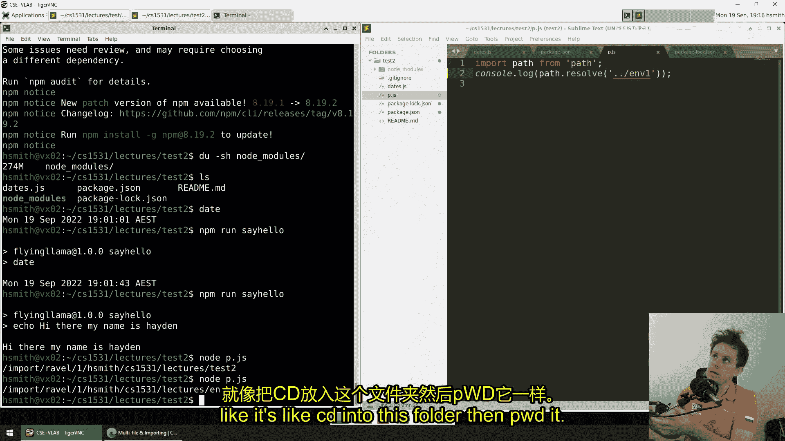
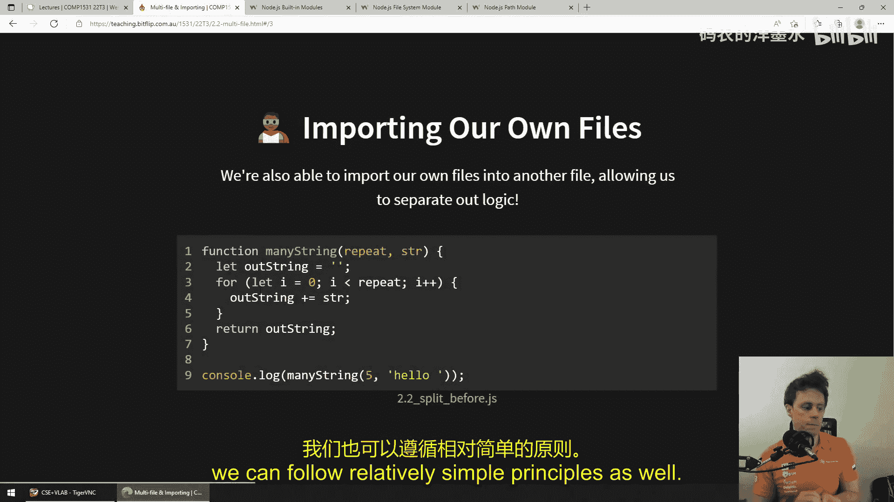
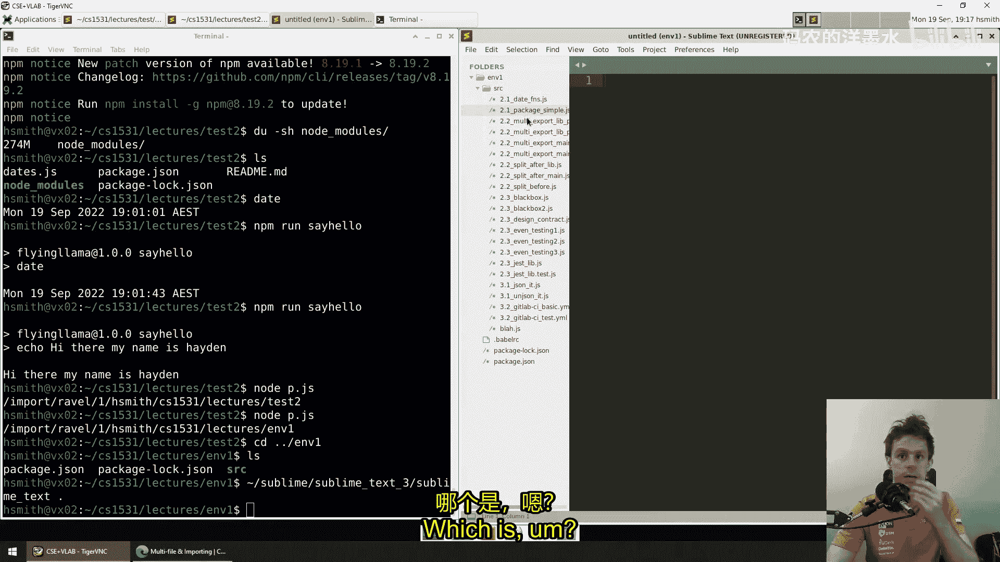
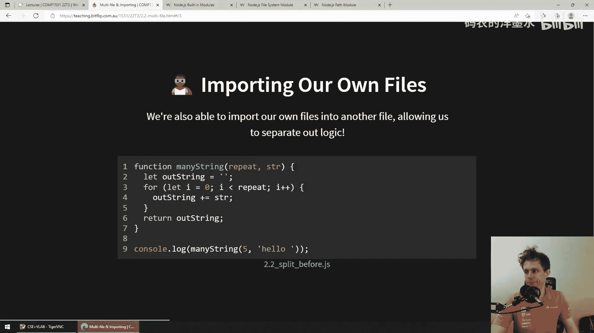
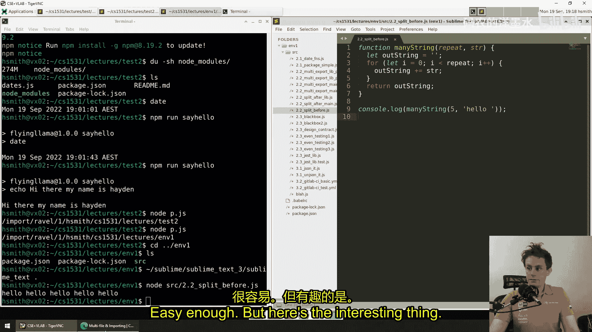
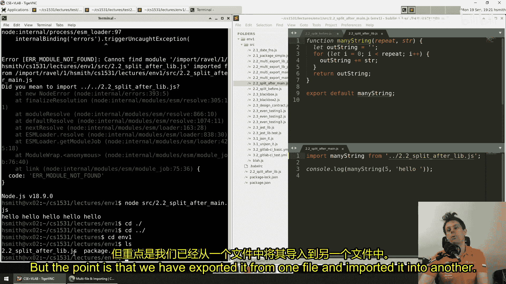
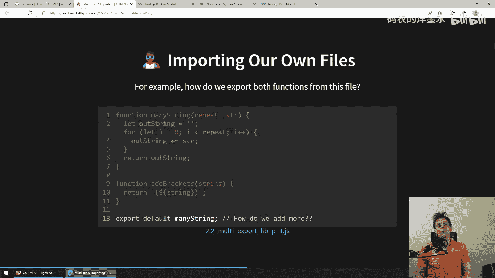
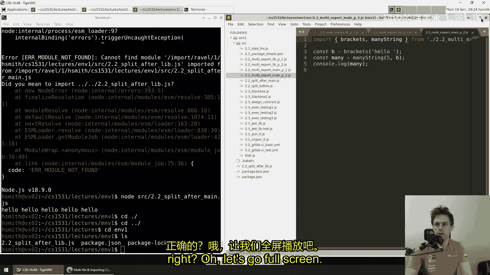

# 005：多文件与导入 📚

在本节课中，我们将学习如何在JavaScript项目中处理多文件代码，以及如何在不同文件之间导入和导出功能。这是构建大型、可维护软件项目的基础。


上一讲我们介绍了使用NPM管理外部库。本节中，我们来看看如何组织我们自己的代码文件。


## 与C语言的简单对比 🔄

在C语言中，我们使用 `#include` 来引入像 `stdio.h` 这样的内置库。JavaScript也有类似的内置库，但导入方式不同。

Node.js自带了一系列内置模块，无需通过NPM下载即可使用。例如，`fs` 模块用于文件操作，`path` 模块用于处理文件路径。


在C语言中，`#include` 指令会在预处理阶段将库文件内容“复制粘贴”到当前文件中。而在JavaScript中，导入更加明确：我们从一个模块中获取一个特定的对象或函数。






**代码示例：导入 `path` 模块**
```javascript
import path from 'path';
console.log(path.resolve('./m1'));
```
这段代码导入了 `path` 模块，并使用其 `resolve` 函数来获取一个路径的完整绝对路径。你可以将其理解为在命令行中先 `cd` 到该目录，再执行 `pwd`。






## 导出我们自己的代码 📤



当我们编写自己的函数并希望在另一个文件中使用时，就需要用到导出和导入。


以下是一个简单的例子。假设我们有一个文件 `2.2_split_before.js`，其中定义了一个函数：

**代码示例：定义并导出一个函数**
```javascript
// manyString 函数：将字符串重复指定次数
function manyString(repeats, str) {
    let result = '';
    for (let i = 0; i < repeats; i++) {
        result += str + ' ';
    }
    return result;
}

// 导出这个函数，使其可用于其他文件
export default manyString;
```
`export default` 关键字表示这个文件默认导出一个东西（这里是 `manyString` 函数）。



## 导入我们自己的代码 📥



在另一个文件中，我们可以导入并使用这个函数。


**代码示例：导入并使用函数**
```javascript
// 从同目录下的 ‘2.2_split_before.js’ 文件中导入 manyString 函数
import manyString from './2.2_split_before.js';
console.log(manyString(5, 'hello'));
```
运行这个文件，它将输出重复5次的“hello”。




如果被导入的文件位于不同目录，需要在导入路径中指明。例如，`../` 表示上一级目录。


## 导出多个功能 🧩


通常，一个文件会包含多个有用的函数。这时，我们可以使用“命名导出”来导出多个项目。


以下是导出多个函数的方法：

**代码示例：命名导出多个函数**


```javascript
function manyString(repeats, str) { /* ... */ }
function addBrackets(str) { return `[${str}]`; }
// 使用花括号 {} 进行命名导出
export { manyString, addBrackets };
```
注意，这里没有使用 `default` 关键字。


## 导入多个功能 🧠


相应地，在导入时，也需要使用花括号来指定要导入的具体项目。

**代码示例：导入多个命名导出**


```javascript
// 从指定文件导入多个函数
import { manyString, addBrackets } from './2.2_multi_export_lib_p2.js';
let b = addBrackets('Hello');
let result = manyString(3, b);
console.log(result); // 输出: [Hello] [Hello] [Hello]
```
你必须使用导出时定义的准确名称进行导入。

## 默认导出 vs. 命名导出 ⚖️


现在我们来深入理解两种导出方式的区别和选择。

**默认导出 (`export default`)**
*   一个文件只能有一个默认导出。
*   导入时可以为其指定任意名称。
*   **公式：** `export default thing;` -> `import anyName from ‘./file.js’;`


**命名导出 (`export { thing1, thing2 }`)**
*   一个文件可以有多个命名导出。
*   导入时必须使用导出时的确切名称（但可以通过“别名”重命名）。
*   **公式：** `export { thing1, thing2 };` -> `import { thing1 as newName1, thing2 } from ‘./file.js’;`


一般来说，**更推荐使用命名导出**，原因如下：
1.  **可扩展性**：未来添加新的导出项时，无需改变已有的导入方式。
2.  **明确性**：导入时必须使用准确名称，代码意图更清晰，有助于工具（如IDE）提供更好的支持。
3.  **避免命名冲突**：虽然默认导出可以重命名，但这有时会让代码更难以理解，尤其是当它偏离了社区或库的通用命名约定时。

编程中一个常见的误区是为了“聪明”或“简洁”而引入自定义的快捷方式或重命名，这往往会降低代码对团队中其他成员（或未来的你）的可读性。清晰和遵循惯例通常比微小的便利更重要。


## 关于代码风格与效率的提示 💡

当需要从同一个模块导入很多项目时，为了保持代码整洁，可以将其分行书写：

**代码示例：多行导入**
```javascript
import {
    functionA,
    functionB,
    constantC,
    ClassD
} from './myModule.js';
```
关于代码风格，我们将在后续课程中详细讨论。现代JavaScript引擎非常智能，通常不需要为了微小的性能优化而牺牲代码的清晰度。**始终将代码的人类可读性放在首位。**

## 总结 📝

本节课中我们一起学习了JavaScript中多文件项目的组织方式：
1.  使用 `import ... from ‘module’` 来导入内置模块或第三方库。
2.  使用 `export default` 在文件中导出一个主要功能。
3.  使用 `export { a, b, c }` 在文件中导出多个功能。
4.  使用 `import { a, b } from ‘./file.js’` 来导入其他文件中的命名导出。
5.  理解了默认导出和命名导出的区别，并认识到在大多数情况下，命名导出是更可扩展和明确的选择。


掌握这些导入/导出机制是构建模块化、易于维护的JavaScript应用程序的基石。