# 014：HTTP服务器 part2 🚀

## 概述
在本节课中，我们将继续学习HTTP服务器，重点探讨Web API的概念、RESTful API的设计原则，以及如何使用Node.js和Express框架构建一个能够处理不同HTTP方法（GET, POST, PUT, DELETE）的服务器。我们还将学习如何使用API客户端和代码库与服务器进行交互，并最终将这些知识应用于编写HTTP测试。

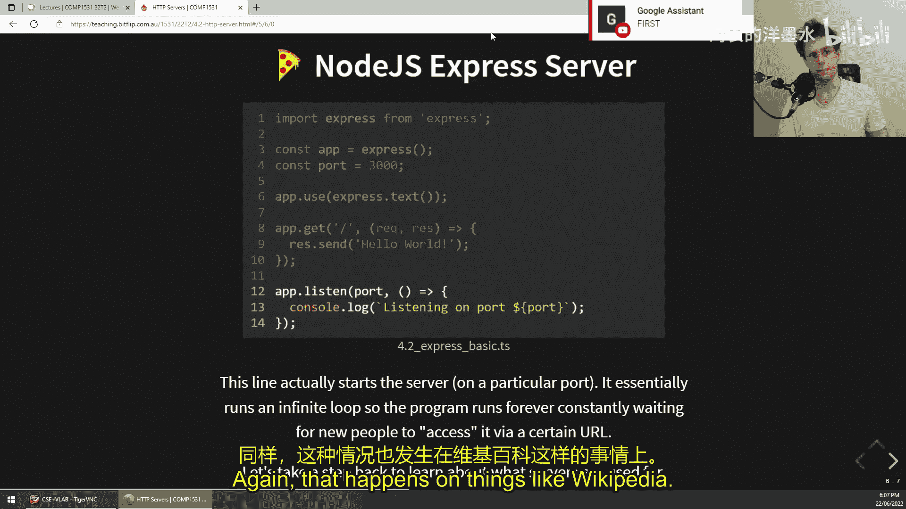

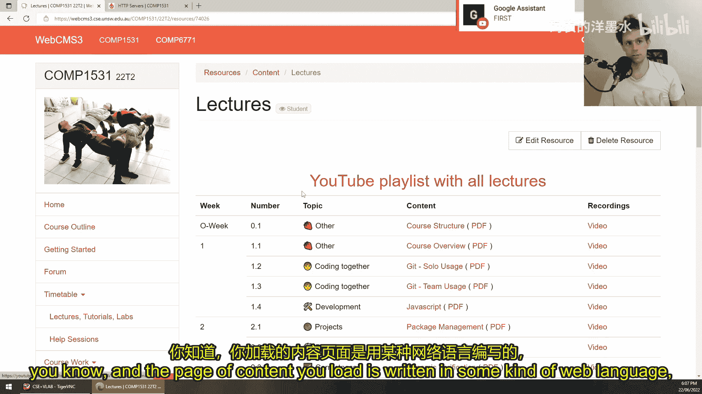

---

## 快速回顾
在上一讲中，我们创建了一个基础的Node.js Express服务器。它有一个URL端点，当服务器运行时访问该URL，会从服务器返回一些信息，具体来说是一个基于文本的消息。

上一讲幻灯片的内容主要是为了让大家理解Web服务器的一种非常常见的用途。

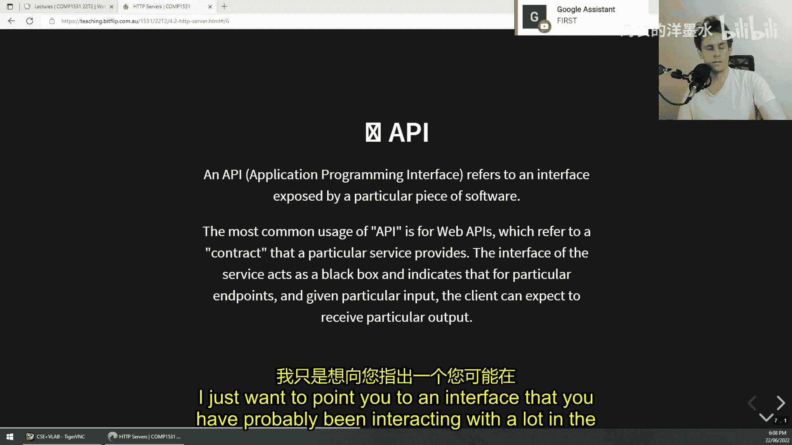

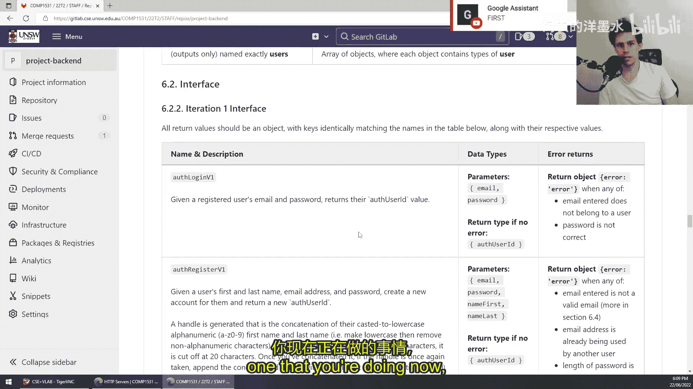

## Web服务器的两种主要用途
这是一个非常概括的说法，但你会看到Web服务器主要有两种用途。

1.  **提供静态内容**。这意味着通过URL获取该URL上的数据。这在互联网上时刻都在发生，例如在维基百科或内容管理系统（CMS）网站上，你通过URL加载一个内容页面，加载的页面是用某种Web语言编写的。

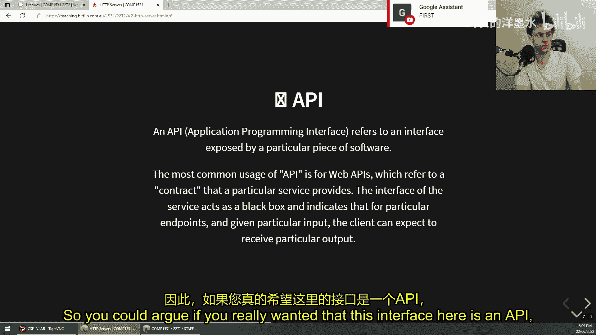

2.  **构建API**。这是Web服务器更通用、更核心的用途。我相信你在学习过程中已经多次听到过API这个词。

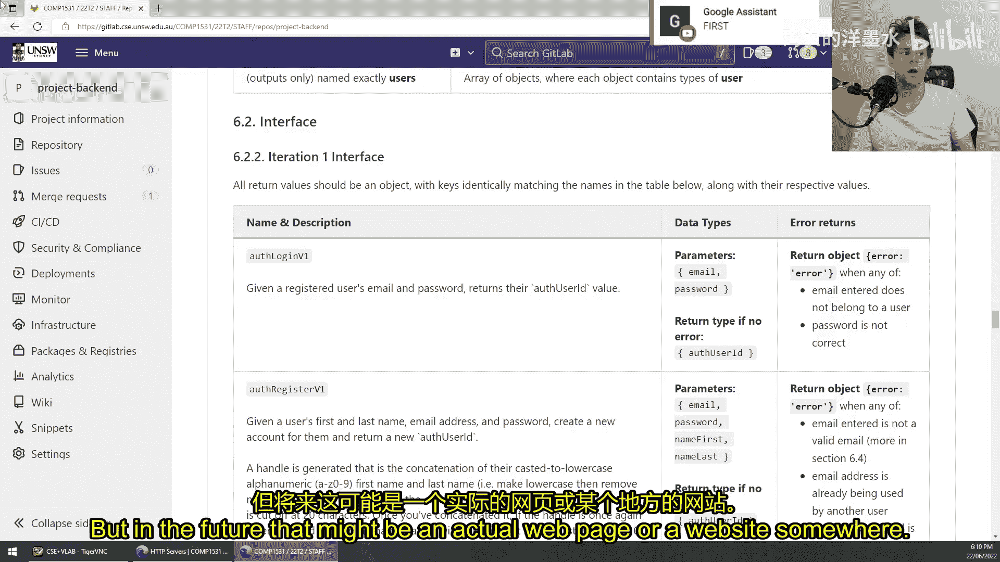

## 什么是API？
API代表**应用程序编程接口**。这个术语非常字面化和概念化。

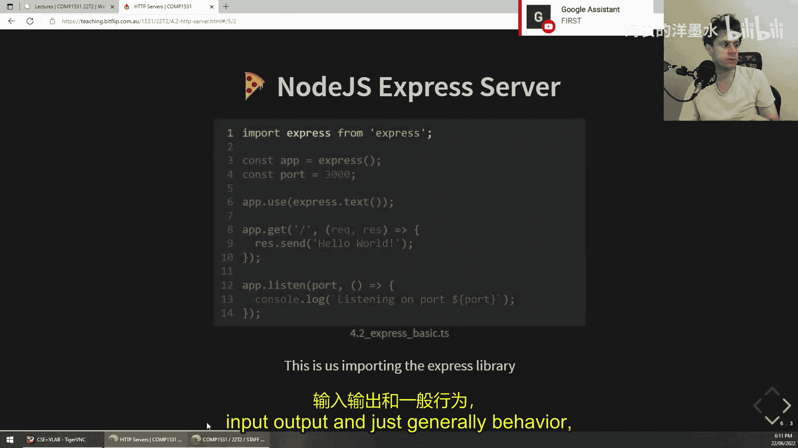

它指的是特定软件暴露出来的一个接口。当我们说“暴露的接口”时，对于处于你们这个位置的大多数人来说，可以理解为就像登录GitLab时看到的那样，它基本上就是一组函数。

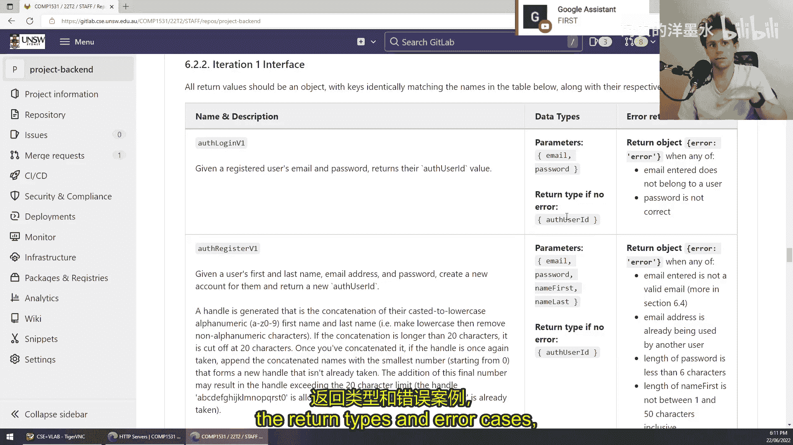

我想指出这一点是因为，在我们进一步抽象讨论之前，我想先指出一个你们最近几天可能一直在交互的接口，那就是你们正在进行的项目。

在当前这个迭代（迭代一）中，我们有一个接口表。这个接口表本质上就是一份契约，规定了特定服务之间的交互方式。

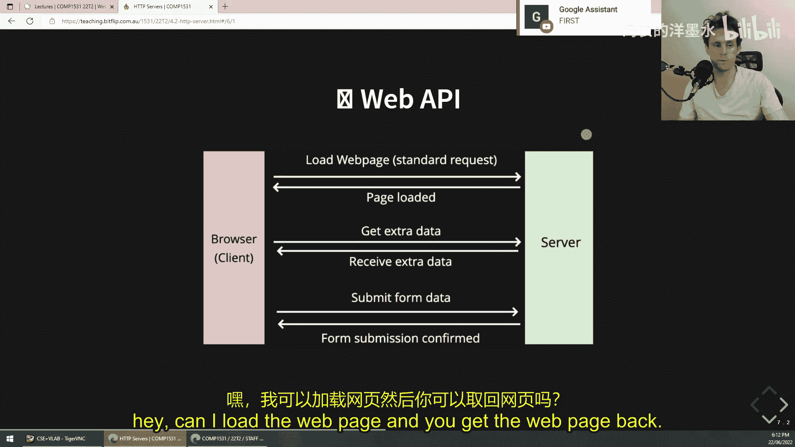

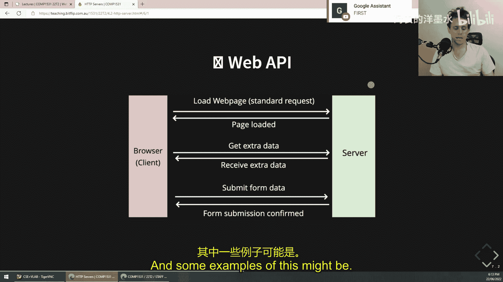

接口实际上就是软件与使用者之间的一份契约。它表明：“我是一段软件（例如1531大项目），我有一些函数，这些函数能完成特定任务。” 契约的一边是使用这些函数的人，另一边是像你们现在做迭代一这样去实现这些函数的人。

API简单来说就是一段软件暴露的接口。因此，你可以认为这个接口表就是一个API。它可能是一个文档不全的API，但它仍然是一个API，因为它是一个软件的抽象，隐藏了实现细节，允许他人知道如何使用它。

在迭代一的上下文中，实际上是你们的测试在使用你们的API。你们有这个接口表（即API），然后去实现后端逻辑，接着有人（也就是你们的测试）会使用你们的代码并尝试用它来运行程序。未来，这可能是一个实际的网页或网站。

**所以，这就是API。**

## Web API
如今，我们看到最常见的API用法是**Web API**。这仅仅是因为API通常存在于以下场景：A创建了一些软件，他们创建了一个易于理解的接口，并构建了所有复杂的后端。然后，B、C、D、E等人使用这个API。这是最常见的情况。

让世界各地的人们使用软件的最简单方式是通过互联网，而利用互联网的最简单方式就是通过我们上一讲讨论的Web。

因此，接口就像一个黑盒，它指明了对于特定的端点，其输入、输出和一般行为是什么。

回到这个接口，以`authLoginV1`函数为例。它告诉你它的功能、参数、返回类型和错误情况，但它并不展示具体的实现，因为你把它当作一个黑盒来处理。

**这就是API。**

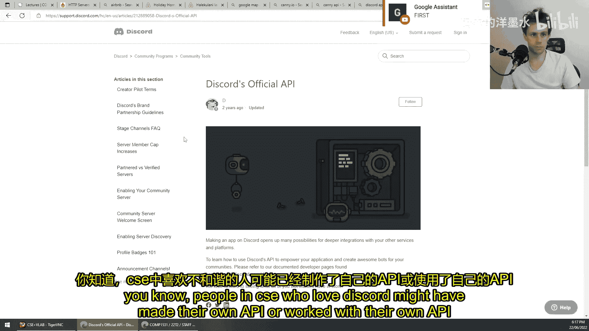

## Web API的世界
在Web API的世界里，事情变得更有趣一些。Web API就是基于HTTP协议（即我们之前讨论的Web协议）构建和发送的API。它完全基于URL，因为HTTP协议就是一堆来回发送的URL。

理解现代应用程序中Web工作原理的一个重要点是：像我现在使用的Microsoft Edge这样的Web浏览器，会向服务器发出请求，说：“嘿，我能加载这个网页吗？”然后你得到返回的网页。这在Web CMS上时刻都在发生，是一个非常简单的例子。我加载页面，页面返回，然后显示在屏幕上。

然而，在初始页面加载之后，如今大多数应用程序的一个非常常见的做法是，它们会通过某种API持续与服务器通信。例如，如果我打开YouTube（这里我没有登录），并使用浏览器中的调试工具，你会看到为了加载这个网页，所有你在这里看到的东西——不同的文件、不同的图片、Mr. Beast的图片、Mr. Bean的图片——这些都是服务器带给浏览器的不同文件。但这不一定与API直接相关。

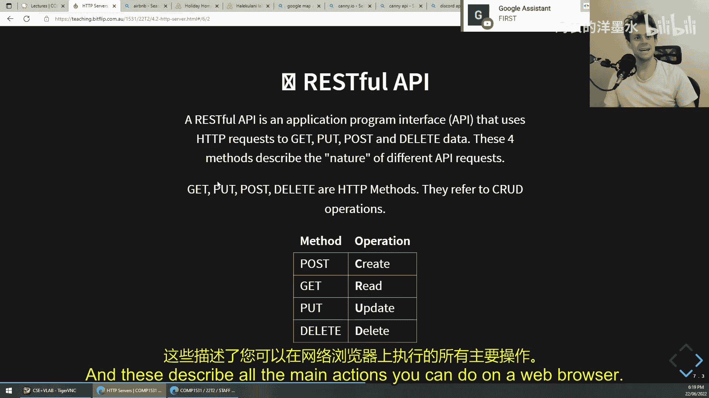

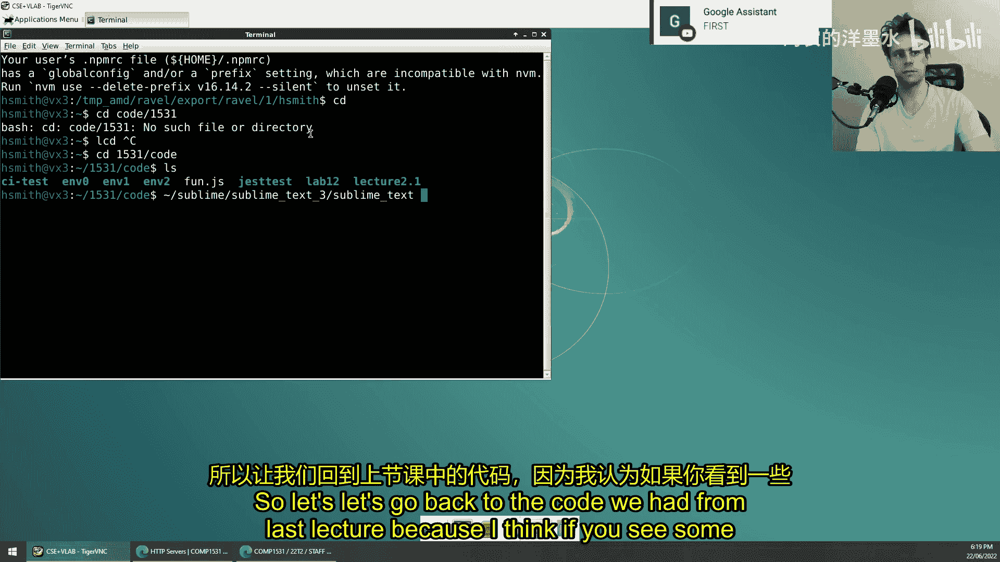

API更有趣的地方在于，如果我点击页面上的某个特定按钮，例如“音乐”，浏览器将不得不与服务器通信以获取更多信息。所以，实际上，YouTube正在与YouTube API对话，它们不断地获取信息。

这并不意味着YouTube必须使用自己的API。一个公司使用另一个公司API的常见例子是Airbnb。当你在Airbnb网站上向下滚动并看到地图时，Airbnb实际上正在与Google API对话。Google拥有像你们大项目那样的Google Maps软件，他们提供了Google Maps API。

想象一下，你是一个软件开发人员，你想创建一个类似Uber的应用，并希望告诉司机去哪里。你可以使用Google Maps Directions API。

我再举一个更简单的例子。有一个很棒的产品叫Canny，它是一个美国的小公司，主要做客户反馈管理工具。如果你开发了一个小产品或项目，你可以使用他们的产品让用户投票他们想要的功能。有趣的是，Canny有一个API。你会发现很多流行的服务都有API。

如果我进入Canny的API文档，你会看到它就像一个论坛，有发帖、评论等功能。如果你想在帖子上创建评论，它会告诉你：“好的，这里有一个函数（本质上是URL）。如果你把HTTP URL看作是函数，会让事情更容易理解。” 然后它会说明参数、参数类型以及返回的内容。

这是一个非常普遍、常见的概念。不仅仅是我们在1531项目中抛给你们的一个想法，在Web服务器的世界里，URL、参数、返回类型等等都是相当标准的。你会发现大多数软件都有这个，比如Google Sheets、Google Docs都有自己的API。

所有这些API文档的核心思想都非常相似。它有一个网站URL，有一些可以接收的字段，告诉你可能返回什么。这基本上就是大量的文档。

## 现代网站的工作方式
回到幻灯片，如今大多数网站的工作方式是：它们加载页面，然后该页面通过某种API不断与服务器通信以获取和收集数据。这就是许多现代网站为你做事的方式。例如，在YouTube上，如果你喜欢一个视频，它只是突然被“点赞”了，但实际上，后台的YouTube网页正在通过API与YouTube服务器通信。这可能是一个公司内部的API。

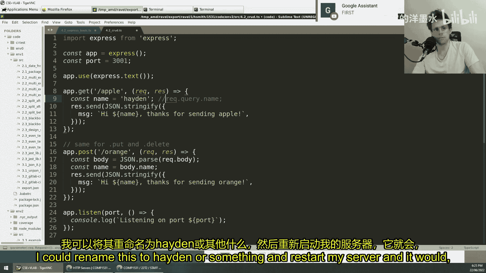

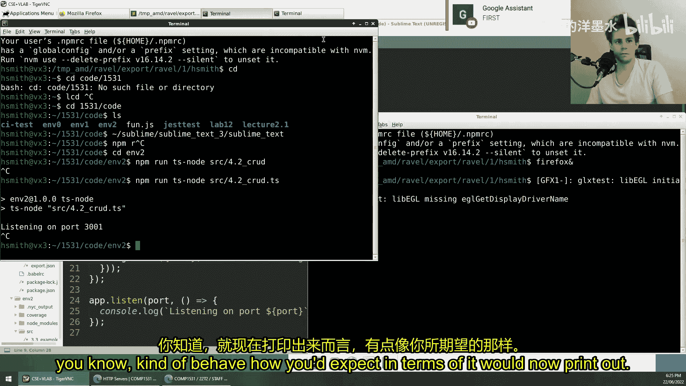

## RESTful API
通过这种基于Web的API进行通信的一种非常常见的方式是构建某种**RESTful API**。RESTful本质上是一个使用四种HTTP请求的API，这四种请求是：**GET**、**POST**、**PUT**、**DELETE**。

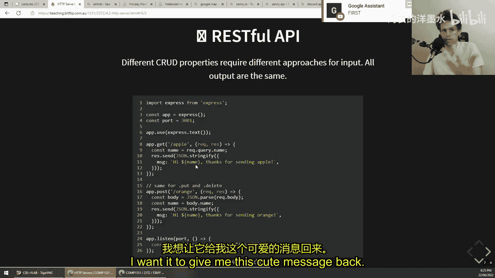

这四种方法描述了你在Web服务器上可以执行的所有主要操作。

让我们回到上一讲的代码，因为如果你看到一些代码，这会更容易理解。这是我们之前的代码，我们有我们的4.2 express basic示例。你注意到我们已经有了这四种类型中的一种，即GET请求。

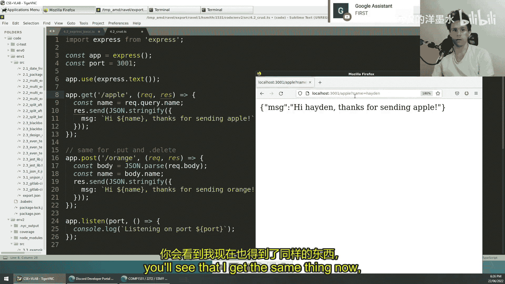

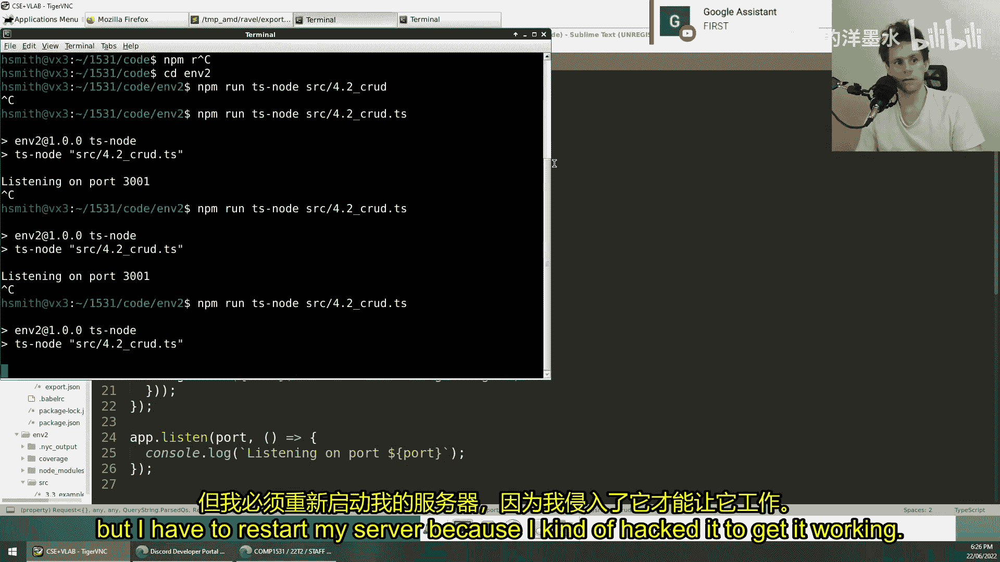

这里的`app`是我们的Web服务器。当我们说`app.get(...)`时，我们实际上是在告诉Web服务器，我们想要发出一种特定类型的HTTP请求。记住，HTTP是用于在Web上进行通信的协议。

但有四种主要的方法被使用：GET、POST、PUT、DELETE。这四种方法合起来基本上意味着：GET表示读取（很合理，就像“获取”一样），POST表示创建，PUT表示更新，DELETE表示删除。

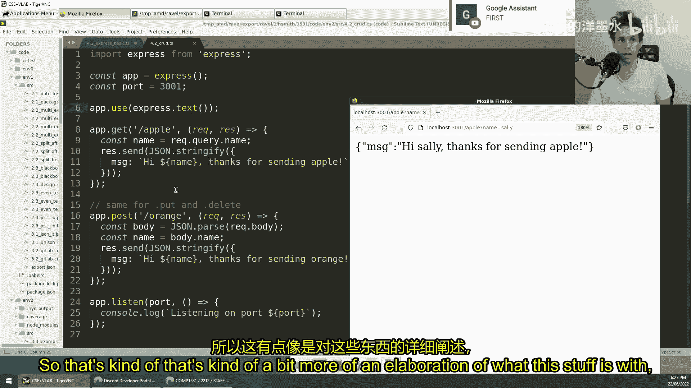

我们有时将这四种操作称为**CRUD操作**（创建、读取、更新、删除）。所以有时你会说“我有一个RESTful API，只是做一些基本的CRUD操作”，这实际上意味着你正在像这样使用POST、GET、PUT和DELETE。

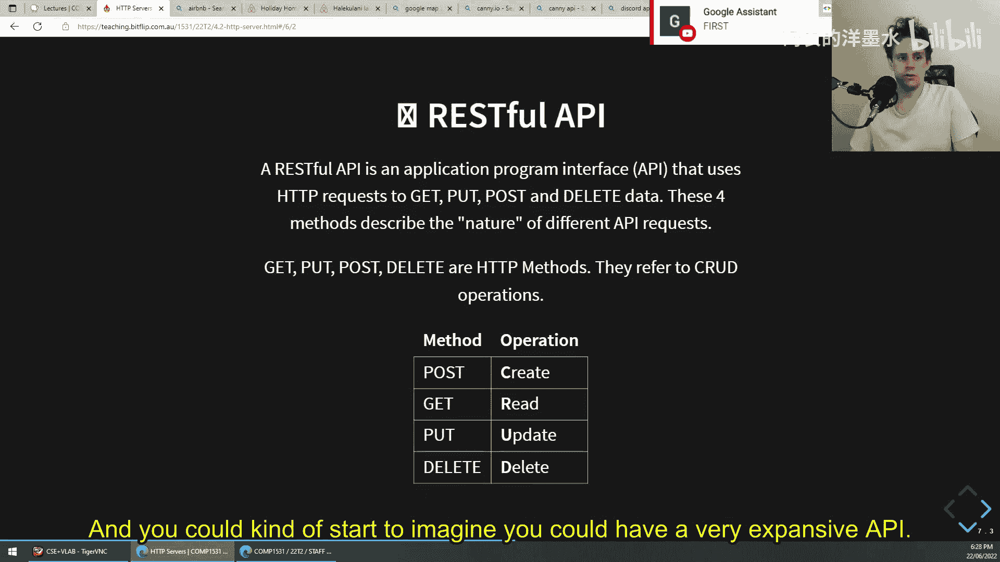

现在，当我们看这个特定的服务器时，我们会更多地讨论这些方法的含义。但首先，为了让你入门并深入一点，很常见的情况是，你会有一个服务器，上面有一堆GET请求，可能还有一些POST请求、DELETE请求等等。你有了这些GET、POST、PUT和DELETE方法。

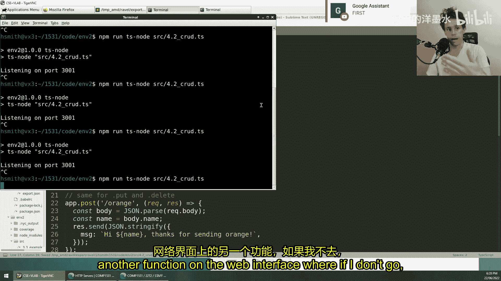

你可能会想，这四种东西是什么，它们有什么不同？这些操作本身在本质上并没有严格的含义，它们更像是一种约定。就像有时你用大写字母创建常量变量，有时用小写字母。一个你打算不被修改的变量实际上可能被修改，但我们使用约定来表述和沟通事物。

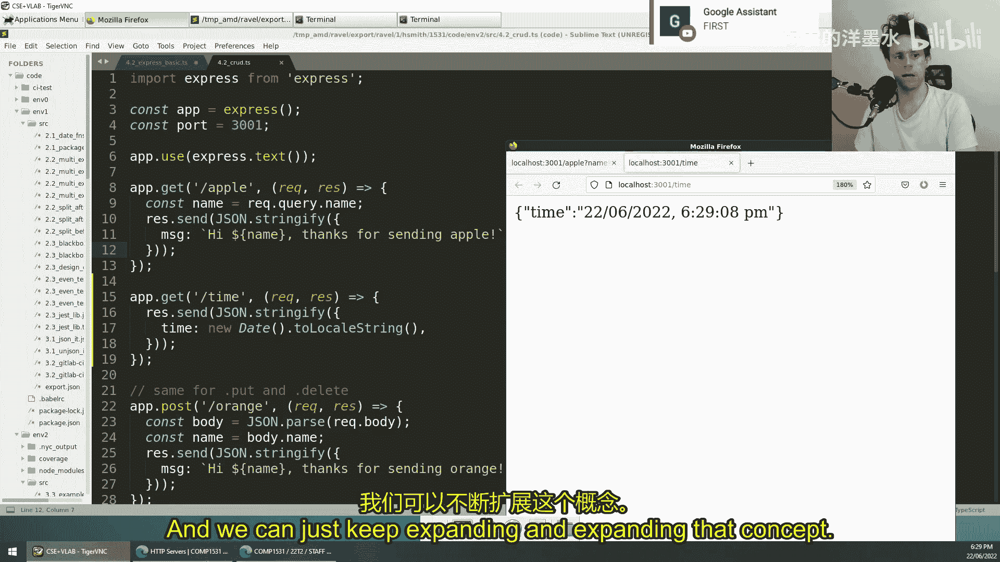

所以，并不是说这里的GET请求在“不能修改任何东西”的意义上是完全只读的，因为任何事情都可能发生。作为程序员，你完全可以让一个GET请求去删除整个网站。这更多的还是一种约定。

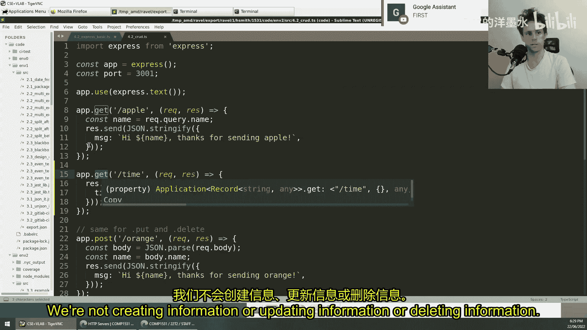

## 查看代码
让我们看一些代码，我知道这对一些人来说可能有点难以理解。

我们有一个非常基础的服务器，它做了一些非常有趣的事情，实际上是上一个服务器的扩展。让我指出一些关键的区别。

首先，我有两个HTTP路由（我们称之为路由），即`/apple`和`/orange`。这意味着如果我访问`http://localhost:3001/apple`（因为我们在3001端口运行），在浏览器中输入这个URL并且服务器正在运行，它就会找到这个特定的函数。然后，函数内部的代码将被调用和执行。

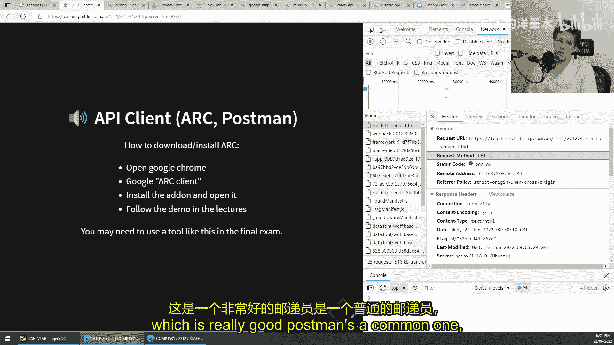

你会注意到，我的GET请求`/apple`，如果我们启动它，然后访问这个URL，你会看到我得到了一个有趣的响应，它说“Hi undefined, thanks for sending apple”。

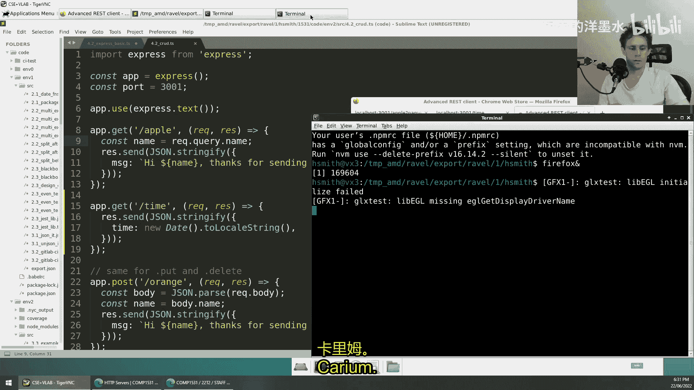

我回到代码中查看，发现`const name = request.query.name`。然后你会看到我正在发送一些东西回去，但如果你记得第一个例子，我发回的是一个字符串（一段文本），而这里我发回的是一些JSON。我抓取这个对象（一个包含键值对的对象），键是`message`，值是字符串“Hi ${name}, thanks for sending apple”。然后我使用`JSON.stringify`把这个对象转换成字符串，因为互联网不理解JavaScript对象，但它理解ASCII。通过JSON进行字符串化，我可以将我正在做的事情转换成ASCII，这非常有用。

所以这很合理，和上一个例子非常相似。我不是返回原始文本，而是返回一些其他文本的JSON字符串版本。

然后你会看到，名字我可以重命名为Hayden之类的，重启服务器后，它会按预期运行，输出与Hayden相关的内容，而不是undefined。但我们不想让它固定是Hayden。

那么，这个`request.query.name`是什么呢？Web的工作方式是，某些类型的请求（如GET请求）如果想要路由接收信息，因为也许当我调用`/apple`时，我希望它根据输入返回一个友好的消息，但我如何输入呢？这不是一个函数，我不能直接在这里添加一个参数。我尝试过，但那行不通。

在基于Web的交互中，我们传递变量的方式是通过URL。你可能经常看到这种情况。如果我说`localhost:3001/apple?name=Hayden`，问号后面的信息基本上就是函数参数。

当我运行这个时，你会看到我得到了相同的结果（但这次我必须重启服务器，因为我之前修改了代码）。当我刷新时，它现在可以工作了。如果我把名字改成Sally，它现在会说Sally。

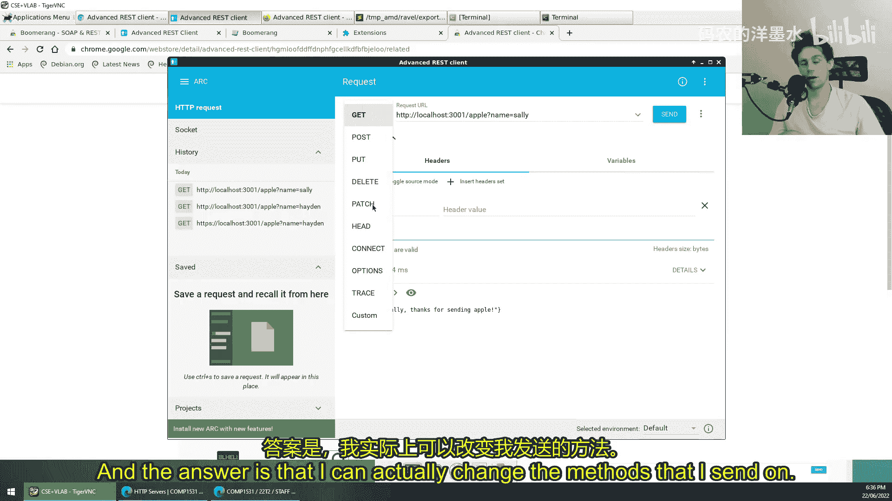

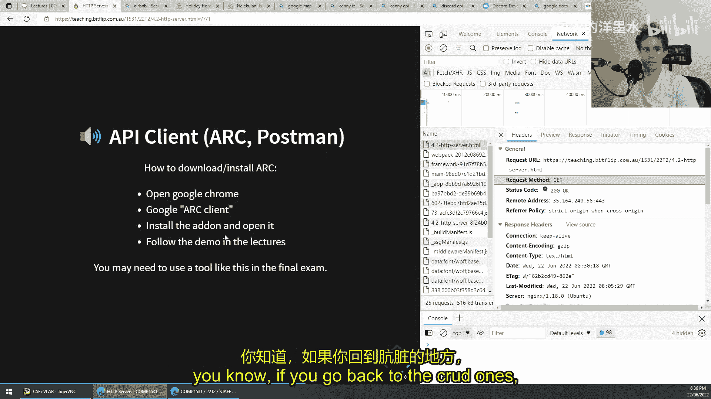

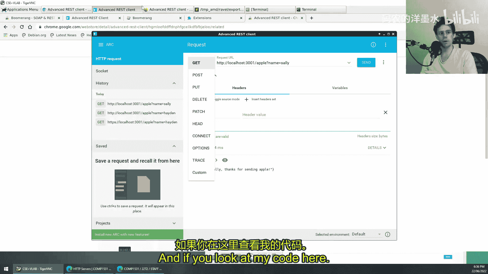

真正有趣的是，你已经开始看到这是如何形成的：我不再是拥有带参数和返回类型的函数，而是拥有一个URL，它基本上就是一个函数名。那个URL也通过URL接收参数，然后它向网页返回某种结果，在这个例子中只是一个字符串，在大多数情况下是某种字符串。

这实际上是API的基础。你会发现大多数Web API的结构在很多方面都与这非常相似，因为它实际上就是一组URL的集合，接收参数，然后返回某种字符串响应。

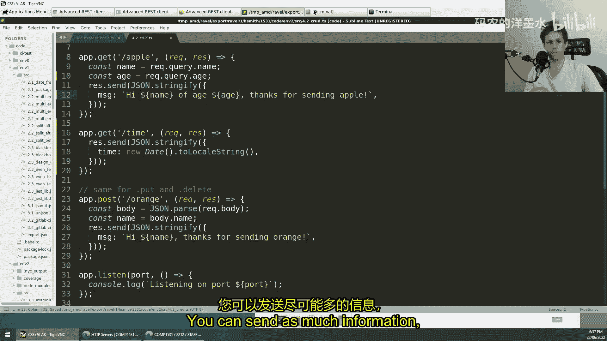

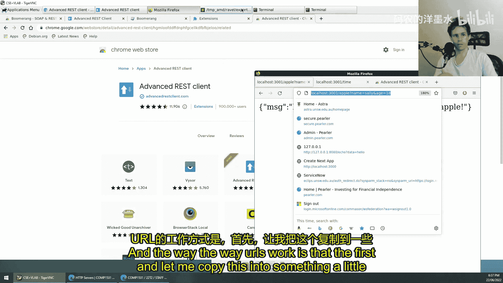

如今，这些字符串响应通常基于JSON，因为正如你在3.1讲（关于数据交换格式和标准接口）中回想起来的那样，这是一种简单的方式，无论服务器是用C、JavaScript、Python还是Java构建的，你总是可以发送回信息，这是一种每个人都理解的语言。所以，如果前端有一个不用Java运行的程序，你仍然能够解析这些信息。

这就是关于API的更多阐述。你可以开始想象你可以有一个非常庞大的API。例如，想象我创建另一个叫做`app.get('/time')`的路由，然后在里面，我只需要发回一个字符串化的JSON对象，对象里包含`time`键，其值是`new Date().toLocaleString()`（一种友好的字符串格式）。

现在我重启服务器，我创建了另一个路由，或者说是Web接口上的另一个函数。如果我不去`/apple`，而是去`/time`，它实际上会给我时间。当我刷新时，我得到新的时间。

这非常方便，因为现在你可以想象我们正在构建一个API，这个API现在有一个时间路由或时间函数。没有参数，它是一个无参数、无参数的函数，但它返回一些东西，那个东西也是一个字符串。

我们可以不断扩展这个概念。

## RESTful API的有趣之处
现在，RESTful API的有趣之处在于，并非所有东西都只是GET方法。我们还有这些其他方法：POST、PUT和DELETE方法。

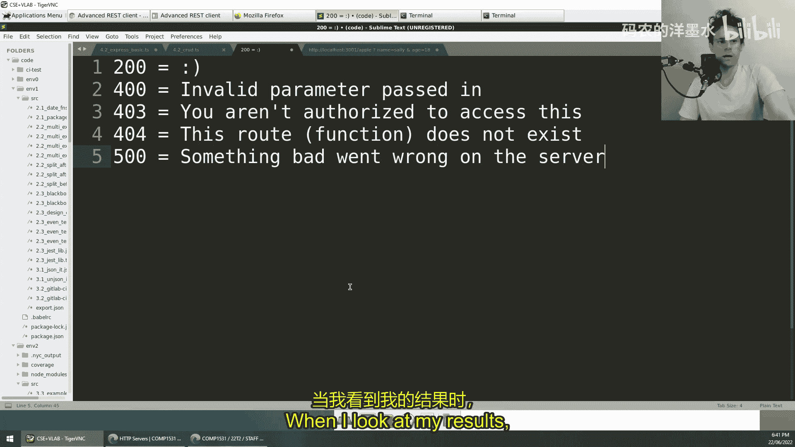

同样，GET意味着读取。所以我们这里的两个路由`get /apple`和`get /time`，都是我们在读取一些信息，我们没有创建、更新或删除信息，我们只是在读取它。

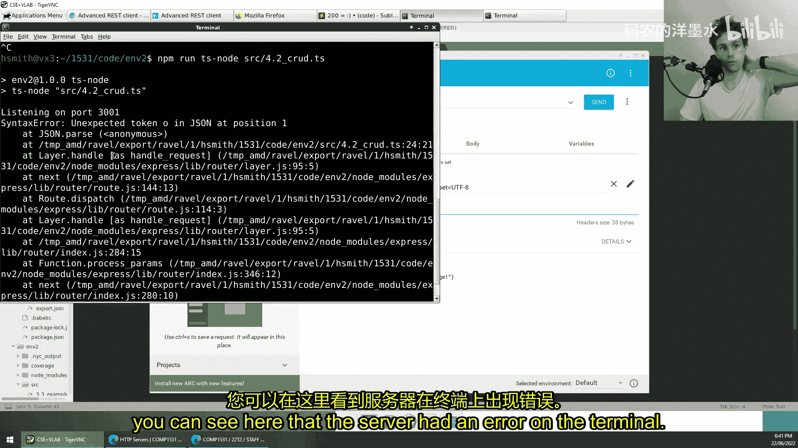

## 浏览器与HTTP方法
然而，大多数Web浏览器，就用户（像你和我）可以通过输入URL来使用的功能而言，总是通过GET发送请求。这就是它们构建的方式。所以，当你在地址栏中输入一个网站或URL并按下回车时，它会为你向该特定URL发出一个GET请求到服务器。

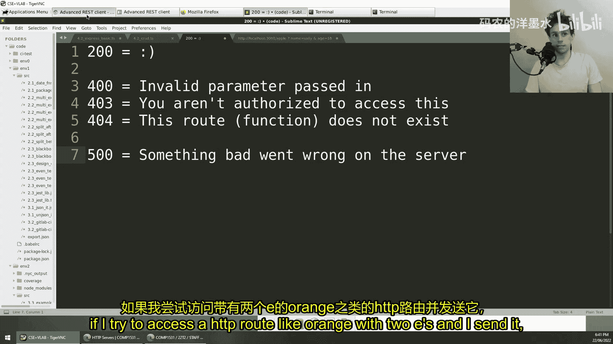

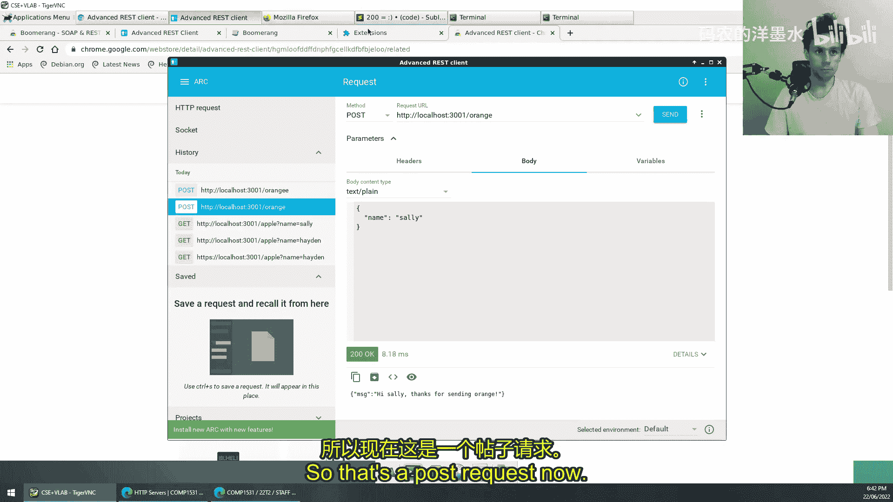

我可以通过再次打开网络标签页并刷新来轻松看到这一点。如果我看第一个请求，你可以看到它是一个GET请求。你不需要看我下面显示的任何信息，那些完全不相关。但正如你所见，它始终是GET请求。

为了与Web服务器进行比浏览器（功能相当有限）所能做的更有趣的对话，我们实际上需要以某种方式与它交谈。

## 与Web服务器通信的三种方式
在本课程中，我们讨论了三种与Web服务器通信的主要方式：
1.  通过**API客户端**（本质上是一个为与API对话而设计的工具）。
2.  通过**Web浏览器**（我们到目前为止已经演示过）。
3.  通过一个**NPM库**（本质上是一个帮助你发出请求的编码库），这对迭代二非常有用。

## API客户端
在API客户端方面，API客户端只是一个用于与API对话的程序。有很多这样的程序。我在工作中使用一个叫Insomnia的，它很好用。Postman是一个常见的。我们在1531中通常推荐一个轻量级的叫ARC（高级REST客户端）。

你可以在大多数基于Chrome或Firefox的浏览器上安装这些。例如，在Chrome中搜索“ARC add-on”就可以找到。它像一个浏览器应用程序一样运行，所以你不需要安装到系统，它通过Chrome引擎运行。

还有其他客户端，比如Postman API，但有时它们会停止通过Chrome插件库提供服务，转而作为专用应用程序提供，就像你下载到电脑上的那样。

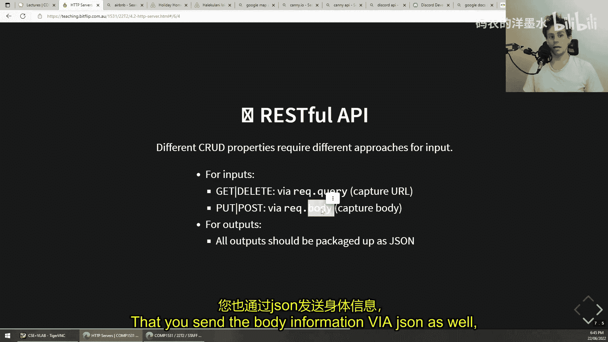

使用这些API客户端，你可以输入URL和参数。例如，我可以输入`localhost:3001/apple?name=Hayden`，点击发送，就会得到结果“Hi Hayden, thanks for sending apple”。如果改成Sally，它就说Hi Sally。

这就像一个可以轻松完成这些操作的小工具。你可能会想，这和Web浏览器有什么不同，或者这有什么令人兴奋的？答案是，我实际上可以改变我发送请求的方法。在ARC里，我可以选择通过POST、PUT或DELETE发送。

如果你看我的代码，你会看到在我的服务器中，我还有一个POST方法叫做`/orange`。`/orange`做的事情类似，但也略有不同。它仍然返回“Hi so-and-so, thanks for sending orange”。但我在这里消费信息的方式有点不同。

这就是事情变得奇怪的地方。你会注意到，对于GET请求，我通过URL消费信息。`request`是传入的消息，`query`是URL参数，`name`是它的一个属性。为了更清楚，我也可以发送多个东西，比如`name`和`age`，然后修改我的字符串。

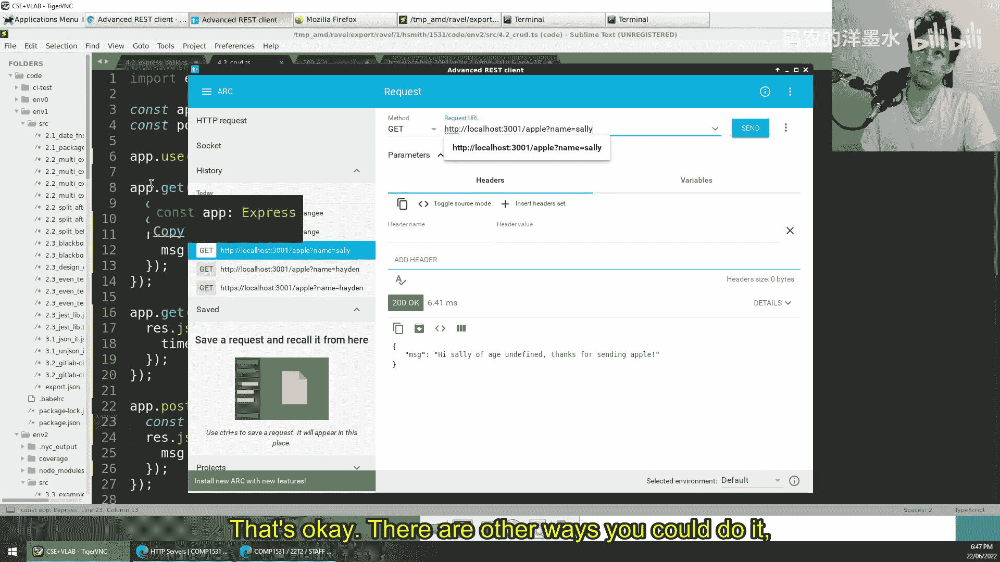

你可以通过URL发送很多信息，只需在后面添加更多信息。URL的工作方式是：数据通过问号与路径分离。URL由协议（HTTP）、域名（或通常所说的网站）、端口（在生产服务器上通常是相同的，所以使用互联网时通常不需要）组成，然后我们称这里为路径（类似于函数名），接着是数据。数据只是`key=value`的形式，对于每一段数据，我们使用`&`符号来分隔。

所以我们可以这样添加更多信息。但是，当涉及到像这里看到的POST请求时，我们不是通过`query`捕获信息。这是因为对于POST请求，我们通过所谓的**请求体**发送信息，这可能是一个新概念。

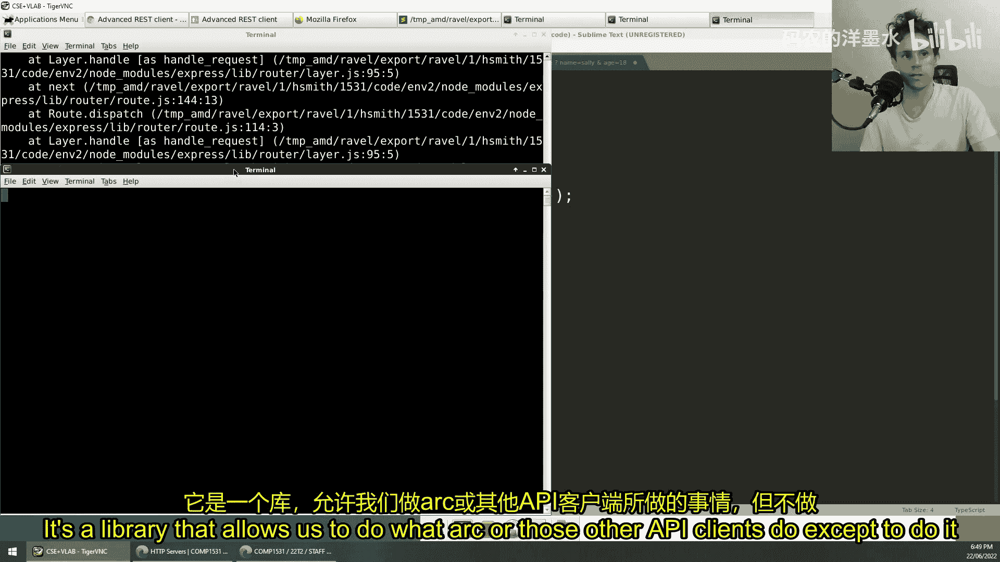

所以，如果我要向`/orange`发出POST请求，我不需要任何查询参数。但如果我想发送信息，比如名字，我实际上必须转到这里的“Body”部分，并且发送一些JSON。例如，JSON会说`{"name": "Hayden"}`。

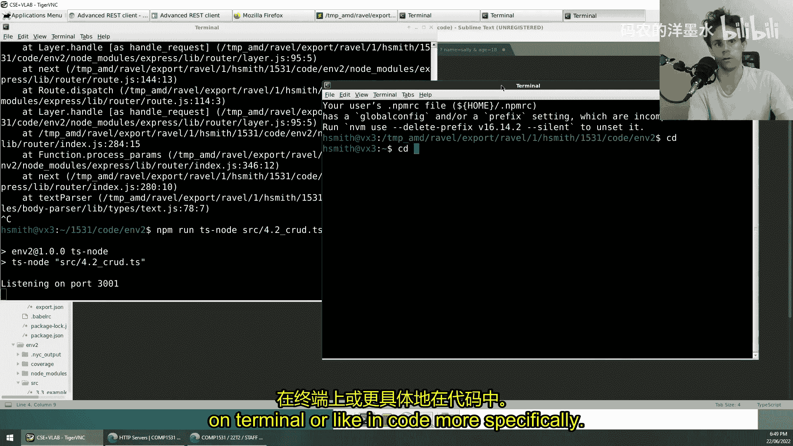

所以，我不是把它放在查询字符串里，而是现在把它放在请求体里。你可以这样理解请求体：把HTTP想象成一封信。我写一封信：“Hi Gab，很高兴在1531讲座中见到你，真是段美好时光。” 我把信装进信封，写上地址和回信地址。这个类比并不完美。

使用查询字符串，就像在GET请求中把数据放在URL里，是在地址上添加更多信息。它是公开可见的，就在那里，非常简单，你不必打开信封塞进更多数据。

而把它放在请求体里，就相当于把它放在信封里的信里面。在互联网上发送信息时，通常邮局工作人员可以看到你把邮件寄到哪里，但他们不知道里面是什么。我在这里简化了一些事情，但这就是我们通过请求体发送信息时所做的事情。

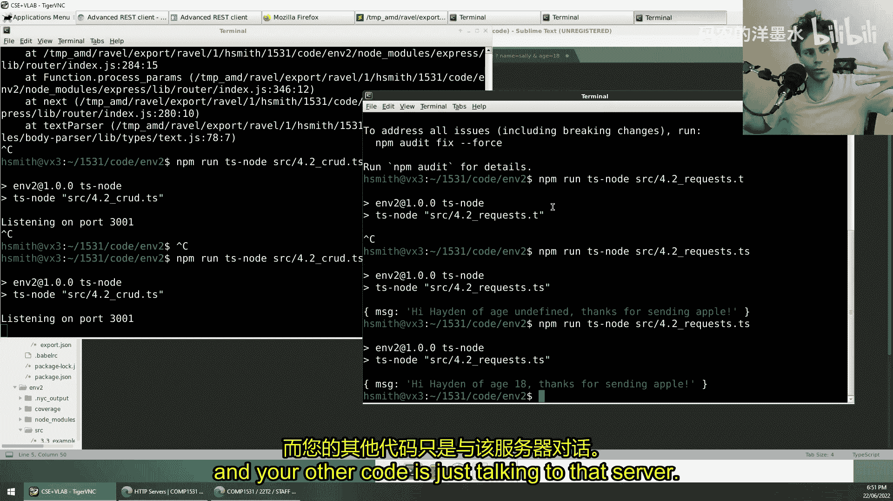

当我点击发送时，我可能会得到一个错误，因为我的代码可能有错误。你会注意到，当我调用这个Sally的URL时，我得到了一个绿色的小标记，写着“200 OK”。在Web开发中，你会看到一些非常重要的错误代码：
*   **200**：成功。
*   **400**：基本上意味着传入了无效参数。
*   **403**：表示你未被授权访问此资源。
*   **404**：表示此路由不存在。
*   **500**：表示服务器端出了严重问题。

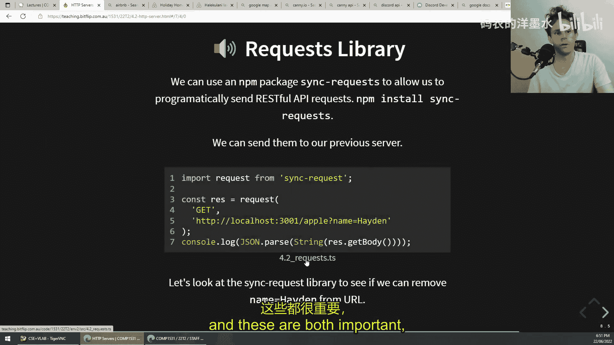

所以，当我查看结果时，这个（GET请求）是200 OK。但当我调用`/orange`路由时，我得到了一个500错误。那个500错误基本上是说服务器有错误。实际上，如果我回到错误信息，你可以在终端上看到服务器有错误。

你会注意到这些错误代码的逻辑划分很清晰：200系列表示一切正常；500系列表示服务器（也就是你在这门课程中写的代码）犯了错误；400系列表示向服务器提供信息的人（客户端）做错了什么。

例如，如果我尝试访问一个拼写错误的HTTP路由，比如`/orangee`，我会得到404错误，这意味着我，这个试图与你的服务器对话的人，犯了错误。如果我做对了，那么就是200成功。同样，我也可以把请求体里的名字从Hayden改成Sally，我们会看到新的请求过来，并说“Hi Sally, thanks for sending orange”。

这就是一个POST请求。

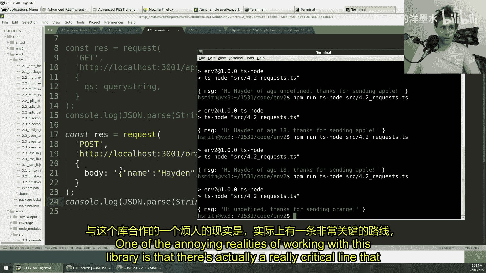

## HTTP方法的语义
现在，如果你在注意听，你可能会记得我们之前说过GET请求是关于读取，POST请求是关于创建，PUT请求是关于更新，DELETE请求是关于删除。你可能会想：“Hayden，但你并没有创建任何东西。你在这里发了一个POST请求，但你没有实际创建任何东西，你只是打印出了名字。”

你是对的。因为如果我们再往下滚动，POST请求实际上并不强制你做任何事情。它们只是通信工具。所以我的这个POST请求可能应该是一个GET请求，我应该把它重命名为GET请求，因为我没有创建、更新或删除任何东西，我只是在读取一些东西。

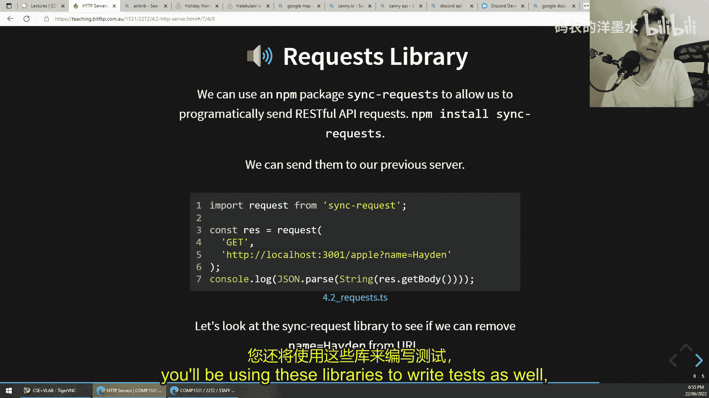

所以，这非常重要。这四个关键词是指示性的，它们不是强制约束，在很多方面也不是技术术语。关于它们有一些细节，但“正确使用”它们更多是基于约定，而不是服务器有严格的技术限制。服务器不会说：“嘿，你说这是只读的，但你现在修改了东西。”

## 代码示例与总结
这是我们刚刚看过的代码片段。我们谈了一点关于使用`query`，也谈了一点关于使用`body`。基本上，HTTP和CRUD的设置方式（这实际上已经有点固化了）是：**GET和DELETE请求不接收请求体**，你倾向于像函数参数一样通过URL向它们发送信息。所以，当你调用GET或某种DELETE请求时，信息会通过URL传来。

而当你有一个PUT请求或POST请求（我们看到了一个POST请求）时，你通过请求体发送信息，就像你在ARC上看到的那样。

所有这四种请求（GET、DELETE、PUT、POST）都将通过JSON发送数据回来。同样，这不是服务器的要求，只是你所说的常见约定。你会发现外面大多数API（我敢说99%以上）都会返回JSON。

同样，我有点略过的是，通常大多数服务器会期望你也通过JSON发送请求体信息。我们隐含地做到了这一点。如果你看我的请求体，这是有效的JSON。在这个例子中，我们以文本形式发送它，我们只是通过互联网发送一个字符串。一旦我们的服务器捕获到它，它就用`JSON.parse`解析那个字符串。它获取请求体，并将其解包成JavaScript对象。这就是我们从`body`得到的东西，然后我们从那个对象中取出`name`。所以这里的`body`是一个带有一个键的对象。

我提到过，99%的API都用JSON，总是返回JSON，而对于POST和PUT操作，它们通过请求体接收JSON。因为有人意识到每个人都在这么做，所以对Express做了一些修改。

如果你的服务器几乎只处理JSON，你可以将服务器从处理文本改为处理JSON。同样，当你使用`response.send`时，你不必说“我想让你发送文本，并且那个文本是JSON化的JavaScript对象”，你可以直接说`response.json(...)`。本质上，Express会为你做同样的事情。它会说：“哦，谢谢你的JavaScript对象，我会为你把它转换成JSON并发送回去。”

第三，对于PUT和POST请求，如果你在代码顶部有`app.use(express.json())`这一行，你就不必做`JSON.parse`。通过将处理方式从文本改为JSON，你本质上告诉了Express你得到的所有输入都是JSON格式。所以当你获取`request.body`时，Express实际上会为你解析它，并把它变成一个JavaScript对象，这非常好。

所以你会看到，当我停止并再次运行它时，我会得到相同的结果。只是我写了更少的代码，这很好。我再次运行那个，运行良好。GET请求也运行良好。对于GET和DELETE的输入，你不需要对JSON做任何处理，它们只是像这样通过URL传递。这样没问题，还有其他方法可以做到，但这只是我们在这门课程中教你的方式。

这些是与前一个例子相比发生改变的关键代码行。

## 使用NPM库进行HTTP请求
现在，让我们进入一个更令人兴奋的部分，也是你们可能会经常用到的部分：一个允许你发出HTTP请求的实际NPM库。

我这里有一些代码，它已经在一个文件里准备好了。我使用了一个特定的NPM库叫做`sync-request`。它本质上是一个HTTP库，我必须打开另一个终端。它是一个允许我们做ARC或其他API客户端所做的事情的库，只不过是在终端或更具体地说在代码中完成。

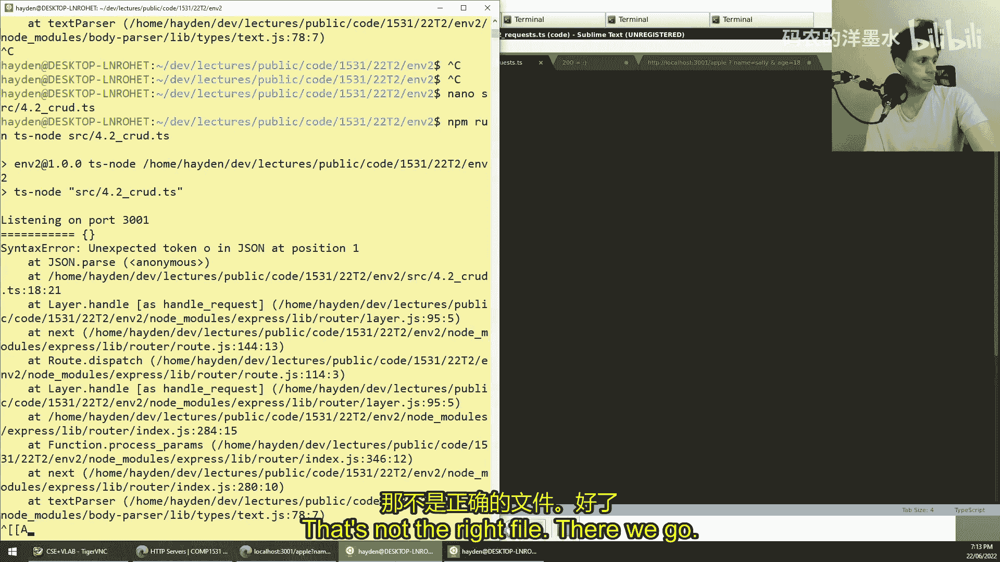

要使用它，我只需要运行`npm install sync-request`。

现在我可以运行这个文件，这个文件所做的就是从一个叫`sync-request`的库导入一个`request`对象，然后发出一个请求。你可以看到这里的请求是一个GET请求，指向URL `localhost:3001/apple?name=Hayden`。最后，我获取响应，这有点冗长，但我得到了响应。所以这是发送到服务器的请求。然后当我得到响应时，我从响应中获取`body`。你已经在下面看到了，然后我把它转换成字符串（据我所知，你必须这样做），然后把它作为JSON解析（这不是自动的），然后`console.log`它。

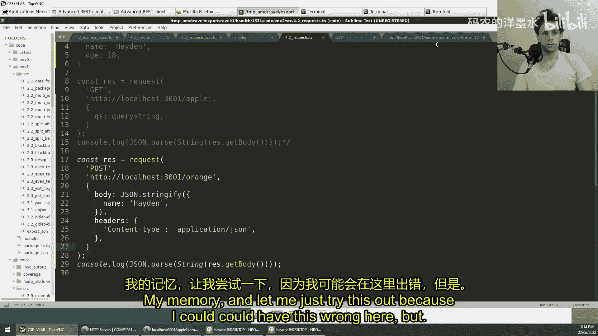

现在，因为服务器还在运行（记住我们的服务器仍在运行），我实际上可以在另一个终端里运行`npm run ts-node source/4.2-request.ts`，它会去和服务器对话。

所以，哦，“Hi Hayden of age undefined”。这很有趣，为什么是这样？我不确定。这不太合理。哦，对了，因为我们添加了那个额外的东西。所以，同样地，如果我想添加其他信息，我可以直接在这里添加`&age=18`。然后我们只需要重启服务器，再次运行我们的测试。

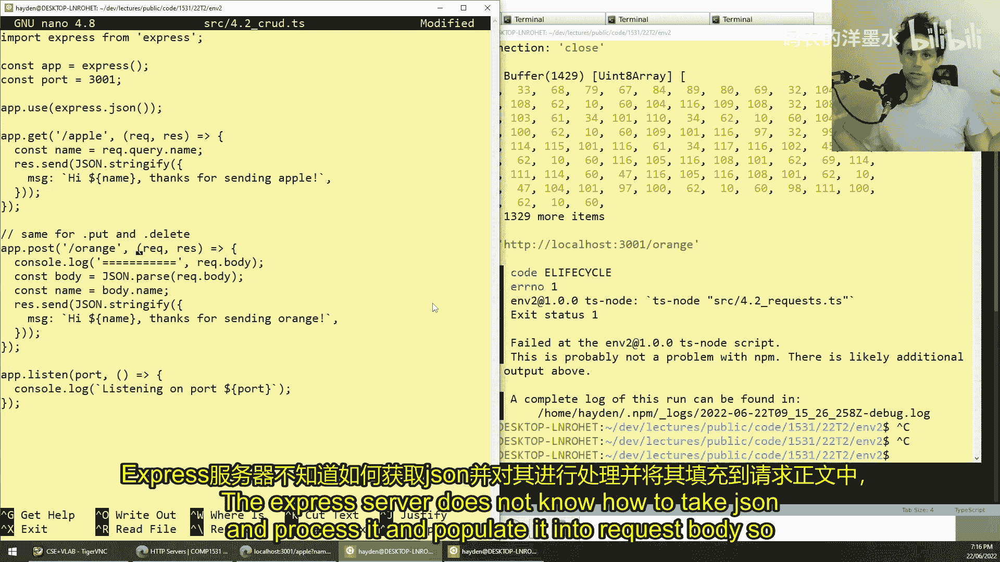

这里发生的一切就是：你的服务器（实现）在这里运行，而你的其他代码只是在和那个服务器对话。这就是真正发生的一切。

所以这个库非常非常简单易用。这就是你用GET请求和DELETE请求的做法，因为你只需要说`get`或`delete`，然后通过URL传递信息。

但还有另外两件重要的事情：
1.  如果我想简化我的代码怎么办？嗯，你实际上可以更进一步。我可以清理一下我的代码，说：“你知道吗，我传入的所有参数（或称为查询字符串）只是`{ name: 'Hayden', age: 18 }`。” 所以，我不必手动写进去（特别是如果你有动态内容，这会有点复杂），我可以实际删除那部分，转而传入一个查询字符串对象。或者如果我把它重命名为`querystring`以便更容易理解，请求库接受这个额外的属性`qs`，它就是查询字符串变量，它应该为我们做完全相同的事情。这使我们的代码更清晰、更动态，而不必手动将信息直接输入到URL中。

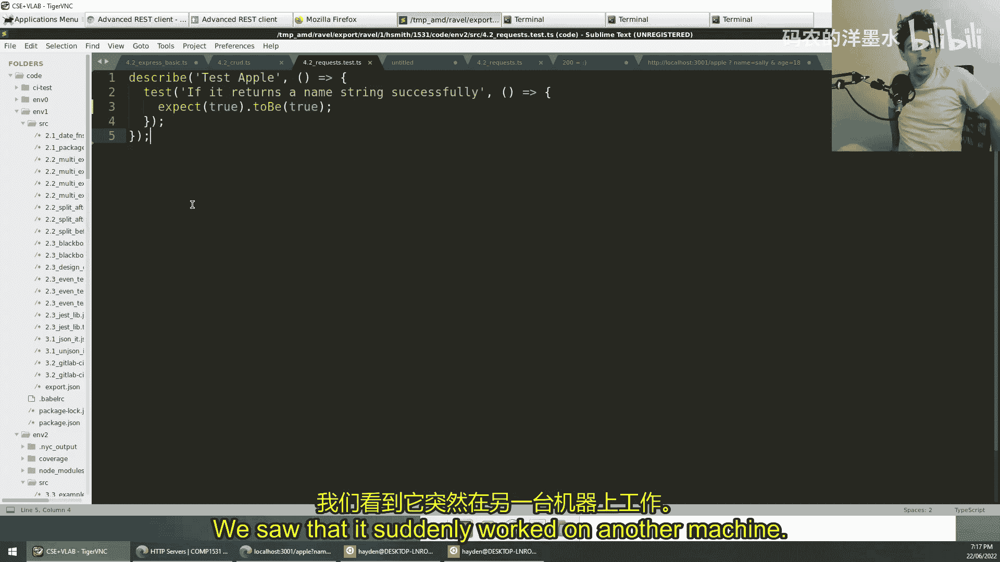

2.  下一个逻辑问题是：我的POST请求怎么办？我们知道，对于POST请求，我们调用`/orange`，并且我们知道它不是GET请求，而是POST请求。然后我们在POST请求中传递的请求体基本上就是你从其他例子中期望的那样。我们想发送一些文本，通常你可以说，好吧，假设文本只是`{ name: 'Hayden' }`。这应该大部分能工作，因为这就是我们发送的请求体。

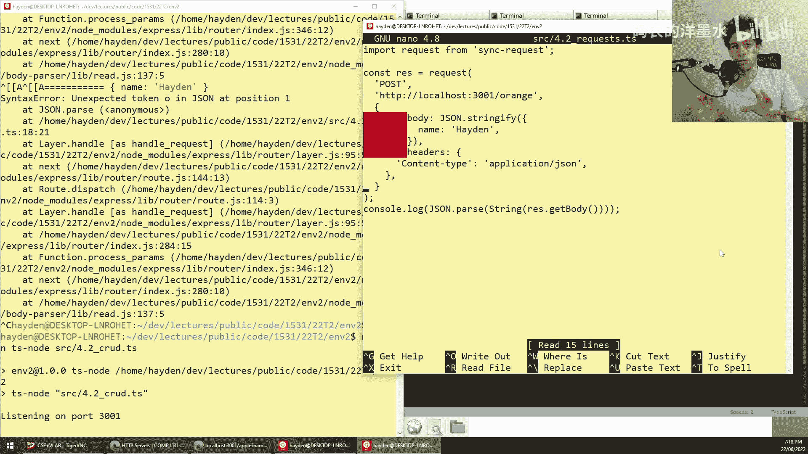

让我们看看这是否可行。我运行这个。它说“Hi undefined, thanks for sending orange”。现在，使用这个库的一个恼人现实是，实际上你需要包含一个非常关键的行（或几行），这在我们给的所有示例代码中都有，但我会在这里包含它：除了你的`body`，你还需要包含这个叫做`headers`的东西和其他一些内容。不要太担心这是什么，但这本质上是随你的请求一起发送的信息，它告诉服务器：“嘿，我正在发送JSON”，所以它知道接受JSON。这有点奇怪，但我很确定这应该能工作。所有这些新代码都是我这学期写的。

所以你现在会看到它实际上会接受它，因为它就像：“哦，我现在明白我得到什么了。我得到了一些有请求体的信息。” 所以这工作得很好，但显然我们不想在这里写手动字符串，所以我们可以像以前那样做，你可以直接给它`JSON.stringify({ name: 'Hayden' })`。现在你可以发送它，然后它就会正常工作。

所以，`sync-request`库可以很好地处理GET、DELETE、PUT、POST。我刚刚给了你们一些非常直接的例子来演示所有这些。这完全正常，完全没问题。

## 编写HTTP测试
你们在迭代二中要做很多的事情就是扩展这个，特别是你们将使用这些库来编写测试。因为我到目前为止向你们展示的是如何编写一个有`/apple`和`/orange`等端点的服务器，以及如何与该服务器对话。但下一步是弄清楚如何编写与该服务器对话的测试。

所以我们休息后会做这个。

## 将各部分结合起来
现在，我们将尝试实际将这些部分结合起来，让你们更好地理解迭代二（关于HTTP和Web内容）是如何结合在一起的。因为你们知道迭代一是关于编写测试和实现功能，迭代二也是关于编写测试和实现功能，但那些测试是基于HTTP的。

我这里有一个服务器，它正在按预期运行，然后单独地，我有一个我创建的好文件，叫做`4.2-request.test.ts`。你会看到它实际上看起来和我们的请求文件非常相似，只是我们把所有这些都包装在了Jest里面。

现在，Jest能够描述一些东西，测试一些东西，然后实际运行测试。然后我们做的是，我们期望返回的`body`（`body`是返回对象上的键）的`message`等于“Hi Hayden, thanks for sending apple”。然后我们对`test orange`做完全相同的事情。

这很棒，因为我们可以直接运行`npm run jest source/4.2-request.test.ts`。

## 调试与抽象
（注：讲师在此处遇到了环境配置问题并进行了调试，最终在本地环境解决了问题，演示了调试过程：缩小测试范围、在不同机器上尝试、检查代码差异、添加日志等。）

现在我们已经演示了我们可以运行我们的小程序，让我们实际运行之前尝试运行的Jest测试。Jest这次应该很高兴。好了，现在我们在Jest上有了两个勾，因为Jest在这里运行了那两个测试。

所以你可以看到，在迭代二中，使用HTTP做的很多事情真的很相似。只是，你不是简单地调用一个函数，而是在处理这个HTTP层。这在某些方面意味着你可能需要更新一些代码。但这也没关系，因为这看起来有点庞大和可怕，但想一想，这是一个巨大的提示：你可以通过创建一个函数来简化这一大堆代码。

例如，我写一个函数叫`get`（这是个糟糕的名字），它接收一个`path`和一个`querystring`。然后我把所有相关的代码放进去。我们知道这是通用的。所以现在在我的测试里，我不必写所有这些，我实际上可以说`const res = get('apple', { name: 'Hayden', age: 18 })`。突然之间，我的代码大大简化了。突然之间，它和你现在做的并没有太大不同，只是语法略有不同。

事实上，为了真正说明这一点，如果我想要一个POST函数怎么办？我们知道POST函数非常相似，只是它接收一个`path`和一个`body`。所以我们可以类似地抽象出来。然后，我们不必写所有这些，我们可以直接写`post('orange', { name: 'Hayden' })`。

这真的很棒，因为如果你定义了一次，那么你就可以重用它。然后，如果你想更进一步，真正深入高级函数讲座中的例子，我们在高级函数讲座中学到了高阶组件的概念。让我们在这里实际使用它。

我们可以创建一个更通用的函数，比如叫`httpSend`，它接收`method`、`path`、`querystring`、`body`等。然后我们发现`get`和`post`函数有很多共同点，除了方法（`get` vs `post`）和请求配置对象里的某些部分。我们可以创建一个高阶函数（一个返回函数的函数）来生成这些特定的请求函数（`get`, `post`, `put`, `delete`）。

这个例子有点复杂，因为`get`和`post`的“额外参数”不太一样（`get`用`qs`，`post`用`body`和`headers`），所以需要一些条件判断。但本质上，我们创建了一个大的工厂函数，可以生成通用的GET、PUT、POST、DELETE函数，减少了重复代码。

`httpSend`是一个生成其他函数的函数。当我们用`'get'`调用`httpSend`时，它创建一个内部函数。现在每次我调用`get`，就像调用那个内部函数一样，只不过方法被替换成了`'get'`。用`'post'`调用时也一样。

但通常，我不认为这种事情值得做，因为重复的代码量相当少。更清晰的代码可能更有价值。下周我们会多谈谈这个，你必须小心，不要为了让代码减少一点点重复而把事情搞得过于复杂，以至于每个人都困惑，没人知道发生了什么。

总之，这是一个有点跑题但有趣的插曲。但这就是Jest，这就是我们把所有东西结合起来，让你们为迭代二做好准备。

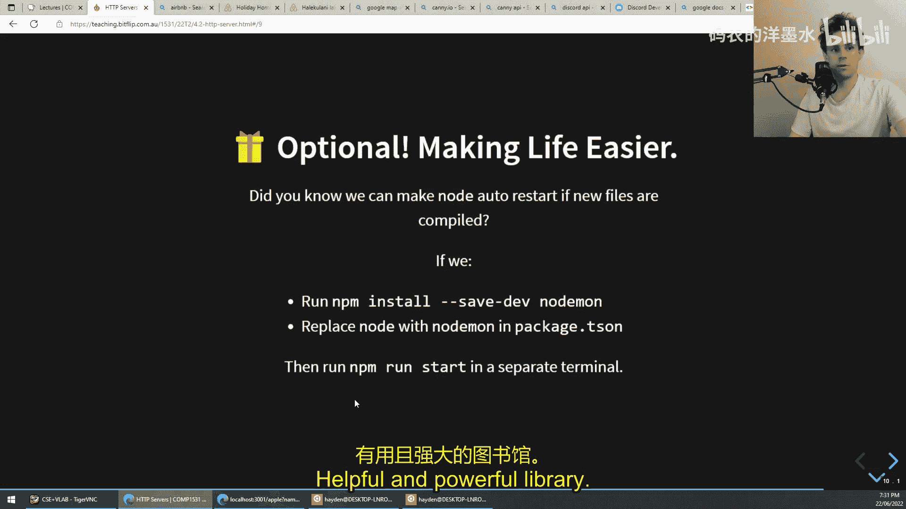

## 迭代二的关键点
正如我多次提到的，迭代二要求你实现HTTP服务器。然而，迭代二中存在的许多路由只是迭代一路由的包装器。这是一个很好的点，因为正如你将在周一（第7周周一）看到的，你将有一堆需要为这个项目编写或实现的路由。

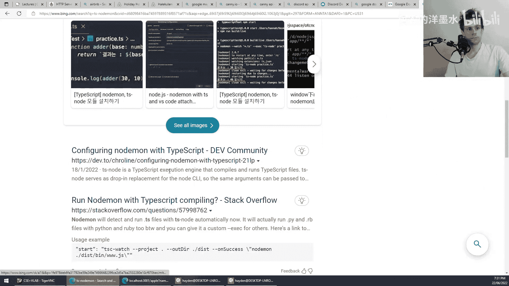

但会有像`auth/register`或`auth/login`这样的东西。这真的非常非常重要。以`auth/login`为例，它接收一个`email`和`password`。我们从请求体获取这些。然后我们可能要做的是调用`authLoginV1`，并传入`email`和`password`。然后我们得到的结果，`authLoginV1`返回什么？它返回一个`authUserId`。

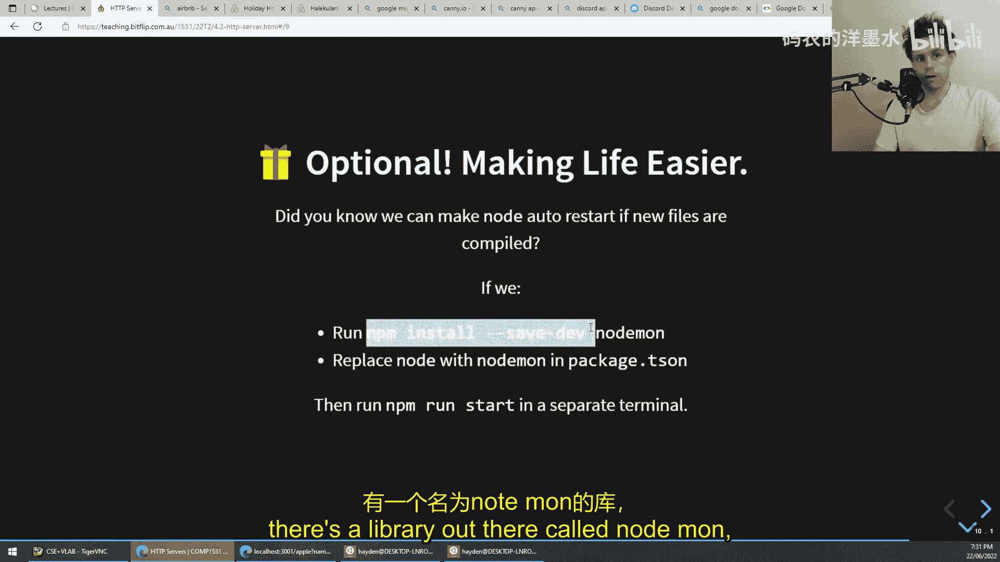

所以，你基本上就是把迭代一已经完成的功能包装成一个HTTP服务器。关键是，我们并不是想吓唬你们，让你们觉得“天哪，我得把所有这些东西再做一遍”。实际上，你们已经编写了很多基本功能，对于很多这些基本功能，你只需要在服务器层面包装一下输入输出，这样当有人调用那个URL时，你只需提取参数，传递给你在迭代一中编写的函数，然后返回该函数给出的结果。

这实际上是非常可控的，它把你迭代一的函数当作黑盒来处理。你们的导师非常非常乐意在这方面提供帮助。

## 有用的开发工具
现在，最后一些非常有用的技巧，我已经穿插在这次讲座中了。

第一个是一个非常有帮助且强大的库，叫做**Nodemon**（我相信它代表Node Monitor）。它的工作方式是：当我们运行一些代码时，特别是像Express服务器这样永远运行的代码，它会监听计算机上的文件系统。如果它看到你保存了任何它用来运行的文件，它实际上会重启进程。

所以，我安装了Nodemon。现在，在我的`package.json`里，我已经有了`ts-node`这一行，但我可以添加这个`nodemon`行。现在，特别是当我运行服务器时，我可以直接使用`nodemon`。Nodemon足够聪明，能判断你的代码是JavaScript还是TypeScript，并乐意运行任何一种。

Nodemon令人兴奋的地方在于，你会看到它现在正在监听我的服务器。但看看当我保存文件时终端会发生什么。Nodemon一直在监听文件系统，然后它重启了服务器。所以现在，我不必停止和启动它，如果我再次运行它，文本就更新了。这是一个非常非常有用的开发工具。

第二个有用的工具与TypeScript有关。基本上，在开发过程中，你应该经常运行`npm run tsc`。TypeScript会对你的所有文件进行相当严格的检查，并可能发现错误。但与其运行这个然后修复代码再运行，你实际上可以添加一个`--watch`命令。

同样，在`package.json`里的`tsc`命令中，你可以添加另一个标志`--watch`。当你添加`--watch`时，TSC会以与Nodemon非常相似的方式运行：它会编译你的代码，尝试进行类型检查，并发现问题。但假设我正在修改我的代码并尝试修复它们，TSC会监听文件系统并相应地重新检查。

所以这是两个非常有用的东西，因为你不需要不断地重新运行终端，你可以让这两个东西一直运行。

你可能会再次问一个问题：为什么我们需要两个独立的东西？为什么我们不直接设置一个流程，如果有类型错误，服务器就崩溃？答案是，你可以这样做，我们可以很容易地为你们设置。但这并不是很好的开发风格，因为代码中出现类型错误是常见的，就像代码风格不好一样。这只是开发过程的一部分。无论是每分钟、每10分钟、每小时还是每天，你都会回来清理你的代码。

所以通常，你可能会发现你不会经常看TypeScript检查，你只会继续开发你的工作，然后可能在合并请求之前，你运行`tsc`，看到一大堆错误，然后回去修复你的代码。这就是`watch`功能真正非常有帮助的地方。

## 总结
本节课中我们一起学习了：
1.  **API和Web API的核心概念**：API是软件暴露的接口，Web API是基于HTTP协议的API，通过URL和JSON进行通信。
2.  **RESTful API与HTTP方法**：了解了GET（读取）、POST（创建）、PUT（更新）、DELETE（删除）四种HTTP方法及其在构建API时的约定用途。
3.  **构建Express服务器**：实践了如何使用Node.js和Express框架创建能处理不同HTTP方法和路由的服务器，包括如何通过`request.query`获取URL参数，以及通过`request.body`获取POST/PUT请求的JSON数据。
4.  **与服务器交互的工具**：
    *   **API客户端**（如ARC）：用于手动测试API端点。
    *   **NPM库**（如`sync-request`）：允许在代码中程序化地发出HTTP请求，这对于编写自动化测试至关重要。
5.  **编写HTTP测试**：学习了如何使用Jest和HTTP请求库为服务器端点编写测试，这是迭代二的核心任务。
6.  **代码抽象与调试**：探讨了如何通过创建辅助函数来抽象HTTP请求逻辑，以提高代码复用性和可读性，并实践了调试HTTP服务器和测试的常见流程。
7.  **开发效率工具**：介绍了`Nodemon`（自动重启服务器）和`tsc --watch`（实时TypeScript类型检查）这两个能显著提升开发体验的工具。

迭代二的核心是将迭代一中实现的函数逻辑包装成HTTP接口，这是一个非常可控的过程。请记住利用好提供的工具和导师的帮助。

祝大家在迭代二中顺利！