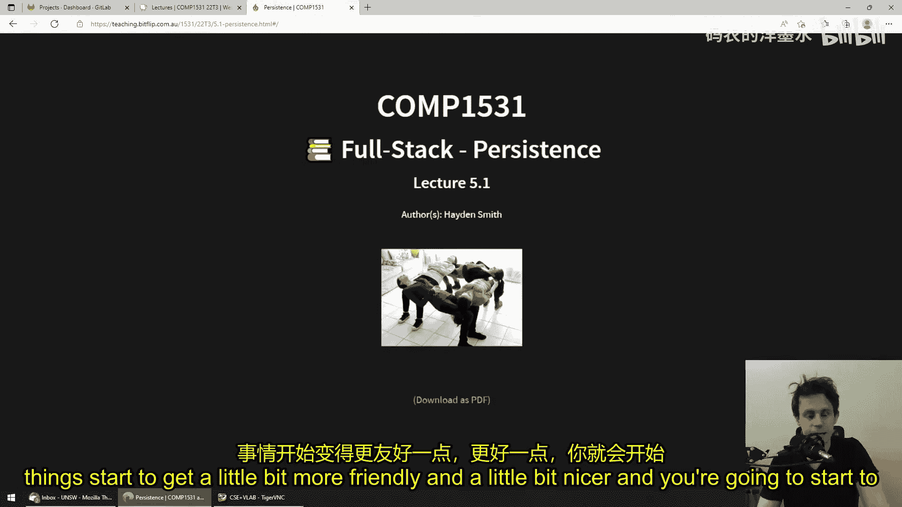
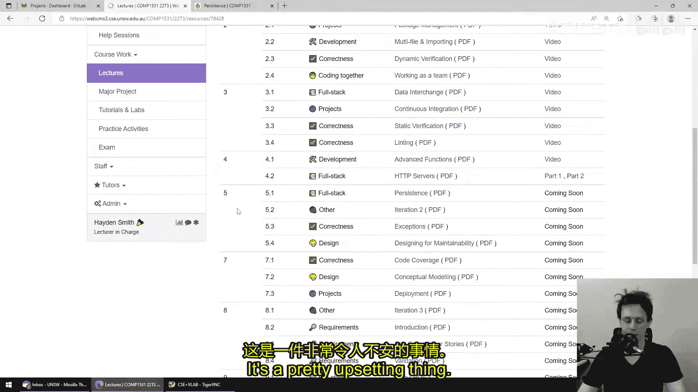
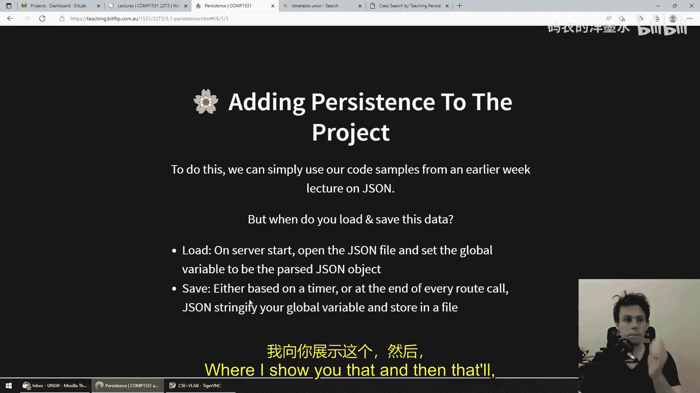
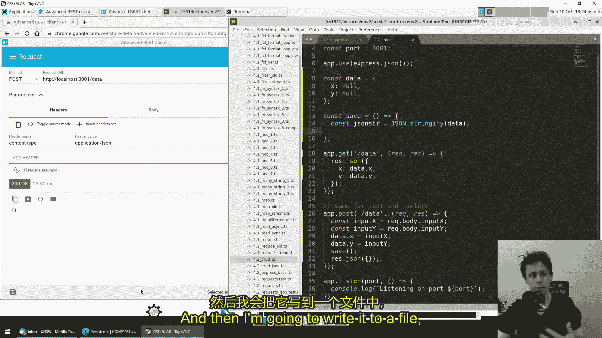
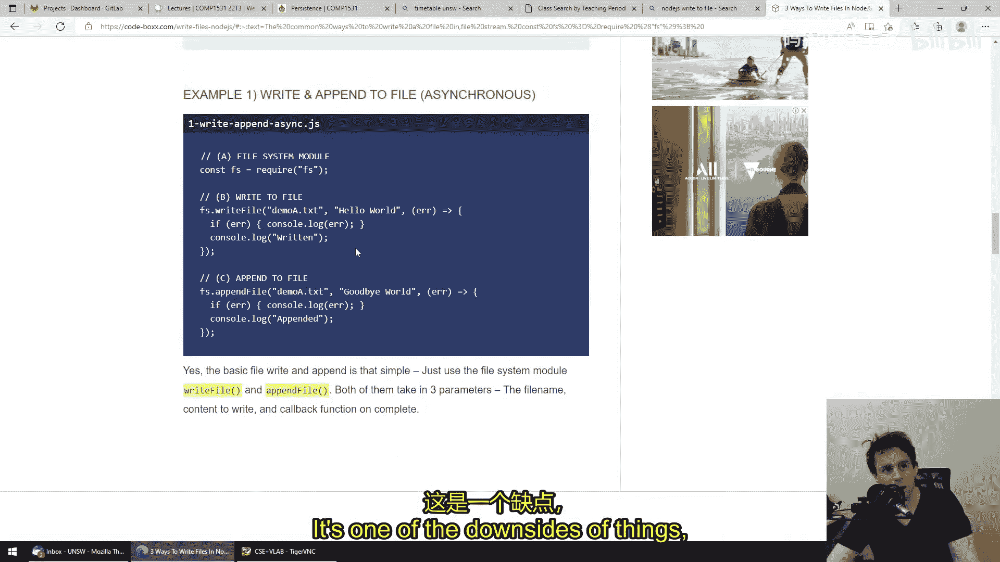
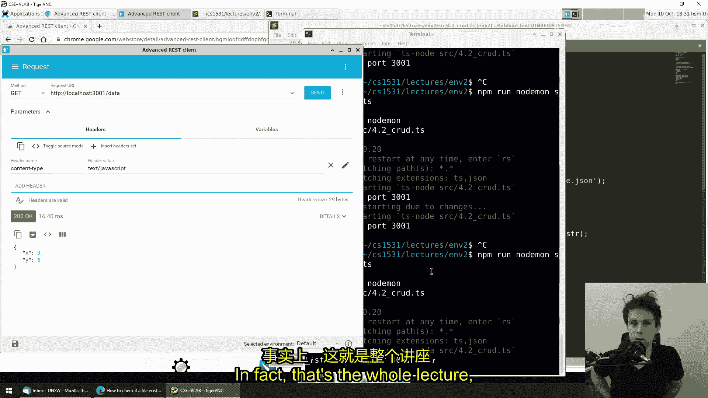
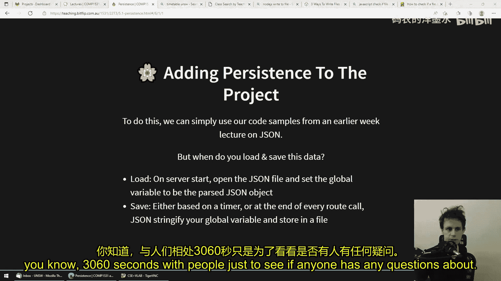
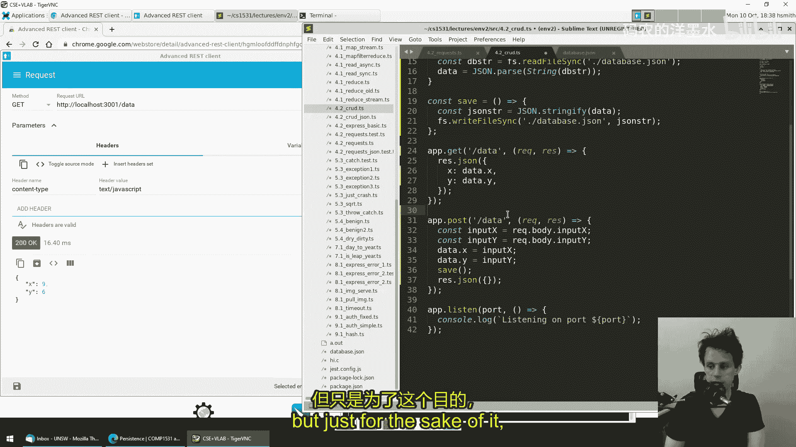
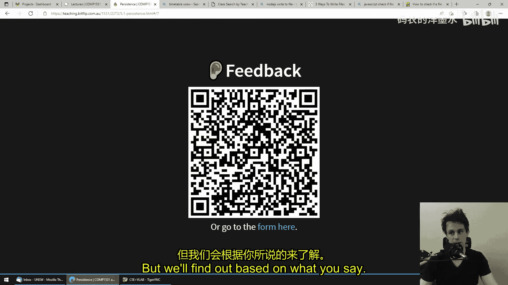

# 015：持久化 📚



在本节课中，我们将要学习一个核心概念：**持久化**。我们将探讨为什么应用程序需要保存数据，以及如何通过一种简单直接的方式——将数据写入文件——来实现数据的持久存储。这对于确保应用状态在服务器重启后依然存在至关重要。



---

## 数据与持久化

上一节我们介绍了数据的基本概念，本节中我们来看看如何让数据“持久化”。

在计算领域，**数据**是程序收集和处理的原始信息。例如，用户点击按钮的记录或游戏中的角色位置。然而，存储在程序变量中的数据是**易失性**的——当程序（如我们的Express服务器）停止运行时，这些数据就会丢失。

**持久化**的目标就是让数据能够**超越创建它的进程的生命周期**而持续存在。这就像游戏中的“保存”功能，让你下次打开游戏时可以继续之前的进度。


对于我们的项目，我们不要求使用复杂的数据库（如SQL）。相反，我们将实现一个简单的**文件数据库**。核心思路是：将程序的状态（一个JavaScript对象）转换为JSON字符串，然后写入一个本地文件。当程序再次启动时，从该文件读取数据并恢复状态。


---

## 实现持久化：一个简单示例

让我们通过一个具体的Express服务器示例，来演示如何实现数据的保存与加载。

我们将创建一个简单的服务器，它维护一个包含 `x` 和 `y` 坐标的数据对象，并提供GET和POST路由来读取和修改它。

### 初始服务器（无持久化）

首先，我们创建一个没有持久化功能的服务器。数据仅存在于内存中。

```javascript
import express from 'express';
const app = express();
app.use(express.json());

// 程序状态，存储在内存中
let data = { x: null, y: null };

// GET 路由：返回当前数据
app.get('/data', (req, res) => {
  res.json({ x: data.x, y: data.y });
});

// POST 路由：更新数据
app.post('/data', (req, res) => {
  const { inputX, inputY } = req.body;
  data.x = inputX;
  data.y = inputY;
  res.sendStatus(200);
});

app.listen(3001, () => console.log('Server running on port 3001'));
```
运行此服务器时，你可以通过POST请求更新数据，并通过GET请求查看。但一旦服务器重启，`data` 对象会被重置，所有更改都会丢失。



### 添加持久化功能

现在，我们分两步来添加持久化功能：**保存数据到文件** 和 **从文件加载数据**。

#### 1. 保存数据到文件

我们需要在每次修改数据后，将整个 `data` 对象写入一个文件（例如 `database.json`）。

以下是实现此功能的关键步骤：
*   导入Node.js的文件系统模块 (`fs`)。
*   创建一个 `save` 函数，将 `data` 对象转换为JSON字符串并写入文件。
*   在POST路由处理程序的末尾调用 `save` 函数。







```javascript
import express from 'express';
import fs from 'fs'; // 导入文件系统模块
const app = express();
app.use(express.json());

let data = { x: null, y: null };
const dataFile = 'database.json';

// 保存数据到文件的函数
function save() {
  const jsonString = JSON.stringify(data);
  fs.writeFileSync(dataFile, jsonString);
}

app.get('/data', (req, res) => {
  res.json({ x: data.x, y: data.y });
});
app.post('/data', (req, res) => {
  const { inputX, inputY } = req.body;
  data.x = inputX;
  data.y = inputY;
  save(); // 数据修改后，立即保存到文件
  res.sendStatus(200);
});
app.listen(3001, () => console.log('Server running on port 3001'));
```
现在，每次执行POST请求后，当前状态都会被保存到 `database.json` 文件中。

#### 2. 从文件加载数据

服务器启动时，它应该尝试从文件中读取之前保存的状态，并用其初始化 `data` 对象。

关键点在于处理文件可能不存在的情况（例如服务器第一次运行）。我们可以使用 `fs.existsSync` 方法来检查文件是否存在。

```javascript
import express from 'express';
import fs from 'fs';
const app = express();
app.use(express.json());

const dataFile = 'database.json';
let data = { x: null, y: null }; // 默认值

// --- 服务器启动时，尝试从文件加载数据 ---
if (fs.existsSync(dataFile)) {
  const dbString = fs.readFileSync(dataFile);
  data = JSON.parse(dbString.toString());
  console.log('Loaded data from file:', data);
} else {
  console.log('No existing data file found, starting fresh.');
}
// ---------------------------------------

function save() {
  const jsonString = JSON.stringify(data);
  fs.writeFileSync(dataFile, jsonString);
}

// ... GET 和 POST 路由保持不变 ...

app.listen(3001, () => console.log('Server running on port 3001'));
```

### 最终效果





通过以上修改，我们实现了一个具有基本持久化功能的服务器：
1.  **首次运行**：`database.json` 文件不存在，`data` 使用默认值 `{x: null, y: null}`。
2.  **修改数据**：通过POST请求更新坐标，数据被自动保存到文件。
3.  **重启服务器**：服务器启动时检测到 `database.json` 文件，读取并解析其中的JSON，用保存的数据恢复 `data` 对象。
4.  **读取数据**：GET请求将返回持久化后的数据，而不是初始值。

这样，应用程序的状态就成功地在服务器重启后保留了下来。

---

## 关于代码结构的思考

在上面的例子中，我们在每个会修改数据的路由处理函数末尾都手动调用了 `save()`。你可能会想，是否可以创建一个“包装函数”来自动完成保存，以避免重复代码？

例如，创建一个 `requestPost` 函数来封装路由创建和保存逻辑：

```javascript
function requestPost(route, handler) {
  app.post(route, (req, res) => {
    handler(req, res);
    save(); // 自动调用保存
  });
}

// 使用方式
requestPost('/data', (req, res) => {
  const { inputX, inputY } = req.body;
  data.x = inputX;
  data.y = inputY;
  res.sendStatus(200);
});
```
**请注意**：这种抽象虽然减少了 `save()` 的重复书写，但也增加了代码的间接性和理解成本。对于初学者或团队项目，清晰性往往比极致的代码精简更重要。在决定是否采用此类模式时，需要权衡其带来的便利性与对代码可读性的影响。

---

## 总结

本节课中我们一起学习了**持久化**的核心概念与简单实现。
*   **核心概念**：持久化意味着让数据在创建它的程序进程结束后依然存在。
*   **实现方法**：对于本课程项目，我们采用**文件数据库**的方式。即利用 `JSON.stringify()` 和 `JSON.parse()` 在JavaScript对象与JSON字符串之间转换，并通过Node.js的 `fs` 模块进行文件的读写。
*   **关键步骤**：
    1.  **保存**：在数据变更后，将其序列化并写入文件。
    2.  **加载**：在程序启动时，检查并读取文件，将数据反序列化以恢复状态。
    3.  **容错**：处理文件不存在的首次运行情况。





你现在已经掌握了为迭代二项目添加持久化支持所需的所有基础知识。记住，保持代码清晰易懂与实现功能同等重要。