# 021：需求介绍 📋

在本节课中，我们将要学习软件工程中一个至关重要的概念：**需求**。我们将探讨什么是需求、为什么需求如此重要，以及如何通过一个结构化的过程来获取和定义需求。

## 概述：什么是需求？

构建任何系统最重要的部分，是弄清楚你需要做什么。这不仅仅是编写代码或绘制漂亮的图表，而是真正理解你要实现的目标。当我们说“弄清楚需要做什么”时，我们实际上是在说，我们正在弄清楚为了达成目标，**系统被要求做什么**。

根据IEEE的定义，**需求**是用户解决问题或达成目标所需的条件或能力。我们也可以将需求描述为所有利益相关者就待完成工作达成的一致协议，或者是对拟建系统的描述和约束。

> “构建软件系统最困难的部分，是决定要构建什么。没有哪部分工作，如果做错了，会比这部分更能削弱最终的系统。”

## 为什么需求至关重要？

在编写任何代码之前，我们通常需要知道如何测试它，也需要知道如何设计它。然而，为了测试和设计任何东西，我们必须首先知道我们的**目标**是什么，更具体地说，我们必须知道我们正在构建的系统的**需求**是什么。

一个常见的比喻是建造一栋建筑。为什么开工前总是需要很长时间？因为大部分时间都花在了规划和确保他们在做正确的事情上。生活中几乎所有事情都是如此：最好的工程产品会花费大量时间确保它们解决了正确的问题，而花较少时间实际解决那个问题。

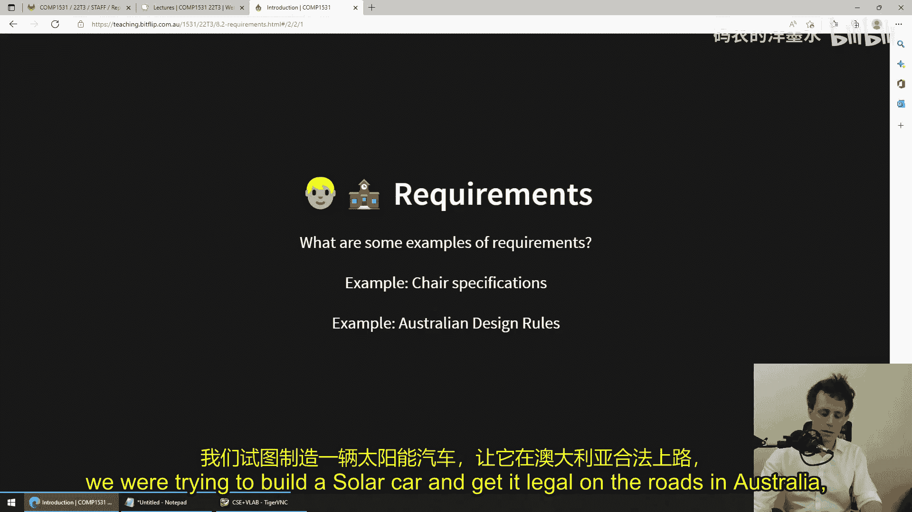

## 需求的类型：功能性与非功能性

需求作为描述系统的规则或陈述，通常可以分为两大类：**功能性需求**和**非功能性需求**。

*   **功能性需求**：指定系统应提供的特定能力或服务。它描述系统“做什么”，可以将其视为系统的“技能”。
    *   **公式/代码描述**：`系统必须提供 [某项具体功能]`。
    *   **示例**：系统必须在有新帖子或有人评论现有帖子时，向所有用户发送通知。

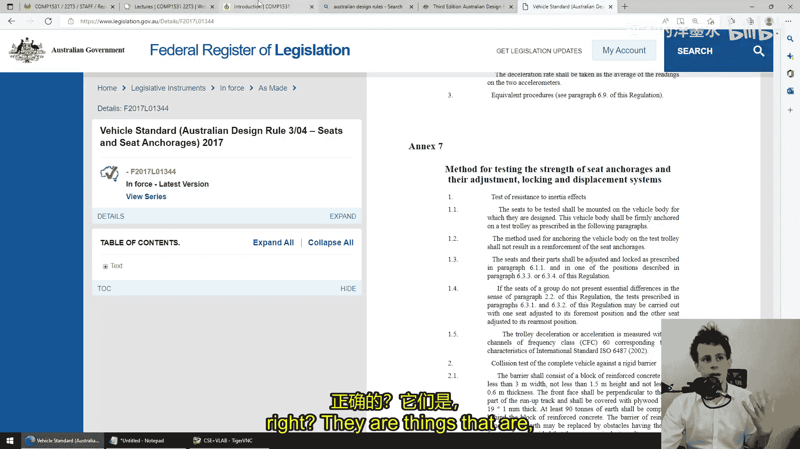

*   **非功能性需求**：对系统如何实现其功能施加约束。这通常是性能特征，可以看作是一种限制或方法。
    *   **公式/代码描述**：`系统必须在 [某种条件/约束] 下提供功能`。
    *   **示例**：系统必须在相关活动发生后**30分钟内**发送电子邮件。

**关键区别**：功能性需求描述“做什么”，而非功能性需求描述“做得怎么样”或“在什么条件下做”。非功能性需求通常会收紧或限定功能性需求的范围。

## 需求工程：让需求“诞生”的过程

需求不会凭空出现。在软件工程中，我们通常需要通过一个称为**需求工程**的过程来帮助它们“诞生”。这个过程可以大致分为四个步骤：**获取、分析、规约和验证**。

上一节我们介绍了需求的类型，本节中我们来看看如何系统地获取和定义它们。

### 第一步：获取

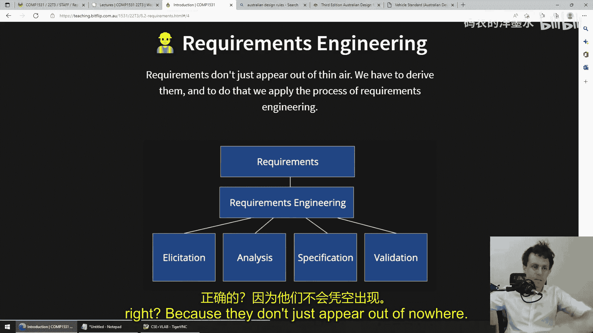

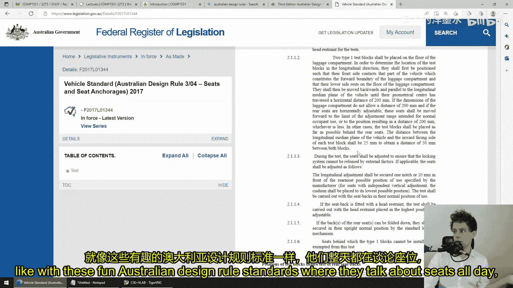

获取是指通过提问、发现和学习来从相关人员那里**提取信息**。这类似于市场调研、问卷调查、焦点小组或利益相关者访谈。

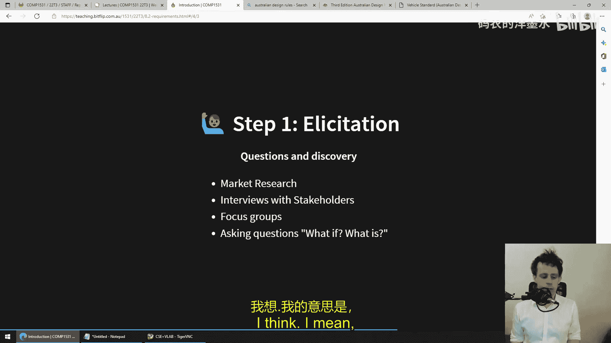

*   **利益相关者**：指那些会受到你所做事情影响的人（无论是正面、负面还是中性）。例如，在构建一个新的课程管理系统时，学生、导师和讲师都是利益相关者。

### 第二步：分析

在从人们那里获取了所有信息之后，你需要尝试**组织和分析**这些信息，识别事物之间的依赖关系、冲突、风险，并将它们归类。

这个过程就像制作思维导图，将原始信息结构化。我们通常通过编写**用户故事**或**用例**（将在后续课程中介绍）来辅助分析。

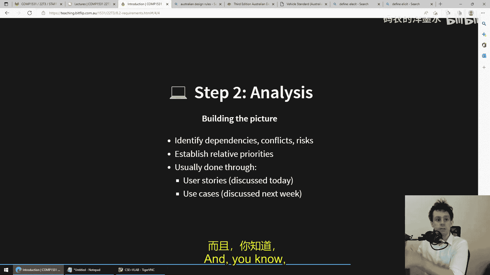

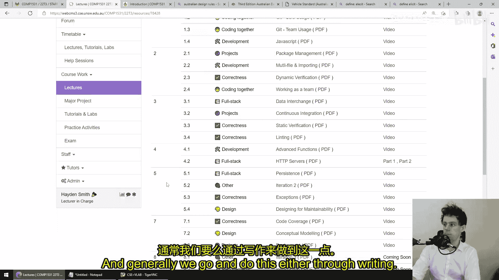

### 第三步：规约

规约是指尝试将所有粗略的想法和工作成果，转化为更**正式、简洁**的文档。其目的是剔除冗余信息，进行综合、浓缩和细化，形成一份能够概括所有需求的草案。

**示例**：一个关于门锁的规约化需求可能是：“系统应始终保持门锁锁定，除非收到授权用户的解除指令。当锁被解除时，应启动倒计时；若倒计时结束时锁仍处于解除状态，则应自动重新锁定。”

### 第四步：验证

验证是将你整理好的需求文档带回给最初的利益相关者，并询问：“**这是正确的吗？这听起来像我们当初想一起做的事情吗？**” 如果得到肯定的答复，那么需求就得到了确认。

## 需求工程中的常见挑战

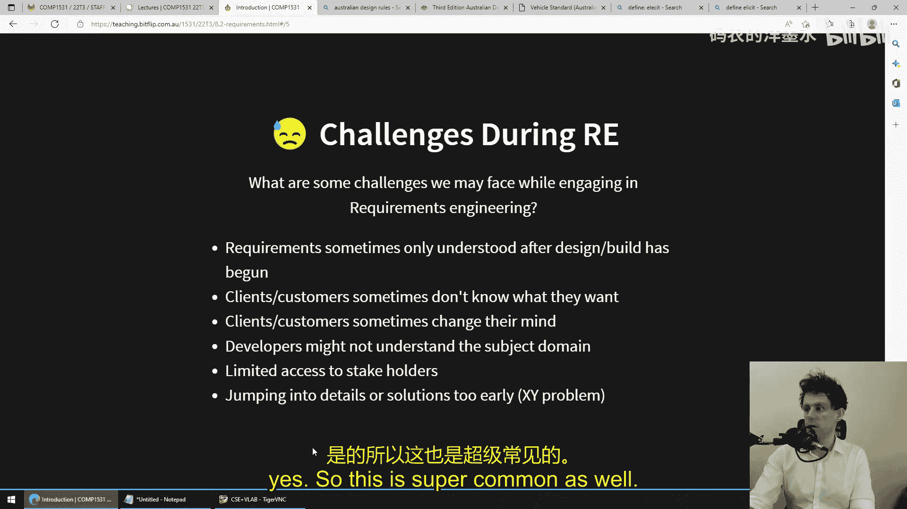

在尝试从人们那里建立一套需求时，你总会遇到一些问题。了解这些挑战有助于我们更好地应对。

以下是需求工程中可能遇到的一些主要挑战：

*   **需求在设计和构建开始后才被理解**：有时人们只有在实际使用系统时，才知道他们想要什么规则。
*   **客户不知道他们想要什么**：这很常见，客户可能无法清晰表达他们的需求。
*   **客户改变主意**：需求可能会随着时间或认知的变化而改变。
*   **开发人员缺乏领域知识**：如果开发人员不熟悉系统所涉及的专业领域（如教育、医疗），可能无法准确理解某些需求。
*   **难以接触利益相关者**：有时可能很难联系到关键的利益相关者进行沟通，导致需要做出更多假设，从而增加出错风险。
*   **过早陷入细节或解决方案**：这是一个非常普遍的问题，与“XY问题”密切相关。

### 警惕“XY问题”

“XY问题”是指：当你想解决问题X时，你认为解决方案Y可行，于是你没有询问关于X的问题，而是去问别人关于Y的问题。

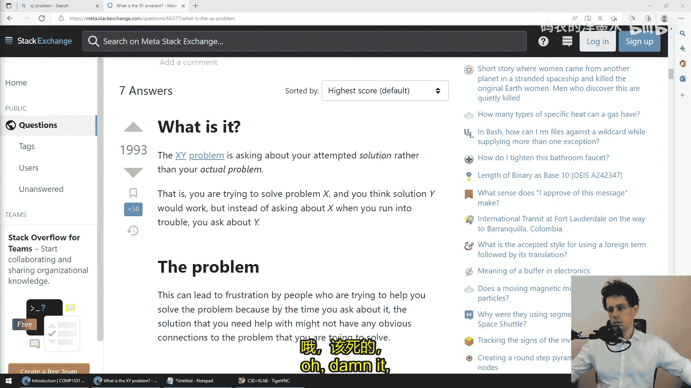

**经典示例**：你需要吃午餐，但认为必须用叉子。你问朋友：“你有叉子吗？” 朋友说没有，于是你们花时间去找叉子。后来才发现，朋友有筷子，而筷子完全能满足你“需要餐具吃饭”的根本需求（X）。你错误地将“需要叉子”（Y）当成了问题本身。

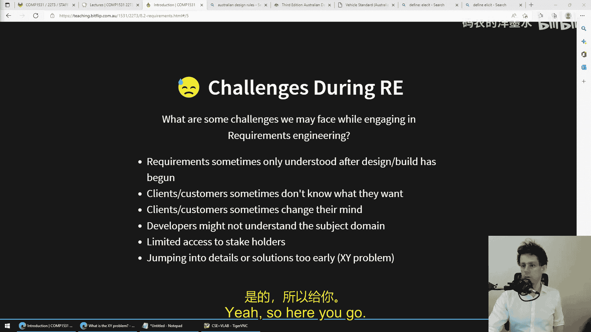

在软件开发中，这经常发生。例如，新手开发者可能会问“如何安装某个复杂的库”，而经过长时间讨论后才发现，他们根本不需要那个库，用一个更简单的库就能实现他们的原始目标（X）。因此，始终要关注根本问题，而不是预设的解决方案。

## 总结

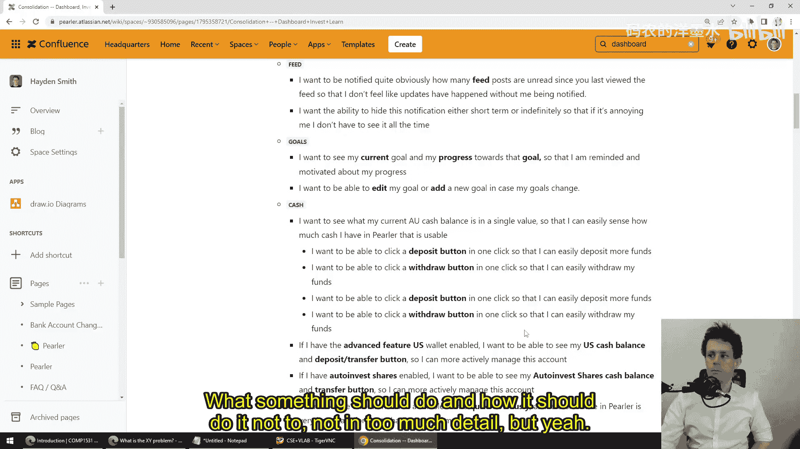

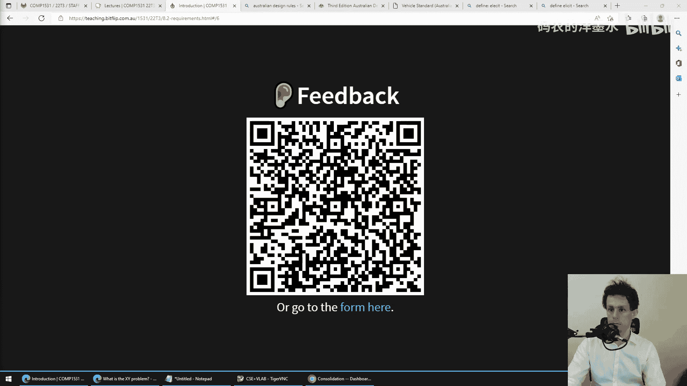

本节课中我们一起学习了软件工程需求的核心理念。我们了解到，**需求**是定义系统“做什么”和“如何做”的规则，是项目成功的基石。我们区分了**功能性需求**（描述能力）和**非功能性需求**（描述约束）。同时，我们介绍了**需求工程**的四个关键步骤：获取、分析、规约和验证，并探讨了在此过程中可能遇到的挑战，如“XY问题”。记住，花时间弄清楚正确的问题，往往比匆忙解决问题更重要。