# 022：用例与用户故事 📝

在本节课中，我们将学习如何以更人性化和结构化的方式表达软件需求。我们将重点介绍两种关键方法：**用户故事**和**用例**。这些方法有助于将复杂的用户需求转化为清晰、可执行的开发指导。

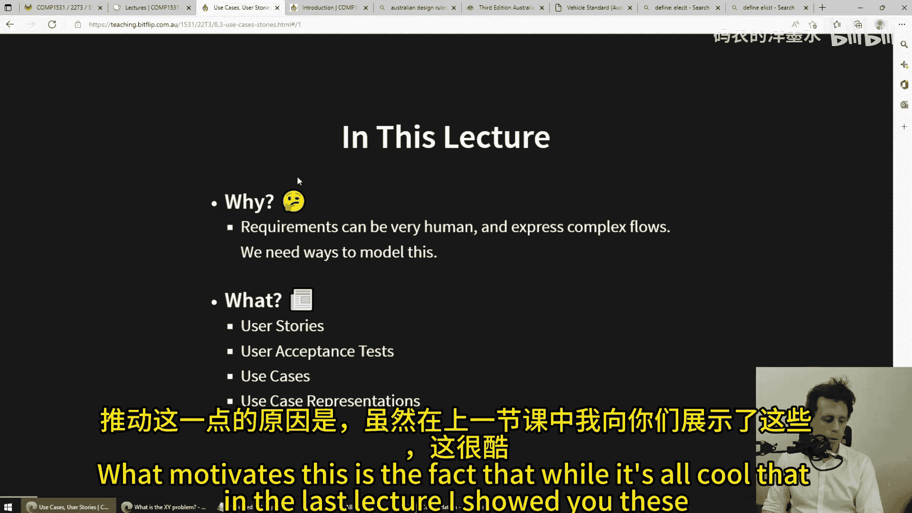

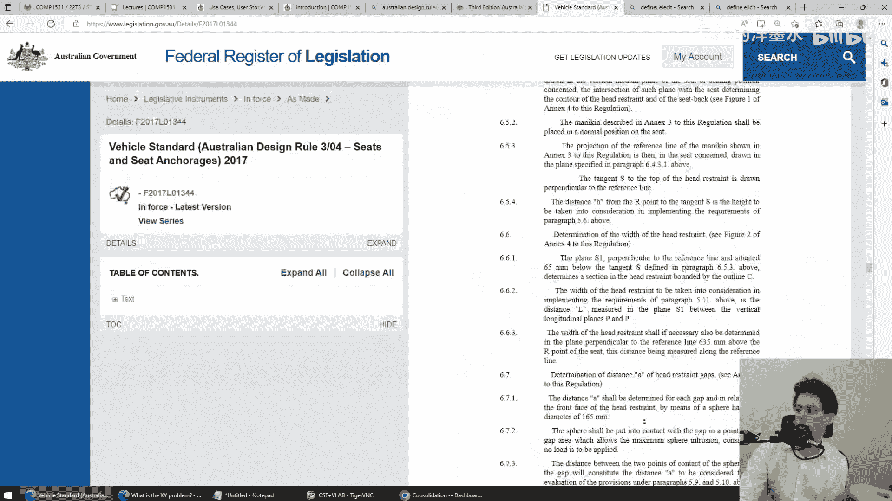

---

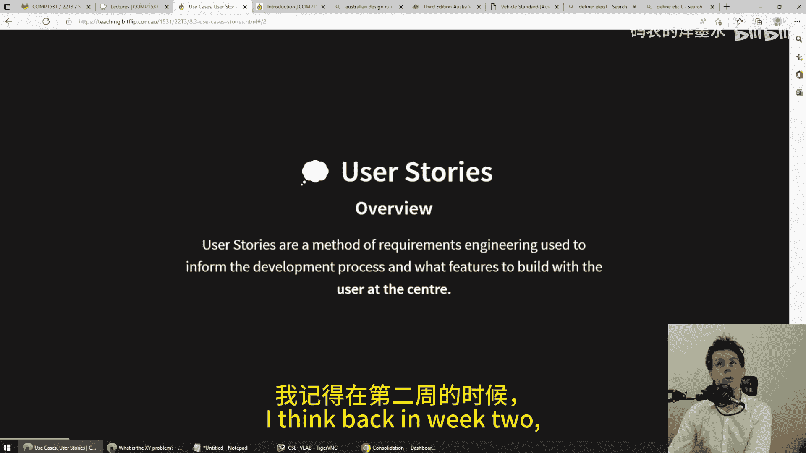

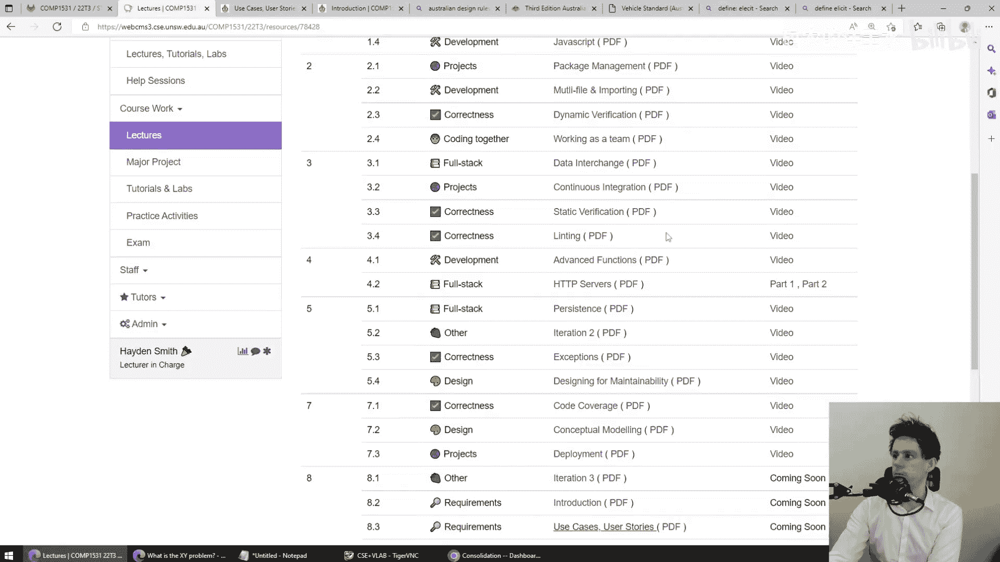

## 概述

之前我们讨论了需求工程的高层概念，但未深入探讨如何具体表示系统或需求。本节将弥补这一空白，详细介绍**用户故事**和**用例**。这两种工具能帮助我们更有效地捕捉和传达以用户为中心的需求，确保开发过程始终关注人的体验。

---

## 用户故事 📖

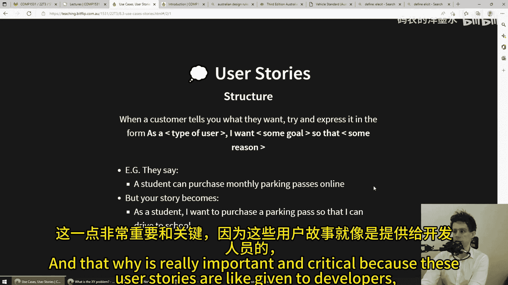

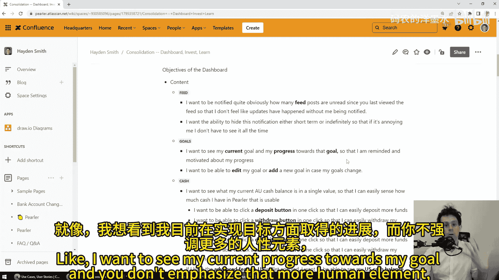

用户故事在敏捷开发世界中极为重要。它本质上是一种需求工程方法，旨在以用户为中心指导开发过程。用户故事的核心是采用特定结构来书写需求，确保每项需求都明确涉及用户角色、用户目标及其动机。

### 用户故事的基本结构

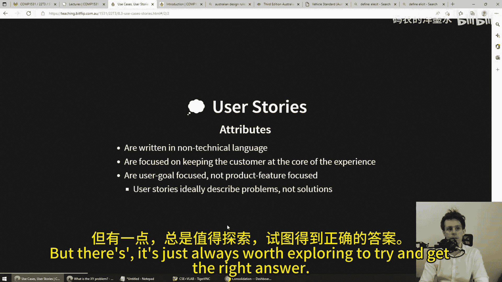

用户故事的标准格式如下：

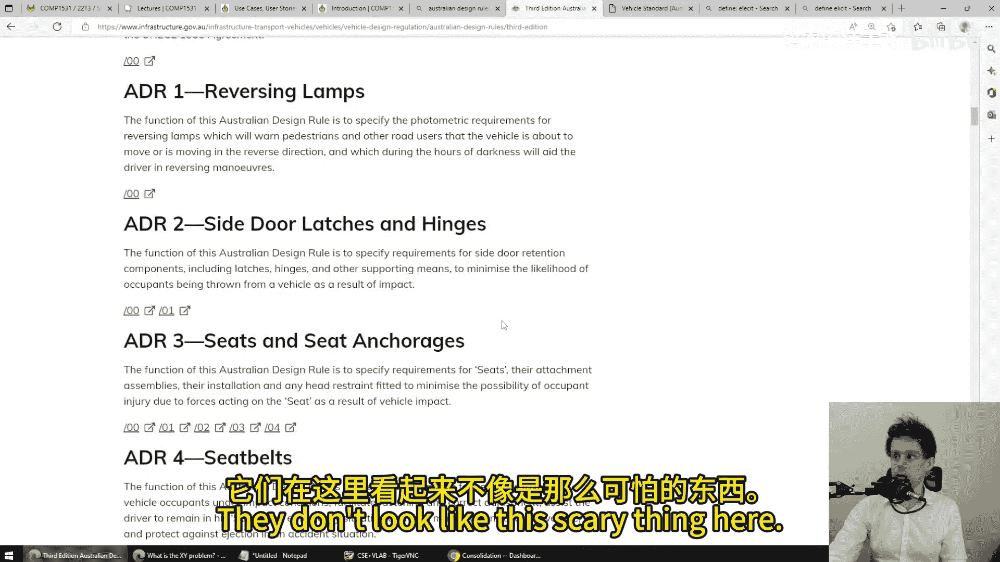

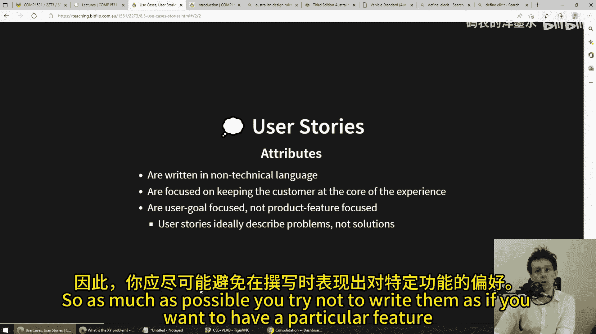

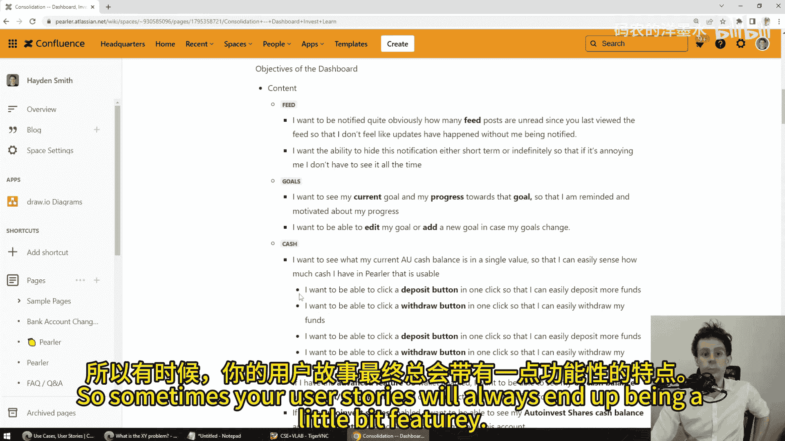

```
作为 [用户类型]，
我想要 [执行某个操作]，
以便于 [实现某个目标或价值]。
```

例如，如果一名学生提出：“我希望能在网上购买月停车票。” 我们可以将其转化为用户故事：

```
作为学生，
我想要购买停车通行证，
以便于我能开车上学。
```

这种结构强调了三个关键部分：**用户角色**、**用户目标**和**背后的原因**。明确“原因”至关重要，因为它能帮助开发者理解需求的深层动机，避免在传递过程中丢失重要信息。

### 编写优质用户故事的要点

以下是编写用户故事时需注意的几个关键属性：

*   **以用户为中心**：故事应聚焦于客户及其体验，而非产品功能。尽量避免写成功能规格说明。
*   **描述问题，而非解决方案**：例如，应写“我想要感受到实现目标的动力”，而非“我想要一个显示进度的饼图”。
*   **独立性**：各个用户故事应尽可能独立，以便单独实现和测试。
*   **可协商性**：故事不应包含过多细节，以便为开发者和设计师留出创意空间。
*   **有价值**：故事应对客户或用户具有明确价值。
*   **可估算**：故事的实现难度应相对清晰，不能过于模糊。
*   **可测试**：每个故事都应有明确的验证方法。

### 实践示例：待办事项应用

假设我们正在为一个待办事项应用收集需求。以下是一些可能的用户故事示例：

*   **示例1**：
    ```
    作为学生，
    我想要能够为待办事项设置优先级，
    以便于我能轻松看到哪些任务对我最重要。
    ```
*   **示例2**：
    ```
    作为学生，
    我想要能够用标签对任务进行分类，
    以便于我能轻松查看相关联的任务组，而不会因一堆未分类的任务感到不知所措。
    ```

---

## 用户验收标准 ✅

用户故事常与**用户验收标准**配套使用。验收标准是一种帮助测试用户故事是否得到满足的方法，它将一个用户故事分解为一系列必须满足的具体条件。

### 验收标准的形式

验收标准通常以清单形式书写，供人工测试时核对。例如，对于用户故事“作为用户，我想使用搜索字段输入城市名或街道名，以便找到匹配的酒店选项”，其验收标准可能包括：

*   搜索字段位于顶部导航栏。
*   用户点击“搜索”按钮后开始搜索。
*   搜索字段包含灰色文本的占位符。
*   用户开始输入时，占位符消失。

另一种更自由的写法是采用 **“场景-给定-当-那么”** 格式：
*   **场景**：用户忘记了密码。
*   **给定**：用户已导航到登录页面。
*   **当**：用户选择“忘记密码”选项并输入有效邮箱。
*   **那么**：系统应向该邮箱发送重置链接。

### 编写验收标准的要点

*   **详略得当**：既不能太宽泛，也不能太狭窄。
*   **非技术性**：应让非技术人员（如客户）也能理解。
*   **尽早确定**：尽管开发过程中可以更新，但最好在开始时就和利益相关者达成一致。
*   **用于验收测试**：通过执行验收测试来验证这些标准是否得到满足，这通常在专门的**用户验收测试环境**中进行。

---

## 用例图 🔄

上一节我们介绍了以叙事形式表达需求的用户故事。本节我们来看看另一种可视化需求的方法——**用例**。用例侧重于以视觉化或步骤化的方式描述系统应如何工作，特别是用户与系统之间的交互对话。

### 用例的两种形式

用例主要有两种表现形式：**文本步骤列表**和**视觉图表**。两者都旨在清晰地传达用户如何与软件系统或业务流程互动。

**1. 文本步骤列表**
例如，描述从ATM取款的用例可能包括以下步骤：
1.  ATM提示客户输入PIN码。
2.  客户输入PIN码。
3.  ATM向银行验证账户。
4.  银行确认账户有效并返回余额。
5.  ATM询问客户需要什么服务。
6.  客户请求提取60美元。
7.  ATM支付现金。
8.  ATM通知银行交易完成。

**2. 视觉图表（用例图）**
图表形式能更直观地展示交互流程。下图展示了一个简化的ATM取款交互序列：
（此处应有一个描述用户、ATM和银行之间消息传递的顺序图，显示“输入PIN”、“验证账户”、“请求取款”、“发放现金”、“通知银行”等交互步骤。）

视觉图表使复杂的交互流程一目了然，便于快速理解。

### 用例的核心价值

无论是文本还是图表，用例的核心在于：
*   **描述对话**：展现用户操作与系统响应之间的序列。
*   **高层次与黑盒**：关注外部行为，而非内部实现细节。
*   **改善沟通**：是向不同背景的利益相关者传达系统行为的有效工具。

---

## 综合实践：校园单轨列车项目 🚝

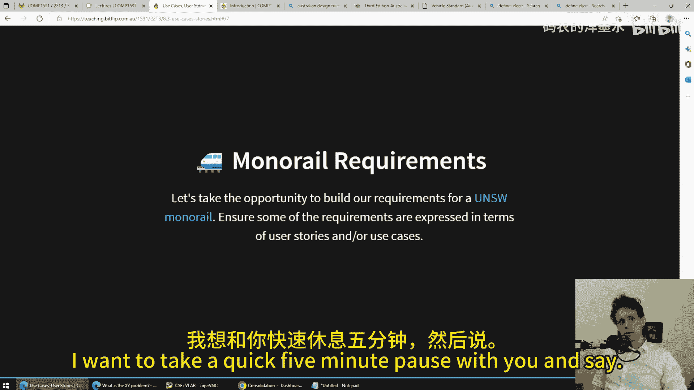

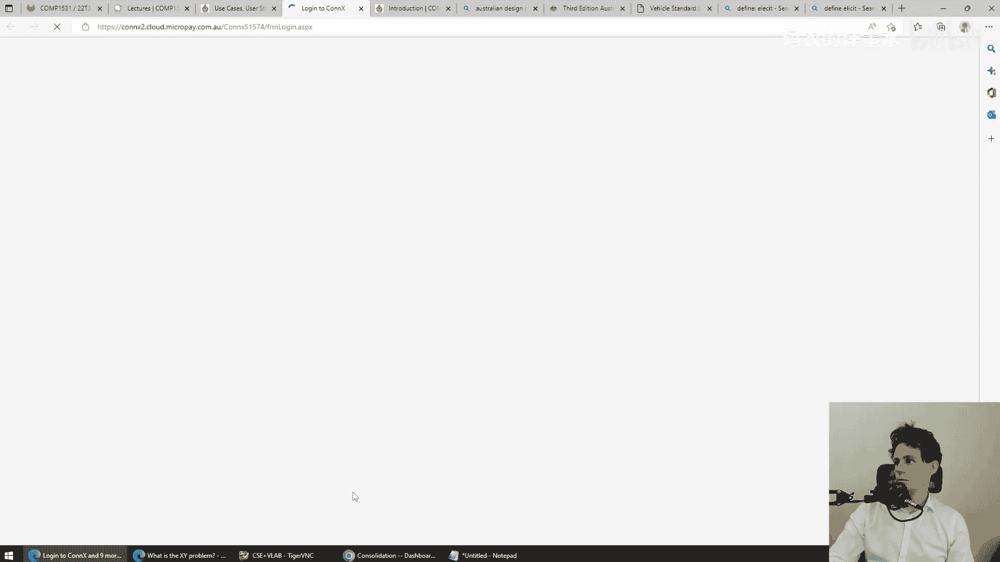

让我们通过一个假设项目来综合运用所学知识：为大学校园设计一个单轨列车系统。

首先，我们需要从不同利益相关者（如学生、学校管理层、建设方）那里收集需求。以下是一些可能产生的需求示例：

*   **功能需求**：系统应至少设有两个站点（例如，法学院图书馆下方和Scientia上方）。
*   **非功能需求**：列车在两个站点间的运行时间应少于5分钟。
*   **用户故事**：
    ```
    作为学生，
    我想要能够免费乘坐单轨列车，
    因为步行既方便又免费。
    ```

通过与各方沟通，我们可以收集更多类似的用户故事和需求。随后，我们可以绘制**用例图**来描述乘坐单轨列车的完整流程，例如：刷卡进站、登上列车、列车运行、下车、刷卡出站等。

这个过程充分体现了需求工程的“人性化”一面——通过持续对话和验证，确保我们构建的是正确的东西。

---

## 总结

本节课我们一起学习了两种核心的需求表达技术：
1.  **用户故事**：一种以“作为-我想要-以便于”结构编写的、以用户为中心的叙事性需求描述，强调用户的角色、目标和动机。
2.  **用例**：一种通过步骤列表或序列图来描述用户与系统间交互过程的方法，有助于可视化系统行为。

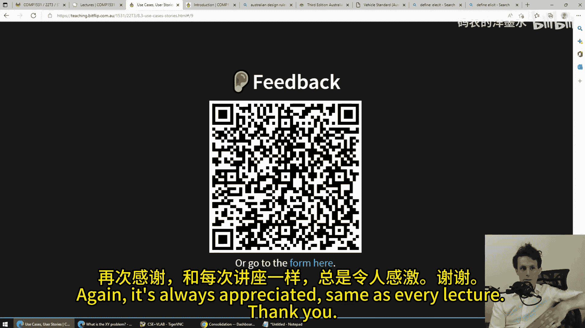

这两种工具相辅相成，用户故事帮助我们理解“为什么”要构建某个功能，而用例则清晰地展示了用户“如何”与系统互动以实现该功能。掌握它们能极大地提升需求沟通的效率和准确性。