# 【全集】新南威尔士大学 软件工程基础 中英字幕 1080P COMP1531 p06 Lecture 6 - 动态验证 -BV1M7Nwz7EGh_p6-

But， so。Today， we are really going to dig into what is arguably like one of the most important topics in Com 15。

3，1， which is the topic of dynamic verification and this falls into the bucket of the correctness lectures。

 Now， remember at the very beginning last week， in fact， about nine days ago。

 I said to you that correctness was this topic about trying to help make sure that software worked。

 that software was safe that it behaved as we expected。 and this is where this all falls into。

 So today， we will be essentially learning the reason we are learning what we're learning is because writing tests and testing our applications are the most important way to make sure that it works。

 we also need to make sure that we approach our testing that we do in the right way so that we actually yield better results so that our tests。

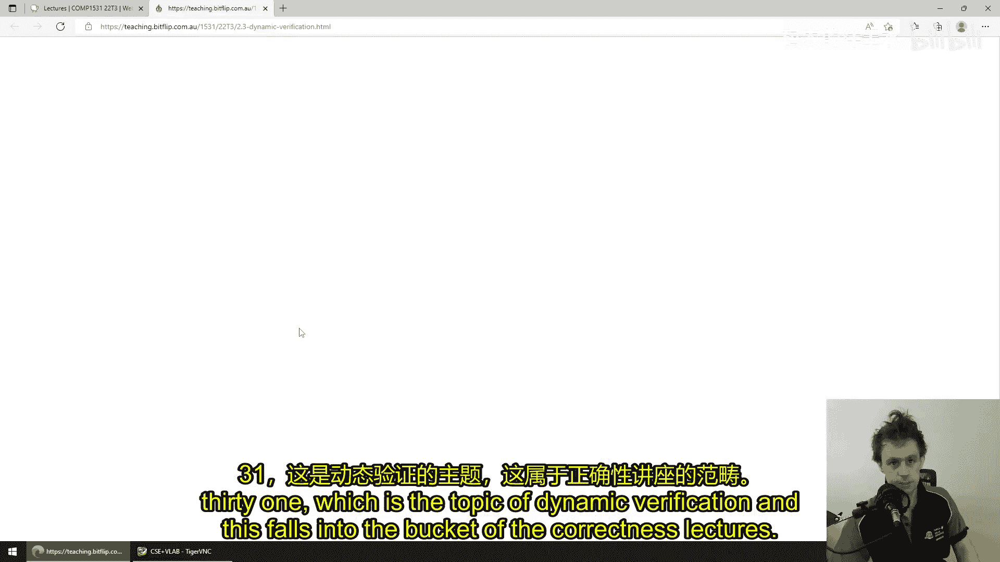

Actually do something because you can write tests that don't do anything。

 And we need to be able to understand the characteristics of programming languages and approaches in terms of how they prevent bugs is in。

 you know， how do different approaches in different languages prevent bugs in different ways。

 So we'll be talking a little bit about testing overall。

 Then we'll be talking about abstraction and black boxes。

 We'll be talking about designed by contract jest， which is a testing library with no Js jascript and then software safety as well。

 So let's start with， I guess， a bit more theory or some higher level ideas。

 And the first one is this idea of verification。 verification is an activity that essentially compares the system。

Against the requirements for that system。 So verification is just a way of， you know。

 checking does the thing do what we said it would do， you know。

 like if you build a table and the table's purpose is to hold 100 kilograms of stuff。

To verify that the table is correct， right， this is the correctness topic。

 you would put 100 kilograms of stuff on it and say， y， okay， the system， you know。

 a particular product of the system， it's way to handle weight。

 We check that against the required characteristics of that product， which is you know。

 the weight in the table。 and this can be anything it can be， you know。

 specific design standards or requirements。 But whatever it is。

 it's what it's meant to do and therefore verification is， again。

 the idea that we're going to check if the system has been built correctly。

The reason this matters back to the why， again， is just。Bad software is really expensive。Frankly。

 it's super duper expensive。 Like bugs and issues can creep up and cost companies a large amount of money down the line。

 And， you know， I've， I've seen this first hand myself。 like， y I， I always kind of think， and， I。

 I learned this through my。You know， kind of my role running a software company。

A lot of software in business is about cutting corners sometimes， you know。

 but it's really like the real experience of you in your job often comes down to understanding where you can cut and where you can't and in some areas of software。

 you can cut a lot of corners and drive the business forward and in other areas of software。

 you can't really cut any corners you know and and drive the business forward。 So you know。

 like as an example， you know， say you're working in something like you know airplane manufacturing or。

呃。You know。Car， you know， think about A B S systems or you know。

 flight control systems in planes or pacemakers， you know， medical components。

 These things need to work。 You know， so there are no cutting corners and verification is critical because if you don't do it。

 you， you can hurt people。 And if you hurt people， you lose money If you lose money。

 the business goes bus。 You know， there's a lot to it。

 So there are always times in every instance where you you just can't cut corners or it's not advisable to them。

 we need to have good software verification practices to get that working。

 when it comes to software specifically， there are usually kind of like。Two areas of verification。

That we look at with our code。 The first one is what we call static verification。

 This is the idea of testing before we even execute the code。

 Sometimes we call these compile time checks， and you're probably used to them。From。

1511 because you had a compiler in 1511。 and you know that that compiler when you went to compile the code before anything even ran。

 it would sometimes tell you if there were problems。 it would say， hey。

 this variable is not defined or if you use DCC it might tell you something like we've noticed that you've accessed an index in this array that doesn't exist。

 know it's kind of guessing or like preempting things that could go wrong So that static verification。

 but most of what we're gonna to be talking about today as per the name of the lecture is dynamic verification。

 which is the idea of testing whilst we're executing the code。 So it's writing tests。

 It's that we compile the code if we have a compiled language and then we run it。

 we're actually running tests on the running code。 So it's kind of like live testing as opposed to pretesting might be another way to think about it。

And all of this is in the name of trying to improve software safety。

 Lots of words been thrown around here。 Corectness is the idea of making sure correctness and verification are kind of the same thing。

 How do we make sure software does what it's meant to。

 But all of this is in the pursuit to improve software safety at the end of the day， right。

 Because if you help make software do what it's meant to， it means it's bug free。

 And if it's bug free， It's kind of safe。 And this word safe is really important to contrast against secure because they can kind to be thrown around again。

😊，Semi interchangeably， but at the end of the day， good security practices are a protection from deliberate misuse。

 So if you talk about cyber security vulnerabilities or like bugs that become vulnerabilities。Then。

You're talking about software security， whereas software safety is really about the protection from accidental misuse。

You know， how do you and and this makes sense， right， Like you think about you build software。

 you've heard things like edge cases， edge cases when someone does something weird。

 and then the software breaks or it seg faults。 And that's because the software might not be as safe as you expected to be because there was some accidental non- malicious misuse of that software that caused an issue。

And software becomes unsafe when it's design or the implementation。

 what you code allows for these unexpected or unintended behaviors。 for instance， edge cases。

 and particularly a lot of them happen during runtime。 And two obvious examples you know， in C。

 for instance， reading oninitialized memory or writing array writing outside the array bounds。

 as a good startt though one of the previous like co lectures of this course had。

 which was like around 94% of spreadsheets contains errors in formulas and for any given spreadsheet。

 there's a 1% chance that it contains an error any spreadsheet formula。

 there's a 1% chance it contains an error。 So basically， you know， like。

ne all the software you use is not completely safe。 There are bugs everywhere。

 and you'll find most of the time the bugs you find will not be security issues or something mission critical。

You know， I think it was an example。 I think YouTube shorts for me had to bug on all my browsers where in some instances。

1 I like。Clicked on a YouTube short on my home page。 It took me to like the short page。

 but the very next video。 And I had to scroll back to it or something very weird， right。

 But like that stuff probably happens because all that it does is an people like me for a few days until they fix it。

 So， you know， the， the criticality of getting that software and those edge cases right maybe a little less important。

 But this is all of what we're talking about。 It's all about making software safe。So。

Let's look at some examples of software safety， so。Cause， you know。

 sometimes people ask like what what is safe software， You know。

 what are different ways we can deal with it or make sure it's safe。 So one example is memory safety。

 C is not considered a memory safe programming language。 However， Javascript is。

 And the reason for that it is that jascript prevents access to memory that hasn't been initialized or allocated。

 and you can't actually access it without point of arithmetic either。

 So jascript dynamically accesses memory at runtime。 You know。

 I think for some of the younger students here， there's always that kind of misconception that。

You know， JavaScript doesn't have pointers， and it's like， well。All programming has pointers。

 It's just whether they， just whether they give it to you。

 whether they give you the power to use the pointers or not。 So jascripts， mallaching stuff， well。

 or jascripts。Using code that Malic stuff， it's just it doesn't give that to you。

 It creates that abstraction layer between， between you。 whereas in C。

 there's no bounds checking perform for array accesses。 So if you， for instance， in C。

 just for argument's sake， go and define some kind of array。

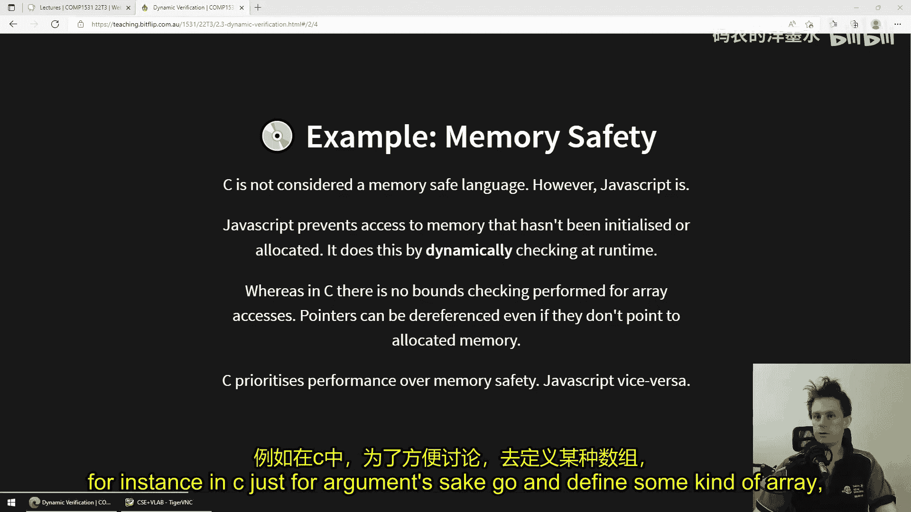

You know， you say in。Aray 5 items like this。 And then you go and try and set array of6 to be4。

 There are no kind of like safety checks when it comes to C。

 it will just let you do that and it will just deal with it， like， for instance。

 it might crash or something quite similar。 So that's why we consider C not necessarily memory safe。

 we can dereence pointers， even if they don't point to allocate a memory。 It doesn't mean Cs worse。

 it just means that the priorities are different because typically every time you add safety checks to run at runtime。

 It adds overhead。 And therefore has a performance cost。

 That's why C is generally a faster language at runtime than jascript because in jascript when you go and write some code where you say。

 you know， constant array equals onto0 or5。 If in jascript。

 you go and try and say like array of7 equals3。 you will get an error because there's something else happening at runtime whereas a C doesn't have that。

 So it's just different， but that's an example of where safety。

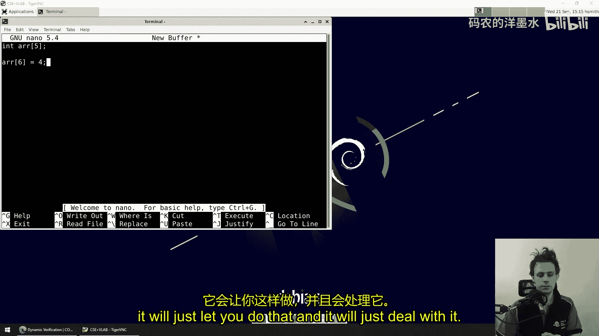

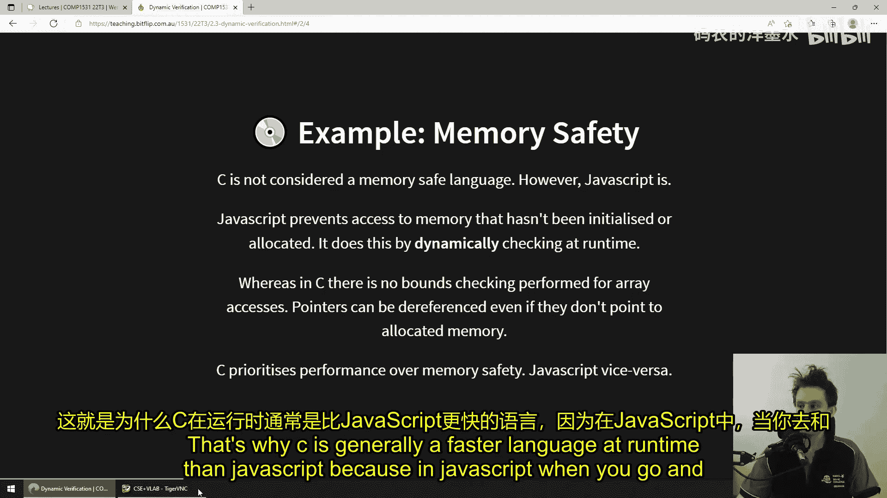

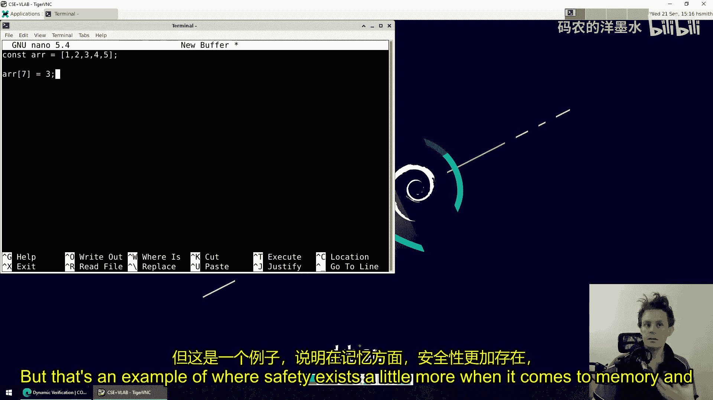

Exists a little more when it comes to memory and something like JavaScript as opposed to something like C。

A lot of this lecture is about dynamic verification。

 which is like the memory safety part to an extent， a lot of it。

Which is about how we make sure that we can make our software safer and verify that it works in every circumstance during runtime when the codes running。

 but a quick interlude for us is static verification because we do chat about this next week a lot next Wednesday and static verification is generally considered a more robust and reliable form of testing because it it kind of is very determined like the ideal world of software is that and it's just not attainable in most instances。

The ideal world of software is one where。You can write code。Right。嗯。

And you know it works at compile time。 If your code compiles successfully。 so to speak。

 then it's guaranteed to be perfect and bug free。 That's the idyllic notion of you know static verification its finest But the problem is there's only so much you can do statically know you can figure out if you define an array like I did before in C C can be smart enough to figure it out a compile time。

 But what happens if you read in someone's input from the command line compile time。

 you don't know what that input's gonna be。 So there is a limit to what you can reasonably do here。

 we'll be talking about static verification more next week with static typing and linting。

 But for now we're talking about dynamic verification and dynamic verification is when verifications performed during the execution of software and this is typically what we mean when we say testing you hear kind of testing thrown around a lot。

 do you test your software。 and most testing is dynamic verification stuff that happens when we execute the。

Where。嗯。We generally consider testing to be broken up into two areas。

 which is testing really small things。 You know， and then testing really large things。 So， you know。

 you imagine a car for a second， if you're testing a car， you could go and test， you know。

 how the mirrors work。 And if the steering wheel turns or you could test if you can actually drive from my house to your house。

 you know， and that's kind of small testing and large testing and will go into a bit more depth on all of this。

 But an important idea to remember is that testing shows the presence of bugs。

 not the absence of bugs。 And it it's one of the reasons why testing is so important because when you write a test。

 you're essentially trying to there's like think of it in theory。

 obviously in every scenario thered be some deterministic number， but in theory， there might be。

A billion different possible。Bugs that could exist。 And every time you write a test。

 you're essentially。IT to find that bug。 And if that bug exists， you're trying to highlight it。

 you know， like grab it。 And therefore， testing is showing the presence of bugs。

 It's very difficult to write an exhaustive amount of tests that prove that there's no bugs in your software。

 which is another。 you know， there's just like a limitation of software in general。

 That's why all these big trillion dollar companies still have problems all the timeca it's just。

 it's very， very challenging to write truly correct software。As， as I've just kind of mentioned here。

 So I kind of alluded to this before in terms of we can't statically test everything because there's just inevitable things that can go wrong while a programme is running that we can't predict at compile time。

 a really good example。You know。A really good example， I guess， is like。

What if you run out of disk space。You know what if you。

 what if your code uses memory and you just run out of it。You just can't figure that out at comp。

You just have to like， you know。Let that， let that be a thing。And pick it up at run time。

 that's why we need these tests，cause sometimes you just need to test for what happens when you run out of memory or dis space or something like that。

So whilst testing shows how a program is correct， the other long term benefit。 Yeah， okay， so the。

 the reason we write tests is not just to like。Find bugs。 It's also because。嗯。If we write more tests。

Then we have this kind of nice little check of our software。

 And if we have this check of our software， you can kind of say， okay， my software works。

 but software is always changing。 It's always updating over time。 And therefore。

 when you go and update it。RightWhen you go and make improvements to it。

 it's good because you can keep running these tests against your software and if the tests succeed。

 you know your software is not going backwardsca a really common way that software breaks over time is that you kind of write software without tests and it works and it works through a bit of trial and error and manual debugging but then a year later someone goes in and tries to change some things and it seems like it's working it seems like you haven't broken anything。

But， you did。And it takes a while to notice because you didn't have this kind of good array of。

 of not， you know， data structure array。 you know， just this this chunk of different ways you were。

 you were verifying that things still work， okay。We talked a little bit about testing in the small and testing in the large。

When we test small things， we're often referring to this idea of unit tests and unit tests and software are typically testing these really。

 really small things in isolation。 A really good example is like testing that a function works。 So。

 you know， if you build， say a website， that website's gonna be made up of， know。

 say the website's Airb and B。 And you got all these different things you can do on the website testing in the smaller is going through and actually looking at the code and all these little functions maybe a 5。

102030 line function and making sure that it behaves like it once。

 So it's like micro testing in many different places。 And this testing tends to be。You know。

This testing tends to be very。Transparent， it doesn't look at your code too abstractly。 You know。

 like what I mean by that is that。You know， I I mentioned before that。What if you are testing a car。

 you can test the steering wheel and the mirrors。 that' small stuff where you could actually drive the car from A to B。

 typicallyy when you drive the car from A to B。You know， you。

You don't really know what's going on in the car。You know， like youre not， like sometimes you might。

 but people who do that kind of testing don't necessarily know all the details of everything。

 whereasas this kind of small testing， it really does focus in more on just that detail。

 So what I mean by that is， you know， when someone's testing a steering wheel or a mirror。

 It might tend to be an engineer who's work specifically on that component。

 But this testing in the large one is a little bit different。

 It's where we like where we look at systems a bit more abstractly or what we call black box testing。

 And this is the idea where we we can actually test something。

 only knowing its input and output without actually knowing how it works。 And these kinds of tests。

 you can break these up into different layers。 like you can call them like module test integration test system tests。

 And they all kind of。You know， increase in their abstraction。In a course like this。

 it's really hard to， you know， find nuance between all these tests because the project you're working on and the labs and stuff are really quite small。

 But， you know， if you could imagine in a very， very， very large software system like， you know。

 maybe Facebook or something， you could， you could unit test specific functions in the code。

 you could then maybe module tests， you know， that the。

When you send a message or messenger that the message save module or the。

The raid receipt sent bubble。Module works。 Then you could do an integration test to see if。You know。

You can actually send a message and reply like tie a bunch of modules together。

 And then a system might be looking at the entirety of Facebook Messenger overall or something like that。

 There's no real kind of， you know， definitions of these defined in the laws of physics。 It's。

 it's more so just a way to get comfortable with the idea that these tests and stuff do occur at different levels of abstraction。

 But what we're gonna do is we're gonna start getting to actually。一 know。

We're gonna start getting into some more。Coding。And if you had this function right， like。

 think about this right now。 this is not for all of you。 But if you add this function， get even。

 it takes in nus， it creates an empty evens array。 You loop through things。

 You check if theyre even then you push to a new array。 We've seen something like this before。

 How would you test it。You learn。If I said to you test that it works。 Well。

 what I'd probably do if I was， you know， sitting in your position as I go and write there some code like this。

I'd go and put some code underneath， and I' just console log things out a few times。

 Maybe I put some comments there to make sure it works。 So like， you know。

 we could try and do this together if we wanted to write。

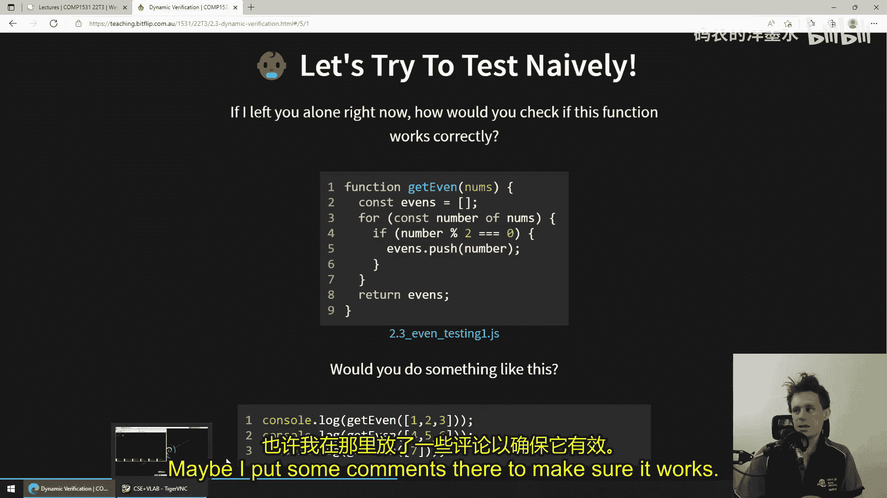

Go inside our M1 folder。Open this back up。

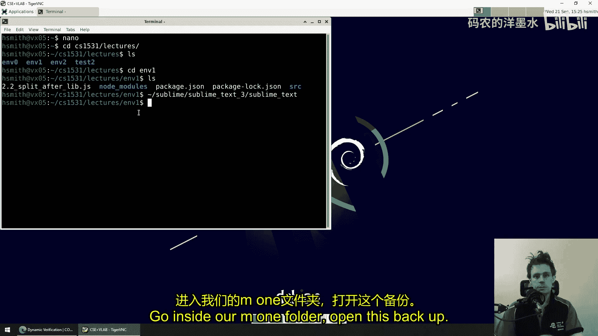

Make this smaller。

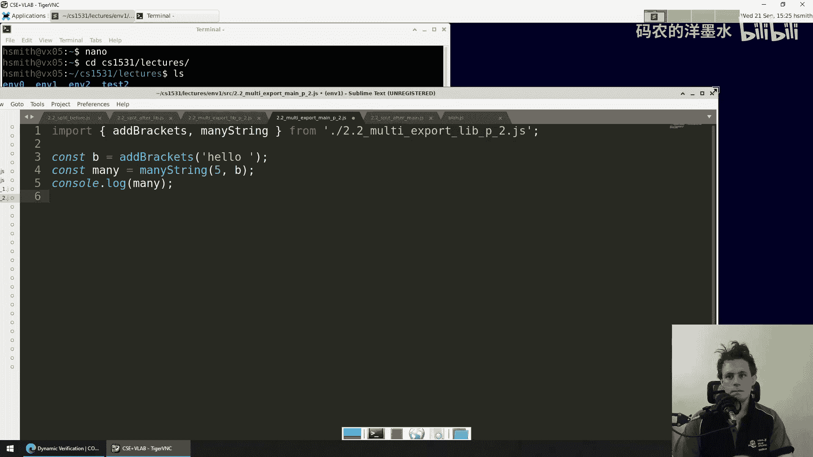

So right， what's of adjusting。Okay。What was the fall cold， Fall was called 2。3， even testing 1，2。3。

 even testing one。Yeah， so if I got something like this and I wanted to do some trivial testing on And I might go and put these console logs here。

 right， then I might run， you know， node source 2。3， even testing 1。Now。Even testing， too。

And then I get some results， you know， and， and I just maybe memorise what those results are。

 And that all kind of sounds well and good。 But， you know， the problem with this is like， what。

 what is the problem with this？ I'm sure I wrote it in the lecture slides again。

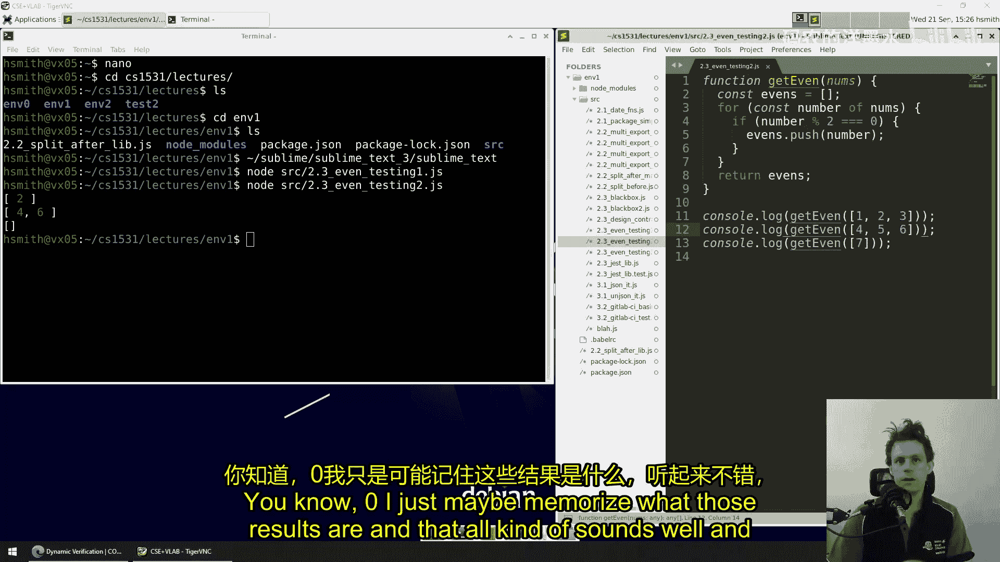

Oh， we can take， sorry。 we can take it one step further if we want， which is like。

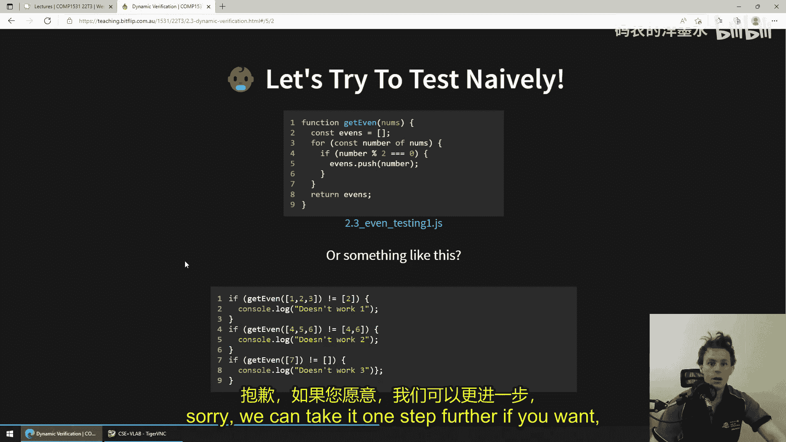

The problem with what I have here is that you kinda have to manually check it with your eyes。

 That's an obvious problem。 Like there's no programmatic way to to make sure it works。

 You have to still do some manual inspection。 If you're really smart。

 maybe you'll do something like this where you actually call the function and you compare it against another array and you see if they all work。

 And if it doesn't work， you print something out。 And therefore， you know when you run the program。

If you don't get the output you expect， which we didn't hear。Zuid。

Maybe it's that double equals thing。 I don't know。 Why did that not work。

It's probably comparing two arrays。This is a new piece of card， sorry。

Let's just compare what it does。I don't。 I think that it's probably comparing to some thing。

 So one of the problems is happens in a bunch of languages。 Sometimes if you compare to arrays。

 because even if they have the same values， you know， they are fundamentally different。

 you run into these kinds of problems， JavaScriptscripts are a little bit backwards when it comes to comparing two arrays。

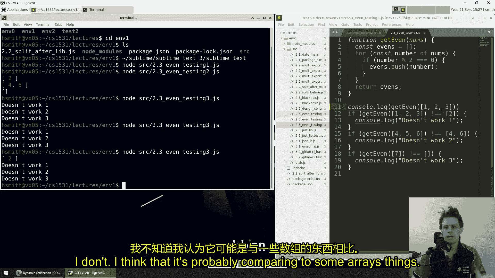

There's not a lot of great ways to do it。We'll get into this more next week。

 But in this particular case， one of the only like there's。

 there's a few kind of horrible hacky ways to do it。

 but one of them to get around it reluctantly is to actually just like convert all the arrays into strings and compare them newer versions of jascript。

 I think， might be trying to fix this， but。

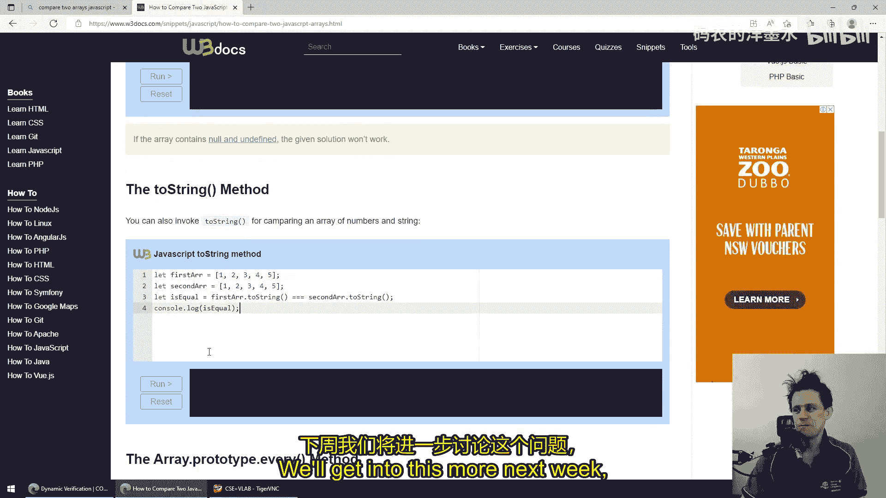

There's some， just some ugly parts to this language。 Let me make a note of that one， though。

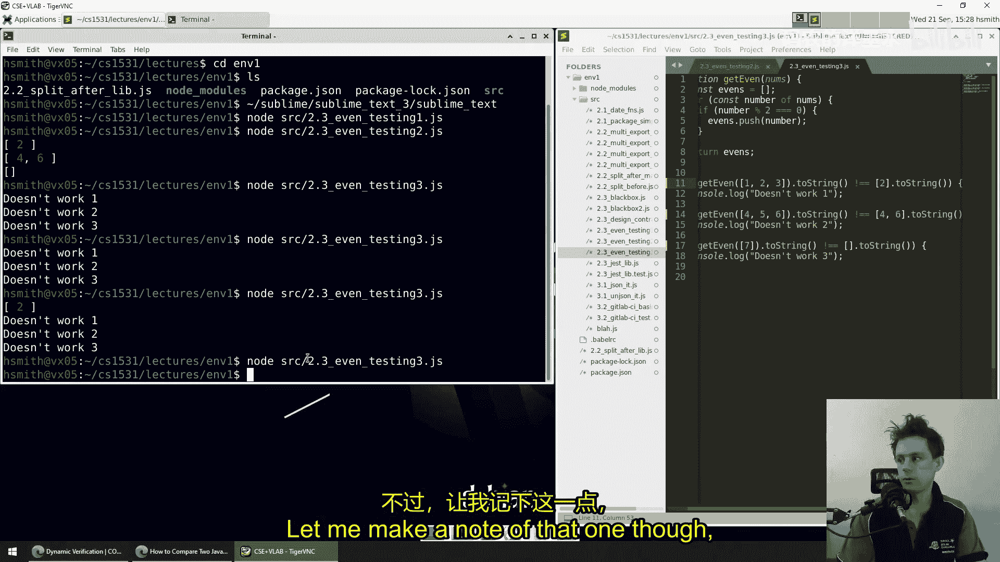

Don't like that。So that's another way to do it。 And this one's really usefulcause you can kind of scale this a little bit programmatically。

 right， You can kind of be like， alright， well， now I can just run this and it will。

 it will kind of work or not work。

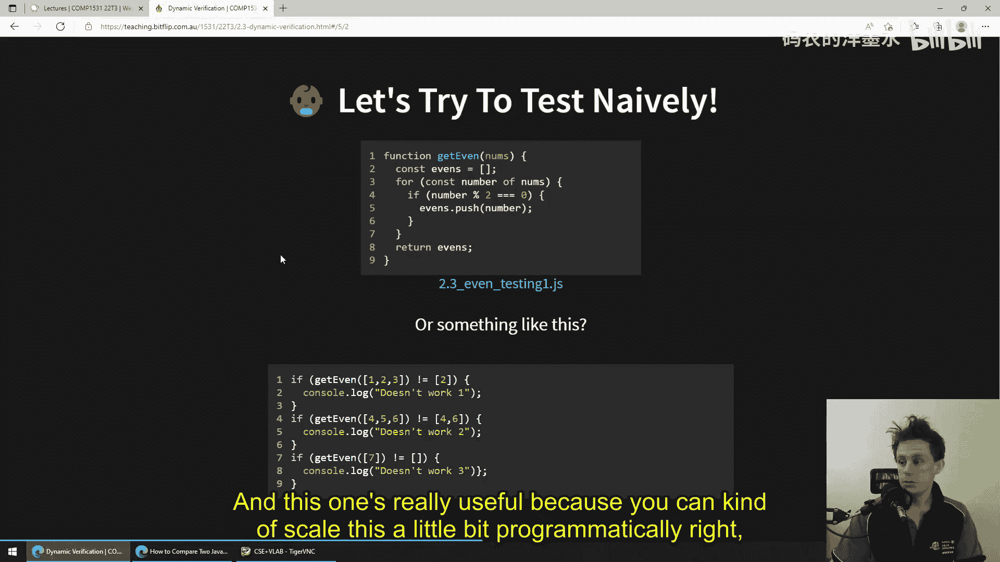

嗯。

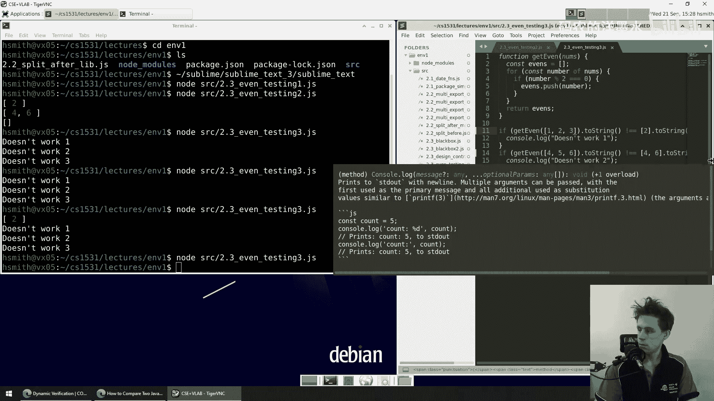

Hu。The problem with what we're doing here is that it's not really testing in the sense of the word。

 like printing errors or visually inspecting output is is a method of debugging and not testing。

 You could argue that what we did with the if statements might get a bit closer to testing。

 But the problem is you are still then just relying on like when I ran a program did it not print out any strings。

 How does that work if like running the test actually prints things out too， You know。

 it gets really complicated。 And therefore it doesn't scale well。

 So we need a scaled approach to testing。 And a scaled approach to testing is。呃。

Where we have to start looking at black box testing first， because that's kind of critical。

 But then we can go and play around with the scale element。

 So if let's first have a look at black box testing，cause this will。

 this will kind of underpin a lot of what we're talking about。

 So it's good to take this little interlude， so。Most testing we do。

Relies on the idea of testing abstractions。Right。And like testing abstractions is really just a fancy way of saying。

 sometimes we're gonna test something without knowing how it works。 And this is true for function。

 Sometimes， right， You might use a function in C like printf。 You know what it does。 You know。

 you know how to give it。Like， you know what to give it。 You give it some stuff。

 and you know what it's gonna do for you， But you don't actually know how it works。 And therefore。

 we're focusing on the high level understanding of the problem。

 the function and they're not worrying about the underlying detail。

 And I mentioned this before when I talk about cars。 It's like。

 when you drive a car or use your computer， you know how to interact with it。 You know。

 you've got a keyboard and a mouse or a touchpa and you do stuff with it and it gives you things back。

 but you don't know in a details of how it works。 So when we look at testing a lot of the time that we test systems。

 We test them in an abstract way。 And when we look at them in an abstract way and test them that way。

 we are treating them as what we call black boxes。 We call it a black box because it's a box that you can't see inside。

 You know， it's dark inside there。 So you're testing a thing you don't know how to see inside and know how it works now。

What's interesting about this is that it allows us to actually write tests for code before we know how they work。

 So let's like look at two examples here， right， We've got this like file 2。3 black box。

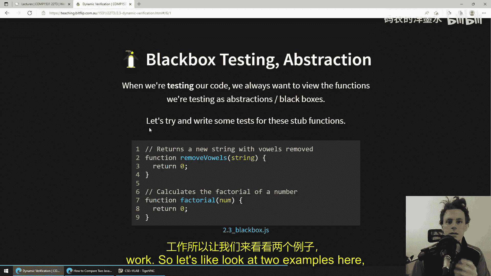

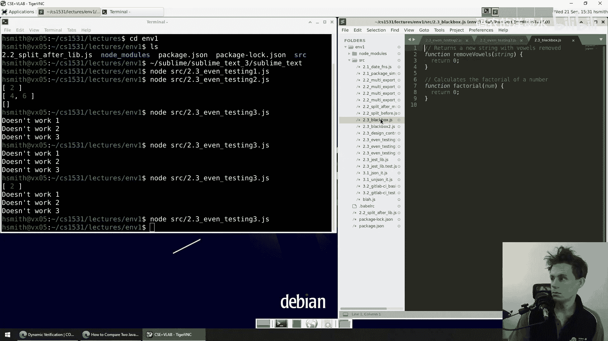

And in that file here， we've got like remove vows and factorial as well。

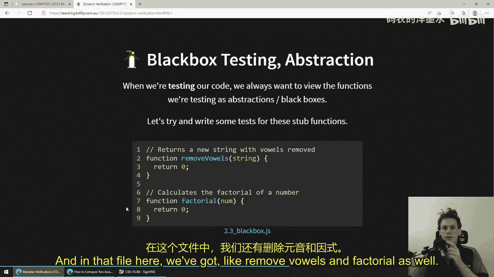

Right， two functions。 The first function， as it says， returns a new string with the vows removed。

 The second function calculates the factorial of a number， yeah。um。We don't know how these work yet。

cause we haven't written the code for it。你 know。But what's interesting is we don't need to know how they work to actually write some tests for these things。

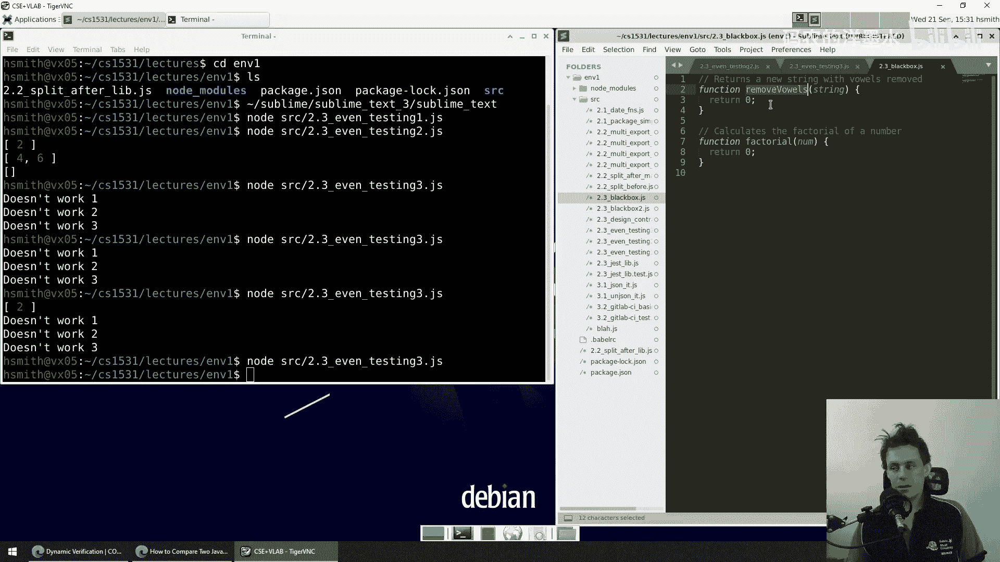

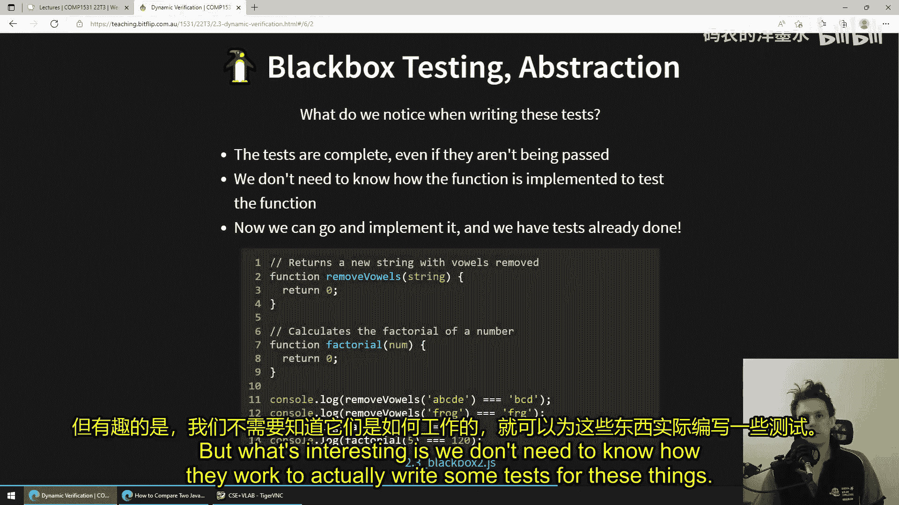

We can go and write tests that aren't complete yet。 Sorry。

 we can go and write tests that are complete for something。 We don't know how it works。

 So if you have a look here， I've written two tests tests， debugging whatever you wanna。

 whatever we wantna call them。 I've written two tests for remove vows， where I pass it， ABC D E。

And it gives back BD。 And then I have another test for vows。

 which takes in F R O G forrog and it returns F RG。

 And then I can test factorial by putting in 3 and getting 6'cause3 factorial is 6。

 and then I can put in 5 and get1 hundred and 20'cause5 factorial is1 hundred and 20。

And this is approaching testing in a black box fashion。

Because we now are testing how this works and we have no idea how it sorry we are testing that it behaves like it says it would without an understanding of how it goes about that behavior。

And this is really， really， really powerful。 It helps you write simple tests。

 It means you don't have to worry about how everything works。 You can just kind of go in and do it。

 But it most importantly and most relevant， for the project， it helps you。

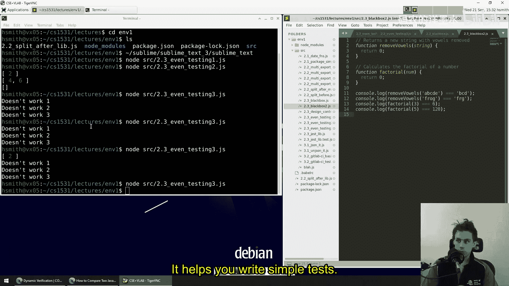

Write tests before you write code。And writing tests before you write code is critical。

 we'll probably come back to this too， but the reason it's critical is because when you write code and then you test for it。

 you approach it with a certain degree of bias， you approach it knowing how your code works and therefore you instinctively whether you realize it or not。

 end up。嗯。Kind of only testing things that workcause you want， you know， you。

 you have like a conflict of interest， right， You have an。

 you have a vested interest in in getting your code to work。 Therefore， when you write tests。

 you're going to tend to。You know， test things based on your understanding of what the code can do。

 So think of it like。You know， when you build a system， you'll read it， you'll read a document， say。

To simplify it。And that document will tell you how the system works。 Youll go and build it。😡。

And over here， you'll have built it。 So you know how the system works。

 But you might have lost something in translation between that document and the system。

 And even if you go back and read the document after the system' is built。

 you're gonna kind be reading that with a bias about how it works， so。

That's why wherever possible we always try and write tests prior to actually。Implementing things。Now。

Scaling testing。Beyond this console log if statement approach is possible with what we call testing frameworks。

And a really popular testing framework in JavaScript is called Jest。😡。

Gest is a framework that's installed with NP PMM。So we can install it with MPM。

 just like we did on Monday with。What was the library we install on Monday， date functions。Sorry。

And justest testing looks a little bit like this。Looks a little like jascript。

 It looks a little bit different。 I mean， it is jascript。 There's a few kind of funny parts about it。

 but you can kind of annotate things a little bit。 So in this case， we're saying， well。

 I'd like to describe a test where we're gonna， we're going to describe what users should。B。

I'm in a set a variable called name that's Hayden， and then I'm going to run a test。

 which is to check the name。 and then I'll expect that that name is equal to Hayden， right。Now。

 this is not obviously a very good test。 It's kind of a stupid test。

 but it's the general code structure that we're going to be interacting with。So。

Let's say for a second A a second that we have a function called remove valveels like this，2。3。

 justlib and。

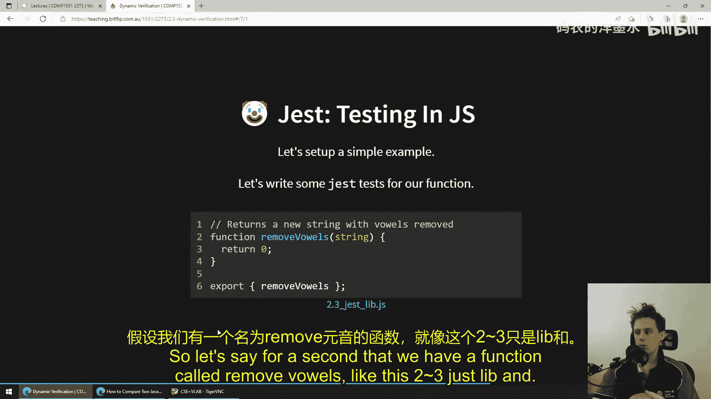

We know that it returns a new string with the valves removed， right？A。We export it， too。

 because we want to， we want to import that somewhere else。 So we can， you know that you there's。

 you know， every time you declare a function in a file。

 you either need to use that function in the file or export it， basically。

 otherwise it achieves no purpose。 So in this case， we are exporting it。

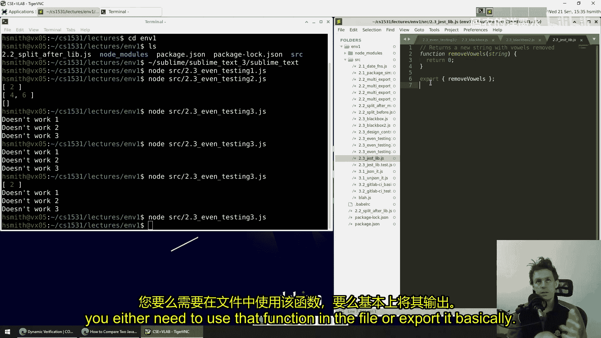

However， if we want to start doing some testing， we want to use the Jeests library。

 We have to actually NP PM install jest。 Now， one thing we didn't cover yesterday with NP PM is that when you NP PMm install something。

 you can sometimes add this dash， dash， save， dash dev flag。

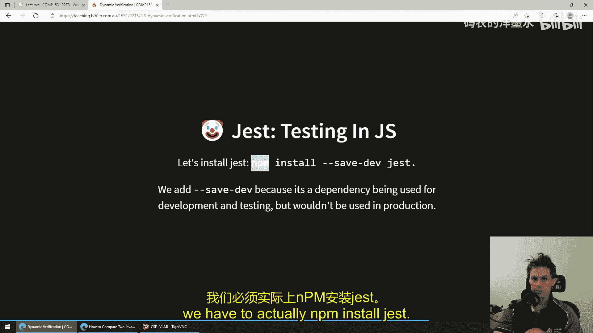

Right。In this dash dash save dash dev flag。 what it does。

 and it's very subtle here is that it adds your dependency。

 It's already even installed on these lecture notes。 It adds the dependency to a different place。

 So you see that these are the normal dependencies here。

 like the ones we did on Monday where we have the date functions。 But these dev dependencies。

 which are where it's put when we have the save dev there。

 you'll see this if I get rid of jest for a second， right， And then I MPm installed it。

 it'll put itself， it'll put itself in that spot， right。There it is。

It's very kind of difficult to articulate to you the difference when you haven't kind of gone too deep in the coding。

 but。A lot of jascript code that you make is actually。

Some of the libraries you used are not necessary for production code。

Is in when when you do work on your own computer。You need certain libraries。

 but there are a lot of those libraries you don't need if it is。

Sitting on a service somewhere running， you know， production for other people to use it， you know。

 you know， it's like live。 So for any library that we install that we think， well。

 this is important for me， but not important for when this is actually published during production。

 we install it with save dev。 And it essentially just means that when you have production builds。

 you don't have to install all these modules that you're not using。 If you don't do that。

 everything's gonna be fine， it just kind of adds bloat to your software， which sometimes can be bad。

 but you know， you survive either way， But now what I've got is whilst I've got my little black box。

 sorry， where is it whilst I've got my little。

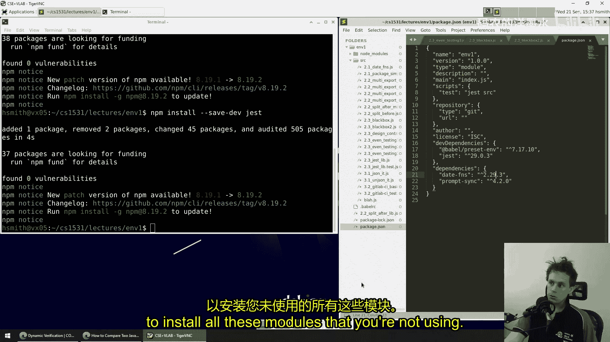

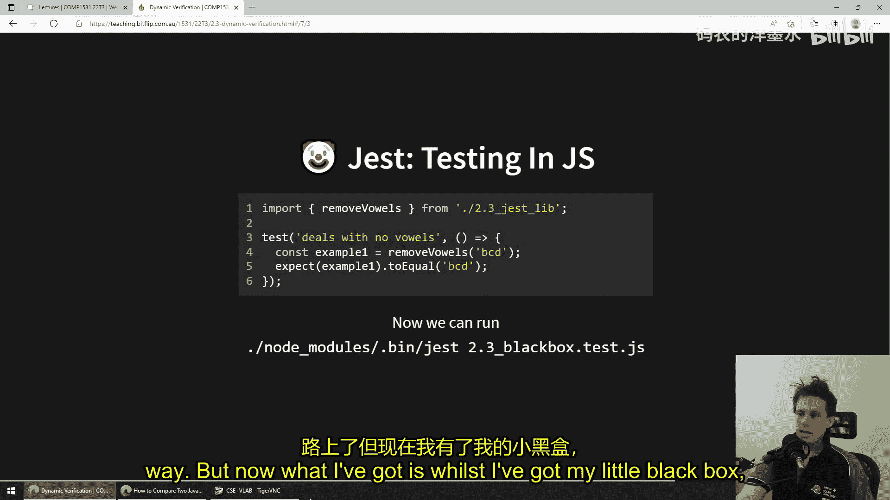

嗯。More was Jeest Lib。 I've got my Jeestlib file with my remove valves。

 but I've also created another file， and this file is called 2。

3 underscore jest underscore Lib dot test dot J S。 So I've added this little dot test dot J S here。

And what I've done here。Is that I have gone and imported the remove vows function here from the file。

 right， so I've imported it successfully， and then I've written a whole bunch of gest tests。

So I've got my describe。 The describe can be anything。

 anything that's yellow and this screen is up to us。 Like it's just strings。 I've gone and said。

 well。Oh，对。I'm going to go do a bunch of tests for remove valves。And here， like my five or six tests。

And the first test is， I'm going to test for。I don't know why what it says deals。

Maybe just say strings or something。 I'm gonna test what happens when I try and remove。

Vows from a string with no vows。 See what happens。 You know， So if I remove the vows from BD。

 I expect it to be BD， and then I'm going to try and remove vows from strings with only vows。

 So if I try and remove vows from AeI， I should get nothing。

 And if I remove vows from O I U should get nothing as well。 You know。

 words starting with vows ending in vows more complex words with vows all over the place。

 So this is me kind of essentially testing different edge cases。

 And the j syntax here is kind of obvious。 it's these describe the test， the expect the two equal。

 But jest itself is actually a relatively straightforward framework to use。😊。

Because you have these really kind of high level keywords like describing and test。

 which are just ways of sectioning tests apart， but most of your testing really comes down to lines that look like this where you say。

 I expect that a particular variable is equal to something else and you can do a lot lot more with this。

 Matthew says a framework is the same as libraries。I'd also say that， like， you know， a library is。嗯。

So， really struggling。 A library is essentially an isolated or like segmented piece of code that you can use that someone else has written。

 You know， it's like a book。嗯。Whereas a framework is often a library that。You know。

 maybe has some like approaches and structures around it。

 So like you'd call the date functions as a library because it's just a collection of functions that you can use。

 whereas jest you'd maybe call a framework more because it's not just a library。

 but there's ways of using jest。 you know， there are patterns。

 There are common practices and a few other things like that。

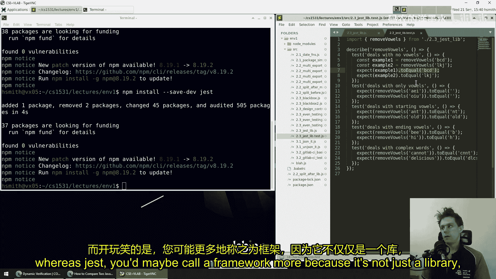

So if we write that jest code like we did here， we can actually run that。

 And this is where things also get kind of interesting。 What。

 another thing we didn't talk about on Monday， not that we should have。

 but let's more just deferreder to today is that。

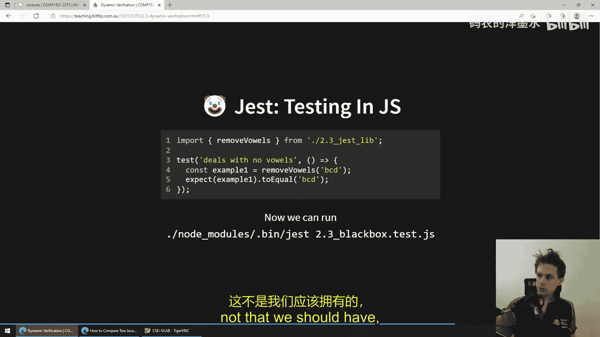

Often。When you NP PMM install a library。You install a bunch of code。

 and that code is just meant to be imported into your code。 But for some libraries like Jest。

 if I go inside of node modules， right， there's a。These are all kind of code and libraries that your code might import。

 but in some instances there's a file， a folder sorry called dot bin inside of node modules and this has all of the kind of programs you can run because when you NPpM install something。

 it can either be a library with a bunch of code that you import into your code。

 it can be a literal program that you can run like GCC Git node。Or both。You know。

 and jest is really interesting because。Just here is a program itself and we can kind of run that if we try to。

 it's an actual program and you'll see it'll give me kind of options as if it's an actual program。😊。

You， and in this case， it's not too happy。But if I go back up here。

 what this means is that if we write some tests like in this 2。3 jest Lib dot test。

 I can actually run that by running the jest command， right。

 which is in the node modules cause we installed it， and I can just run source 2。3。Jestlib dott dots。

Now what you'll see is these tests fail。And this is a really， really。

 really important point because there is a distinction。

Between your tests being complete and your tests working。

So what you'd say here is that your tests are complete。

 And the reason for that is that for argument's sake。

 they cover all of the edge cases that we're interested in。

 I have written all the tests the tests are done， but nothing is passing。

 And the reason nothing is passing is because the program hasn't been written。

 like the function is not done。But that's okay。 Like。

 don't justca it says error and it says 5 failed。 It doesn't mean that you've done anything wrong。

 This is just like a necessary step。 So as part of the， you know， the development process。

What we do is we， we frankly just come in and go， well。Our tests are done。

 They're testing everything they need to。We run them。 Everything fails that we expect that。

 So now we go and actually work on the remove our function。 Now。

 it's an easy way to do this function。 Well， you know。

 you could go into the whole string equals string dot replace and just replace。You know。

 a with nothing。 you do that for the other vowels， right。And then just return string。

 That's one way of doing it。 Just remove all five bows。OK。Now， some things are working。

 but some things aren't。 So let's go and have a look at our test。

 So this is us now using our test to tell us if our software works。 What are we noticing here。 Well。

 we see that deals with starting vowels failed because we tried to do it on OLD and we got OLD。 Well。

 that's just a typo in my test， right， So you do make mistakes in your test sometimes that's okay。

 That's bound to happen eventually， So I I fix up my test there because that was an issue。

 run it again。Okay， I've got two fails this time。 I can see that my other fail is this B E thing。

 which is that 1 I tried to remove B E E。It only removed1 B， as you can see。

 I expected it to be B like this， but it actually was B E。 So now I go， okay。

 now I need to learn more about jascript。

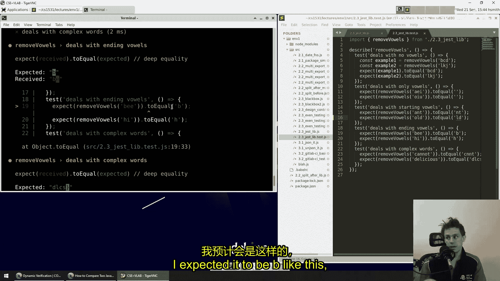

Javascript replace all。Occurrences。Okay， well， here go。 There's a jascript function。

 which I probably could have found through a quick Google， which is replace all。

 So there's not just a replace function， but a replace all'cause clearly replace just replaces the first instance of something。

😊。

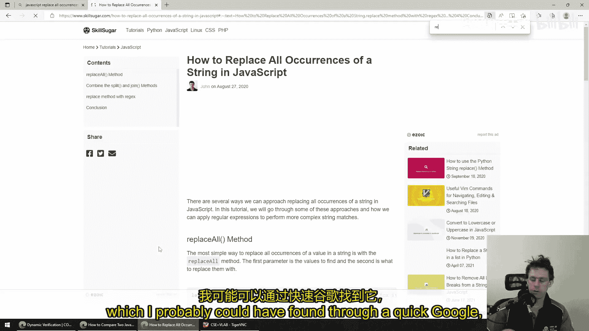

Okay， now we only have one fail and that that one fail probably looks like a typo too。 Yep。

 see another typo。 run that again。Now， all our test pass。 And this should be really exciting for you。

 because when we've set ourselves up in this particular situation， we have given our， we have。😊。

We've basically been like， yep， it all works fine。 We know it works fine， which is good。

Any questions about this so far？So。Jacob says。Can't you just write assertt statements？

So some of you are probably familiar with assert statements。 The problem with assert statements。

 though， is that they don't really scale well， like assert statements are they， they're not。

Testing frameworks are really handy。 You'll kind of come to learn this in the following weeks as you。

 you see how you can， you know， set up groups of tests and execute code before all those tests or after all those tests。

So asserts maybe work okay if you're just doing a little bit of stuff， but， you know。

 it's good practice to get more comfortable with these larger testing frameworks is is the short answer there。

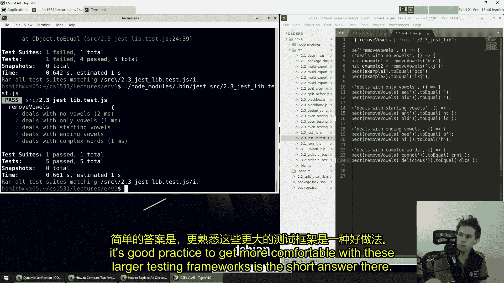

So that's， you know， that's the test we ended up with。 Obviously。 Now。

 one of the interesting things about how no JS works and how NP PMM works is you saw before that to run this。

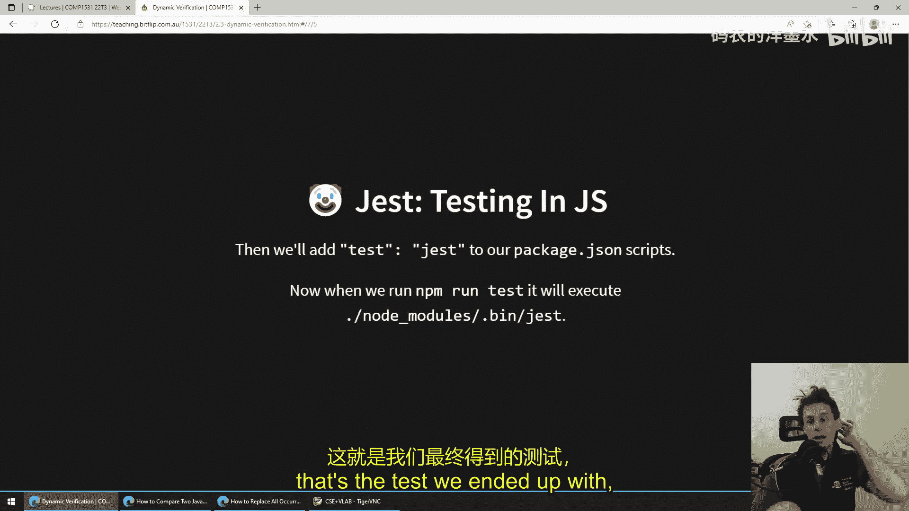

I to do this dot slash node modules， dot bin slash jest thing。

Whereas I can actually create a shortcut for myself， right， where if I want to， I could say that。

 well， when someone runs。NPM run test。 if you don't know what I'm talking about。

 trying to remember the， the last。Lecture and a half。嗯。

I can say if I run test that I want it to run you know。

 node modules slash dot bin slash j slash saw slash 2。3 js dot Lib dot test dot G Js， right？

 And that's very handycause now on the command line， I can just run NP PMM run test。

And it runs that test for me， however， whenever I'm referring to commands inside of the scripts here。

 I don't actually need that node modules do bin because what NPpM does is that when it sees commands like jest in the line。

 it will actually go and look up see if a program exists in the node modules dot bin folder called jest and it will run it for me that way。

😡，Right。嗯。So that's good。 And then jest is also more powerful because what we can do is we can actually just say jest source。

 We don't actually need to give jest a particular file。

 Jeest will happily take in a folder like this。😊，You know。嗯。The whole of the source folder。

 and it'll go look at all the files there。Daniel says。

 how does Jess even know which files contain tests。 Can we have multiple of these files。

 these what are the test suites are。 So Jes is always looking for patterns。

 The reason Jess knows that there's one file here is because it only sees one file with。U。

The dot test， dot J S， because by default，'s I think there's a few different ways that Js looks for things。

 One of them is the dot test dot sorry dot Js thing。

 So it goes the combs through that folder looking for anything that's dot test dot Js。

 and it goes and grabs that。

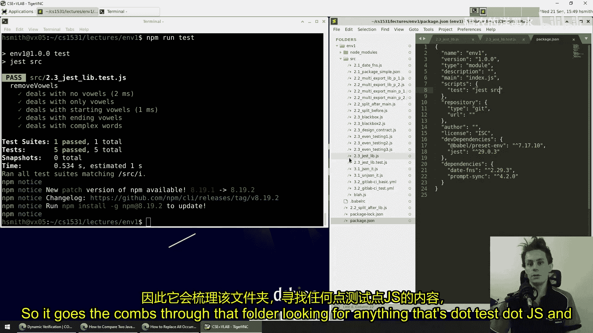

So that's just a handy little tip。What else we got。I want nearly it the end。 That's good。去。

So a question that comes up a bit is like， you know。

 what's the structure I should have with my tests。 Well， every time let's。

 let's look at the the words。 So the general structure you should have is that the outermost like describe keywords describe like areas of tests。

 So let's say again， you're testing a big system。 you might say， you know， you're testing，Messenger。

Upload a photo。You know， then you might have another section that's like upload big photo。

 upload small photo， upload photo from file system， upload photo from camera。

 And then as you get into the test level， that's when you're actually testing specific things。

 So you can kind of nest describes。 You can actually have a lot of describes if you'd like to。

 like this can go as deep as you want to。 In the case to think about iteration 0， right。

 We have all these or functions。 So you might have a section like I'm gonna check test all the or capabilities。

 And then I'm going specifically test or register。😊，And then within off Reg。

 I'm going to test these specific use cases like that it fails on an invalid email and a whole bunch of other stuff like that。

 which you'll kind of get to in iteration one。 So that's one of the rules。And then generally。

 what you also try and make sure is that one test for one thing。

That doesn't mean that you can't expect。Multiple。Expects to be in there。You know。

 so like as you kind of saw up here。We did only have two expects in each case。

 but we could add more of those if we wanted to。 It's just that the point is that all those expects are testing the same thing。

So， each test here。Test a thing。And if we have multiple expects。嗯。Then。like。

 what am I trying to say the。What is bad practice。Is if you have a test that tests different things。

 Because ideally， if one test fails， it means there's one behaviour problem。With your code， you know。

 so you， you wouldn't wantan to combine some of these together。 But you， like， you know。

cause obviously， you could put all these expects inside of one test， for instance， if you wanted to。

You know， really need to worry about that part。 That's just me adding things to the lecture slides。

 Basically， we're saying that。Don't ever think some things。Okay。Last topic before we have a break。

 is this idea of design by contract。um。Which is that when we're testing or implementing a function。

There's a couple ways of thinking right So like a very kind of cybersecurity eque way of thinking is defensive programming。

 which is like if you have a function called remove vows in jascript。

 you expect anything in everything to be passed into that。

 you don't expect that people pass in strings， you test for numbers you test for arrays giant array。

 tiny arrays objects， objects of arrays like you just kind of test for everything under the sun。

 But another approach is when we we talk about design by contract and design by contract is when we only really work or test with the constraints that are placed on it。

 So， for instance， if we have a function called remove vows you know and it says that the input is a non-empty string type and the return is another string。

 we can depending on what your team and how your programming is set up。

 we can say that our input is a non-empty string。So as in what we test for and what we prepare for is that all inputs are just they're not going to be empty。

 they're definitely going to be strings。So， you know。

 it's a string and you know it's not going to be an empty string。 So therefore。

 you only kind of have to test that。 Now， is that bad practice。Depends， right， like。

This function might be being used or called only by functions。That have already checked for。

Nonempty strings。 Check it's an non emptyty string。

 So you testing this might be completely redundant in the context of a larger software system because someone else has already done the checks。

 It's part of another piece of software。 This is also where like， you know。

 communication and understanding of the problem is like really， really， really critical。

 But the point is that a lot of what we kind of do in 1，5，3，1 is if we kind of say to you， hey。

 this function takes in a string。 Then， yes， you need to check all the edge cases and variances of if it。

 you know， what different kinds of strings it could be。 But you don't need to check if it's a number。

 or something like that。 You can just assume that it is a number。That's the end of dynamic testing。

 Are there any questions that have come up from that。Like sure， I'd be curious。

 I know there's a few less people here today， but be curious if people are confused about anything。

 have any questions about anything。 now's the time to ask。

Jacob says would we use Jess for next week's lab so yeah all the week two lecture content comes up in week three so next week in week three we're going to be getting you to use like multiple files。

 NP pm jest， writing tests and similarly for iteration one which you'll start on next week you'll be using jest as a big part of the iteration so that's why today's lecture here is quite important。

Iteration comes out on Friday night。 All the iteration。 Oh， wait， sorry， my bad。

Iteration  zero is due on Friday night， but we， we release iteration 1， probably on。

 on Sunday evening。 that'll come。 that the specific timing will be shared in the。

 the notice that we send out on Friday。But it'll probably be Sunday night， I think。Cool， well。

 thank you。 Please leave some feedback if you can。 Its always appreciate。😊。

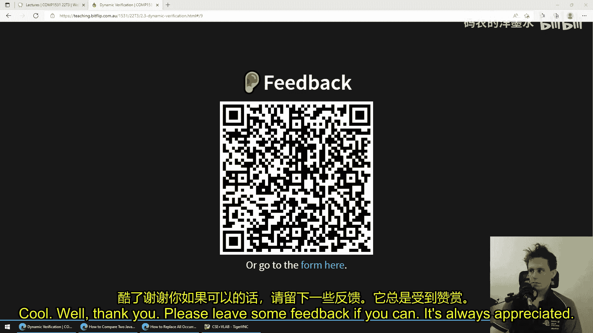