# 【全集】新南威尔士大学 软件工程基础 中英字幕 1080P COMP1531 p07 Lecture 7 - 团队协作 -BV1M7Nwz7EGh_p7-

The last part of today is gonna be digging into。A slightly less codedy lecture。 It it's a very。

 it's a very coding， heavy start to this course。 Like the first， honestly。

 the first four or five weeks are just like code code code， lots of programming。

 But the latter parts of the course are more like theoretical And this lecture is kind of one of them。

 which is a topic called coding together working as a team。

 It's part of the theme of learning how to work together， Like with Git。

 And this one is specific to how do you actually not at the coding level。

 But how do you like work together as people， because you know。

 Git was all about how do you work together as coders， in a sense。 But this is more about people。

You know， or the software engineer or something。It's obvious why this is important。

And we're going to be talking about。Agile practices， stand up， sprints， task boards。

 meeting and minutes。 we're going to be talking about quite a few things here so。嗯。

What I think I want to preface this is that I could talk a lot about teamwork。你哪儿。

I could talk to you about。For hours， right， I've done on my YouTube page。

 there's a talk on it for like two hours， It's about like how how to get the most out of people。

 how to have them work together， could talk about my experiences leading。

 you know it' a company of 20 or some student groups of 10 to 70， you know。

 there's like lots and lots of stuff there。 But what I've found genuinely is that for the majority of you。

 this is the first time you've meaningfully worked together with people in an engineering project。

 And what's hard about that is that if we get kind of too abstract or you know kind of hear all the lessons to learn。

 it often falls on deaf is quite a bit。 if it's really early people。

 It's a little bit like if you've never flown a plane。 And I just tell you how to fly a plane。

And I show you some slides for an hour。 It's like cool。 But until you're actually there。

 plains about example， until you're there， and you've made some mistakes。

 which you don't wan to do in plain， of course， maybe， maybe a better example would be like。

 you know， how to。😊，You know， baker cake or something， you know。

 until you've actually like felt it until you've like baker cake， Let's stick with that， right。

 Like until you've actually gone and said， well， I can I feel the I feel this part was more stressful than I thought this part was easier than I thought once you have that。

 it's actually really easy to then go in and talk really practically about teamwork。

 So I'm a big advocate for trying to structure your program in a way where like in 1，5，3，1。

 we talk about a lot of fundamentals。 But you know， as you go further through your degree。

 other courses can dig a bit deeper into some nuanced stuff。 You know。

 So we'll still talk about a lot today， but I just want to convey that I don't think this is。

Complete， like in can totally enriched as much as it could be。 I just think that it's。

 it would not be a great use of our time at this point in your journey， so。Firstly。

 it's a bunch of stuff here。Firstly， we're going to talk about agile。

 Have you heard the term agile before。 Most people have heard the term agile， thrown around a bunch。

 You know， we're an agile company。 We're part of an agile team。 You want。

 We want to see you have experiences with agile practices， agile methodologies。

 It's talked about all the time。 But we want to understand a bit more about what it has to do with computing。

And。If you have heard the term before and you've heard it in a bit more detail。

 a really common way you hear it is when people talk about sprints or scrum masters or something。

 And these are all ideas about how to structure a team in an agile way as if it， if it's a very like。

Heavy framework kind of thing， you know， like a soccer team has like a netball team has， you know。

 goal defence and centres and goal attacks and a whole bunch of stuff like this， right。

 And most sports do。 And it's it's painting agile in that kind of way。 And whilst that's true。

 And there's a lot of merit in that and there'd be a bunch of companies that approach it like this。

 we more want to actually talk about the philosophies and principles that inform thegile agile methodology because。

Agile development is very much a philosophy。But once you start getting into the hole。Spprint。

 scrum master and stuff like that。 It really gets more into a， you know， a particular practice。

 which is derived from that philosophy， But we're less interested in an interpretation of the philosophy and a practice and more。

 you know， focused just on looks focus just on the philosophies themselves and。

This is just a web page out there， Agilemanifesto。org。

 which highlights really the key tenets of what informs agile development。

And this is summarized by four key points。Which is that agile focuses a lot more on individual's interactions rather than processes and tools。

 What this means is that。Talking is more important than how a Gitla works。 You know。

 actually having a good relationship with the people you work with and being able to communicate with them and discuss with them and negotiate with them is。

 is just better than。You know what you can automate through Gitlab。

Working software is more important than comprehensive documentation。

 This is the idea that as much as possible， we always want software to。Work fundamentally。

 rather than kind of have like a clear documentation of how the software should work。

 but it doesn't work， right， because like strong documentation is important always， But， you know。

 most of the most of the time we're building software because these are generalizations again， right。

 and not all of them can be applied everywhere。 we care about software working more than we care about it being well documented。

 And a big part of this is because a lot of software， frankly， is it doesn't live very long。

 You know， like。My， my colleague， Rob， often talks about the half life of software， right。

 Most of you have done science in school。 You know， what's the half life of of a uranium isotope。

 right， It's like， okay， you write some code and most code has a half life， a period by which。

 you know， a short half life everything has a half， not。

Like a lot of code can have short half lives in the sense that within 12 months。

 a lot of codes either changed or removed or rewritten。 You know。

 so sometimes it's really focused on just getting the software workingca documentation often in reality can change。

 can need to change much faster than it does， which can make it useless again。

 depending on the context。 it says that customer collaboration is more important then contract negotiation。

 this is really just a way of saying that， you know， when you're building software。

 it shouldn't just be like， you sit down with someone， you know， at the start of the year。 and。

You decide what you're gonna do and what you do for the rest of the year。You know。

But it's actually saying you need to talk to people and have an ongoing dialogue with them because things change。

 People change as。 People learn more。 they understand more， et cetera。

 And then the fourth one is that responding to change is much more important than following a plan。

 This kind of ties into the previous comment。 But it's a bit broader than that， which is that。

You know， even what you do as a team， you decide to do this next fortnight。 Sometimes things change。

 Sometimes things come up。 Sometimes there are bugs you need to fix or issues you didn't realise were as large and you can't get too fixated on what the plan was。

 You need to be quite adaptable。 So that's essentially like， you know， a set of agile philosophies。

 if you will。You know， and。The summary。Aileles， of philosophy and culture that's used to inform a range of different processes。

 The processes that you take on are really kind of up to you to an extent。And。

Whilst these processes will change between teams and organisation。

 most of those philosophies and principles will carry through， frankly， you know。

unless you're dealing with。Very unique kind of software becauseuse， again。

 a lot of this kind of agile approach。Pays itself very well to most software。

 which is focused on kind of speed and customer satisfaction。

 whether that customer customer is a large organization or an individual person。But， you know。

 there's always times where that doesn't， isn't true。

One thing that's talked about a lot when agile is like agile versus waterfall。

 you kind of see this idea where it's like the waterfall method of engineering is that it's like the software software development lifecycl。

 except， you know， you start with your requirements。You finish with。You finish with， you know。

 testing and all of this。 You， you might be thinking implementation and testing don't look the right way。

 Hay and why are they that way， You said they should be the other way Well， you know。

A lot of these rules we have are generalized across engineering。

And one of the things is that like if， and a lot of like a lot of engineering practices kind of most fundamentally derive from like civil engineering in a lot of ways。

 right， Like， it's kind of one of the oldest forms。

 Electical engineering didn't exist a couple hundred years ago。 Soft engineering didn't exist。

60 years ago， something like that。 you know， so like civil， you think of buildings， right。

 when you look at most classic engineering， think of buildings。You know in buildings。

 you figure out where youve got to build， you get some blueprints together， you build the thing。

 you make sure everything in it works， and then you give it to someone。

And then if you're in Sydney and it's， you know， pre stress concrete it breaks and something。

 you know， like。It's not funny。 If anyone lives， if anyone lives or has parents who've bought a a defective property。

 I am sorry， it's actually a horrific issue we have that I hope is resolved soon。 But， you know。

 civil buildings， you can kind of picture it and software engineering。

We do actually tend to move through things in a similar way。 It's just that we。

 instead of them being like a start in a finish， we just loop through them。 You know。

 like we just go round and round and round the bend daily， weekly， monthly。

 like whatever you're doing。 And we saw that at the very beginning with the software engineering life cycle。

嗯。Et cetera sorry。Yeah， that's it。 That's waterfall in a nutshell， and。

The this has no bearing on what you do。 It's more just to point out that these aren't two wildly different things。

 There's kind of this idea that， you know， there's like waterfall and agile。 And it's like， well。

Most people kind of end up iterating anyway， even like you know construction projects。

 you build stuff and you still learn things and then you modify it。

It's not really about these two different philosophies。 It's often just about nuance， and it's about。

Pacing and， and cycles， you know， like in software。

 you can work in really tight cycles that you don't work with in other industries and。

 and industries move in different directions all the time， right， like。You know。

 like mechanical engineering， you're seeing a lot now where they're actually figuring out ways to kind of fabricate things cheaply and quickly。

 you know， like test things because like when you do mechanical engineering。

 you' you'll you'll figure out what you're trying to build， you'll design it。

Before you mass produce it， though， you're going to have to test it。You know。

 and sometimes those testing cycles historically might have taken a really long time。But nowadays。

 you can get them down much quicker because of modern manufacturing methods， you know。

 or like 3D printing， Think about how much easier it is now， and you can 3D print your thing。

 see if it works and then go and get it built with， you know， Aliey or some other proper mechanism。

 That was a bit of a ramble。 but you get the point， so。So Agile is all about saying， okay。

 we get that whole classic world of engineering where we used to build those buildings and it would take a few years。

 But our objective is to apply these philosophies that help us like plan。

 build test release all as quickly as possible。 And， you know。

 the aim of the game is to iterate as fast as possible whilst building good software。

 So I think it's a slightly broader thing than that， too。

 because it's not just a build software faster' because that's true。😊，Right。

 we do build software faster because of these processes。 But the second element。

 which is kind of touched on here， is these comments about customer collaboration over a contract negotiation。

 because where software is wildly different other。Types of engineering is it'。

It's never had this intense consumer interaction before。You know， used to buy a car， you got the car。

 maybe you didn't like some things about the car。😡。

You didn't have this capacity to kind of like change cars。

 Like you can go from Netflix to Disney Plus and Disney plus to。What else do you Apple TV？You know。

So there's this， it's a whole different world of how as engineers。

 we interact with people in the software space。 It's so。

 it's so close and tight and and fast and critical and intolerant， you know， and therefore。

 the a lot of what we do with agile is also just about helping bridge that relationship because that's part of why we want to build things quickly。

 too。 if we build things quickly， we can take on feedback and build them quicker， right。

 like you like services that will adapt fast。😊，You know， and like you've seen this。

 like I've nearly stopped you， I nearly stopped using Whatsapp at one pointca you couldn't react to messages And it was annoying meca like every other app。

 like telegram， signal messenger， like like Snapchat， we're all doing it。 And WhatsApp didn't。

 And Whatsapp just like fixed it after some， I don't know months or something。

 But the point is that this kind of ability to engage with people and interact quickly is just critical to about like 95% of software you're all gonna work in。

 which is consumer facing software， right。嗯。Yeah， and。

I said that we're going to talk a lot about principles， not processes。But。😡，嗯。Sorry。Right。But。😡。

One pro， one process that's quite useful to talk about as a sprint。

 It's something that we can loosely touch on in this course。 And essentially， a sprint is like。

A fixed amount of time， E G week or fortnight where you set a number of tasks to be completed。

 And the idea of the sprint is that it's a fixed amount of time， not a fixed scope。

Sometimes this is kind of different to how you might typically。You know， interact with something。

 which is like， you sit down with your friends and you say， you know， we're gonna build this thing。

 We're gonna build a table and you just kind of you get a built。 Maybe it takes a day， two days。

 three days， four days， you work till it's built。 Then you say we're done。 What are we gonna do next。

 Whereas sprinter another way of saying it， which is like。Let's do this。 Let's build a table。

 But rather than the done point being the table built。 The done point is actually one day。

 It's an amount of time。 So then you say， okay， we're gonna build the table this week。

 Then next week， it doesn't matter if you haven't built the table。 You have built the table。

 You sit down and you say， what are we gonna do this week。 So the idea is really tying thing。

 It's not a very complicated concept， right， But the idea is just tying up。

 tying up your workloads into a time based rather than scope based。

 And what it's really helpful for is。It's helpful for you to always have like a check in pointcause。

 you know， introspection and points of reflection are really important when it comes to any kind of engineering project。

 and frankly， projects in general， so。That's the case。 also with。Software。

 and it's really cool because like what this means is that you and your team should meet once a week。

 if I I'd recommend your team generally meets like twice a week formally。

 but like once a week enough。 And it's like it doesn't。 The point is。

 it doesn't matter if all of you didn't do anything。😊，If you all didn't do anything。

 you still meet up and you still talk about it to plan how you're going to do these things next week。

 because otherwise you fall into the trap。 Oh， we haven't done enough。 So there's no point meeting。

That's a very bad recipe。 If you're all busy people， which you are， because you're students。

 you know， youve got some stuff going on in your life beyond this。

We don't expect you to be so methodical in this course， like we can call them sprints if we want。

 but all we're really asking you to do is make sure you meet once a week you just kind of talk about sprints as an idea that might be this might be a lot more relevant as you hit the workplace。

Okay， there's a few kind of teamwork related things to chat through。 How do we stay in sync。

 How do we track our tasks， What is what are some basic practices。

 and then how do we handle conflict。So firstly， number one was like staying in sync。Standups。

Standups for an idea that came out of agile， you know， a lot of agile stuff， which were。

 or at least was popularised by agile stuff。 I don't know if it came out of it， which is to say that。

 wouldn't it be great if frequently， ideally every day the team meets。Talks about things quickly。

 You know， it's a short meeting。You know，3 minutes，15 minutes， something in that。

 And you answer a few questions。 What did I do since I last saw you yesterday。

 What issues did I face， Maybe what am I going to do tillil， you know。

 what am I going do between now and the next time I see you。

 And it really has two very useful purposes。 In my view。 One is that it， again。

 forces you to stay in check。It really forces you to like reflect because you can't do work every day。

 You can't be productive every day。 In fact， even if you are a fulltime employee。

 you might not have output every day。 Some days might just be really hard。

 But having that ability to say， okay， I didn't do anything again today。

 I'm still trying to finish the same thing。 having to even say that out loud helps you keep track of yourself and not borrow into that party or brain that's really good at ignoring shit。

 right， Where like， and similarly to your， to people you work with。

 it's a signal to them that maybe you need some help。 You know， they'll ask you， what can I do。um。

Standups， you know， a typical time， usually， I think stand ups happen is sometime between like 10 and 12 at a lot of companies。

When I was interning at Microsoft， I think we had ours at 1030。 I think I think I du'n know。

 that was like the latest I could get to work。 That's what I remembered。 My， you know。

 boss would not be happy if you weren't there for stand up。 but nowadays。Covid 19 in particular。

 has accelerated a movement towards asynchronous standups。

Asynchronous stand ups are not the same as like online stand ups。 like obviously nowadays most。

Pretty much no tech company I know of really would have the entire team there in person at the same time every day。

 So a lot of stand ups will happen online Now， that's pretty much the normal。

 But another thing that started to happen with Covid was asynchronous stand ups， which was like。

Rather than you all have to be there at the same time or even be on a call at the same time。

 there was just like a two hour window or one hour window every morning or say between 8 AM and 10 AM where you would just type this stuff in a chat。

 Maybe you'll have like a a stand up channel。On M teams or something。

When you just like type what you did and you can kind of interact that way。

 It works really well for big teams。 It works really well。

 particularly in your case where there's no suitable time。

 typically for everyoneca you've all got different timetables。

 But the downsides are that if there are issues， it's really hard to address them because someone says something in the morning And then you ask a question at 10 AM。

 And then they reply at 1 PMca they were busy and they're gonna work tonight。

 So there's like some downsides to it。 It's also really easy to forgetca you don't have that kind of structure in your day。

 you know， like。I'm like most people。 You tell me to do something every day。

 I'm gonna put it in my calendar and find a reason to forget or get too busy。 You know。

 it's also a little less personal and people less likely to read itca you know。

'll if you're standing in a room with someone or on a call and they're talking at you。

 It's much harder to ignore them than than a bunch of messages that， you know if you don't read。

 you'll probably be okay。 You know， that's the problem。

 Daniel says how do daily asynchronous stand ups function with the fact that people don't work on the project every day。

 So one thing that's important here that I might have glossed over is like。

I'm telling you about this concept broadly。But for the sake of the project， we。

 we mostly just expect you。To meet semi regularly like this， or like message。Daily is fine。

 I would encourage groups。 if you can have the discipline to do it daily。

 you will perform better than other groups。 I tell you that honestly， on average。

But what is more likely， like a more suitable approach for a typical 1，5，3，1 group is to go。

 we're gonna have a weekly meeting in our lab， Maybe it's a Tuesday。

We're going to have a stand up on Thursday， a stand up on Saturday， a stand up on Monday。

Online on teams or something。 Or maybe， you know， there's a meeting on Saturday， you know。

 like one to two meetings a week。 And you'd never really go more than 48 hours without having a moment where you come together because the projects short。

You know， it's 9 weeks。 Uity at the end of the second week。 Ne for are a bunch of people。

 One of thems flex week。You've got like 7 meetings until you have to have a 60。

Percent assessment finish。 You know， it's not a lot。 So like， don't。

 don't get scared to have too many meetings。 If you turn up and people are just like。

 we don't have anything to talk about good。 You had the discipline to stick to it， to turn up。

 And for all of you do it， to express that you haven't done anything。It's。

 it's an important moment and perspective， you know， And don't stop doing that until。

You're all high performers。 Like， if you're a high performer。

 your team is just smashing through stuff， then sure。You know， skip， don't even have meetings。

 Your tutor probably won't care if you're all geniuses who are working beautifully together。

 and they see you on the street， holding hands， laughing or something。 You know， like， don't。

 don't actually skip meetings。 But you got my point。 It's like， you know， don't。

 don't try and cut corners if you， if you aren't performing to your own standards。

 It's just a bad way to approach life。😊，Another way is to just have these weekly meetings。

 I've talked about these。 the one difference between like weekly meetings and these stand ups。

 the standups are typically not where you change direction。A weekly meeting is like。

 what are we gonna do this week like a sprint。 You'll probably take some notes。 I a good approach。

 You know， record those notes。 This is it written in the spec。

 Some of you have seen this when we talk about meeting minutes。 And then in between then。

 you have these kinds of stand ups。 You know， in the structure of the meeting is often really simple。

 Like a typical 1，5，3，1 group is probably gonna have a weekly meeting somewhere between 10 minutes and an hour on hour too long。

 you wouldn't really have a meeting for an hour somewhere between like。

It's not even like that long because there's not much to talk about。 Frank， the 1，5，3。

1 project is not that big。 It's it's a pretty tiny contained problem in reality。 You know。

 doesn't mean it's easy to do， but it's like not a lot to discuss。 It's often just like。

 how are we going break up work。 What are we doing this week。 Let's go and do that， But you might。

 you know， keep some notes and take some notes like here in the diagram。

 This this is a 30 minute meeting。 These are notes I took for that， You know。

 here's a meeting who came。 What do we need to talk about what were the notes， not extensive notes。

 You know， it's not much。 Someone asked on the forum， I think。Maybe it was in the last lecture。

 I can't remember。 Someone asked me last time might have been the lecture。

How detailed should the notes be， And I think I described it as as detailed enough for you in a year to know what you were talking about。

And like when I read this here， and I'm like。Okay。嗯。

Do a 30 minute run through the mobile site for feedback。Okay， that I know， I know reading that。

 This is a year ago， literally more like nearly two years ago。 I'm like， oh， okay。

 that reminds me that I need to， you know， look at our site on mobile and spend 30 minutes probably really looking at it and really looking for some issues。

Another important part of like working as a team is like task tracking。

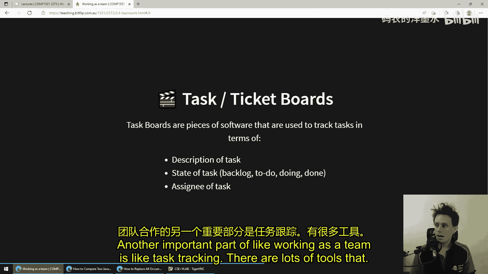

There are lots of tools that。There are lots of tools out there on the internet that help you track tasks as you know。

 like trello and Dira， you can kind of do what you want。 But just for ease in the course。

 we generally just recommend that you use。

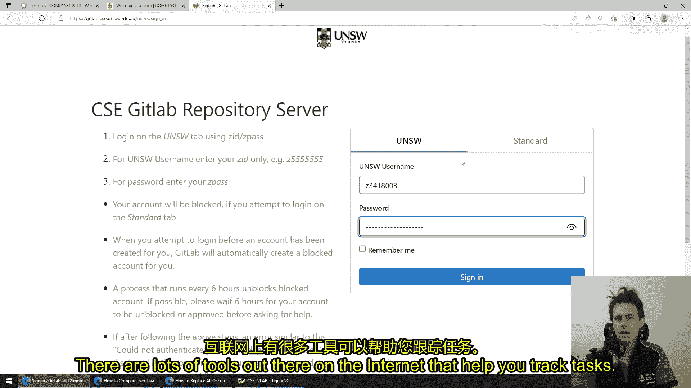

The Gitlab task board， because the Gitlab task board just works。 and it's。

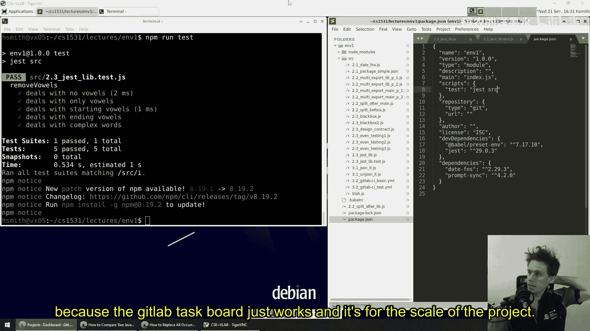

For the scale of the project， you don't need a lot of crazy stuff。 You know。

 you're not the giant corporate with all these things going on。 You're。

 you're a bunch of clowns like me just trying to get by。

 So for 95% of the groups like Gitlab' is gonna be fine。 But if I go to a group like T 17 C dream。

And you can find the task board by going to issues， and then boards。And if you come here。

 I don't want to wreck their board， but。

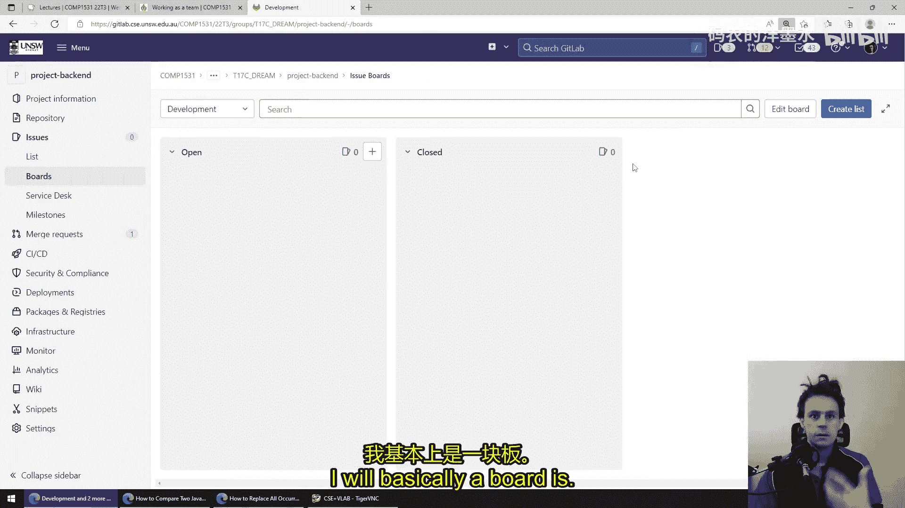

I will basically， a board is。A board is kind of made up of columns generally like a simple task board that。

 you know， canban boards and and this and that， I don't want to get into thatca it's all just really nuanced stuff。

 but the idea is you've got things to do， You've got tasks or tickets。

 which is basically who's doing it， What are they doing and where is it up to and the columns represent that Where is it up to part。

So when we look at something like Gitlap here， you can see we've got open here and closed。 Well。

 I feel like last term I had this。 And there we go。 I can make another one。 Select the label。

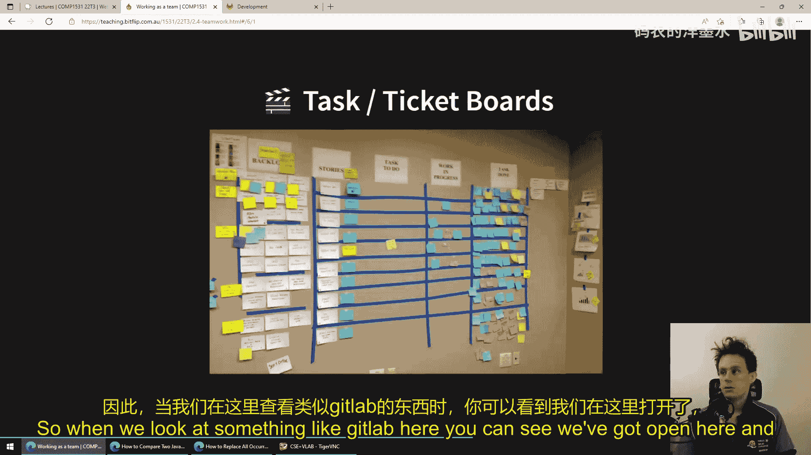

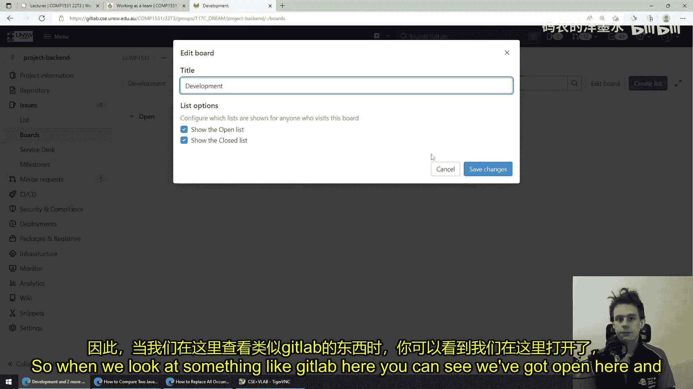

On那。Someone， someone， this happened last time。Or no。I forgot how to do it。 Add to。

Someone posted on the farm after and was like， you can add a label。Christ。

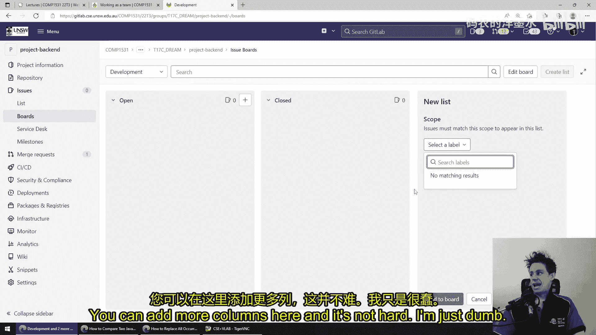

You can add more columns here， and it's not hard。 I'm just dumb。嗯。

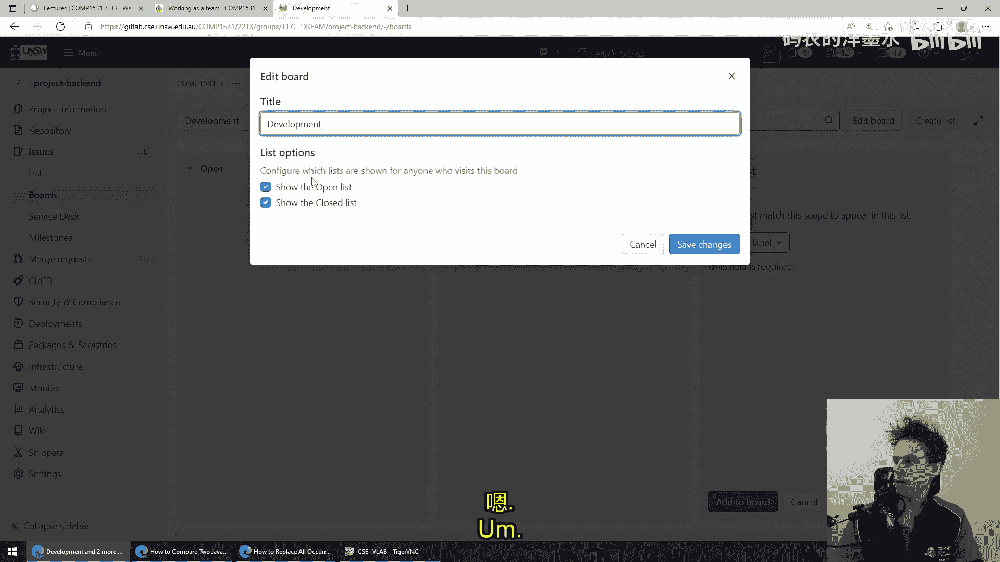

No idea how to add a label。 I hope someone knows。 Does anyone here know。

 There's only like 15 people here。 So probably not。Get lab board label。

 I'm gonna Google at this time。Labels。Type the labels。

 assign labels in the labels section of the cyber。Labels。New label。In progress。

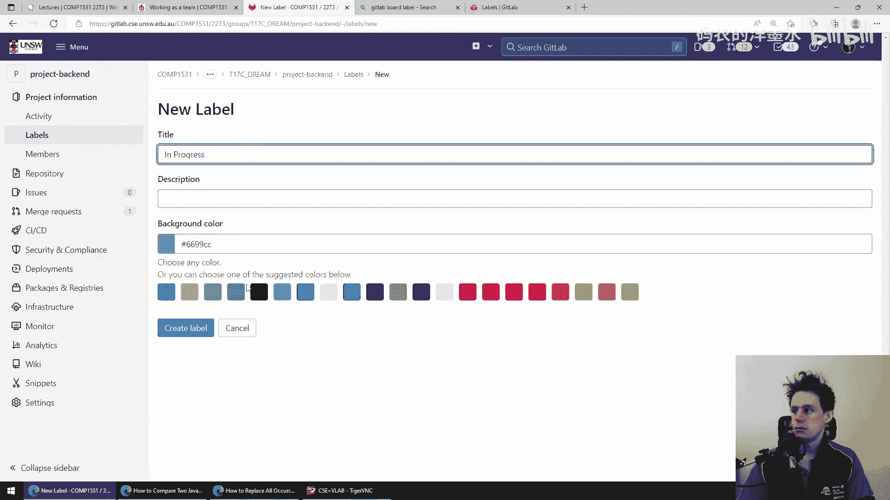

Green。Yeah， so I can add a new。

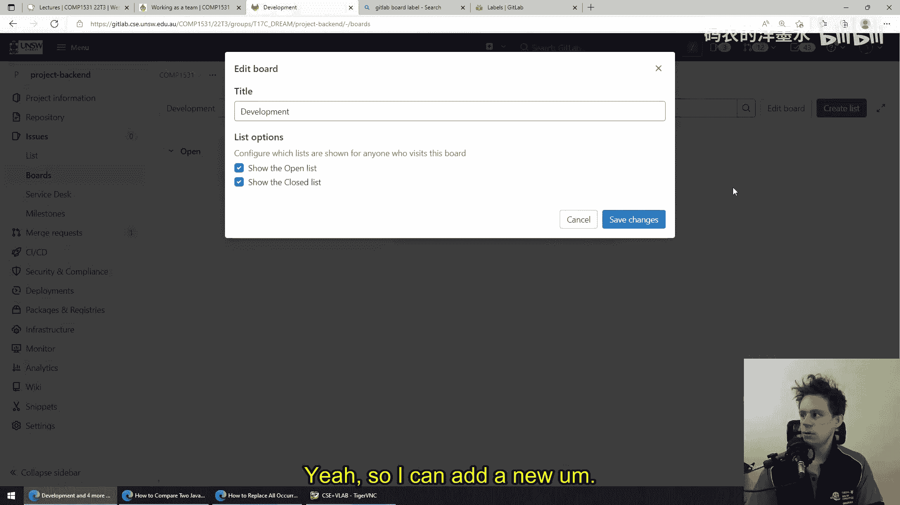

I can add a new column， if I want。Called in progress， I guess。Cool， and basically。

 like what you can do as a team is you can come in here and be like， well。

 let's make a new task to do， which is like， maybe， you know， stub or red or stub all o functions。

 right。And you create that。 And then what you can do is you can assign it to someone。 So。

 for instance， in this case， I might assign it to you know， y。And now it's y's problem。

 And then like y might have five or six things here that they're working on this week。 And then like。

 as y does it， they'll be like， yeah， I'm gonna work on， I'm working on this one today。

 And then once they're done， they move it over here。 Right。

 You can have different columns if you want。 You can figure that out with your group。 In general。

 most boards have three columns， which is。Well， depends。 This is kind of the basic。 It's like。

 here's the stuff I'm。At work， I have them labelled out。 There's like the stuff I'm gonna do。

 the stuff I'm doing and the stuff I've done。 That's the simplest thing。

 But larger projects will tend to have another column at the start。

 which they often refer to as the backlog and the backlog is essentially stuff that you're not gonna do。

 but eventually someone probably is going do this。 It's like。

 and you can see it over here on this screen。 It's like the stuff way on the left here。

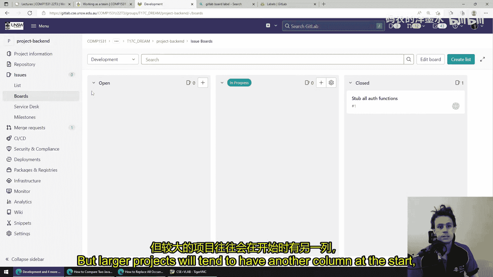

It's a way of acknowledging that something。We can't forget something。

 but no one's actually got it on their plans right now。Okay， and then last couple of things。

 pair programming。um。A really great way to work together as a team is to actually just get two programmers working on one computer。

1 keyboard。 That's not two sets of hands on one keyboard。 That's basically like。

 you take turns to write code and you kind of sit together。 You know。

 like I have my my buddy over here， who's like sitting behind me and they will just be chatting to me as I program。

 I've done that a bunch in my life， particularly precovid。

 It's probably a little less common now like。😊，It's okay to do on calls。

 But if this makes sense like， and maybe this is just my terrible attention span。

 I find it's really hard to do on callsca you got your computer there。

 So these things buzzing and friends messaging you。

 It's kind of much easier when you could sit next to people more frequently。

 even though we're starting to get back to that point。

 But the purpose of it really quite simple and an ideal。 when there's two people。

 the person whose programme is actually writing the code。

 Like the person behind them is not like put an if statement there。

 like name this variable that the person behind them is often。Thinking at a slightly higher level。

You know。It's kind of like， and， and you can imagine this in many spots in life。

 It's like mowing the lawn The if you and your friend mow the lawn， they cut the grass。

 The person cutting the grass is really focused on like， you know。

 lining up and cutting the grass and managing the machine。

 But you're kind of sitting there looking at all the grass and。Paying a bit more attention。

 thinking a little bit about， actually， that section over there looks a little taller than that section over there。

 You know， that kind of thing。 So it can be a really great way to programca someone can kind of be a bit higher level and be like。

Actually， we need to take into account this use case。 You know。

 So a bit of discussion Its something that's really fun。

 I definitely encourage you to try it out sometime。 I。

 then the last set of slides is handling conflict。😊。

This one is a new set of slides that I've added in just'ca I think this is kind of really helpful。

 Human relationships are wonderful and messy。 if you ever had families。

 if you ever had family members， friends or partners。

 I'm sure if any of you have some or all of those three。

 you've experienced the messy and wonderful parts of things。 CO 15，3，1 team members are no different。

😊，And we need to find ways to manage conflict。In this project。

 And we're gonna run through a few of them。 There's kind of 7。 There's a 7。 It's like 7 in ways。

 Most of them say the same thing。But we're gonna start with scenarios。

 I don't wan to give you lessons Like， I wan to give you scenarios。

cause think they're a bit more practical。 Let's say you come into a group and you think。

 I know more than my group members。 That happens。 You're not all of equal intelligence， I mean。

Half of you would know more than half of your group members， I guess， statistically。

 if things were well distributed。 And then there'd be a small number of you that would know more than all of your group members。

 So what do you do if you're in that instance， Well， take a break， go work another assignments。

 You know， maybe you want to push it a little bit harder to get your mark up。

 That's kind of up to you。 That's your prerogative。 But just generally you know 1，5，3。

1 moves at a certain pace and you kind of putting pressure on other people to go faster is not going to help。

 Should you expect them to do good work。 Yeah， of course， you know。

 you've got aspirations and it's reasonable for you to put those aspirations on others。

 But what you don't want to do is be one of those people。 It's like。

 I know all these things about programming My group doesn't。

 So I'm going to strong arm them into doing this and doing that and you got to do it my way because I you don't know what you're doing。

 It's like as long as you get there in the end， that's the thing that matters。

 don't let your extra knowledge kind of pollute。嗯。You know， the process of getting there。

My group members aren't doing enough。See this one a few times。 Well。

 communicate This one need to be a bit more specific。 Communicate to them on Microsoft Teams。

You know， message them。Be like， hey。I have a problem， not in a mean way， just be like， hey。

 I've noticed you aren't doing a lot recently。You know， what do you think。

 How are you feeling and then what can we do to resolve it。If you approach every like。

 if every time you feel conflict， App it with two things。 One is a desire to like。

 understand and empathize， and the other one is a clear need to have an action。Right。

 and people often don't do both。 Sometimes they'll do one。

 It's like the understanding empathy part is really important。 It's not like you didn't do any work。

Daniel。You know， it's like， hey， Daniel。I see you haven't really pushed any code in like three days。

 And I think the group struggling a bit， is everything okay。You know。Daniel might be like， yeah， my。

 my， my， my， one of my parents just died or my dog girl， my cat just died。 And it's like， oh， well。

 that changes the entire dynamic。 You know what I mean， so it's like。

You always have to approach these things with understand。

 Give everyone the benefit of the doubt first， you know， I， I I don't know if it's in the slides。

 I don't think so。 And I say this every term to people。 The advice I usually give。

To people it's like。Always try and ask five questions。And， you know， so， if someone annoys you。

 this is good relationship advice in general， right， Like if someone annoys you。

 just ask them questions， don't， don't test them， don't lie to them。 Don't be passive aggressive。

 but just ask questions。Say someone's ignoring you。Someone you like is ignoring you。

 someone you're close to。 It's very powerful to just ask them to start with a U okaycause if they say。

 no， well， you're on it a whole different thread of conversation。 It's about their， their well being。

 And now you're focused on them。 too， you know， if they're like， yeah， I'm okay， you're like。

Have you been feeling any different lately， You know， and it's like。

 I'm not talking about this isn't group members as general advice。 And they're like， no， not really。

 And then it's like， okay， well， just just figure out if you're missing something。 And then once you。

 you know， you get deep enough， eventually， you're like a very small fraction of the time。

 you can then get into。You know， there's clearly a problem here I need you to address。

But if you start with that， you can always risk a whole bunch of misunderstandings， right。

 So it's like。Just really focus in on understanding and empathy to start。 But also like。

 you can expect things of people， like， if you have a group member who's underperforming in your books。

Then ask them。 but like， don't wait two days for them to reply。

 like you can expect things from people。You can expect him to engage with you in a reasonable time frame。

 you know。And。If you do get into a conversation where you do identify that， you know。

 maybe they've been struggling in the second part， always have a clear action in that scenario。

 It's not enough just to be like， oh yeah， I've had a hard week。 I'll try better。 Don't do that。

 It's really tempting because you want to be a nice person。

And you don't want to put pressure on people who you feel like are struggling if you're not a。

 you know， a poo poo。 So it's like。But， but in a nice way， like， just help like， you know。

 a really common thing for me is like， if someone is。 if you're working with someone and you。

 they're not giving you what you want， Talk to them。 They'll be like， I've had a hard time。

 I'm doing my best。 Just be like， that's cool。 Tell me what I can expect from you。

When are you gonna get that work done。 And they'll tell you， And it's like， good， Well。

 if they tell you and it's a terrible answer， then you can have a very specific conversation and be like。

 actually， you can't do thatca so and so is relying on that。 But then on the flip side。

 if they tell you and they say， oh， it's gonna get done on Friday。 now， when it comes to Friday。

 you can actually have a conversation with them and be like。You know， I was really。

 I was expecting this。 This is problematic。 You know， we need to figure this out。

cause if they just say， I'll do my best， you get to Friday and you have the same conversation with them again。

Then they say， yeah， I'm nearly there。 And you're like， oh， what does that mean， Then it T， you know。

 you know what I mean， So it's like。Be understanding and empathetic， but at the same time。

 don't walk away from conversations around problems or conflict without a clear sense of what happens next。

 or you'll just be back there and you'll both be more stressed。Cool， cool so。

My group members have disappeared。 This one's， this one's not too bad。 Message them。

They don't know where they are message The message you tutor to and be like this person's disappear and your tutor will take a note of it。

 General， if someone just disappears and they don't reply to anything within like 48 to 72 hours。

 you should just work as if they're not going to reappear because most of the time。

 like 95% of the time that someone disappears。They're either not coming back。

They've dropped the course。 They're having a really bad term and confrontation scares them。

 So they'll drop the course eventually， but in the meantime， they're just avoiding it。

 They're really sick。 So when they do come back， it's not like they're gonna reappear from hospital being like。

 hey， guys， I've finished everything Well as in the hospital。 So you know， just move on without them。

 And they'll be they'll be like a 5% chance that they'll reappear。

 But if they reappear and you've done their work and they have less work to do。

 which results in them having a lower mark or that was on them。 You know。

 like sometimes we disappear， we make choices in life。

 Like if someone wants to disappear for five days without communicating。

 it's gonna impact their mark。 like don't don't feel held ransom by that。You know。

 you no one should be sitting around saying so and so hasn't replied for five days。

 We don't know what to do。They're gone。 I'm not saying they are。 but just get into that head space。

 You know， they gone， move on。 Ti chance they'll come back， deal with that as it comes。

 They're probably not coming back， so。You've re establishedlish reality。 You know， that's。

 that's the way to deal with that。 Always talk to your tutor as well。 Like in all these situations。

 my group members are emergingrging in broken code。 They're merging in code without approvals， well。

You know， message them。 Talk to them。 All this stuff really comes back to like， Talk to them。

 try and resolve the problem。 Try and make sure that you have a clear definition of it being resolved。

 And if you have any issues or you're concern， talk to your tutor。 It's really that simple。

 if a group member gives you。Crap for like you asking them politely and friendly to。um。Fix something。

 And they don't just email your tutor。 They'll help you out。 I think one really important note too。

 as I said before， like ask questions， but。The the only thing I'd， I， I。

 I sometimes give this advice。 and people ask terrible questions。

 Just please don't ever be passive aggressive with people。 I。

 I say this every time'cause it always happens。Someone's like， I'm going listen to Hayden。

 and I'm really annoyed that this team member is not working hard。

 So I'm gonna to ask them a question。 The first question they ask is like。You know， do you even。

 do you even give a shit about this group， It's like all like， you know。

Are you interested in the success， Like in， Are you interested in making us miserable， You know。

 it's like， don't ask dumb questions'cause you then you're just a pain in the butt。 So， you know。

 always be a good person。 your group members are being rude。

 What if your group members are a bad person， Tell them to stop。Politely。

Then talk to your tutor if you don't resolve the issue。

If your group members are being a genuinely bad person， like， you know。

 maybe they're like being extremely derogatory or discriminatory or they're stalking you or something very strange。

 Don't， don't try and engage with them in those extreme scenarios。 Just talk to your tutor。

 you can always email me too that that happens excessively rarely as far as the teaching staff are concerned And in terms of what they know。

 So don't be worried about that。 But that's just a footnote。 generally。

 it's mainly just people being like。No。You'll just ask them for stuff， and they'll be like。没。😡。

You'll be like， what， Talk to me， you know， like， be an adult。 So that's if you're not getting that。

 But all the trends you're seeing here that if there something goes wrong。

 try and engage with the person。Set some clear understandings。

 And if anything isn't solved email or you know， message your tutor。 generally。

 emails are probably better than M S teams。 a lot of the time。 But obviously。

 you can go to on M teams to your tutor。 if they don't like it， they'll tell you。

 but you should always feel empowered to email your tutor。

 Try not to email me because most of the time， I'm just gonna ask you。

 have you emailed your tutor because not because I don't like you。

 It's just there's no point me getting involved because they know more than me。

 So typically what happens is you email your tutor。 And if they don't know how to deal with it。

 or they have problems with it， then they come to me and I can help them out。

 It's much kind of easier that way。 So yeah， that's the end of this lecture。

 If you could you know leave some feedback， that would be immensely appreciated。

 like always love the feedback。And other than that， that's kind of it we have for this week， we will。

See you next week。 I guess send you an email on Friday。

 Good luck with iteration 0 being G on Friday night。 Iteration 1 will come out late weekend。

 We'll put that in the notice。 Other than that， I'll see everyone on Monday for those who've had class。

 hope you've had a good week and for those who。😊，Have yet to have class。

 Enjoy your class this evening or tomorrow。 So thank you， everyone。

 Have a good rest of the afternoon。😊。

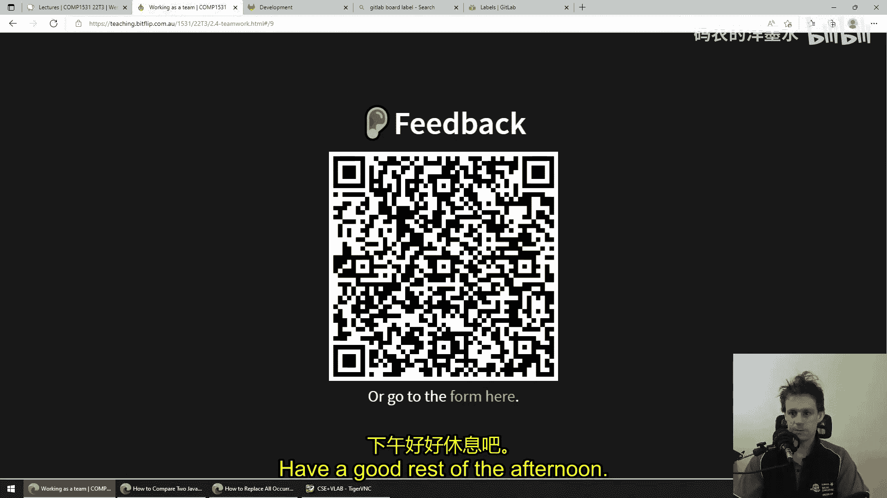