# 软件工程基础：07：团队协作 🧑‍🤝‍🧑

在本节课中，我们将要学习如何作为一个团队进行协作。我们将探讨敏捷开发的核心哲学，并介绍一些实用的团队协作实践，例如站会、任务板和冲突处理。这些知识将帮助你更有效地与团队成员合作，共同完成软件工程项目。

---

上一部分我们深入探讨了代码相关的主题。本节我们将转向一个不那么“代码密集”的讲座。本课程的前几周内容非常侧重于编程，但课程的后半部分则更偏向理论。本次讲座就属于后者，主题是“团队协作”。

这部分内容属于“学习如何合作”的主题，例如之前学习的Git。但本次讲座更侧重于“人”的层面，即如何作为团队成员一起工作，而不仅仅是代码层面的协作。理解这一点的重要性显而易见。

我们将讨论敏捷实践、站会、冲刺、任务板、会议和会议纪要等概念。这里有很多内容要讲。

我想首先说明的是，关于团队合作，我可以谈论很多。但根据我的经验，对于你们大多数人来说，这可能是第一次真正意义上在工程项目中与他人合作。如果讲得太抽象，效果可能不佳。这有点像在你从未开过飞机的情况下，只听一小时的幻灯片讲解如何飞行。直到你真正动手实践并犯过一些错误后，才能更好地理解这些概念。因此，我主张在课程中先打好基础，后续课程再深入探讨更细致的内容。我们今天会讨论很多，但请理解，这并非一个完整的、面面俱到的教程，而是在你当前学习阶段最实用的内容。

首先，我们来谈谈敏捷。

## 什么是敏捷？ 🏃

你可能听说过“敏捷”这个词。我们经常听到“我们是一家敏捷公司”或“我们采用敏捷方法”等说法。我们需要理解它与计算领域的关系。

如果你听过更详细的介绍，通常会听到“冲刺”或“Scrum Master”等术语。这些是关于如何以敏捷方式构建团队的具体实践框架，就像足球队有各种位置一样。虽然这种框架化的方法有其价值，但我们更想探讨的是支撑敏捷方法论背后的哲学和原则。

敏捷开发本质上是一种哲学。一旦深入到冲刺、Scrum Master等具体实践，就进入了基于该哲学的具体方法。我们更关注哲学本身，而非某个特定的实践解读。

有一个网站叫 `agilemanifesto.org`，它概括了敏捷开发的核心信条，总结为以下四点：

1.  **个体和互动**高于流程和工具。
    *   这意味着：与团队成员的良好沟通、讨论和协商，比精通GitLab等工具如何运作更重要。
2.  **可工作的软件**高于详尽的文档。
    *   这个观点的核心是，我们始终希望软件能够**工作**。虽然完善的文档很重要，但大多数情况下，我们更关心软件能否运行。很多软件的“半衰期”很短，可能在12个月内就被修改、移除或重写，因此过分追求文档有时并不划算。
3.  **客户合作**高于合同谈判。
    *   这实际上是说，在构建软件时，不应该只是在项目开始时与客户定好计划，然后埋头执行一年。而是需要与客户保持持续的对话，因为需求会变化，人的认知也会更新。
4.  **响应变化**高于遵循计划。
    *   这与上一点相关，但范围更广。即使是团队计划在未来两周内完成的任务，也可能会发生变化。可能会出现需要修复的Bug，或者发现某些任务比预想的更复杂。团队不能过于执着于原定计划，需要保持适应性。

这些就是敏捷哲学的核心。它是一套用于指导各种不同流程的哲学和文化。具体采用哪些流程，在某种程度上取决于团队自身。

虽然这些流程会因团队和组织而异，但这些哲学和原则在大多数情况下是相通的，除非你开发的是非常特殊的软件。敏捷方法非常适用于大多数注重速度和客户满意度的软件项目。

人们经常讨论敏捷与瀑布模型。瀑布模型是经典的软件开发生命周期：从需求开始，依次经过设计、实现、测试，最后交付。这很像土木工程中建造大楼的过程：先规划蓝图，然后建造，最后测试验收。

软件工程也倾向于以类似的方式推进，只是我们不是线性地走完一次，而是不断地循环这个过程，每天、每周、每月都在进行需求分析、设计、实现和测试。这就是我们在课程开始时看到的软件工程生命周期。

所以，敏捷与瀑布并非截然不同。大多数项目无论如何都会迭代。关键在于节奏和周期。软件可以工作在非常紧凑的周期内，这是其他行业难以做到的。敏捷的核心思想是：我们理解传统工程世界（如花几年时间建楼）的模式，但我们的目标是应用这些哲学，帮助我们尽可能快地进行计划、构建、测试和发布。游戏的目标是在构建优秀软件的同时，尽可能快地迭代。

敏捷的意义不仅在于“更快地构建软件”（虽然确实如此），还在于上述第三点提到的“客户合作”。软件工程与其他工程领域的一个巨大不同在于，它从未有过如此紧密的消费者互动。你可以快速地从Netflix切换到Disney+。因此，敏捷的很多内容也是为了帮助建立这种紧密的客户关系，因为快速构建才能快速吸收反馈。

我说过我们会多谈原则，少谈流程。但有一个流程值得讨论：冲刺。

## 理解冲刺 ⏱️

冲刺是我们可以在这个课程中大致接触的一个概念。本质上，冲刺是一段固定的时间（例如一周或两周），你在这段时间内设定一系列要完成的任务。

冲刺的关键在于它是**时间固定**，而非**范围固定**。这与你通常的做法可能不同。通常，你和朋友可能说“我们要造一张桌子”，然后一直做到完成为止。而在冲刺中，终点是时间（例如一周），而不是“桌子造好”。一周结束后，无论桌子是否造好，你们都会坐下来计划下一周要做什么。

这个概念并不复杂，但它有助于你始终拥有一个检查点。在任何工程项目中，内省和反思时刻都非常重要。对于软件项目也是如此。

这意味着你和你的团队应该每周开会一次（我建议正式会议每周两次，但至少一次）。重点是，即使大家这周什么都没做，也要开会，并计划下周如何改进。否则，很容易陷入“我们做得不够，所以没必要开会”的陷阱，这对于忙碌的学生来说是一个很糟糕的配方。

在本课程中，我们不要求你们如此严格地执行，你们可以将其理解为一种理念。确保每周开会一次即可。“冲刺”这个概念在你们进入职场后可能会更加相关。

---

上一节我们介绍了敏捷和冲刺的理念。接下来，我们看看一些具体的团队协作实践。

## 团队协作实践 🤝

有几个与团队协作相关的事情需要讨论：如何保持同步、如何跟踪任务、有哪些基本实践，以及如何处理冲突。

首先，保持同步。

### 站会

站会是源自（或至少因敏捷而流行）的一个想法。理想情况下，团队应该每天快速开会，时间很短（3到15分钟），并回答几个问题：
*   自从上次见面后，我做了什么？
*   我遇到了什么问题？
*   在下次见面之前，我打算做什么？

在我看来，这有两个非常有用的目的：
1.  迫使你自我检查。即使你某天没有产出，大声说出来也能帮助你跟踪进度，避免陷入自我欺骗。
2.  向队友发出信号。如果他们听到你连续几天卡在同一个问题上，可能会主动提供帮助。

典型的站会时间通常在上午10点到12点之间。如今，特别是在新冠疫情之后，**异步站会**开始流行。即团队不在同一时间开会或通话，而是在每天上午的一个固定时间窗口（例如8点到10点）内，在聊天频道（如MS Teams）中打字汇报。这对于大型团队或时间难以协调的团队（如学生团队）很有效。

但异步站会也有缺点：如果出现问题，很难及时解决；也更容易被遗忘，因为缺乏每日固定的仪式感。

对于本课程的项目，我们主要期望你们定期同步。如果你们有纪律每天进行，平均表现会更好。但更可能的情况是，每周在实验课上见面一次，然后在周中通过在线方式再进行一两次简短的同步。关键是在这个短期项目（约9周）中，不要超过48小时没有一次集体沟通。不要因为“没什么可谈的”就跳过会议，坚持出席和沟通本身就是一种重要的纪律和反思。

### 周会

周会与每日站会不同。周会通常是确定方向的地方，类似于规划冲刺。你们可能会做笔记（会议纪要），记录讨论内容。一个好的方法是记录这些笔记（课程规范中也要求了）。

一个典型的COMP1531小组周会可能在10分钟到1小时之间（通常不会太长，因为项目规模有限）。会议结构通常很简单：如何分解工作？本周做什么？然后就去执行。可以像下图所示这样记录简单的笔记，详细程度以一年后你还能看懂当时在讨论什么为准。

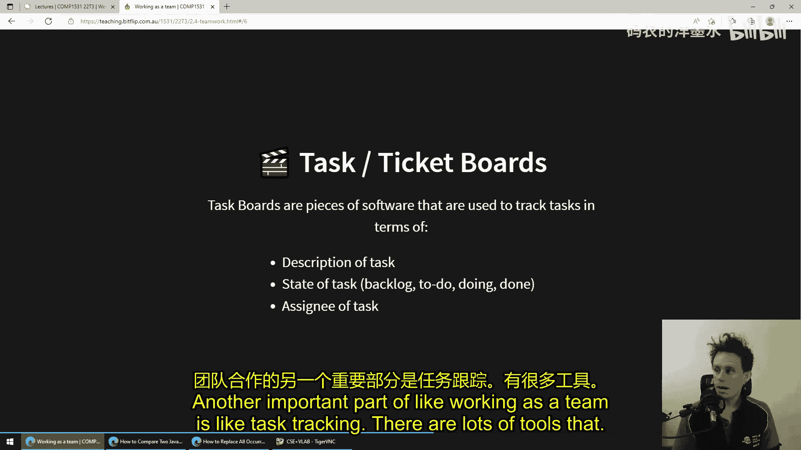

---

保持同步后，我们需要有效地跟踪任务进展。

### 任务跟踪

互联网上有很多工具可以帮助跟踪任务，如Trello、Jira。为了简便，本课程一般推荐使用 **GitLab任务板**，因为它开箱即用，对于本项目的规模来说完全足够。

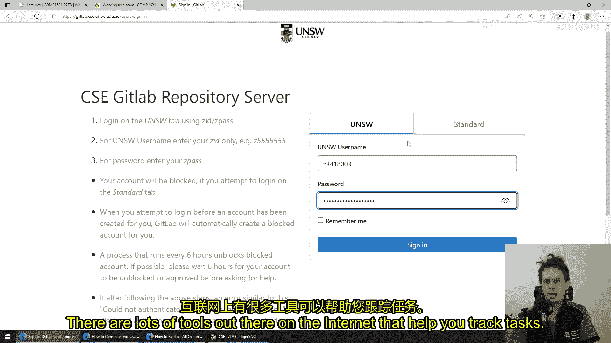

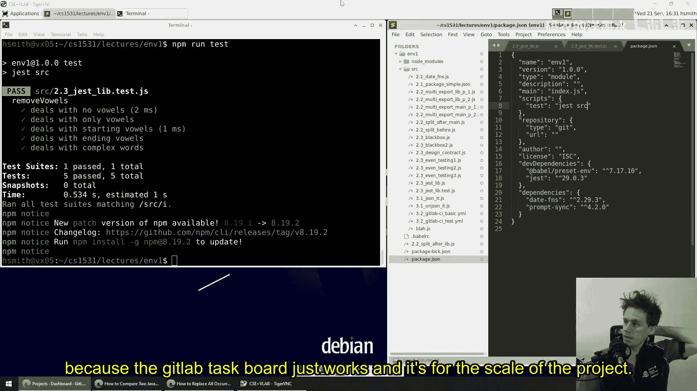

你可以通过进入项目的 `Issues` -> `Boards` 找到任务板。一个任务板通常由若干列组成，这是一种简单的看板。每张卡片代表一个任务（或“票”），包含谁在做、做什么、当前状态等信息。列就代表“当前状态”部分。

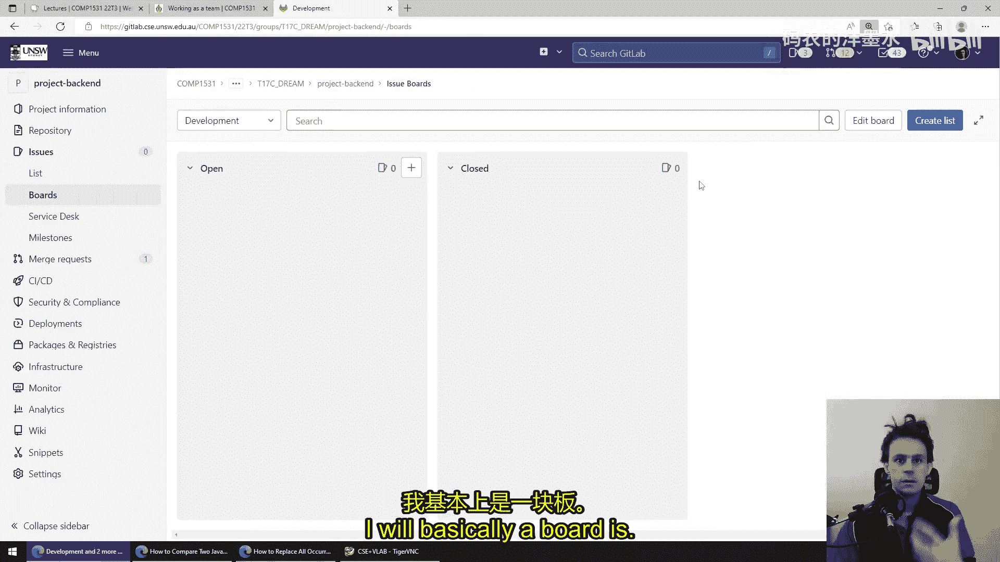

在GitLab中，你可以看到“Open”和“Closed”列。你可以添加更多列，例如“进行中”。具体操作是：在项目中创建新的标签（Label），例如“In Progress”，然后将其添加到看板作为一列。

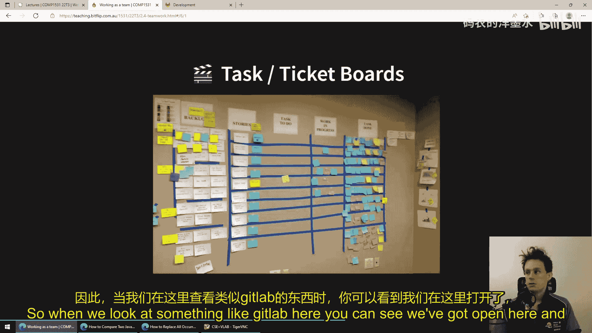

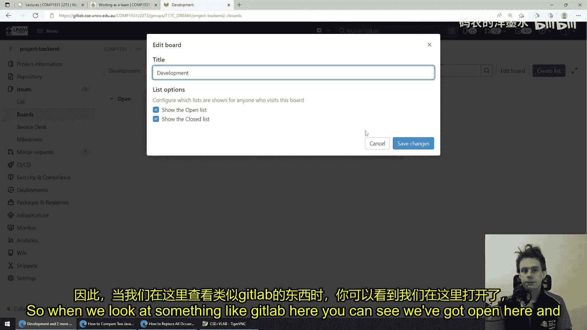

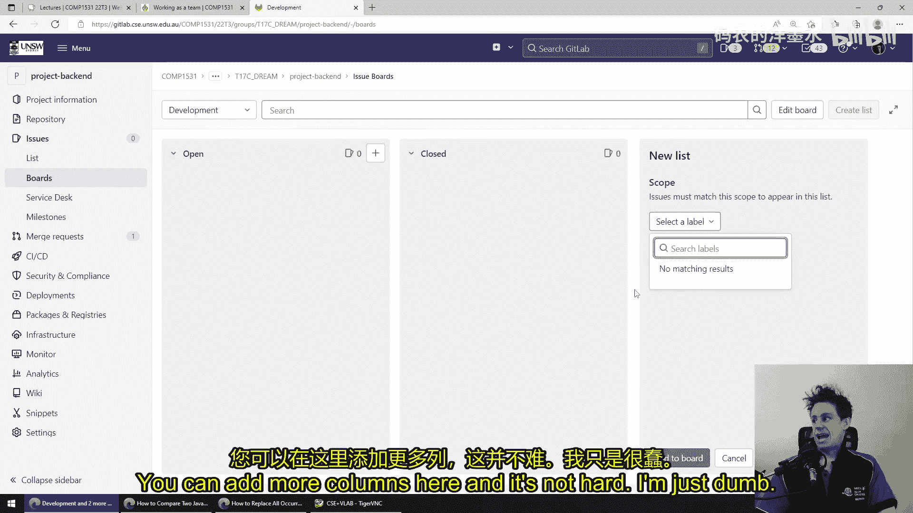

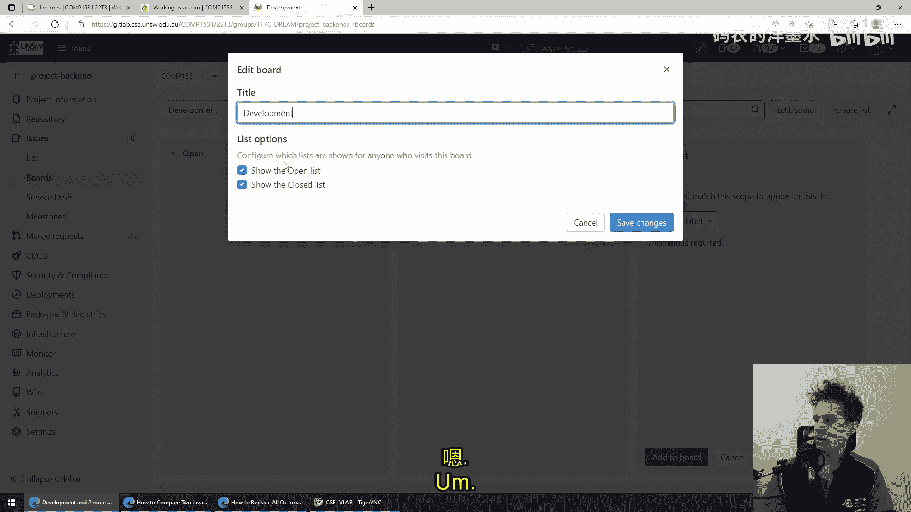

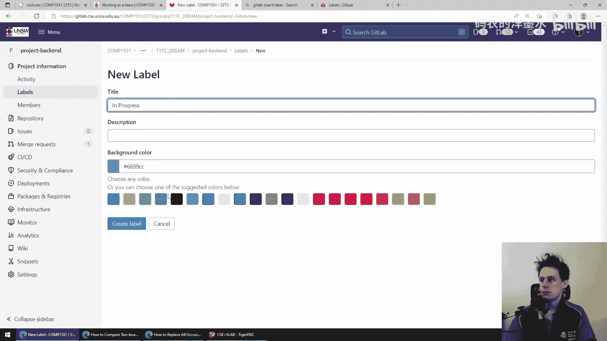

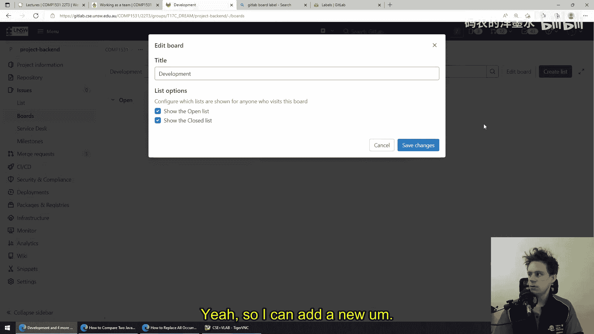

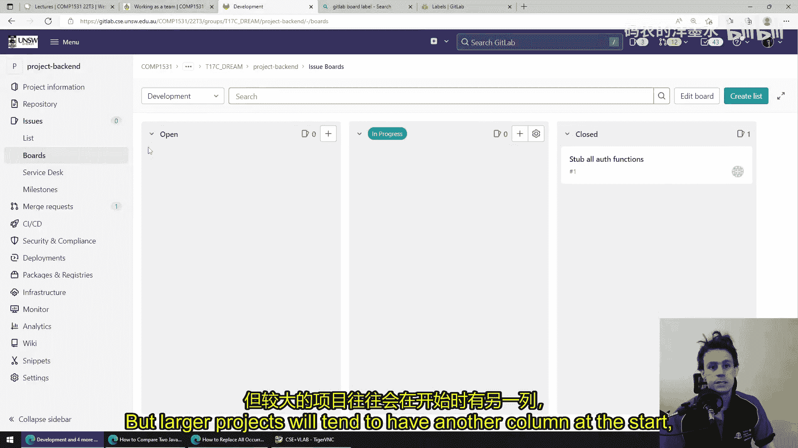

团队可以这样使用：创建一个新任务（例如“为所有函数添加存根”），然后将其分配给某个成员（如Y）。Y本周可能有五六个任务。当Y开始处理某个任务时，就将其拖到“进行中”列；完成后，再拖到“已完成”列。

通常，最简单的看板有三列：“待办”、“进行中”、“已完成”。大型项目可能在最开始还有一个“待办项（Backlog）”列，用于存放那些暂时不做但未来可能做的任务。

---

最后，我们介绍一种有趣的协作方式：结对编程。

### 结对编程

结对编程是一种极佳的团队协作方式，即两个程序员在一台电脑上工作，共用一套键盘（不是四只手同时操作），轮流编写代码并坐在一起讨论。

在结对编程中，负责打字的人专注于代码实现，而另一个人则可以从更高的层面思考，例如考虑更多的用例、整体设计等。这就像一个人割草，专注于操作机器，而另一个人观察整个草坪，指出哪里还需要修剪。

这种方式可以产生很好的讨论效果，我强烈建议你们尝试。当然，在新冠疫情后，远程进行结对编程可能更具挑战性，因为容易分心。

---

掌握了协作实践，我们还需要学会如何处理团队中不可避免的冲突。

## 处理冲突 🛡️

人际关系是美妙而复杂的。你的COMP1531团队成员也不例外。我们需要找到管理冲突的方法。这里有几个场景和建议，大多数建议的核心是相通的。

**场景1：你认为自己比组员懂得多。**
*   **怎么办？** 放平心态。COMP1531有固定的节奏，向队友施压让他们更快通常没有帮助。你应该期望他们做好工作，但不要因为自己懂得多就强行要求别人按你的方式做事。只要最终能达到目标，过程并不那么重要。

**场景2：组员做得不够。**
*   **怎么办？** 沟通。通过Microsoft Teams等渠道联系他们。以友好而非指责的方式开始：“嘿，我注意到你最近参与不多，一切都好吗？我们能做些什么来解决？” 处理冲突时，请带着两种心态：一是理解和共情，二是明确需要采取的行动。
*   **关键建议：先问五个问题。** 在假设对方是恶意或懒惰之前，先尝试理解。例如，对方可能正在经历家庭或健康问题。从关心对方的福祉开始对话。一旦深入了解了情况，如果确实存在绩效问题，再设定清晰的期望和下一步行动。不要以“我会尽力”这样模糊的承诺结束对话，要明确“你具体在什么时间前完成什么”。

**场景3：组员消失了。**
*   **怎么办？** 先联系他们。如果超过48-72小时没有任何回复，通知你的导师，然后就当ta不会回来了，继续推进项目。大多数情况下，消失的成员要么退课了，要么遇到了严重问题。如果ta之后回来，因为缺席而导致工作量减少和分数降低，那是ta自己的责任。不要被这种情况绑架而停滞不前。

**场景4：组员合并了有问题的代码或未经批准就合并。**
*   **怎么办？** 联系他们，沟通问题，尝试解决，并明确解决的定义。如果你有任何疑虑，告诉你的导师。

**重要提示：**
*   **避免被动攻击。** 不要问“你到底在不在乎这个组？”这类问题。这无助于解决问题。
*   **如果组员粗鲁或行为不当。** 礼貌地要求他们停止。如果无法解决，联系你的导师。
*   **在极端情况下**（如歧视、骚扰等），不要尝试与对方交涉，直接联系导师或课程负责人。
*   **善用导师资源。** 在大多数冲突中，尝试与当事人沟通并设定清晰期望后，如果问题仍未解决，请及时通过邮件（通常比MS Teams更正式）联系你的导师。如果导师无法处理，他们会寻求更高层级的帮助。

---

本节课中，我们一起学习了团队协作的核心概念。我们从敏捷开发的哲学（个体互动、可工作软件、客户合作、响应变化）出发，了解了冲刺作为时间盒迭代的概念。接着，我们探讨了保持同步的实践（站会、周会）、跟踪任务的工具（GitLab任务板），以及高效的协作方式（结对编程）。最后，我们通过几个常见场景，学习了如何处理团队冲突，核心在于沟通、共情、明确行动以及善用导师资源。

希望这些知识能帮助你在当前及未来的团队项目中更有效地协作。祝你们迭代0顺利，我们下周再见！

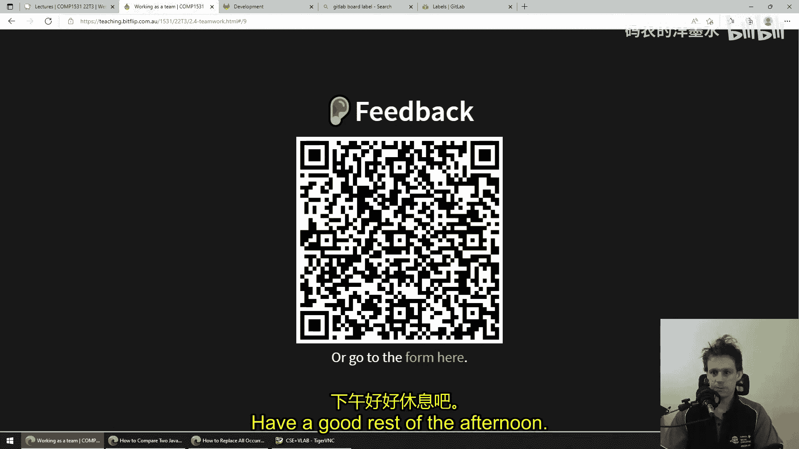

