# 【全集】新南威尔士大学 软件工程基础 中英字幕 1080P COMP1531 p08 Lecture 8 - 数据交换 -BV1M7Nwz7EGh_p8-

Okay， so yeah， tonight's lecture on data interchange。

 Data Interchange is one of a few lectures that I was very passionate about introducing when I took over the course because it's one of these things that actually will like underpin an absolute ton of what you do in computer science over the coming months and probably years。

 But prior to this， it wasn't really actually。😊。

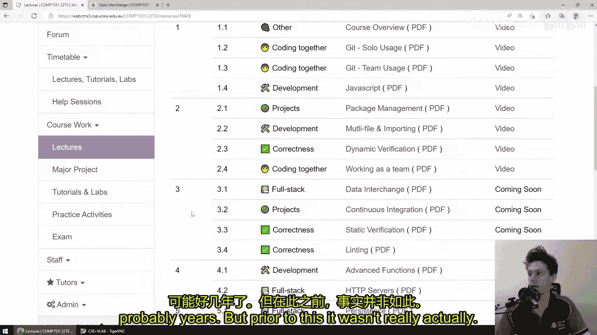

In a course。You know， it just didn't exist anywhere and。It's a bit of a， it's a bit of a。

 it's a funny topiccause we talk about it in really abstract terms。

 We're actually learning about some really specific things。

 But the reason we're learning about all of this is because。In computers。

 there are many different systems out there。 Sometimes as's programming languages， C and jascript。

 sometimes it's operating systems like Windows and Mac， sometimes it's servers， you know。Clouds。

 like whatever， everything in computing， phones， i， Android， different。Different ports。

 USB and this and that。 We need ways to kind of send data。Through a common。Interface。

 right and the way we deal a lot with this is through data interchange formats and everything else。

 And today we're going to be talking about standard interfaces in general。

 let's just look at them from a philosophical standpoint。

 Then we're going to talk about three fairly specific types of technologies that are used to either like represent or transfer data in a standard way because it's not always about transfer。

 even though we call it a data interchange lecture。

 This is all really about standard interfaces this lecture。So firstly。

 what is a standard interface I know you all have access to the lecture slides。

 but I'm not above asking everyone in the chat who's live what you think a standard interface is。

 So do your best to guess， I don't mind。Love to see just a few ideas。Okay， so Fritzi says， well。

 judging from the emoji slash chord slash wires， okay。嗯。Yeah， maybe。 I don't know。

Ceril says a specification of data and its types。Okay standard interface is a specification of data in its types。

 maybe AT says a standard from an exchange of information。

 William says fundamental functions and data requirements when sending data。

That's also quite interesting。 Lots of different ways We're thinking about it here， Well， like。When。

When we think about standard interfaces， we could come up with a definition。

 But tell me what comes to your mind when you think about an example of one， right。

 Derie's got some things， too。 This one's interesting。 Derie says it's an awesome name， by the way。

 I hope it's your real name。 Some universal way agreed upon to unite different languages and stuff。

 Oh， you were so elegant until the stuff。 You nearly got there。😊，When I think of standard interfaces。

 I don't think of a definition。 I think of some examples， right。So what do you think about。

 And these are just some things。 And this， this lecture slide is like。Part of it's。

 like a couple years old。So there's a million other things I could think about。

 But what I think about when I think about standard interfaces and obviously。

 I'm biased being from a， you know， a computing background in some way is one example is USB cables。

 I kind of mentioned this one before。 Sometimes I think it's crazy。 You know。

 you can plug a USB cable。 Like I've got my Android phone here and like Windows computer。

 You can plug it in and they have a way of talking。 And more importantly。

 they just have a physical way of connecting。 I have like a USB port on my computer。

 It charges the Fitbit， charges my headphones It can charge my phone It can do a whole bunch of other stuff。

 So that's an example of a standard interface。 bolts or another standard interface。😊，You know。

 even though many different companies manufacture bolts。We， screws。

There are still tons and tons of standardized。 There is tons of standardization when it comes to what these bolts are。

You know， you talk about an M4 bolt， you know， 3，16th size bolt。 everything's kind of。

Follow the same pattern。 And you'll see this everywhere， right， You see this with car tires。

 You see this with， I mean， come on， come on， Help me with examples。 doorways。

 You haven noticed that every lounge seems to fit in nearly every door frame， somehow just。Yeah。

 but no like you， you know what I mean， like everything kind of follows this fairly standard idea that people。

 either in small bubbles or big bubbles， tend to come together and say。

 let's all just agree upon a set of。Standard， simple rules。 maybe it。

 maybe they're not complex enough。 Maybe they't do it deal with every edge case。

 but it will help us all communicate together， you know。Airplanes， runways。

A plane can be built in one country， take off in country 2 and land in country 3 And everything just seems to work。

 Most of the time。 You know， it's everywhere。 It's a really exciting part of engineering generally。

 The Internet， right， as we're gonna talk about next week， you've got H T T P。

 which is a protocol for exchanging web pages on the Internet。 That's a standard interface。

 That's a way where people said， let's just， you know， send data all around。And then just this is。

 this is one I don't know why I， I'm gonna change some examples'ca I feel awkward talking about the same weird analog。

 you know， five terms in a row。 But train tracks are always a fun one。

 And I like train tracks because it's not always to do as standard interfaces either。

 because if you look I like train track gauges around， I can't spell gauges。😊。

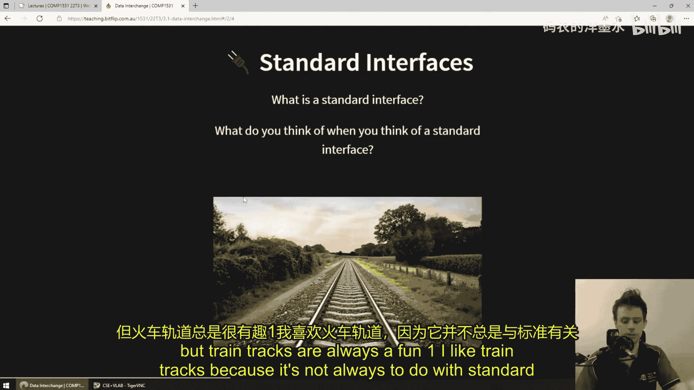

My kids spoke ages。Gugages how wide a track is。 You know， and you， you go around these world maps。

 and you'll actually see， you know， in different parts of the world。They're different sizes。So。

 you know， you can kind of easily， Well it depends where it's a bit complicated'cause， you know。

 in different countries have different train tracks in it。

 But it's like lots of countries will figure out how to have standard interfaces between the tracks。

 So if you look at Europe， you know， it's obviously quite intentional。

 I think there's probably a history of Europe。 I'm not familiar with I would guess where at some point。

 they all。I don't want to go in a tangent about nothing。 I don't know。

 But I know that there's countries like Russia that I think I read about how they would intentionally not use standard track sizes so that people couldn't invade them。

 right， because， classic war time。 you'd see a a lot of invasions would be essentially bolstered through transport via rail。

 right， So， you know， an example of cases where there are lots of standard interfaces in cases where there aren't standard interfaces。

 So lots and lots and lots to think about all these systems have a simple thing in common。

 which I think Dope kind of touched on a little bit。 and everyone had a pretty good attempt at。

 which is， you know， it's a universal method of connecting different systems together。

 That's a fairly high level summary。 Obviously， you could go a little bit deeper into that。

 But that's like a good starting point for us。

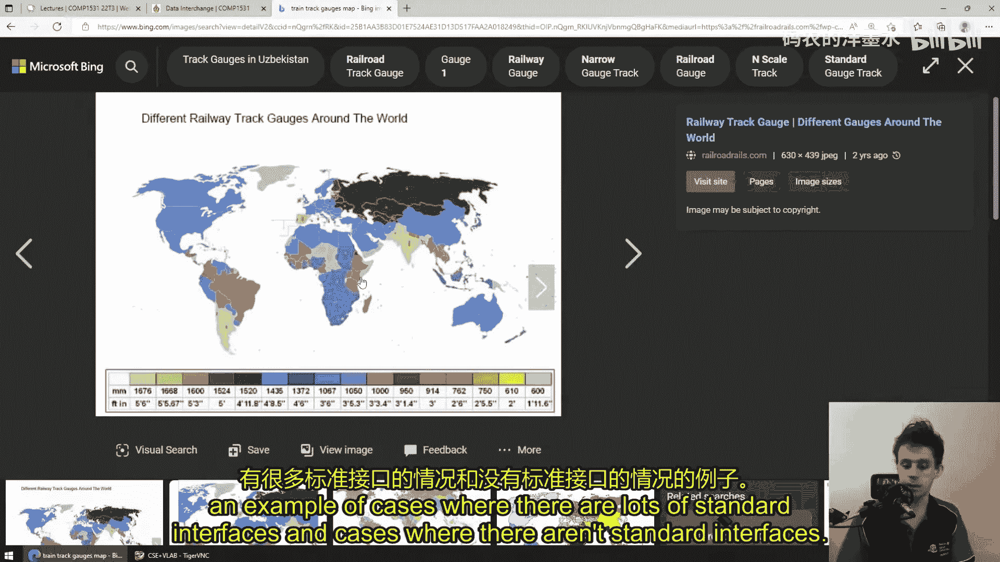

But we're not here to talk about the philosophy of engineering as fun as that is。

 We're here to talk about computer science and in particular。

 standard interfaces when it comes to how software interacts。

 how different computer systems interact， particularly application systems。

 And when you look at the most。Important way that a lot of application systems interact is pretty much just through the transfer of data。

 right， It's how they move data from one application to another。You know， how， how is it that。

 you know， you're using a web browser right now watching this on YouTube。

 which is written in one language and then。When you type a comment into the YouTube comments。

 it goes and gets sent to a web server somewhere with Google that's written in another language and another system。

 How is that data actually transferred， you know， with people understanding it so。

We need these standard interfaces in the world of data。And to get that。

 we're going to use a data interchange format， right。

 And data interchange format is really just a way of saying that。We will。

Find a language that is simple enough。That everyone can understand it。

Another way of thinking about standard interfaces， right。

 just to really hammer the point home is like。Waving， saying goodbye， you know。

 there are certain things across different languages in human society that we can make sense of。

 right， Ss， tears， you know， all these kinds of things。 So it's all。

 it's all really long the same thread， so。One of the ways we experience these standard interfaces is through this data Interchange format and we're going to be talking about three formats today again。

 some of these are used a little bit more for data interchange and some of them are just used for kind of standard data representation but we'll dig into that a bit more。

 but the main one we're going to be talking about as JSON and the summary of what JSON is used for is it's a simple markup language that is really just there to help describe a objects numbers。

 strings and booleanions。So it's like a really， you wouldn't call it rich。 It's like a really unried。

 unenriched version of just simple dataca it really can't store a lot。 So we have a look at Jason。

 Jason stands for JavaScriptscript Ob notation。 even though jascripts in the title。

 it actually has remarkably little to do with jascript in terms of like it's。

 it's as standard in other nonjavascript languages。

 So don't kind of walk away from learning this with an impression that。You know。

 you've learned this because you've learned jascript。

 This has relevance in your life I irrelevant to whether you've learned jascript or not。

 But JO is a notation。 It's a very， how would they describe it A lightweight text based language independent data interchange format。

 So that's really interesting。 lightweight means simple text based means simplecause it can all be represented。

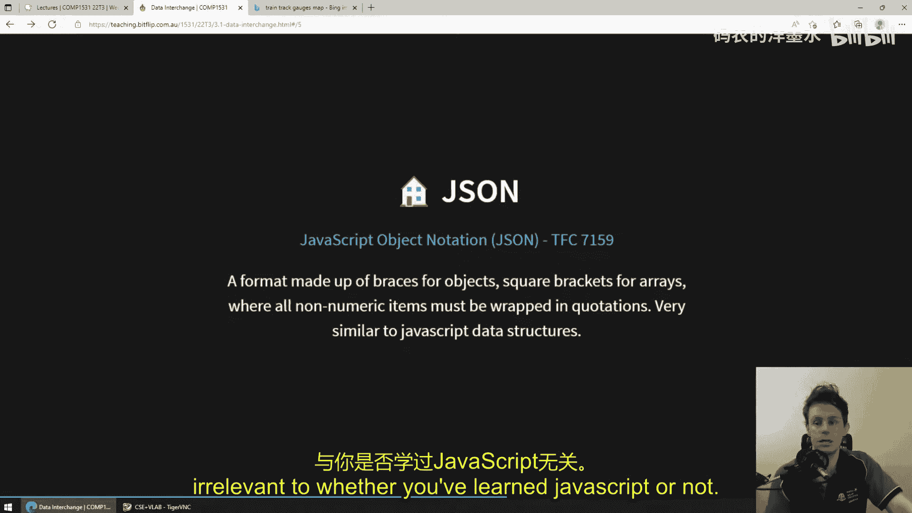

I guess zraki sort of language independent。 when they say text based。 I mean， you know。

 it's all characters。 You can， you can look at Jason as a human， They can read it。

 even if it's complicated， right， you can always read it。

 It's like opening a CV file if you've ever done that。 You know。

 maybe it's all jaled in the text editor， but it still looks like text language independent means that it doesn't matter whether you're in C or jascript or anything and data interchange format we've talked about。

It was authored by someone， a bunch of people who really liked jascript。 So it kind of， I think。

 came out of the early jascript community， But again， we're not here for a history lesson。

 but it is a format made up of braces for objects， square brackets for arrays and essentially all nonnumeric items。

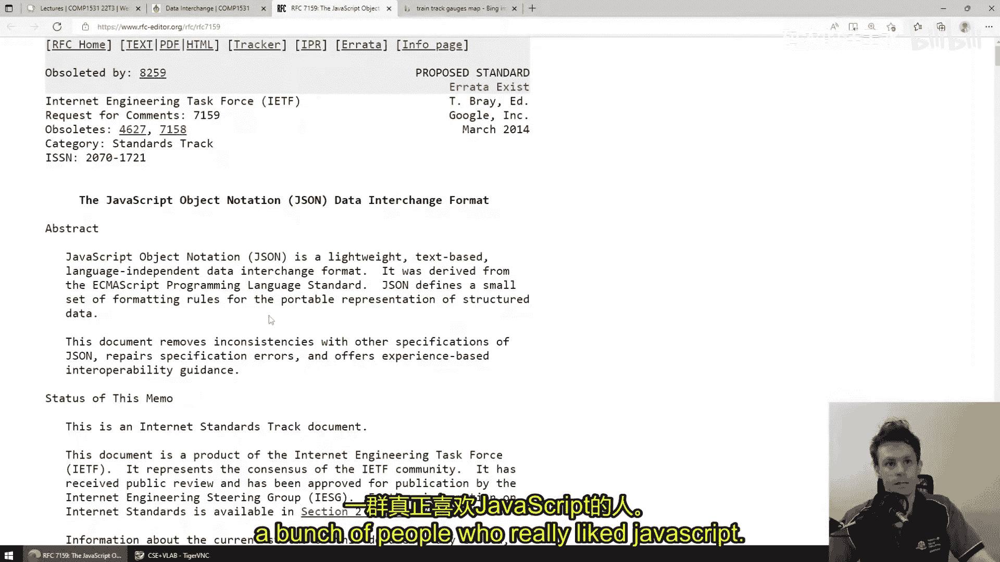

Are based on having quotations wrapped around them。

 So it's actually very similar to jascript data structures。

 And you'll certainly feel a lot of that as you program with it。 You'll be like，hu， actually。

 this feels like a really simple version of jascript that I can use just to represent data and information。

 So here is a piece of Json。And we want to represent this structure。

 which is an object that contains one key。 And that key is a list of locations or an array of locations。

 And each location itself is an object that contains two keys， which is the suburb and the postcode。

 right。Now。You can see that immediately it's very， very similar to JavaScript。Remarkably similar。

You know， if you actually， you've probably done some of， you know lab。

 you've done lab1 or lab2 by this point you should be familiar with this if you're watching the lecture if you haven't。

 you might want to go and check out some of that material again。

 but you will notice a few differences between JO as a representation of what a normal jascript object might look like or jascript。

 you know， structure。 One of them is that in Javascript， we don't allow trailing commas。

 I think this might have even been something I glossed over a bit in week1。 I can't remember。

 Let me just open up our lecture code。

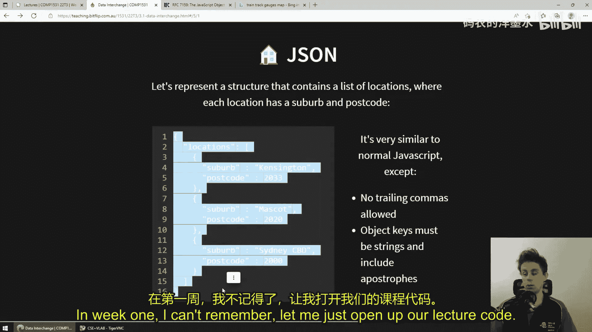

P second。So like， for instance。In Javascript， one thing I feel like I might have glossed over this in week1 when we were going over the language。

 but in Java， we encourage you to actually put trailing commas at the end of all of your list items。

 This is something that you tended not to do and C whenever you have an array or list of things。

 but it's something we encourage you to do in Java。

 The reason for that is because it makes your code。More easily mutable。

 more easily changeablecause you can just kind of swap lines around without having to create compile errors。

 whereas if you don't have commentsas somewhere， you have to kind of think about， oh， I did。 Okay。

 Bron， I'm having a bad moment， Bron， thank you。 Sa us another minute or two。

 So one thing about Json is that we don't include those ever。 It's a really simple notation。

 It has to be exceptionally。It has to be simple to be like easily consumed by everything。 Basically。

 So that's one change。 The other one is that object keys must be strings and include apostropphes。

 So what that means is that。

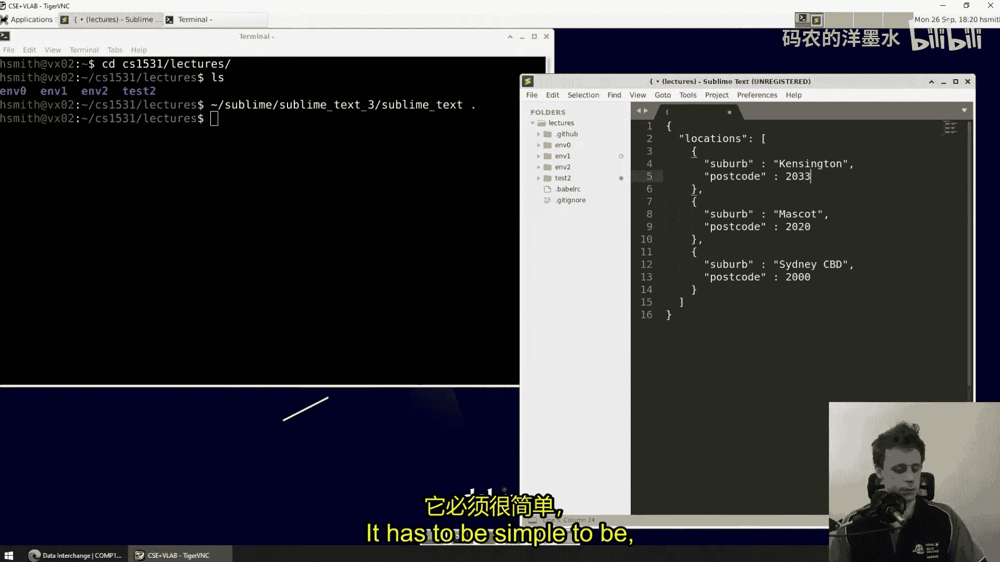

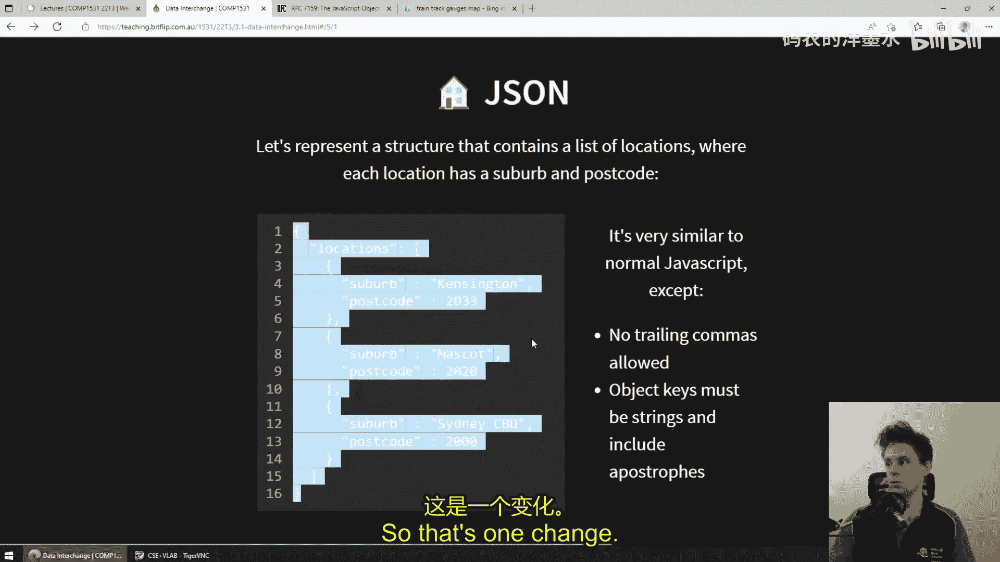

In Javascript， you can do something like this。 You can actually say I have a key of suburb。

 a key of postcode， particularly if it's just， you know， characters。 You can't do that in Json。

 everything has to be actually explicitly a string。You know， so in these cases。

 this all has to be a string。Like， look， like。Theyger。😊，等。嗯。Yep， or also has to be double apostrophe。

 Javascript doesn't Json， sorry， doesn't love single apostrophees。

 So if you've got into a habit of single apostrophees in jascript。

 you probably need to go back to double apostrophees in Json。 But besides that。

 we're really dealing with。

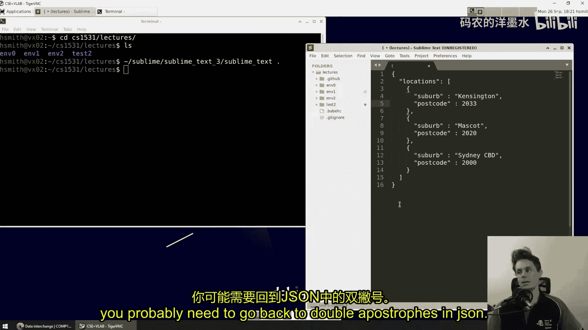

Something very standard， which is good。The cool thing about J is that most languages。

Have the ability。Either built in or via libraries to read and write Jason。 And this makes it again。

 remarkably powerful。Because it means that language A can take a data structure。

 represent it through Json this universal data interchange format and send it somewhere else， right。

When most of the time all these libraries， all these JO libraries are really doing is just converting like language specific data structures to JSson strings。

 because remember， everything in JSO is a string， even though this kind of looks like code。

 it's actually just text， It's text that a program can take in and convert to something meaningful。

 but otherwise it's just text。So if we have a look at an example of some J code。

 I've got some here in week 3。

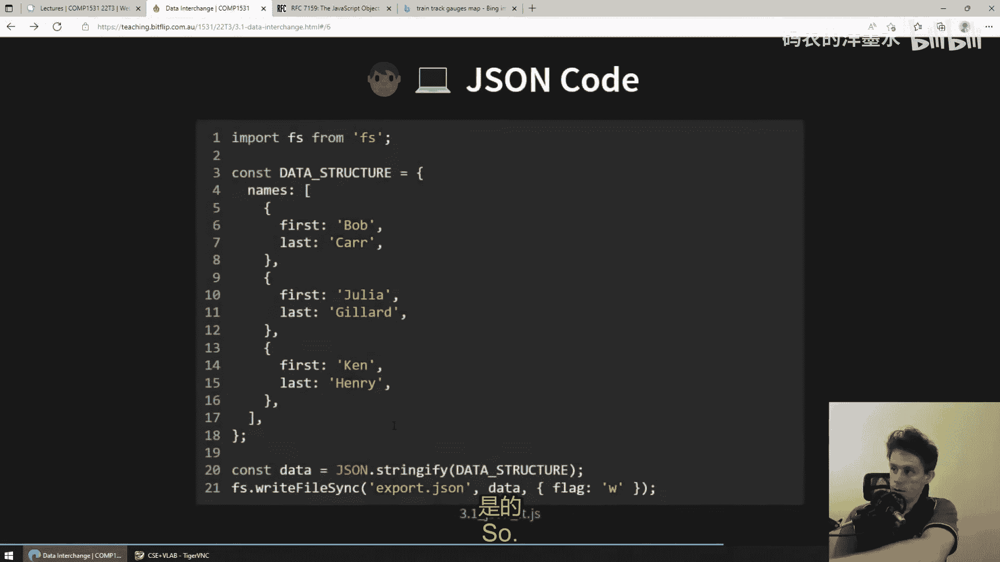

So remember week  three， we're still in this environment one folder， and we'll go to 3。

1 called Jsonnet。um。And in this case， here。We have。A couple of things to look at。

 Let me make this window just a touch bigger。And this file is relatively easy to make sense of。

 We're gonna import the file system object from file system。

 Remember file system is one of the built in libraries to jascript。

 We had to look at those last week in one of the lectures where we talked about NPm and importing so you don't need to do any NPm install for that one it just kind of works as it is and then we've got ourselves here a data structure doesn't need to be called data structure。

 It could be called pineapple and it's very simple。

 It's an object that contains one key very similar to what we saw before。

 That one key is a list and each list contains an object so the list contains three objects and each object has two keys with respective two values。

 You can see we've got lots of trailing commas here。

 We don't have apostropphes or double apostrophees either around our keys for our objects and up until this point you know the code kind of make sense I could just have this program here and I could just console data structure like this and then I could run it I could say well you know。

Noode in M1 source。3。1。Like that， you know， seems to work fine like that。So， you know。

 where we can actually just console logger。 William says in Json。

 is it correct style to have spaces around the colon unlike JS。 No。

 I don't think that's correct style or not。 I don't think there really is a correct style necessarily。

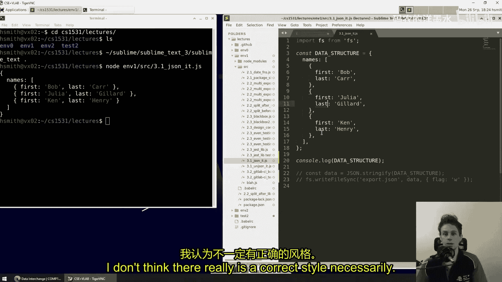

That's fine。 It's probably just how the lecture slides， no。

I think I had something weird on the lecture slides back here。Yeah。

 I think that's just how the code is on the lecture slides。

 There's probably that white space could probably be gotten rid of。

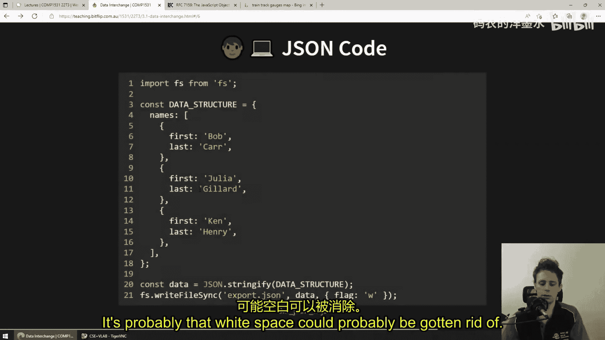

For consistency。So fairly straightforward， now what we're gonna do is a really important line here。

 which is line 22。 And what line 22 is gonna do is is going to take the jascript specific。Struccha。

 right。Which is what we printed out before。 And it's going to convert it to a string。

 And this function here， this is a string of I function that's part of the Json object， right。

 It doesn't have to be imported。 This Json object，'， it's actually。

 it's a bit of an awkward thing from a language design point of view。

 Like if you're a language designer， this probably wouldn't be ideal。

But it just means that without importing anything， you can write Json and then get some functions on it。

 This will turn the structure into Json。 And what I wantan to do here is I want to contrast for you the difference between printing data structure。

Right。And printing data。So I run it now and you'll see two things happen The first time we get the data structure。

 Now， remember， this is an actual structure that makes sense to ja that it just has to turn into text to display it to us because we've asked to log it。

The one underneath， though， is the result of a Json stringing ofify。

 String aify means convert to a string。 The result of that。

 which is why we get all this kind of goblliical here。

 which is just bunches of braces and apostropphhees and lists and texts like that。So this here is JO。

A computer can't understand this。 So to take that analogy further， what I mean is if I say to this。

 try and print out。The names。The value at the names key of the data structure， that will work。

But if I try and do the same thing with data， which is the stringified one at the bottom。

 I'm going to get an error because for the first one， it's like。

 why I know what that is' because it's， you know， it's a language specific object like this。

But for the second one， it just sees a string。 It's like it's literally the equivalent of me saying。

 you know， it， like it literally is the equivalent of me taking this。Saying， you know。

 bla is equal to this。Yeah damn it。O。Scary， I know my fat heads in the way。 Let me make this。

There we go。Yep， so it's like taking this。 And it's literally like this line here onm 25。

Is really the equivalent now of just saying console dot log b names like this。You。

 and we'll get undefined， too， right， because it's a bit silly。 You know。

 Javascripture really throw an exception or something。Bye。😔，Kiki asked a really interesting question。

 which is basically， hey， what's the difference between。

What's the difference between Json string andify and just two string。

 I like that question'cause what we could do here is like， we could do a little test。

 which is we know data structure is the actual data structure so we could console log。

The Json stringify of data structure， or。We could console log。Where is a data structure dot2 stream。

Now， you can see that in the latter case， it didn't like that。 And， well， I mean， it did。

 it did exactly what it's meant to do， which was that it saw that it was a very complicated structure。

 right？ And instead of actually printing it out like it did with Json。

 we just kind of got this like blanket object object thing。 Now， obviously。

 the jascript language could be designed。Right， in such a way that if you do two string。

 it could turn it into JO。 There's 100 things it could do， but it's just at the end of the day。

 it doesn't do that。 You know， it just doesn't do that。So， point is。We have this line。

 data equals that。 And now we wanna， what we wantan to do。

 And this is a really common thing to do is we actually want to save it to a file。Soright。

 I'm gonna say here， I've got my file system。 That's what I imported up the top here。嗯。

And I go right file sync。 And now， and this is part of the， you know， file system library。

 I say that I would like to write to a file export dot Json。 I can call it anything I want。

 But in this case， I'm gonna like， you know， call it export dot Json。To that file。

 I'd like to write data。Which is a string because what you write to a file typically has to be a string。

 typically。 And in this case， it is because we convert it to one。

 And then the flag and this third argument of the writing to a file is a set of options。

 Now this is not something we cover extensively in the course。 there's only one option we need here。

 which is what we call that it's a W flag， which means to write to the file and that's needed there if we want to write to it。

 So we run that code again。 And what you notice is after I run that code。And I look inside。

Which follows it in。I didn't say but here we go。 Let's run it。See， and this file just appeared。

 And when I look at export do Json， I have a Json file here， which is。Text， right。

 becauseuse Jason's text， really， really easy。1。Tony says， is it like F put S in C。Well， like。Yeah。

 the file， the right to file like this line is like F put S and C。But F put S is just putting。

 putting a string into a file。 And similarly here， we're just putting a， you know。

 what would you call it。We're just putting like a。Piece of text we already converted。

 So the kind of real， the kind of money element here。

 the part that you really need to be concerned with is definitely like the Json stringifyingcause like writing to a file is something you could just Google。

 You know， you could just Google how to write， you know， dried pineapple to a file。 It would be fine。

 It would work normally。 and you could open this file and there'd be dried pineapple there。

 we don't wna put dried pineapple there。 We wanna put data there。

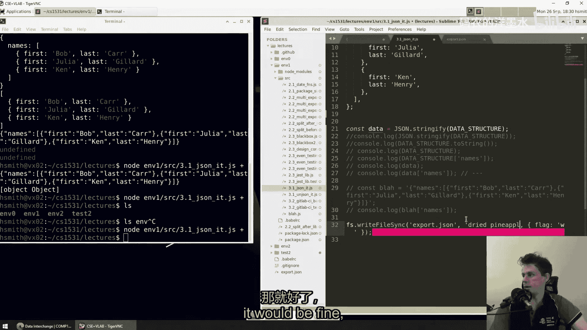

So now data is actually going to be there。 So that's the writing to Json part there。

Any questions about that before I move on，cause now we're gonna talk about。You know， reading。

Reading from Jason。It's not that complicated。I'll just give you a minute。

Whilst we're waiting for questions， if you have a look at the reading from Json 1。

 you'll see that it's actually remarkably similar。 and it's fairly intuitive as well。 right。

 Like you look at this and you're like， okay， that actually makes a lot of sense。

And the reason I think it makes a lot of sense is 'cause it's basically the same code。 Let's look。

 let's look at the differences。 We've got read file sync。Right。

Read file sync is just different from right file sync。 instead of writing text to a file。

 we are reading text from a file。 That's it。We are reading from export dot Json。

 And instead of giving it the data to write to， we are pulling it out。

 and then we needed to give it an R instead of a w in this case， because we're reading from it。

 technicalically， you can still read from it with the W。

 and I'm not gonna get into file system flags or anything like that。Danny。

 I don't think the W is capitalised。 I think that might just be a slight illusion， potentially。嗯。And。

 you know， Dery says is a like file open。 Yes， read file sync in jascript is just like opening a file。

 That part is not that exciting。 This is just reading in text。 So if we actually look at this。

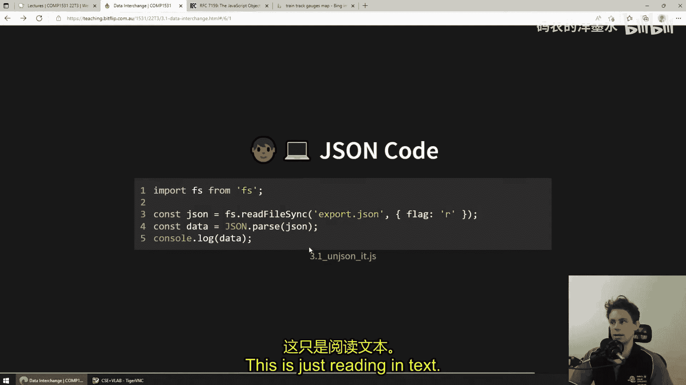

3。1 on Json it， right。I can just console log Jason。 Now Jason is just a variable name。有。

So if I con log that。哎，呃。Johns onnet。 All。 Yeah， yeah， yeah， shut up。Like this。Oh。Oh， no， I've got a。

 got a problem here。A， why。

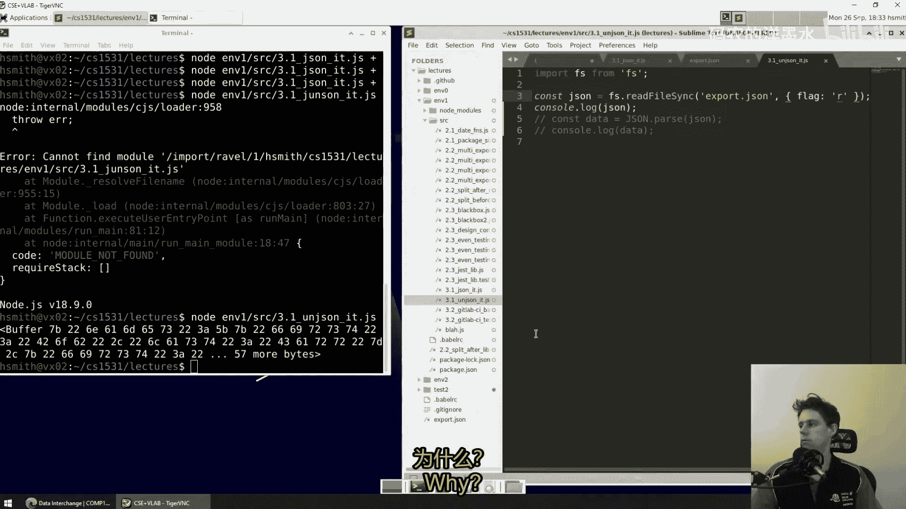

So。Yeah， I'm just checking jascript， read， sync file buffer。

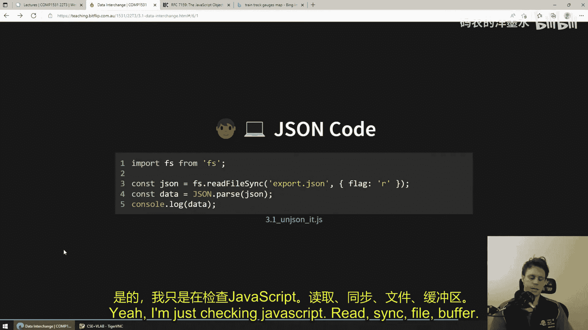

B for the entire， it might take a long time to read it。So let me just check something really quick。嗯。

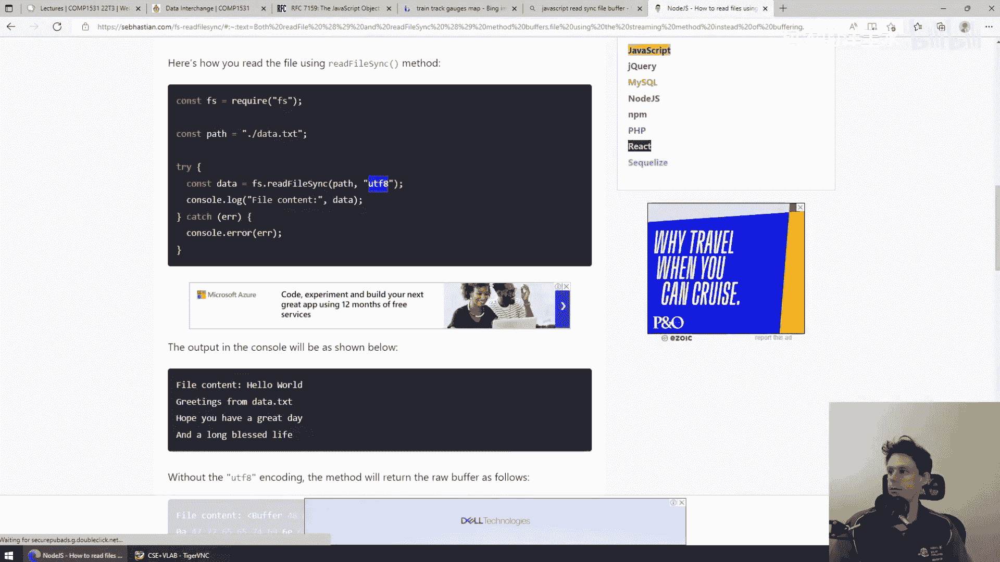

There's a few different ways to do this kind of thing。 I'm just。Basic， okay。

 so let me take a step back。 What's， what's happened here is that in certain languages like jascript。

 when you read really large files， right， when you read really large files。It's very。

It's very costly for the computer to sometimes read the file。 If the file is many megabytes of text。

 it can be quite taxing from a processing standpoint to just like load that entire file into memory。

 So what happened there was that it was loading it into kind of like a buffer。

 which is essentially just a way to optimize the loading of the file。

 So it sits in like a little bit of a queue。 so to speak。And。What I've done here。

 which is not something you need to immediately be concerned with is just trying kind of change some flags here as to how to open the file I basically forced it to say。

 yeah， please open it as text。 Other things you can do here。 You could have， why is my cursor gone。

I can't see my cursor on the screen anymore。Okay， whatever。

Another thing you could do is like in this case， when you open the file。

 I could just like convert it to a string as well。 That's another way，'cause the buffer itself， Wait。

 when you try and convert the buffer to a string， it'll actually just， you know。

Dump the whole thing forward。嗯。Yep。That's the file。 That's the contents from the file。

 But the thing is， again， this is just a string。 Like I said before， I can't just load that and say。

 hey， I'd like to get Json names key。That doesn't make any sense。Right， it just doesn't。

 It'll get undefined againca it's like trying to get it out of a string。

 So what it' need to do now is use the Json library to convert it from the string。I need to parse it。

 which is another way of saying kind of like processing and make sense of from a string to an actual from a Json string to an actual piece of data。

 So now you'll see that like the contrast similarly here。

 This is the string that I read from the file。 and this is the actual object that I decoded from that Json string you know。

 into something real。 And then that's really cool because I can use it now。

 So what we've essentially done is we've run a program over here with a complicated data structure as part of the program it has gone and packaged it up into this JSson data interchange format。

 it is then stored that in a file。😊，And after it's started in the fall。

It's then been opened by another running of a program that is opened and then can process it again。

 So that's really， really cool。 Now， if we go back to the questions。😊，You know， Jen said。

 I'm still confused as to what J does。 Okay， well， J is a language。

JSON is a way of representing data。 JSON is a way of essentially creating a standard that says this is how you can represent some simple data with some braces and square brackets for lists and objects and some double quotes for strings and numbers and decimals。

 you know， true or false， very， very kind of contained space。嗯。

What we're doing with Javascript when we use this Json dot stringer file。

 this JON dot parse is that the writers of Javascript。

 the engine have written into it a library that can encode or decode JO from that language's data structures。

 So in this case， the people who write some of the environments for jascript， this function。

Bam can take jascript， turn it into a string in this file can take a string， turn it into。Javascript。

 and that string is J。 If it wasn't J， like how could you ever。

 how could you ever predictably make sense of it， you know。You just be like， I。

 I don't know what this is。 could be anything。 There's no standard way for you to interpret it。

 which is why it can work with all these different languages。 Like， I'll show you this， right。

 in Pythons， Python's different。 So let's say I make a file here in another language called you know。

 J。

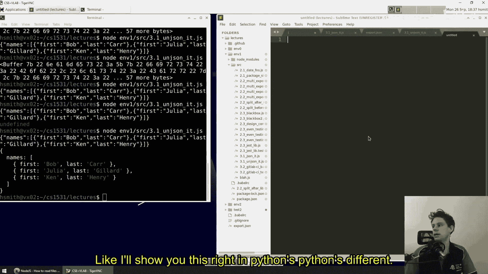

Yeah。J S dot pi。 And then I'm gonna forget how to open Json and P then。 I mean， I vaguely remember。

Right， I'm gonna go grab a piece of sample code。 It's not much。 It's only a few lines。Oh my god。

 Just give me the code。Iclicked on the wrong link， clearly。There we go。Yep， fairly straightforward。

 Most of this isn't needed。 This is a different programming language。

 It's not something you need to be concerned with。 But the point is that I can go and say。

 I'd like to open export dot Json， and I would like to。

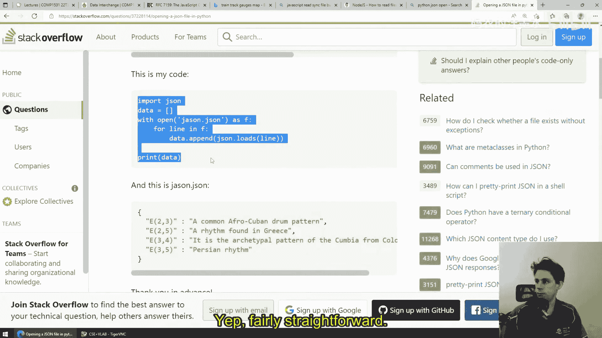

Let me， let me get the， the language consistent。I can'ta can't'cause of how that language works。

 like， let's say it's like， I call this one Json string。

 Like I'm gonna read the text or like Json file。And then I'm gonna say that the data is Json dot。

Loads。Sorry， testing my knowledge here。Right， so let's say I didn't get that wrong。 I probably did。

And we try and run this now。There you go。 There's that data。

 and I can probably do what I said before where I can say， you know， data dot names。There you go。

So like what I've actually done here is we've gone， you know， we've， we've made data in jascript。

Used a library to convert it to a JSON string and then opened it in another program in another programming language with another library here in this programming language that is capable of。

 you know， reading and interpreting that standard JSON language。Into。Python， in this case。

 his own data structures， which would be very different。 you know what I mean。But you're just very。

 very different， so。

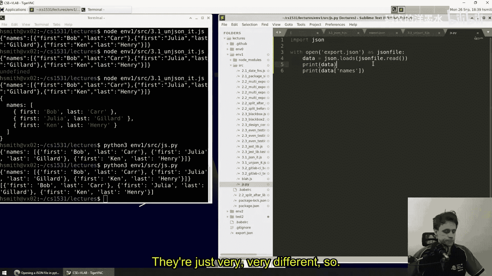

Yeah。Cool， I think that's it on Jason。 That's this is an important one because we see a lot of this in the course。

 and we're gonna move on to another language now。 But again， just before I do。

 I w to pause for 10 seconds。 Well，30 seconds to see if people have any questions。😊。

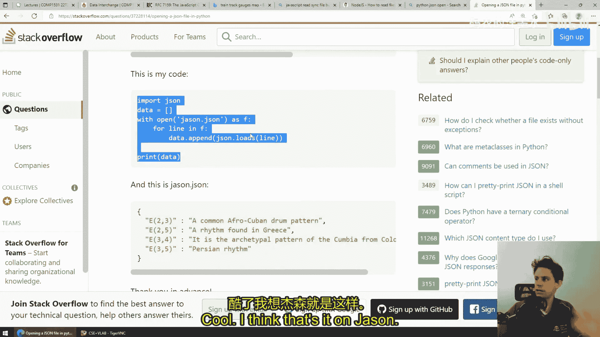

Tony says， is Jason accepted by all languages， that's really up to the language designer。

As far as I know， pretty much all major languages either have a J library built in。

Have it built by built from date very early on and easily importable。 Like。

 so jascript it's built in。Python it's built in， but you actually have to explicitly import it。

 but it's still built in。 just the name space isn't immediately there。

 I assume languages like C plus plus You have to install a library externally。Most would， especially。

 again， most application layers and particularly， sorry， most application software in particularly。

Any software that interacts with a lot of Web stuff will always have it。 Braron says。

 so Jason is just data storage， or do you sometimes call method slash functions inside a Json file。

 It's just data storage。 But I want to be clear， Json is not data storage。

 Json is a language definition。 This the and It know you mean this。

 but I'm just trying to be really specific。 The actual Json is just stored as text。

 It's actually just a text file。 It's just ASI in a file。

 It's just that the arrangement of that ASI is， is to a certain standard to a certain common interface。

 which is defined。By the Json stand， It's like a CSV， you know， like CVs are not too different。

Which is quite interesting， Allison says， is the data structure store in the same format for all languages so that the data structure in JON can be used in Python too。

 exactly like a JO file looks like a JON file。 There is no JOson file for jascript and Python and see it's it's it like is JO。

 It's a language It's a definition。 It's a standard standard interface， right。

Bron says there's no JO interpreter。You can't let me answer it better。 You can't run J， right。

You can't just run it。It's not a programming language， you know。Like a CSV， you can't run a CSV。

 It's just a way of storing data。I'm going move on a slightly newer。

I will answer this one last question from Dery。A。So Json is like a bridge to transfer inputs and outputs across languages。

Json is like a bridge to connect data between languages。

 I don't know if I get into inputs and outputs but。Speaking of like standard interfaces。Yamo。

Yaml is a really weird recursive name that stands for Yaml Ain't Markup language。

 bit of a funny name。 I won't go into it。It's a popular。

 It's a popular modern interchange format due to its ease of editing and concise nature。

 So you got to think of this as like a Json alternative。 And it has pros and cons compared to Json。

 And one is not better or worse。 They are simply different。At its core。

Json is really useful for actually storing data and sending data over networks。

 Yammal is a bit more useful for kind of standard configuration files。 So less like。

How would you put it less like sending and more just like config， like config files or like you。

 you kind of seen these already， right， Like in your project， sorry。

 I always forget how often Gitlab logs me out。对。Right， like in your project。

 if I just go and open some random groups project。

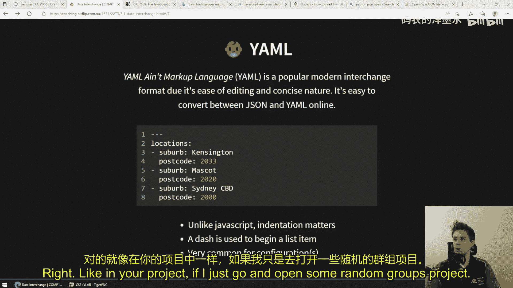

W 13 a arrow， right？ You know， they have a package dot Json。 And like， this is a good example。

 Like package dot Json is not really sent anywhere， right。

It's not really like sent or like sure it's stored in a file。

 but it's not like you writing programs that are reading and writing to it and you're sending it over networks。

 It's kind of just existing there。 But it's a nice， easy way to just represent simple data。

 So Yaml's an alternative to this。 And if you have a look。

 it looks kind of similar to Json in the sense of like this data structure you see here is meant to mimic what what we saw above here with locations and then lists of suburb postcode。

 But it's much more compact。 So and the way they got around this was that unlike jascript indentation matters。

 So instead of relying on know braces and square brackets and all these other kind of double quotes and lots of boilerplate fluff。

 we simply just use indentation as well as these dashes you'll see here next to suburb and postcode to represent data。

 So if we look at like say we go online Yaml interpreter。

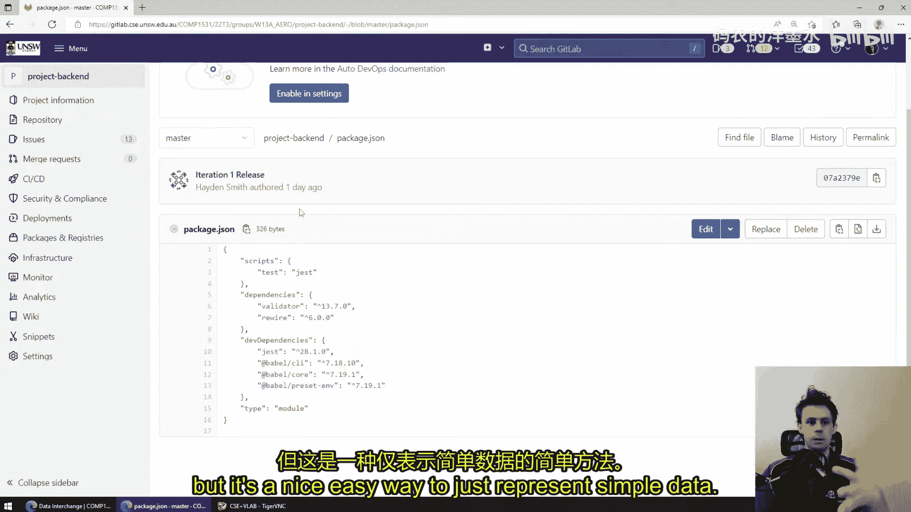

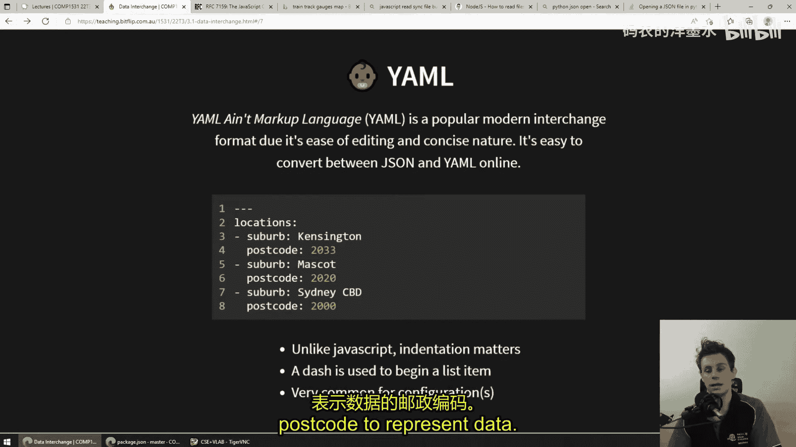

Something that we can like， play with。 You know， this isn't。 this doesn't run Yaml。

 It just simply like tells us if it works， right？ And you'll see if we look at our code， you can。

 we can create objects。 So like， if you imagine that everything is like an object in， in Yaml。

 or maybe let me get the Yaml to Jason converter up。

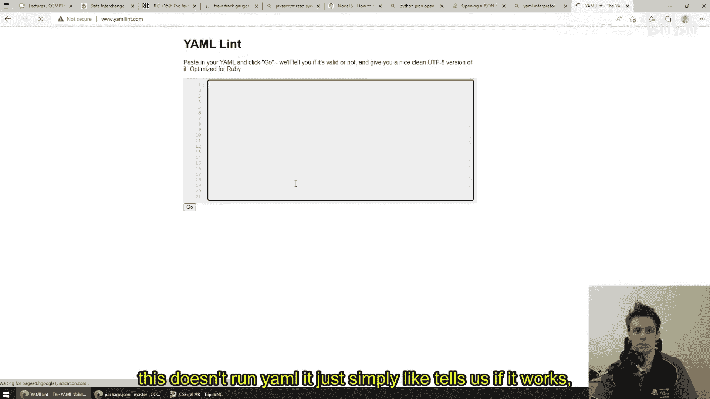

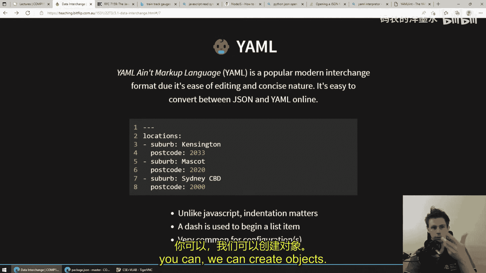

There's many of these， right， It's not like the 1， I should say a yaml to J converter。

 And on the left here， if I start writing yamel， like locations。And then inside there。

 I start copying， you know。Dash suburb， Kensington。And we convert it。

You can kind of start to see the pattern here。So the pattern here is that。

Locations is one of the keys。 And I could make more keys just by saying， you know， you know， Hayden。

Something。Something use my last name， Smith。Hello。There， I don't even ever done that right， yeah。

Let's like play around with this a bit。 What are we noticing， Well。

 we're noticing that indentation matters in the sense that。This second。

 something because it was further in。 it actually like says I'm part of that， right。So， you know。

 it's like everything on the very left hand column is part of the main object。

 And then everything kind of indented from that is like part of the sub element。

 The dash is used to say this is a new list item。 So notice what let me zoom in a bit。

 Notice what happens here when I add like another dash here。 Watch the something。

 It suddenly goes from that to that。 So the dashes away of saying this is a new item in the list。

So what happens is。If I wan to say， okay， I've got a suburb of Kensington and a postcode to 2，0，3，3。

Because I didn't use a new dash。 It thinks it's like kinda part of the same object。

 But you'll see if I put a dash here。It now thinks it's like a second object。

 like a second item in the list。 So think of the， the dashes are like a new item， like。

 like array push or something。 So two dashes means two items in the list。

1 dash means one item in the list。 And if I don't have the dash there。

 it just kind of can assume that it's the next thing down。

 So you notice it's immediately much more compact。

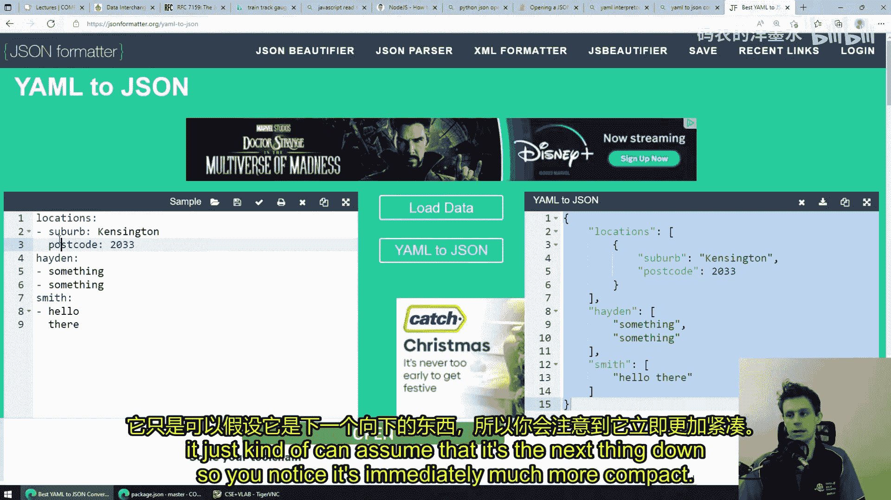

Then JSON， which is one of the reasons it's probably grown in a lot of popularity because what it means is that you can sometimes describe what might be otherwise a little bit more ofbo data structures like this like if we go back to our package do JO here let's take this from W13Aarrows group。

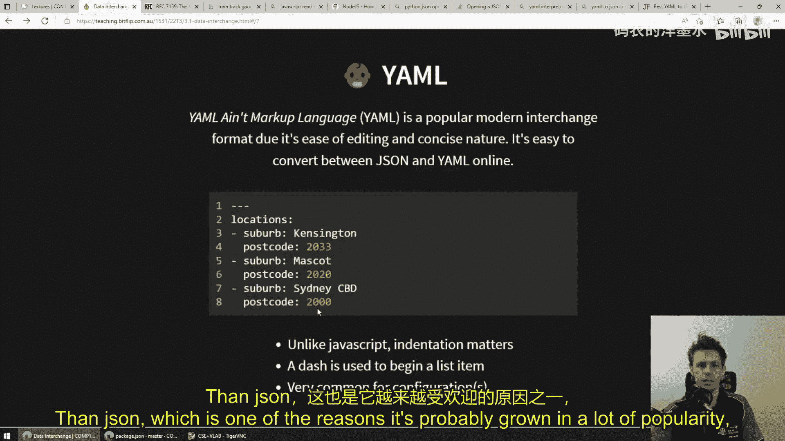

Let's paste it here。Well， how do we go the other way。Go adjacent to Yaml， right？

See that it's like a slightly more。Easy way to represent it。 And you notice here。

 there's no dash here， right， There's no dash before validator because the objects themselves are made up of more objects。

 So you don't need the dashca it's not a list。 So you can just say， yep。

 Scripps has these items in it， Test and dependencies as these items in it。 So again， it can。

 it can help you really write some， some very straightforward。 like， you know，Country。You know。City。

Suburb。I don't know， straight。KAndzac parade。Now， this doesn't make any sense， but again。

 a little bit lighter。

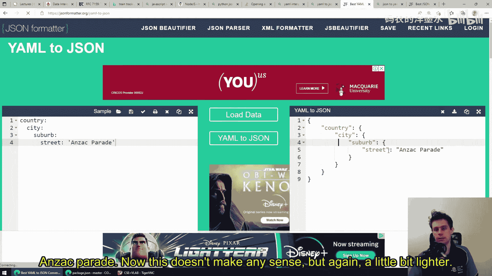

So it was a very practical demonstration of Yaml again， very very simple language。

 You don't actually get asked to do much with this in the course at all。

 And you probably won't see a ton of it。 You know， on a day to- day basis I probably work with like you know。

 twots Json onet yaml， but the Yaml is nearly exclusively configuration files。

 I've never written Yaml to a file。 I've never read Yaml from a file。

 It's usually stuff like packaget like package JsonN is a really good example of what Yaml might be used for。

 but actually storing data and transferring it over the network much less。

 so definitely much less so。 And then the last kind of interchange format is Xml Xml stands for extensible markup language。

 It's kind of like a legacy or old school way of。

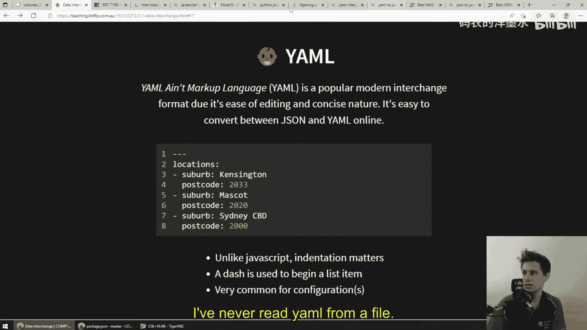

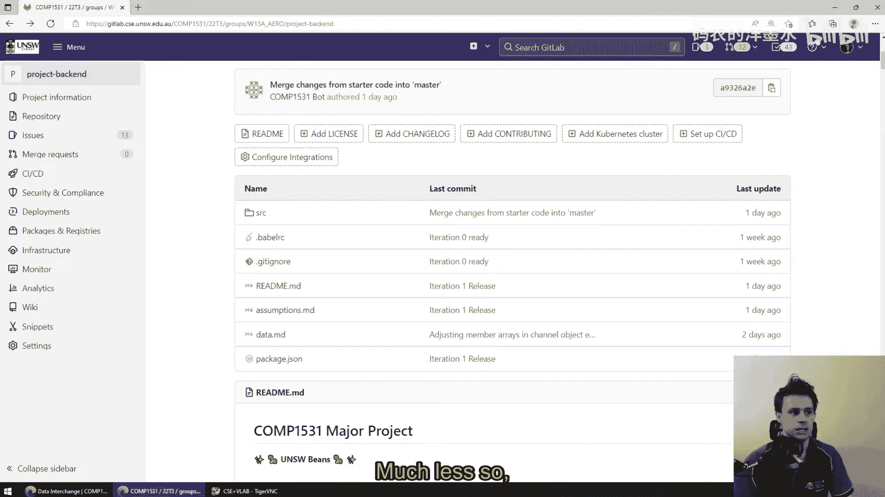

Expressing data。And it looks very。嗯。It looks very like。Weird and over the top， right。

 Look see that's the word I'm looking for。 Bron says it looks horrendous exactly。 So it's ugly。

 and it's's it's kind of over the top。' it's like rooted in the same basics of HML。 Yeah。

 so many of you have seen HML want to be HMl that's a， exactly and it' it's just for both。

 you know like it's kind of like Jason except you don't only have the key that you have to close you know everything's got an open and close。

 And you'll see here that the density of like data to boilerp is really bad。 you know。

 so most of it is not the actual data itself。 It's just structure。 but it's very like old school。

 it was kind of propped up most of how particularly the web interacted for a long， long time。

 So this was kind of like this was like before Yaml helped be a counterpart to Json。

 And before Jason even existed。 This was a big thing。 And you can still see some relics of it today。

 you might have seen。😊，This around the Internet where you got an XML file。 And like to this day。

 most on website site maps， you know， like if I go to like my company's site map， most of the time。

 it's still an XML just because it's， you know， I don't know why it still is an ex。

 this is unrelated to anything， but。

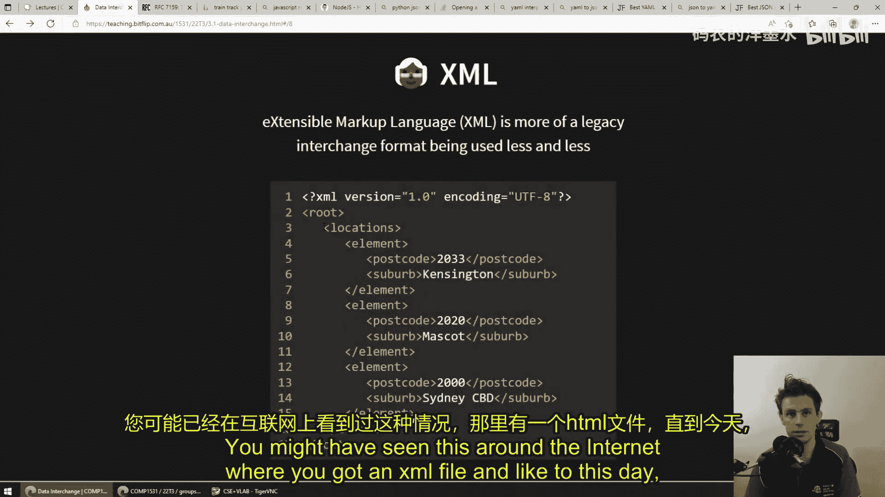

It's just how some of these things like to still work。 So it exists。 That's why we talk about。

 Otherwise， we just pretend it doesn't exist like we do with 99% of computing， you know。

 But in this case， it's kind of relevant。 I already talked about the issues to do with this。

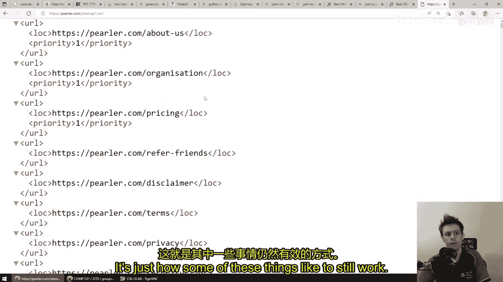

It's just not really used in modern languages。 You don't have to worry about it。

 It's not gonna to come up in the course。 It's really just a chance to give you a look at it。

 And Tony says， are we going to use all three of these languages in the course。

 or are only going focus on Json。 So Jason's Jason's what we're gonna focus on。

 But I think what I want to leave people with from this lecture is that this particular lecture is not hard。

 You know， like all of you are really smart。 And in fact， if we didn't even have this lecture。

 And we just gave you like some sample code and said， here's some Json。 should。

 you all have big brains， You'd be able to pick it up like that。 Honestly， You know， that。

Before I taught this， it wasn't taught it as in a core undergrad degree explicitly。

 and no one was sadder for it。 People just learned it。

 The reason this lecture exists isn't to show you a couple of code examples for Json It's to put in your eye put in your heads the broader idea of why this stuff matters and where it fits into the world。

 you know。To give you some like language and some context to things。

 So it's mainly language and context， though most of what you'll be exposed to in the course will be Json。

 I don't think we expose you to any Yaml。 Sometimes we ask exam questions about it。

 but we never see any X Ml。 So again， I'm going to ask for any last questions for 30 seconds。

 Otherwise， we are going to jump to a break for 10 minutes before we get into the second part of the lecture around continuous integration。

Let's give you a short moment。What is my favourite data format。

 I don't really have a favourite data format。It's a good question， though。

I'm pretty indifferent to most things as long as I help me get what I need to do done， so。Cool。

Please leave some feedback， Love some feedback。 would appreciate it， As always， it's so easy to do。

 and other than that。Thank you。

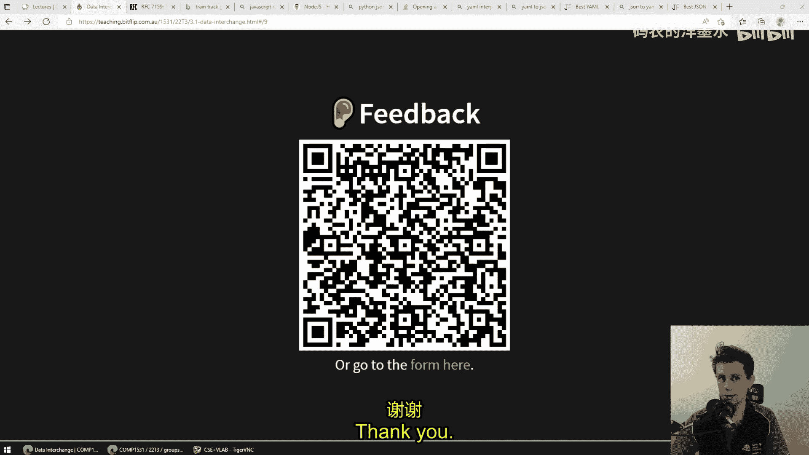