# 【全集】新南威尔士大学 软件工程基础 中英字幕 1080P COMP1531 p09 Lecture 9 - 持续集成 -BV1M7Nwz7EGh_p9-

Okay， so the next lecture is another part of our projects。Lecture theme。 If you remember。

 we did one last week on package management。Today， that we're doing one on。Continuous integration。

Continuous integration is a topic that is also new since I started teaching this course， which is a。

How would you put it， It's， it's a lecture that's motivated by the fact that when you work like we've none the stuff with Git where。

 you know， you learn how to use Git and you make merge requests and you do approvals and stuff like that。

 But to scale these multiuser software project environments。

 we need automated ways to integrate and test code。 basically。

 we need ways so that you can create these merge requests。Merge them in。Right。

And help assist you in making sure that they didn't break everything。 You know。

 that the person who wrote the code didn't just destroy everything。

 So we're gonna learn about continuous integration。 We're gonna learn about pipelines。

 We're gonna learn about runners， all of these things。So continuous integration。 formally。

 we will define it or it is defined one or the other。 It's practice。

 It's the practice of automating the integration of code changes from multiple contributors into a single software project。

 which is a really fancy way， again， of saying that we make it easier。😊。

To make sure that code changes come together and don't break anything when it comes from like。

 you know，10，5，1015，30 people， you know， you look at companies like Canva or Lassian。 You know。

 that Canva is a good example， Probably like 3304000 engineers， I don't know， something like that。

 You know， kind of one code base that many of them work on。

 And you got code coming into the master branch every single day， right？ How do they keep the。

 how do they make sure it doesn't break everything all the time。

 You know how do we make sure that more frequent mergers into master don't create instability。

Fairly simple questions。And basically the way we get around this and what continuous integration is is that it is a process where we run a series of operations on any commit that's pushed to the repository。

To check if it works。 So it's like an automated checker。 And we tend to do it on a per commit basis。

 So each commit that happens， you know。We like。Go and figure it out that way。 you know， we， we。

 we go and actually like do a few things， which includes like building testing and some other stuff we're gonna talk about in future lectures。

 Now， building is not something that comes up with jascript because we're not we're really building things in jascript because it's an interpreted language。

 But what we do do with jascript。 a lot is test。 And we've seen that last week with j， haven't we。

 you know how you can actually like。Test some things with jest building in other contexts might more be like what you do A C where you do like Gcc or Dcc to actually。

 you know， like compile it， building come in compiling as well， right？ But in these cases， no。

 we just mean we'll just be looking at testing。 There are other things we will do。Right。With。

With the continuous integration over the coming weeks， But to oversim it。

All we're really looking for to solve here。Is that continuous integration allows us to automatically run NPpM run test or the Jest tests on every commit so you don like you're going to still do it locally。

 but like we don't want you to kind of stress that if you if you did it wrong or you forgot to that everything' is going to break and number two。

 we want to help give you a visual okay or not okay summary on Gitlab so that you and your team can kind of really easily look at commits and be like this commit is okay or not okay you know。

And the way we're going to do that is we're actually going to add a really important file。

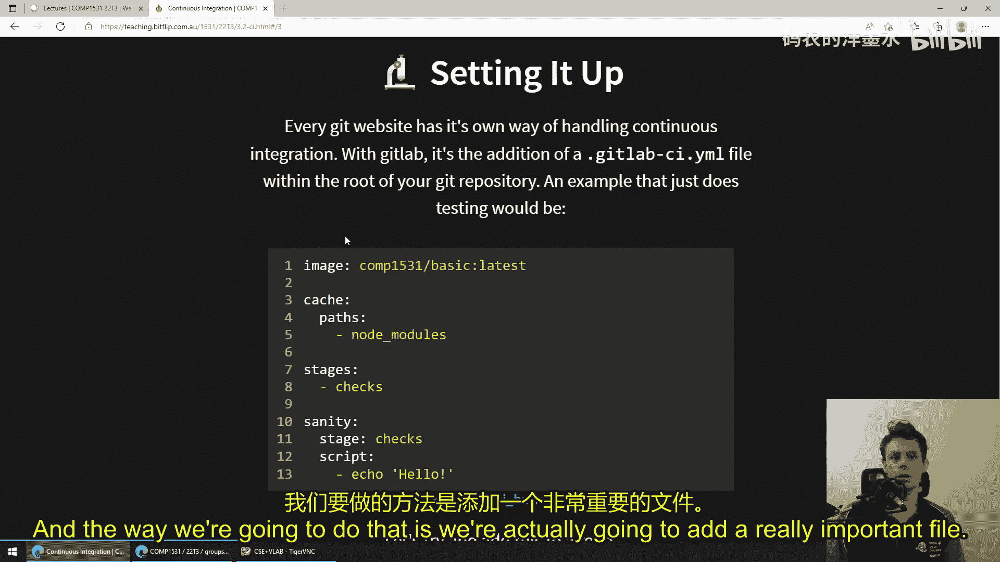

To your Gitlab repository。 So what I'm going do just to demonstrate this is if I come to Gitlab here。

 and I'm just gonna make a new repo， you won't ever have to make a new repo， but I'll make one here。

In that new repo， in this case， I'll call it like C I test。Can be， you know， it doesn't matter。

Or make it internal so you can all see it if you want to go look up this URL。

I don't know if that means you can push to it。I don't think you can。

 But what I'm gonna do now is I'm going to clone this have a look at this repository for a second。

 I'm gonna open it up in a new tab again。So we can look at it twice。

 We can come back to how it looked before。 I'm going to clone it。

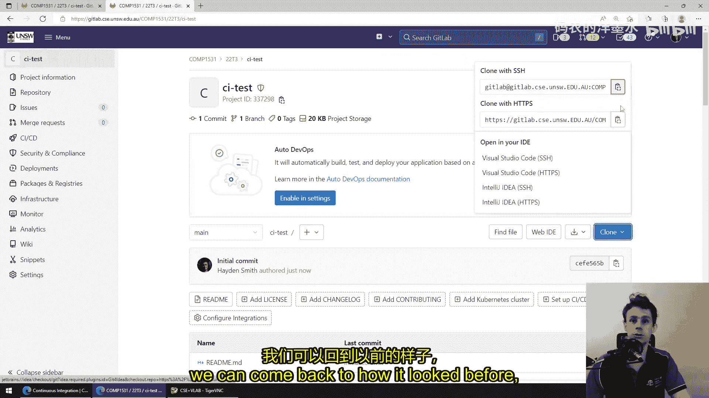

Yeah， right。 Here we go。 Gi clone。Like that。Done C I test。 Co。

 Now what I'm going to do is I'm going follow the lecture slides。

 which is going to consist of adding this here。 all this text to a file called dot Gitlab dash C I dot YMl。

 So dot Gitlab C I， the dot makes it a hidden file on Linux Gitlab is obvious。

 C I stands for continuous integration。 dot YMl is a dot yaml file。

 So you can see all these pieces are kind of coming together a bit。

 And if I create that dot Gitlab C dot yaml。 and I paste that in。

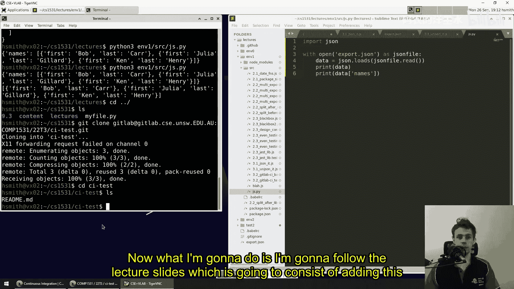

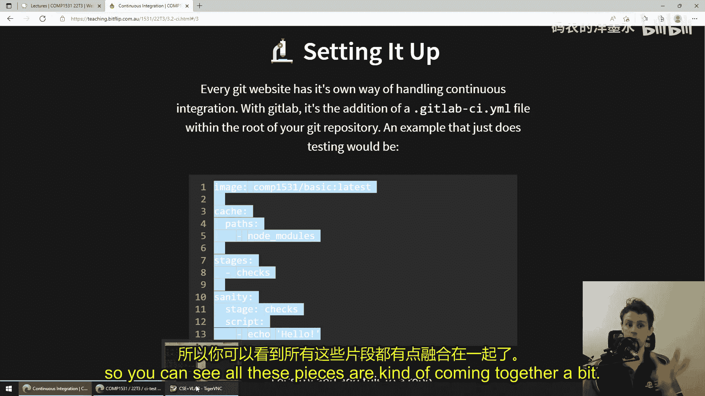

Now， what I'm gonna do is I'm going to go and commit and push it。Right。

 Git commitit adding Gitlab CI file。Push to master， obviously， in your project。

 you wouldn't need to push and you couldn't push to master。This reos is using main so。

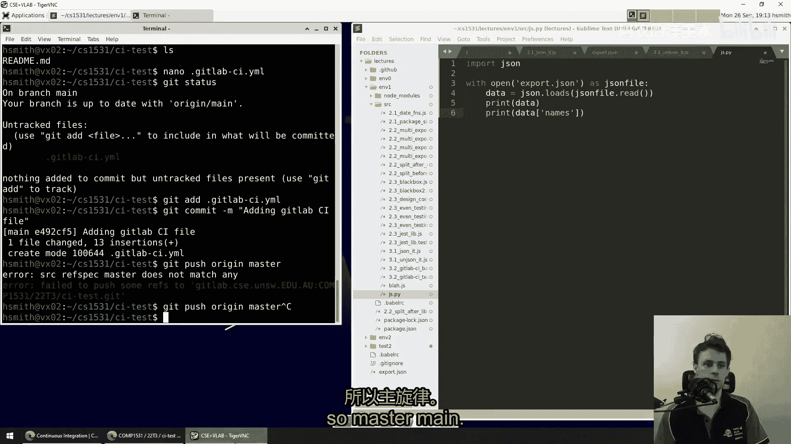

Master main， we talked about that back in week 1。 Now it's what happens when I refresh the page。

Two really important things to pay attention to。First one。

 a new file was added here'cause I made it Gitlab C I dot yamel， right， It's got that stuff in it。

 Secondly， you'll notice that up here next to the commit and have a look at the other tab for a second。

 right，ca I'll compare these two things side by side。Have a look at the difference here。Right。

 see how we've got this little， like。Waiting sign here。

Now what this is is this is actually Gitlab now kind of doing the checks on your code。

 or more specifically what Gitb is doing in this case is it's running the automated checks based on the rules。

That are provided in this file， and we should break down these rules really quickly。

 and there's not a lot to them at this stage。 They're all very straightforward。Right。So。

The first one is this image line。This one well come back to。

 but you kinda don't need to worry about it for now。 These two lines。

 most of this you don't need to worry about for now。 And maybe we will come back to a bit of it。

 But the main line to pay attention to is this line here， Echo， hello。

And this is the actual kind of script or the， the shell that runs when the checks happen。

 So if I go back to my repo here and I click on the tickcause you can click on this。

 you'll see that it actually。It has a few things on this page。

You'll see that it says it did a check called sanity。 And if we look back at the code here。

 you can see that there's a check called sanity， cool。 And when I click on that。

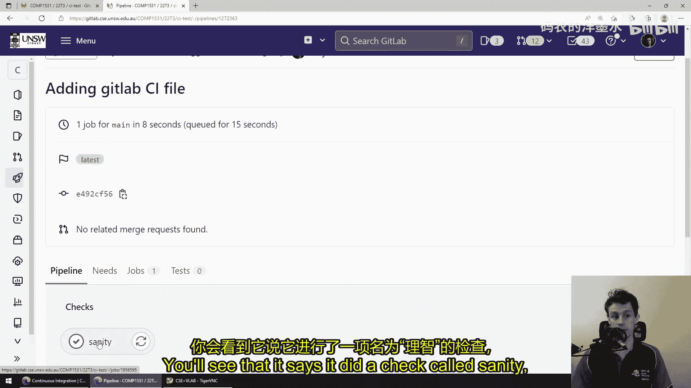

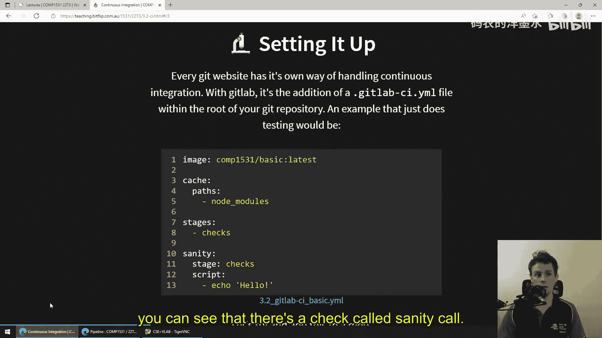

It's got a whole bunch of text here that I can mostly ignore。

 but you'll see there it actually render that code right here so that E Echo hello was run right there。

Now， the main point of this is not to kind of show you all these things and scare you。

 The main point of this is just to very quickly demonstrate to you， right。

Very quickly demonstrate to you that。

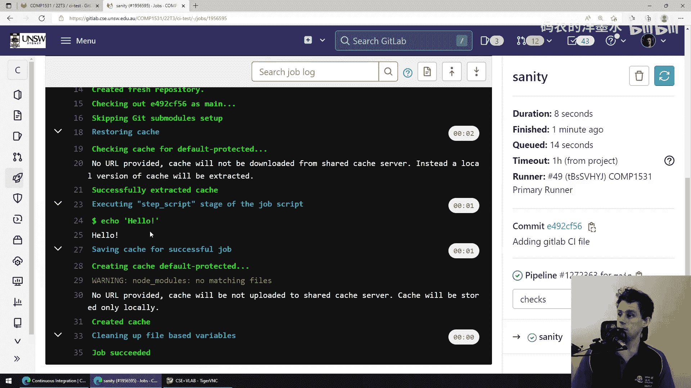

We can write a little bit of code。In here。Like this。 And it will run in here for us。

 so I could go and change that right on Gitlab if I wanted to。 I could say this echo another test。

 more exclamation marks。Then I could commit it。Then you'll see here that on Gitlab。

This is now a little waiting symbol again because it's， we'll come back to what that is。 It's。

 it's doing its thing。 It's doing its thing。 It's checking。 It's running that。Instruction。

 that automation that we lasted to。 And if I keep refreshing enough， it says tick， which means done。

 And if I come in here and I look in this again， you'll see that it doesn't say hello。

 it says another test。 Okay， so what we've established now is that we have a method to actually write a little bit of。

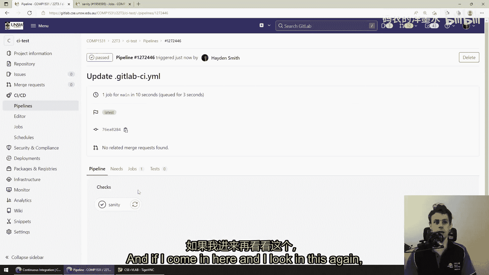

Command line stuff。

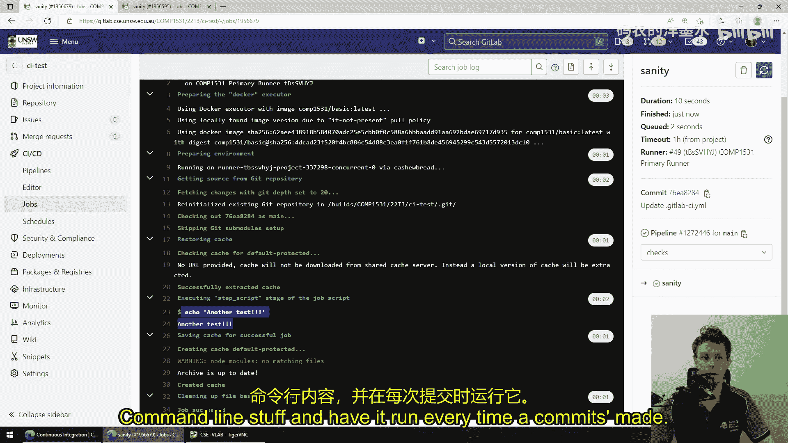

And have it run every time it commits made。 So that's really interesting。 Let's move on and keep。

 We'll come back to that， right，cause I've just talked about this with Gitlab。

And I've talked about this as well。 right， These are just for the lecture slides so people can read it。

I want you to we want to talk about how it actually works though first before we get into how we can play around with it。

And the way it works is that every time in Gitlab， a commit is pushed。All of the code。

 if there is a dot Gitlab C I file in that repository。

 what Gitlab does is it takes all of the code in that commit， and it gives it to another computer。

 like imagine a laptop sitting out in， you know， an office down the street。

 It gives it all to that computer and that computer。Runs all of the instructions for it。You know。

 like it goes and runs that， that echo。 hello or that， like， you know。

 what's the other thing like that echo。And what to say another test。 something mean。

 it just goes and does that for us。 So that's a really important distinction。

 because how it actually works here is that if you have a repository。You know。

 your group's repository and then your friends in another group have another repository。

 Both of you are all working on each other's on your own computers， right， so like group 1 has。

 you know， there's a few people in that group， everyone's working on their own computer。

 They're all pushing， you know this， they're pushing up to git and syncing with Git。

 And then another group over here is working on their computers and pushing and syncing up to git。

 But every time each of those groups pushes。Each repository。

 whether it's your group or another group， packages up that code on the commit and sends it to a computer that we call a runner。

You， we call it a runner in this course， which is essentially a a computer thats job it is。

 is to run code for us。 That's it。It just runs code。

So a runner is just another name for a computer whose sole job it is to run pipelines。

 We'll talk about pop lines and a sec。 but it's， it's just executing instructions for commercial websites like Github and Bi Buck。

 typicallyyically what they actually do is they have runners built in。 So like。

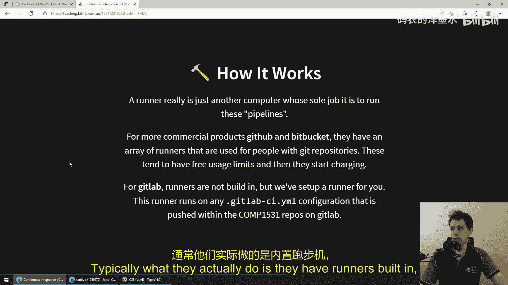

If you got like， bit bucket。P bucketet呃。Has like these computers like packaged into their service that they use。

 and typically。They give you a little bit of it for free。Yeah， so basically。

 the way a company like Allasian's bitbu， the way a company like Allasian has their tool bit bucket at work is that they will。

If you create a Git repo in their service， you could do this yourself Unrelated 1，5，3，1。

 You will be given 50 minutes of a computer's time a month to run instructions。 And after that。

 they'll start charging you simply stops working。 That's kind of the case。 Git lab。

 What are they Gitthub， What are they call Gitthubs ones actions pricing。 can't board it's called。

Free Github has。2000 minutes a month of this stuff， I believe。A lot more。

To 50 is plenty for a normal person that 2000 is quite。 What is it， How much is that a day。

But 2000 divided by 30。Right。60 an hour a day。 That's a lot。 That's pretty extensive， right。Great。

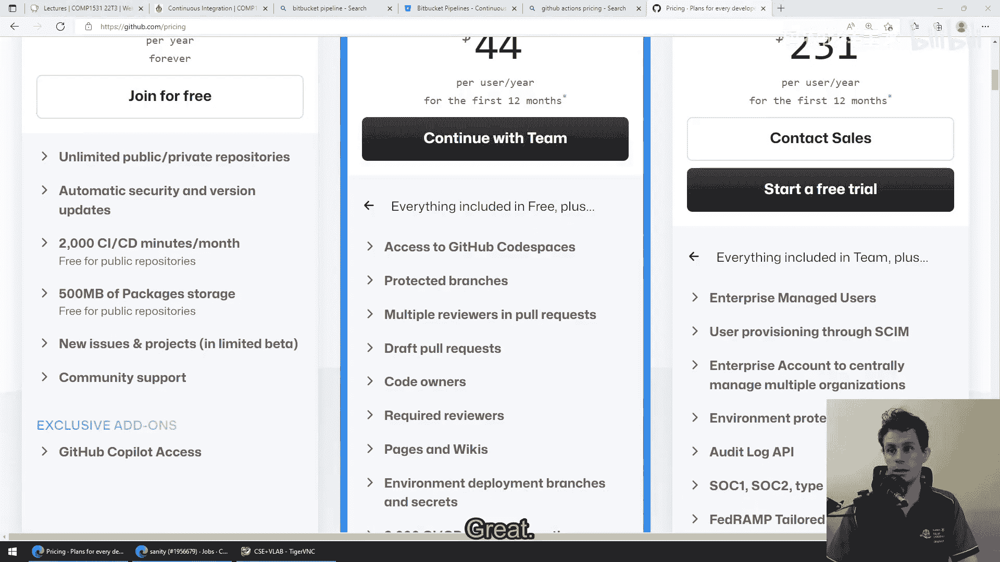

Cool， so lots of cool stuff for something like Gitlab， though， the， the thing we use for the course。

 What actually happens with Gitlab is that because it's an open source platform。

 we actually provide a runner。 So the runner is actually sitting in C SE。😊，The building。

 So if you have ever like gone into the computer science building。

 the actual computer that's running all of your like a will soon， run all of your Gitla。You know。

 little ticks and things is all actually just， you know， sitting there running all the time。

 It's a dedicated computer that CSE manage。 Bron says。

 so is this just a feature we're getting through UnSW for free。 Yeah， kinda like in theory or 1，5，3。

1 projects could use thousands of hours in theory of like the runner's time because the school's providing it in reality you'd probably have to pay for that or provide your own computer like a lot of bigger organizations won't use like Github or bit buckets like computers to do the running。

 They'll actually like have their own and ask bit bucket or Github to actually like use another computer instead。

 which obviously is gonna to be fine because it's。Just work。 when I say ask。

 I don't mean you have to call someone up and ask。 there's just settings that you can change。

But yeah， so Gitlab， the runners aren't built in。 We've set up a runner for you。 It's managed by CSE。

 pretty straightforward。I had something I want oh yeah， pipeline。

 I was like I have something I want to tell you。 So the term pipeline has been thrown around a bit。

 So I just want to get the language really， really right for you。

 which is that the way I'd say it is that you have a gi Gitlab repository。

 it has a dot Gitlab dot C I Yaml file in it when that Yaml file is present。 every commit you make。

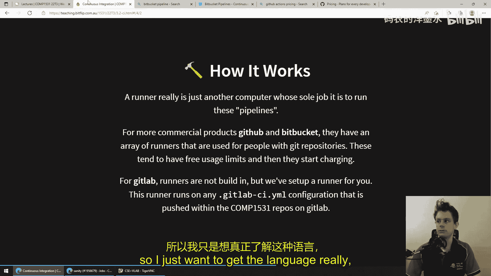

Gitlab notices that file， it packages up the code。😡，It gives the code to a runner。

 and that runner runs a pipeline。A pipeline is the set of instructions defined in this file。

 so you could kind of describe this file as a pipeline instruction。

 We call it a pipeline because a pipeline is made up of a series of jobs。

 and you can kind of see that sometimes here when you actually see that there's if I go to your own my Gitla re here。

 you could do this for your own。 There's actually a section called pipelines where it shows you all of the pipelines that have run。

 And remember and pipelines are typically generally related to commits。

So I kind of did two commits with this Gitlab CI file and therefore you can see that I've got two pipelines。

 but pipelines are made up of more smaller jobs and those jobs are the actual kind of executed code So if I go to jobs here you can see that there's been two jobs that have been run。

Right， which makes sense because the pipelines had one job， so I can actually click on。

 say the first pipeline we ever ran 8 minutes ago and you'll see there's one job in there。

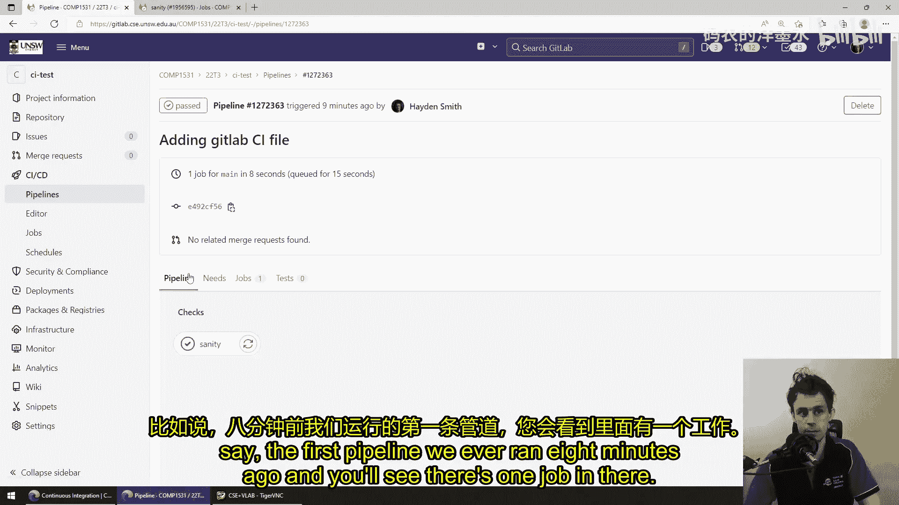

Which was the， you know， the print。Thing here。 So it pipelines， series of jobs。

 A pipeline runs when you commit code。 Those series of jobs run。

 Let's dig a little bit deeper now together。

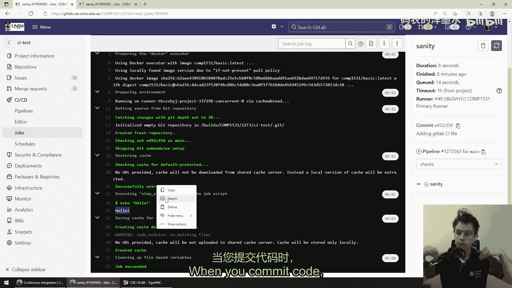

Which is configuring it。 So now let's actually get ourselves set up。With N PM。

 So this is another good chance to revise things very slightly and say， well。

 let's actually go and quickly put some code。

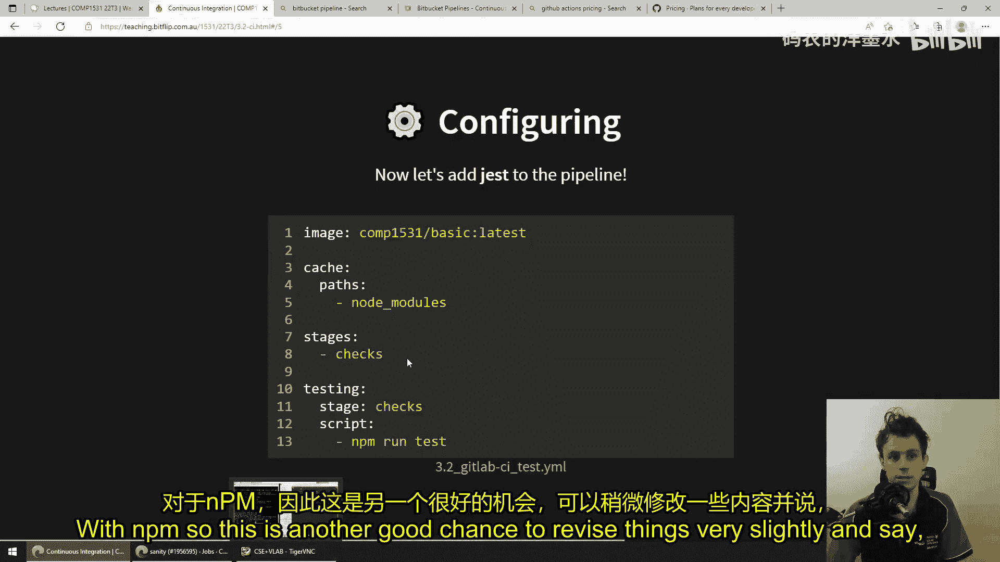

Here inside the C I test folder， you know， let's go and steal some stuff。嗯。

What what's some testing we have from the last lecture。We got an export。Yeah， let's try this one。

 So let's take our。I'll copy our lectures M1 source，2。3 justest Lib dot T dot J S， right。

 I'll copy that here。 I'm also gonna copy our dot Lib dot test。Dot J S here。 And I'm also gonna。

Create an empty package dot Json， which again， you'll never have to do， but I'm gonna make one here。

Now， let me open this up in the text editor so you can actually kind of see the structure of it。

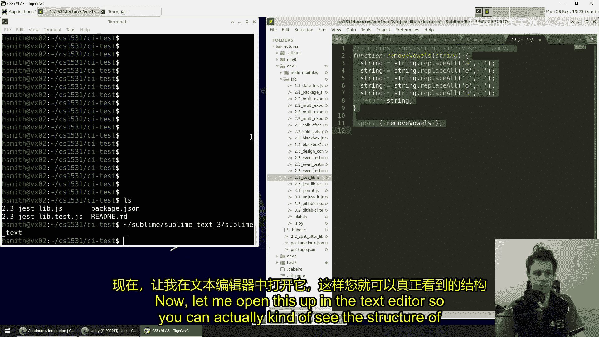

I'm just kind of。You know。

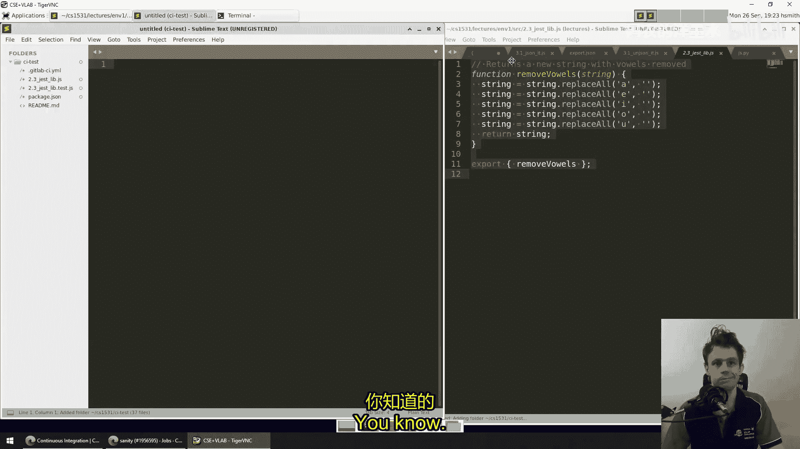

gettingtting together a few little things。 again， you never have to make this package dot J song 'cause we。

 we kinda make it for you all the time。But what you'll notice is that I have to actually import jest because I'm using the jest library。

 So like I did last time， I will MPM install save Deb。Jest。

Which will install the library into the package dot Jsonca without it。

 if I tried to put this up on Gitlab， Gitlab would try and run the code。Right。嗯。

And it would basically just。Not work。'Cause it's like。

 I don't know where the library is just like we talked about last time。

 So now that that's been installed。 And just a quick recap， now that that's installed。

 I have a node modules folder。Right。Which you can see here， node modules。 I've also updated。

 you know， my package are Json to have that dev dependency。 I'm gonna go and commit all these files。

 I'm gonna do something。Notice this。 notice I've got this node modules folder here。

 I don't want to commit that。 so I'm going to go make myself a dot gett ignore file。

Noode modules like this。Now， it's been ignored。 I'm just gonna go and add everything which I shouldn't normally do。

 but I'm gonna do in this case。 I'm gonna call it adding jest testing files。

 I'm going to push it up to Gitlab。This didn't work because I modified the file on Gitlab， right。

 Do you remember that， So the commit history， This is back to our very first lecture in the course。

 The commit history here is different because I updated this on Gitla whereas is if I look at my local commit history。

 I've only got up to， I've only got adding Gitlab C I file here。

 So there was a commit made on Gitla and a commit made on my local， you've probably seen this before。

 if you've done parts of iteration 10， how do I solve this。

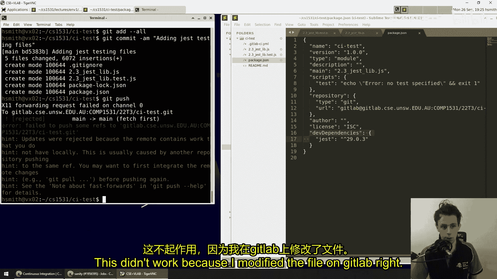

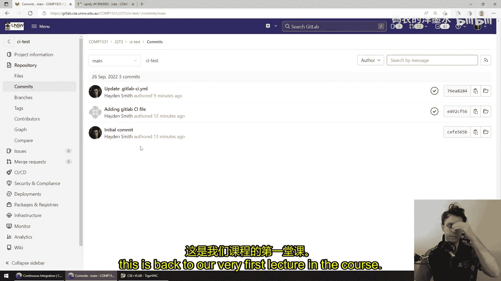

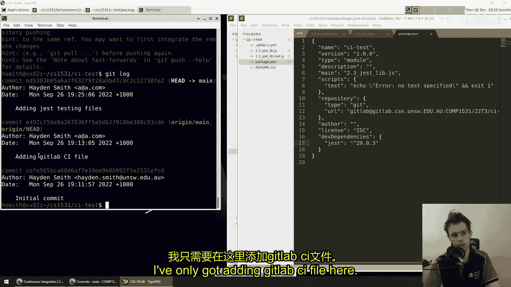

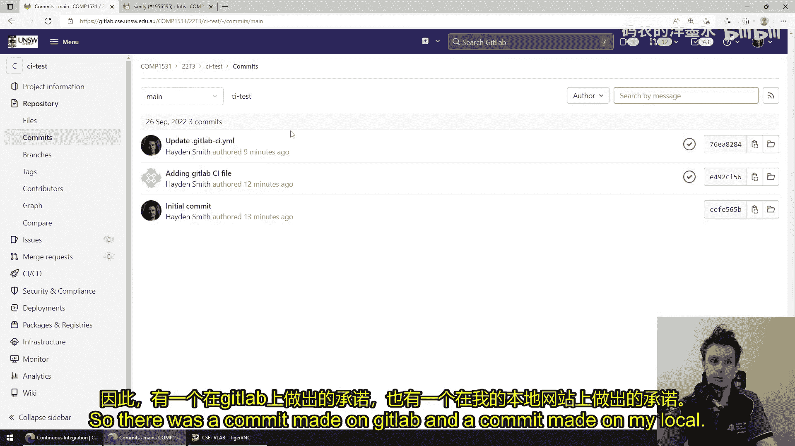

I get Paul。Which does the merge commit， This is all back to the very first lecture。I， I exit this。

 now I can push。 by now， I'm hoping you would have seen a lot of this。 And if we go back to Gitlab。

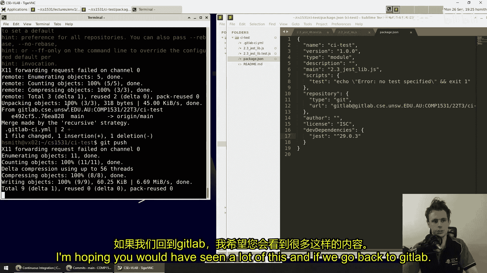

You'll see now that nothing's changed in terms of the pipeline， but my files are there。

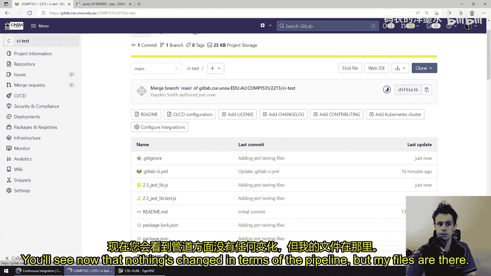

So in theory， what I should be able to run locally now is NPM run test。Right， oh sorry NPM run， yeah。

 NPM run test。 But what it says here is it says no test specified。

 That's because the test script here is designed to do that。

 But what I actually want it to do is I actually want it to run jest on 2。3 Lib dot test dot Js。

 So MPM run will run a script That script in this case runs that jest command It says so there。

 and it should work unless I've copied the code wrong。Okay， it says it's failed。

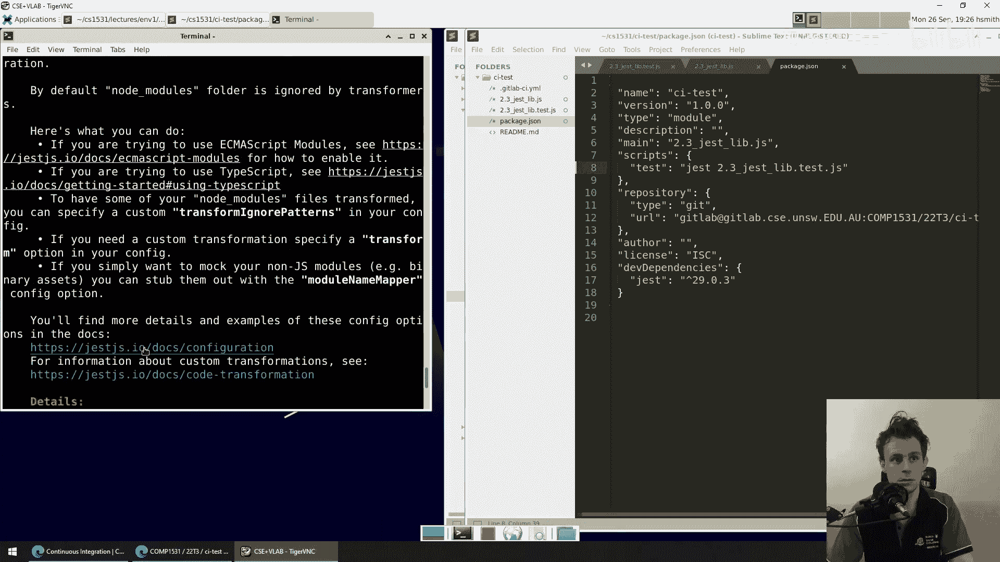

Because I'm missing a file。 By the way， me and some tutors were talking about this， but。

One of the things you should do seriously， if you ever want to work on your own stuff like this。

 like what I'm doing in the lecture， you should not do what I've just done and create a new repo。

 It's just not it's not a smart idea because there's a lot of like fiddling that we have to do to get some of your things working。

 So what I would generally recommend is that you go to a lab that's at a similar point in the course。

 you clone that and you remove the files because， for instance。

 there's this really random annoying file that you need to make things work。Called dot Babel R C。

 And if you don't have that file， nothing seems to work。 It's， there's some long。

 complicated stories about jascript here。 But you see， this should work now。

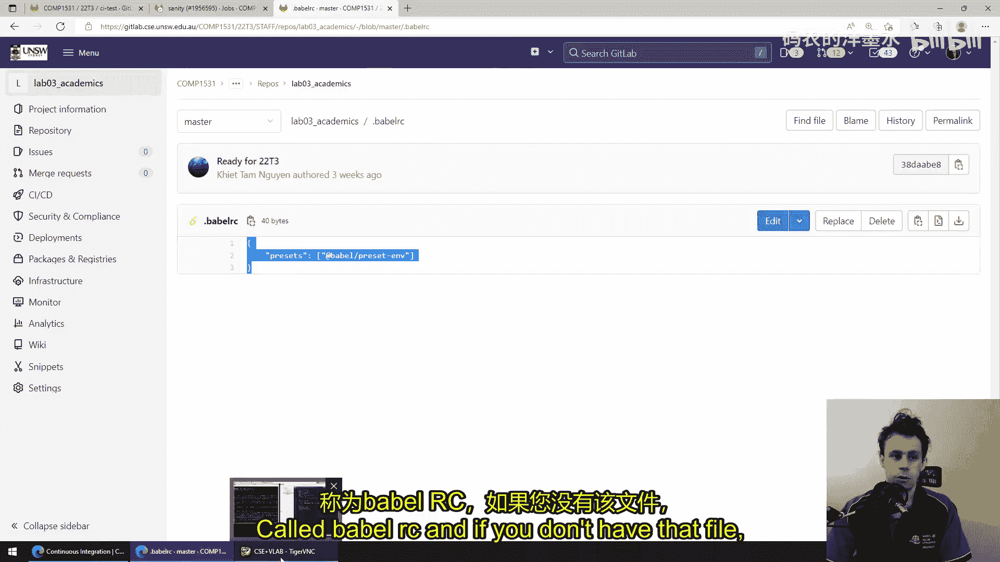

No， I got other problems。Oh， that looks like a big problem。

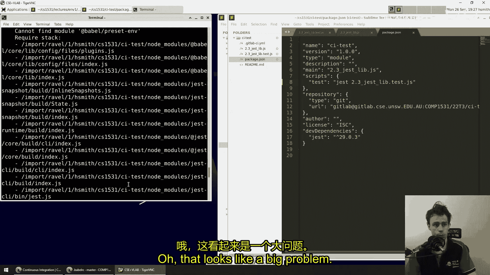

Oh， after yep， see， there you go。 What do you notice about the labs。

 If you've looked in all your labs， you'll see in the package dot Json。 we not only include js。

 but we actually include this other library here。

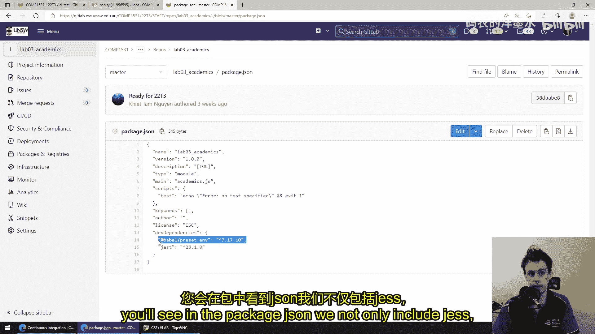

You know， there's， see， the thing about Javascript is that， you know， it's a really young language。

 which。The problem， I talk about this a bunch， which's just like because it's so young。

 people are improving at an enormous rate。 It's， it's， it's。

 it's an insane time in computing for jascript。 Things are just， things are just moving all the time。

 And it's incredible what the tech is doing。 But because of that。

 there's a lot of patches on patches， which means that to give you some of this more modern stuff。😊。

That we work within the course。I didn't install it。 I just added it to package dot Json。

 I shouldn't have done that。 I should have just run in。 I'll show you what I should have done。

 I shouldn't have just added it here。 I should have gone here， and I should have gone NP PM install。

You know， that library。Like that。And I should have made it a dev dependency with the dash。

 dash save dev thing。 I forgot that。 And now it's going get put in a different spot inside a package dot Json。

Right。Let me close that， and reopen it。Oh， no， it figured it out。I wonder how it knows that。

 That's so interesting。Now， when I run it， it will work， I'm sure。It worked。 Oh scary， so。

That's cool now。 So what we want to do with the pipeline is rather than us have to run NP PMM run test every time we make a code change。

 I'm going go and update the Gitlab C I file。😊，To simply run instead of this echo text。

 I'm going to say NP PMM run test。 So remember the， the， the Gitlab C I file is just an instruction。

Of what code to run that you would already run on the terminal。 It's nothing fancy。 You know。

 it's just literally what you would run on the terminal， but put it in this file。

 So Gitlab and the runner will run it for you。 So now when I go and， you know。

 Git status and I go and I got to git add these files I'm just being lazy'cause it's 730 And I don't want to go through two minutes of correct Git practices every single time。

嗯。

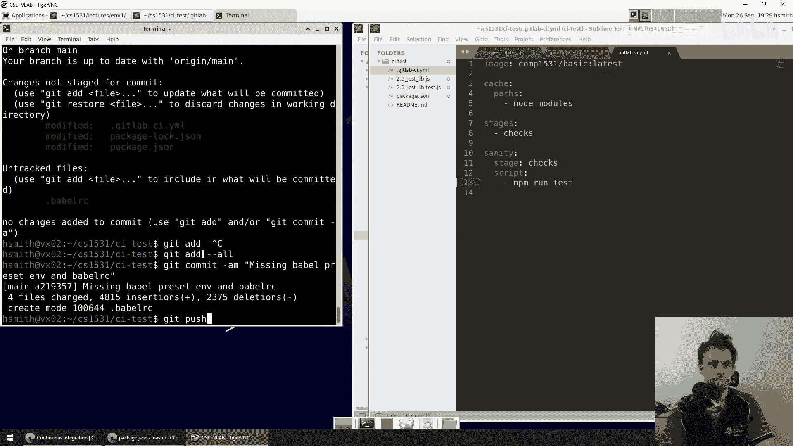

Right， push that up to Gitlab。Now what you'll see， if I click on the pipeline here。Right。

Is that there's one job still。 And when I click on that job， it's still running。

 you can see there's a few different states for the pipeline。

 The first one you saw with the pause symbol， that's called waiting。

 What that's actually doing is that。It is waiting for。

The runner to be freecause the runner just like most things in the world can't just do everything at once。

 You can only do so much at once。 So that's it saying I'm waiting until the runners ready for me。

 And then the blue moon thing is when it's running， That's it saying the runners running me。

 And then at the end of that， it either ticks or it crosses。 if it succeeded or fails。

 So in this case， you can see it actually ran that command there， which succeeded。

 And that's really cool because now in my little repo here。 because of that file。

 I get this little tick， which is saying， you know what， your jest test surpassing。 Good job。😊。

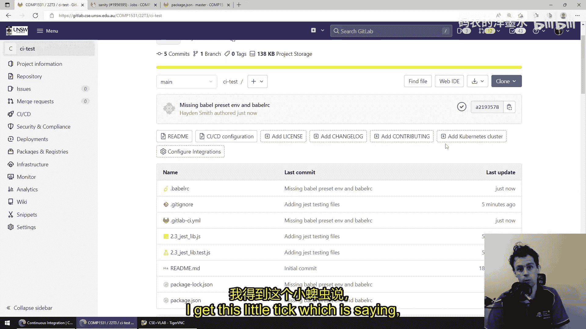

嗯。😊，And the reason that's exciting is because let's say you go and accidentally make a mistake。

 like you comment out that line of code。Right。And then you go and add。

That gi commit very intentional， smart change。

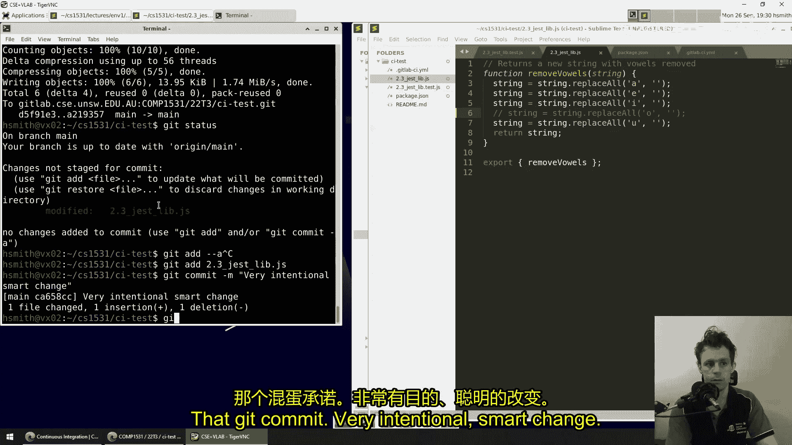

Watch what happens now when I push that up to Gitlab， again， it'll be waiting。

 waiting for the runner to be free。Right。Waiting till the wanted to be free。 still waiting。

And then soon it'll be like blue'cause it's running。 Now， the run is actually running it。

 It'll be blue for a short moment， maybe like 10 seconds。The run has got to do a little bit of setup。

 But then it's pretty much just the time it takes to actually run the code。

 This is it doing some setup up。 And now it fails。 It shows us that something was wrong。

 It shows us that some tests failed。 And now you'll see on the repo。

 it actually comes up with a cross here。So this is super。

 super useful because this is run on every commit you push， therefore， right。嗯。

You don't have to do much work Sometimes you have this like sanity check。 It's a convenience。

 You don't need it because you can always run those commands locally， but it makes your life easier。

 which is really good。😊。

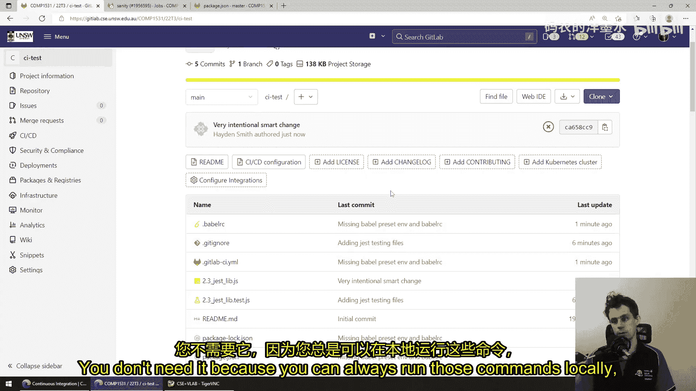

Sir。We can uncomment that to make it work again。 And now let's play around with it a bit more。

 Let's add another couple of commands just for fun。 or run Echo， hello。😊，Echo there。 right。

 So let's add a few。 And this is yam all right。 So these are three items in a list。So， you know。

 get status。 I'm just gonna， I'm gonna add them all again。More testing。Again。

 sorry for cutting some corners there。 I'm just trying to。

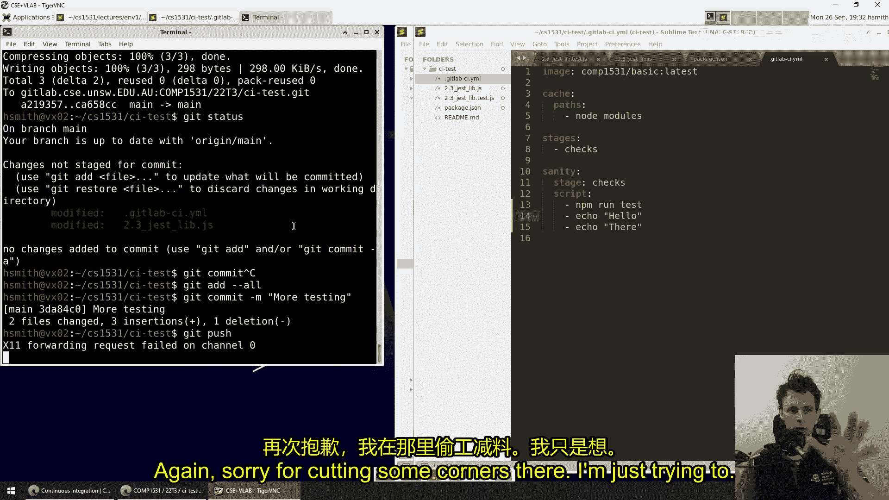

Respect your time of it。Okay， it's the same thing。 you'll see it running。 But have a look here。

 this now look at the pipeline。There's still one job。But there are three parts of this job now。

 That's quite interesting。 So justca I've got three items here， it will run one at a time。

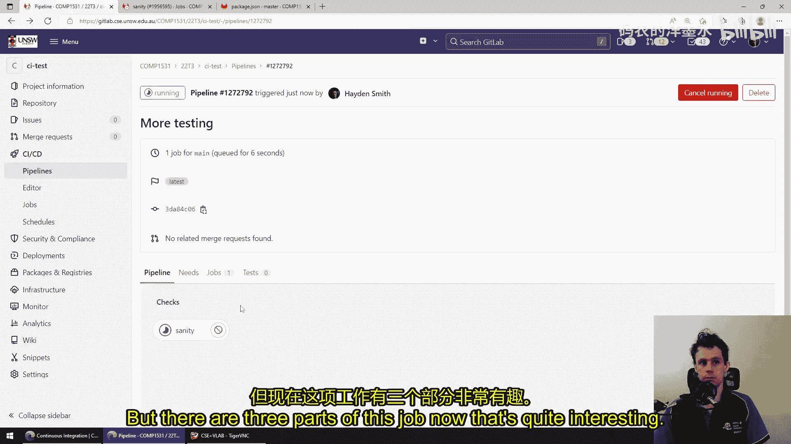

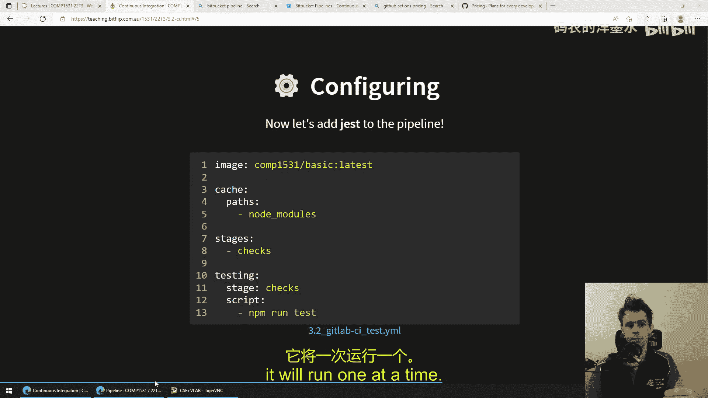

Right， you'll see it。 It'll run them all。1，2，3。But they're all part of one job。

 How do I split them up into multiple jobs well。

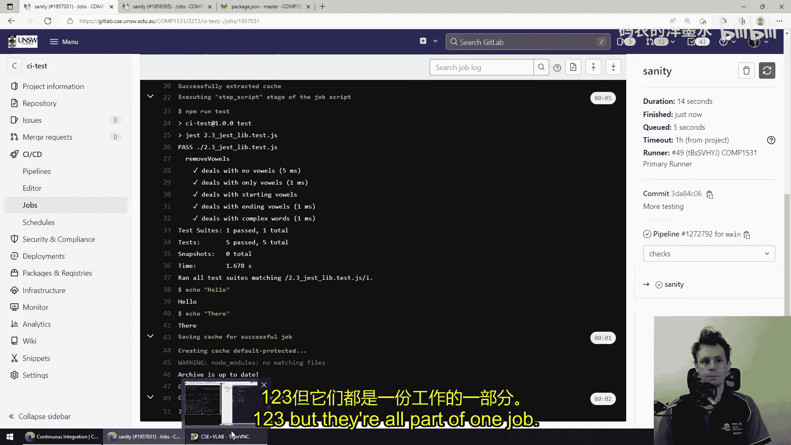

What I can do is just give each job job a name。 So in this 1 I call it sanity。

 I might call it testing。And let's go back to what we had before。

 But I can actually just copy and paste this block。So this one， I'll call it like。You know， great。

And the command will be echocho hello。And then I'll make another one。Called。Farewell。

 which will be like。Hello， goodbye。Now， let's see what we get here。 I'm just gonna。

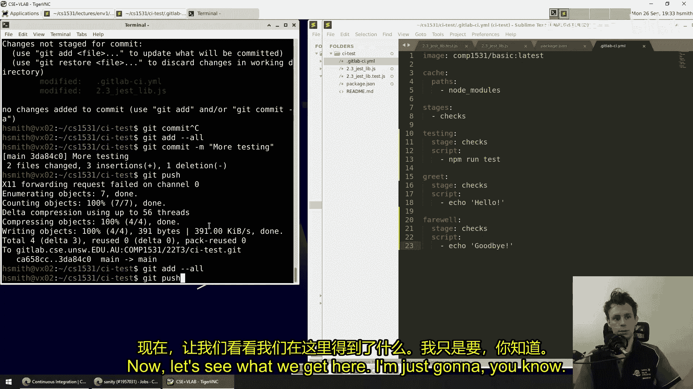

Add commit push。Sorry， it's the wrong page。

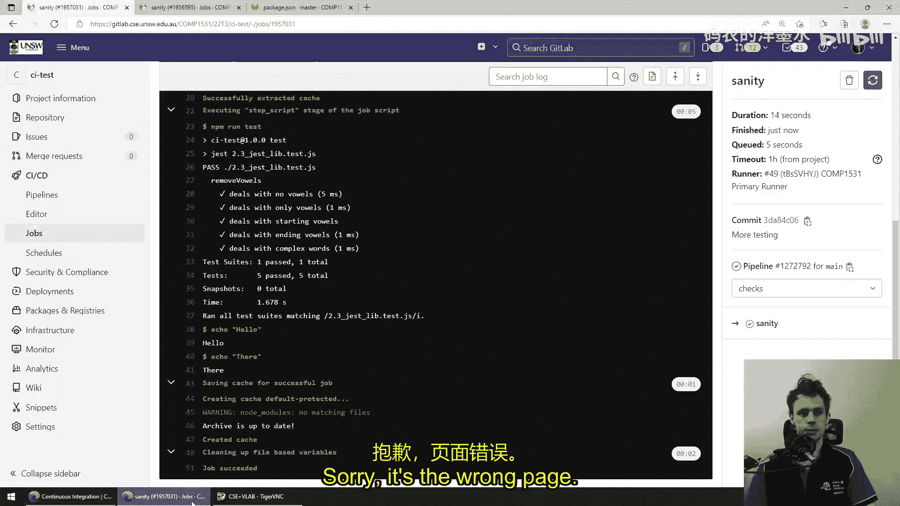

So we'll come back up to our repo here。Pending， but we got three jobs now， right。

 three separate jobs。So these jobs now all run independently， which can be useful。

 It can be like easycause then you can pass one， pass another， fail another and so forth。

 But that's just one way of splitting it up。 what we can also do is break that up even further by creating different stages。

 So youll see how I've got stage。 I've got one I don't love how this file is configured。

 I think it's a bit hard to read。 But the idea is that every single thing you have here is a job。

 And each job can be grouped into a stage， and you can list stages up here。 So， for instance。

 I could have a stage called checks。 and I could have a stage called。

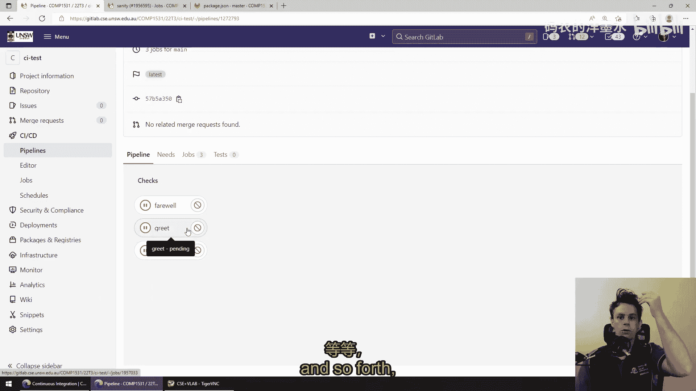

You know， messages。And my hello and goodbye could be in the messages stage like that。

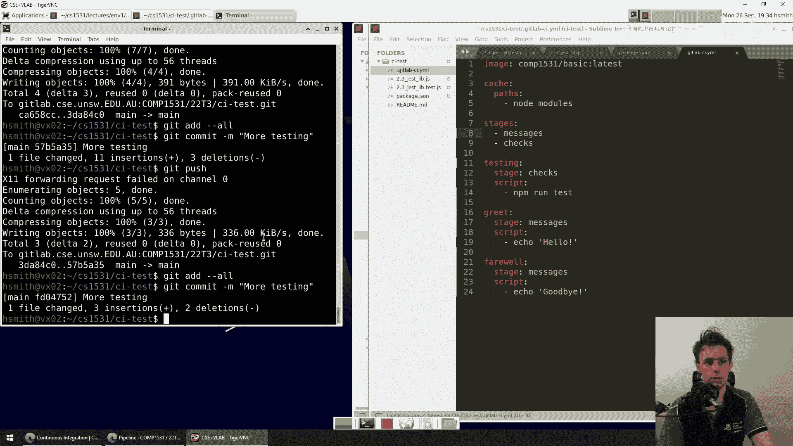

So now when I push that change up to Gitlab。You'll see its structure is also different。

It's structureal。Has like two sections。 So still three jobs。 There's always three jobs。 But the。

 the kind of stages are how you can break it up into different pieces and。I don't know the exact。

I I think the way it works， I could be wrong。 I haven't dealt with this too extensively on Gitlab。

 but you can play around with it in a certain way that like everything in a stage needs to pass。

 but then you can pause the next stage。 and you know。

 there's a lot you can do and we do a few things on the back end。

 like you know hiding behind the scenes on the course to make it work right but that's it running the pipelines。

 you'll see it eventually succeed that one。 the testing won will take a few more seconds。

 obviously because you know it's got to actually test it。 Now it works。 Everything's ticked or good。

Right。Pretty straightforward。

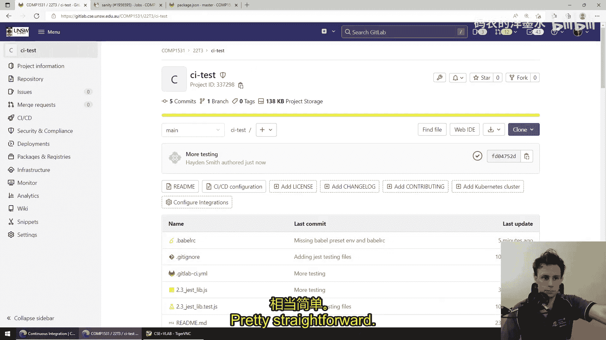

Pretty fun。Yeah， we've kind of played around with that。Near the end， Okay， so。An important question。

What do you have to do with this？You know， we've done all this stuff today。 Now， again， thankfully。

 today's lecture。😊，Is so kind of both this and the last one。

 are very theoretical in the sense that you don't actually have to do anything。

 We give you these configuration files in the course。 Where will we give them to you。

 Where will we first expect you to start using them well。Feielel labs。It's going be。Next week。

Typically， we assess things in your labs the week after we have these lectures for your project。

 it's iteration 2， which is week5。 so you've actually got week three and week  four without this。

So it comes in week five， your labs it comes in week four。

 the some groups may want to try and put this in their project Feration one you're welcome to。

 but what I would probably ask is that when you submit it you get rid of it。Because。It' just。

 it's gonna affect how our iteration 2 changes come in。

 So feel free to play around with it as much as you want。 Just whatever you submit。

 please don't include it。 You know， that would be great。😊，You know。So in summary。

 continuous integration helps us make frequent code changes because we can write tests。

 write implementation， to push to Gitlab add merge requests， right。

 make sure we have the green tick and merge it in。 It's a convenience。 It makes things easier。

 you can do them faster。 It doesn't let you do anything you couldn't already do in reality manually。

 but it's a huge convenience， right， Tony says， is it how our labs are marked。

 We do use get we do use Gitla pipelines to mark some labs。 Yep， definitely。

 Valoronnova says to hackers hack our laptop and use it as run。

 I don't think that's a motivation to to hack your laptop mostly。

 William says if it's run on what shoes does it wear。😊，It's a good question。 I'm not a shoe person。

 but I'm sure there's a good answer to that somewhere。 Cyril says。

 could we have a nonstrict pipeline which just tests if the code works。

 but still allows the code to be pushed， even if it fails。Yes， I mean， to be clear。

 the code is pushed it like pipelines rarely stop anything。 Its main use is， honestly， with。

Like his main use is like a， it's like a sanity check in case youre forgetting to test your code as you push it。

It'll still push it。 It just will come up with a cross。 But the main one is that。You know。

 Gilab is set up to typically not allow merge requests to happen into master unless it's got the tick。

So if you've written good tests， like， if you've written perfect tests。

And you don't let code merge in in terms of the implementation until， you know it works。

Then in theory。This continuous integration stuff。 it'll， It'll make sure your code is perfect， right。

 It'll guarantee it to work， so to speak。Very interesting。

This is a bit of a visual representation of how this kind of stuff is thought about， which is like。

 you know， you do some coding， you merge it in or you go to merge it in。 It gets built。

 It gets tested， you get feedback with the crosses and the ticks and then you move on。

 And that's the new master， right？ So it's it's really just about like taking a pause where you used to not pause doing a few things and giving you some information back。

 That's really it。 The most important thing you need to take away from this lecture is that your master branch should always be green。

You shouldn't be merging code if it's not green。 in some cases， you can， but it's。

 it will be like a penalty to your group if you merge in code when it's not green。嗯。

This is something that you should try and implicitly practice in iteration1， though。

Even though we don't have pipelines and the reason we don't have pipelines in iteration one is just to make your life easier。

 It's just one less thing that we're hammering you with early on。

 you should still have a habit of never， I mean this like never merging any branch into master if NPM run tests。

 the gest tests fail。Ever。You might be thinking， you know， like， oh， well。

 how do I write tests before implementation then。You know， like， you might be thinking， oh。

 this is kind of hard or scary causeuse。😰。

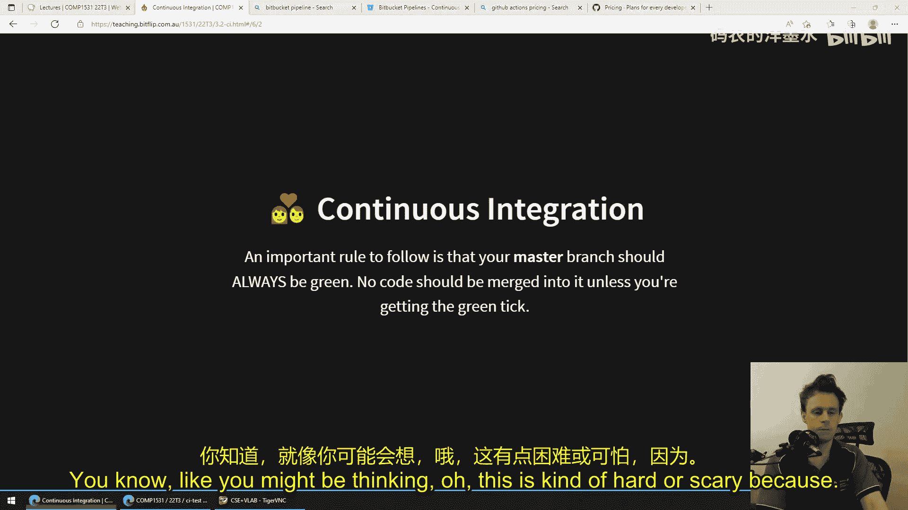

W you know， what if I go and write like a test A， A couple of tests over here for an imp。

I don't know why they were lines like two tests for implementation that isn't ready yet。 It's like。

 well， don't merge it in yet。 Go and write the implementation for those two tests。

And then take all of that once it's all good and then go and merge all that in， right。

 Like then go and give it the tick。Cause the problem a lot of students make is that they'll go and write this huge bed of tests。

Right， with like lots and lots of tests。 And then they'll be like， oh。

 it's the it's failing the pipelineca all the tests fail。 Of course， they fail。

 There's no implementation for it。 And then it's like， oh， crap to make it work。

 I have to go and implement everything。 So， you know。

 you go and implement all these like other things， right。

And then like by the time you actually go and take all of that and get it to pass。

 the code is massive。 And it's like， no， nothing's been a master for a week。

 You've been like camping on the branch。 And it's just like a nightmare。

 So your attitude is always to like， write as few tests as possible。

Write the minimum amount of tests that you need to write the minimal amount of implementation。Then。

 go and take that。Put a merge request in。Run NPpM， run test yourself。

If it passes merged in in this iteration in your own time， you can。 But then in next iteration。

 willll basically say， you can't merge any code in without， you know。

Going through that process of writing the tests then everything else。

 And your tutors will check this as well。 You know， So your even without the pipelines。

 your tutors will still go through your commit history and make sure you are committing tests before your implementation。

 You know， so just just be wary of that。

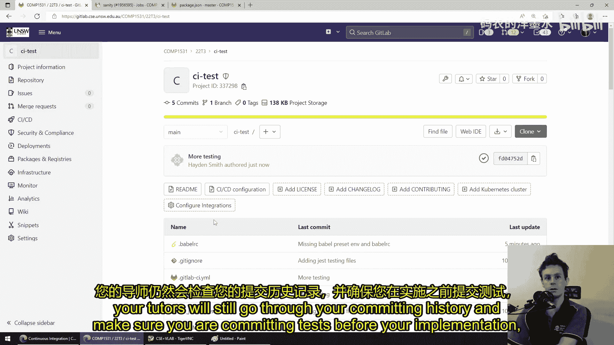

There's some further reading on continuous integration if you want。 But other than that。

 we're at the end tonight， Do you have any questions before we wrap up， Otherwise love some feedback。

 just like always。Give you like 30 seconds to ask anything you want。Ba No says。

 is bias an interface for charging。I don't know if it's interface for charging。But。I don't know。

 It's a good question。 Actually， William says， wait， so we're advised not to write test Feration 1。

 No， no， that's not what I'm saying。 We's， we're saying that like you， you write test Feration1。

 do all of that， right。But。You。We， you aren't expected to set up the Gitlab continuous integration pipeline。

cause we don't， it's not part of iteration 1。 We're talking about it now for iteration 2， later on。

 you know。嗯。Jacob says， so we're not supposed to merge just tests into master。 right， correct。

 If you go and read the， the spec， it says that， you know， you should like， write your test。

 then write the implementation for it。And then once the tests are passing。

 you merge that piece of code in。That's the right practice because it's good habits to build because otherwise all that happens is when you go and put pipelines on things。

嗯。They just fail。You know，ca things aren't working。 If you， ex， if you accidentally did that。

 that's okay。 in the past， we've been much more militant with groups in iteration 1， but we've。

 we've been a bit more relaxed since last term。 It's something I'm trying out。 And it's。

 it's just a little more pressure offca。😊，But the point is。

 the point is not to do it because like if you， if， if you make a few mistakes。

 you're gonna lose a ton of marks， It's more like get into the habitcause next iteration， you'll。

 you'll need to make sure it works fine。 you know， so， so please， you know， be conscious of that。

Cil says what do we do if we merge and the continuous integration fails， Do we revert the merge Typ。

 you just make another merge request that fixes it and you merge that in。

 That's usually the standard approach。 Yeah， so it's it's less reverting and more just patching it so to speak Do be ask a great question which is will there be more un jest。

 I feel like I don't know much about how the testing aspect works yet。

 So there's a lot of jest in the week3 labs。 and then also in the week four labs to an extent。Yeah。

 like in week 3 and 4。 but jest itself isn't very complicated。 And I think。

 I think that's something to kind of keep in mind is like a lot of what we asked for you early on。

 It's really the exact things that we showed you where you've just got described， describe test。

 And like most of what you're doing with jest is not actually like using that much of jest。

 I'd say that the best thing you can do with jest。

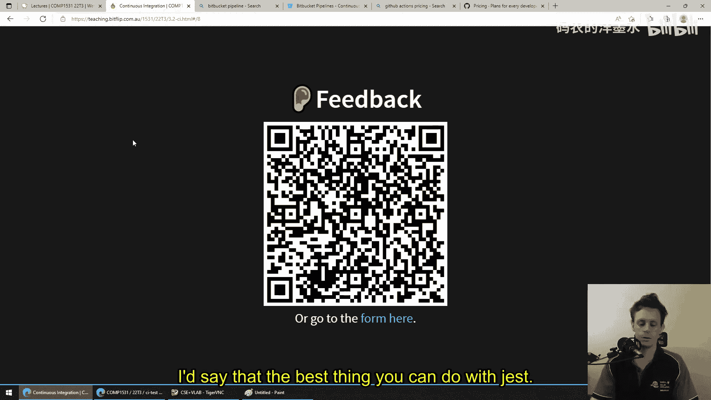

Right。Go to the jest like getting started page and go， I can't remember where it is。

 I normally Google it。嗯。It was like jest， usually I Google Justest expect。Because a lot of things。

 like， a lot of jest， honestly， is just like， oh。If I jump back to lecture 2。3。

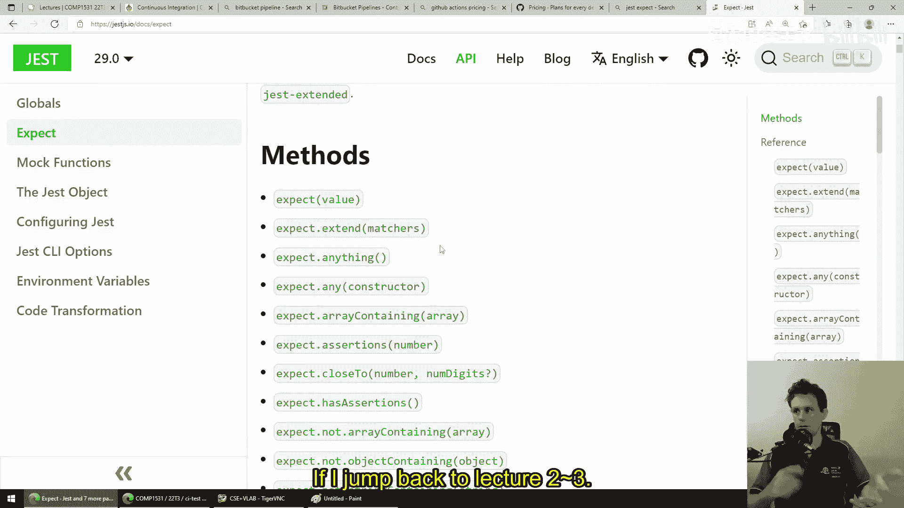

A lot of jest is quite honestly just where's some big。 Do I have some。A lot of just is this。

This exact thing， except that you have different setup and you do a different expect。

That'll be true for most of the course。 Everything else is。

 everything else you do and the complexity of this is typically not to do with jest。

 It's typically just to do with like， you know， what you're actually testing。

So it's not really a ton to do with Jeess。 the most， the only thing， honestly。

 with Jeess that you often need， like， you can just copy and paste this example and modify it in nearly all cases。

 One of the only things is that when you start doing things like comparing arrays or comparing objects or comparing strings or。

A few other cases that aren't just like， is this string equal to that string。

 That's where you need to kind of go and read the G expect API。

 which you can do just by Googling G expect。 And it shows you a whole bunch of stuff， you know， like。

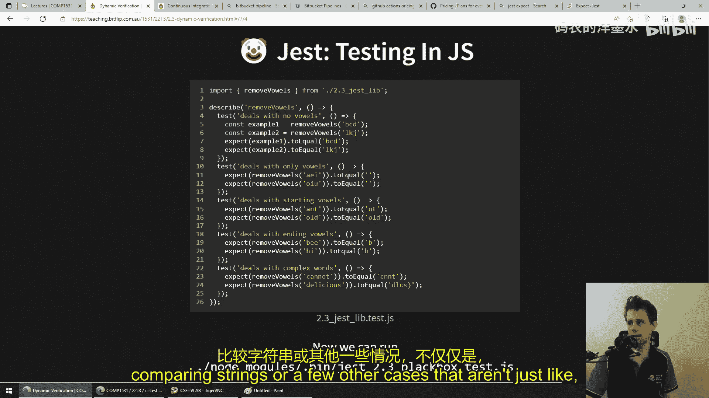

You know，2 B or two have returned or two have length is a great way to check what an array length is。

To be greater then。 So if you want to check if something greater than something else， you know。

 there's like a lot here that you can go and look up。 But most of the time。

 all you really need is like too equal and。To contain， to match。 So you know， just go and read it。

 And， you know， I know it' a little bit confronting at times。 But again， part of。

 part of this course。Is to say again， when you do 1，5，1，1， it's like spoon feeding。

 And when you do when you do a thirdy course， it's a lot of like good luck you're on your own。

 And we're here dealing with somewhere in the middle a little bit。 know that's kind of it。

 So we're kind of like here's some justest examples。 Let's talk about jest for half an hour。

 And you know it's a very basic thing。 but we're not gonna go and step through 30 different things in the API。

 You can kind of Google that and have a read through yourself and discuss with your team members。

 know that's essentially what what we're doing there。

 So if you are kind of feel like you don't know enough about Je。

 what I'd say is that there's a good chance it's not to do with Jeest。

 It's just that writing tests can be hard。 you can look at some of the lab solutions as they come out because remember we release lab solutions really early。

 So if you struggle with the week 3 labs， they come out next Monday。

 like in less than seven days by a couple hours。And we also have， like， remember， like， don't forget。

 we， we release to all of you。嗯。A repository that you can find called practice activities。

 And I'm pretty sure， like most of these practice activities。

 like if you go to like the week 3 practice activities。

 there's a few different activities that all have like。Go， that one looked a little bit broken。

 You know， you can look at stuff like this。You know，'s lots of stuff we've given you， you know。

 so you can go look at the practice activities。 Remember， you can get it just by going to this link。

 It's not too hard。 You can just follow the link。 It takes you to the right places。

 We've set things up quite extensively， so。That's it。For tonight。

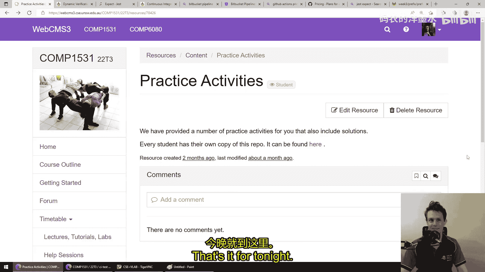

Thank you for coming。 Leave some feedback。 If you have any other questions， please post on the forum。

 Don't forget we have a lecture on Wednesday。 We will talk about some very interesting stuff on Wednesday。

😊，So。Come along。 Remember again。We've made some changes to the course that mean that lecture content is taught much earlier than you need to worry about it。

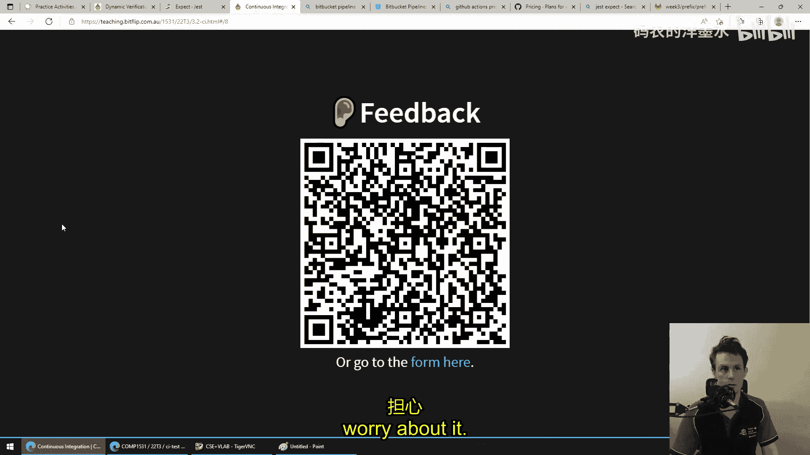

So what you learn about this week。Has no bearing on anything you do or submit this week in your own project or lab。

Right， everything here has nothing to do with iteration 1 and nothing to do with La 3。

 It all starts coming from next week and the week after。

Just like this week is where you're going to first start doing testing。And NP PM。

 because we talked about it last week。 So don't get stressed if you're watching this lecture in week 3 and you're like。

 oh my God， I'm scared。 We have lots of time to figure it all out together。

 So please have a good night。 I'll see you on Wednesday at 6。 hopefully， if you're there。And， yeah。

Keep at it。 Keep up the good work。 The next couple of weeks are where people start to fall off the wagon。

 So keep your focus。 and you should be good。

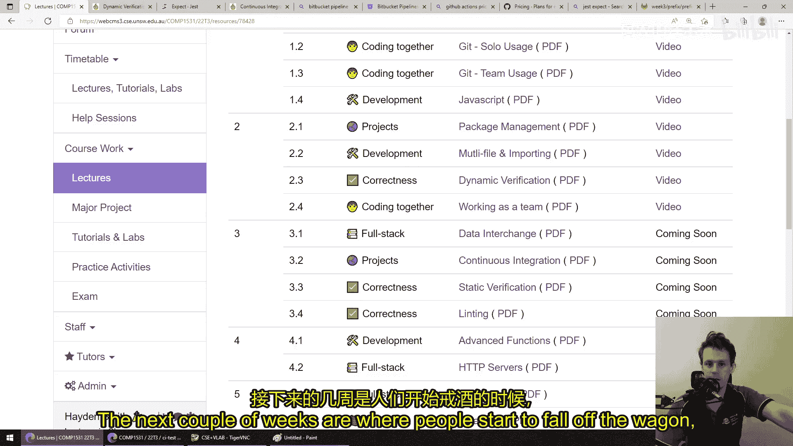

够。Thank you， everyone。 Have a great evening。

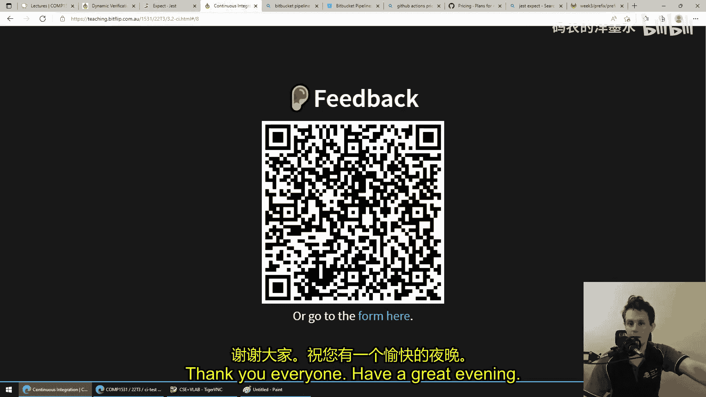