# 【全集】新南威尔士大学 软件工程基础 中英字幕 1080P COMP1531 p10 Lecture 10 - 静态验证 -BV1M7Nwz7EGh_p10-

Okay， so。Today's lecture is on static verification。 It is the。

Logical follow on from the lecture we did on testing with Jess。 If you remember。

 we talked a lot about like what correctness is and software verification。 in particular。

 that lecture we talked about dynamic verification as a topic。 This one is static verification。

 If you remember what the difference between static and dynamic is。 Good job。 Otherwise。

 we will cover it again。 But before we get into this， just a quick preface。

 This is the first new lecture of 2022。 I'm pretty sure every other lecture here is some kind of。

Restructure or revamp of a previous lecture。 But this one is totally new。

 And the reason it's totally new is because I think it is an extremely important topic。

 having taught this for a long time and worked in an industry for a while。

And I'd love for students to get more in touch with it。

For those who are kind of more familiar with the colloquial descriptions of 1，5，3，1。

 this is the lecture where we teach you type script。

 and we don't actually do a lot with it in this course。 And I'll， I'll keep talking about this after。

 but I want to really preface it， as that。This is introduced as a topic because me and some other academics are certain it's important。

We make you kind of use it for the project， but we literally make you use it in like the most。

Minimal way possible， Like you can kind of not know most of it。

 You can know very little about this topic and get by perfectly fine。 And it's by design like that。

 because when we introduce new topics into a course。

 it's really good to just kind of let them exist for a while。

 And we spend a few times just feeling how students respond to it。

 which helps us know where like that's a little bit miserable。

 that sounds really interesting and that was valuable for them。

 So point is you're gonna get a little bit confused in this lecture， it's pretty natural。

 it's taught much earlier than we expect you to worry about it。

 because you don't need to worry about this until week  four in the labs and week 5 in the project。

 So do your best to follow along。 if you understand it about 40% level。

 it means you're like dead on the money， you're gonna be okay， if it's less than that。

 you'll figure it out through the labs。 And if it's more than that， you got a big brain。 So。

 you know， good job。Static verification。啊。I was really excited by this idea once when someone explained to me that you could write a piece of software that was compile time。

 provably correct。And what that meant was like， if you could compile software。

So that you could compile software that in theory， the compiler or say GCC in the context of C。

 it would know if you did everything perfectly。Right。

And that's really exciting becauseuse it means you have codes bug free。Now， again。

 I mentioned this last week。 It's a bit of an unattainable idea。

 but the principle still remains that the best time to improve safety safety is before。不。Yeah。

 safety， safety。Yeah， it was actually a phrase we used to having't sun Swt funnily enough every time someone did something safe。

 Someone would say safety safety quietly to them， so。

The best time to improve software safety is before the code runs。

 So if you can get as much like debugging as much testing as possible away from jest。

 so to speak and towards like the compiler， which you probably don't have a sense of with jascript。

 But think about it like Gcc。 then good。 That's really good for you。

 We're going to talk about what type safety is， which is the main way we're going to be looking at static verification。

 we're going look at typescript as a language and then go through a bunch of examples。

 I mentioned to you， early on。😊，Particularly last week。

 let me find a code example that if you go and look up all the lecture code。

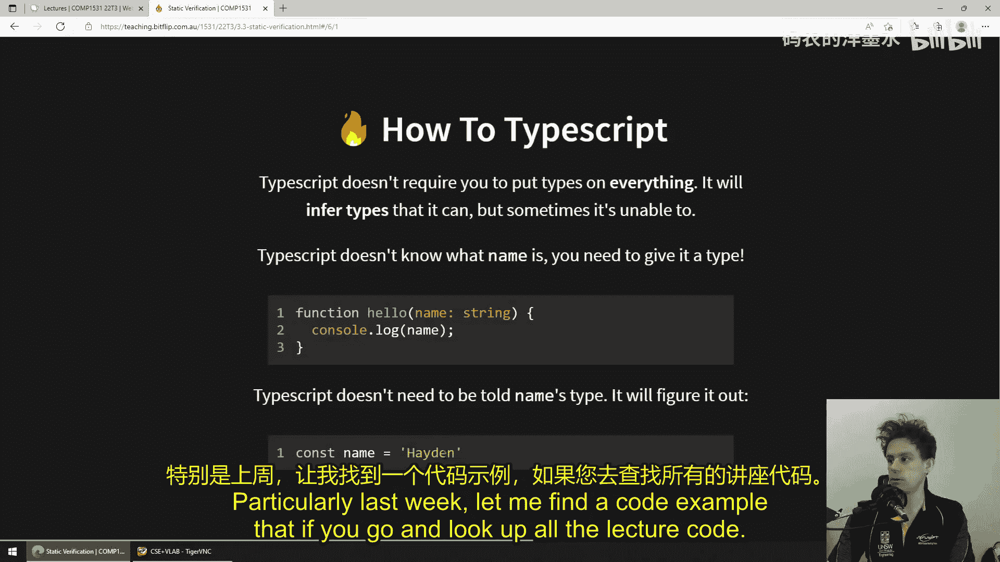

You will see that all of the lecture code sits in these three folders。

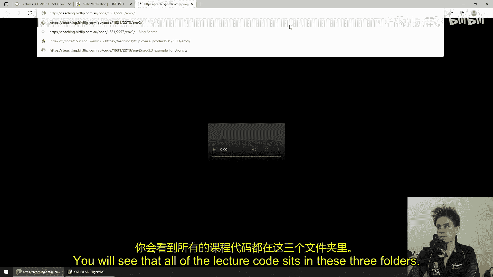

Which is M0， M1 and M2 and M0， again， we mentioned as like your week 1。

2 lab and some of the early lectures， M2 is like a couple of lectures next week。And then M sorry。

 M1 was a couple lectures next week。 M2 is like all of our lectures from now on。

 So it sounds like we kind of chop and change a bit。 But like， honestly。

 this is just kind of saying from now until the rest of the course or from your weekfo lab。

 we've kind of layer it on everything and everything we do from this point will be the same。

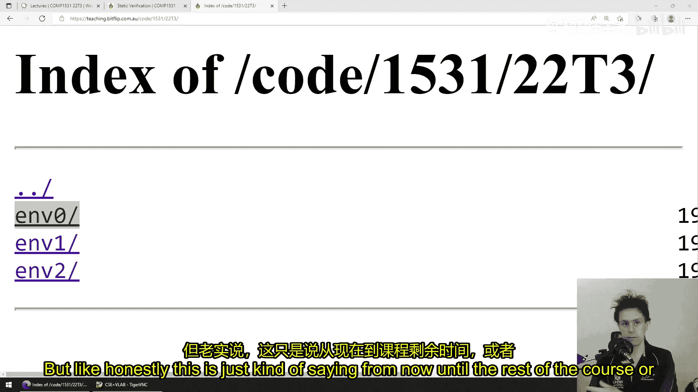

So we're going to be looking at some slightly different environments。 And again。

 what this means is that you can't run the code we show you today in you're like week three lab。

 you can't have to wait if you're a week four lab so。Software safety。

 the main type of safety we're interested in is called type safety， Funnily enough。

 The main area of safety we're interested in is called type safety。

 And what we mean by types is literally like data types like variable types。

 Think back to C in doubles， chas stars， all of that。

 And the point of type safety in a programming language is essentially preventing a mismatch between the actual and expected type of variables。

 constants and functions。 And it's like what in the world does that mean， Well。

 think about this in jascript， you can do some really funky stuff like you can say you know cons A equals4。

 and you can say cont B equals high， and then you can save a equals B。😊。

The thing is this code will run。 There's no kind of like compile time checks where the code like。

Just says that's dumb。Why did you just ask me to compare a string to a number。

Whereas if you were to do this in C， right， and you had down here in C， chas star B equals high。

 And you said if a equals B。You know what you get in that instance is some kind of compile error that says something like。

 oh， you know， cannot。

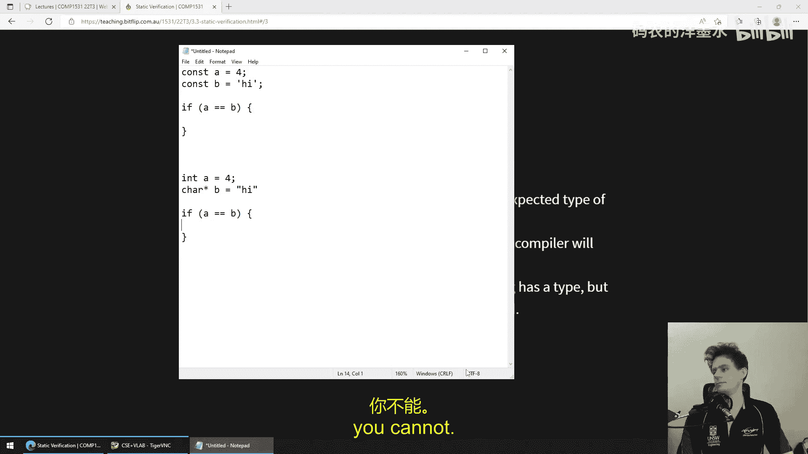

Me mean， what error do we yet， Let's play around with it， right， We all know how to program and see。

So say we've got a program here we don't even need。Wow， that colouring is not very useful。

So say we have like some kind of int main。We have an in a case here where we just kind of check if。

 if A and B are equal。You know， and if A and B are equal， we'll just return 0。

 Otherwise we'll just return  one。Pretty simple program， yeah。Ill just put it out here。

 There's the program。 Now， if I go and compile that。Correctly。There we go。

 Warning comparison between pointer and integer compile time。

 This program has not run yet because there are some type safety checks that exist within javascript that stop us from doing silly things here。

 And this is great。 That wouldn't happen in jascript， right。

 Javascript it would just run and give an output and potentially have a bug。

 So an example of how these type safety checks staticically improve our life is right there。 Now。

 if it wasn't already obvious， see as typeafe as types must be declared and the compiler will check that types are correct。

 You've just seen a demonstration of that。 Javavascript on its own is not typeafe， though。

 it doesn't just work type safely。

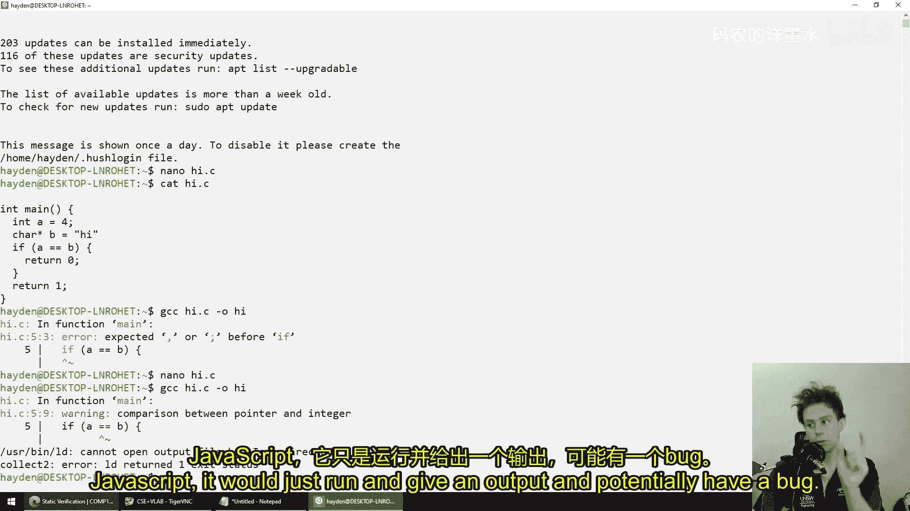

It doesn't work safely with types out of the box。This doesn't mean that there are no types in Javascript。

 This is kind of like a common， I think misconception and expression。 And I think in programming。

 knowing how to communicate is really important。 You couldn't say that jascript has no types。

 Javascript does have types。 It's just， it's a loosely typed language。 dynamicyally typed。

 and it's not type safe。 So things are a string or a number or something else。

 It's just the jascript doesn't really care。If you try and compare a number to a string， it's like。

 yeah， whatever， let's， let's do it。 see what happens。So whilst everything has a type。

 the type is not actually known until the program is executed， whereas in C。

 kind of the the way the compiler has to run is that every single variable in C needs to know what type it is before it runs。

There isn't a lot of kind of what you'd call like dynamic polymorphism， big words in the program。So。

We like type safety。 It's good for us。 It makes our。It makes our code work better， but。

What do we do about Javascript not having it， We've just said that it's important but that it doesn't exist in Javascript。

 So， well， in the absence of it， we do what。We were doing last week。

 which is we start testing software dynamically。Oh god。

 And we do this by catching issues at run time。 We got do this by writing jest tests， you know。

 pretty， pretty reasonable。 We go and write some jest tests and those jest tests will test our program。

 make sure it works， but。We draw the check estatically， like we do in see。How do we do this。

 We need a way to check it。 And that's where Typescript comes in。 Typescript is a funny little thing。

 I think what's hard about explaining what Typescript is is that most of you have an impression to date of like。

 you have a language like C and you have a language like jascript and languages are very。

 very different things。 The way to think about Typescript， I think， at the simplest level。

Is that Typescript is a different language to Javascript that just looks extremely similar to Javascript。

 and it feels pretty much identical to Javascript。 So imagine， you know， it's like you know。

 it's like copying and pasting someone's assignment and changing， changing a few things， you know。

Think of it like a bit of a plagiarism of jascript。

 But you added a few extra lines to feel smarter than your friend。

So and it's a language therefore built on top of the JavaScript language。

 and it's really just JavaScriptscript with a few little extra elements to it that helps you actually check the types of your program。

The funny thing about Typescript that makes it a bit weird to use is that it， it actually。

 what it's really actually doing is that it's。It's a language that checks the types of your program and if the types are good。

 it actually goes in kind of quietly runs normal JavaScript underneath。

 and that's why we shouldn't think about it as like a totally separate idea because it's really a wrapper around Java in other programming languages like you know。

 Python， we have libraries like My P。So the way to think of Typescript is。

Different to Javascript looks the same。 and its whole job is to simply be like the bouncer for Javascript。

 You know， something in front of it that you can code in。

 and there's just an extra check at the start。You know and Tony says arere all languages allowing us to declare types type safely。

 No， some languages don't have inbuilt type checkers。

 some languages do some languages have weak ones。 C is actually a very weak typed language in a way you can't actually do a lot with types we'll show you this through Typecr like type like Cs are much more strongly typed language than JavaScriptscript。

 but Typescript is probably a much more strongly typed language than C which is might be a bit of a weird concept。

 but we'll see that with some examples， and what you see here is here's actually a piece of Typescript。

It's a very simple function。 It looks like what we've seen before。 We've got a function called sum。

You know， which takes in an A and a B， and it sums them to it returns them。

 and then we console log the calling of the sum function。

 The one thing you'll notice that is different from what you've seen with normal JavaScriptscript is that we've actually got these two annotations here。

Which are colon number and colon number。 And it's actually a little bit like C。 like this isn't any。

 this is not a new concept to you， right， Like if if you wrote a C function。Like this， you know。

 youd， you'd write a C function that's like int sum int A， int B。Return a plus B。 You know。

 like you're pretty。You're pretty familiar with this as an idea。You know， so。

The the way we're annotating the type is just slightly different here。

 instead saying in a or something we're saying number。 And it's like， what is number， Well。

 numbers like kind of an integer or a double。 if you think about it。

 it's just like a different type system。 It's just a way of saying， you know， something numeric。

 something that you could kind of sum。So that elements a bit different， but we're just annotating。

 but besides that， it's normal jascript。 it's not a totally different language。

 It's just jascript with this annotation， But the question is， how do we run this。

 Because we have a problem， and I'll show you this if。

 if I am sorry that I don't have the terminal up already， I was fixing。

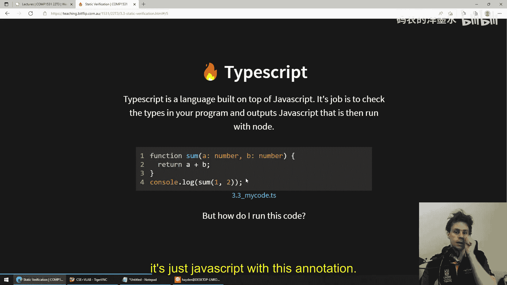

Fixing the little luxury thing。If I go into M2 source and then I run this piece of code，3。3。

My code dot Ts， right？Which looks like jascript。 It's just， it's a little different。

 And it's got a dot T S for Tscript instead of dot J。 S for jascript。

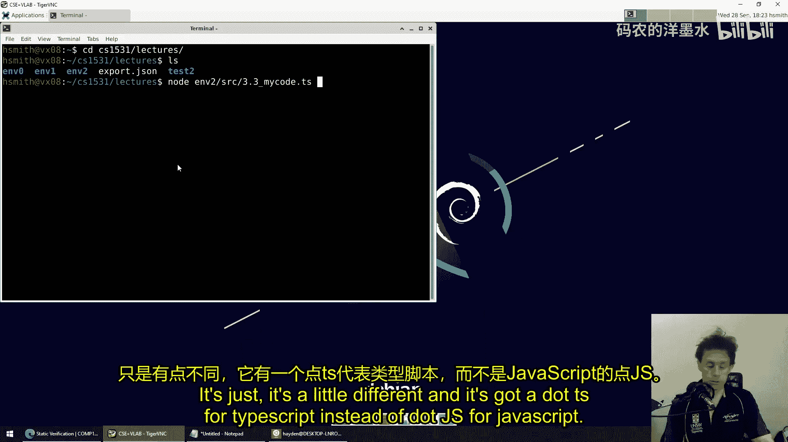

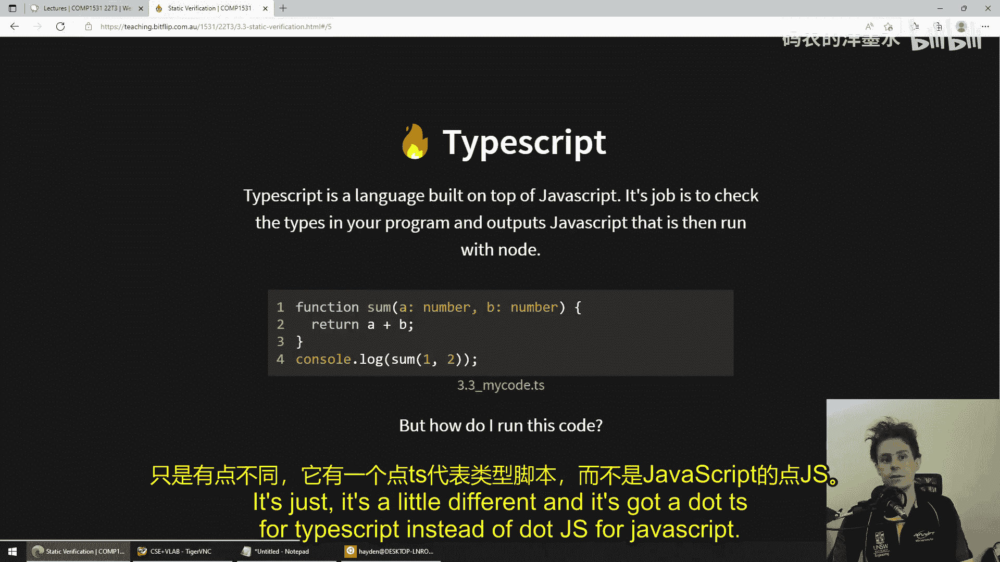

If I go and run that， you see that node when it tries to interpret that。

 when it tries to run that code， it says unexpected token colon。That's because node。

 the normal JavaScriptscript engine is just like what in the world is that that's not part of the language。

 And that's why it's a separate language actually， Like that's why Typescript is a separate thing。

I'm very confident that they're working towards a solution where these are less less of two ideas。

 I guarantee you in five years， you'll be able to run this code with node because Typescript's extremely popular。

 extremely popular。 So and who wouldn't want the ability to optionally add extra type checks to your program。

 It's just kind of like a win win。 It's just like what I said last night or Monday night， Sorry。

 is that sometimes jascript moves so fast that it just takes a while for things to catch up。

 So rather than like the the main community， the ones that kind of manage node integrating this。

 There's these kinds of side projects。 There side projects everywhere all the time。

 And most of them die because they're terrible。 Typescript didn't die。 Typescript took off。

 And everyone's like， w， this is so useful。 Sos now that it's useful。

 Let's start the multiyear process of integrating an into node Js。 you know。

 so it actually like runs part of it。 So right now， you can't run it with node。

 A little bit annoying。😊，Just for now。 But that's， that's why we have to talk about how we run this code。

 because we can't just run it normally。

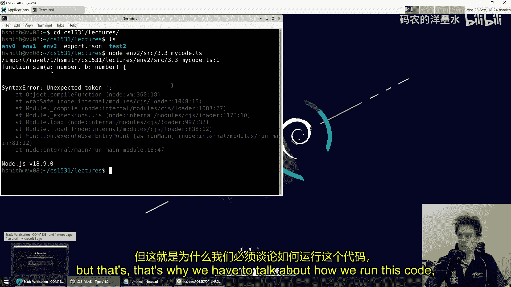

To run Typescript， we actually need to install dependencies like jest。 You know。

 think about jest for a second。 It is javascript， but it also looked a bit different to jascript。

 didnn't it， It like really is javascript， But like it felt like a bit of a semi pseudo language。

 and we needed to like do a dev dependency install， do an MPm stole of jest。

 we needed to do a very similar thing with Tscript where we actually install these typepescript libraries because funnily enough。

 even though like Typescripts a language and we。And we say， it's like node。

The weird part is that it's actually just an NP PMM library。 If I go N PMM JS。 And I look this up。

 it's actually a library and a very popular library at that， right。

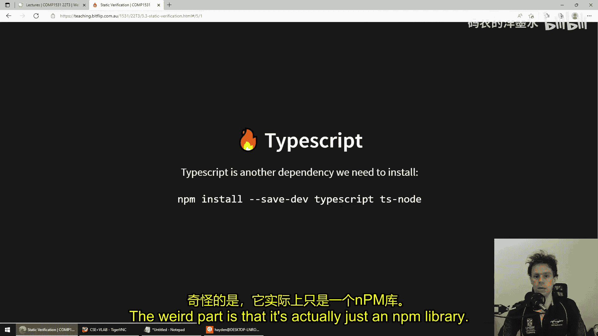

34 million downloads a week。 Oh my God， that's a lot， right， That's a lot of downloads。

36000 dependents。 Oh my god。It's a lot。 It's a massive library。

 And there's another library we're gonna download called T， S node。Now。

 TypeSscript is the actual kind of call library that allows us to check types。

Allows us to actually you know， interpret the code as you see it。

 T S node is like a really helpful library that basically。

 instead of using Typescript to convert Typescript to like original jascript and then running that with node T S node is like a library that you can download that essentially just allows you to like run Tyscript as if it works with node you know like because in an ideal world。

 you can just like write Tpescript and then type in node my file do T， but we can't do that yet。

 we will in the future in the meantime this library needs to exist。

 I'm sure this library won't exist one day。 but it exists for now and it's extremely popular right now Tony says this jest a library as well。

 Yeah， Jees is just a library。 everything anytime your MPm install something It's just a really popular library。

 This probably has yeah 18 million downloads a week。

 the library we use in this course a massively popular。 like extremely like core standard， very。

 very popular libraries。So。

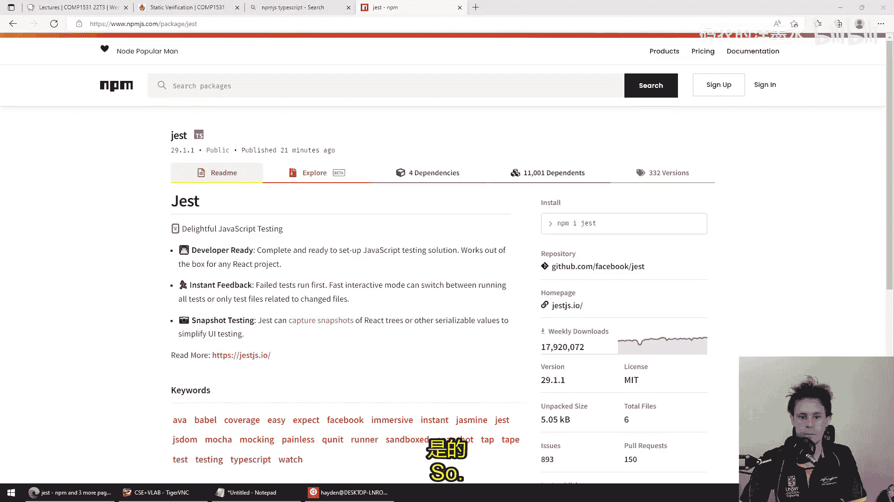

Let's keep going。Doesn't work。 What do we need to do when we follow the lecture notes。

 The lecture notes say that we need to run NP PMM install these two libraries。

 I can put two libraries here and it installs one after the other， right。

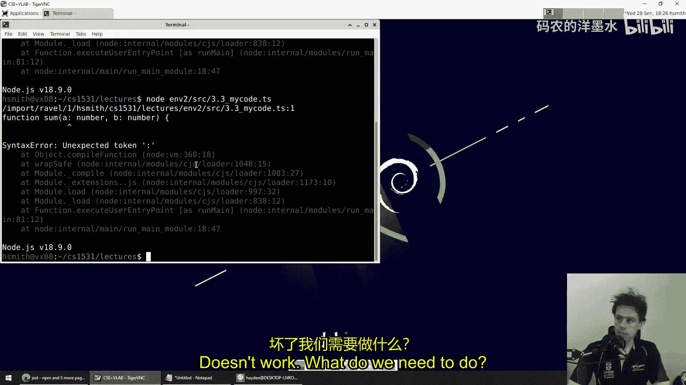

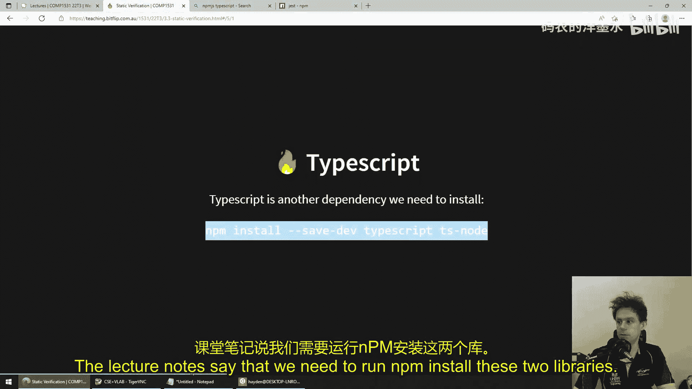

I think I need to go inside M2。So I installed that。Great。

 it goes and installs them into my package dot Json。 Now for the lectures。

 I already have a lot of modules like installed in this folder， so。😊。

There'll be a lot more in the package Dot Json that you'll see。 but mostly。

 mostly it's just normally it to just be these two。 I'm just really killing time。

 saying nothing of value until this。It's already installed。 That's the worst part。 I I think it is。

 Maybe it's not。

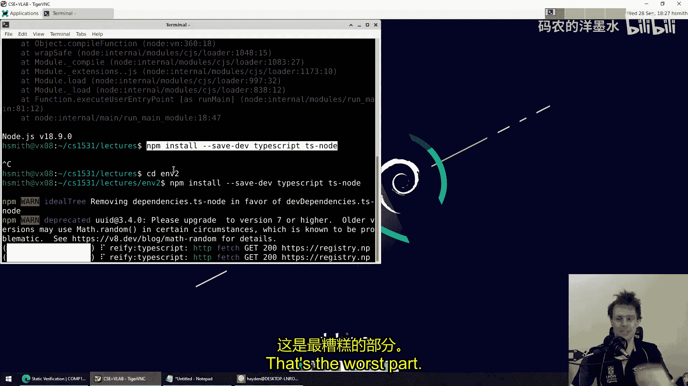

Doesn't matter。So we go and run that and what that allows us to do is it allows us to actually run TS node。

Which is like the node equivalent on our code。 Now， you remember with jest。

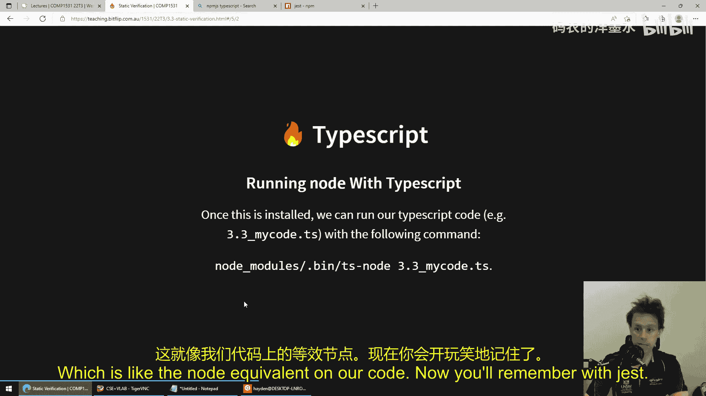

Justest wasn't like a。A system library， right， It wasn't like node。

 Like you can just run things like Git and node and GCC。

 because they are kind of installed on your computer。 You know。

 it like programs whereasas things like jest aren't actually installed on your computer。

 They're installed in your project。 and therefore to run them， we need to kind of。You know。

 be clear to the computer where they are，cause otherwise， the computer just doesn't know they exist。

 So what I mean by that is if I just type in T S node， the computer's like。

 I have no idea where that is。Because on Linux， how it works is that there's a whole bunch of paths that exist like these。

 and they're separated by colons here。嗯。And basically。

 it's just looking for programs in these paths to run。

And it can't find a program called T S nodede anywhere。

 And that's because T S node does not exist in any of those folders。 It exists inside this folder。

 inside node modules， inside dot bin。There's a file called TS node， that's the actual program there。

That's， if anyone's ever wondered that， if you remember in C，cause I don't。

 I don't think they go into this much in C。 But if you remember in C。嗯。They'd say things like。

 you know， you can power your program， and then you run dot slash like hi。Like this， right？ So。

 you know， you make your high dot C。 It's an int main program that does nothing。 You compile it。

 It outputs a file called a dot out， and then you run a dot out。

 And the computer knows to look for that there because you've told it where to look for it。

 Which if I just write a dot out， The reason it says it can't find that is because if you don't specify where it is。

 it's always looking for it in one of these folders here。But obviously A do out's not there。

 It's in this folder。 So we need to specify that。 And similarly。

 when we install the T S node library， we need to be very clear of where that is too。

 We need to actually say dot slash node modules。

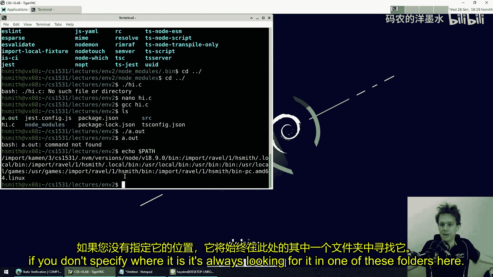

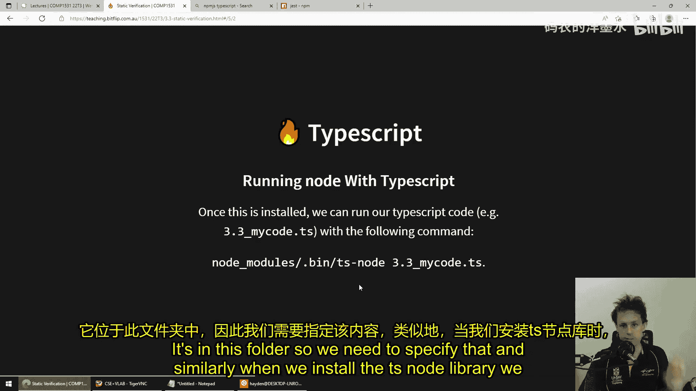

Slash T， S node。 And now it'll work。 Now it's actually that， that's the programme。

 That's the node thing running that。 It's just like node。 But node， I don't need to specify that。

'cause it was installed on the computer。So T， S node， and then I run source3 point。2。

 what was it was the file called 3。3 My code。Dot T S。 And now this will actually run。Great， right。

 it， it prints it out。 And if I open up let， let's open up this。

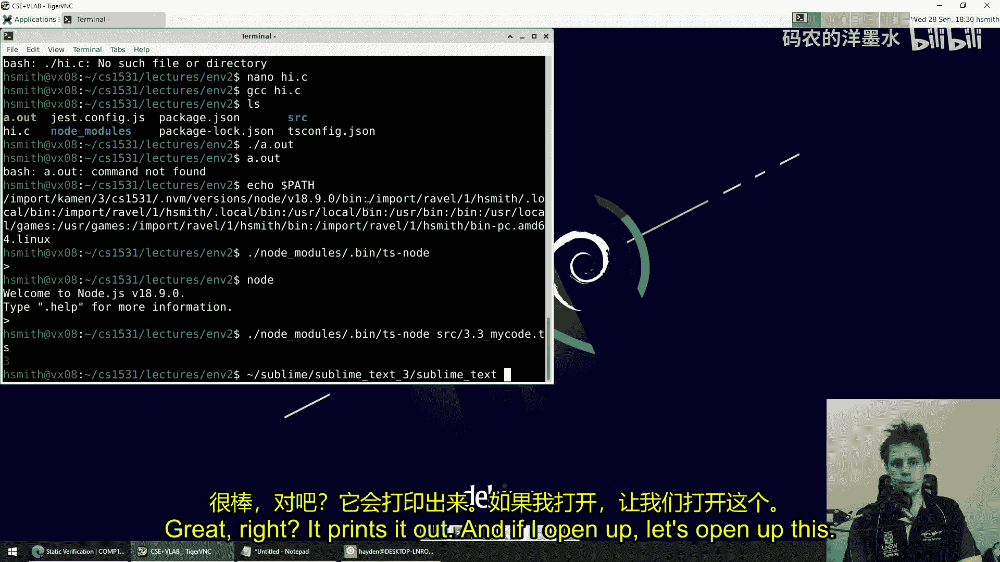

Have a look at all the code。If I go inside the source folder here and I look up my 3。3 my code。

 that's， that's all it did there。 we would run that oops。It just ran that code。 So like。

 I can run typescript Like I can run jascript。 It's a slightly different language。

 That is a slightly different way of running it。 It's pretty easy， pretty manageable。

 nice and simple。

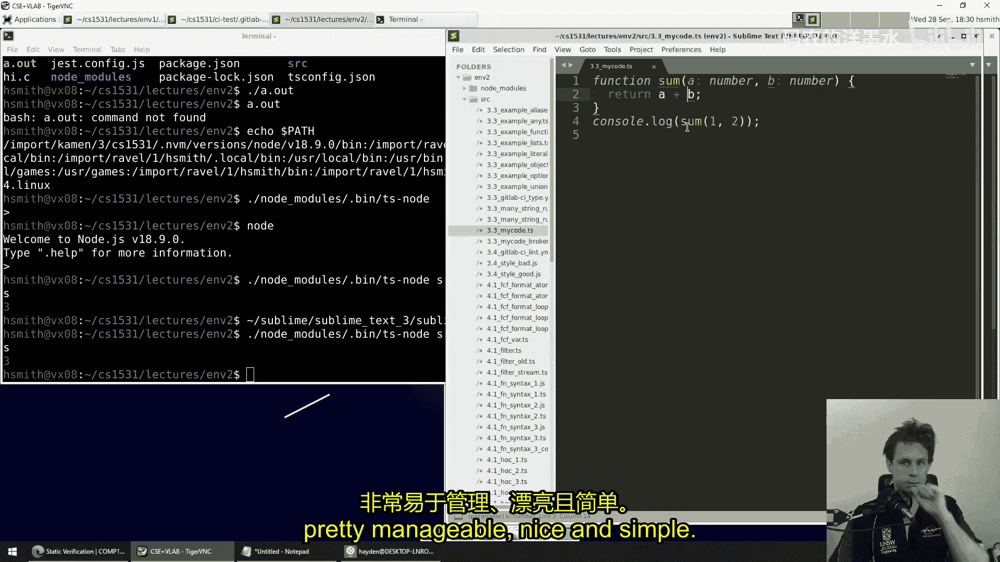

And you might be thinking。What's the point， Let me just double check here that。

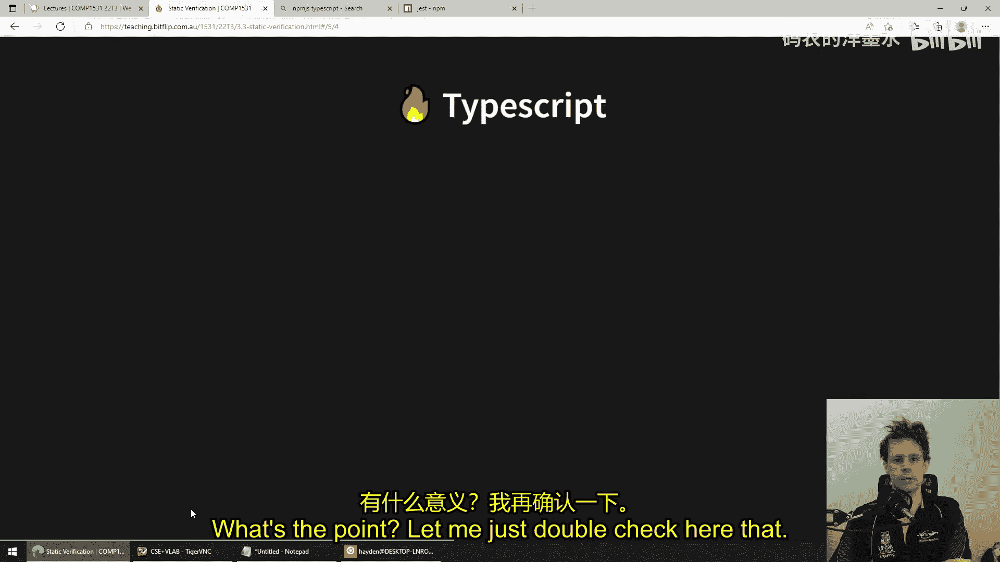

Yeah， you might be thinking like， what's the point？Of Typescript， well。

 the point of Typescript is that unlike Javascript。

 I can actually write code now that will protect itself from silly things like this。This will fail。

 See here， argument of type string is not assignable to parameter of type number。

 So our code is actually protecting itself before it even run。 We have improved the static safety。

 Remember， static means before it runs， we've improved the static safety of our code because if I create the same file。

 that's just called 3。3 My code dot Js。Right， and I get rid of this thing。And I just run it， right。

 with node。Soce slash 3。3 my code dot J。 S。 It runs。 and it tries to add them together。

 But that's weird。 That doesn't make sense。 What if I like， I don't want job， like， I don't want。

 if I'm writing a library and I want to create safe software。

 I don't want to allow someone to put in B， S into my function。 I mean，1 a is like a number。

 That's the worst part here。 You know， it's not even like， I passed in， let's look at it。 you know。

How do I， how do I do is it type of， type of blah， I think so。If I run that code， it's a string。

You know what happens if I add one and 3。I get 13。一er。I don't want that。 Now。

 you could say that all I'd haydon fair enough， but that just sounds like a stupid programming language。

 right， Maybe that's definitely true to some extent， but。The principle still remains the same。

 It's at scale， right， This this could just be a bad example， potentially， it's a simple example。

 but we want to prevent that。 And Typescript helps us prevent that because we can annotate code。

 And there's a static element of running the code that happens before it runs that says all this code needs to actually make sense。

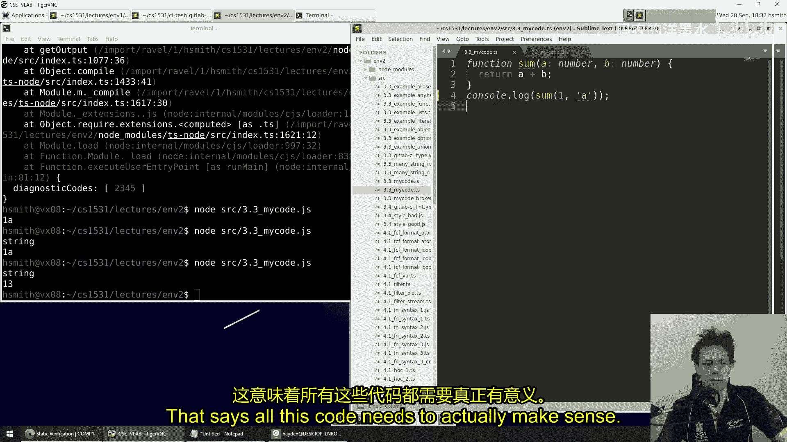

There's another element to。Typecr， which is really useful。

 There's kind of two key commands that we deal with in Typecr。 One of them is T S node。

 and the other one is T SC。And T SE is I get， I get this wrong every time。

 I think it's the Typescript compiler。

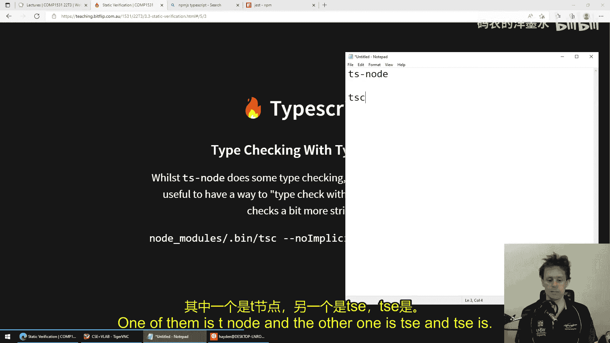

There might be typescript。

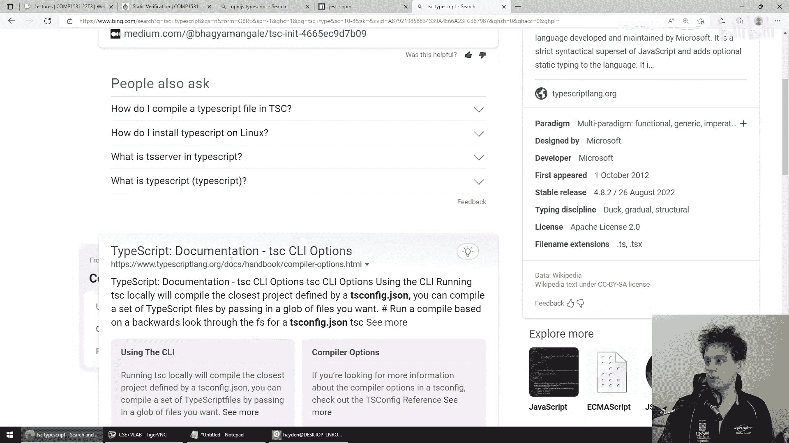

Yeah， I think it's type scripting power。 Hope so。 T S C is the actual thing that does the type scripting。

TS node is actually just a little raper that does the type scripting and then runs it。As node。

And this is just to give you some kind of background here of like， how this works is that I'm。

 I normally don't run this， but let me try it out。

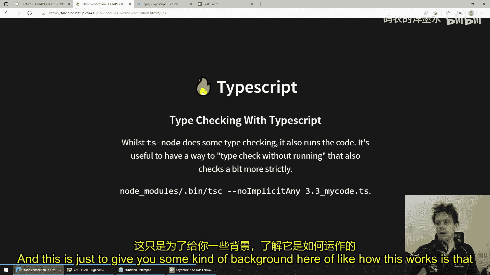

Yeah， I didn't think that would。Go particularly well。Yeah， but I。

 I kinda really wan to show you this。 So let me， let me， let me actually just like。

Let me show you an example of I'm gonna make a random folder called going a bit of a tangent here just to really drive something。

 I'm gonna to call like M 9 for no reason。 And what I'm going to do inside M 9 is I'm gonna create like my own oh。

 not get an inch。I'm gonna create， like， an NP PMM。You know， thing。 So I've got like a new MPM。

 And then I'm gonna， you know， MPM install save dev。 I'm gonna install type script and。T S node。

In here。Cool， and then I'm gonna， you know， like。We create a file called myco dot T。

 So imagine this is you。 This is how you'd maybe run Tpescript by yourself。

So I've got like a some code there that's like， you know。Micro dot T， S， call， and then。

What you would typically do to run that。 And we're probably missing some configuration。

 which will really demonstrate to you， like how kind of finicky this whole thing can be。嗯。Okay。

 it didn't work。 That makes sense， because like in our code。We were trying to do something。

 that shouldn't。But like， this is all you need to do to run Tpescript， right， really， really simple。

 That's T S node， though。 Another command you can run is TSC。

And what TSC usually wants is a folder to run in。 So you，ca TSC checks like a whole bunch of files。

 typically， there's usually a bit more setup involved。That I'm probably， let me。

 let me just try this。 Normally， we give you all these setups。 Okay， if you run TSC。

What it actually does is it checks all the files in your kind of folder if youve set it up correctly。

 and it makes sure that they're all type safe。 It doesn't actually run anything because it's a bit like Gcc。

 right when when you write code and C， there's two steps。

 there's the compiling step where we check it's okay。 and then there's the running step。

 So in reality， what's happening is that there's a program called TSC。

 the Tyscript compiler that goes and compiles your Tpescript into something that node can run。

And then we run it with node in those two steps。 And the T S node thing we saw before is just again。

 I'm just reiterating the same point。 It's just a shortcut method where they get combined into one step。

Whereas this is just checking the types and you can see this， right。

 I'll show you this it's quite interesting。 If I open up the code in this folder。

 and what I'm showing you here， you don't have to do much。 So don't don't stress。

 I'm really giving you some theoretical background。This is it here。When I run TSC， it checks it。

 So watch what happens if I put an error there。 Watch what happens if I put an A there。

 TSC will fail。It's not trying to run the code。 It's simply trying to compile it。😡，Right， like this。

When it just like normal GCC， if you don't have any errors， it'll just come back and say oh good。

 no issue， let's keep going。And to give you like the full understanding of what happens here， how。

 and this is， again， very theoretical。 I'm just giving you background。

 how Typescript actually works is when you run the T S node command。It runs TSE。

 which outputs some jascript that looks like this。 This is what you might call like compiled typescript。

 It just outputs jascript， and then it runs that jascript。

 So you can imagine what T S nodes like actually kind of doing is it's running that command。

 And then right after it's running my code dot Js。 So it's like those two steps there。 And therefore。

 if there's like an error here。In your code like that。

 what it actually does is it does that type check first。 And if the type check fails。

That was the wrong file to edit。If that type check fails。It simply doesn't run your code。

 It just says there's a problem。 And then you fix that up。And then your code works fine。

So that's all T S note。But as far as you're concerned， at a high level。

 all we're really doing is saying to you， instead of running node， you now run Ts node。

 and instead of writing dot Js files， you write dot T S files， which are basically the same。

 they just have a few slight changes to them。

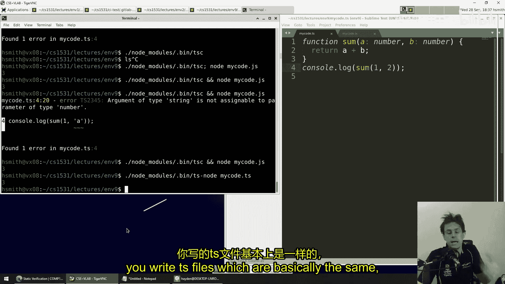

So really quite easy。You can go and like， add some shortcuts if you want。 So， for instance。

 in this new little project I made here， you can add a script。 I can。 I can remember how I said that。

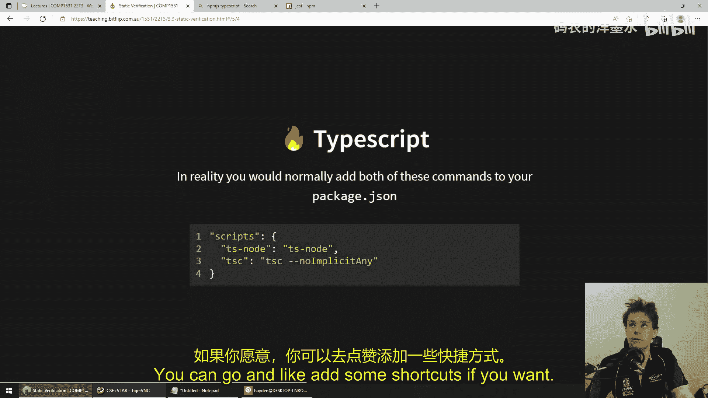

If you add a script like T S node， when these scripts run， it actually adds the node modules path。

To the， like the run time environment。 So you can actually like， you can just do something like this。

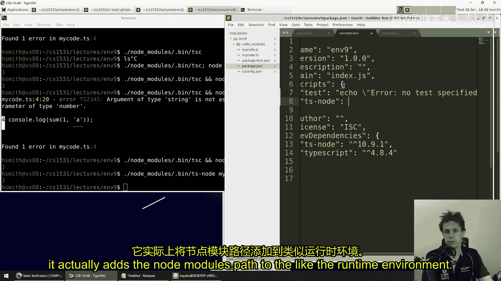

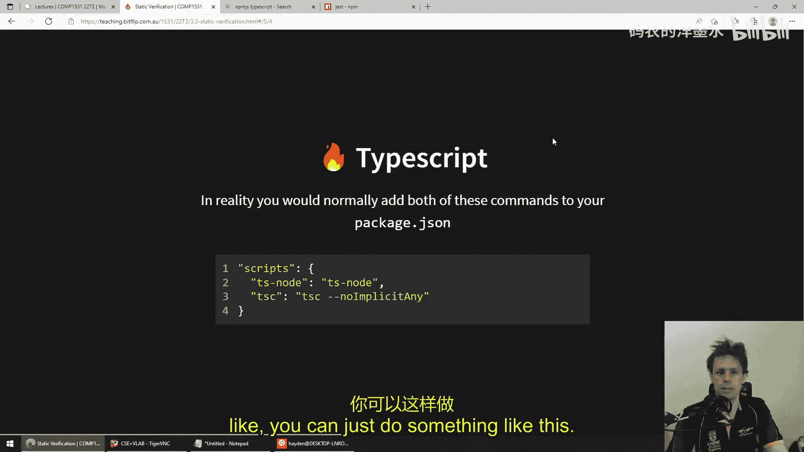

T， it seems a bit silly and redundant， but it's just kind of how it works there is that now。

 instead of having to write out that whole command to type check。So like， check。

 I can actually just run like NP PMM run TSC like this。And that'll run the TSC command。

 And similarly， I can now run MPM run TS node。On my code dot T， S， and it would just run it。You know。

 so we've really reduced this to something that's not that different to what we're already doing。

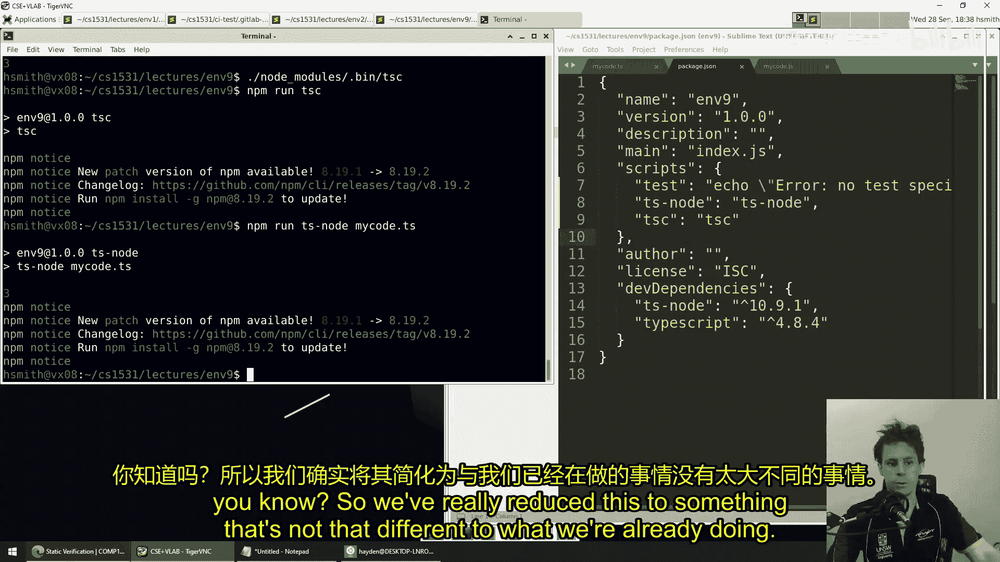

Okay， let's do a slightly more complicated example。 I've got this。 Let's go back to our other。

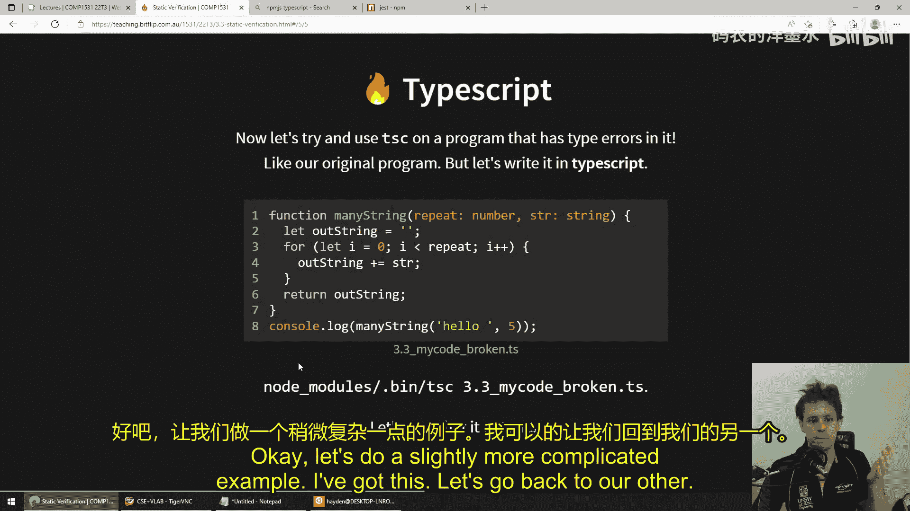

Actually， I might， I might need to keep copying code across here。

 Let's go'cause it's easier to run in a small environment。 So if I have a look at this。

 I've got this piece of broken code。Right。And I'll call this one， like broken dot T S。

And you can see here， a fairly straightforward function called mini string。

 We've already seen something like this。 It's one of our previous examples where' all we're really doing is taking a string and multiplying it kind of like concatenating it to itself many times。

 But there's a bit of a problem here， which is very， very easily picked up on with Typescript。

 which is that。😊，It expects a number， which is the number repeats。

 and then a string of what to repeat。 But in this particular case。

 we've given it to it the wrong way around。 And this is a great example of where。You know。

Typescript can be really helpful because if I try and run broken dot T S。

It actually won't run because it's like， hey， argument a type stringing is not assignable to number here。

 And I'm like， oh， I need to swap them around。But again。

 think about what would happen if I had this in jascript。So let's say broken dot Js。

 Let's write some jascript for it。 Remember Java' is really similar。

 It's basically the same thing just without the type annotations。 So now instead of running that。

 I run node broken dot Js。Oops， wait， why did that。Yeah， I run no broken dogerers。

 See that This is the problem， This is like the whole problem with soft like。

 this is why we talk about software safety because this programme didn't crash。

And there's a whole hierarchy of bugs， which we haven't really gotten to。 And it's like， you know。

There's there's this idea ironically that compile time errors are the best errors because they're so like in your face and then run time errors are kind of the worst。

 like a divide by0 or a tan of 90 because。You don't know it's a problem till the programme's running。

 And then the the actual worst kinds of errors are what you call， you know。

 like logic car undefined behaviour， which is where the program seems to not crash。

 This program didn't crash。 It just ran， and it gave us a strange output。 And this isn't good。

 This isn't good for us at all。Because now it's like it seems to work， but it didn't。

 It's fundamentally screwed because what actually happened here was we passed in hello to repeat。

 and then we passed in5 to string。And， like。What happens if you try and do a loop？

Where eye is less than repeat。You know， it's just not going to behave。

 It's not going like it very much。I'm not sure why the stream is buffering。

 I have fairly strong signal right now， So maybe it was just a second。

 but it seems pretty stable at the moment。 So let's hope it stays that way。So yeah。

 fairly simple code there。 And similarimly， if we have our broken dot T S。

 we can just run NP PMM run TSC to actually。You know， make sure that it behaves。 And it says， oh。

 you've got that wrong。 like， oh， good spot。 Thank you， Typescript。I appreciate that。Bruns again。

Good， everything's fine。Love it。 Tony says if we want the user to input an integer。

 but the programme is given a string， will Tycr cache this error while the program will keep running and give the wrong output。

This is a hard question to answer， because。Some things you just don't know what you're gonna to get at runtime and input's a bit complicated because input's always a string。

So input checking is not really something that Typecr helps you with necessarily。

 Typescript helps you with everything that you know at compile time。

 which is a surprisingly high amount， surprisingly high amount helps you with you know。

 undefined variables and poor types and like misuse of functions。

 like you'd be amazed how many of your bugs think about what we were doing on。

The other day was like date functions， how we were passing dates into the date functions library。

We might be passing it in wrong sometimes I guarantee you there's probably a bug in most of your JavaScript code somewhere you've written in this term。

 but like no one notices it。 It's probably a type error。You know。

 there's probably an instance where you've passed an integer into something where the integer could be null。

 but you're not dealing with the null case。 and no one's tested the null case。

 Like it's actually really common。And it's very interesting。 Jen says， might be a stupid question。

 but why would we need typescript if it's so similar to javascript。

 Is it just to compile code that without it can't be compiled or tested。

 It's literally just to check types。 That's it。And there's a few things it does which is kind of useful。

 but it's like it's predominantly there to annotate your code with types so that when you write big complex pieces of code and then more importantly when you use other people's code。

 like when you use other NPM libraries that you make sure you're always passing in the right thing that it's expected。

Derpe says， does that mean jascript could be less secure than other languages as intentional poor inputs could mess up a program。

 Yes， this， I mean， I don't know if I'd like secure as a hard oneca you can kind of like。Securities。

Oh， I want to come back to saying it's less safe。 We use this term safety to describe software that could be accidentally misused。

 Of course， there's probably some more vulnerabilities that exist because， you know， it's。

 it's less strongly typed， but it's the bigger issue is that jascript is definitely less safe than a lot of other strictly type programming languages as accidental misuse could easily mess up a program。

 and you will not realize that you have accidentally misused it。You know， until it runs。 that's the。

 the problem with run time。 Remember how in the dynamic verification lecture， we pointed out。

That testing， dynamic testing with jest is identifying bugs。 It does not remove the presence of bugs。

 It identifies bugs。 So what I'm saying is in the labs you write it。

There could be bugs in your code that you don't realize。

But TypeScr will pick up on because it's very easy to pick up on tight matching errors and other things。

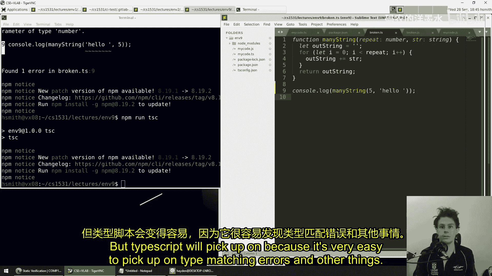

O。I think it's a good opportunity to kind of just very quickly pause here。

 And I'll remind you at the end，'cause last time we had a lot of misunderstanding with this， but。

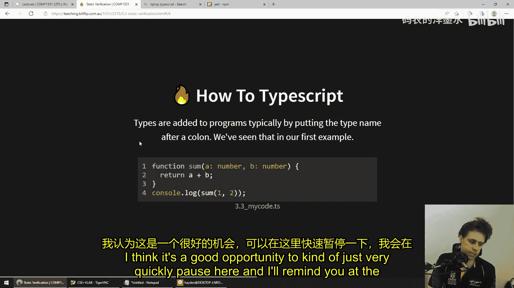

The way we integrate Typescriptt into your project is actually really light。In the sense that。um。

What we actually do。Is that the way we've set up your project for like week  five and stuff when this comes into it is that。

When you run your Typescript code， we actually tell Typecr to like。

 ignore most problems to just like forget about it。But we tell T S C to look at them。

And why we do that is because we want you to be able to， like。Work with Typescript。Run it。

 But if your code doesn't work with Typescript， If you've got type errors。

 we don't actually want it to slow you down。So what I mean by that is like。

 if you have some type errors in your code like this。Right。

 the way we will set up your project is so that when you run NP PMM run T S node on Bro dot T S。

 it will actually run fine。 Like it won't actually have this error。

 We've set it up so that it just runs it normallyca it can actually ignore that。 Like I'll show you。

 it's like。

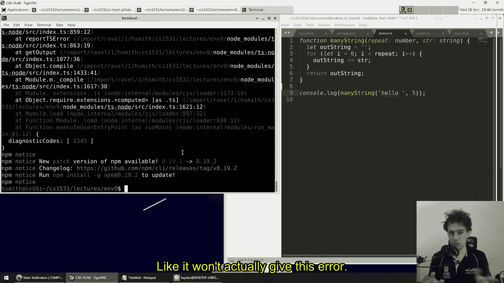

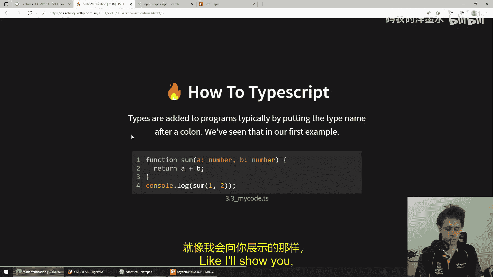

Type script， ignore。Erra， I don't know the。What do you say。T S， config， ignore。Tight mismatch。

 I don't know。There's some it won't ignore。 There's some pretty obvious ones that won't ignore。

 And to be honest， maybe that's not a good examplecause like none of you wanted to ignore that。

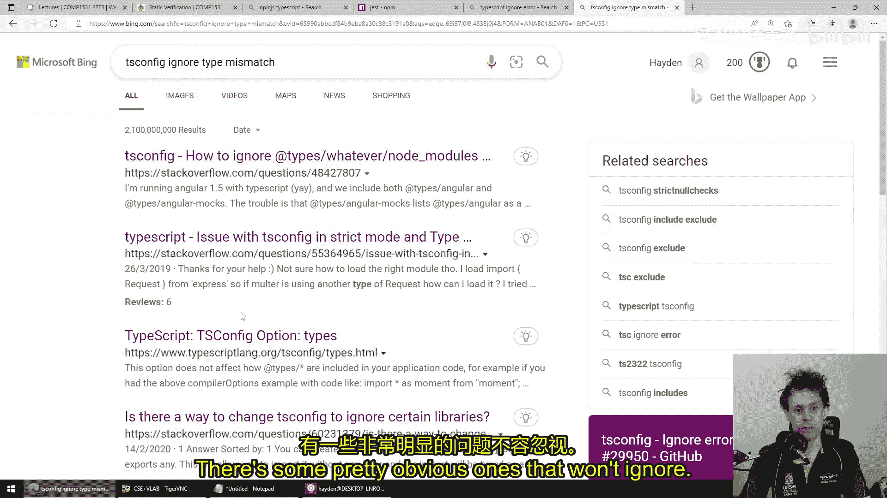

Right。None of you want it to ignore that。 That's， that's something you should be like， thank you。

 Typescript。 But there are sometimes annoying errors。 I'm actually gonna come back to this example。

ca I think as we get further into some of the other pieces of code。

 it'll be more immediately obvious like what I'm talking about。

 And I'm probably just speaking very abstractly。 So let's keep going， how to typescript。

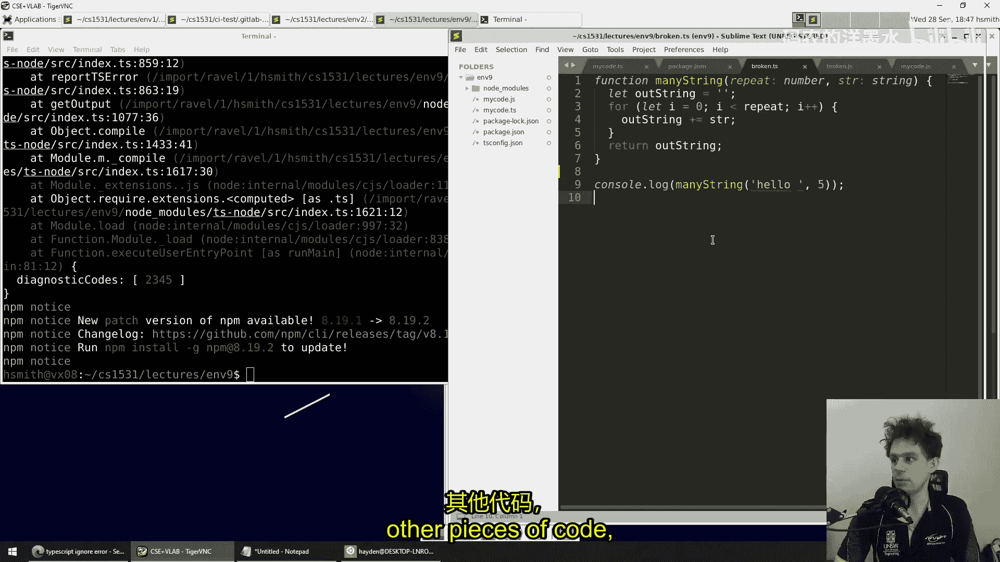

Okay， we're gonna start looking at some examples。Types are added to programs simply by putting or typically by putting the type name after a colon。

 we've seen that in the first code example。When we define a function。

 the parameters typically need to be typed explicitly。

 that's one of the most common places that you put types in with Typescript is in function definitions for the parameters。

 In this case we specified that both A and B were numbers。

One thing that's interesting about Typescript， and it's very good at this。 actually。

 is a language is's quite powerful。 Typescript does not require you to put types on everything。

 It will infer types。 That means it will guess types where it knows it can guess confidently。

 and it guesses not even the right work， because it implies that it could get it wrong。

 It will derive the types deterministically if it can。 Otherwise， if it can't， it'll tell you。

 So if we say take a simple program like this one， this function。 Ho here。

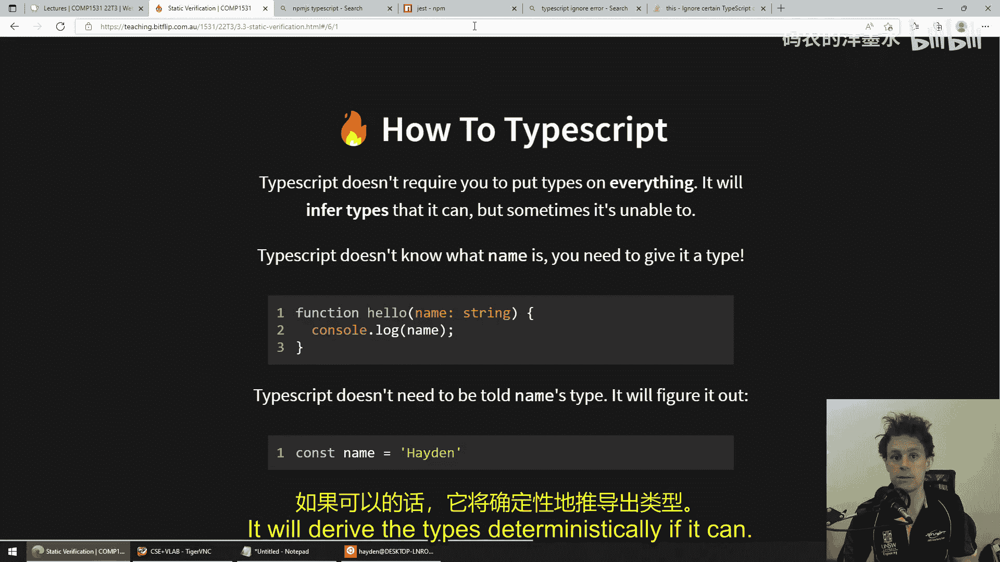

Right， I'll create a new file called bh。Bla dot T， S， right， We got names string and stuff。

 But if I say here con。First name equals Hayden。What I don't need to do here is to say。String。I。

 I could do this， right，cause remember that we're saying types are just added after the names of particular names with a colon。

 I could do this and it would kind of work right if I ran like MPM run T S node blood dot T S。

It'll run。 it doesn't print anything out。But it all run fine。 But if I don't have this here。

It still works fine because you gotta think imagine being in the brain of Typescript。

 It's like Typescripts like， h。What typus is name here。Right， so if someone。

 let's imagine that your type script and someone gives you this function and they say， yeah。

 figure out what type name is， Is it a number， Is it a string。

 Is it one of many other types it's like。I don't know。How are you going to figure that out？

Whereas if someone comes along and says， hey， I've got first name。

 it's equal to the string Hayden type scripts like， well， I know it's gonna be a string。 So it's。

 it's got a very powerful type inference system， which means that you don't actually need to derive too much。

 which is really good。 And it's also why you don't need to specify what this。

 this function here returns。

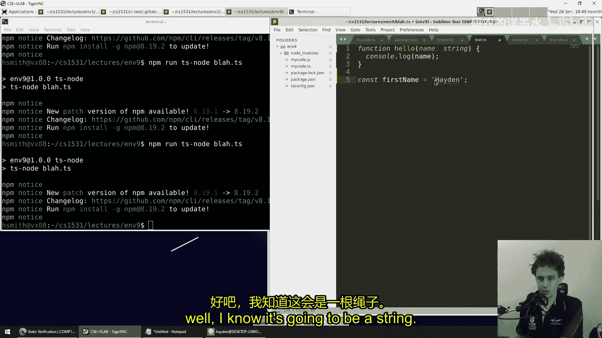

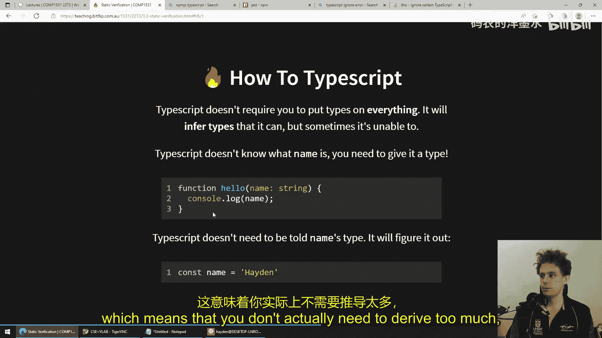

Cause you can specify the type the function returns， but you rarely need to。

 because Typecr will look at that and say， well， or if let's say I'm actually returning something。

 it'll be like， well， he's returning name and name is a string。 So I think he's returning a string。

 Or if it's like， well， he's returning name plus a plus B。 Well。

 if I had a string to a string to a string。 I get a string。 So I must be returning a string。

 So it'll figure a lot out for you， which is very， very handy。

 Let's look at some actual examples of what you can do with Typecr。

 Let me just click ahead a couple of slides to make sure I know how much we got to go。

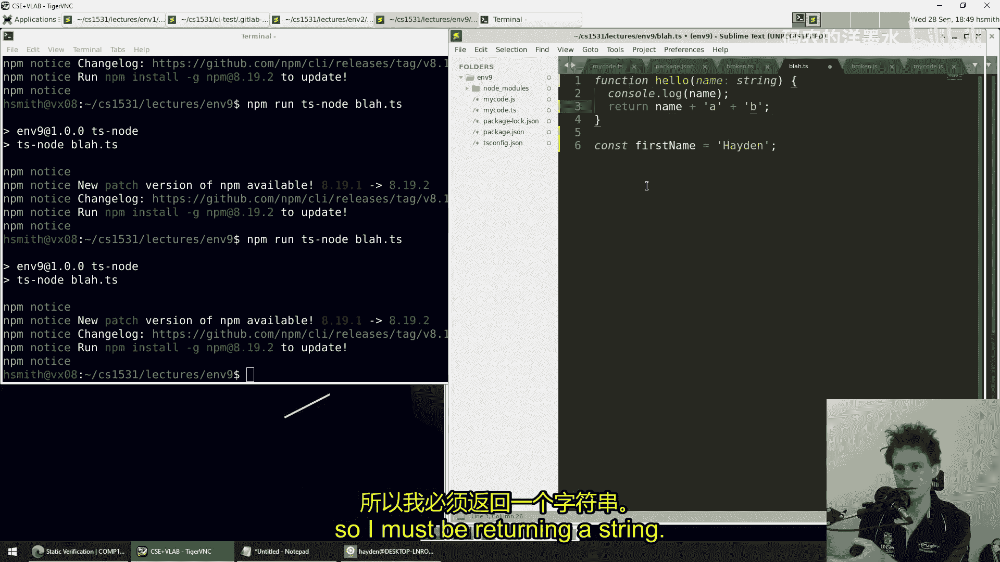

Becauseuse this will run。It might take a break in the middle。 This。

 This takes up a little more than half of the lecture。

 So lots of examples to go through with Typescript。

 And I'm actually just going to go and copy a lot of them。

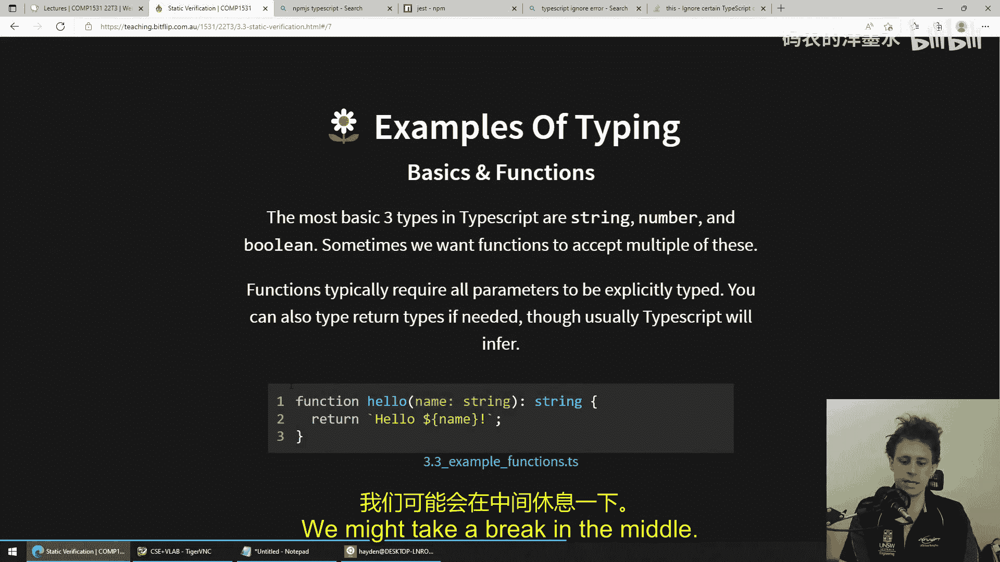

From the M2 folder。Cool。嗯。Where are they。Why can I see them。That's rude。Let me try and fix this up。

Okay。Alright， let me close this and reopen it and see if it appears。By the way。

 I was talking about like passinging on the computer。

 This is why whenever I open up this editor I use， I actually have to like tell it where it is'cause if I just write the name of the programme。

 it doesn't work。

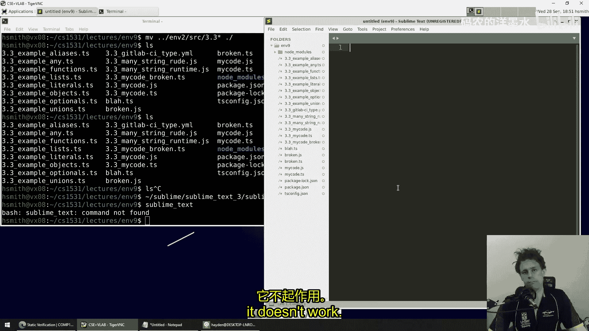

You know， so I've got all this code here。 and let's talk through some of them。

 So one of the first ones is just like a standard function definition。

 probably the easiest one because we've seen it already。 In this case， this is how you。

 this is how you specify a return type for a function。

 you put like a colon and string at the end or something else。 For instance。

 if I wrote colon and number here and I tried to run this particular piece of code。

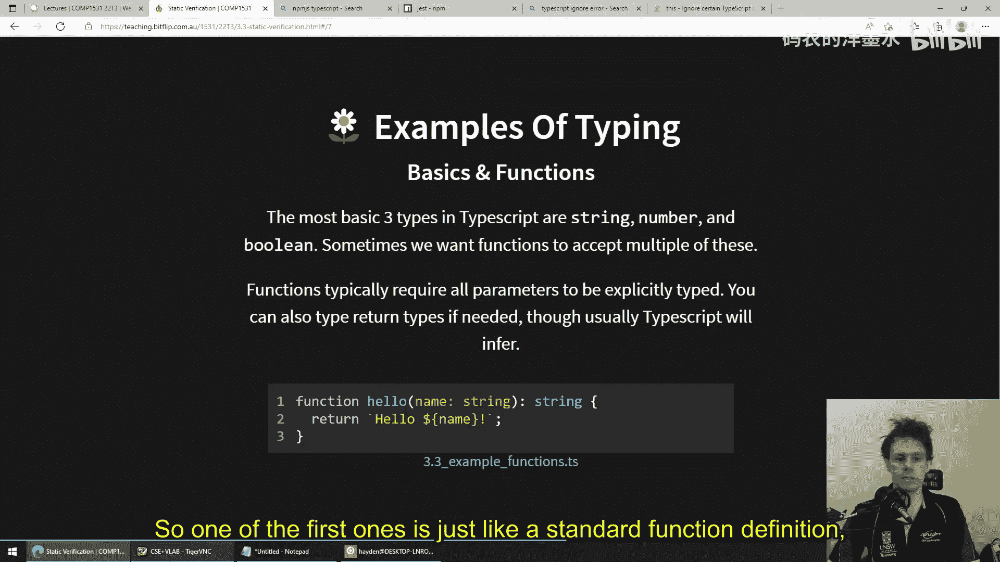

You'll see that what will happen is it'll basically be like， no， that doesn't work。Right。

 and it's like， okay， well， maybe I have to return a number or something like that。 Now， obviously。

 you wouldn't do that， but it， it will actually do that check。

 So those functions are relatively straightforward。

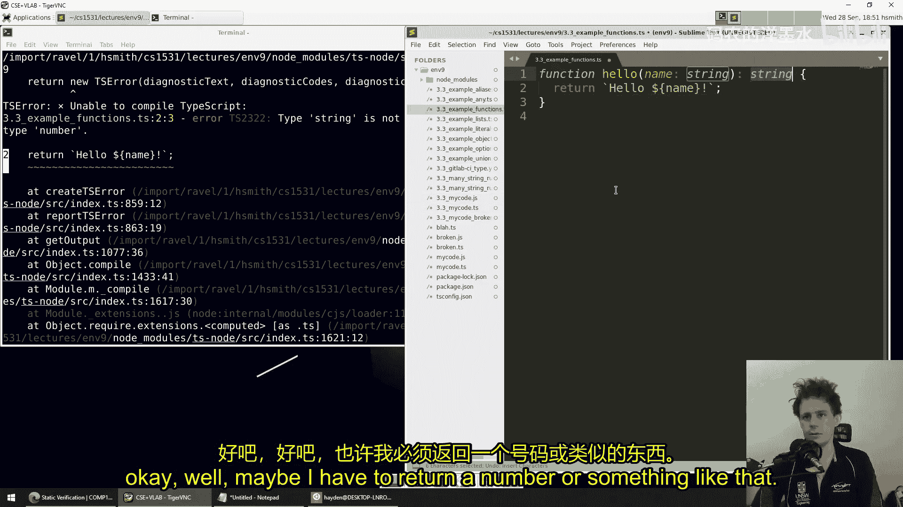

Unions are a really interesting concept。😡。

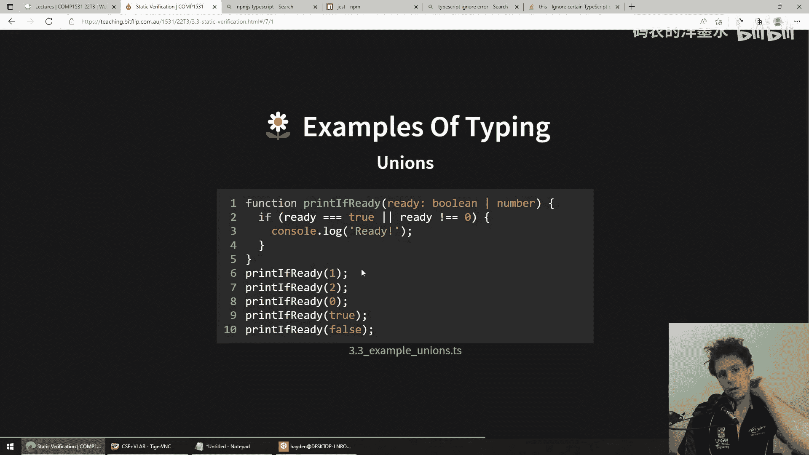

Sometimes you might have a function called like， you know， print it ready。

And what you want is you want that function to be able to take in a variable called Read。

 but you want that to be a number or a boolean。Maybe， for instance。

 you're adding Typescript to some code that didn't have it previously。

 And you know that there's lots of instances in the code where people have been passing in true or false。

 right， where true is like true， or they've been passing in 0 or numbers where like in a unique style return code。

0 means success and one means fail or something like that。 Now， maybe that's a dumb idea。

 maybe one nonzero should be true， doesn't matter it would depend on what you're doing。

 But let's say for a second that0 or true means true and false or a nonzero means false。 Well。

 with Tyscript， you can actually represent that type by saying that it is either a boolean or a number。

The pipe meaning or， you know， it's like a normal if or， but， you know， it's just one line， not two。

 So in this case， I'm like， cool。 okay， well， ready is either。A boerre number。

 And then my next line of code here checks。 Well， if ready is true or ready is 0。There should be a。

 Oh， it is。 Yeah， sorry， if ready is true。Already is not 0。 then console log ready。

 And then I've got these five things here that should give me what I expect。Ready， ready， ready。

 ready， right，cause most of these are。Oh， sorry。 I said that wrong before I said if it was 0。

 it's true， but it's actually if it's non0。Now， this is weird，'cause it's printing out four redies。

 but I would have thought it only prints out。3。Maybe I didn't notice this。

 there was a problem with this code last time。Okay， so false。 Why did false。Why did false say true。

 Oh，cause that's not 0。 Oh， well， that's very。So if ready is true， already ready is not0。

 But the problem is that。How would I fix this， I'm really。

 this is not a difficult problem to solve is it。My brain wants to be like， well， you know。

 I could just be like， well。If it's。True， truthy。And呢。I think that does solve it。

 But maybe there's a more elegant way of doing that。 I du'n know。 I'll leave that alone for now。

 Let me just make a note of that。That code example as well。What noise of3。3 unions。 Yeah。

 so it's like this is really handycause it means that you can represent this。 And I might be like。

 well， you might be thinking， oh， well， what's even the point of this。

 I'm already doing all these checks。 Like， why do I typescript again， Why don't I just make like a。

 a jascript file， oops。Yeah， why don't I just make a jascript file that isn't typescript where I don't need to type annotate it。

 You know，'cause this should run fine， shouldn't it node 3。3 example unions dot J S。That runs fine。

 Yeah， but the problem is that， like， what it allows you to do is it allows you to start doing things like this and pass in empty strings and like arrays。

 And like， you just don't know sometimes like it， it adds a level of comfort。

cause obviously now this all succeeded。Right， this is the problem。

 You didn't think people were gonna pass in strings。 Did you。 And it's like， okay， sure。

 you could filter out strings。 You could add more checks here， like I could say， you know。

If type of ready is equal to a string， then， you know， like return。

There's a lot of things you can do。 but the whole point again。

 think back to the very beginning of this lecture。Is we said that the main objective。

Is to where possible。Move your safety checks from dynamic to static。

 You want to move it away from jest and move it towards Typescript in an ideal world。You know。

Because well， A。Well， it's just more convenient， frankly。It's the massive part of it。

Dynamic tests are kind of painful to run。 Like you figure them out later。 You don't。

 You don't really want your code as much as possible to be dealing with edge cases during the running。

 Also like， what do you do in this case， Now， you have to define the behavior if someone calls it incorrectly。

 Are you gonna throw an exception， which we'll talk about later， Are you going return null。

 Are you gonna crash， you know what I mean， it's， it's like it's more inconvenient to do it that way。

 So， so instead of doing that， we prefer to do what we do with Typescript where now if someone comes along and ads。

That the running of typecr will be like， oh， no， there's a problem。There's a problem。

 There's a few problems。

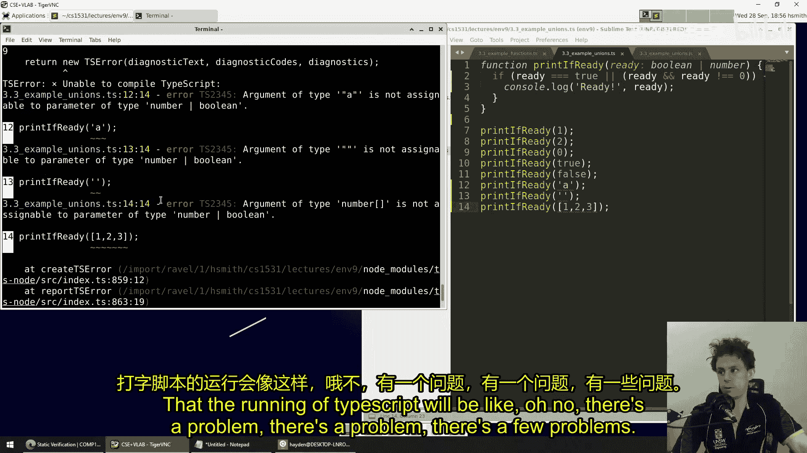

All of these arguments are not assignable to the expected type。 So that's unions。

 unions are really helpful when there's like you actually need to take in potentially two different types for something or multiple types。

There's also lists。Because sometimes our types aren't always booleanions， numbers or strings。

 Qui often， our types are going be lists or like as of things。

 So if we have a look at when I say lists， it just means a raise lists and array raise that kind of uses interchangeably here。

 which is either a function that takes in an item and it creates 10 of them and it returns that。 So。

 for instance， if I run you know， console log。

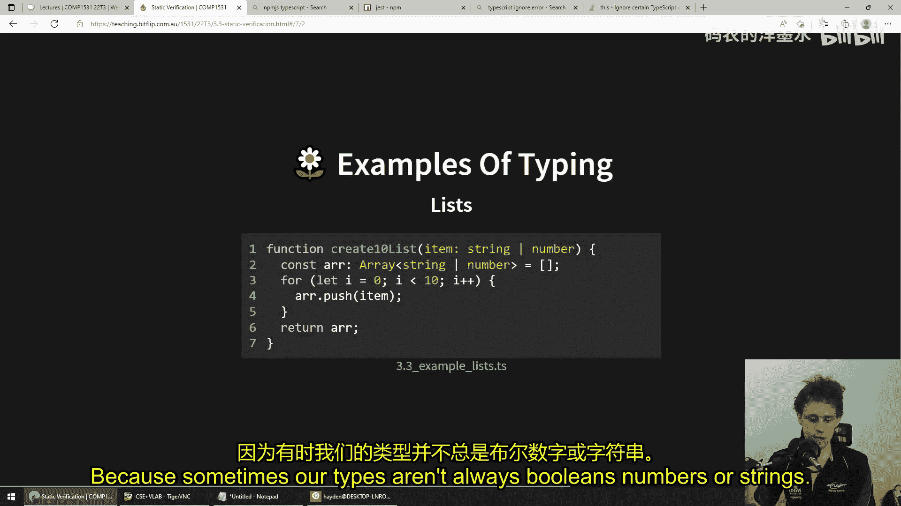

Create 10。Create 10 list of A。 You know， let's see what this program does。 MP PMM runs T S node 3。

3 example。 list dot T S runs。 Yeah， gives me an array of 10 items。

 But what if I want this to work for like strings and numbers。Well， I already did the union thing。

 which we did before， which was really helpful。 And maybe I could add more if I wanted to。

 like we could do Booleions as well。So now Tsscript will accept a few different things。ho。Now yeah。

That wasn't， obviously， that wasn't gonna work， but。Or picks that up after。 But the thing is。

 and this is， this is one of the examples in Typecr where you do actually need to define something is that。

If you have code like this where you have an empty array， right。嗯。This might seem mostly okay。

 And I actually think it'll let you do this。It does let you do it。

But if you have strict type script on， which most， most kind of organisations you deal with will。

 the problem is that。When Typescript tries to derive what's in this array。I'm pretty sure that。

I'll show you。 there's actually a flag that we can add。To type script。

Which we actually have on for your， like。TSC checks。 But like you normally in the project。

 this would succeed。 like what you have here would succeed。 In fact。

 I'm pretty sure that we've set up your project so that you can p pretty much for iteration to。

We've set it up so that you can pretty much just run normal jascript with Typescript and Tyscript will'll just be like。

 I'm gonna ignore everything so that it doesn't get in your way。 but you'll see like。

What was I trying to show you here， sorry。Okay。Yeah， okay。 maybe not。Yeah。Yeah。There's a。

 there's a bunch of this is all。 this is all like how typepescripts configure figure that you don't need to worry about。

 But there's a whole bunch of like， I'm probably turning on the wrong check。

 But there's a check here that， like， makes sure that you declare something correctly。

The point is that。Typescript here will look at this empty array and it'll be like。

 that that sometimes might be really hard for it to figure out what type that A R R variable should be。

 So you can actually be more explicit and say， hey， this is actually an array of numbers。

 So you take a type and you wrap it in another type， which in this case is like array。

 but sometimes you need to take that further and say， well， obviously。

 since the item that's the item that's in the array is a string or a number。

 The array itself is an array of strings or numbers like that。You know。Super simple。

And that works fine。 And that's really helpful。 And that's how you deal with a raise in Typescript。

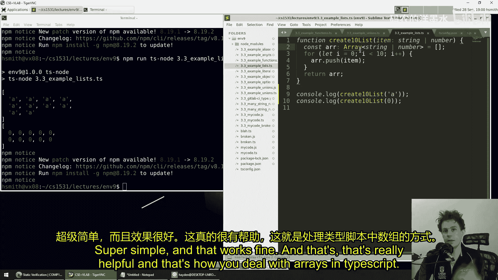

Now， aliass are another interesting topic。 By the way， this is actually really basic。

 But all this typescript stuff we're doing is like。

 this is like so far beyond most of what most of you will do in the course。

 This is kind of a little bit of fun， to be honest。 so you know。😊。

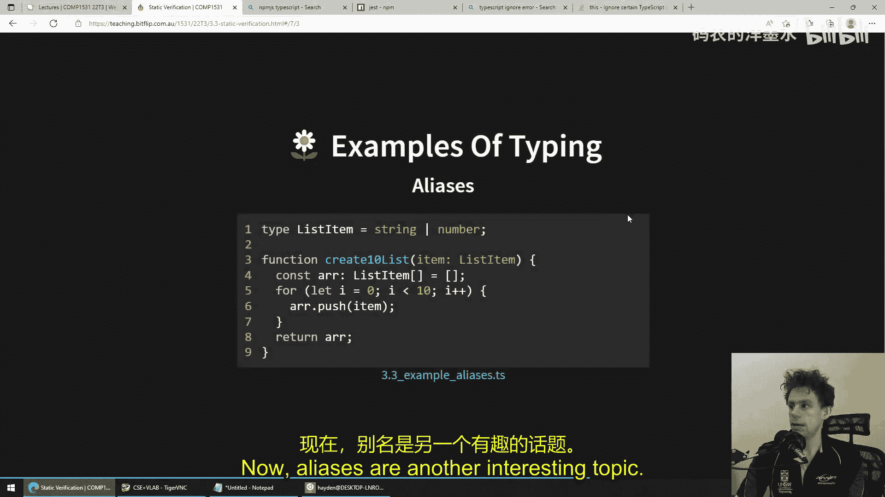

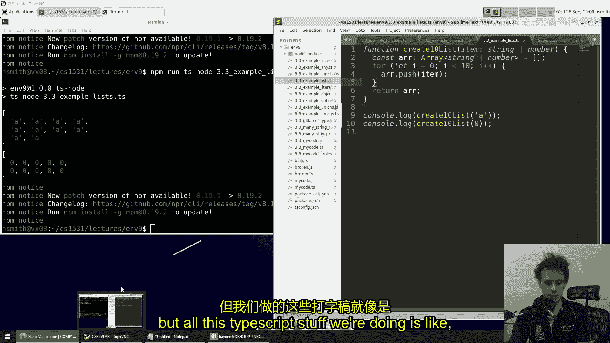

It's a lot， but it's not really that much， but there's a lot of few things。 Most。

 most of you probably won't interact with half of this。 but that's okay， bit of fun。

 Now let's say I've got a function called create 10 list。 and I want to pass in an item。

 Sometimes it gets annoying to like do what we did here where we're always like string on number。

 string on number， string on number。 So we can actually alias the type a bit like a type de in see if you still learn type de。

 Some of you might have some of you might not have。

 I do think they've removed them where you can just literally say type list item is equal to string on number。

 and then use that。 It's just like a variable。 you know。You， you know how to program。

 It's just saying this smaller thing is equal to that bigger thing so I can repeat myself more concisely。

 You will notice that there's actually two syntaxes in Tscript for making arrays。

 One of them is array with the brackets。 and the other one is。What we saw before， you can either do。

 you can either do array arrays like that， which is kind of seaish style or you can do a raises kind of more Java style like that。

 Both of those work。 Both of those are typical。 Bill says type def in comp 2，5，2，1。 That's right。

 It isn't 2，5，2，1。 It used to be in 1，5，1，1， but I do believe they've trimmed it out。

But yeah， that's how you can do aliases。 So aliases are fun like that。

Optionals are actually really important。 It's probably one of the few things that。

You'll find super useful。A。We'll take a break soon。I've got this function here called substr。

And a substrate function is a fairly， fairly standard function within programming。

 where it takes in a string。And it takes in an index in that string to start and an index in that string to end。

 So it's like， it's essentially a way of。

Going， well， if I've got this like array of all these different characters， like a string， you know。

 say the word cactus or something。 A sub string will take in the string。Like this。

 And then it'll also take in like， say this start point， this end point， give me these three letters。

 So that's what that function is doing here， taking in a string， the start point in the endpoint。

 It creates a new string for that smaller string。

And then what we say is that the modified end of that string， this gets a little bit interesting is。

A的。It's either like the end index it's given。 Like in this case， see。

 see here how I like call it with Hayden。 and I pass in 0 and 3。

 So what that means is go from index 0， H， right，0 index，0，1，2，3，4，5。Like that。

 So I say go from 0 and finish at 0，1，2，3。 So go like H， A Y。Right， like that。 or go three character。

 you know， to the third index。But if I don't give that if I don't give that argument， right。

 if I have a function that doesn't need that third argument when I call it， then I'm instead。

 if that argument was not passed in， I'm just gonna to use the string length。

 I'm basically going to say go to the end of the string。

 So it's like a bit of a backup case so that people don't always have to enter that end index。

Then I'm going to have a full loop here where I say， well let I be equal to start。

 which is the start index， go until you reach the end index， whatever that is。

 and then for each character go andend that to the string。So this is like a neat little function。

 I'm pretty sure that Javascript has this built in。 This is more just a。Convey a point。

But the reason optionals are really important in JavaScriptscript is that in Typescript， sorry。

 is that without this question mark here。Typescript will sometimes get mad naturally because it'll look at this third function here。

 and it'll second function column。 it'll be like， hey。

 this function expected three arguments you only gave us too。

 This is another good example where Tyscript is really helpful because it actually like， stops you。

You know， it stops you using a function incorrectly。 So in this case， you used it correctly。 Now。

 a couple things we can do here。 One is we could say it's either number or undefined。

 We could use the union case。Which should work， but it doesn't。 I always think that works。

 but it doesn't。Dad， it's annoying。I think I always assume that works。

 I think this only works if you actually pass it undefined。어。Anyway。That doesn't work。

 I think I've screwed that up last time。 I was like， this works， doesn't。 But you。

 if you actually give it a question mark there， it's like the typescript shorthand of saying。

This variable is the type of this is number or maybe it's nothing。

 So the question mark means maybe it doesn't even exist。 And that's what allows the code to run。

 That one's actually super useful for optional arguments。 So you'd probably find that one， You know。

 prettyt useful a lot of the time。 How much we got more， Just a few more examples。

嗯。Objects。

You know， objects in jascript they look like this here for The top party is typeypescript。

 You have something like this。 You say cons person is equal to， you know。

 an object with the name key and that key has the value Hayden and then you say person dot age equals 5。

 right？ Now， once again， if I was to create a。Javascript example of this code。

 And you got rid of the typescript elements of it。AndI just ran it， 3。3 example objects。Like that。

 Obviously， it works fine。 And if I was to console log person。

 we would get a A an object with two items in it， right。But in this case。

 Typescript will typically expect that I tell it what a person is。Right， if I run。

 if I run typepescript version of this without any typescript， it'll usually be like， hey。嗯。啊， os。T。

 S node， it'll be like， hey。I don't know what that is。 Or more importantly。

 what it's actually doing here is it trying to infer the typeca it can， right？ It's like， oh。

 I think this is obviously an object with a key called name that is a stringca he said that literally。

 But the problem is that then my other code won't work because when I then try and add this to it。

 Type scripts like， I'm sorry。 I kind of I decided already what this was。

 And now you're trying to change it。 You know， like I I've had to。

 I'm trying to make the program type safe。 I'm sorry， I can't add you。

 I'm gonna have to throw an error。 but。What we do instead is we actually explicitly define what person is。

 and we make a type called person。 It doesn't need to be the capital version of it。

 It could literally be called Lama， right， It could be called Lama。 And we say that， well。

This is typescript。 We say that Lama is an object。 and it has a few different properties。

 It has a property called name， which is a string。 It has a property called age， which is a number。

 but age might not exist。 It has a property called height， which is a number。

 but height might not exist。 So now this code actually works for us。

 And you'll see if I didn't have this optional here with the age。 It would not work。

 It would fail because it's like， hey， you just defined person as a type Lama。

 But you said Lama has at least name and age。 The keys that are strings。Maybe not height。

 but I only't see a height， so it doesn't matter。Yeah。Cool。

Literals are kind of fun。 This is actually pretty useful for the project。

 It's one thing that you probably aren't familiar with from a language like C。

 But if you ever have an instance where like you have a function that takes in。😊。

A。Like a string。 But that string is always one of a very few set of。OfValues。

 you can actually use what's called a type literal。

 which is where you And this is actually true for your project。 This is what you do in iteration 2。

 no matter how many times I throw my fingers up， someone's gonna ask on the forum。

 Do we have to use types group for iteration 1， And the answer is， no， no， no， iteration 2， okay。

You can answer them on the farm now when they ask。Is instead of saying visibility is a string。

I know that it's only ever gonna be two strings。 So instead of just saying it's a string。

 I can be like， well， it's actually instead instead of being like visibility is a string。

 I can be like， well， it's actually literally either public or private the string。

 And you can do the same if you want to， right， Like you could create a sum function。😊。

That takes in two numbers。But let's say you only want that function to work on numbers that are less than 10。

 You could create a type called sum number like this， an alias。Right。But then you could also just。

Go and instead of that， you could actually give it a literal。 You could literally just be like this。

 You'd be like， yeah， it's literally only gonna be these8 numbers。

And then this is really powerfulcause now when you call the sum function。

 it will literally only let you call it with those exact numbers。Now， obviously。

 I haven't had a use for the second case here。 This is a bit of just a dumb example。

 The top case is pretty useful， but it will fail。 It'll be like argument a type 11 is not assignable to a parameter of type sum number。

 So this is what this is what I mean by a powerful type system。 I said at the start that。

C is not a powerful type system。You know， I mean， it it's not like bad。

 It's more just like there's a lot。 It's a。 This is a rich type system and many other type systems are like it as well。

And then， the last thing。Is the any type。Very interesting type。

 Any type is what you do when you're lazy， when you don't know what a type should be。

When you have a program like this and you think， God， I don't know what that should be。

 So you just put any there and any's like a pass through type。Any is like。

It's like a way of saying like literally just do whatever， whatever， man。No safety checks。

Just let B be。今儿。嗯。Ye。That's it。

There's some examples here。 We could take previous functions。 We've worked on Hello sub string。

 We could use any if we want to。 Yeah， so this is fine meme， right， like。

It's the， it's the this thing。 That's， that's any in a heartbeat。

 It's actually really useful when you don't know what a type is'cause it kind of unblocks you。

 Normal typecr will actually throw in like。Normally， what would happen。

Is that you would get an arrow if you use any。A。So I'm just running TSC now。

 which I actually check all the files in the folder and it says there's a bunch of errors it's found。

A。Oh I think it's because it's created all these。Yeah， give me a sec。Oh god， Oh God， Oh no。Oh。

 think Gilber at the end of that。I do this like once a week。 I need to slow down。Oh perfect。はい、ユニク。

Don't accidentally hit the space bar between。Your star and what you're trying to do。

It's meant to be remove everything that has something dot JS。

 But I instead run this commanders remove everything。 And then a file called dot JS。

 but no file called dotger S exists。 And then it removed everything。 So okay， well。

 there's the examples gone。

Or just in time for the end of the list of examples。

Okay。This was just a quick run through of Typescript really quickly。 And I wrote all these examples。

 and I thought about very carefully how I want you to interpret them and build on them。

 But the actual like full list of things you can do with Typescript are written it's on the Typescript L website。

 It's， it's really the documentations really， really solid。 So you can go and find that there。

 A quick summary of type safety。😊。

Languages with nonopional built in static type checking are like C， Haskell， Java。

 Languages with optional， but still built in type safety checking are like typescript and objective C。

 What that means is that Typescript has is a typed language， But you can say ignore it。

 You can't do that with C。 C， you won't just ignore stuff。 Sees like I can't ignore it have to do it。

 And then there are languages with like optional external type checkers like Python and Ruby。

Where you can install them， you could argue that Python's the same as Typescript in a way。

 but that's right don't don't don don't lose too much sleep over that。

 There's a slide here about migrating to Typescript。 You don't have to read this。

 I kind of put this here nearly from my own therapeutic benefit。

 which is to say that when we go and so ignore this slide。

 when we go and convert your iteration 1 to iteration 2 to get you set up for Typescript and all this other stuff。

 We go and we we will do these things to move it from like where you're at to like where it's going next。

 And I'm just put this slide here so that you can kind of。

For the really nerdy types you can understand what we do。

 and you can see it includes like installing a few extra libraries and adding some files and updating some things。

 Again， you don't need to worry about any of this。 It's more just saying I't I don't like waving my hands more than I have to。

 So this is what we'll end up doing when we move like certain things you do to Tyscript。

The cool thing about Typescript is that you can add it to the。

Pipeline into the Gitlab CI file that we talked about last week。Last week， yeah。Which is awesome。

 I think it was last week。 It was the last week。

Sly。Yeah， yeah。 It was Monday。 Oh no。 Okay， last lecture。

Feels like a w ago。 You know， we can actually add it so that when you push your code to to Gitlab。

 it's really cool now because you can actually have it run jest and then also run typescript or probably in the other order makes more sense。

 But this is really helpful because if you， you know， this is for， again。

 lab4 and iteration to onwards。 as we're layering on ideas to you in this course。

 So that's super useful， we'll obviously add this to your pipeline。 sometimes， if not。

 will'll tell you how to。😊，We'll tell you how to add it。And then lastly， don't stress。

We do so much of this for you。 We've set this course up， so that。We don't actually like。

I talked a lot about this with some tutors。This is a very new concept。

 And I and I have to say like this term， I feel like last time it felt like we made some mistakes。

 This time I'm feeling really good about this in terms of how we've been able to structure it within the project and teach it for students。

 So I think it's good。 I'm feeling good。 I think I need one more term before I start making it worth marks in terms of saying to groups。

 If you don't do this， you will lose marks。😊，Or not these marks。 like to get， to get。

 to get the last these marks you need to make sure it all type checks。 The plan this time， I think。

 is that。We introduced Typecrt as a tool。Not for Marx necessarily， but a tool to help you。

It kind of get marks implicitly because if you use Typecr properly， it'll actually reduce your bugs。

 which will improve。How well your code performs。But what we've been talking about is that。

For your the at the towards the end of the project， there's actually this component of bonus marks。

 which is normally actually really hard to get。 Like， you normally have to do a lot。

 A lot of work for it。 But what we've been， what has been agreed is that we will say that if you make sure that when you submit your kind of final iteration。

 if all of your code is completely type safe。You know， it passes T SC。

 We'll just give you all the bonus marks。 You get an extra 10% of iteration 3。

 More information will come about that later。 So don't stress。

 don't ask too many too many questions But the pointca I'll tell you when we do iteration too。

 But the point is that that's kind of how we've structured it。 So it doesn't。

 And the exam has a bit of typescript in it too， right， But like So， you know。

 you're right typescript， but I won't like test you too hard or anything like that。

 But this our plans， because if we don't give you marks for it， you won't do it， right。

 I respect that。But I don't wantanna like， put a whole bunch of marks。

I don't want to put a whole bunch of marks in。And then add it to like you're like， oh my God。

 there's so much。 I have to figure out this and figure out that。 It's just too stressful。 right。

 You got a lot of things to figure out。 So the plan is to basically just say， well。

 there's bonus marks。 you can do something cooler you can just make your code type safe。

 which is probably easier， which means that anyone who wants the marks。

 you'll probably all just do it， which was great because then you do it， And if you don't do it。

 you don't lose any marks because there bonus marks。 But if you do do it， you've learn something。

 You know， everyone win。 So that's where we ended up with that。 If you got leave some feedback。

 that'll be great。 We're gonna take it quick。😊，8 minute break。8 minute break。

And then we'll get into the next part of the lecture， which is Linting， which is another fun topic。

 which really gets us towards some of the end of a lot of these environmental things， so。😊，Thanks。

 chat soon。

