# 【全集】新南威尔士大学 软件工程基础 中英字幕 1080P COMP1531 p11 Lecture 11 - 代码检查 -BV1M7Nwz7EGh_p11-

Alright， last lecture， we got 25 minutes。 It's on Linting。 Linting' is a really fun topic。

 It's pretty much one of the last ish lectures on correctness。😊。

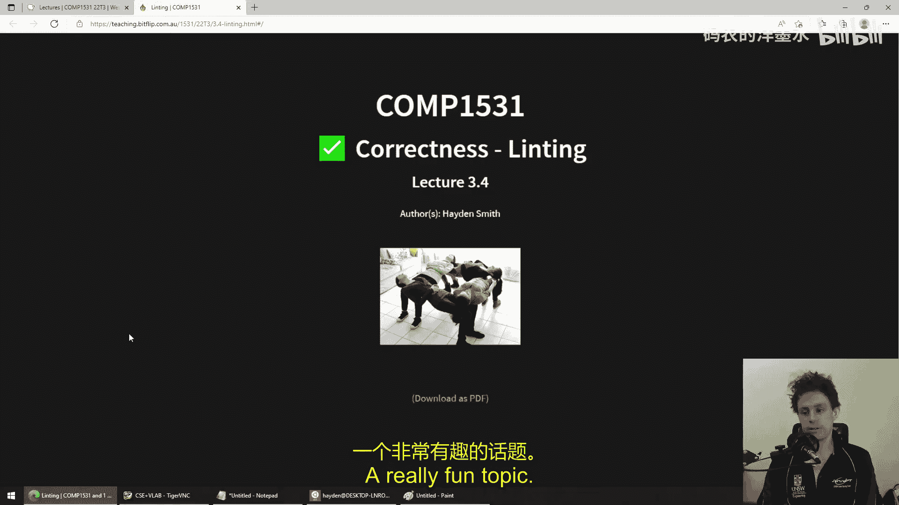

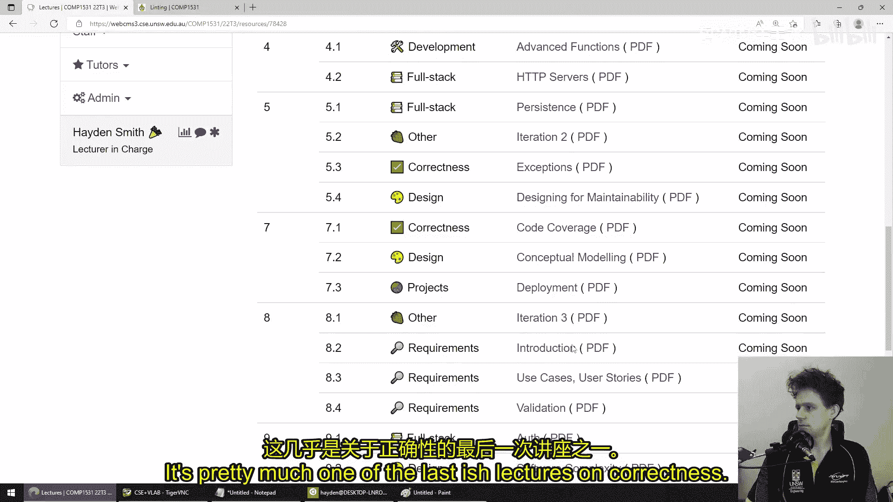

It's the middle lecture。 I guess that's last dish by a very loose definition。 It's not in the。

Yeah passed were halfway Lnting is is a lecture where we're basically like， hey， you did 1，5，11。

 You tried to write code to a style guide， which included a lot of you manually tweaking things sometimes。

 But in the world of software engineering， we need like automated scalable approaches to managing style。

 You know， we need easy ways to make our code match style guide without having to tweak things all the time。

 We're gonna talk about this process of Linting， which is what it's called。

 and we're gonna talk about a particular library， another library called E S Linnt。

 which is a library that helps us automatically ensure that our code matches said style guide。

 So first thing， coding style programs must be written for people to read and only incidentally for machines to execute。

There is。A phrase I love。 And it's not a very complicated phrase。

 which is going to make this very antiticclmatic， but it's just this phrase here。 Code is for humans。

 It's a really important idea that it's very easy to forget。

 particularly in the infancy days of being a software developer of any sort and you notice this as you get older。

 you go and talk to people who've been coding for 20，30，40 years， 40s a long time。 maybe like 5。

1020 years。 and you'll notice that very quickly。 they have a different understanding of things to you。

 which is that。You know。Code is written for people to read。Other people to read。

 there'd be a lot of things that we would do differently if code was written for computers。

 but it's not。 it's for people。 And therefore， and we'll learn about this in week 5， I think。

 when we do some stuff on designing for maintainability， everything needs to be very human oriented。

 And that's why we have style guides。 That's why we care about style。

 Computers don't care about style。 They don't care about indentation that don't care about any of that stuff。

 but we do。 and we like a good style in our code because it's easier to follow the flow of code visually when there's consistent white space。

 it's easier to visually make sense of what parts of code or what when there's similar patterns throughout the code。

 it's easier to detect bugs in code， because we can visually see the difference。

 like if you know how like indentation is a good example。

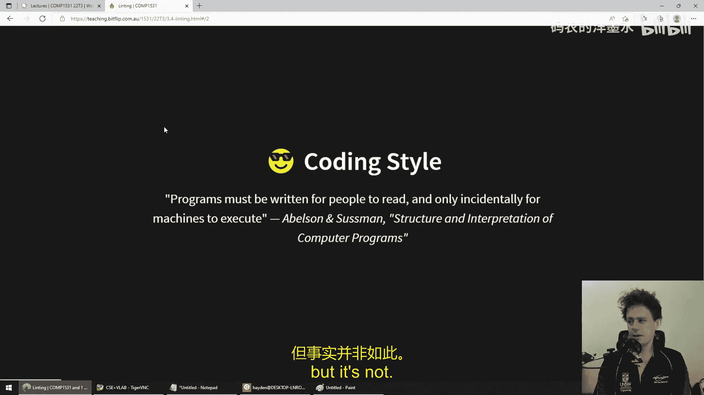

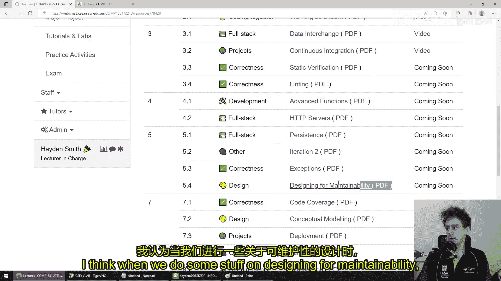

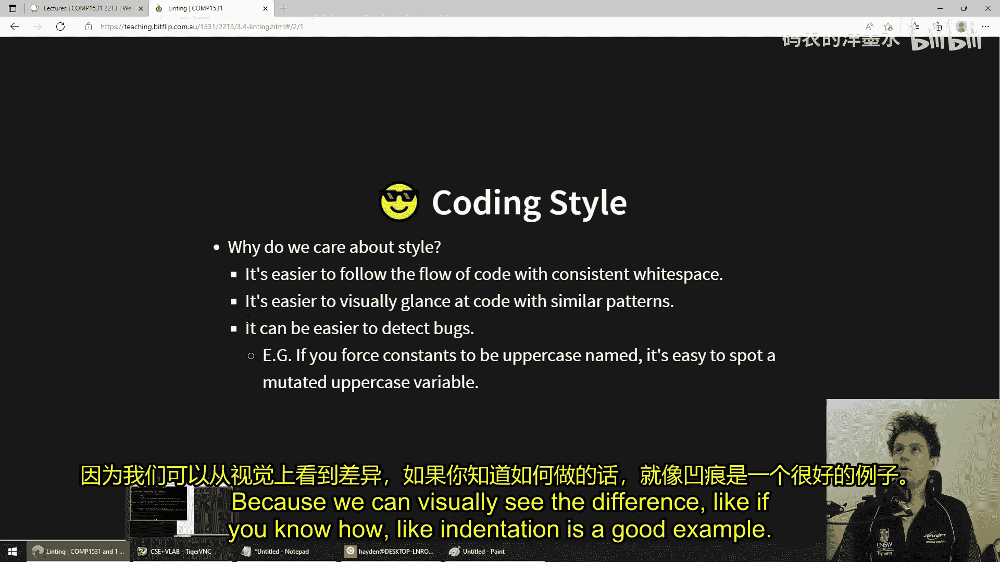

If you see some code like this。Immedia， I know something's wrong with this code because there's patterns of style that I'm able to rely on here。

 I'm like， four loops have a thing inside them。 You know， like to have a。Sorry。

 they have like an indent somewhere。 And I'm like， somethings wrong。 You know， figure it out。

 So style is really， really useful for humans。 If you force constants to be uppercase and it's easy to spot when it should be when you've modified an uppercase variable。

 This is just tons and tons of things。 for instance， that's more， that's a relic from Python。

 Javascript obviously has the constant， which is really helpful。 And， you know。

 you can see what code looks like with good style and bad style， we have bad style on the left。

 good style on the right。😊。

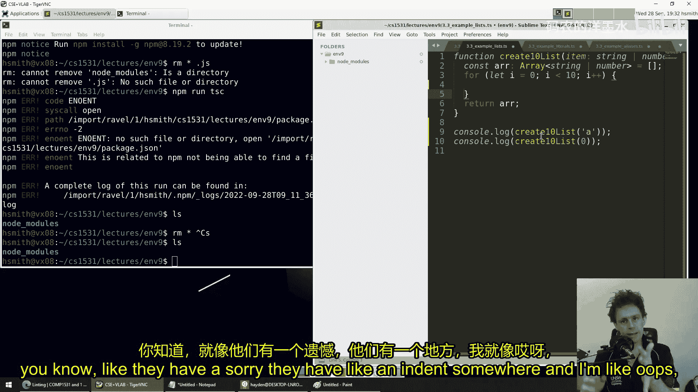

It's crazy to think they're very similar programs。 Sometimes I pull up an old piece of code that I used to write。

 I might try and pull it up whilst we are talking。 see if I can find it。

I have no idea where it would be let me just I know what the name of the file is so。

I'll let it search for a few minutes。It's like my classic。

 I remember itca it was like the first proper program ever wrote。 You know， there's some bad style。

 There's some good style。 Obviously， they're chalk and cheese， as far as we're concerned。

Not a lot to it。 They both run fine， is the point。So then we get into an interesting question。

 which is who decides on good style right Typ， this is up to like a group。 A group could be anything。

 It could be an organization like Google Canvara Lassian， it could be a 1，5，3，1 group project。

 It could be you。 It could be， you know， all the people that are part of you know。

 computer science artificialificial intelligence Group， doesn't matter。

 but there's typically a group of people who decide on what good style is or isn't。😊。

And what they'll often do in reality， honestly， And you'll see this a lot。

 People tend not to sit around and like debate about things like， where should。

Where should commas go and where should semicollons go and what should we do with indentation？

 Sometimes you might have that， Like， I'm a massive fan of2，2 space indentation， right？

 So when you pick a style guide， like and you you' go and typically grab one from Google， right。

 So like Google， a jascript style guide， you'll find one like this。

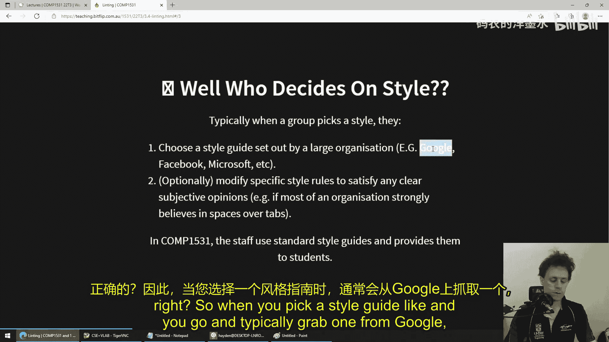

Google Javavascript style guide。 bam， there's a style guide。 You'll be like， that's great。

 I'm an adult。 Adult don't need to like tweak everything。

 Adult can just go and use what Google gives because Google's probably thought about it more than us。

 So you go and take that And then optionally， you might go and modify specific style rules to satisfy any clear subjective opinions。

 You know， you might go and like like I said， some organizations really like tabs other organizations really like spaces。

 but it's very rare in the rest of your life that you will be dictating the terms of the style that you write code to。

 because it's not about it's about consistency。 That's really it。

 And very rarely will you be in a position to inject your own opinions in that unless you're in a very small organization because someone else has probably just decided it for you。

 that's okay because again， as you mature in the space and some of you will have already gotten there。

 you realize it doesn't matter。😊。

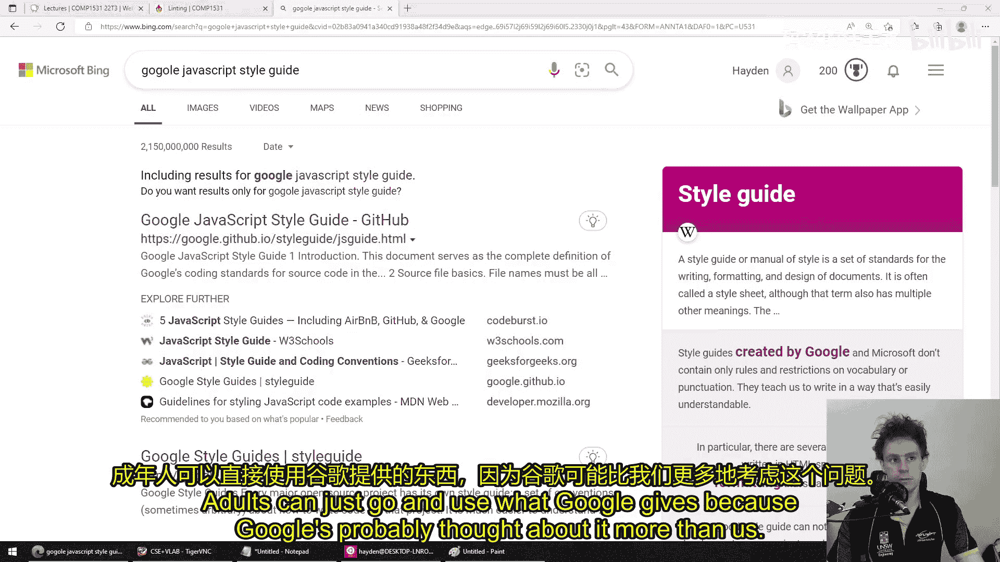

It just doesn't matter You' write code， how you're told to write code。

 because you have better things to worry about than where the braces are。Lining。

Right is a concept of enforcing style Lntters as an idea are pieces of software that will enforce style for。

 So in early computing courses， I said you're asked to manually fix up your code in proper software engineering projects we tend to do what we call Lnting a verb Lint code by using software that statically analyzes your code and automatically makes adjustments to it。

 We call these programslinters。 you can loosely consider these as a form of static verification。

 I think it's a good way to think about it because they are kind of checking your code for errors sometimes Sometimes it's about style。

 Sometimes it's about errors before the code ever runs。

And another element that is important is their static。They don't check running code。

 they check code before it compiles。So what does a Lita do。

 Lita does two kind of key things as part of the static verification。

It looks for style issues and it looks for semantic issues。 Now。

 you're probably familiar with like C again， and Gcc and Gcc tends to check for things like type errors and unused variables and whatnot。

 And we just did a lecture on Tyscript， which checks for things like type errors and unused variables。

 But a Lita has a little bit of overlap with that， but it's very weak。

 mostly a Li is designed for style issues indenttation， white space， incorrect variable names。

 you know， things that are all about a style guide。

 But they also do check some semantic issues sometimes。

 if you're using a static typer like Typescript， This is much less useful to be perfectly honest because Typescripts much。

 much smarter。 But as a general comment。It's very helpfulca you can go and like find issues in your code。

 Like if you good example is an unused variable。 Most， I think E S the Liin will get to。

 it is actually very able to just be like， hey， I see a variable that you declared。

 but you didn't use it。 That could be it's a kind of a style problem。 It's bad style。

 because it's not necessarily wrong， right， to like not user variable isn't mean your programs broken。

 but it makes your program messy。 So it's a good example of these semantic issues。

 Maybe the the layouts are correct， but。You know， that， that's why we call it a semantic issue。

 not a style issue。 By the way， I found that code。 I've shown this to most classes。

 I just wanna give you an example of like， bad。 I'll just remember this。 This is like， what is this。

 This is。

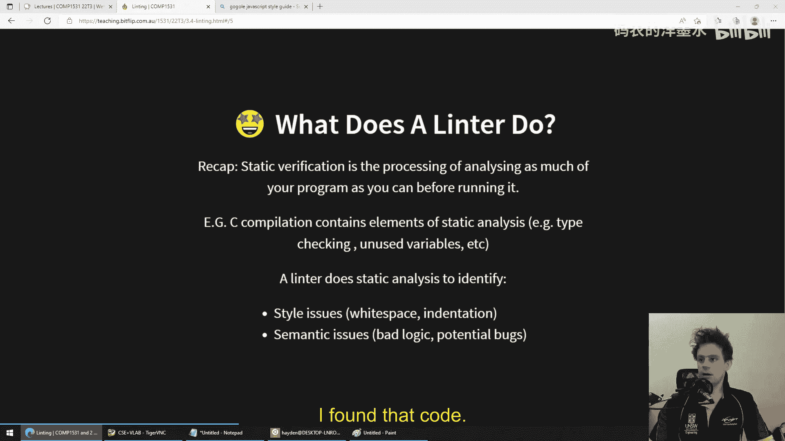

I think I wrote a long time ago。 be like 13 years now。I wrote like a finder word generator。

There's a website， and I wrote it in P， H P， one of a very beautiful language。

 And just look at this stuff。It's just the first thing I think about when I think about style。

 Look at this for loop。 This is still one of the most disgusting things I' ever seen。 You know。

 this is an example like a lintar。linta wouldn't。 Well， he's， it's actually。

 this is actually an interesting point because。

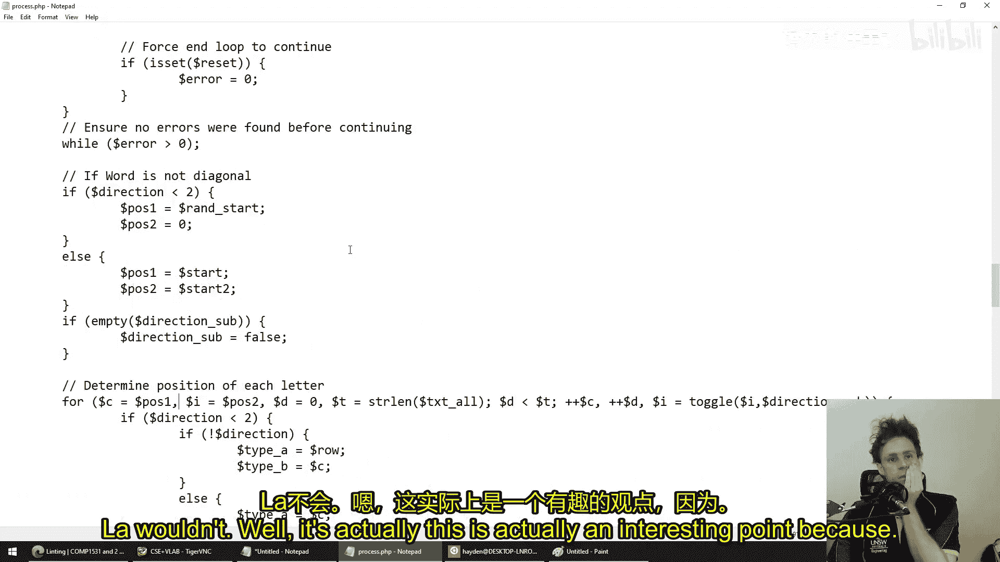

What isn't mentioned here in this slide is that liters aren't something that goes and improves the style of your code universally。

 right， Because there are things that aren't necessarily style issues like indentation and white space。

 And there are things that aren't necessarily semantic issues like bad logic。

 Sometimes the issues we have are actually just like poor variable names。

 And I'm sure they we'll probably see this over the next， like。

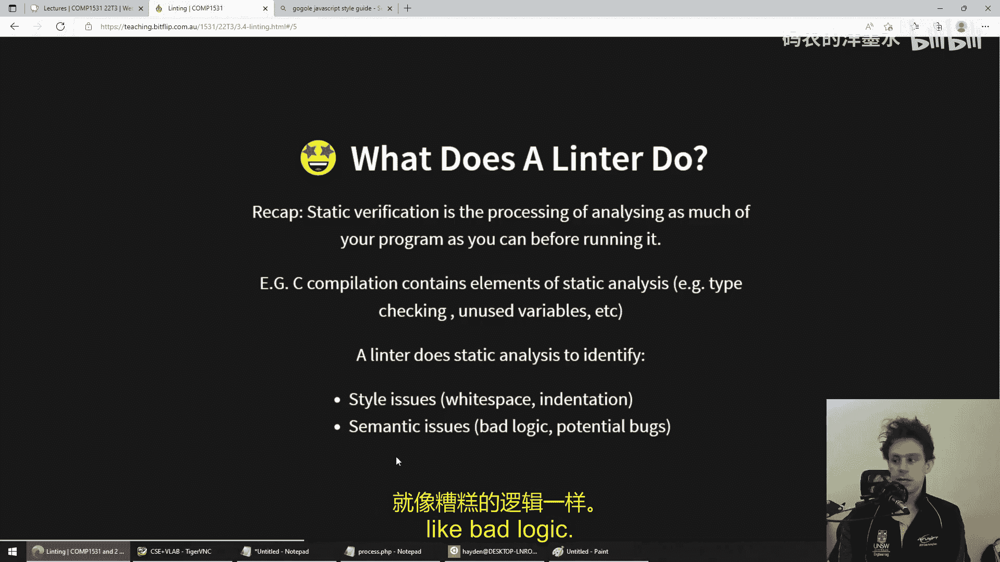

You know，10 years or something where。There'll be some AI linting word or like。

 look at your code and be like。Clearly， this function is named poorly or something。 But right now。

 the lis can't do that at all。 So therefore。There are things like alin would probably say that most of this code is okay。

'cause if you look at it， the style of it's pretty consistent。

In terms of like indentation and spacing between things， it's just crap， right， absolute crap。

Giant functions。Nested， nested， nested， type A， type B， type C， C， row， like all this crazy stuff。

 So that's something to keep in mind。 Liters don't absolutely solve all your problems。 They just。

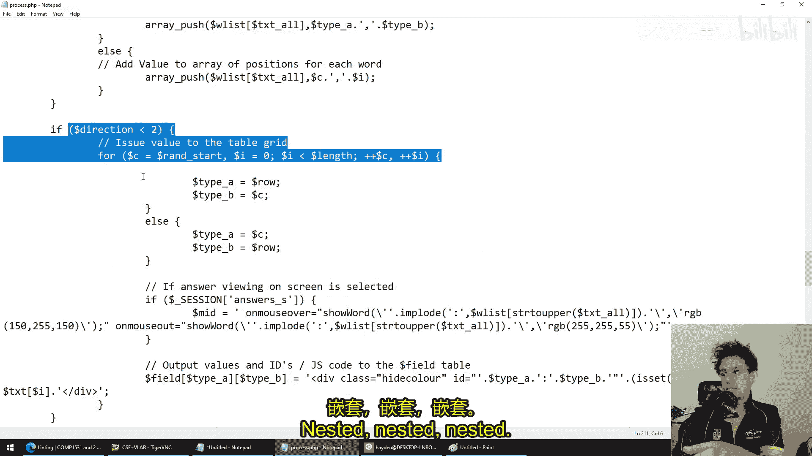

Help dampen some of them。I just said that。 Okay， I forgot I put that slide in。 There you go。

 One step ahead of my idiot brain。Yeahep， okay， E， S Lin。

 E S L is a popular external tool for statically analyzingnalysing jascript code。

 What that means is that when we say。External tool。

 What we're saying is that it's not built into node。

 You have to NP install it just like you did with typepescript and stuff。 Staally analyzing is。

 again， like looking at code as it's like before it's running and it can detect errors 1 of potential errors。

 It's basically the tool that does the thing we've just been talking about。

 You can install E S Liint。 We're gonna have a quick look at it just in a jascript context here。

 Right， So I've got my little M 9 project where I accidentally deleted everything。

 We'll have to fix that up。 That was very silly。

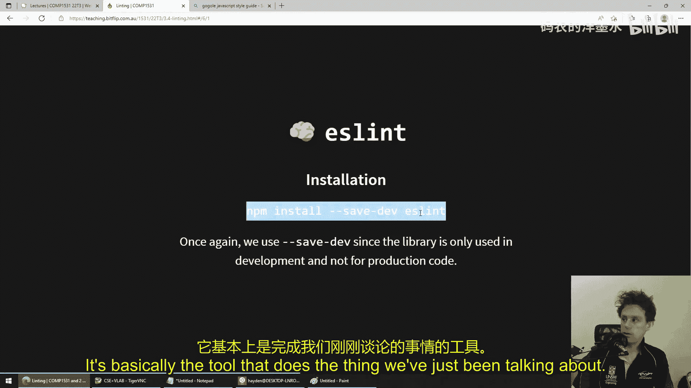

Cool， I'll just quickly NP PMM install Ty script and T S node again in case we need to use it。

 and I'll also NP PMM install E S Lint like this。

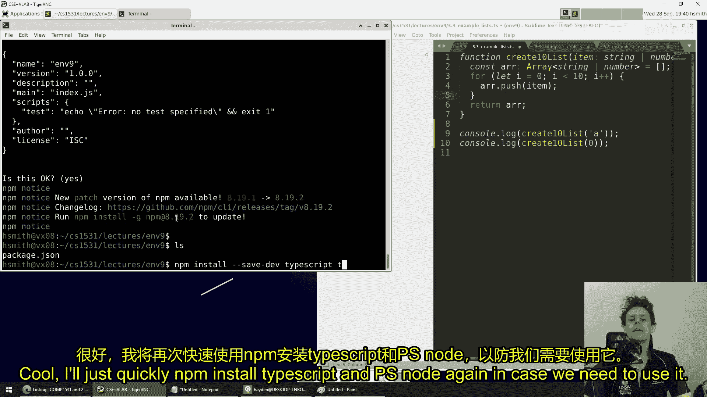

So now yeah， we've got E S Linnt installed。 Now， again。

 we will do this step I'm about to show you for you in the course。

 but what E S Linnt does is it typically looks at a file called an E S Lntar C file。

And there's a few different ways that file。 it can be a JSON file， it can be a Yaml file。

 or it can be a jascript file In the cases of the course， we'll be using a JavaScriptscript file。

 and I'll show you how we go and create it， but you don't have to do this step。 So again。

 a big disclaimer。You don't have to do this。 We will do it for you。

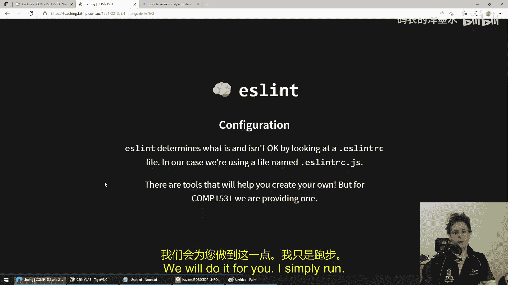

I simply run。Nope， I don't have the command。 I simply run。Noode modules， dot Ben， E， S Lnt。And knit。

嗯。Oops， what is it dash dash in it。There we go。It's wants to install some stuff。

 whatever I don't care。 Just do what it says。 How would you like Ely to use， Okay。

 the checks syntax find problems in enforce code style， great， are we， which are we using？ Well。

 again， this is quite above you in the course We're using this one。 None of these。

 do we use Typescript。Yeah， yeah。 I think so mightight as well。Are we using。

 are we using jascript in the web browser or Are we using it for no Js。

 Web browse is a whole separate topic。 This is jascript there Use a popular style guide。

 That sounds good。 Okay， standard。Yep， and I'd like to the config file to be jascript。

Would you like to install all this now？Sure。Which package management to use， NP PM。 Yeah。

 that was really handy， wasn't it， So that's the kind of stuff we do when we set up your labs in your project。

 We typically only do at once， and we reuse the settings for the rest of the course。

And you'll see what it does is that it creates a file here。Where's the file。 Oh， it's a hidden file。

E， S Lntta C dot J。 S。 And it doesn't have much here。

 It doesn't have much because it's actually using a standard style guide that it's installed for us。

Normally， there'd be like a whole bunch of rules here。 But in this case。

 all the rules are kind of like just these standard rules。 But now that we've installed that。

 we can actually go and li our code。 So if we go and， let's go and take some code from。

lectureecture 3。4。Right， we've got this file here。 style bad。

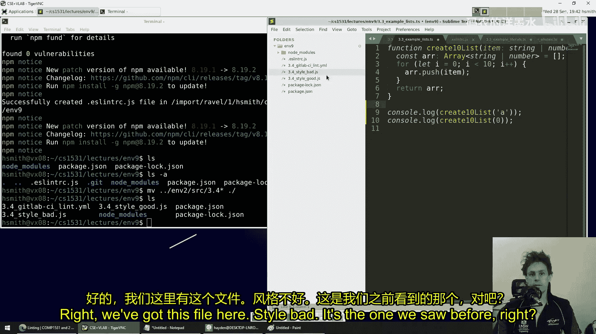

It's one we saw before， right。Now， if nothing prints on the terminal， when we run E S Lnt。

 you're all good， but let's try it out。 So if I go node modules， dot bin slash E S Lnt3。4 style， bad。

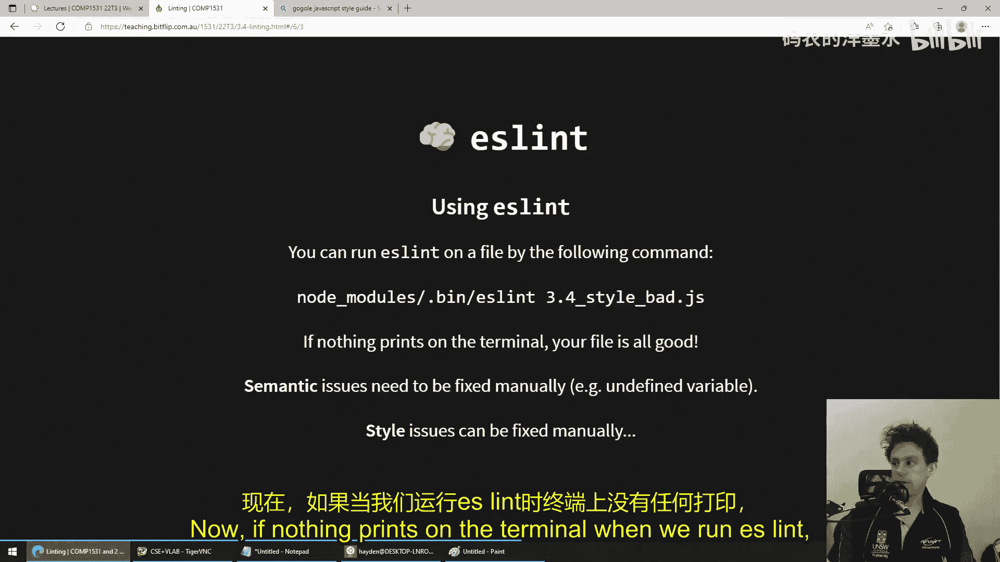

Hopefully， it complains， oh， no。

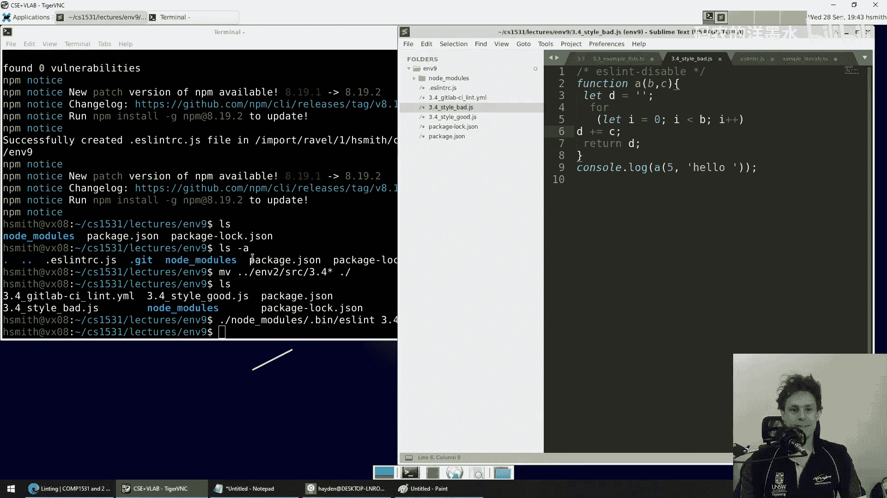

What have I done， I did this last time as well。 It doesn't have any issues with my code。

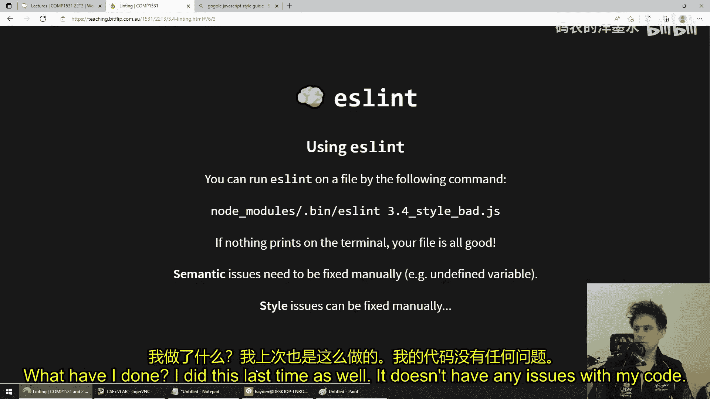

That's， oh， yeah， I remember。I'll explain to you what that is in a set。Okay， this is the liter。 Now。

 the li' is like， hey we've got a lot of problems missing space before function parentheses right here。

 It tells you line111 characters in a space is required after the comma on line 1，13 characters in。

 right， And we can fix these。 And when we run the liter again， it gives us less and less errors。

 And it's like， you know， I can start fixing the indentation if I want to， right。😊。

If I do start fixing the indentation， suddenly everything will probably start to go a little bit easier。

Okay。That didn't really help much Miss space before opening brace。 Okay， expected indentation of two。

 but found one。Okay， fix that indentation。 What do we got now， extratra semicolon on lines to。

 So this is actually a good example where it's the standard style guide is actually like semicols are stupid in these cases。

 They're unnecessary， right， They're extra because jascript's smart enough to figure out that。

You don't need them。 So what we could do is if we wanted to。

 if we were setting up this is we could actually go and say E S Lnt extra semi colon art for something。

 We can kind of go and Google how to do this。 And there's， there's a way to do it。

 which is just modifying the， the the file， But I'll show you is that。

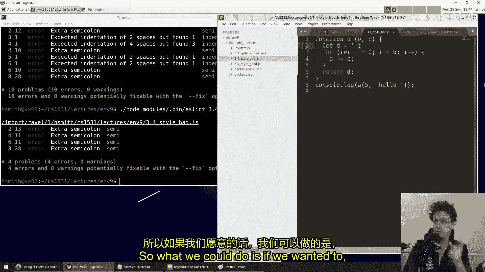

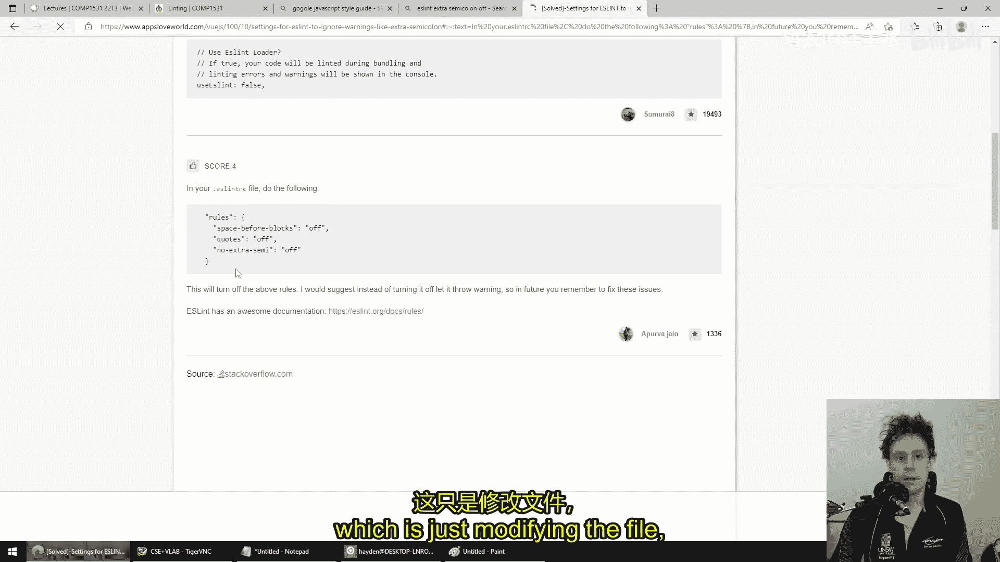

This E S Lintar C file， again， you never have to edit this。 But there's a bunch of rules。

 And what you can do here is you can actually go and turn off a rule just by like Co， you know。

 pasting this here as this is just a javascript object， I can go and say， well。

 no extra semi column will turn it off。Oops， that's not the right rule。 I dunn know。

 I was just guessing。Great， so I've turned that rule off。 Now， you can't do that。 Don't do that。

 You know， I'm meant to touch that， but like。That's like how we configure it。

 So like we made a few adjustments to the rules， I think， for 15。

31 that we thought were consistent with kind of how a lot of code is within computer science at CSE。

 Like Sam Collins are pretty well accepted， I think for us。

 So we would have turned that rule off if we use that standard one。

 But the point is that now we've got our code there that's been improved。

 But here's the interesting thing if I go and undo all of this work here and we end up back where we start。

 E S Liint has another powerful element， which is that if you can actually add。

 and I think this is coming up in the next slide。

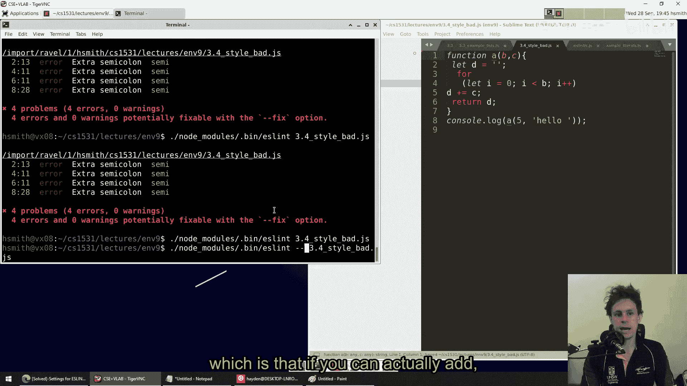

You can actually add a dash， dash fixed flag to the E S Li command。 Well， it where if it can。

 it will go and fix things for you。 So like if I've got all these problems here。

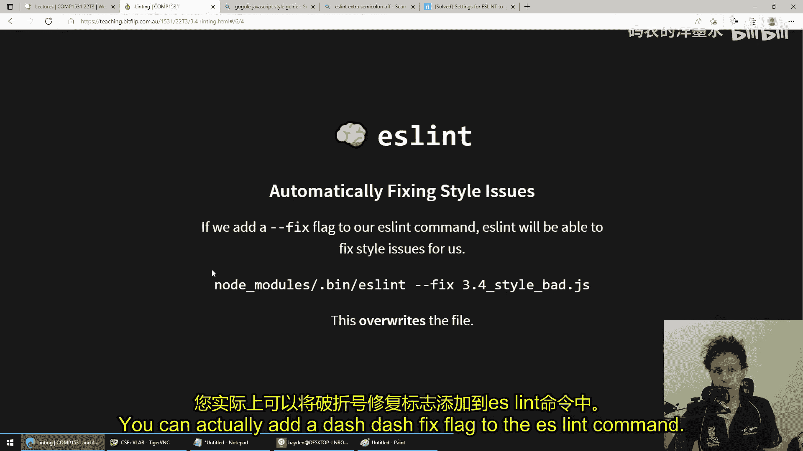

And I go， dash， dash fix。It'll actually go and fix a bunch of them。 And in this case。

 it nearly fixed all of them。 It might have fixed all of them。Okay， fixed all of them。

 And you might think， well， that code's still crap。 And it's like， well， yeah， well。

You'd normally add some more rules there。 You know， So like， for instance。

 if I go like E S L for loop。

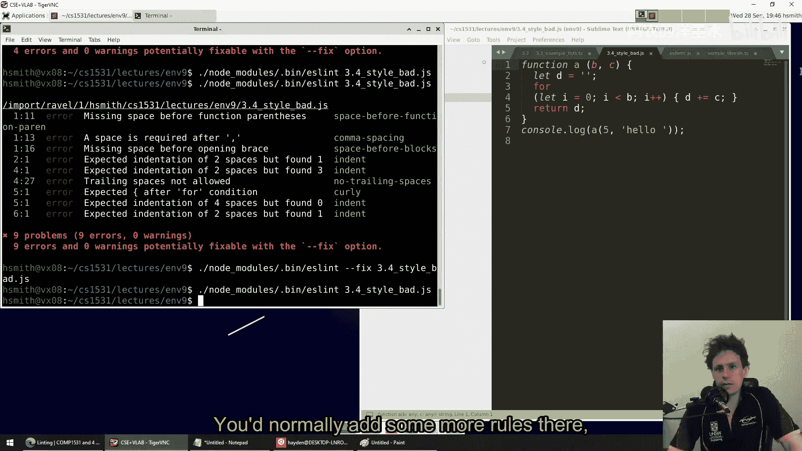

Same line or something。I don't know。

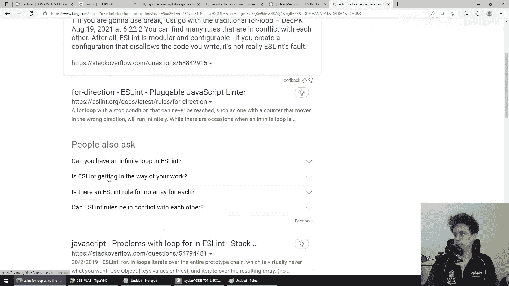

There's probably some there sometimes there's rules for things。

 I'm not sure how you could force it to come up on the same line。 Maybe you can't。D' know。

But you can go and fix things up manually too， right， There's probably lots of rules of stuff。

 The one we haven't 10，3 once fine， don't， don't message me and be like， can we change this。

 The answer is gonna be no every single time。 So you will survive。 You will be okay。

I promise you will be okay。Some things can't be fixed。 Sometimes it doesn't know how to fix it。

Sometimes it sees us use tabs and spaces like this。 And it thinks， a。

I could just convert that to spaces， but it's like， I du'nno。

Should I how many spaces I'm not sure I shouldn't take a guess， So if ES SL can't figure it out。

 it will simply tell you and say， you know it will just not be able to fix it automatically and typically while some style errors aren't fixable。

 it's often semantic errors which are unfixable。

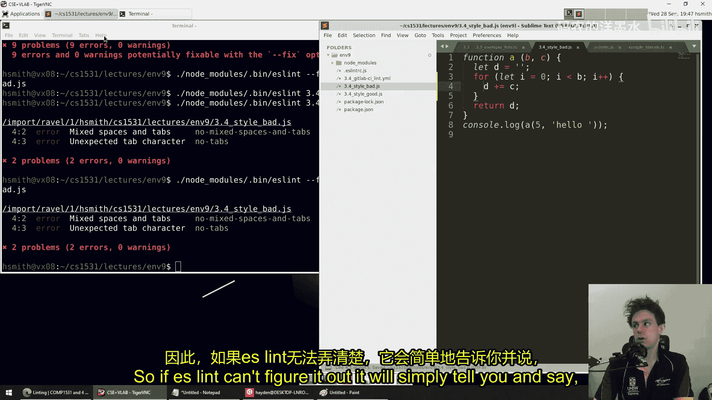

Another thing about E S Lin is that you can actually tell it to ignore certain rules if you want to。

 This is something that we let students do maybe once or twice throughout the project。

 and we ask that you check with your tutor beforehand。

 but occasionally there's just some weird library you use or some weird use case where you think you know what I want E S Li to shut the hell up about this a bad example would be this tab thing I have here where E S Lin's complaining about the tab and you can actually let me let me not do that one。

 Let me try another one maybe like。

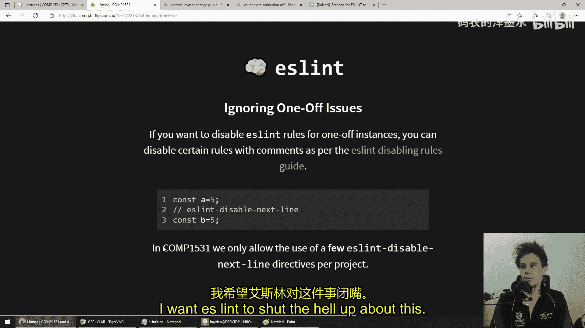

Maybe like the space one here。So I don't wantan to do that though。 I w to do that on another line。

Let me try it like here。Come on。 Let's got it。 Oh， Id the fix on。 Got it。Cool okay。

 we got an error here。 Opera plus equals must be space。

 I can actually add a line here that says ES Li ignore line。

 and then I can give it the name of the rule that it found。 So in this case it's space infi ops。

 I think that's the right thing。 And if you just put that comment there， but you do it correctly。

 ES Li disable next line。😊。

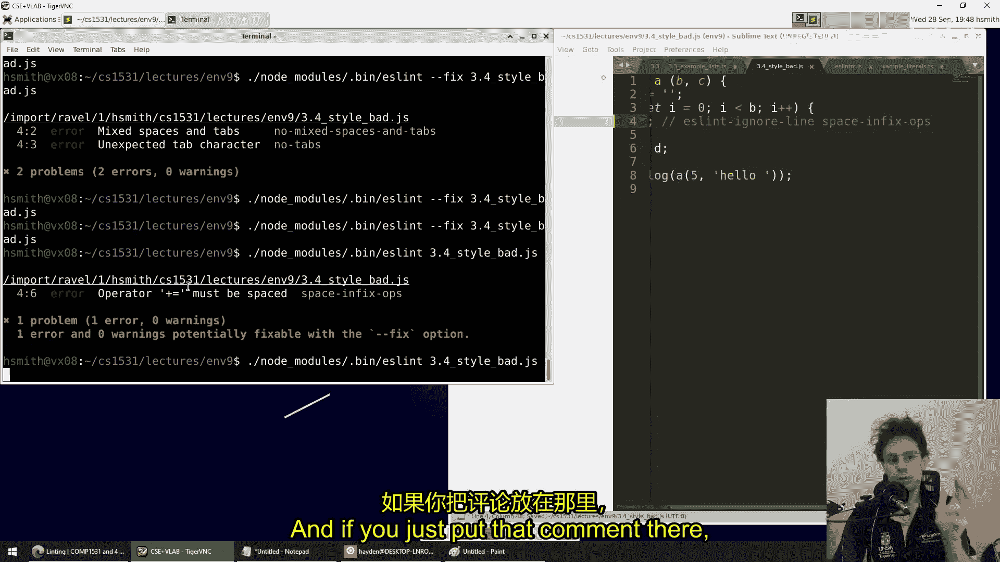

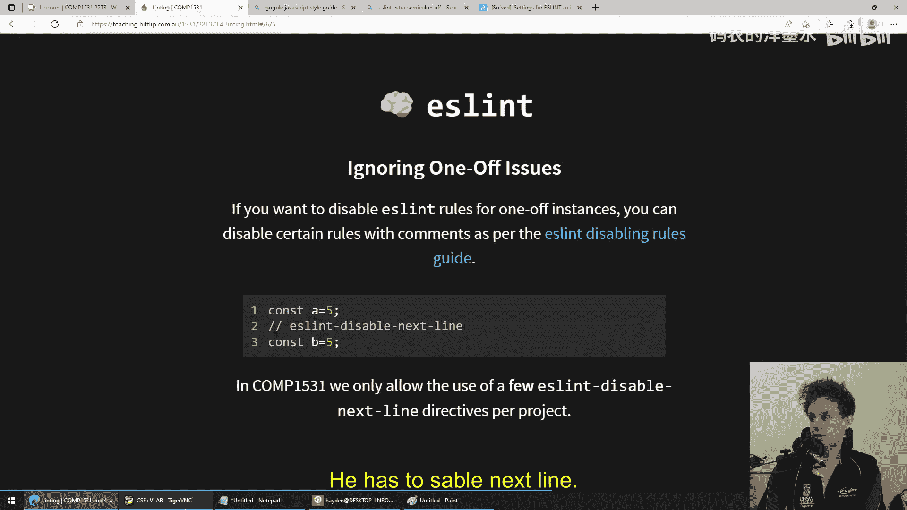

Oh， not ignore Disable。 Sorry。 If you do that， E S Li will ignore it and just think everything's fine。

 You can do it a few different ways。 You can say disable line。

 if you want to put the comment on the line above， you can do E S Li disable next line。

 That's really useful for long lines of code。Obviously， I added a tab there。

 which was a bit of a problem。 So that now works fine。

 Or what I did with this file when we first opened it was I added a line up the top。

 which was E S Liint I E S Liint to ignore。 I can't remember what I added。

I can probably just undo everything。E， Li disable， and this actually disables Linting on the entire file。

 The reason I have that there is because I actually link all the lecture code。

In my lecture code repo， so that's why most of the lecture code is relatively consistent with style because we actually have a lecture code E L that's the same as the courses E S L that runs on all the lecture code。

 but I want to give you this piece of crappy lecture code。😊，But obviously。

 I don't want it to be lited because then it defeats the purpose of why it's a bad style example。

 So the way around that is that I put this line in。 And then every time I teach this。

 I forget I put the line there， and I wonder why the lius not picking up on any of this ferocious horribleness of the code。

 so。

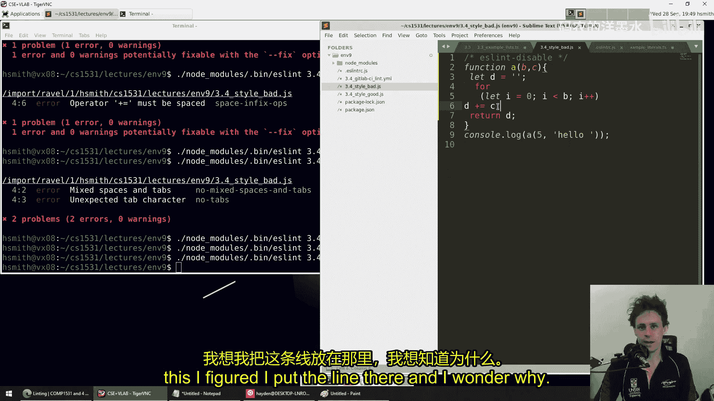

We don't like you to do this， but occasionally you'll need to just ask your tutor for it。

 Linting is super easy to run。 It workss with Typecr 2 when we set it up for you next week。

 I'm just giving you some jascript examples here， but Typecr is perfectly fine。

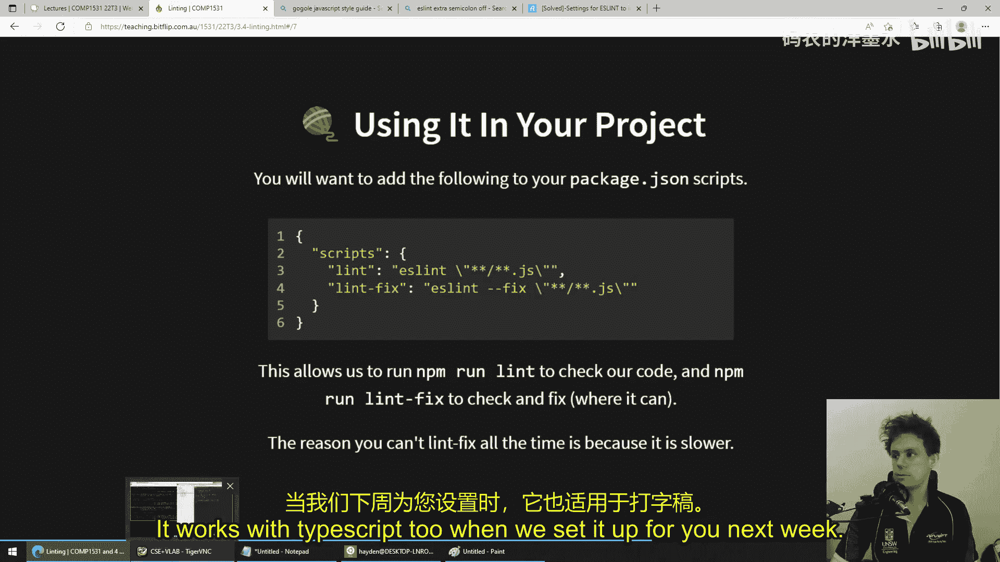

Typically， what we do is we add a few extra lines to your like package dot Json for you where we add something like。

Will be like E S Lint。If you run that， or like， we'll just say Li， where if you run NP PMM run Li。

 we will run E S Li on like。Every JavaScript file you have or something like this。

 so you can just run NPpM run Lint。You know， and now it's， and we， we add some files to ignore there。

 But you can see it's picked up on the E S Lintr C file， which is kind of funny。 We。

 we set that up to ignore that file， but it's also picked up on the style good file。

 And it's said that there's missing a space before function parentheses， so。😊。

According to this style guide， the one we installed。

 which is a bit different to the one we use for the course。嗯。You know， now it's okay。

 And then we also typically add to your repo a like a Li fix command。

 which is the exact same thing except the fix things there。

 So if you ever want to like link your code and fix it all， you can。You can just run Lint fix。

 and it will go and fix everything for you。 And then when you just run it without the fix。

 it'll do that。 Now， why do you have a separate command， Why not just always have the fix there。

Honestly， on， unlike production scale code basis fixing is a really computationally expensive exercise。

 like， I don't have a timing for you。 But like for instance， at work to Lint the code base takes。

dependss on， it's， depends on on like my M1 Mac， it uses takes。30 seconds to fix it。

 It takes like a minute， minuteute and a half or something。 You know， something like that。

 So that's why fixing is just more intense'cause it's， it's。

 it's also like fixings dealing dealing with file I O， like it's opening files。

 sometimes preparing to write at various other things。 I don't know how it works under the hood。

 but it's definitely slower。

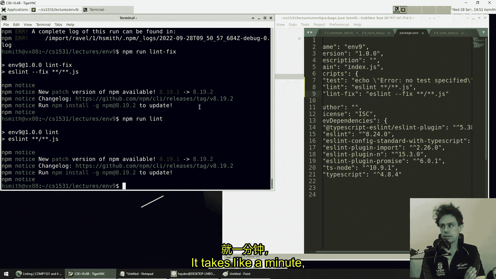

The cool thing about Linting， you can also add it to your pipeline。

 and we do this for you from week 4 labs onwards。 and， and we expect you to link your code next week。

 Can we do this for iteration to。😊，呃。And it's as simple as NPM run， that's the cool thing。

 Like once you add it to your package do Json like this。

 it's really easy just to like start layering on commands。 like we've already got like testing。

 type checking Linting and you can start to see this story of how we' layering on infrastructure and environmental support that makes sure our code is like tested and typechecked and styled know and you can start to kind of get a feel like a really early feel for how these massive corporations are able to generally keep things fairly in check because it's just these principles but at a much larger scale and typically much more complex。

 but it's all fundamentally of a similar similar thread。😊，Now this is true for Typecr as well。

 so I want you to read this slide with Typecr and E Lint in your mind。

 E Lin and Typecr will be part of your labs from week 4。

 We will give you all the configurations you need。E S linen and Typescr will be part of your project from week 5。

 which is where we release iteration 2。 We will give you all of the configuration and setup you need。

And if we don't include it in the pipeline， we will give you instructions to include it in the pipeline。

 The reason we sometimes don't include like the link command in the pipeline immediately is because we don't want your code to fail immediately either。

 So we'll talk more about that as we get closer。 I've said this like six times this week just because I want to drill into everyone's head Linting and typescript aren't anything you need to worry about this week。

 So only next week in the lab seventh time。 and it's iteration too。Waiake 5。Yeah。

 there's like with the Typescript lecture， there's a slide I have here that like shows you all the things that we do to get E S Lint working with Typescript and everything else。

 We do all this for you。 I've just included it in the slides so that you kind of like are kept along with the journey。

 but we do all this for you。 This is more just if you're super curious。Same slide。

 Don't stress we do it all for you。 and that's it。 that's it for tonight。Thank you。 As always。

 leave some feedback。 There's a couple of questions here。 Daniel says。

 why do we use interface and lab instead of custom type。

 I don't think there's a deep reason behind it。 You can post on the form and we can get you a better answer。

 though， if you'd like。 That's the only question in the YouTube chat。

Thank you to those who came live。 It's always lovely to see you。U。

I'll send you notice on Friday with some updates。Other than that， we'll see you next Monday。

 where we talk about really other cool， important stuff。 The first five weeks of this course。

 actually， frankly， the first four weeks of this course are pretty intense。

 It does taper off after that。 So if you feel in the crunch。

 it's probably'cause you're getting a little bit crunched。😊，嗯。Oh， public holiday， oh。I don't know。

 Figurere that out later。 D I I won't lie I a lecture on Tuesday and Wednesday。 So there's a very。

I'll figure it out。 But there's a， there's a chance I might just run the lecture on Monday。

cause like。It's kind of might be easy。 Like， it's basically a tos up。

 Do I just run it on Monday or do I run it from like 4 or 6 on a Tuesday， I'll figure that out。 I'll。

 I'll maybe do a poll or some crap， I du't know。Later， it doesn't matter'cause it's all recorded。

 but sometimes Mondays tempting，'cause if it's Monday， then people can watch it earlier。

 If it's prerecorded。 but again， I'll figure that out later， so。It's much of a muchness。

 Thank you all。 Have a great evening。 Lovely to see you。 Thank you， Daniel， Kaaiki， Tony。😊。

Everyone else appeared。

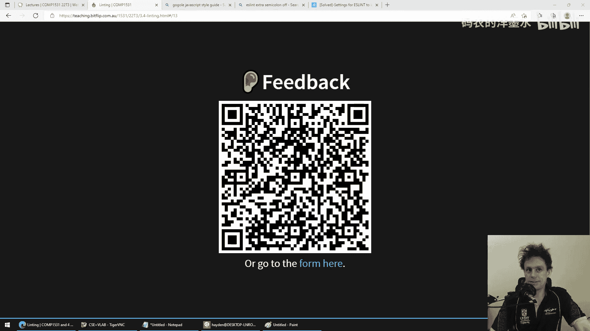

Co。Saよなら。