# 【全集】新南威尔士大学 软件工程基础 中英字幕 1080P COMP1531 p13 Lecture 13 - HTTP服务器 part1 -BV1M7Nwz7EGh_p13-

We're going to do part one of the HTTP service lecture now。

This lecture could probably be two hours if we really tried。

 but I've found that if we just tackle a little bit of it today。

 just a little bit before the kind of full lecture on it tomorrow。

 that it just takes the edge off a little bit， which is really useful。This is。

One of the most two things to preface this lecture。 This is one of the most important lectures。

 not today， specifically probably more tomorrow。 One of the most important lectures in the course。

But also， it's kind of what I consider to be the end of the you know。

 the first hard part of the course。

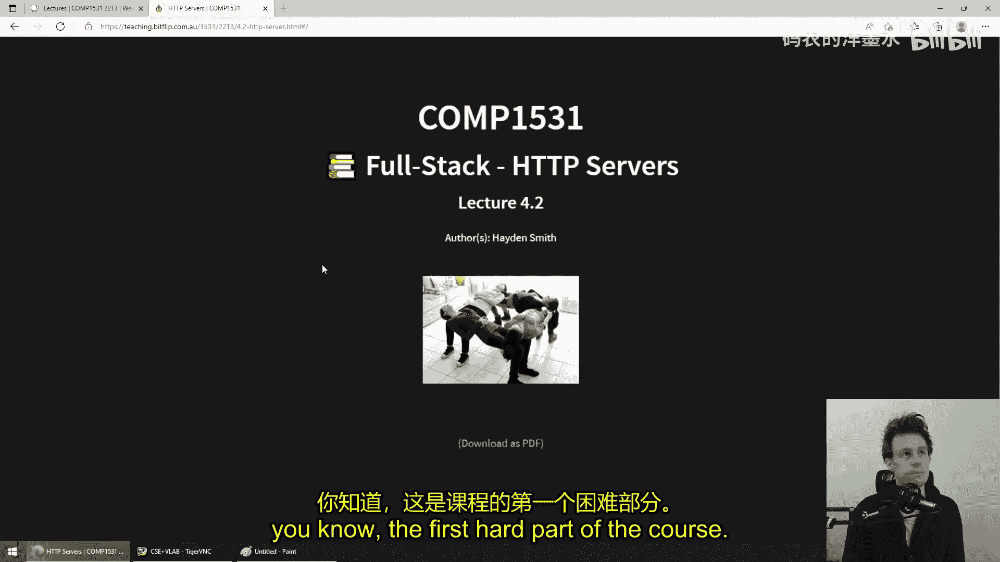

You know， this course is 9 weeks， right， with flex week week1s a bit of a。It's a bit of relaxing。

 you know， a bit of chill， A couple of bonus lectures the exam。

 So we really have eight weeks of lectures， if you think about it。 And， you know。

 tomorrows the halfway through the meaningful lectures in the course。

 And this course has a lot of the harder content at the start because we want to give you the tools to do stuff with。

 so。😊，I just want to guess point out that there's definitely going be a contingent of students who at this point are certainly feeling like their brain has a lot thrown at it and to those people。

 well， all I can comfort you with is that。

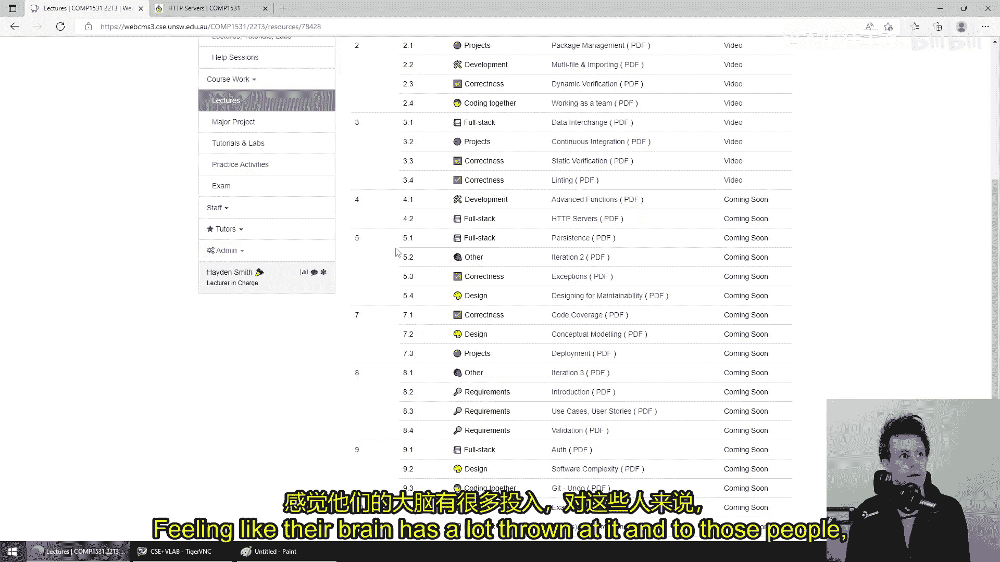

嗯。We are。

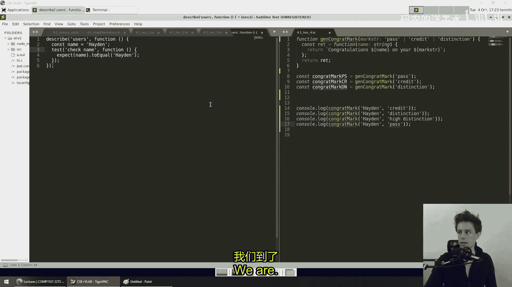

Toward the end of that。 so to speak。 And this is where I feel like we start to get to that point。

 So this lecture on H TTP servers。Web service。You know。

 products built on websites are a fundamental part。 Oh sorry， let me take a step。

Products built on the Web are a fundamental part of how software is distributed and used today。

 The majority of you will go and work on software that is distributed on the Internet。

Or specifically， through web browsers。Super important and web servers。

 the things that power a lot of these webs or web apps you use， the things that sit， you。

 in Amazon or Google or Microsoft you know， centers with you know churning through all your data every time you you upload a YouTube video。

 all these kinds of servers are a fundamental part of how web based applications exist。嗯。

This lecture， we' going to talk about。Networks in general。

 a bit of just high level touching on computers and networks。

 We're going to talk about a particular type of web server that's really easy to build in jascript。

 We're going to talk about APIpis， And we're going to talk about crud。

 which is a certain way of building Apis。 Most of the APIs and stuff will happen tomorrow。

 But let's start going through it， so。Firstly， networks。

 this is a very old slide I've had this in for a few years now。And I think it's very important to。

Understand the difference between these three words， Network， Internet and the web。

 I think it makes it easier to talk about。 I think if you can talk about something then you know life life is substantially more manageable。

 And a network is simply a group of interconnected computers that can communicate。

 know the way I like to think about this is that most of you are sitting at home right now or if you're not you will at some point today。

 and youre connected to your router or your wi-fi at home And that router or w-fi can disconnect from the Internet。

 but you can actually still talk to all the computers within your house。

 if you wanted to like everyone in your family if you're all connected to the router。

 You could send things to each other if you tried certain ways， a little bit nerdy ways。

 you wouldn't need the Internet。 you wouldn't need Telstra， whoever。 And that's a network。

 It's a group of computers that can talk to each other。 That's it doesn't need the Internet。

 The Internet， though， is a global infrastructure of networked computers。Around the world， right。

 So the very first networks were。Computers in a room， then maybe computers at a university。

 and then universities started connecting their computers together。 And eventually， you know。

 this network got big enough and someone was like， let's call it the Internet。你能。The。

 the Internet work， I don't know what。 Does that it stands for，'ve never thought about it before。

 And then you have the Web， which is a really interesting subset of the Internet。

 which is specifically。When you use the Internet via web browser， basically。

 so if you open Google Chrome， Safari， Firefox， anything like that。

 you are using the the World wide web。 That's why you see WWW， sometimes they call it the web。

And it's a certain way of communicating over the Web。

 There are lots of other ways of communicating over the Internet that aren't the Web。

 which we kind of。Chat about in a sec。 But if you do wan to go learn more about networks。

'cause this is about as deep as we're going to get。嗯。Go study comp 3，3，3，1。 Its networks。

 And I didn't study it， so。

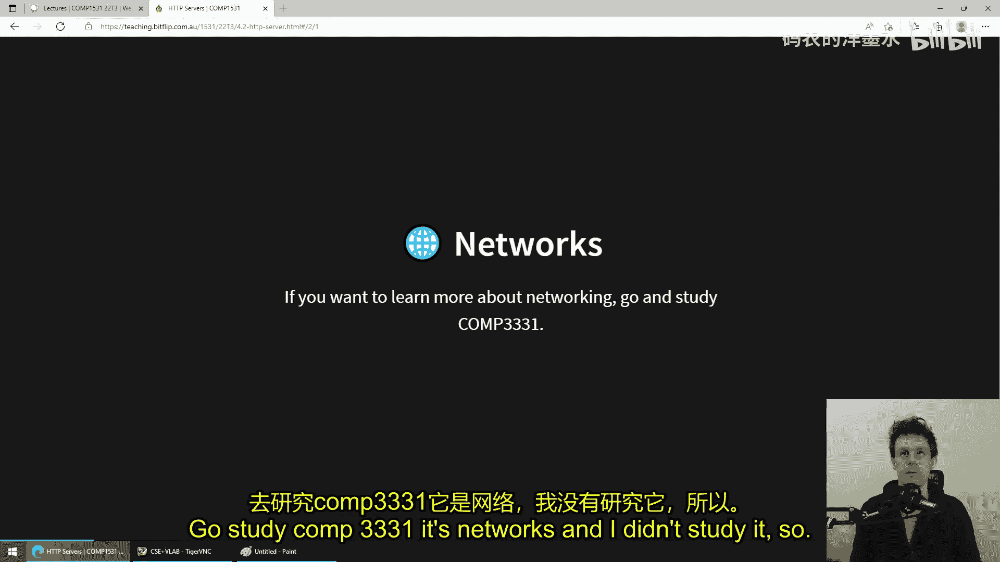

Itwork and something。 What's it called。

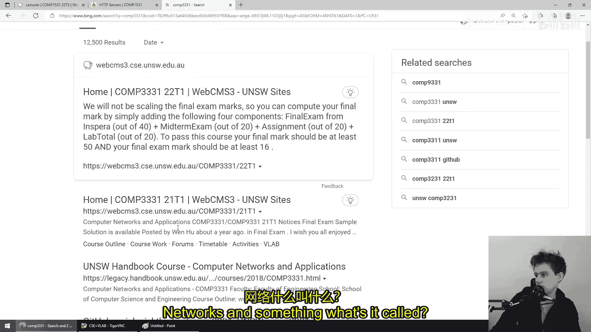

Computer networks and applications。Cool。On the Internet in computers in general。

 it doesn't need to be on the Internet。 But let's just imagine it's on the Internet。

 We need certain ways to chat that based on protocols。 And we call these network protocols。

 They are a structure so that different computers know how to talk。

 So when your computer sends a message to your friend's computer。

 How do they speak on the same language。 And it's like you do this all the time as a human。

 whether it's like clapping， waving handshakes。 you go to meet someone。

 you wave goodbye so they know you're leaving， you say goodbye so they know you're leaving。

 you do this when you pick up the phone。 You pick up the phone and you don't know you say hi。

 you know， this is Hayden。 How can I help you。 that's's a form of a protocol。

 it's a standard operating procedure that everyone kind of understands exists and therefore people can talk。

 computers do the same。 and there are different protocols for different ways that we communicate over the Internet。

And there are lots of them， and they're really nerdy。 and there are very technical some of them。 And。

 you know， most of you have heard of some and maybe not a lot of others。

 But you know maybe some I'll draw your attention to are if you've kind of seen any。

 you know you might have seen immap or SMTP if you ever played around with your email。

 Some of you might have heard of FTP， a way of transferring files。

 a few other things a few of you would have heard of many of these and you'll know exactly what they are。

 But the point of articulating here is that H TTP， which you would have heard about when you copy and paste a URL。

 is a particular way， it's a particular protocol of how people communicate on the Internet。

 and it was designed tell help people communicate via web browsers。

 That's why the URL literally like。Up the top of this page， says H T TP there。

ItIt's just all based on the web browser。That's why， you know。

 whilst there are maybe different ways of SH is another protocol， we forgot。SS H isn't on that list。

 so any of you SS H into something or SFTP or something to do with VS code。

 there are all different ways of using the internet that have nothing to do with HTTP and web browsers and a lot of what we're focusing on today is not on any of these other things They're on H TDP or web browsers。

So， HtTP。Stands for Hypertex Transfer Procol。 It is a protocol for essentially sending and receiving documents via the web browser。

So if you think about a web page， you know， think about like this when I Google， you know。

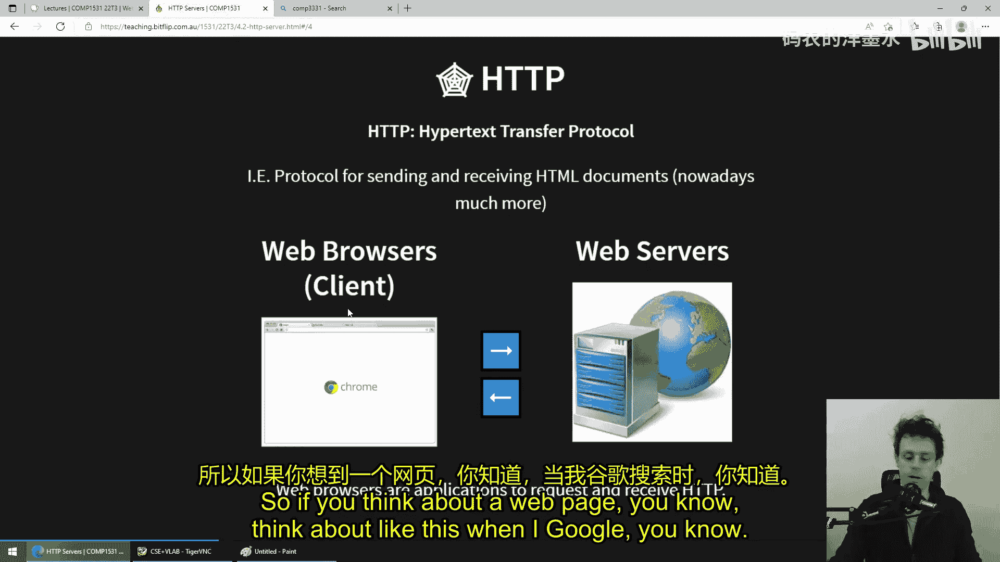

You know， Roger Federer， tennis player recently retired， right。

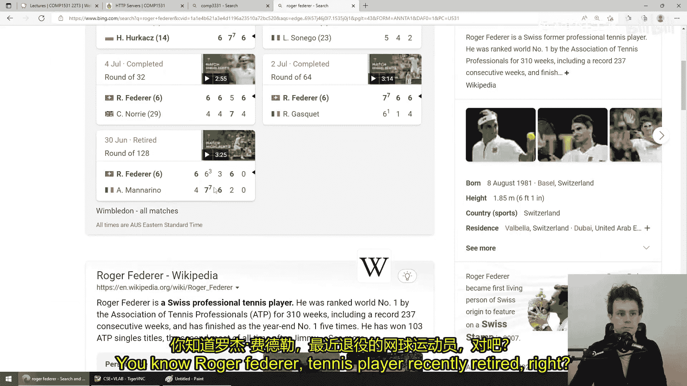

What do I get here， I get a page。 I get what you call a resource。 It's some kind of material。

 H T TP is just the standard that governs how people transfer these materials together。

 This slide deck material， you know， my my USW is another piece of material。 And fundamentally。

 all this happening when you。Paste a URL， you type in a URL and you access something is that you on your computer。

 on your web browser that we call a client are sending a message to a web server somewhere。

 maybe in Sydney， maybe in Melbourne， maybe in Singapore。

 maybe in Oregon doesn't matter somewhere around the world。 and you are asking for a resource。

 You're asking for some kind of document information。 and you get you get it back。And that's。

How most of your day is probably powered， right， You load up YouTube， YouTube loads， and then you。

 you do something， and you're， you're asking for more video， and it's sending you more video。

 It's all more content all happening through the web browser。

 So web browsers at its core applications that help request and receive H TTP messages。

 which is how we， you know， which is a protocol that governs how we get documents and stuff。

We can make our own web server that operates using the HTTP protocol using a popular NPM library called Express Server。

Express server is。

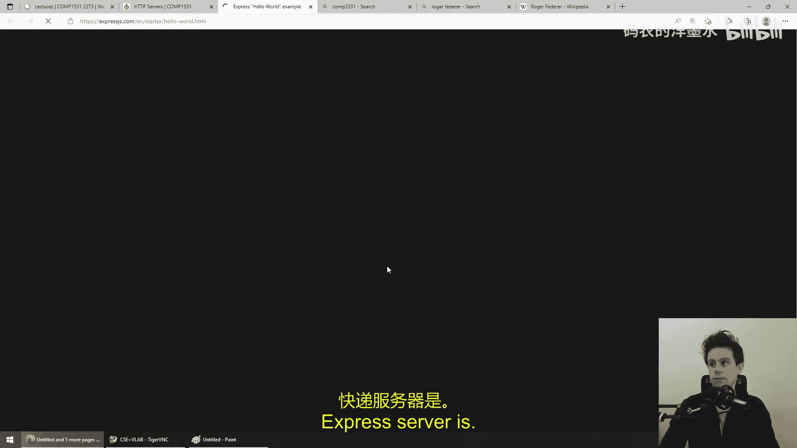

A very simple server。That has been downloaded 25 million times a week。It's a lot， right。

 We've been talking about this a bit。And you'll see from its website that it allows us to get some very simple code here。

 I'm gonna have to modify this code very slightly。Nope。

 I will have to modify it just very slightly a work with。

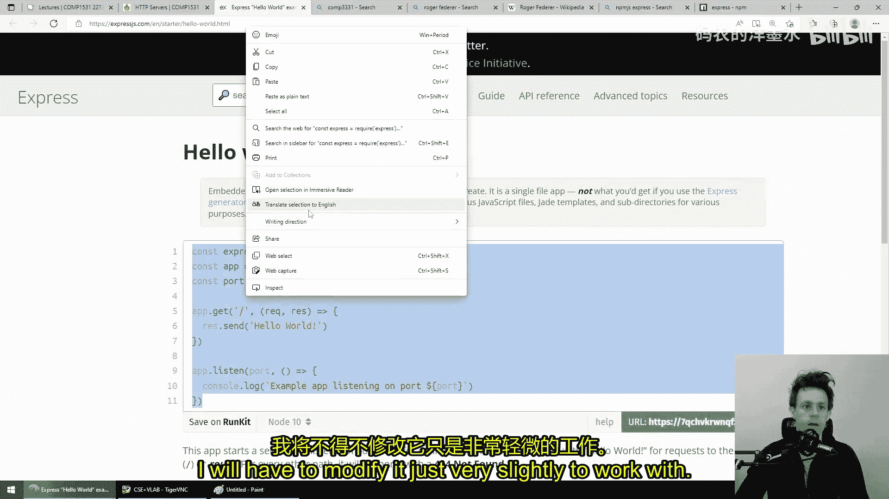

Our different syntax。But。Let's actually some code example， sorry。😊。

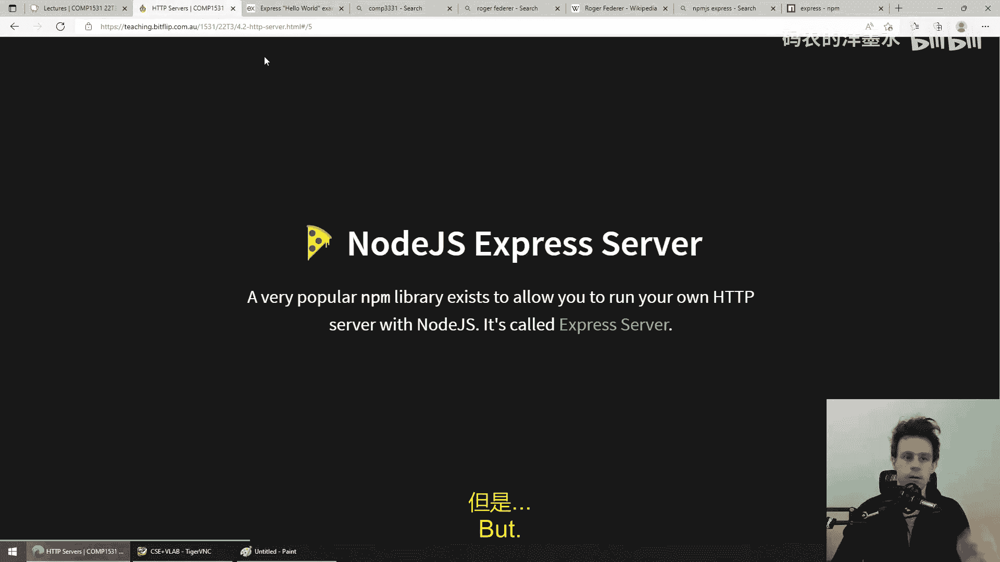

The look at the lecture code examples， even though you can figure things out pretty quickly by a Google。

 But this is all it is。 It's a simple file。 I import Express from Express。

 You've done some imports already。 I create a new web server here。 This is like creating an instance。

 a version of a web server。 I bringing it to life。 And it's called app， app for application server。

 I pick a port that it's gonna run on。 We'll come back to ports。 This isn't a networking course。

 So we gloss over it pretty lightly。😊。

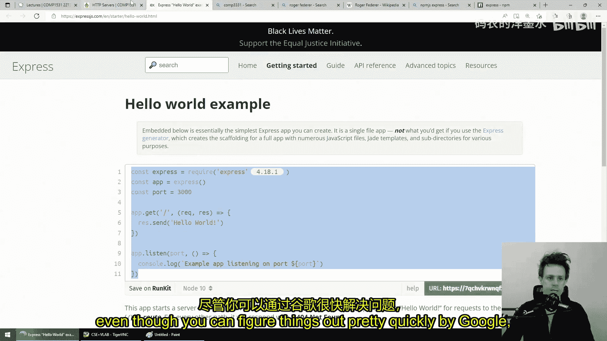

I add some magic here， which isn't that important。 And then what I do is I。

I actually define what the Web server can do， and we'll， we'll unpack some of these lines together。

 But in this particular case here。This is me saying that when someone accesses my web server。

At address， slash。I want to send back to them。 Ho， Well。

 And then this last line here is saying this web server is going to like bring it to life and make it listen。

For。People trying to talk to it。 So if we go back to this slide here。

 you're creating the thing on the right， the one like right there。

And you're listening for people like you and your friends to talk to it。

 So that's what's really being said here。 It's like， okay， for this new application server I've made。

 listen for people to talk to me on this port。 So if we open up。The example here， I'll， I'll make。

 I'll make this smaller again。

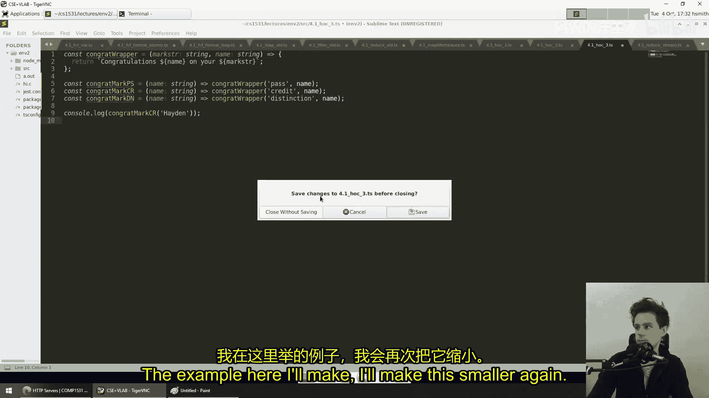

And I run it， MPM run TS node source 4。2 Express basic。Right。

 what you see is that it starts saying list on port 3000。Now， what this actually means。

 which is a little bit interesting is if I right， click on VLb。

 I go to Internet and I go to Chmeium web browser。And I open this up。

What is happening on the left here is a bit unlike the programs you've been running to date。

 The programs you've been running to date， they tend to just run。And then stop。You run them。

 They start。 They stop。 This web server is kind of running inside like a wild true loop。

 It's like running forever， in a way。And。What it's telling me is that if I go and access the web server via the web browser。

 it will listen to my request。 And because I'm running the web server like on my computer here。

 there's a very particular。There's a very particular like name， which is quite interesting。

 which is local host。 And local host is this weird。 It's kind of like a website name。

 but it means your computer。And what I can do here is I can say， I'm going to access my computer。

 or in this case， V labb doesn't matter。On port 3000。And there you go。 And I'm gonna get hello well。

 Now， the things to pay attention to here are that it's always local host because it's always running on your computer。

 You're developing something。 So it's always low host43000 computers on networks are made up of a whole bunch of little pigeonhole。

 a bunch of like spaces that they can all run in， in parallel。

 It can be pretty much any  four digit number or  five digit numbers。 So I could do 9，9，9，9。😊。

I could stop my server with control C， and I could restart it again。And now if I load up that page。

 it won't work anymore。 but if I load it up on 9，9，9，9， it will work， you know， like that。So。

You know， it's。It it's happening there。And the interesting thing， again， is that so this。

 this is all set up。Up the top。And everything down here is running the server。

 But this is the actual kind of content of the server itself。

 And what you can do is you can go make a whole bunch of these if you want。

 and you can put different URLs here like， hey。And you can change what they do。 And in this case。

 you know， if someone accesses slash， hey， I'm gonna have it say， hey， and if someone accesses slash。

Bye slash by。 I'm gonna have it say bye bye。 You know， it can be anything you want。 They。

 they're all just strings。 They can kinda be anything。 And if I restart my server。

 you'll see that now oops。You see that now if I come here and I access the normal1。

 I get Hello world， if I access hay， I get hay， and if I access by slash by， I get by by。

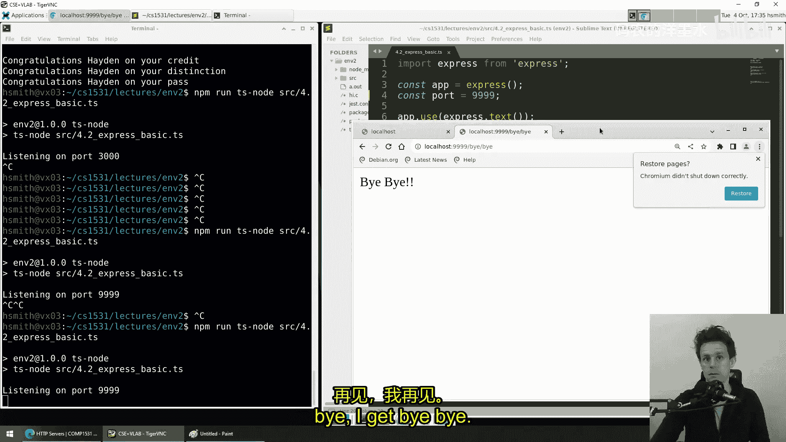

So we've been able to just write a very simple program and run it。嗯。

That can deal with like lots of different use cases， you know。Which is， which is kinda cool。

 It's kinda cute。It's， it's a good bedrock for what we want to do next。U。

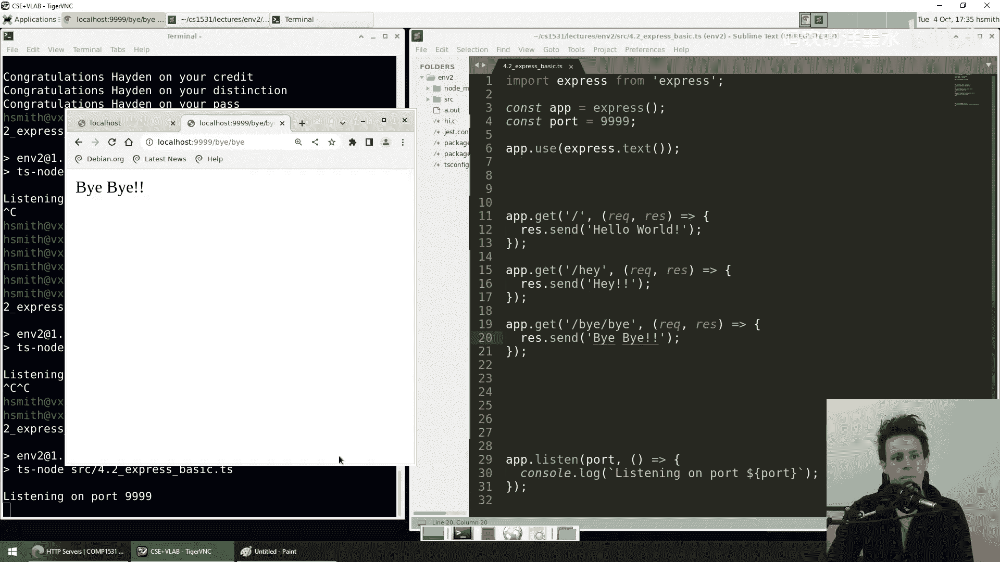

Usually what I like to do here。And we'll kind of talk through that again。

 And I don't want to get into the API stuff today。I just wan to kind of run this the express server and talk a little bit about ports and networking。

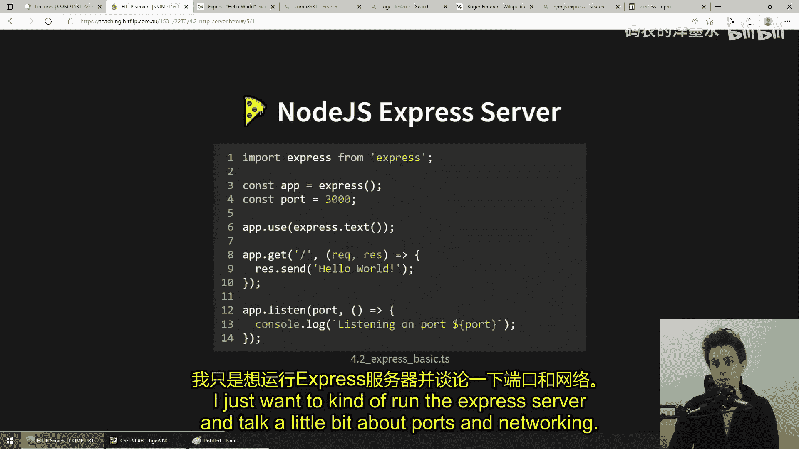

The thing about networking and ports that's very interesting is that on your computer right now。

 there's a whole bunch of ports that are available for kind of like development and fun。

They're not low ports。 right， So like， if I go like available ports， H T TP or something。

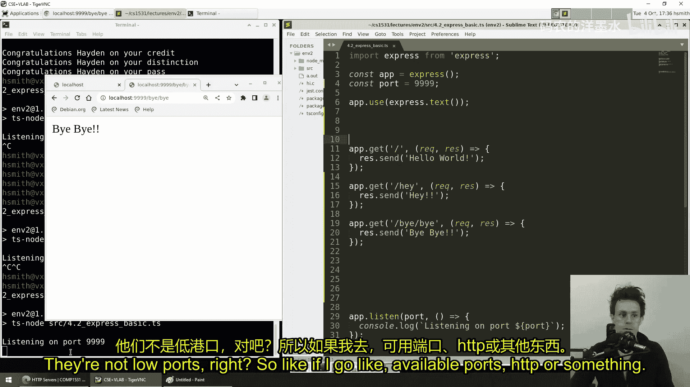

There's usually like， there's kind of like this list of ports that。

Exitports aren't don't think of them physically。 that I know some students can get lost。

 They're like virtual， like you get this， right， Like on your computer。

 you have like maybe three USB ports， USBC or something。 and you can plug 3。

 you can do three things at once。 And once you do more than those three things。

 you just can't do anymore。 you know， ports are very similar in a like a networking sense on your computer where say your computer。

 local host has a whole bunch of ports， right， has like。I don't know。 It's like。Tens of thousands。

 it's a look。And。Some of them are used for very specific things。 And you can see them here。 These。

 you don't need to worry too much about these。 These are used for very specific use cases。

And then above a certain point， no one really uses them for anything in particular。

 which I don't think is listed here。 It's like 4000 or something someone would know off the top of their head。

嗯。How did there。It's like， Ino，1 thousand to1028 or something。 Can't remember。Ino。

 minimum network port number。It's not really gonna tell me there's a number。 It's obvious。

 I should know it， but I don't off the top of my head。It's like around 1000。 But basically， like。

 if you think of 3000 as your standard minimum， I mean。

 I've never really worked in an environment where anyone's picked a number lower than 3000。

 It's kind of like assume let's just call it 3000 Everything above that is essentially just free re up till about 665000 or something like that。

 So you can pick a random number。 I wouldn't pick 1，5，3，1。 It's a bit low as I it' stick above 3000。

 You could pick， you know。

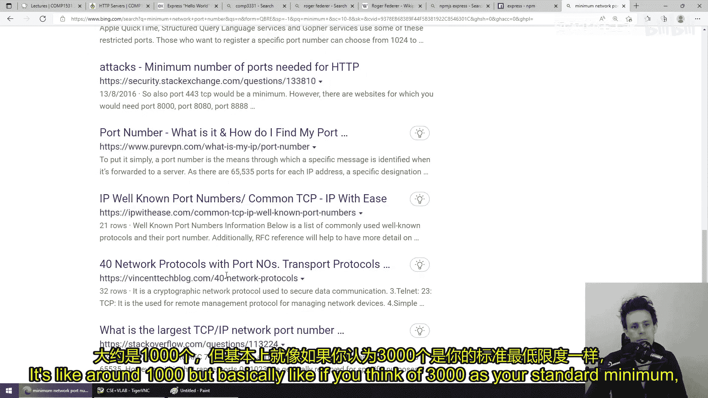

You could pick 3，4，5，4，3 like that。 And you could go and run a server on that。

 And what this allows you to do is essentially allows you to run applications that listen on a network of a computer。

cause if you imagine your computer for a second。

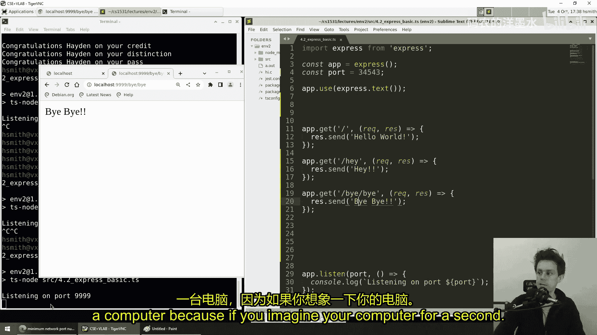

Your。Your computer is honestly just like this like if you think of your computer's network。

 it's interaction， as people talk to it， it's just this grid of ports。

 and there are a lot like software can run on each of these ports。

 And they'll all be busy with something one of them might be used for this。

 one of them might be used for this。 So when you develop。

 you just pick a random port and you just kind of work on it。

 The reason this is important is because when it comes to Vla。

 Vla is a little bit weird because Vlab is actually a physical server sitting actually it's not sitting inside。

 I don't know where it is anymore。 maybe it's on Aws finally。

 but it's an actual server believe it or not like even though it feels like this very abstract thing。

 What's actually happening on Vla， you know how on your computer。

 you can have like a couple user accounts。 Like you get have your account and your sister's account or something and you can both kind of log in into different accounts and they're kind of separate。

 but they're still maybe running on the same machine。

 a lot of like big user service like the one C has they can have one computer that can have many people logged in at the same time。

 And like little。

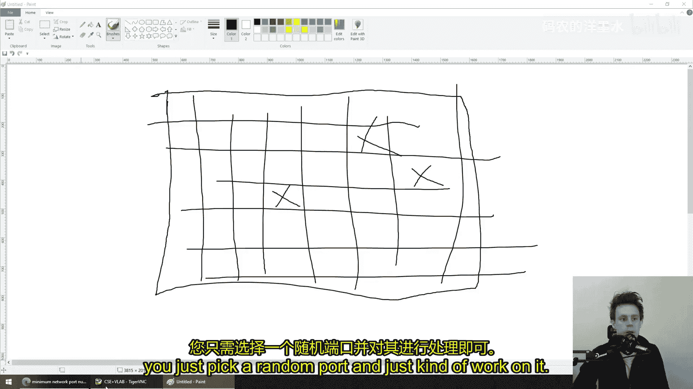

Environments， and they， they're all sharing the same Ram and the same hard drive and， you know。

 all this kind of stuff。CSE does a similar thing， except the way CC set up is they actually have like about 8 of these computers。

 And you actually see this very easily。 If you have a look at your terminal and V labb。 For instance。

 this one says V X 3。 And when you connect to V lab through ti V and C or something， right。

 Let's say you use V lab。 If you don't use V labb， you'll never have this problem。

 But you'll see that every time I load this up， it actually gives me a。😊，A different V X machine。

 It's kind of random。 I think it's a load balance， right， So I've got V X 4。

 And if I open it up again。Right， I will get in this， I got V X。 It opens up on another window。

 I got V X 4 again。 And if I open up again。I get Vx4。Right it。

I haven't played around with this since they changed it。 Oh my God， I got V X4 again。

 Maybe they're changing how it works to an extent。I do think there used to be。 I got， okay。

 I'm just getting V X4 a bunch of times now。 But the first time I loaded up V lab for this lecture。

 I got V X 3， which was probably that that was like the less loaded server at the time。

What's tricky is that。When you are on B X 3， you are sharing this one server with everyone else in CSE who is on V X 3。

So let's say there's 1000 people in CSC on VLb at one given time and there's eight servers。

 That means that there's going to be about 125 people who are sharing that server with you。

 which means that if there's 125 people who， let's say they're all working on。

 let's say 10 of them are on 153，1， if they are try and use port 3000。They're going to get an error。

Right so see how my software works here when I choose 3000。

 watch what happens when I try and run the exact same code in another terminal。

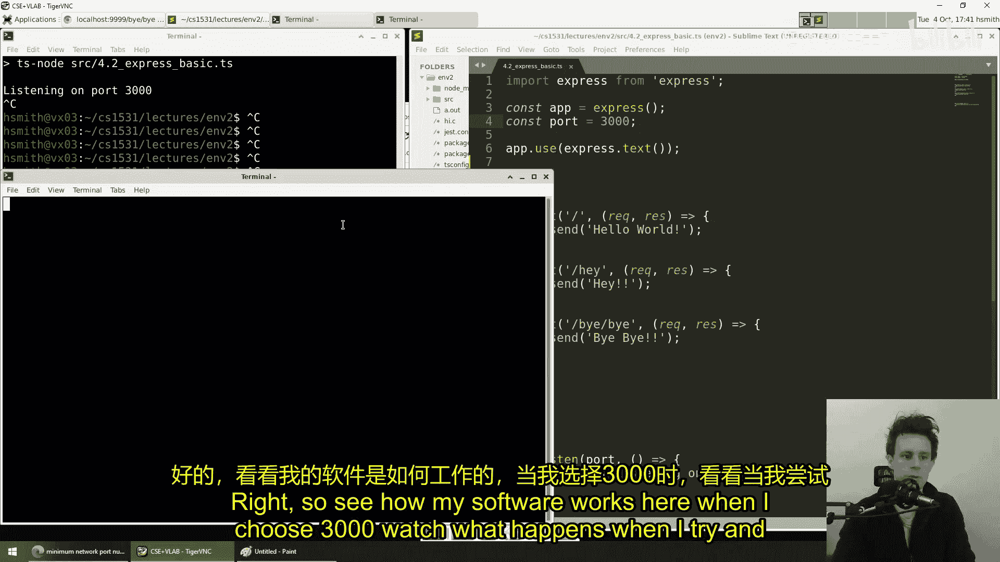

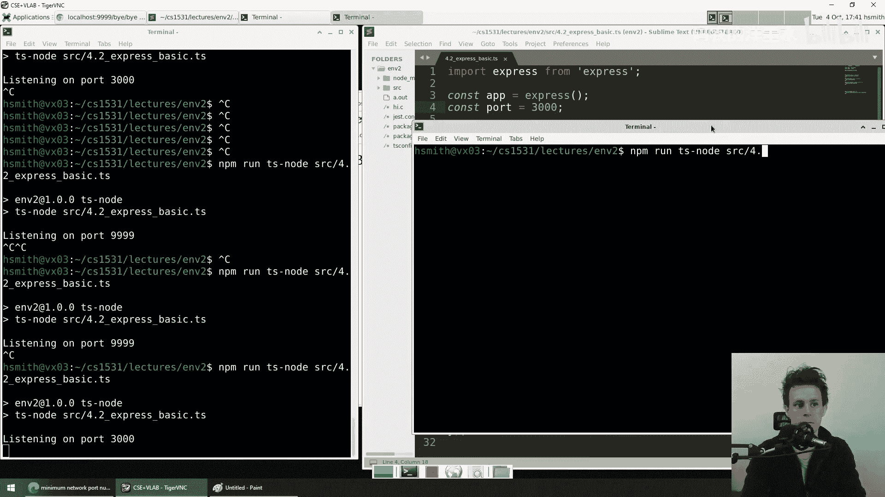

It will give me an error。 It'll say I'm sorry， but the address is in use， right。

 Er address in use is already on this port。0 dot0 do0 do0 is another way of saying like local host。

's all There's a few different ways of saying my computer。So this is what error you might get。

 So if you are a CSE student using V labb and you get this error and you aren't running it in another terminal。

 there's a very real chance that there's literally just another CSE student who's used that port you're using on another machine on on the same V lab machine they just happen to have been on the course。

Working on the thing the same time as you。 And you just change your port number。

 You just come up here and be like， allright， I'll just change it to a number。 like， you know。

 sometimes I used to use the port 6080 a bunch'ca it's the other course I teach。 You know。

 you could make it anything you want。 Like， what's the number I like。 I like 2，6 and 12。

 Maybe it's a bit low。 I like 6， a lot。 So 6，2，6，12 The， another port。

 Keep it between 3000 and 65000。 And it's fine。It doesn't really matter。 but that's， that's it。

 You can run a web server as simple as that。You just spo it up。

 you define a few what we we call these routes or URLs here， make it any you want。

 and then you can have it return stuff。 And what we're gonna be doing in the next lecture is essentially taking that and saying。

 well， let's go and actually build a server that can be useful and then tie it into your project a little bit。

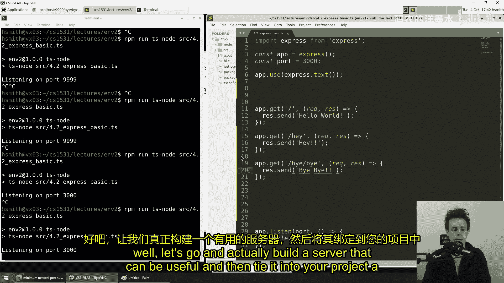

I think that's probably where we'll stop today。 Just to recap on this file again。

 First lines and import。 This is us creating an instance of the server and setting the port that it's going run on。

 Oh， there's the link。 I was thinking about that。 There's a little Twitter post that kind of。

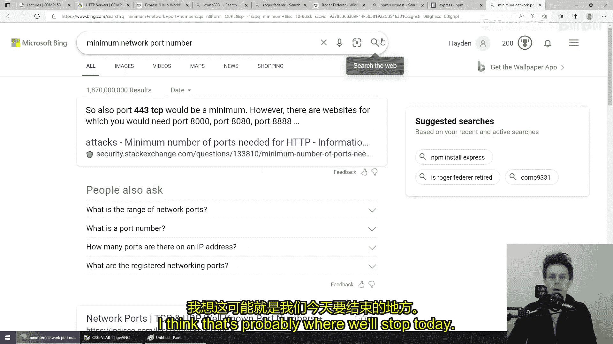

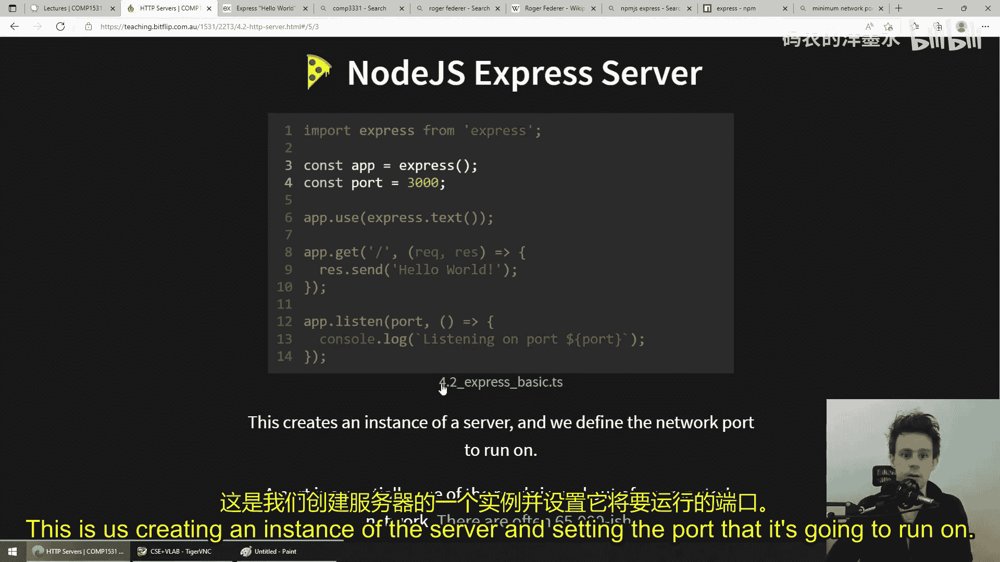

Summarizes these things。嗯。Yeah， here you go。Pors between one and1023 are designated as like don't touch them。

Ports between 1，02，4 and 50000 are registered， meaning that like。You， you can probably use them。

 but occasionally， there might be some random application that you use that conflicts with them。

 That's okay。 And then ports above that are kind of like fun for development。 So in theory。

 you should probably be using like maybe one of these ports。

 but it doesn't really matter as long as it's above 1023， you're fine。 So like port 1，5，3。

1 would be fine as well。

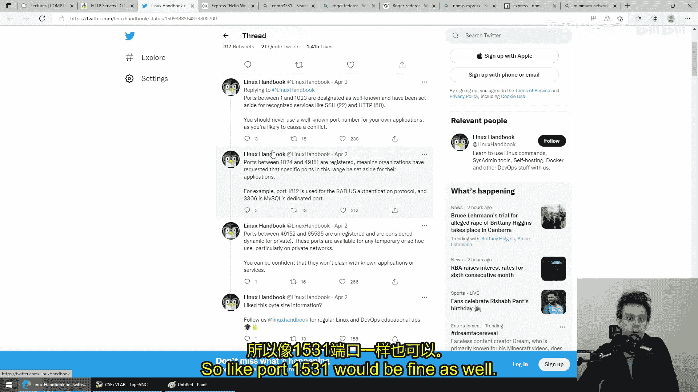

This is just a quirk that we need to have in Express， which will come up next lecture a bit more。

 This is the actual running。 This is actually defining what the web server can do。 what it。

 like what different。Pages or like URLs it should respond to and give to。

 And then this one's actually just the running of the server， right which Daniel said。

 does app dot listen essentially just endlessly listen for things to correspond to and app dot get stuff。

 Yeah， exactly So if you don't run this app dot listen line， the server never starts。

 So this starts the server to start listening for anyone who is calling URLs defined here。That's。

 that's how that works。 Mattw says， is every application we install occupycc its own port。Only if it。

 only if it's like， well。Most applications you install are probably not running a server。

They are probably talking to a server， and that server is probably operating on a very standard port。

But if you， if you create an application that's running a server， then yeah。

 it's probably running on its own port。 But that that wouldn't be very rare。

 Like very few programs you'd have on the computer would。

 would do that unless you're like doing some development stuff like this。

 So probably not something that you notice day day very much at all。

Did peer to peer connection still occupy a port， yeah。dependspends how they're connecting。

A lot of peer to peer happened over UDP， which was a different。I don't know what Port UDP was on。

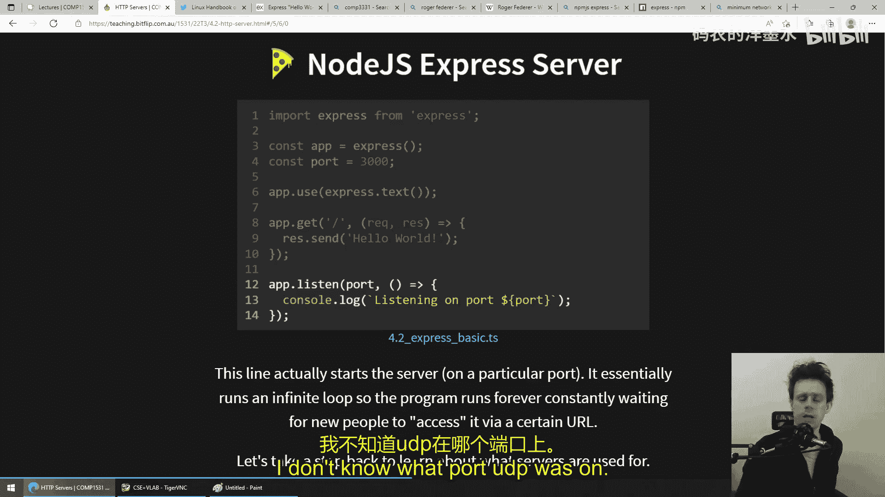

嗯。Maybe didn't matter。I don't know a lot about UDP。Probably could have been any port。

Maybe don't listen anything I say on this。

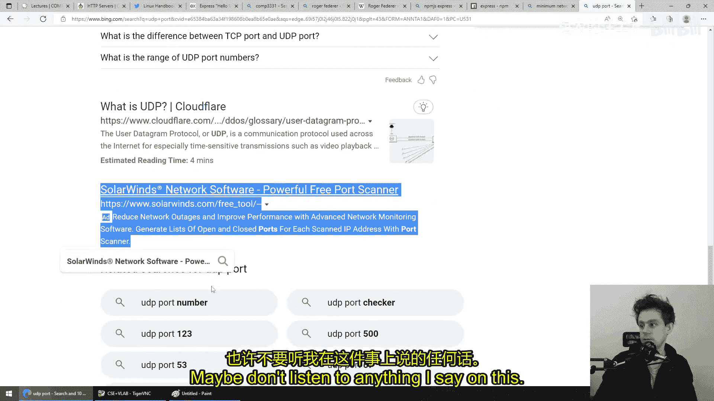

But peer to peer， peer to peerer would still occupy a port。like a web browser uses poets like。

Everything I'm doing on this， everything I'm like when I access YouTube and this slide deck and Web CM3。

 everything typically on a web browser happens on port 80 or 4，4，3， one of the two。

These are in that like those reserved ports。 There's like first thousand。 So， you know。

 your web browser is talking to another server on the Internet on a particular port and they're very standard ports。

 like for a certain type of application you can expect it to be on this port。 None of that。

 you need to worry about。 Of course， the port thing is just for background。 at the end of the day。

 All you're gonna do is type in a number。 it needs to be in the URLs that you access like that。 And。

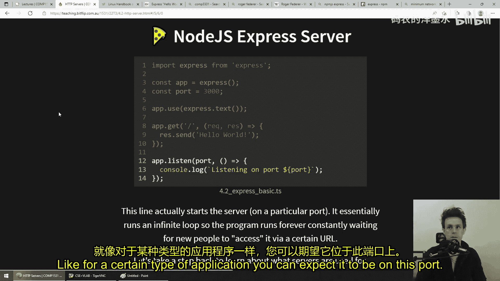

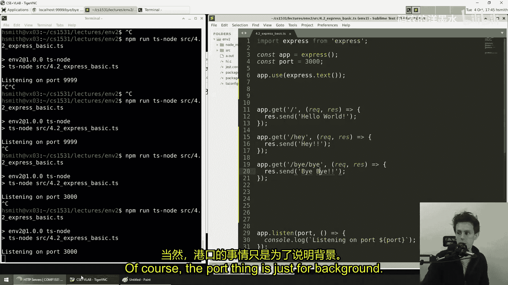

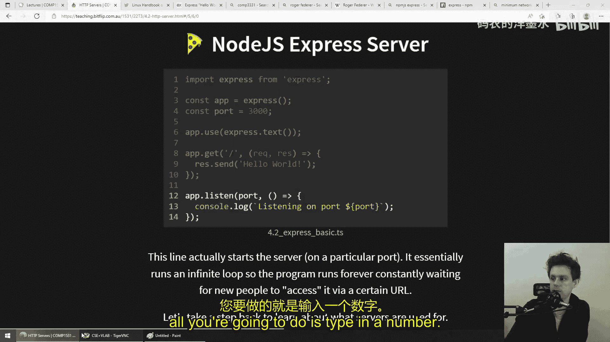

It works。 And if you get a conflict， you just change it。

 That's about as much as we expect you to understand in， in this course。

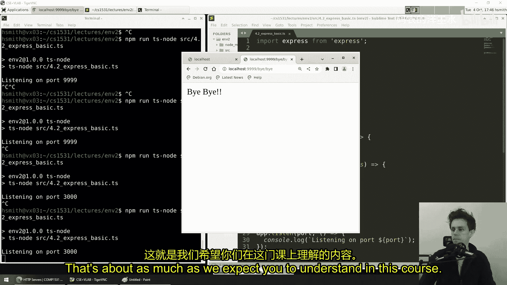

Yeah。Swe以。I won't ask for feedback on this lecture yetca we're only halfway through。

 but next lecture， we will be going through API and keep going。

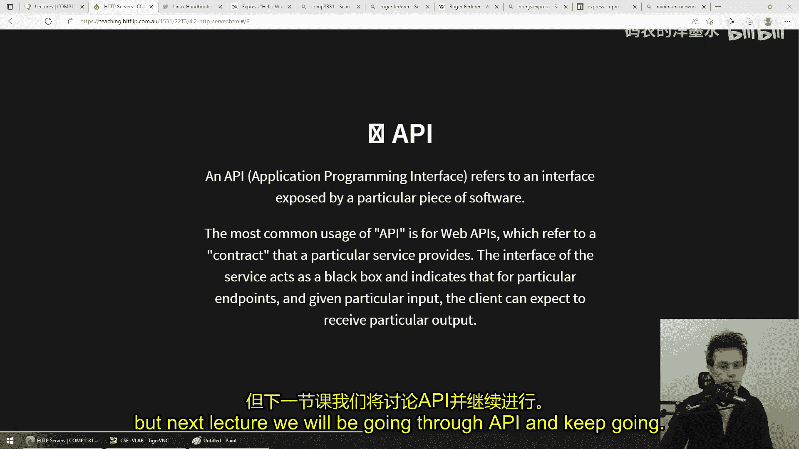