# 【全集】新南威尔士大学 软件工程基础 中英字幕 1080P COMP1531 p14 Lecture 14 - HTTP服务器 part2 -BV1M7Nwz7EGh_p14-

Hello。For those joining us live， this will feel like a whole separate day， because， you know。

We got started on the first part of this lecture previously， but for those joining us。

 most of you watching the prerecors， this is probably just moments after the last lecture so we're going to get straight into it therefore and keep going through our 4。

2 HTTP server lecture The really quick recap just in case you did watch previously was that at the end of the last lecture we created a no JS Express server which did really basic things and just had a URL and if you access that URL while the server was running you got some information that was sent from that server in this particular case the sending of some kind of textbased message。

What we looked at in the previous slides was all about essentially preparing you to understand a really common way that web servers are used。

 and there's really。I mean， this is a very generalized statement。

 but there's two major ways that you'll see web servers used。 One is to serve static content。

 And what that means is to essentially his URL get me the data at that URL。

 that happens all the time on the Internet again that happens on things like Wikipedia。

 it happens on things like Web CM M S3 where you're essentially taking a URL to load a page of content。

 you know， and the page of content you load is written in some kind of web language， but。

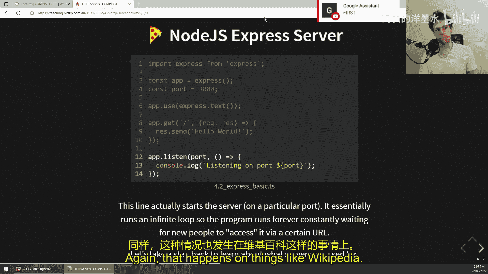

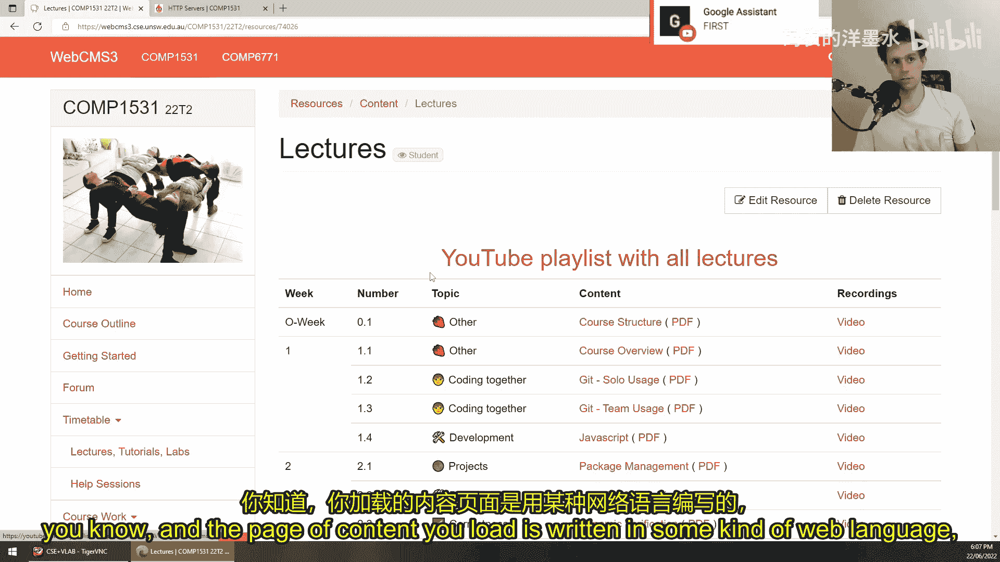

A far more generalized and maybe topical thing that you'll use Web servers for is for the use in an API。

 and I'm sure API is something you heard about。Plenty in your time。

 no doubt youve probably heard about it here and there and everywhere else。

 So we're just gonna kind of talk briefly about what exactly this is and and what relevance it has to the project and hopefully teach you a little bit about software。

 particularly server based software in general。 So firstly， an API。

 where the A P and the I stand for application programming interface， which。

As a bit of like a non phrase， right， like application programming interface。 I mean。

 it makes sense when you think about it， but it's very， very literal and conceptual。

It refers to an interface exposed by a particular piece of software。

So what that means is that and when we say interface exposed。

 what we're really talking about there is essentially for what。

 what most people in your position would understand， I'm just logging into Gitlaub。

 it's basically a set of functions， you know， and the reason I point to this is because before we get to again abstract about it。

I just want to point you to an interface that you have probably been interacting with a lot in the last few days。

 depending on when you're watching this， which is the project back in。

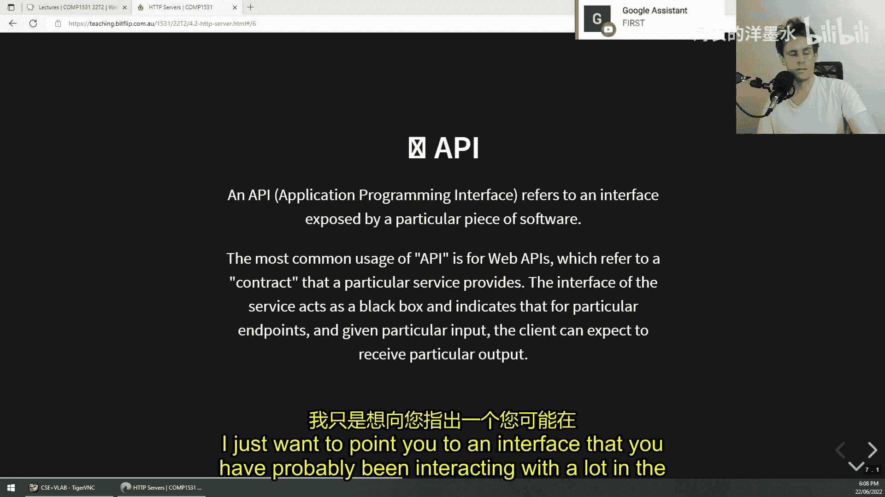

And in this particular iteration one that you're doing now， we have this interface table。

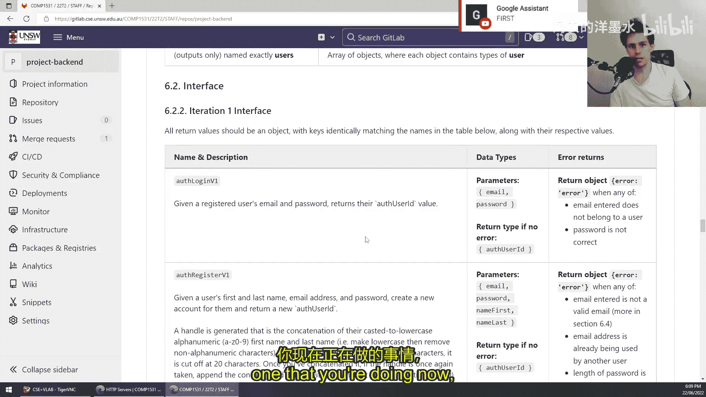

And all an interface really is， as per the slides， right， is。

It's a contract between particular services。 So what the interface actually is when you。

 when you really bubble it down， is it saying。I am a piece of software， you know， the。1，5，3。

1 major project。 And I have functions。And those functions do things。

 And then on that line there where we say I functions that do things。

 people on one side of the line will use your functions and consume them and work with them。

 and on the other side of the line， people like what you're doing right now with iteration1 will implement them。

 they will build them。And。An API is simply referring to an interface that a piece of software exposes。

 So you could argue if you really wanted that this interface here is an API。

 It would be a very strange API。 Well， not strange API， but it would be a very poorly documented API。

 but it would still be an API， nonetheless， because it is simply an abstraction of software that hides away the implementation that allows someone to use it and know how to use it and。

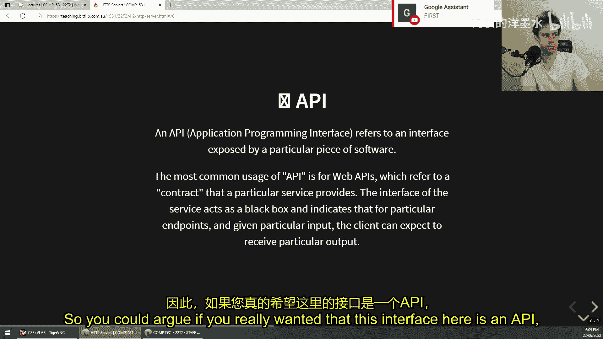

Yeah， that's， that's kind of a lot of what there is to it。

 If you're not really sure what we mean by using your API。

 it's actually kind of in the context of iteration 1。

 it's actually your tests that are using your API。 Like， again， think about it。

 You have this interface table。hich has the interface in it， the API if you will。

 and then you go and implement it， you know this kind of back end stuff and then someone uses your code and actually tries to make make a program happen with it。

 which are your tests essentially but in the future that might be an actual web page or a website somewhere。

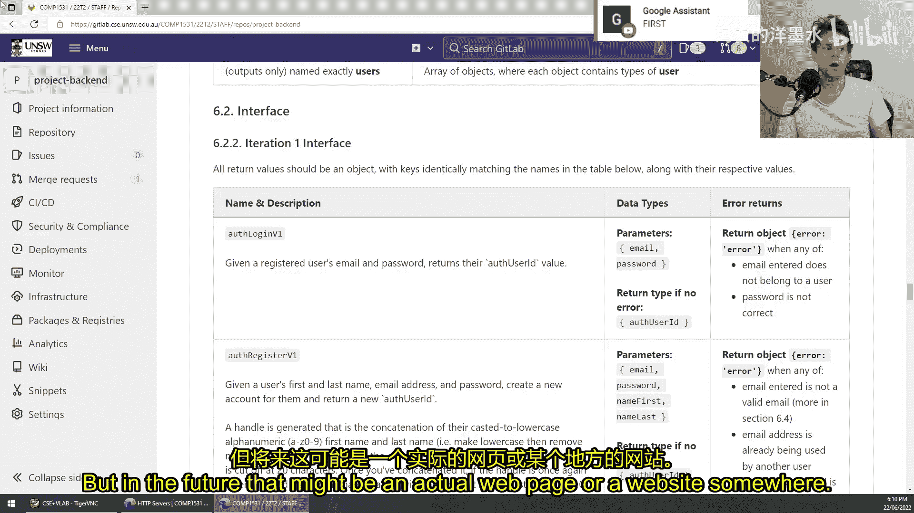

So。That's what an API is。 Now， the most common usage we see of APIs are web APIs。

 and that's simply because APIs mostly exist。Where。Person A creates some software。

 They create a nice， easy to understand interface。 They go and build out all the complex backend。

 And then person B， C， D E over here kind of use that API。 That's the most common case。

 An easiest way for people to use things all around the world is through the Internet。

 and easiest way to use things over the Internet to kind of leverage the web。

 as we talked about in the last lecture。So if it wasn't already applied。

 the interface basically acts like a black box and indicates that for a particular endpoint， input。

 output and just generally behaviour so。

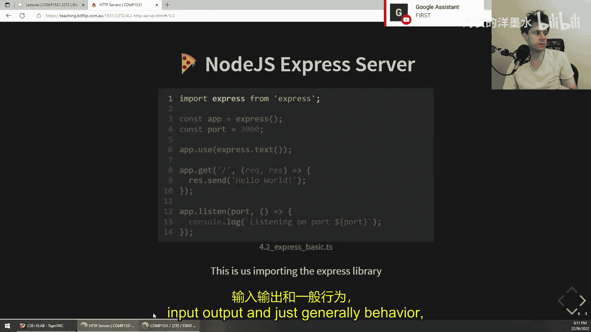

Again， back to this interface here， this function ortho log in V1。 it tells you what it does。

 It tells you the parameters， the return types and error cases。

 but it doesn't actually show you the implementation because you treat it like a black box。

 So that's what an API is now。

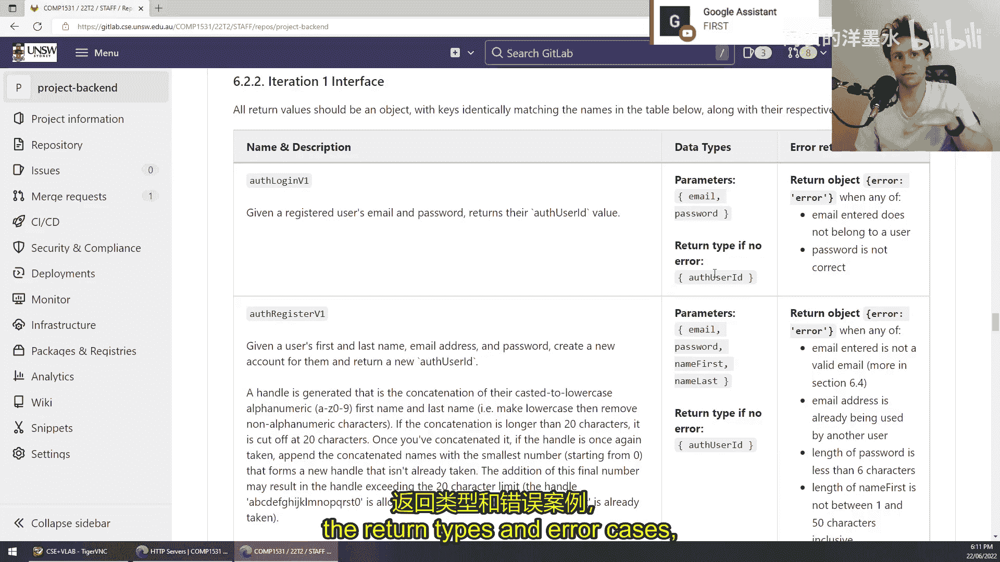

In the world of web APIs， which is where things get a little bit more interesting。

Web APIs are just APIs that are built and sent over the HTTP protocol is in the web protocol the one we looked at。

And it's all based on URLs， right， because the HTTP protocol is just a bunch of URLs being sent back and forth。

What's important to understand about how the Web works typicallyy in a modern application。

 And this is， again， just a very quick summary， is that what a web browser like this 1 I'm using here with Microsoft Edge will do is it will go and。

It will itself make a request to a server and say， hey。

 can I load the web page and you get the web page back， That happens all the time again on Web CMm3。

 It's a really simple example。 I load the page， I get the page back， the page loads on the screen。

 however， after that initial page load， a really common thing that most applications do these days is they keep talking to a server through some kind of API as they go and some examples of this might be and I'll just show you。

 for instance， if I open up YouTube for a second and I'm not sign into YouTube here。

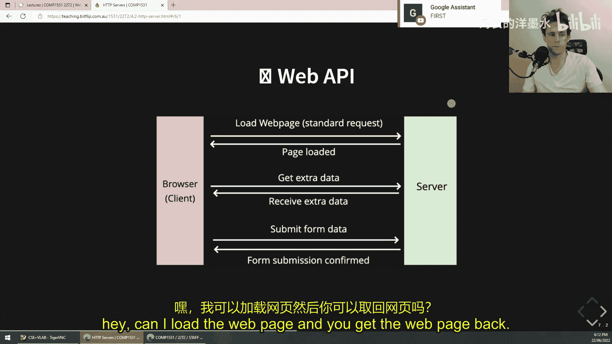

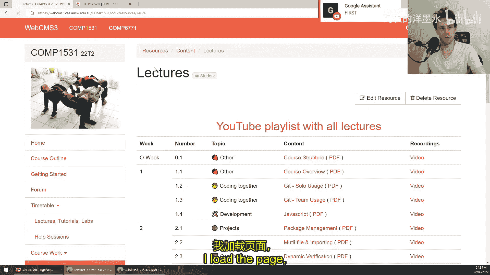

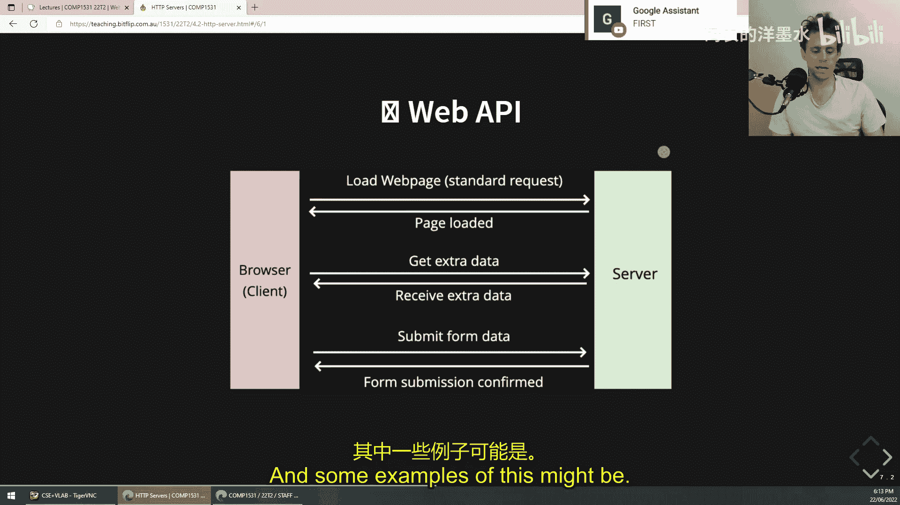

and again， this is not in the course specifically because everything to do with web browsers is not really critical in the course。

 but if I open up this here。This is like a bit of a debugging tool we have in a web browser。

 And the one thing I just wantan to point you to here is that and let me just find the exact。

There's gonna be a lot of information there。Basically to load this web page。

 all of this stuff you see here， these are different files， different images， the Mr。 Beast images。

 the Mr。 Bean images， these are all different files that servers are bringing to a web browser。

 but that doesn't have a lot to do with APIs necessarily but where APIs get more interesting is that on this page if I click on a particular button here。

 the web browser will have to talk to the server to get more information back So you see if I click on music here。

It will go and actually make some more requests and do some more things。

 So what you'd actually say here is YouTube is talking to the YouTube API。

 and they are kind of constantly。Getting that information。

 And this doesn't have to mean it like if YouTube wants to use an API。

 It doesn't mean that YouTube has to use it。 You know。

 a really common example of one company using another company's API would be Airb And B， right。

 So this is an Airb And B website。And what would actually be happening here is that when you scroll down on an Airbnb website and you see this kind of map here。

This Airbnb is actually talking to a Google API where Google has essentially a Google Maps piece of software like your major project。

And I can look this up， Google Maps API。 And you'll typically see that if I。

 this is a very complex API。 So it's probably gonna be。Directions API。

 So imagine you're a software developer and you're like， I really want to create a Google Maps。

 but I'm making Uber， and I want to be able to like direct tell my drivers where to go。

 So it's actually a Google Maps directions API。 And I do worry that。😊，This might be such a big。

 complex library that it might be hard to look at。Again， I shouldn't。

 I shouldn't pick random examples on the fly。Directionions API overview。

 I'm going to get sentence circles here。Maybe。I'll give you a really simple API。

That we were working with recently at work。 it's just like quite a straightforward run。

There's this great product out there called Kenny。 It's a US。 It's a really small US company。

And what happens with Kenny is that they are essentially a customer feedback management tool。

 So they build websites where if you have a little like product that you build。

 maybe make a little project。 you can actually。Use them as another product to let people be like。

 I want this feature。 I want that feature kind of like feature voting so that you can have a community of people who help essentially vote on what they want。

 And what's interesting about Kenny is that it has an API and you'll actually find a lot of popular services you like have an API。

 And if I go to the API， you will actually see that Canny。Think of it as like a forum。

 It has a bunch of things like saying， hey， you can make a post and you can comment on that post。

 And if you want to create a comment on a post， it kind of tells you， okay， here is a function。

 essentially URL。 If you think about if you think about H T TP URLls is basically functions。

 It makes life a bit easier。 And then it says here are your arguments。

 here are your parameters and the types they are。 And then it says this is what gets returned here。

 So this is a very universal common concept， you know。

 it's not just something we throw at you in the 1，5，3，1 project， this idea of。Function or， you know。

 in the case of web servers， Us， parameters， return types， all of that's pretty standard。

 And you'll find this for most things， like Google sheetets have their own API。 I mean， Google Docs。

 like you'll find a ton and ton of software。Google Docs API。 I've never even looked at this。Usually。

 you look for like developer guides or， or reference docs or something。 Not that you need to， but。

 and to be honest， all lot of Google stuff， Google stuff is very。Like intense and complicated。

 for instance。 But point is that that there'd be documentations some somewhere here。Yeah。

 it's all a bit of a a lot。 It's a lot to take in。 These kinds of simple docs like the one I showed you with Canny are much simpler。

 But the point is that that's what an API is。 These are web APIs they are literally everywhere over the Internet。

 There's probably there's one for discord。 I'm sure that a bunch of a bunch of you know。

 people in CE who love Discord might have made their own API or worked with their own API here。

 Again， I haven't clicked on this before。 The1 the1 I prepared was the the canny one， but。

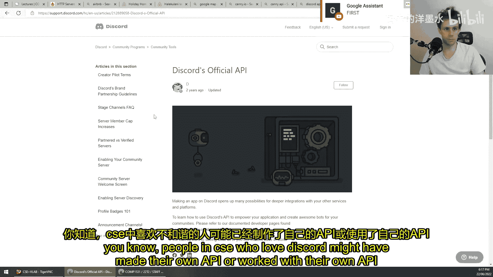

You can kind of see here that。Go， again， not making stuff up。

 but it's all of a kind of very similar thread at the end。Yeah， so here you go here。

 It's a similar thing。 He has a website URL。Here are some fields that you can take in。

 It tells you maybe what it returns。 It's just a lot of documentation。

 So if we go back to the slides。

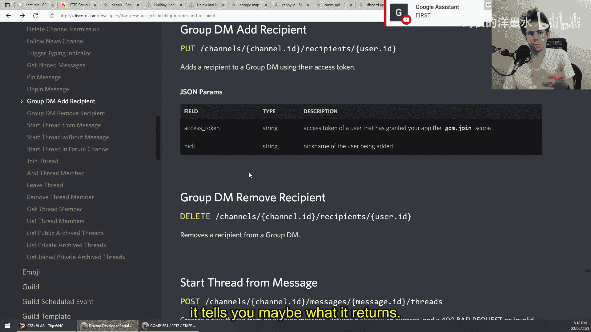

The way most web sites work these days is that they load the page and then that page is constantly talking to the server through some kind of API to get and collect data。

And that's how a lot of modern websites will do things for you。 like again on YouTube。

 if you like a video。It just kind of is liked suddenly。

 but what's actually happening is in the background。

 the YouTube web page is actually talking to the YouTube server via an API。

 It's probably an internal API， you know， inside the company and they're doing stuff。1。

Really common way that we communicate through this Web based API is through what we call building some kind of restful API and restful。

Is essentially an API that uses the four H TDP requests， which are get post。Put in delete。And these。

 oh sorry， it's like a bandaid I have that I'm like half ripping off。🤢。

And these describe all the main actions you can do on a web browser。 So on a web server。

 So lets let's go back to the code we had from last lecture because I think if you see some code。

 this will start to make more sense。 And this is the code we had here， we had our 4。2 express basic。

 and what you notice is that we actually had one of these four types already。

 which was a get request。 So this app here is our web server。 But when we say dot get。😊。

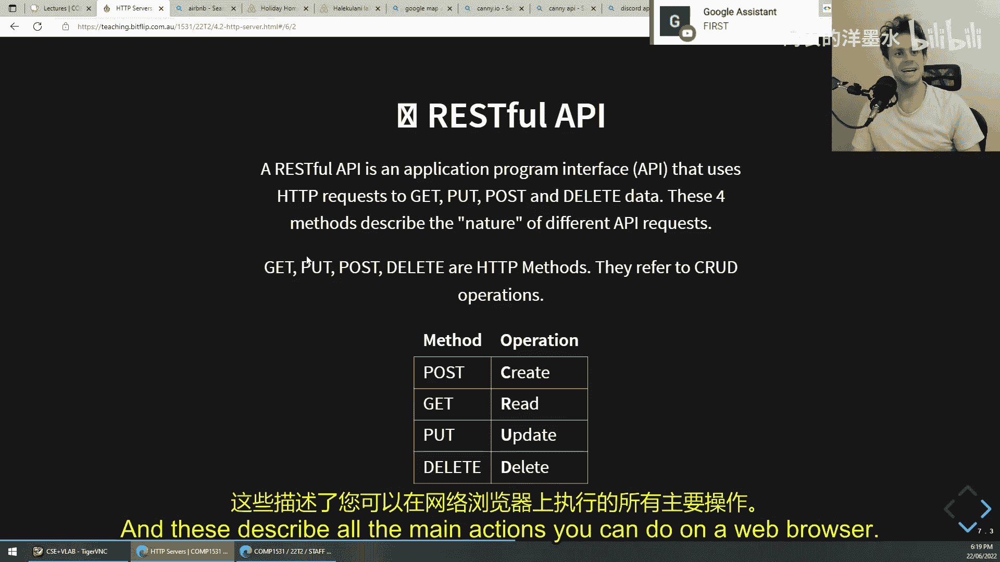

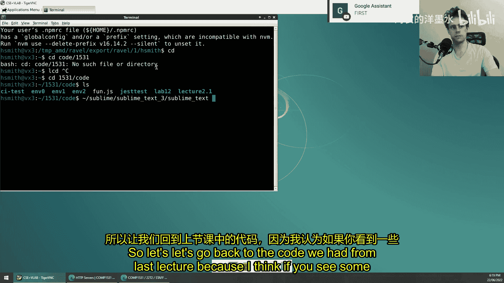

What we're actually doing is we are telling the web server that we would like to make one particular type of a HTTP request because remember HTTP is the protocol that's used to communicate over the web。

RightBut there are four kind of methods that are used as's get， post put and delete。

And the four of those together essentially mean get means to read makes sense， right。

 like get like read only posters to create， put is to update and delete is to delete。

And these four operations we sometimes refer to as CrD operations which is CRUD。

 that's the operation column here， so sometimes you'll say you know I've got a restful API just doing some basic crud things which really does just mean that you're using post get put and delete like this now we'll talk more about what those mean in a second when we look at this particular server here but。

呃。To start you off and to go into a little bit of depth。

 what is what is quite common is simply that you will have a server and you will have a bunch of。

 say these get requests。 You might have some post requests。

 You might have some delete requests and a few other things。 but you've got these get posts。

 put and delete。 Now， the first thing you might be thinking is like， well， we got， you know。

 what are these four things and like， how are they different。

 the C operations themselves are actually quite， they don't really mean anything inherently in terms of they're kind of like。

You， you know and see how sometimes you'll create a constant variable with an uppercase。

And sometimes like a constant variable。 And， you know， it。It。

 it might be able to be like something that you intend not to be modified might actually be able to be modified。

 but we use conventions to articulate and communicate things。 So it's not like a get request here。

 get HDP method is exactly read only in terms of， you know。

 nothing can happen to modify anything because anything can happen。 You as a programmer could。

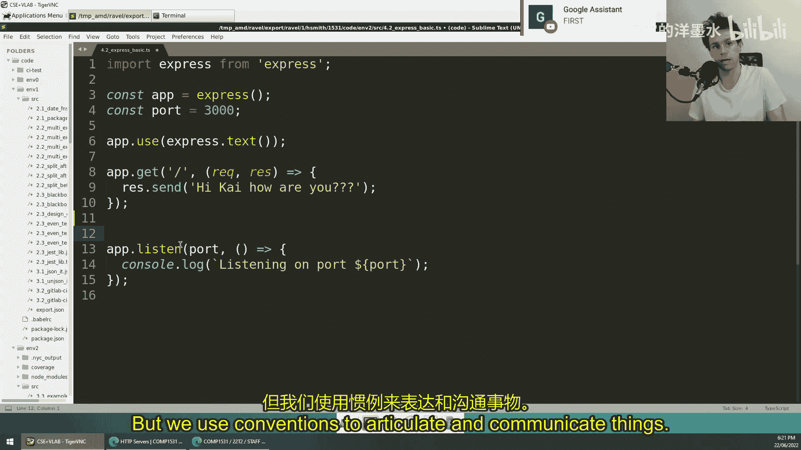

Completely have a get request， go and delete the whole website or something。

 It's more again just convention。 But let's look at some codeca I know this is gonna get a little bit too heady for some people。

 so。

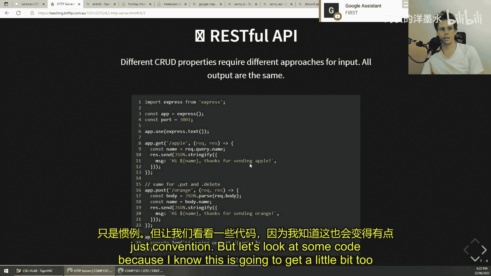

Where is， where is it， What is it4 point。2 crowd。So all we've got here is we've got a very basic server that does a few very interesting things and it's actually an expansion on the last server。

 but let me point out some of the key differences。 So firstly。

 I've got two http routes we would call them which is slash Apple and that's s orange。

 that means that if I go to http s Col slash local hosts like if I go to http column s local hosts port 3001 because that's the port we're running slash Apple。

😊，If I if I type in that URL into the web browser and my server is running。

 it will come and find this particular function。This particular function， because it's what's。

 you know， written here。 And then the code inside of it will actually be called and run。

 And what you'll notice here is that。My get request Apple， if we start this up。

 So let's start it up and P go inside M2 MPM run T S node source slash 4。2 Crd。Like this。

 And we get the server running。 Let's see what happens when we actually go to this URL。

 So if I open up。5 fox or something doesn't really matter。And I go to local hostst 3001 s Apple。

What you'll see is that I got this kind of interesting response， which said。

 let me move my head there。 Yeah， it says brace message high undefined。 Thanks for sending Apple。

 And I go back to my coat， and I take a look。And I say that okay， well， Kant's name equals request。

queery。 name， whatever the hell that is。And then you'll see that I'm sending something back。

 but if you remember in the first example I sent back a string basically a piece of text。

 whereas what I'm sending back here is some Json， So what I'm doing is I'm grabbing this object which is one object with a key in it and that key is message and that message is a string that saysH name thanks for sending Apple and I'm taking that object and I'm JO stringifying it into a string because the internet doesn't understand JavaScriptscript object but it does understand。

What ASI is。 And by stringifying it with Json， I can convert whatever I'm doing into ASciI。

 which is really， really useful。 So this kind of makes sense。 It's very similar last example。

 I'm not returning raw text。 I'm returning the Json stringed version of some other text。

 And then here you'll see that the name I could rename this to Hayden or something and restart my server and it would。

 you know kind of behave how you'd expect in terms of it would now print out something to do with Hayden as opposed to undefined right。

 but we don't want it to be Hayden。 So what is this request dot query dot name。 Well， the way that。

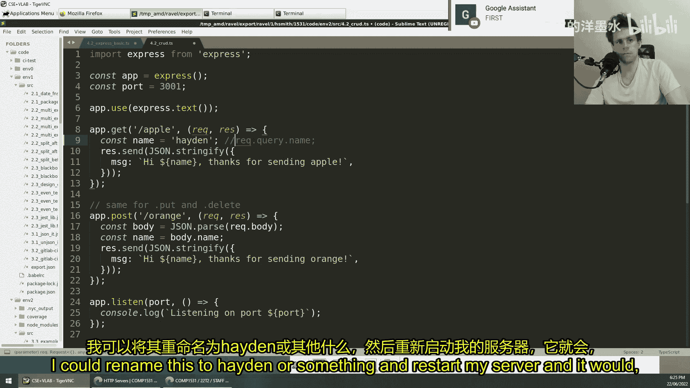

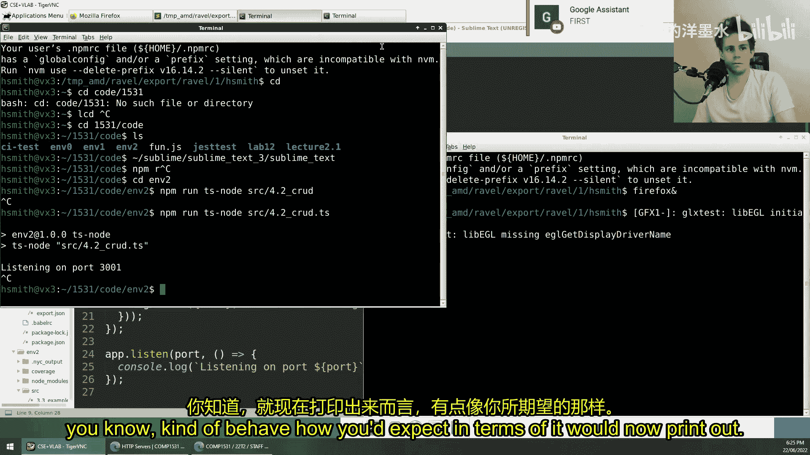

The way that the web works is that certain types of requests like get requests。

If you want the route to take in information。

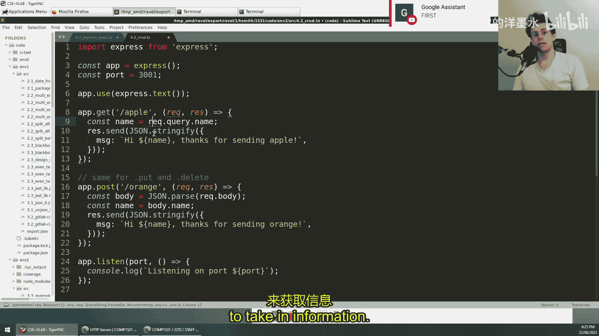

Right， because maybe， maybe I want， you know， when I call slash Apple。

 I want it to give me this cute message back。

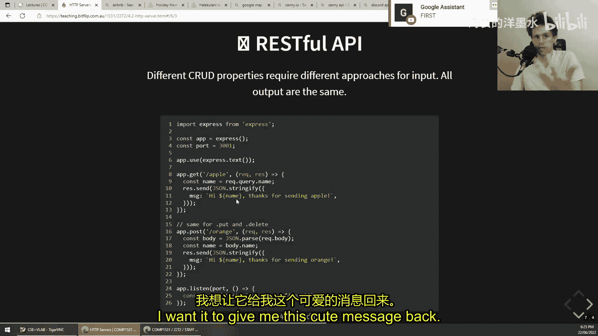

You know， sorry， let me just get to the page。

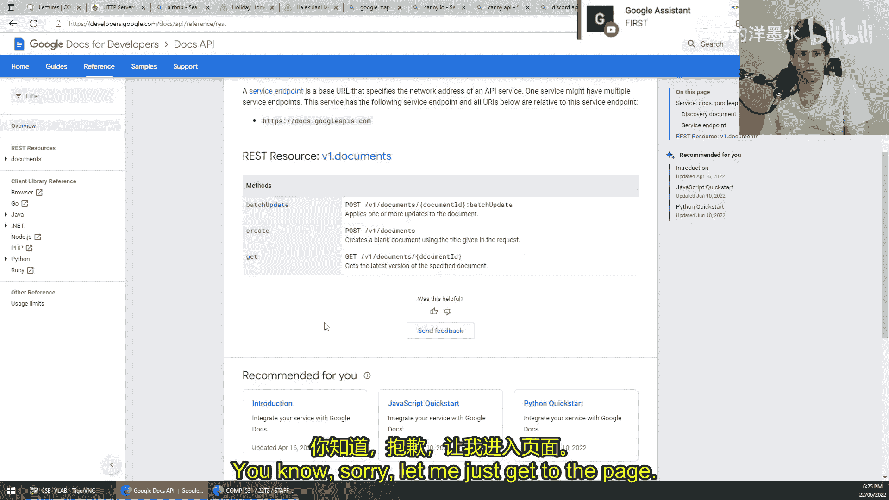

Oh， that's my personal computer， sorry。Yes， so like what I want it to do is to print out this nice message based on an input。

 but how do I input it， It's not a function。 I can't just like add a parameter here。

 I could try but that won't work。 And the way we do it with a web based interaction is forge variables we can actually pass it through the URL and you probably see this around all the time if I say Local hostst 3001 slash Apple question mark name equals Hayden。

This information here after the question mark is basically the function parameters。

 And when I run that， you'll see that I get the same thing now。

 but I have to restart my server'ca I kind of hacked it to get it working。

 you'll see that when I refresh this， it now works。 But if I change this to Sally。

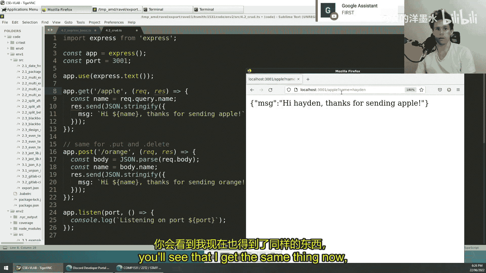

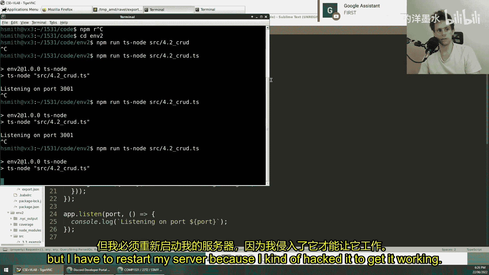

It now says Sally， and what's really interesting about this is you can actually start to see how this is forming already whereby instead of having functions with parameters and return types。

 I actually have here a URL， which is basically a function name。😊，And that URL is。

Taking in parameters through through the URL as well。

 and then it's returning to the web page some kind of return result。

 which in this case is just a string and in most cases it's some kind of string。And yeah。

 that's that's a big part of it。 And this is actually the foundations of an API。

 And you'll find that most web APIs are actually structured very similarly to this in many ways in the sense that it's it's quite literally a collection of URLs。

Takes in parameters， and you get some kind of string response back。 Now， it is very common for those。

m sorry， I'm fidgeting tonight， for those。String responses to include to be JSON based so they're based you know JSON text based because that's just again。

 if you think back to lecture 3。1 that is a I think it's 3。

1 the one about data interchange formats and standard interfaces it's just an easy way where it doesn't matter if the server is built in C or Javascript or Python or Java you can always send back information and it's a language that everyone understands。

 So if you have a program on the front end not running with Java then you are able to still digest that information。

So that's kind of， that's kind of a bit more of an elaboration of what。

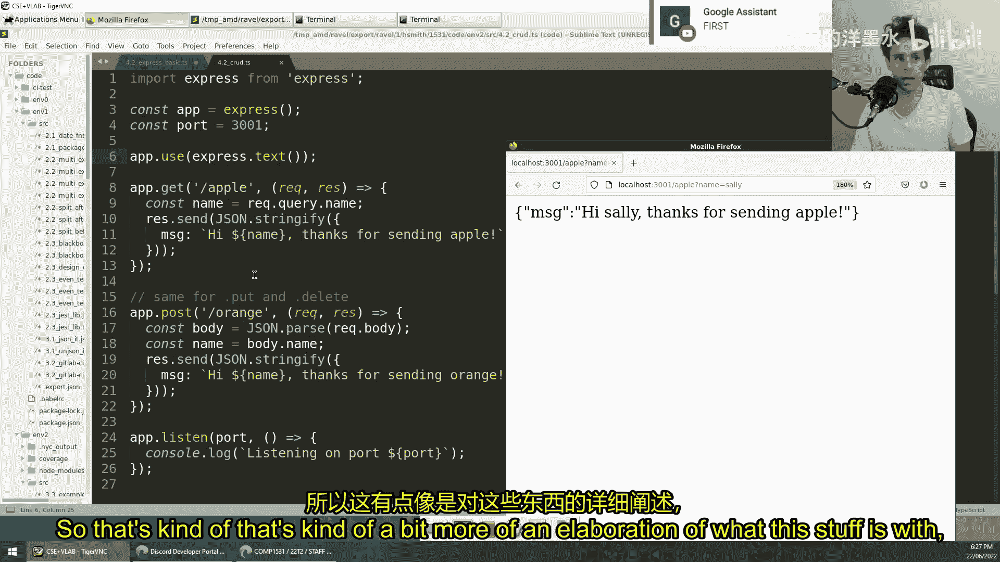

This stuff is with you know， APIs and whatnot。And you could kind of start to imagine you could have a very expansive API。

 for instance， like imagine I create another one called app dot get， and then I say slash time。

 you know， and then I go you know request response。

 and then inside of here all I'm going to do is I'm going to just send back a stringified Json of an object。

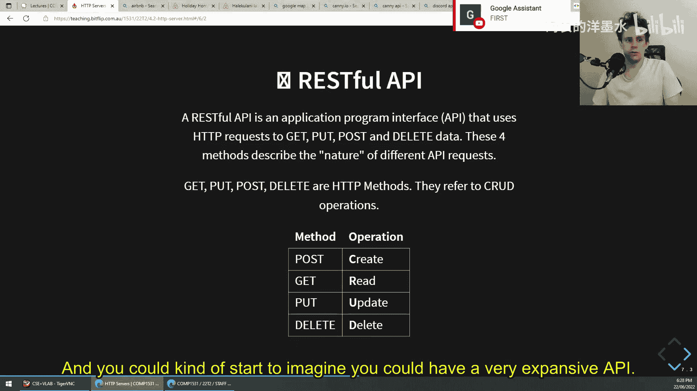

And that object's just going to say time。 And then all I'm going to do here is say。

I'm just gonna return new date dot to a local string， which is like a friendly string format。

 you know。And I'm now just going to restart my server。

 and I've created another route or essentially another interface。

 another function on the web interface where if I don't go， instead of going to Apple， I go to time。

 it will actually give me the time And when I refresh it。 I get the new time。

 And this is really handy because now again， you can kind of imagine this is kind of us building on an API where this API now has a time route or a time function。

 No parameters。 It's a parametersless argumentless function。

 but it returns something and that something is a string as well。😊。

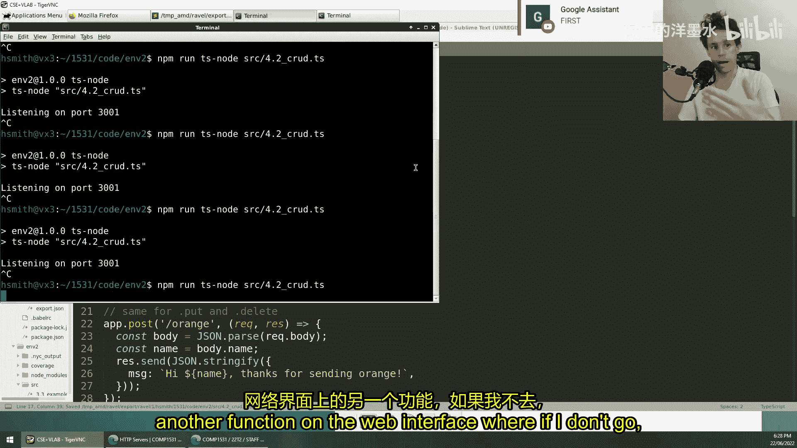

And we can just keep expanding and expanding that concept。 Now。

 where things get interesting on the restful API is that not everything's just a get。

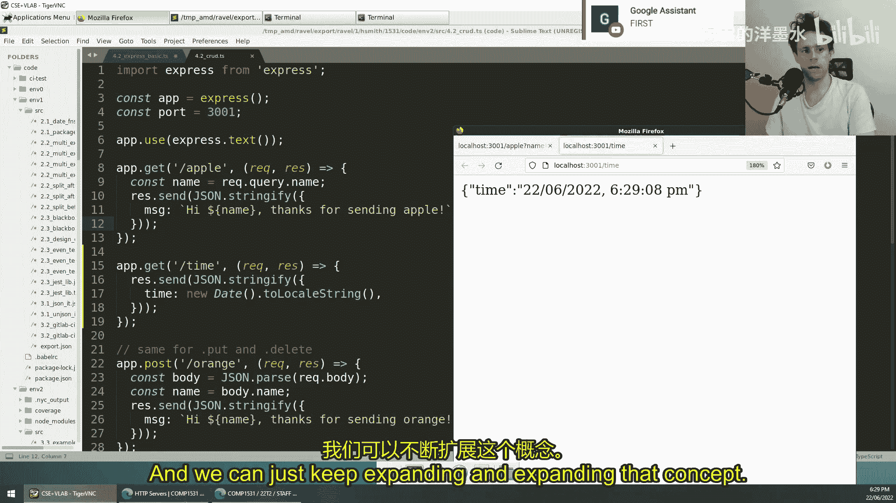

Method。We also have these other methods that are post， put and delete methods。

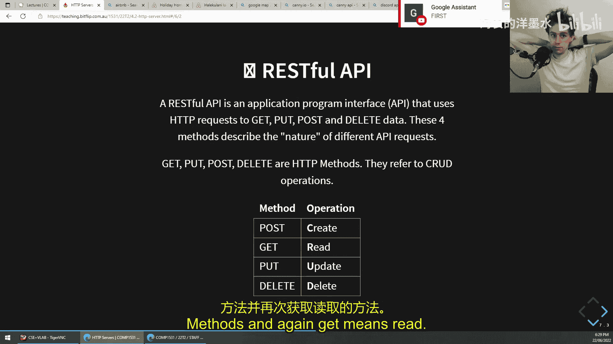

嗯。And。Again， get means read。So you know these two routes we had here get Apple and Get time。

 these are all us reading some information， we're not creating information or updating information or deleting information。

 we are simply reading it。😊。

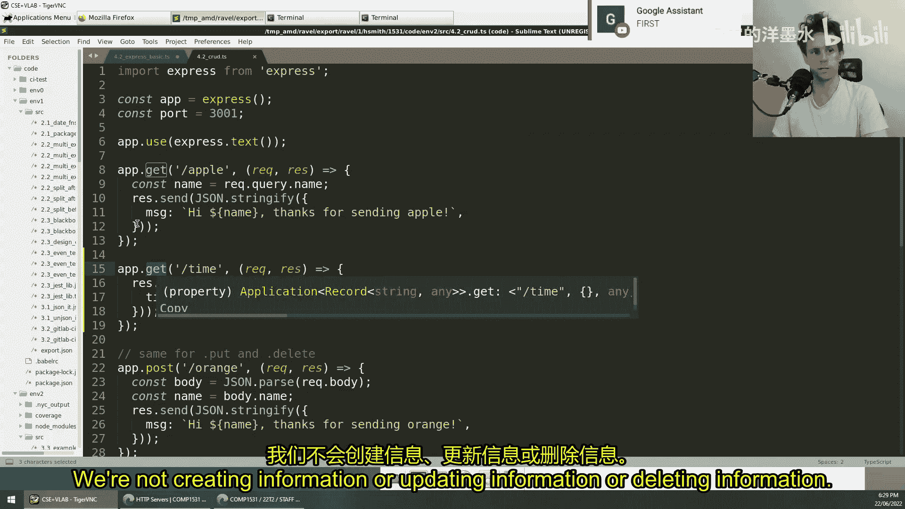

Now， what's really interesting is I'm just gonna see if we should jump ahead a few slides and then come back。

 which I think we should。嗯。I think I might have， yeah。

 so let's jump ahead a few slides and then come back。With this， most web browsers， though。

 inherently in terms of what a user like you and me can use just by typing in a URL。

 always send requests via get。 It's just how they're built。

 So when you type a website or a URL into the address bar there and you hit enter。

 it's gonna make a get request to that particular URL for you to the server。

 And I can see that pretty easily just by opening up the network tab again and。Refreshing。

 And if I look on the very first request here， you can see。It's a get request。

 You're not required to have a look at any of the information I've got up kind of here just generally below me。

 that's， that's totally unrelated。嗯。But， as you can see， it's relatively。You know。

It's always a get request。What we really need to have more interesting conversations with a web server than just what a web browser can do。

 which is quite limited is to actually talk to it some way Now there are three main ways that we discuss in this course to talk to a web server The first one is via well the second one is via a web browser which we've kind of demonstrated so far。

 but the first one is through what we call an API client which is essentially a tool designed for talking to APIs and then the third one is an NPM library that is essentially a coding library that helps you make them which will be really really useful for iteration too so。

On the API client front。An API client is， again， just a program that is used to talk to APIs。

 And there are a whole bunch of these programs， you know， two common one， like。We。

 I use one at work called insomnia， which is really good。 Postmans a common one。

 One of them ones that we usually recommend in 1，5，3，1 just'ca it's lightweight is。

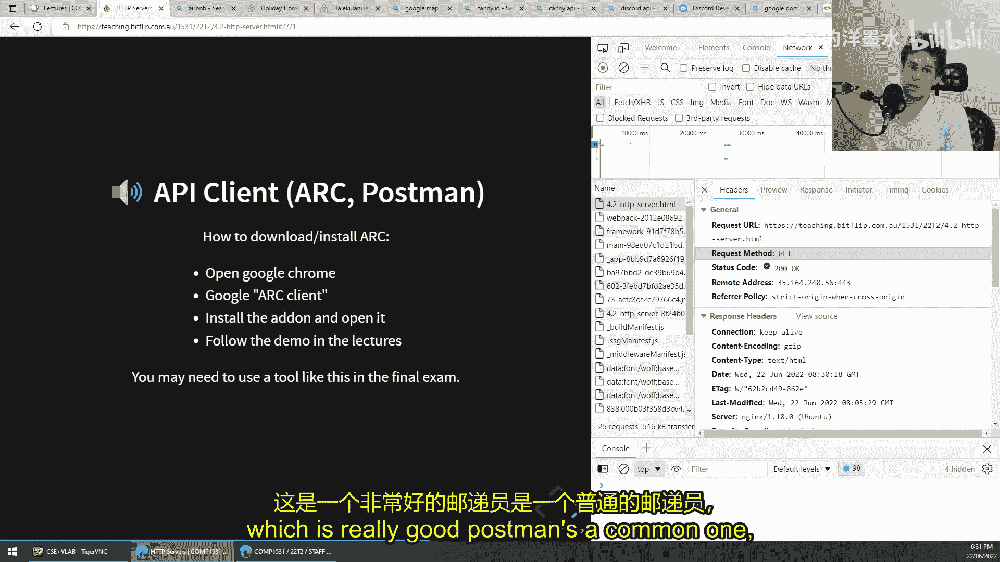

ARC， which is the advanced rest client。 And you can install these on pretty much most Chrome or Firefox based browsers by just go ARC add on in in Chrome and you'll。

 well， this one's a chromrome add on。 So you'll probably open it up in Chrome。 switch to Chrome。 Yes。

 I don't want to download Chrome。H。

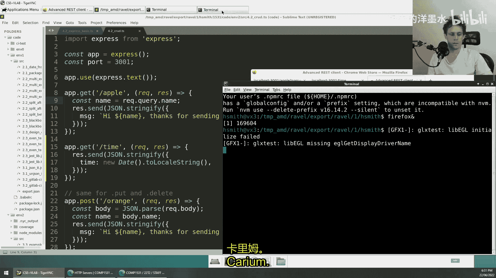

Caribmium。Quit。And what I can do here is if I go ARC add on into Chrome， I can actually。

 again find it on the Chrome store。 So maybe not Firefox。 I'm not sure I can go launch app。

 I've actually already installed it， but you can go and。Open this up yourself anytime。

 And this actually runs like a a browser app。 so you don't need to install it to your system。

 It kind of runs through the Chrome。Engine， if you will。Though it's being a little bit grumpy today。

 I think， I think sometimes it might take a second。I'm not too sure why。

 but there are other ones you can see， for instance， again， there's a postman API。

 which I'm not even sure sometimes。Sometimes they deprecate things。Yeah， see， for instance。

 in this case here。Postman was a useful one， but they kind of decided to stop。

Sing it through the Chrome add on library。 And instead set serve it as a dedicated app， you know。

 just like you download one on your computer， so。I'm just going to try， and。嗯。Chrome add on again。

 I'm just gonna try and get back to this and see why it's not working。

 Maybe we can uninstall it and reinstall it。Extensions。Yes， how do I。

I'm not sure why it's not doing it。How do I see my adds， settings， my extensions and apps。No。

Why just launch。Let me try closing it and reopening it。Cool， and then I go ARC add on。Try it again。

Longcha。The AIC extension is also deprecated now。 I it Oh no。

The problem is you can't really install things natively on them， on the CSE machine。

 sometimes if they have。Yeah， sometimes they'll have standalone things to run。 it's not good。

M mate Jay says， can these web APIs be accessed by mobile apps， not just web browsers， Yeah。

 it can be accessed by anyone with the internet， That's why it's so excitingca。If。

 if a technology is capable of sending an HTP request， then anyone can open it。嗯。I would like to。

St this out。 This is annoying。How do I uninstall it。

Well let's just try and find a random one on the Internet。API client。See what we find。Boomomerang。

 Okay， this， I let's try this out。 I， This is probably a terrible idea， but let's give it a go。

 I' never seen or heard of this before。 I'm sure it's fine。 They're all kind of the same。

 It installed on Chrome。 I can see there's an extension there。

 Will you let me manage extensions with it。 Oh good。 Thank you。Sorry， now I can remove it。

 Let me try and reinstall it。 I， I'm not sure if。Sorry。Normally， this just works， but。

If I add it now， maybe it'll be happy'cause I reset it。 let's try it out。 Okay， there we go。 Alright。

 well， we're sticking with this one。 Sorry boomerang。 I don't love you very much。

 So this isnt API client。 And you'll see here， I've still got my server running。

 And they're kind of like web browsers in the sense that you type in a URL on some parameters and stuff。

 And I'll show you here。 I can also type in local host 3001。😊，slash。Apple。And， you know。

 question mark name equals Haden like this。 And when I click send， I。Sorry。

 it's trying to send it securely。 You can ignore that for a second。 I get this result here。 You know。

 message， say， you know， hi Hayden。 thanks for sending Apple。 And if I say， you know， Sally again。

It says hi Sally， so this is like a little tool where I can easily do this and you might be thinking why is this so different from the web browser or what's so exciting about And the answer is that I can actually change the methods that I send on and there's a lot here。

 but don't worry about those and I can send it via you know if you go back to the Crud ones。

 I can send it through like a post to put or delete And if you look at my code here。😊。

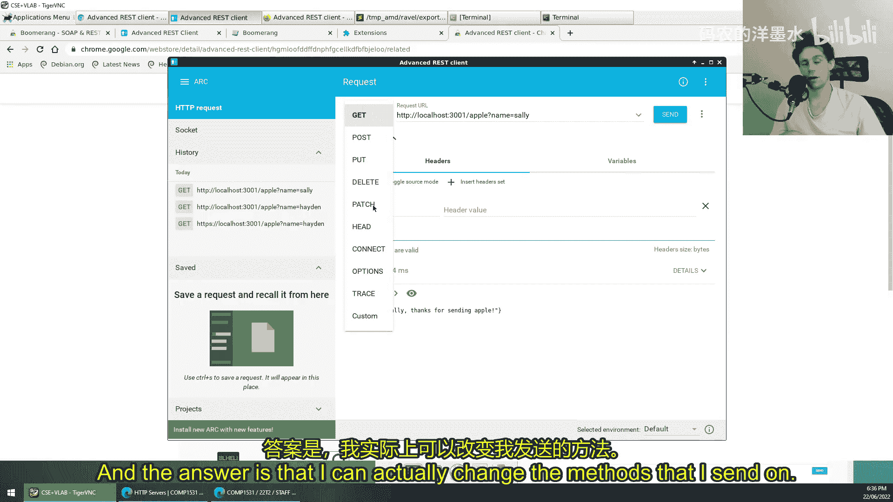

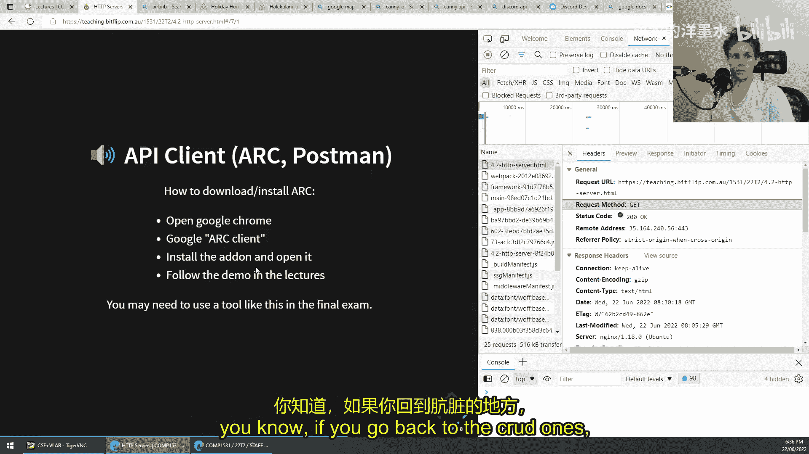

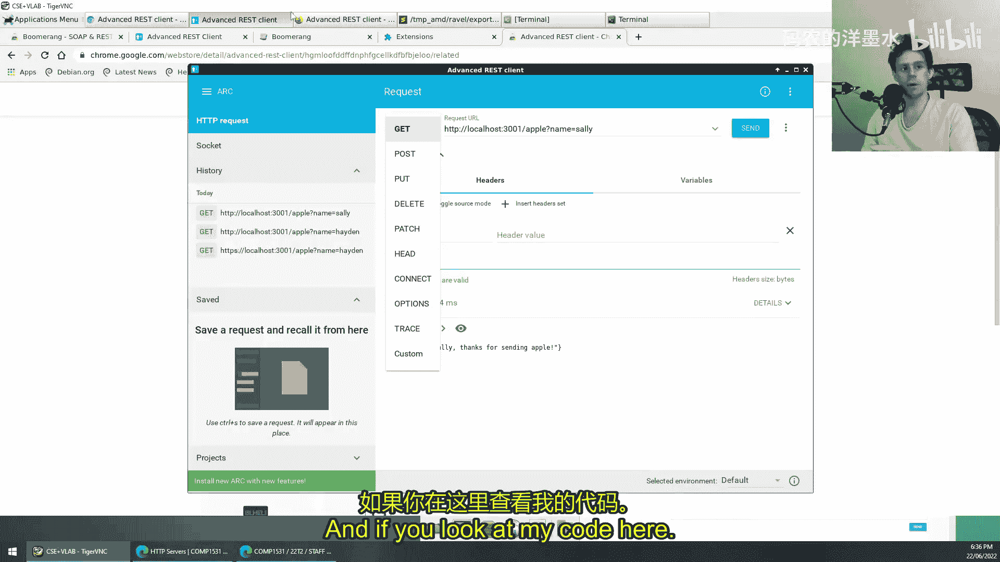

If you come back to my code， you will see that in my server， I also have a post method called orange。

And what orange does here is similar， but also slightly different。

 which is that it still returns high。 So and so thanks for sending orange。

 But the way that I've consumed the information here is a little bit different。

 This is where things get weird。 You notice that with the get1。

 I consume the information via the URL。Rightright， I pulled like request is the the incoming message Que is the URL。

Prameters and their name here is a property of that。And just to be clear， too。

 I can send multiple things if I say like name and age， let's say request dot query dot age。

And then I modify my string， you know， high name of age age， and I restart my server。

 You can send as much information， but not as much。

 but you can send a lot of information through the URL。

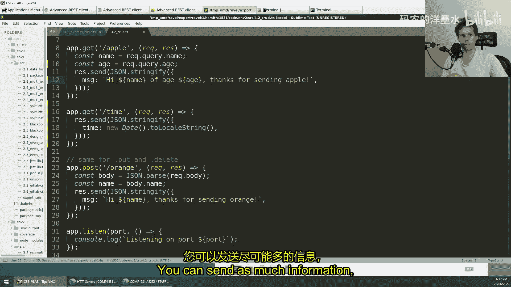

Simply by adding more information after it。 And the way the way Uls work。Is that the first。

 and let me copy this into something a little bigger so you can see it。

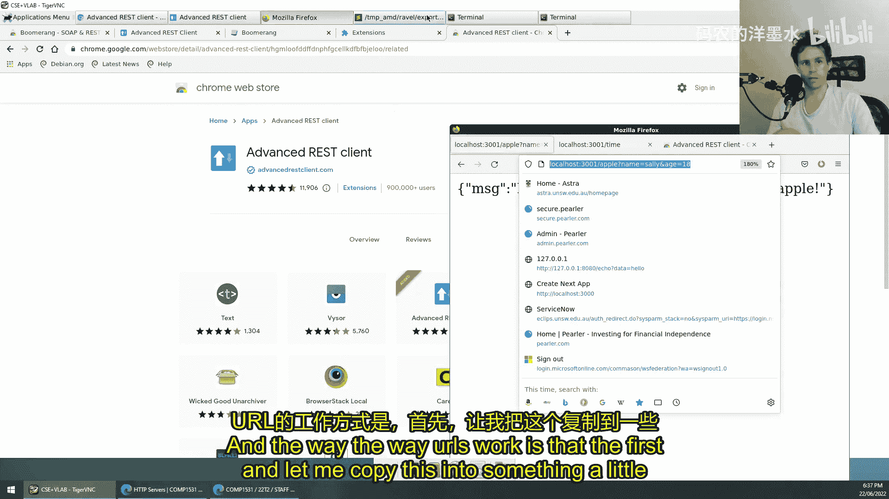

The all of the data coming in from the query is separated by question mark。

 So it's like the URL here， question mark and then。The data。And this URL is made up of the protocol。

 which we know is HTTP， It's made up of the domain or what you might normally call the website。

 and then the port， which on most production servers is the same so you actually normally don't need that when you're using the internet and then we call this here the path which is kind of analogous to what you understand you know that a function name is and then the data is here and the data is just basically key equals value and for each piece of data we use an ammp percentand to separate it。

 So if I was to add more I can add more like this basically。So we got that information there。

 but again， when it comes to these post requests like you see here。

 we're not capturing that information via the query。

 and that's because with post requests we send the information through what we call the body which might be a bit of a new concept。

 so if I go and make a post requests to orange， I don't need any more query parameters but if I want to send information for instance。

 the name I actually have to go to the body part here， and I have to send it some Json。😊。

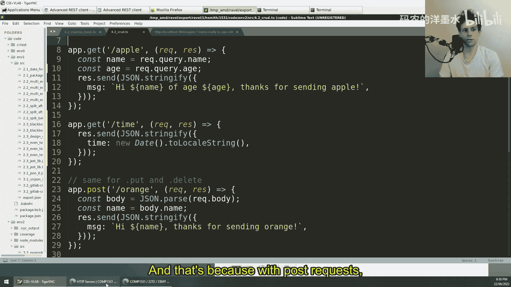

So the JO is going to say， you know， name is Hayden。So instead of putting it in the query。

 I'm now putting it in the body。Now， the body， you gotta think of it like this is the equivalent of。

 you know， think about H TDP as。You know， male。I write you a letter that， you know， hi。

 so and so hi gaab， really nice to see you in the 1，5，31 lectures。 You know， it was a great time。

 I wrap that up in a letter。 I put my address， I put the address to where I want it to go to and then I put the return address。

 So I know where it comes back or something like this。 the analogy doesn't carry perfectly。 but。😊。

Using query， putting data in the query like we did forget requests on the server is like adding more information to the address。

 It's publicly visible， It's right there， it's really simple。

 you don't have to kind of open up the envelope and shove more data in。

 but adding it into the bodies the equivalent of putting it inside the letter that's in the envelope and over the internet when we send information typically you can look at the letter like anyone working at the post office can see where you're sending your mail to。

 but they don't know what's inside of it so。😡，I'm simplifying a few things here。

 But that's kind of what we're doing when we send it through the body here。

 Andm I click send or get an errorcause I've probably got an error in my code。What do I got here？

Okay， so some， and this is probably a useful tool with debugging。

 You probably noticed that when I call this URL here， the Sally 1， I got this little green thing。

 and the green thing said 200 okay。 There's a few really important errors that you'll see when it comes to web development。

 The first one is 200， which means happy face。 You got 400。

 which means basically invalid parameter past in。😊。

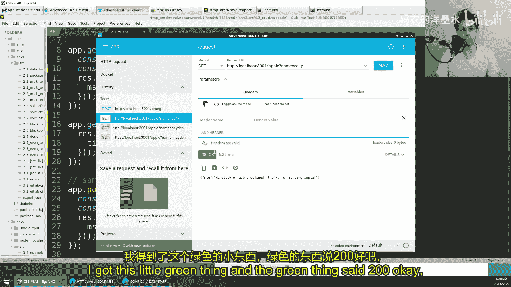

You've got 403， which means you aren't authorized。To access this， you have 404。

 which means this route。Does not exist。 And then you' got 500。Which means that。The server。

 something bad went wrong on the server。And that's why you'll see here when I look at my results。

 This one was 200 okay。 But when I called the orange route， I got this。 Oh， worked that time。

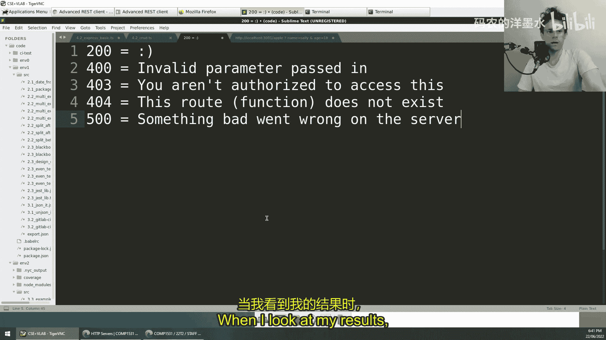

Alright， well。You saw before there was a 500 here。 and that 500 basically says that the server had an error。

 And in fact， if I go back to the error， you can see here that the server had an error on the terminal。

 Now， you'll notice that these are pretty logically split up where 200 stuff is okay。

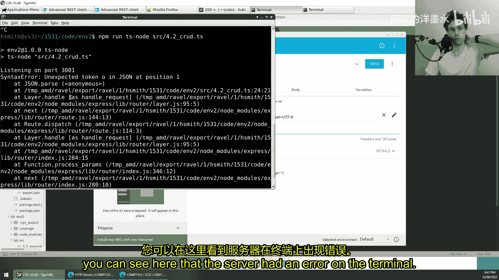

500 stuff means that the server made a mistake， the thing you wrote in this course and 400 means the person who's giving information to the server did something wrong。

 So， for instance， if I try to access a H TDP route like orange with two Es and I send it。

 I get a 404， which means that me， the person trying to talk to your server， made a mistake。😡。

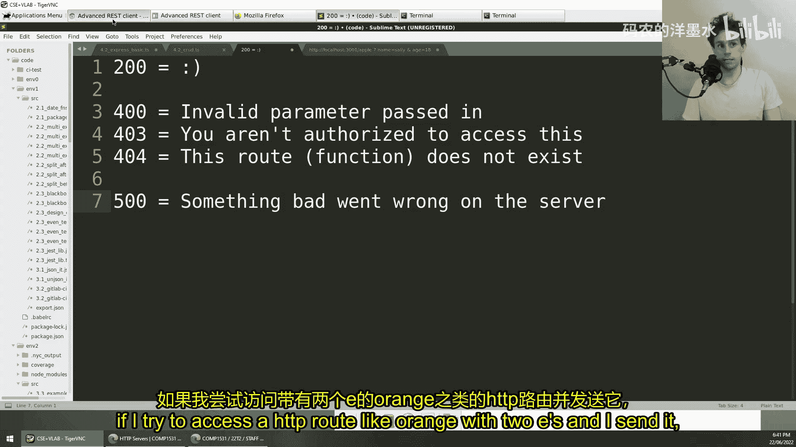

Which if I do this right here， then， you know， it says 200 acceptable。 and similarly。

 I could change what's in the body from Hayden to Sally and we would see that we would get the new request come through and it would say hi。

 Sally， thanks for sending orange。So that's a post request。 Now， if you're thinking。

 if you're paying attention。

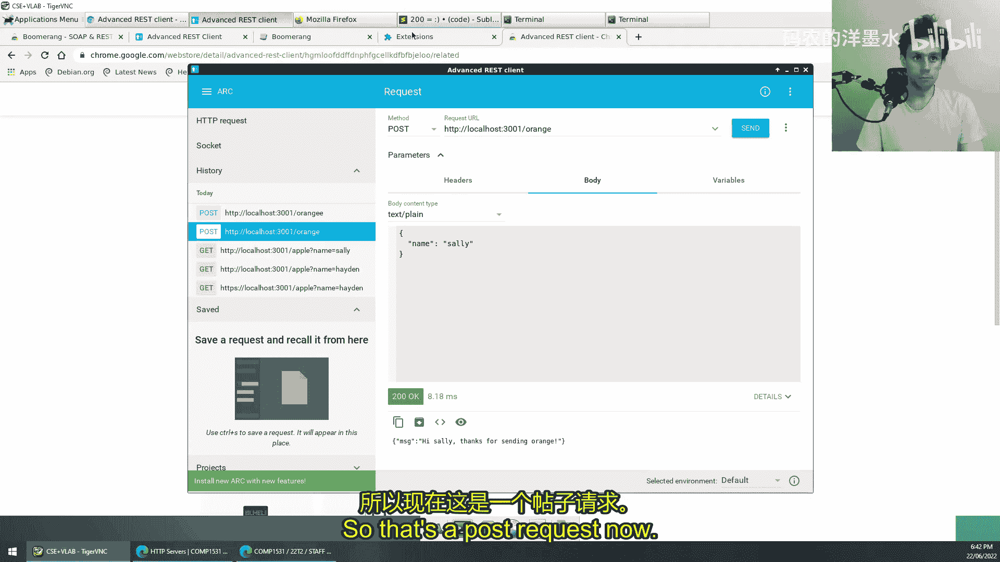

You might remember that before we said that get request for about reading。

 post request about creating， put requests about updating， delete request about deleting。

 you might think， okay， Hayden， but you didn't。

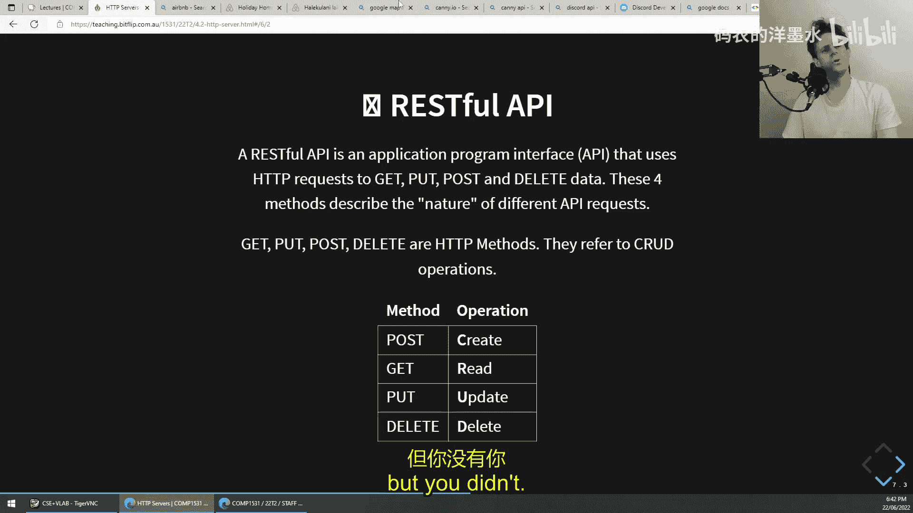

Create anything。You， you made a post request here， but you didn't actually create anything。

 You just printed out the name。 And you're right， because if we could scroll further down。

Post requests。Aren't actually forcing you to do anything。 They are communication tools。

 So my post request is kind of what should probably be a get request。

 I should probably rename this to a get request because I'm not creating or updating or deleting anything。

 I'm just adding something reading something。So that's， that's just really important。

Those four keywords are instructive。They're not constraints。

 They're not technical words in many ways。 There's a few things with them， but。

You getting them right is just based off， not that you ever have to really get them right in the course。

'cause we tell you what they are， but。Yeah， they， they don't mean like they don't mean something really deeply to the server。

 Like the servers not gonna be like， hey， you said this was read only。

 but you modified something now。

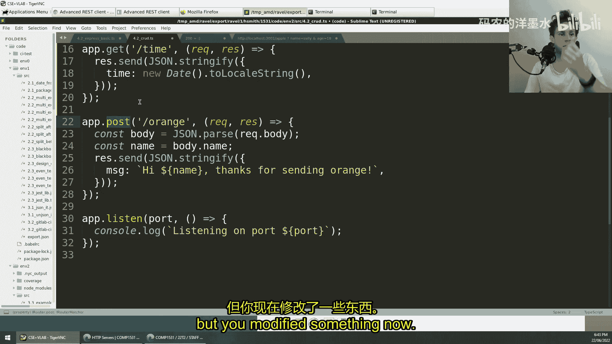

Just to help， kind of。Carry this example a bit。 We're gonna keep moving on and then loop back to it。

 This was the piece of code we just kind of looked through。And we talked a bit about using the query。

And then we talked a bit about using the body and basically the way that HTP and cru and stuff is set up and this is actually kind of somewhat baked in stone is that get and delete request don't take in a body and you tend to send information to them like function parameters or arguments through the URL。

 So if you have a get request or some kind of delete request when you call it that information will come through in the URL。

 But when you have a put request or a post request and we saw a post request you send that information through to the body via the body like you saw there on ARC now。

All， all four of those get delete put and post。 They will all send the data back via a Json。Now。

 that's not again a requirement of the server。 That's just what you'd call common convention。

 You'd find most most APIs out there， I'd say 99%， probably more would return J definitely。

 And also what I kind of glossed over is that typically most servers will expect。

That you send the body information via Json as well。 And we kind of implicitly did that。

 If you have a look at my body here， this is valid Json。 Now， in this case， here， we sent it as text。

 We just sent it as a string across the Internet。 And as soon as our server caught it。

 It pars that string with the Json dot pars。 It took the body。

 And it kind of unjaed it into jascript object。 And that's where we got the body here。

 And then we got the name out of that object。 So body here is an object with one key。 It's the。

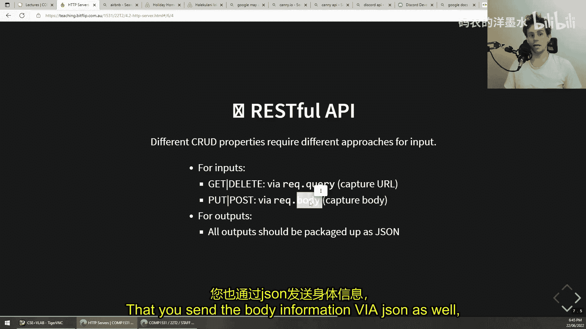

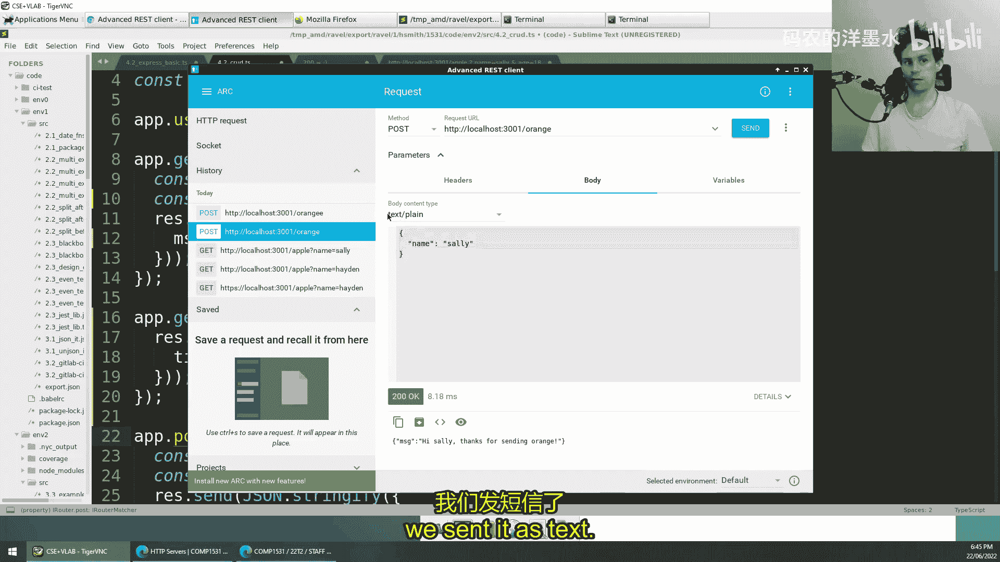

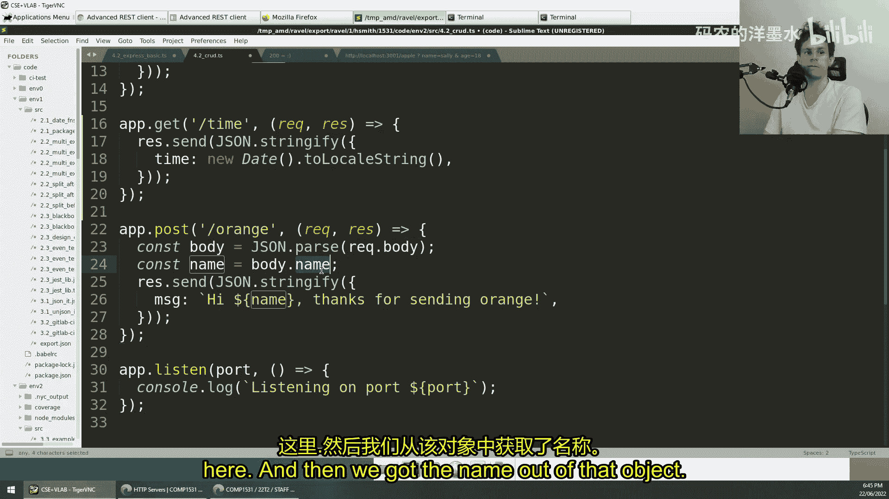

It's the unpacked from Jason version of this。

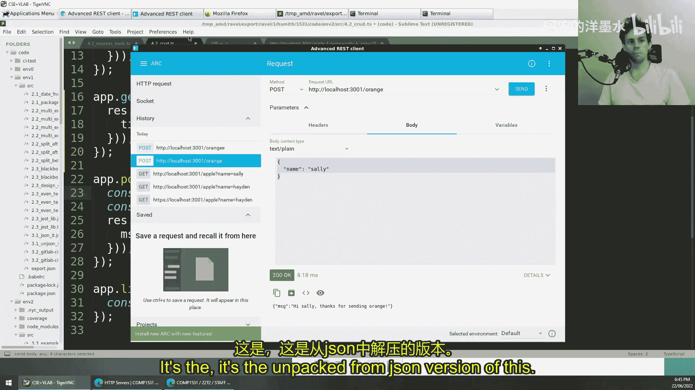

Okay。Now， I mentioned before that 99%， probably of APIs。啊。Done with Json。

 always returning Json and for post and put。Functions， operations。

 they take Json in through the body。 So what was actually done because someone realized everyone was doing this was some modifications were added to express。

Where if your server is going to be pretty much exclusively dealing with JO。

 instead of saying that your server is working with text， you can change this from text to JO。

 And then similarly here， when you have your response dot sends。

Instead instead of having to kind of say， I want you to send text and that text is the Jsonified JavaScript object。

 you can actually just say response dot。Json like this。

 and essentially Express will do that same thing for you。 It will actually say， oh。

 thank you for your jascript object。 I will go and convert that to JO for you。

 and I will send it back out。 And then the third one is for the put and the post requests。

Instead of having to do JSON。 pars， if you have this little thing up here with JSON。

 what it will allow you to do is to essentially do what we do with the queries and simply say request。

Dot body dot name， because by changing this from text to JO。

 you've essentially told express that all the inputs you're getting are in the JO format。

 So when you get the body actually kind of parse that and you know。

 unscrew that and turn it into a jascript object for me， which would be really nice right so。

You'll see here when I stop this and run it again， I will get the same results。

 It' just I've had to write less code， which is nice。 I run that again。 That works fine。

 I run the get request。 That works fine。 Yeah， you don't do anything with Json when it comes to inputs for get and delete。

 They just passed in the URL like this。 That's okay。 There are other ways you could do it。

 But that's just how we teach you to do it in this course。 And yeah。😊。

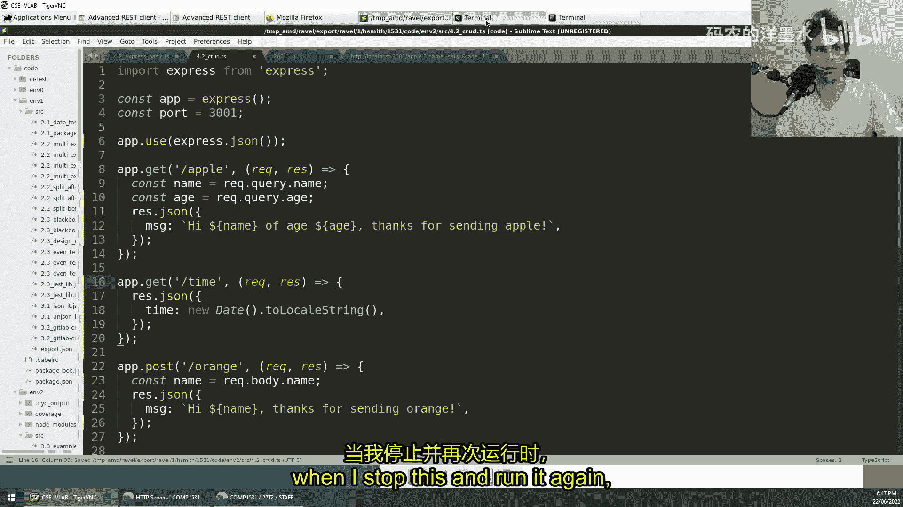

These were the kind of key lines of code that got changed here compared to the previous example。 Now。

 there is a little task that we want to do。 And We might do this at the end just to play around a little bit。

 but I'm not going to do it explicitly now， because。

Let's get to the end and then see how we're feeling。 So back to API clients。

We learned how to use ARC to do a get and a post request。

That was cool U a doing a delete request or a put request is honestly identical。

 Like I could take you through an example， but the actual code written would be nearly identical。

 So we've looked at ARC。 We've made a couple of requests We're familiar with web browsers' because we were using them in this part in the first part of this lecture。

 But let's get on to the far more exciting one on the one you'll probably be working with a lot。

 which is an actual NPpm library that allows you to make H TTP requests。😊，V our code。

So what I've got here is I've got some code and in fact it's already sitting in a file ready for us to go here。

 and I'm using a particular library in NPM called Snc Request。

It's essentially an HTTP library that I have to open another terminal。

 It's a library that allows us to do what ARC or those other API clients do except to do it on terminal。

 or like in code more specifically and all I have to do to use it I don't know if I mention this here。

 Yeah I did is just run NPM install sync requests。

Now you could maybe say that maybe this should be a dev dependency or not。

 It really depends on how you're using it。 So you know in this course it's probably a dev dependency because you're mainly going be using it for test but again it depends what you're using and I just go on to install that and then what I can do is I have this file here I can just run it and all that file does is it imports a request object from sync request and then it makes a request and you can see here that the request is a get request。

To this URL Lo close 3001， Apple name equals Hayden。 And then what I do at the end is that。

It's a little bit long winded， but I get the response， right， so this is the。

 this is the request made。 So like sent to the server。 And then when I get the response。

 I get the body from the response。Which you've seen as this thing down the bottom here。

 I then convert it to a string， which you kind of have to do from what I can tell。

 and then you parse it as Json， which isn't automatic for you。 and then you console log that。

 So now with the server running because remember our server still running。

 I can actually just over in another terminal over here， I can just saympm run T S node。Soce slash 4。

2 request dot。T， S， and he will go and talk to the server。So， oh， high Hadon of age。 unde'fined。 Oh。

 that's interesting。 Why is that。I'm not sure。 That doesn't make much sense。Oh， a， I'm fine。 Sorry。

 of course， Cause we added that extra thing。So， yeah， similarly。

 if I wanted to add that in other information， I could just add this here。 A G equals 18 like that。

 And then then we just have to restart our server。

And then we just run our test again。And all that's happening here is your server。

 the implementation is running over here， running， running。

 running and your other code is just talking to that server。 That's all that's really happening here。

So this library is really really simple to use。 that's how you do it with get requests and delete requests because all you have to say is get or delete and then you just pass the information through the URL。

Ype， that's all I have there， apparently。But two other things， and these are both important。

 is that what happens if I want to simplify my code， Well， you can actually take it further。

 Let me just check， yeah。

And instead of instead of manually encoding that here。

 I could actually clean up my code a bit and say， you know what， all of the parameters。

 all of the arguments I'm passing in or my query string， as it's called， is just name Hayden。

And age 18， like this。So instead of having to kind of manually write that in。

 which is a bit complicated particularly if you have something dynamic。

 I can actually remove that bit and instead pass a query string in， that is just my query string。

 or if I say rename this to query string just so it's a bit easier to understand the request library takes in this kind of extra property QS。

Which is this query string variable and it should do the exact same thing for us。

 which kind of makes our code a little bit cleaner and more dynamic without having to kind of manually type out the the information straight into the URL。

Now， the next logical question is what happens with my post request。 Okay， well。

 let's say that this is our get request。What do our post requests do， Well。

 we know that with our post request that we are calling slash orange。

 and we also know that it's not a get request， right， It's a post request。

And then the body that we pass in that post request is actually going to be pretty much what you'd expect from some of the other examples。

 which is that。We want to send some text， which normally you might be able to be like， all right。

 let's say that that text is just。Name is Hayden。So this should mostly work because that' that's like the body we're sending。

Let's see if that works。 Let's see what happens here。So， I run this one。Okay。

 and it says hi undefined。 Thanks for sending。Orange， now。One of the annoying。

Realities of working with this library is that there's actually a really critical line that you need to include or a few lines and it' it's in all the sample code we give you。

 but I'm just going to include it here and that is that as well as your body you also need to include this thing called headers and this other stuff don't worry about too much about what this is。

😊。

But this is essentially information that comes with your request that tells the server， hey。

 I'm sending Json， so it knows to like accept Json， which is a little bit strange。

 And I'm pretty sure this should work。 All this new All this stuff is new code that。

I've written for this term。So you see now it will actually take it because it's like， oh。

 I understand what I'm getting now。 I'm getting some， some information that's like。You know。

 got a body。So that works well， but obviously we don't wanna have to write manual strings here so we could do what we did before。

 which is， you know， you can just， you can just give it。😊，The stringified version of name is Hayden。

Like that。And now， now you can send that through， and then that will， that will work as well o。

That will work fine and you'll get high Ha thanks for sending。Oranges， so。The request。

 like the S request library can do both get delete and put put put post totally fine。

 And I've just given you some very straightforward examples that demonstrate all of that right。

 That's totally， totally normal。 That's totally fine。

What you're doing a lot in iteration too is just expanding on that。

 and in particular you'll be using these libraries to write tests as well。

 because what I have shown you so far is how to write a server。

That has， you know， Apple and orange and stuff。 And then also how to talk to that server。

 But the next step is to figure out how to how to write tests the talk to that server。

 So we'll do that after the break。 We're gonna take a 10 minute break now till 705。

 and then we'll keep going。Okay， so now we're gonna try and actually tie these pieces together to give you a better sense of how iteration2。

 which is about。You know H TTP and web stuff， how this all ties together because you know that iteration one was about writing tests and implementing things Iteration 2 is also about writing tests and implementing things。

 but those tests are HtTP based。 So what I've got here is you know I've got our server。

 we've got that running as you'd expect and then separately we've got a nice file I made called 4。

2 request dot test dot。Ts。And you'll see that it actually looks really similar to our request file。

Like this。Except we've wrapped all of this inside of jest。So now。Jest here is able to。

Describe something， test something， and then actually run the test。

 And then what we do is we expect that the body， what's returned。 we expect that the body's message。

The message is the the key right on the the objective。 That's what the message is。

 We expect that the body's message is equivalent to high height。 and thanks for sending Apple。

 And then we do the exact same thing for test orange here。

 And what's great about that is rather than you know running that we can actually just do。

 you know MPM run gest source slash 4。2 request dot test dot T S。Except。What have I done wrong here。

Maybe haven't installed something。 this is a horrible era。I don't know。Try and。Check something out。啊。

What's in the package dot Json， Let's make sure we got it right。What do we got， jest calls jest。Okay。

Cool。嗯。This wasn't happening when we prepared for it。

So if you do run into some kind of random problem with this。

 it's very easy like I'm doing right now to assume that it's something out of your control。

 but typically here's what you would do， right？You have something like this。

 I'm gonna go copy the file contents here。Cause I， I tested all this code locally。

 but not all of it on Vlab， Right。 So maybe there's something obscure happening。

 So what we do is let's reduce our test。Down to something really， really simple。 Like。

 so instead of doing all the request stuff， let's just test that true is true。And this way。

 we can tell if it's something in our code or if it's something in how the library in the way that it's all set up。

So now we go to run oops， now we'll go and run at our test again。Like this。 Okay， exact same thing。

Well， this is kind of usefulcause now I know that it's not。Something to do with that。Dn。

 let me see if I can。 Let me just quickly see if this， this works for me locally。

 Maybe I can get around this for now， and I can go and have a look at this later， so。If I go inside。

嗯。Here。What I'm going to do is I'm going to run the server here。 we'll see if this works。

So let me try and run NPpm run TS node。Soce slash 4。2 crd。That's the， that's the server。Sorry。

 I think I forgot to MPM install。This this kind of happens， you know， like sometimes。

 sometimes at work。 we will have engineers spend an entire day on an error like this because modern computing is just stacks on stacks and stacks of this stuff。

 which just gets absolutely crazy。 So let's navigate to this folder too。

 And now now that my server is running。 And just to show you this is the server running locally here。

 and I can open it up locally low close 3001 slash Apple name equals Hayden in my URL like that。

 Hi Hayden thinks with' any Apple。 So it's all working。Now。

 and this will also help me discern whether it's the CSE machines or not。 So if I run NPM run Gest。

Sour slash 4。2 request dot test dot Ts。See what happens。Okay， so。Just actually ran here。

 but there's a separate arrow。Now， this is good because what it means is that there's some weird thing about the code I have that doesn't work on CSE。

 And I I'll figure that up by the time you're watching this if you're watching the recording。

 it's probably already fixed。 So go look at the code。

 But it's something to do with the CSE machine or just my account as well Does't matter。

 Don't worry about it。 I'll fix it。 So let's just look at this particular example locally。

 which is where I wrote some of this stuff and tested it。 You can see here that there are two tests。

 test Apple and test orange。 and you can see that test orange failed。

And you can see the test orange failed because the server returned to status code 500。

 That means that the server had a problem， not us right。

 unexpected token O in Json and string1 now in position1 now， if you get a lot of these weird errors。

The way that express is designed is that if express crashes。

 what it actually does is it doesn't just return an error。

 it actually returns an entire web page that is meant to be viewed by someone。

 It's just like the default behavior。 So you can actually ignore all the fluffy stuff and just focus on the error here。

 And it's basically saying unexpected token in Json at position1 in Json do pars。

 So let's go and have a look at our server。So I'm going to open up 4。2 Crd dot T S。

 Now we know it failed on orange， So let's come down to the post orange and you'll see it failed on Json dot pars here。

 So how do we debug this， Well， it's saying that Json dot pars failed So what I'm going to do is I'm going to consolet log requestquest dot body And just for easiness。

 I'm going to also add a few equal signs in there just so I can see it a bit clearer。Okay。

 then I'm going to run my server again。Going to run the test again。

 And because I put the consoles on the server when I run it。

 the data will come through on the server so you'll see it pop up on the terminal behind and you can see there that it is an empty object。

So what that's saying is that the server is actually not getting any information being passed in。

 And therefore， when you are saying pausese it with JO， Jason's like par what。

 it's an empty object and it's not enjoying itself very much。

 So let's go and have a look at our test file。Right， let's have a look at what we're sending。Now。

 a lot of this stuff looks pretty reasonable。 It looks like what we sent in our own VL one。

 so maybe let's have a quick comparison。

I look at our。Request here。 And what's like， let's try and compare the difference if we can。

That's not the right file， there we go。

So let's have a look at the difference。 What do you think we've done wrong here， requestquest， post。

 local host， orange， body， Jason， stringingify， name， Hayden headers。

 content type application slash Json。 That's kind of strange。Right。

 does anyone spot anything particularly odd about this or。

Anything seemingly not written properly looks pretty okay。 We got the headers， like we talked about。

We could always check whether this request file works， too， right， we could always just go and again。

 this is debugging。It's just like a natural part of things。 I know we have this other file here。

 which is our 4。2 request dot Ts。And I'll replace this for a second with。That red is just tabs。

 I'll replace it with the one we know that worked。 And let's try that one out。

 So instead of running our jest thing， let's just run our standard test。

So now I'll just run NPpM run TS node。4。2 request dot Ts。Okay， I'm getting an error there。

Because I forgot to include。What request from。

quest whoops， I removed too many lines in the code when we added to that。Okay。

 so now what do we have， We got another problem。We got the same thing。 Oh， Oh， no。

Very complicated some of this stuff， isn't it， right？We got a few weird things going on here。

We're not sending for some reason our packages are being received by the server。

 which is kind of annoying。My memory。 And let me just try this outcause I could。

 could have this wrong here， but。

Sometimes。What I found， let's， let's try it out where we don't actually Jsonify。

'cause we're already telling it that we're sending it Json。 I don't think it'll like this。Again。

 these are all totally new libraries this term。Yep， it doesn't like that。

 So body always accepts a string here。 that's what we could tell。Jason dot stringify。Great。😊，Co。

Is actually really the reason， the reason we're not getting anything there is actually really simple。

It's because if you remember in the earlier example we did。

 we went and changed the dot text to dot Json。 And why do we say we did that。

 Because we said that without changing the dot text to dot Json。

The Express server does not know how to take JSO and process it and populate it into requestt body。

 So by making that one simple change。

You will find that immediately， the original request file works or doesn't work。

 What's the problem now。What a， you can see that we're getting the body now， right。

 We're actually getting that passed in。 Let me open up this file just beside it for you。

 so you can see it。You can see now we are getting the body pard in。

 but also therefore I don't need to pass the body in to pass it， right。

 like think about what we did back on VLab before we just simply said Kant's name equals requestquest do body dot name so we can do the exact same thing that we here we can say requestquest name equals requestquestt body do name and then this should in theory work。

Should be fine。Oh， Lord， what's happening。Was it the same thing。I think I had to restart the server。

 Yep， so I forgot I， I made a change to the server， but I didn't shut it off and start it again。

 but you'll see it's working now。 Now， I just wantan to take you back through again for a second。

 Think about how， think about how we went through that problem togethercause about， I don't know。

 two thirds of while went wrong I had a good idea of what it was。 And sometimes I didn't， so。

We saw that on Vlab。When we tried to run our full test， the big one here， it didn't work。

We weren't sure whether that it was our code or the library。

 so we shrinked our code down to very little， and we ran it again and it still didn't work。

 So that tells us we probably haven't written bad code。

 It probably doesn't have anything to do with H TTP at allca this has nothing to do with that。

Then what we did was we said， let's try it on another machine。 It's usually a good thing。

 Many of you have laptops。 Many of you have V lab。 Sometimes you can try it or try it on your team members's machine。

 We saw that， It suddenly worked on another machine。 That's good。 Now。

 we know it's related to the machine。

Then locally here， when I tried to run my test， I got that Json error and the body wasn't being passed in。

That was where I got tripped up。 And again， the question is what's different。

 what's different about my machine to Vla Because this request file here。

This nano source55 this file。This was working on Vla， but it doesn't work locally。And again， if I。

 if you would have stopped and said， what's different。

 we would have remembered that we actually went and updated our crud file here。

To have a few changes， such as most importantly， this line of code here。

And when we added that line of code， it all worked totally fine。 So now that。

 now that we've demonstrated that we can run our little tiny， tiny little program。

 let's actually run the jest tests that we were trying to run before。

And then Jess should be pretty happy this time。 There you go。

 So now we've got two ticks on jest because Jes has run those two tests here。

And it has ticked them off。 So you can see that using， you know。

 a lot of what you'd be doing in iteration to with H TTP is really similar。

 It's just that instead of calling a function simply you are， you are dealing with this H TTP layer。

Which does mean in some ways， you might have to。Update some of your code。

 But that's also okay because， you know， this looks kind of big and scary， but。

Think about it for a second。And this is a massive hint。

 But you could go and simplify this a bunch just by creating a function。

 And I'll just call the function， like。Get。You know， let's call it get。 It's a terrible name。

 And all that takes in is say， a path。And a query string， right？

 So this is a function I'm writing now。And I'm just gonna go and take all of this here and put it here。

And what do we know about this that is， this is common， right？ Well， okay。

 cons equals request to get the u here。 But then instead of Apple， we want it to be the path。

But to do those strings， you need the funny little back ticks。

 And then the query string here is just gonna be whatever's passed in。

 And then we know we have to decode the the body。 and then we'll just return the body object like this。

 So now I've got this nice little helper function。 So in my test here。

 instead having to write all this， I could actually just say， well， you know， cont。

Or is it like cont。Qu， you know con querys terrible name equals get。

 which is the function I defined up here。 And I just pass in Apple。Because it's you know。

 slash something， slash apple。 And then I just pass in the query string， which is this。

And I don't need this bottom thing here。 And then suddenly my code is simplified dramatically。 And。

 and suddenly， it's like it's not actually that much different to what you're doing now。

 It's just maybe the syntax are slightly different。And in fact， just。

 just to really kind of draw it out。 what happens if I want a post one。Well。

 we know that a post one is very similar。Except a post one takes in a path and a body。

So if we come and copy like this example down here。

 we can now go and abstract that out if we want to。Pretty simply where you know， similar thing。

 we have the path here。And then the body is just what's passed in。 And we keep the headers there。

 And， you know， we return the body object。Like this。And then similarly。

 instead of having to write all this， we can just write， you know， post。Orange。

 and then pass in similarly the the object。Like this。

I could break it up into different lines if we want like this。 I don't think I need both brackets。

 do do I need both brackets。I think。I think it's just that。Yeah， so， you know， and。

 and this is really great'cause if you've defined that once， then you。Can reuse that， for instance。

 if you'd really like to。Which is great。And then if you want to take this really far just to really drill home the example from the advanced functions lecture。

 What do we learn in the advanced functions lecture。

 We talked about this whole higher order component thing。 Well， let's actually use that right here。

 And instead of get and postca see how there's some repetition here。

 Like there's the J dot par and the string and the request and the URL and stuff。

 Let's actually make another function that might be called， say like H TDP。😊，Send。And it takes in。

 say， a path and potentially a query string and potentially a body or something like this。

 Maybe that's not the best example。This could， this could go a little bit haywire， but。I don'tno。

 This would be fun。 I'm just like thinking about the time。

 Let me just have a look at what we got here。😊，We don't have a to left。

 so let me just talk about this for like a minute。Which is that the problem is that these two are fairly separate。

So what I could do here， for instance。Try it out。 I that I'm gonna create a function that takes it。

 And this is， this is getting a bit complicated。Is I have a function that takes in a path and an extra arguments。

And what I'm going to have it do， Like， let's have a look。

 What's the commonality between these two functions。

 You notice that they're pretty much the same except for the method， post。

And for whatever this little thing in the object is here， you see how that's different。

 So what we might do here is we might go and grab this。Just like we did before。

 we'll have a look at what's common， which is a lot of it。

 We'll replace this little object here with extra as， for instance。I will replace the。

The I'll put a method argument here。 So instead of saying get， it's just method。Right。

 and then path is already passed in。 extra as is passed in。 all of that's kind of the same。

 except this doesn't make sense already because we want it to be a higher order component。

 And what do you know about higher order components。

 You know that they are functions returning functions。

So how this actually works is that I create an inner function， which might be like。

 I'll call it my inner function。And what this one actually does is this one is what does the work。

So this will start to look very similar to the higher order components we saw before。

 and I've kind of put these in the wrong place because where this actually goes。Is。Kina here。Where。

 and this is， this gets a little bit annoying。 This is why I didn't wanna go down this example'cause I think it's a little bit tricky。

So like， if you're kind of zoning out， you can just skip like the next three minutes。 But it's like。

 I have a function called H T T B send， which takes in a method。And then， the inner function here。

Is something that's created to be called later。 So again， it's a function creating a function。

 And what I would do up the top here is I could actually remove a lot of this code。If I wanted to。

And just say that get is actually just the result of H TTB send get。

And post is the result of H TTP send post。Now， the reason this example breaks down a tiny bit is because these getin posts aren't perfectly similar to each other in the sense that the extra as here is is quite different。

 So see how here I call get， and I pass in the path， which makes sense。

 But the extra ags I pass in previously was like just the object。

 whereas here to get this working I need to pass in the whole， you know， query string。Blah， b， blah。

 blah， blah kind of thing， which gets a little bit complicated。 So there's some problems here。

 because what you'd realistically need to do is you'd realistically need to do a thing where you would have some kind of conditional here。

 such as， you know。You， you'd say that you， you create your。You create some extra object and you say。

 you know what， if the method is post。Or the method is， is put。Right。

 then your extra would be like what we had previously， which was that your body is your extra as。

And your。Headers include a content type。Application slash Json。 And again。

 that that stuff you just copy and paste。 However， if someone passes in， you know。

 if the method is actually get。Or the method is delete。Then what you actually want。

Is that those extra as aren't body and all that。 They're just query， the query string。

So that's why this example kind of breaks down a bit。 It's not my favourite。

 but what we've kind of created here is one big factory function where if we wanted to now create generalized。

You know， functions for get， put， post， and delete。We can kind of do it here with limited repetition。

So H TT Bend is a function that generates other functions。

And we've got it here generating an inner function。 And so when we call H V Sam with gett。

 it creates an inner function。And now every time I call get， it's like calling inner function。

 And quite literally， that's what's happening。 When I call get， it's light calling inner function。

Except everything with method here is replaced with。Get like that。And when I call it with post。

 everything with method here is replaced with post。 So like these like。

 it's kind of like creating copies of functions in a way。 I'm creating a get copy of the function。

 a post copy of the function。But again。Typically， I don't think this kind of thing would be worth it because like the amount of repeated code is quite minimal。

 It's， it's pro like， that's kind of clearer to read， right。

 And this is where you gotta be really tricky。 And you talk about this a bit next week。

 I think where。You got to be true。 You got to be careful。

Making things seem so tricky just to cut down on a little bit of repetition that suddenly everyone is confused and no one knows what's going on。

 so。Anyway， that was a little bit of a tangent， bit of a fun tangent。 But that's， that's。

 that's jest， that's jest， that's。We're tying it all together now， getting you ready for iteration。

 too。嗯。As I mentioned a few times， iteration 2 requires that you implement H TTP server。 However。

 many of the routes that exist in iteration 2 are just rappers of the routes iteration 1。

 And that's a good point because as you'll see on Monday， Monday， the 20。6th，7， I't know。7th， Monday。

 the 27th， you will have a bunch of routes you have to do， or you have to write for this project。

 But there'll be things like， say。

嗯。I'll give you an example。There'll be things like or register。 And this is really， really。

 really important。 over listeners。 It's like with o register。

 it's not that you necessarily have to go and implement all of this because you're like， oh my God。

 didnn't we already do that。 And the answer is yes。

 Because think about it or or login might be better。 What does or log in。嗯。What does it do。Right。

 it takes any username and a password。 So we write that down。 You know， username equals request dot。

Body dot。Usesr name or email， I think email takes in an email and a password。

 So we do an email and a password。 We grab those from the body。And then what we would probably do is。

 we would say。I want to call or login B1 and you just pass in email and password like this。

 And then the result you have here， what is or login return， Well， it returns an off user I D。 So。

 for instance， and I'm not saying it does， but like read the docs， but， you know。

This is kind of how you would， how you would wrap what you've done in iteration one around an H TTP server。

 So the point is that we're not trying to kind of scare you and be like， oh my God。

 you have to do all this stuff again。 It's actually just you。

 you've written a lot of basic functionality。 and for a lot of that basic functionality。

 you can just。Wrap that kind of input output around it so that what you're doing with the server level is just creating a URL that when someone calls that URL。

You just extract it， pass it to the function you wrote in iteration one。

And then you return what that function gives。

It's actually very manageable and it's treating your iteration one functions like black boxes and your tutors are very。

 very happy to help with this。😊，Now， just some last really useful tips that I've slipped into this lecture。

The first one is a really。Helpful and powerful library。

Called Nodemon。 And I'm just realizing， let me just check if there's a。

I just realized that when we originally did this slide， maybe it works with Typescript。

I think when， when I originally did this， we weren't。Going to do the server with Typescript。

 but let me just show you。

How this works is there there's a library out there called Nodenmon。

 which means I believe it means nodeden monitoring。 And what that means is that we've seen before。

 how are we kind of running a server here。 But if I go and install this and it's a dev dependency because it's only for developers。

The way nodedemon works is that when I run some code now。

Particularly code that runs forever like an express server。

It listens to the file system on the computer。 And if it sees that you save any file that it's using to run。

 it actually restarts the process。 Now， I don't think that this will work out of the box。

Because I have to check something really quick。

Sorry I， I pause the recording for like a minute there， but basically。

 I was worried about something that wasn't true。I forgot how powerful this library was。

 So essentially， I've installed nodedemon。 And what I'm going do now is that in my package dot Json。

 I've already got this T S node line here， but I can actually add this nodemon line。And now。

 instead of using T S node， particularly when I run the server， I can just use Nodemon like this。

 Nodemon is smart enough to figure out whether your code is Javascript or Typescript and it happy to run either。

 But what's interesting about Nodemon and why it's kind of exciting is that。😊。

You'll see here that it's listening to my server now， which is good。

 But have a look what happens when I go to my text files。

 like let me open up the Crd thing here and when I save the file or let me undo it till the last changes just so I don't break something。

Yeah， so you'll see here that currently the server is running and it's you know。

 saying thanks for sending orange。 And if I open up the rest client and I call the oranges a orange API。

 I get 200 okay。 but let's say I want to change that from thanks to thanks a lot for sending orange。

 So when I type in thanks a lot when I hit save watch what happens in the terminal。

Nodemond was listening to the file system all my files kind of stalking them。

 And then it restarted the server。 So now without having to stop and start it， if Id run it again。

 the text is updated。 That's a very， very， very helpful development tool。

 So that's helpful tool number one。 helpful tool number 2。

Is to do with Typescript， which many of you probably aren't going to look at a bunch， but。

Yet， I mean， but for instance， when， when you're developing something and we'll probably talk more about this with some downtime next week。

 but。

Basically， what you should do a lot in in you can try this out in your lab and stuff is that if you just run NPpM run TSC。

 what will happen is that Typecr will run quite a strict check on all of your files for your lab or your project。

And it will find errors， potentially。Not sure if this will。 I've changed a bunch of code。

 So this is testing all the lecture code， basically， which is why it's like crazy。

 But it's finding all kinds of code， particularly with the stuff we modified last week。

 You see how a lot of 4。1 and 3。3 is suddenly breaking because we， you know。😊，We。

 we worked on it last week and made a bunch of problems with it。

 But what I wanted to show was that instead of kind of running this and then fixing your code and running it again。

What you can actually do。Is just。You know， run it。So sorry， instead of just running it。

 you can actually add a dash dash watch command to it。

 So similarly inside the package dot Json here with the TSC command。

 you can add another flag which is dash watch and when you add dash dash watch What happens is that TSC runs in a very similar way to nodemon in that it will compile your code it will try and type check your code and it will find problems。

 but let's say I'm going through my own code and trying to fix them up For instance。

 let's look at an error here that we made the other week。

Ass a few of these that might it doesn't really matter。

 the point is that let's say I go through my old file， such as like 4。1 map， whatever。

 And then I go and make a change， like say I put two console logs there。

 you'll see that TSC will be listening to the file system and it will similarly redo it。

 So these are two like really helpful things because it means that you don't have to constantly like rerun terminals all the time。

 You can just kind of have these two things up。You might be asking a question again， which is。

Why do we need two separate things， Why don't we just have a process where if there are type errors。

 the server crashes， You know， the server doesn't run。 And the answer is， you could do that。

 We could set that up for you pretty easily， but。It's not great development style。

 because having type errors in your code is。Is common。 It's like it's like having poorly styled code。

 It's just kind of part of the development process。

 And whether it's every minute or 10 minutes or hour or day。

 you'll kind of come back through and clean up your code。

So typically what you'll probably find is that you won't actually look at your T script checking as much。

 you'll be kind of just developing your work and then maybe like before your merge request comes in。

You might run TSC， see a whole bunch of errors， and then go back through your code。And essentially。

 go and fix them up。 And that's where that， that's where that watch things really， really helpful。

 The last thing is。

This actually slide should be deleted。Again， new course， tons of new content。

 And I was changing lots of things around。 So you can ignore this slide。

 It will be probably gone from the deck by the time you watch this recording for most of you。

 So this was back when we were doing something another way。 but I wanted to make it easier。

 So we don't have to worry about this anymore。 So they're two really， really useful tips。

That's all that we have for tonight。 So please leave some feedback。 It does。

 even if you're watching this with the pre recording， you can still follow this link。

 It's totally easy。 You just follow the link and then bam， you get， you get the form。

 really appreciate it。 I guess just the last couple of points for those。

 I I know many of you are not gonna watch this lecture until after iteration ones due。 So like。

 I don't wantan to tell you anything like， you know。😊，Good luck with iteration on being Duke。

'cause most of you won't really watch it probably， but。

All I'd say is that the work we're seeing groups do at the moment is really great。😊。

It's really exciting seeing how engaged people are。 Your tutors have been sensational。

 They're really wonderful people。 If you're having a difficult group， please talk to your tutor。

 You'd be amazed how much work goes on behind the scenes。

 how much they care about you and your wellbeing and how much we talk and make sure everything's okay。

 so。😊，嗯。You know， just， just keep at it and trust that we after you and talk to us all the time if you feeling uned or worried about anything。

And。I think that's it。 Just good luck with it。And， you know， it might be a little bit challenging。

 but we hope you're learning a lot。 And that's kind of the main point of the course is that you kinda come out of it being as good as you can be。

 so。That's it for me。 Please fill in the feedback， if you can。See you all next week， week5 oh。

I just remembered that。Monday of week 7。I'm hoping to run an inper lecture on campus。

 It'd still be online， too， but if you're around campus on Monday of week 7 at this at the normal time。

 we're gonna try and do something in person。 So keep that in your mind。

 But I'll send info about that in the notice。 So anyway， that's literally it for me。 Thank you。

 everyone。

