# 【全集】新南威尔士大学 软件工程基础 中英字幕 1080P COMP1531 p15 Lecture 15 - 持久化 -BV1M7Nwz7EGh_p15-

Hi， everyone， Welcome to week  five today week fives。 If you remember the last lecture。

 I talked about how this course has broken up pretty heavily into this this kind of front loaded four weeks of the term where we cover quite a lot of fairly heavy content。

 We put a lot on you to understand and learn and remember。 And then from week  five onwards。

 things start to get a little bit more friendly and a little bit nicer。

 And you're going to start to feel that this week， because if you look at the content for week  five。

 we actually have two relatively manageable lectures this week。

 And the first one is a lecture on persistence。😊。

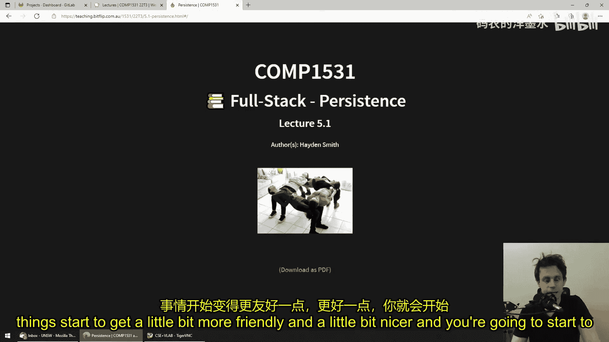

Which is the first one today， which is a little bit of help for iteration too。

 It's actually a very straightforward lecture。 and then the second lecture is on iteration2 itself。

 where we're essentially just going to go and run through the spec briefly。😊，The question， Dlan says。

Did I get a haircut？ No， I didn't。 Sometimes it just looks different。 And I'm。

 I'm a passenger to that process。 Daniel says， you said persist was very easy。

 but I had to remove all the maps and sets from my data store。Yeah， that's fair。 Look。

 the first time I used jascript maps， I did learn the hard way that they aren't Json serializable。

 It's a pretty upsetting thing。

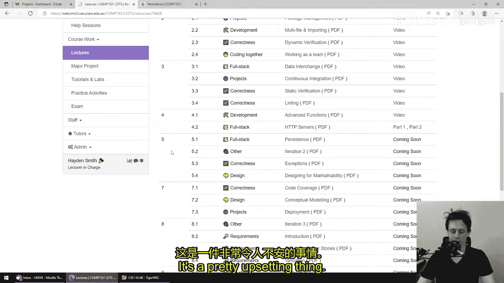

I'm sorry。There's， there's probably some ways around it if you do enough Googling or maybe not。

 maybe I'm just too hopeful， but I am sorry， nonetheless so。This lecture。

 very ominously named persistence。It's。It's a bit of a funny lecture。

 It's a little bit like the JSO lecture in the sense that we are we are mainly trying to clarify a few high levell concepts and theories to you whilst in the meantime giving you a few helpful little snippets of code that are quite relevant for the project。

 So there's just a couple of snippets of code and other than that we're really just communicating ideas to you。

 We're gonna be talking about data as a concept and how that relates to persistence。

 it is very straightforward。 I feel like I feel like you see this in many courses。

 you see this in high school as well when people sit down and they talk about what's the difference between data and information And and it gets a little bit dry kind of gives me real high school vibes in a lot of ways。

 but。A quick recap is that data is really just raw things that you collect。 So， for instance。

 you know we have a product at work where every time someone clicks a button or types in an input or something similar。

 We store information about what they did somewhere And there's not a lot you can derive from it。

 no one could look at it and make sense of it， it's all just sitting there and like a big think of it like an Excel spreadsheet And the theory being that what you can do is you can take that data and you can go and process it and get something out of it。

 which we might call information or insights， which is generally like actionable or meaningful information。

 So you think about what's the difference between data and insight or data and information。

 the answer is if a normal person was to look at it， would they be able to make sense of much。

 would they be able to make decisions with it。 if the answer is no there's a good chance what you're looking at as just raw data And if the answer is yes。

 there's a good chance what you're looking at iss something more akin to insights or information So that's just a very high level idea of what we're talking about with data。

 The reason。Relevant。In our world is because more and more than ever。

 data is critical to how an application functions。 You know。

 it's been the case in software for a very long time。 You。

 if you're building an application or some some other kind of service。

 you will have to account for the fact that your program probably has to deal with the fact that things happen and you need to store some information about it some of the earliest instances you might have seen this or when you're playing video games and your video games saves itself。

 you're able to somehow pick up let's say you have like a PS4 or PS5。

 I don't know wherever it's up to with that stuff and like you pick it up。

 you take it over to your friend's house or to another room in the house， you just connect the power。

 you turn it back on everything seems to work again because that data is stored。

 So the storage of data is extremely important。 know this this isn't kind of a conversation about big data or anything like that。

 even though that is quite interesting because something like big data and data analytics you know some people。

Igue it's the most relevant aspect of computing these days， right。

 And there's not a ton of courses at USW about it。 But many of you will be interested in it。

 but we don't kind of talk about that。 There are some， I mean。

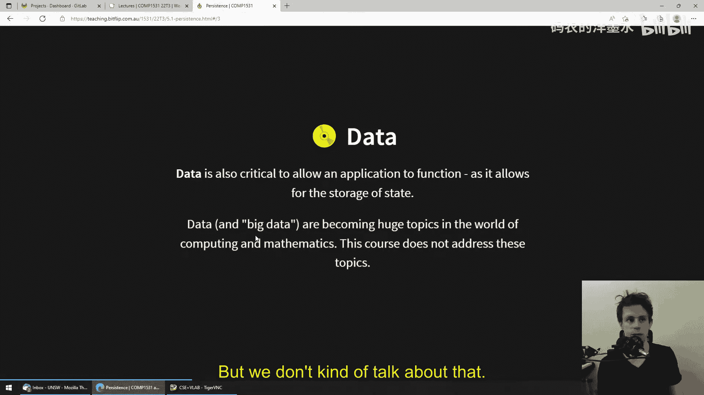

I hate doing thiscause I don't really。I don't really know a lot these days。

 but if you do kind of just go and glance around the UNSW timetable。

 you will generally find that there are some courses， particularly level 6 courses。

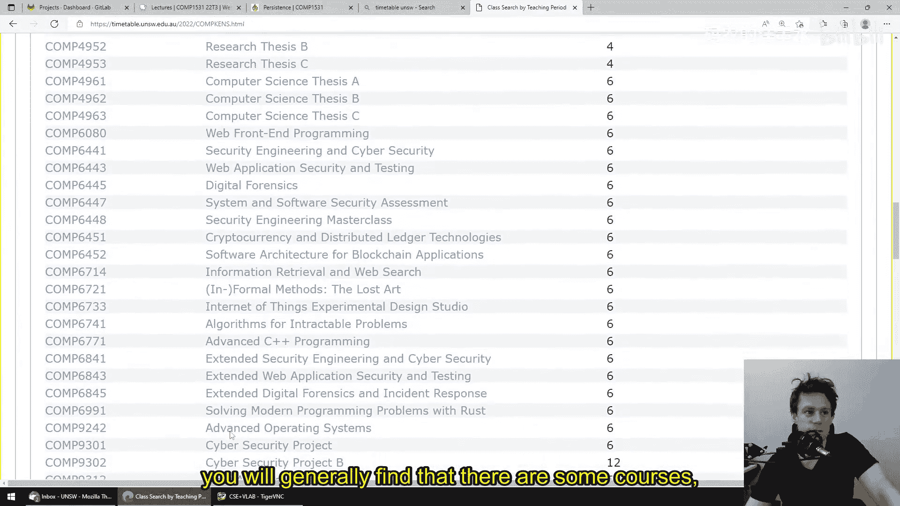

Later on。Which start to get a little bit more interesting in that area。 So you can always go and。

 you know， data analytics for graphs， big data management。Web data， compression and search data。

 services， engineering。 Some of these are actually quite new。 These are postgrad courses。

 which don't affect a lot of you information retrieval and web search。

 You'll also see a little bit of data manipulation in courses that deal a little bit with machine learning and AI。

 But again， we're not really talking about that。 We're not really talking about big data or the science of data。

 We're really just talking about the fact that。Data。In applications。

 needs to be stored so that it can actually function。

 It would suck to have a video game where you couldn't save your progress。 It would suck to have。

 you know， to， to have YouTube without subscriptions or Spotify without playlists。You know， so。

When we look at how this data is actually structured in applications。

 it's important to know that it's all well and good to talk about data as if you know that's your saved game。

 but data is everywhere。 you've been interacting with data since your first week of programming because a variable as data right we learn this variable as a chunk of memory。

 It's a chunk of RA on the computer that' set aside to store a particular piece of information So you could argue that that variable itself is data。

 So maybe that variable data。 But when we're actually doing some programming。

 we will often refer to data as a particular part of the software that is where we store data or what we might call the data layer。

 And it's really about taking data and storing it for the long term。

 if you did kind of do these like high school S courses。

 you probably heard about this as you know what do they call like nonvolatile data persistent data is what we refer to it as。

But。Say you have a take， take take this little image down the bottom here that I made。 it's like。

You'll often have many layers to an application so say say for your your beansans app right you'll have your like frontend like a website which we provide you with and then you might have some you know some nice visuals on the website and then under that on the actual frontend so to speak you might have more code that's making some decisions and doing some things maybe that's on the back end。

 and then you know what you're kind of writing potentially with your project is something you know in this area here。

 you might be writing a service things that help log in registered log out users But what you've kind of been dealing with if you want to think about it really narrowly in iteration1 and in a lot of ways parts of iteration too or if you've just gotten started is just this kind of middle chunk here。

Where you're really focused on， you know， how does the kind of system or server need to define itself in relation to the behaviour that stakeholders expect。

 But then also， you know， just those underlying elements that actually you know。

 push and add users and customers to your big variable or object， right。And Feration2。

 we are giving you a front end to help expand your idea of you know what an application is。

 but we'll also be expecting you to create a layer underneath， which is where your data is stored。

Now you might be thinking okay， Hayden's telling me that I need to create a layer where my data is stored。

 but I also have a file on my computer called datastore js or datastore ts what in the world you' talking about well what we're really talking about is that right now and you'll see this with iteration2 every time you run your application every time you run your test or federation to every time you start your server。

 it's always like a clean slate you know it's always like starting again whereas what we're actually interested in is creating a program where the state of the program the data associated with the program that we need to make it run。

 it actually outlives the process that created it and the process that created it is in the case of iteration2 like we've seen in week4 with the express servers。

 that's actually the server itself So if we start the server and think back to I hope by now you've watched last Wednesday's lecture where we kind of did that example where we like stored a point and X and a Y point in our code if you think back to that example we started the server。

The program had a notion of state that X and Y point。 we modified it。 we read it。

 we modified it again， we read it。 But when the process ended when I pressed control C and killed that server。

 the state of the program， that information diet， it did not outlive the process。

 So where we're interested in is creating this what we call persistence。Which is， I mean。

 persistence means what it says， right， Like if you say to someone， oh， you're very persistent。

 it means that they like don't stop， right， you just want them to go away， but they don't。

 So in the in the world of computing， when we're talking about a persistence layer or persistent data。

 We're talking about data that doesn't go away？ It stays there。

 So how do we make it stay with our program， how do we make that data or state outlive our program so that it stays with us。

 right。And we need to basically modify our server to store this data persistent。

And then there's a question， a pretty open question。Which is like， how would we do that？

 And I see from the chat that some people have already done that， so。It's a fairly like。

 it's a fairly basic question。 But， you know， if anyone has done that in the course。

 how have you done it so far， Like， how would you modify your program or your server to actually。

storeore data persistently， right。Tony says write in a file。 Okay， that's， that's true。

 So there are definitely ways to。嗯。I was just checking。 I removed。

 I removed a couple of slides from last year that I thought were confusing。So for the project。

 we want you to as part of iteration to create this ability for your data to persist beyond the running of a server and rather than ask you to do anything complicated。

 which you might have heard about online or you've got some tech boyfriend that's told you about it。

 We don't want you to go and worry about like SQL or databases or anything crazy or firebase。

 we're actually just going ask you to write a simple what we call in file database。

 what that means is that rather than try and store you know your program or the state of your program and something fancy。

 We just want you to store it in a file like a Cv or JON file something really， really simple。

 and therefore all you really need to do for the project is to actually just be able to represent your code your program state。

In Json and store it in a file and load that back up again。 And we're gonna。

 we're gonna basically run through an example。Where I show you that。

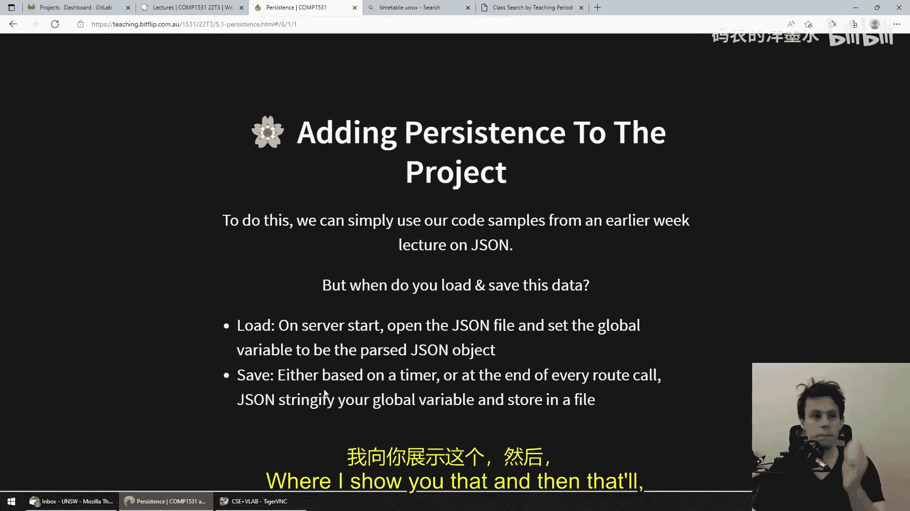

And， and then that'll that actually pretty much the end of the lecture。

 So if we go back to environment 2， let's go back to where we picked off。Kicked off， picked off。

Left off whatever Who cares at the end of week 4， which was where we had。

 I'm just trying to find the example。 We had this nice little example with。

less I've completely lost it where we had the state being stored。

 I might not have even saved the file， but that's not of too much a concern。

 I might have accidentally just deleted it。嗯。Well， let's go with this one。 for instance。

 let's just go with this， this particular file express。Basic。

 so we'll just quickly kind of rewrite it again。 that's not probably not what I want。

 I probably want like this one。 No crud， that's a good one。 This is a good one to use。 So it's like。

 let's say that again， I want to have some data。 and that's gonna be some kind of object。

 And that object will contain， say an X point and a Y point。

 This is slightly different to what we did the other day。And then if I have a get request。

 which I might call that one get data right And all I want this one to do is to actually return me the data that's stored。

 Well， that's pretty easy。 I can just respond with JO。 I can give it the X coordinate of data dot X。

 and I can give it the Y coordinate of data dot Y relatively straightforward。

 That's what that get route will return。 If I now have a post route called data because remember it can have the same name。

 What I might do in this one is actually capture， say an input X。

 let's call it input X and an input Y。Right， I'll capture both of those from the body'cause we'll pass them through the body。

 And then I'm simply going to return nothing here like that。 So in the bottom case。

 I'm actually modifying my data。 Actually， I'm not modifying it yet。 Let me， let me do that。

 Data dot x equals input X and data dot y equals input y。 Obviously。

 that could be much shorter if I wanted it to be。So we modify that easy。

 Now we're gonna go and run it。 We run NP PMM run T S node because that's how I run Tpescript files。

4。2 Crd dot T S。 And it should start up a server where I can call post and get on the data route。

 It says it's running on port 3001。 I'm now gonna go and open a web browser。 And I'm going to go and。

Load up an app。 I always forget how to load up apps。 I'm just gonna Google ARC add on。

 which you'll get me like the， the Google Chrome。 I always forget how to open them on Chrome。

 I feel like there's some easy way that's for normal people。

I'm gonna click on the launch app a couple of times， see。See what happens there。

 And now I've got this like little last time I called it coward， but let's just call it data now。

 So I've got on local on local hostport 3001， I've got this data out。

 And when I actually try and get that data out， it sends me back， you know。

 X is Nile and Y Nll like this， right？ If I go and make a post request。To data。

 And you know how with post requests， I send information through the body like this with X and Y。

 except in this case， we call it input X and we call it input Y。

 that will now get sent and that will start。 And I'm just recapping what we did in the last lecture。

 So that's a 200 okay as well， because it just got sent and stored right。

 So I like talking to these two particular routes。 I'll go and put it upside by side so you can just be reminded of what it is here。

Like this。So they're both working2 and 3。 I can go in。I can go and change it again。

 So if I don't want to send 2 and3， maybe I can go and send like 4 and 6， and that'll like update it。

 So now when I go and get it。I'll get 4 and 6。4 and 6， right So you you're just doing this。

 So this is data。 But and it's being stored in the program。 but that's only because the process。

 the server itself is still running。 It's been running the whole time。 But obviously。

 like I showed you before， when we stopped the process and we started again and we go to get the data has disappeared because the data is just sitting in variables。

 So how do we actually stored in a file well。What we're going to do is we're going to try and take our data and we're going to try and package it up in JSO and there's a couple of ways you can do this one of the easiest ways to do it is that every single time you have a route that modifies the data。

 what you can do with that route just before say sending the response is that you can actually try and save the state of the application in a file。

And it's very， very kind of easy to do。 Let's imagine that I'm gonna create a new function called save。

 It's just a simple function。R doesn't really do anything。 I'm gonna go make it up here。

 Sa I'm gonna use the new function syntax。 It takes no arguments。 It's just as simple as that。

 And what it's going do is it is just going to keep it really simple。 It's going to console log。

The stringing ofified Json。For data like that。So every time I post， every time I update data。

X and Y will be updated， and then I'm just gonna call my save function。

 It will just stringify whatever data is at the time。 and it will print that to the terminal。

 So now we'll be able to see this if I restart the serverca I've modified it。 Actually。

 what do we learn in the last lecture， Let me move this terminal。

 We learn that if I run instead of using T S node， I can use nodedemon Because nodedemon will listen for file changes。

And it will update our file for us， which is really good。 So now that I've got that， I can go here。

 I can go and get my data。 That's null obviously because get was just returning me to the initial state。

 but let's watch what happens when I post it when I click post it actually console logs x4 Y6 to the terminal and it console logs it as a JO string and JO strings are great because we can save them in a file and files like basically just text So then we come along here and we say well you know when I say it I'm much just going console log it I'll create a variable called JO string which is that And then I'm going to write it to a file but I forget how to write it to a file so I Google it ja no Js write to file。

😊。

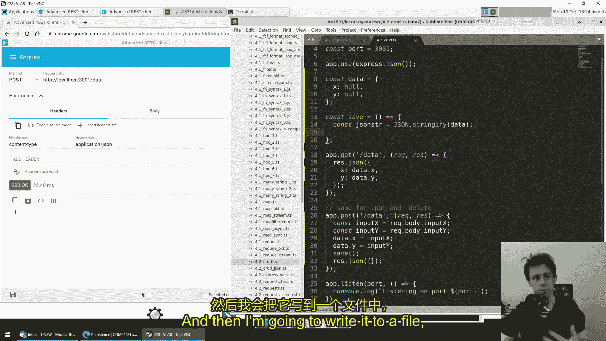

I'll get， you know， usually there's a。There's a couple ways you can write to a file in jascript。

 But the one we've kind of shown you in lectures is。嗯。A synchronous way of writing to a file。

 which is called right sync。And a lot of these examples really suck。

It's one of the downsides of things， but that's okay。 Let's just try it out the simple way。

 We know that if we want it right to a file， we need to import the file system library。

 we need to import the file system object from the file system library like that。 So we import FS。

 And then what we can say here is Fs dot right file sync。

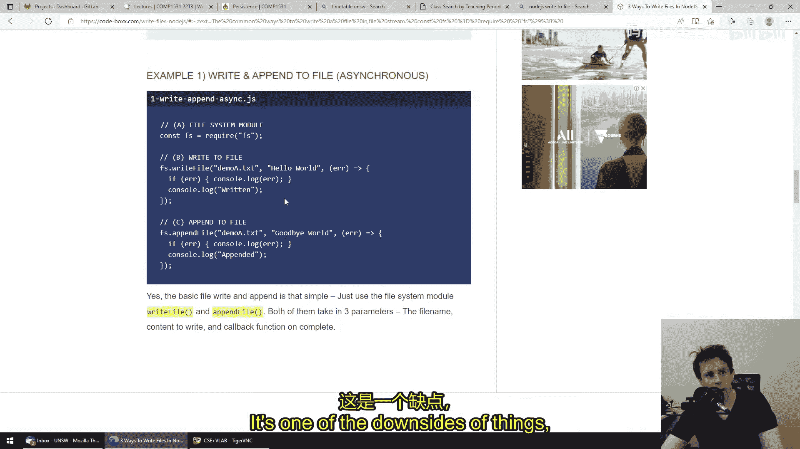

And we can give it。Basically， a couple of things， I think last time I showed you some extra stuff。

 but generally I just need to make a file first the file I'll call it like data or like I'll call it data based on Json or something and the contents of it will just be JSson string like that。

 So let's see if we can kind of take the state of our application and just write it to a file。

See it should be that simple in theory。 I don't know what。 I shouldn't didn't need to restart that。

 It was doing it for me。 So now I've got this program。 I click send。 Okay。

 once I click send in theory， it should have converted that Json string and then written it to a file。

 And when I come down here， if you have a look in the system。

 there's now a file called database dot Json。 And when I open it。It's right there。

 My X and Y coordinateordoner there。 We kind of took kind of the existence of our program in a data form and we saved it to a file so that we can use it later。

 Now， that's half the battle。 That's just the saving stuff。 So now we've saved the state to a file。

 but we we need to now actually be able to read from it， because even though I've saved it。

 the problem is if I actually restart my Jesus。 If I restart my application。The problem is。

 now whenna go to get it。It's still going to be。Like that。Here。Which I didn't really like。

' not that's not particularly good。So I need to load that back in somehow。 Well， how can I do that。

 Well， I could play around with it， and I could do it when the programme starts。

 So I could actually say， well， I've already imported the file system library。

 and I know that this code executes from top to bottom。 So how about， let's say that。

When the program loads， I'm going to go file system dot read file syncnc。

And I'm going to try and open database dot Json。 And I'm going try and capture that as say， like。

 you know， the D B string or something database string。 And let's just console log at to start。

 Let's just see what happens。 Let's just console log D B string。Okay， so we like restart it。

 And what does it tell us It tells us like something we've seen before。

 Jacob Jacob's asking a question。 So the extent of persistence in this course is just writing to a file。

 correct。 Yeah， it's very easy when I， when I first kind of wrote 1，5，3，1。

 and we were doing like looking at this。It was just a decision I made that we've stuck with because it's like this course has a lot lot to learn in it。

 And there's a lot of cool stuff you can learn in the world of data。

 but it's like we've got 15 other things to learn。 you know so we're just kind of keeping it really simple and more' we're trying to teach the principle of the idea that your application state can live outside of your program。

 It's just the way that we're storing and loading that。

 It's like a really crude just to kind of have it be a distraction。

 So you see that when I actually got that database string from the file， it was a buffer。

 we saw this in a previous lecture where we could actually just turn the buffer to a string like that。

 So now we should see it actually there's my Json string。 So I've just gotten that out。

 So it's like cool all right well when the program loads。

 let's actually convert it to like let's just let data be equal to the JO par of the Db string。😊。

That makes sense， right， We basically get the D B string or the the string of the DB string。

 I should say like that。 And we， we know it's a Json string。

 So we kind of decode it into a javascript object。 And then we replace data with that。

 But as you can see here， data is giving us an error because it's cons。 So I need to make it let。

So now if we've done this correctly。I should be able to start my program。

 and when I call get immediately， I should get the data I'm looking for right I get that 4 and 6。

 and that's really cool because then I can come here。 I can now post some new data to it。

 let's imagine the new data I post to it might be like 9 and 6。 I go to post that， great。😊，Cool。

 so now I come back here。Easy。😊，And then I click send again， and I now have 9 and 6。

 And when I restart the server， and this is the interesting part， right。Now， when I restart it。

 the datas still there because it's like the server stopped and it all vanished， it all disappeared。

 But when it started again， the first thing it tried to do is read from a file and pull that data out of the file。

 So it's like I know where to start from now'ca someone kind of you know it's like you know。

 it's like anyone ever， I've done this。One time I bought a bunch of chocolate before a party。

 and I didn't want to take it into the party。 So I just， you know， you like hide the。

 hide the hide it in a bush， grab it later。 You know，re like。

 you're leaving yourself a little trail of bread crumbs for later so you can actually like get started again when you need to。

 so。Now， we。Have one problem。 Is anyone picked up on the problem。

 There is a problem with the approach we've done。 It's going to cause us some grief。

 but it hasn't caused caused us grief yet。So。Any ideas。cause。

The main problem you have right now is what happens if like your team member who's never seen this code change you've made before。

 comes along and they don't actually have this database file that was created when your program ran。

 Now， the problem is that when you try and run your program。

 you're going to get an error because the first thing that read file S is going to do is try and open a file that doesn't exist。

Right， and that's， that's not very good。 So how can we get around that？ Well。

 maybe we do some more googling Javascript， Check if file exists。F S library or something。

So it's like now we can like use some other libraries。 Okay。

 what do we see here if there's a particular function on the file system object called exist path。

 So it's like cool。 So now instead of this I can actually wrap this in an if statement。

 So if this particular path exists。 And obviously I should pull this out into a variable。

 So I'm not repeating myself。 if that path exists， then I would like to open it。

 grab the database string， decode it and set it to be data。 So now when I run my server。

 the first time I run it， it should work fine， it should start up fine because there's no file to look for I'm going to get null。

😊，When I post to it， it's going to like， you know， post successfully。When I close it and restart it。

And I send it。 The data is now there， right， So it's all very， very manageable。

 And that's the whole example。 In fact， that's the whole lecture。 In fact。

 So if I'm just gonna pause here for like， you know， all of， all of， you know，30。

60 seconds with people just to see if anyone has any questions about。

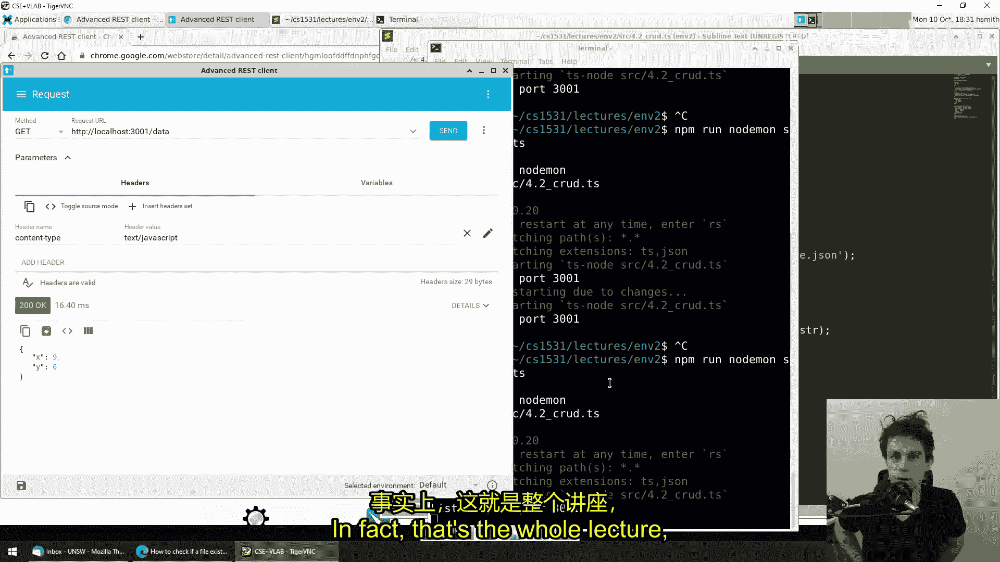

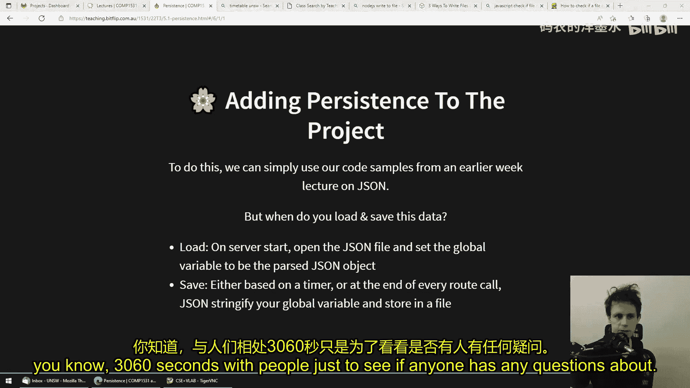

That because that's， that's really as much as it is。 I， I've actually just done it for you。 In fact。

 you can go and copy that if you'd like to。 You can do some more elaborate things。

Maybe I'll use the example to talk about higher order components， potentially。I don't。

 I don't think I'd encourage what I might show you， but， you know。It can be。 It can。

 can be something that you might wanna look at。Like， okay， let's say you want every， like， okay。

 well just， if you have any questions， please post them nowca I'm gonna go through this example for five minutes just to kind of tease jascript a bit。

 And then I'm gonna stop。 And I'm not gonna wait for questions again。 So if you have questions。

 please ask them now。But basically， up， there we go。 towi it says， what if I wanted it to be null。

 don't save or reset the data store after implementing the structure。What would I need to do？

 So if you wanted it to be null。嗯。I'm not sure what you mean there if you want a what to be nu。

 X or Y to be null， I mean。The approach we've done will just store whatever the data object is in the file。

So if X and Y and now it'll store it in the file as no。It's just the way we've written it so far。

 X and Y aren't Evan null because。We always write it to the file after we' modified it。

So maybe I don't fully understand， but you can， you， it can be null。

 You can add it to the file as null It's just in this case， we， we don't come across that at all。嗯。

Yeah， if you want to reset it， you can just change it toll。The most common thing you have， though。

 is like what I have here， which is like。If the file doesn't exist。

 you just have like a template file or something。 But the thing is this approach where you save it at the end of every route。

 it has the only annoying thing is you have to kind of put save everywhere at the end of each route。

 an example of something that I don't know if it's a good idea。

 but it's just an example of how you can play with functions in jascript。 is if youd like to。

 you would go and create a。呃。Like a higher。 I think this is a higher order function where you could come across and say。

 like， I'm gonna create like a post。Or like， you know， A， a request post or something。

 And this is going to be a function。 and what it does。Is it basically。

 and this is a little bit heady。 So if you lose， if you lose it here， don't worry。

'cause I'm just kinda maybe for some people who are a bit more interested。嗯。

You could actually create something that looks like this where you're like route is a string and。

My function is an any。And you could have something like this。Where。It's a little bit weird， but。

It's not really a higher order functionca you're not really returning anything like a higher order function a function that kind of creates a function。

 but this could be a little abstraction。 And I still don't think it's a good idea。

 but just to demonstrate the point where if you're gonna save at the end of every single route rather than know there should be route here rather than writing app dot post and writing the same thing out a bunch of times。

 you could actually modify it so that the equivalent you'd have to write here would be you would just write request post。

 which I believe all you would need to do is just to put in slash data and then the function you want to to。

To have。Which， you know， it gets a little bit hairy here。

 But let's just imagine for a second that you wanted it to be like this。

I've done this slightly wrong。But you can kind of have something like this。Where it's like， you know。

 this doesn't work perfectly either。 I'd have to pass a request in response into that as well。

 But like now what we've done is we've kind， it's like creating a wrapper。 It's not that。

 that kind of complicated。 If you think about it。 It's like， here's the actual post。

 We've just said that every time we make a post route， obviously， the route's gonna be different。

 And what we do is gonna be different。So when you create one， you're actually passing in， you know。

 the route itself and then the function that you wan to be called when the route is executed。

 which is just that function there。 So， but the， the。

And I'm brushing this again'ca it's not like an example I'd encourage。 So， you know。

 if you're not sure about it， go meditate over it for a while or maybe go talk to a tutor or something。

 But the reason this is what I would consider a bad example is because what you are doing here is you are。

 you' are making the code finitely。 And I think I touched on this example last week， actually。

 it's like you're making the code finitely cleaner here because you're removing the repetition of save。

 right。Sometimes that could be a really good thing， like if not saving is disastrous。

 like if your program is going to completely explode if you're going to lose data。

 like if it's so critical， then this is actually maybe an important way to do it because if you。

 if you only let people create routes with like request post instead of the normal way。

Then they actually can't not save it at the end of each call。

 but the problem is if all you're trying to do is cut down lines of code or cut down the confusion of the program。

 what you've essentially done here is you've essentially sacrificed the clarity of what app dot post means to save the overhead of how many times you have to write save。

And that's probably not good because seeing save as a function many times is probably a lot easier to understand than seeing this random function called request post that you then have to kind of like go and look up and like if you look at that the first time you're gonna be like what in the hell is that saying。

 So this kind of comes back to that lesson from last week， which was。

 know be very careful about over optimizing your code because quite often if you try and over optimizeimise it because you're like look at me。

 I'm so sneaky， I see that we've said save a whole bunch of times So I'll just like avoid it by creating this like wrapper function that's kind of harder to understand because I have to really sit down and make sense of it。

 It could arguably be about idea。 know I'm not saying it is a bad idea。

 but it could definitely like be considered about idea。

 So just something to ponder over because that's really up to you。

 So that's pretty much the end of the persistence thing。

 everything I've said for the last five minutes is like pretty irrelevant know in terms of like you don't need to worry too much about it because it's all simple enough。

You can give it a go you copy the lecture slides。 It's really that straightforward。

 If you need any help， your tutors are happy to help As of this lecture now。

 you formally have everything you need federation to in terms of like background。

 we're gonna do a lecture after this that actually goes through the spec。

 we'll talk about it in more detail。😊，呃。But just， just so thatca we all we。

 I don't know how long we'll run for the next one。 But just for the sake of it， let's take a。

 let's take like a four minute break before we move on。 But before we do that， if you could。

 please just leave feedback， as always， fill in this form。 feedback is appreciated。

 It's a pretty straightforward lecture。 So hopefully， the feedback is very straightforward。

 But we'll find out based on what you say。 Thank you。

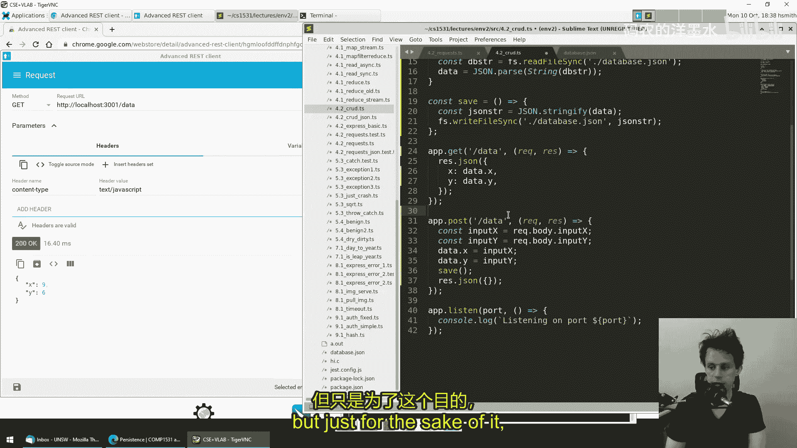

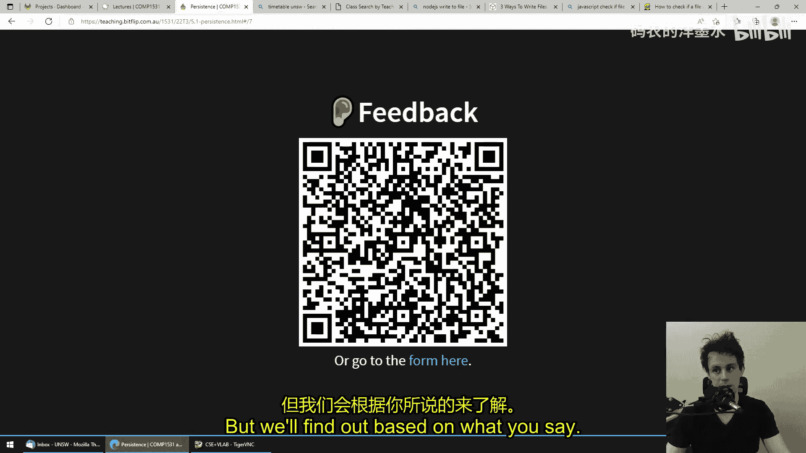