# 【全集】新南威尔士大学 软件工程基础 中英字幕 1080P COMP1531 p16 Lecture 16 - 异常处理 -BV1M7Nwz7EGh_p16-

So two lectures tonight， two lectures today。 however you wantan to think about it。

A lot of coding today， though， thankfully， the coding is not super urgent in the sense that this first lecture exceptions is all about iteration 3。

 So it's actually， we're actually giving it to you way in advance。

 You don't need to worry about this until like week 8。 So like three weeks away quite a while。

 And the second lecture today is just useful in general throughout the course。

 So lots and lots and lots of fun stuff。 this particular lecture called exceptions is one of the last correctness lectures。

 you'll see that there's only two more correctness lectures。

 which is focused on like How do we try and make sure that how code works。

 We've been through the correctness bubble for quite a while。

 But the main motivation of today is that we need more elegant and graceful ways to deal with errors。

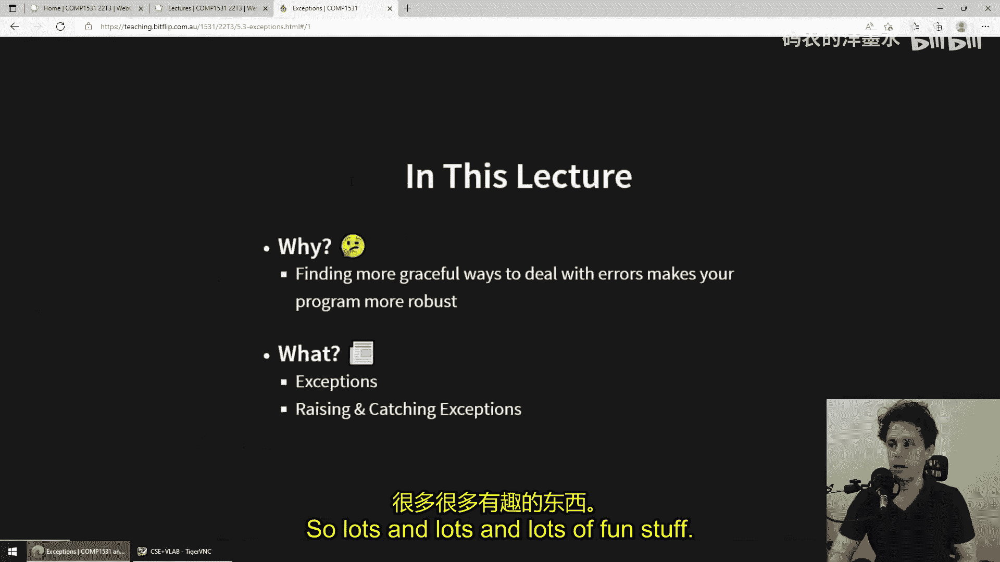

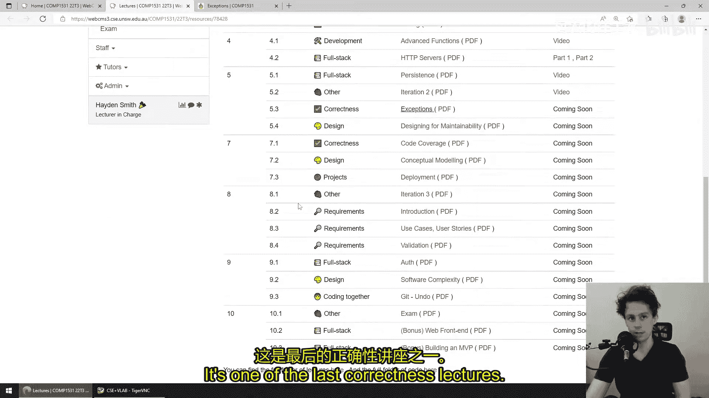

That makes our program more robust because it's， it's completely normal and expected that our programs。

Have errors occur in them。 But what we've been doing so far in the course with this whole kind of like return error objects and stuff like that。

 it's a very archaic Cstar way of dealing with errors。

 So instead we want to actually teach you a concept， which is true， which exists in many， many。

 many languages， most of them， which are called exceptions and for most of you。

 it would be the first time you've come across them。 And then just how to deal with them。

 how to deal with raising or throwing and catching exceptions。 So firstly。

Let's have a look at a fairly straightforward program。

 We have a program here called JustC and what it does is it imports prompt from prompt syncnc。

 It creates a new prompt you would have seen this from your labs。

 and then it has a square root function that takes in x that's a number If x is less than0。

 we kind of print an error to the console and then we exit the program right If x is not less than0 we will return math dot power x to the power of a half because x to the power of half is a square root。

Now。That's the square root function， and all the program does is it creates a variable called input。

That's the result of calling prompt function， which prompts the user to enter a number on the command line。

 and then we consoles log the square root of the end of that number that's entered。

 so it's a relatively straightforward program。

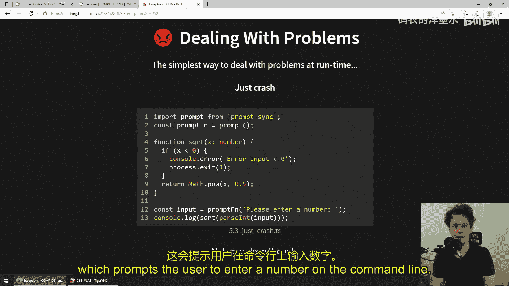

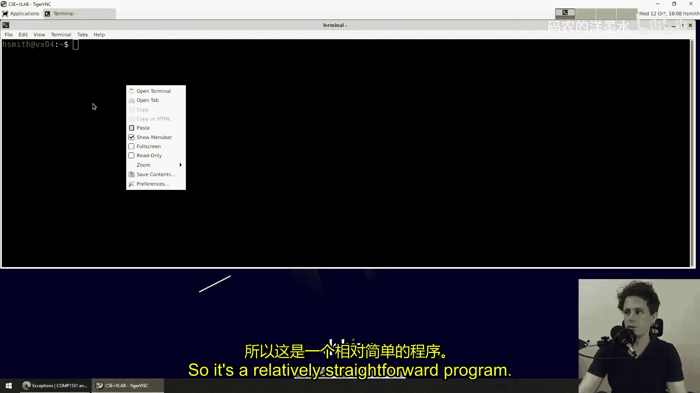

It's something that you should probably be more than equipped to。

Deal with at this point in the course。

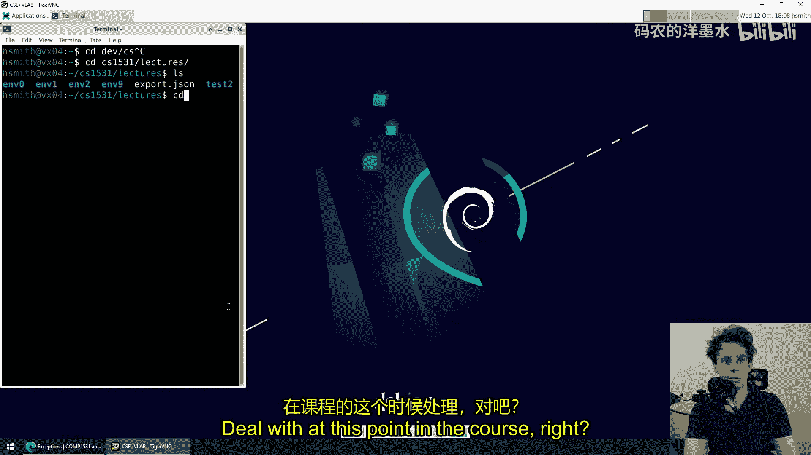

Right。Open this up。 That's not what I wantedcause we were working on assignment 2。

To close some of the old things， yep。So I'm gonna open up this just crash file and we're gonna。

 you know， we're gonna use the file should be pretty simple， Just crash easy。 Then we'll run it。

 NP PMM run TS node source slash 5。3， just crash。It should prompt us for a number。 And if I enter。

 oop， what do we got， we got an error， Oop， sorry yetep， I have to end PM install stuff， I think。

Let's see if let's see if prompt sync is actually installed， maybe it's not。Oh。

 it's sort of installed。 It looks like， looks like I didn't install this in the actual lecture code repo。

 So I might need to install it and PM install prompt sync。

There there's this library here that it's like kind of installed。 it's like half installed。

 but not really， it's installed like a types part of the library， which。

Isn't isn't really what we need， but that should install prompt sync now。

Please enter number 5 square root of 52。23。 I'll try it again with a number like negative 9。

 and I get error input less than 0。 So we have just console logged that。To the terminal now。

We have gone consult at era。That does print it to standard error on the terminal。

 Where console dot log prints it to standard it out。 That's an important distinction in general。

 but not one that affects us too much right now， however。

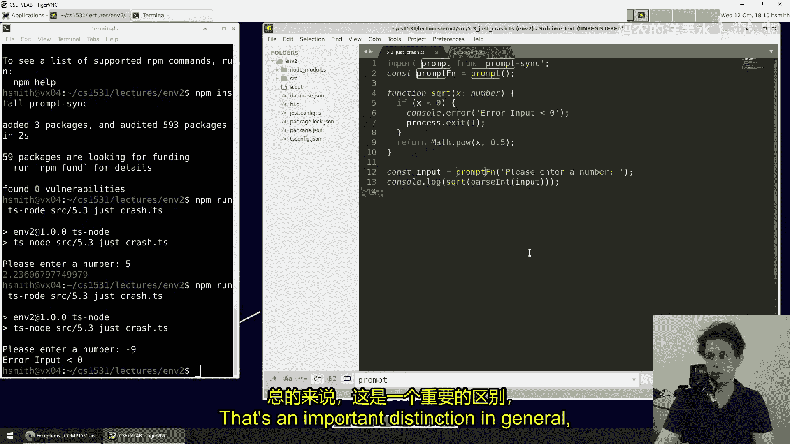

We don't always。 We don't always wantan to do things this way。 And the main reason is because。Well。

It's not very good for the programme to just crash randomly， right。

 That's generally not good programme design。 You might be thinking， well， heyden。

 it doesn't have to crash。 I could actually just say return null in this case。

 And then when I get my input， I could say， you know， if input equals null， you know， then we will。

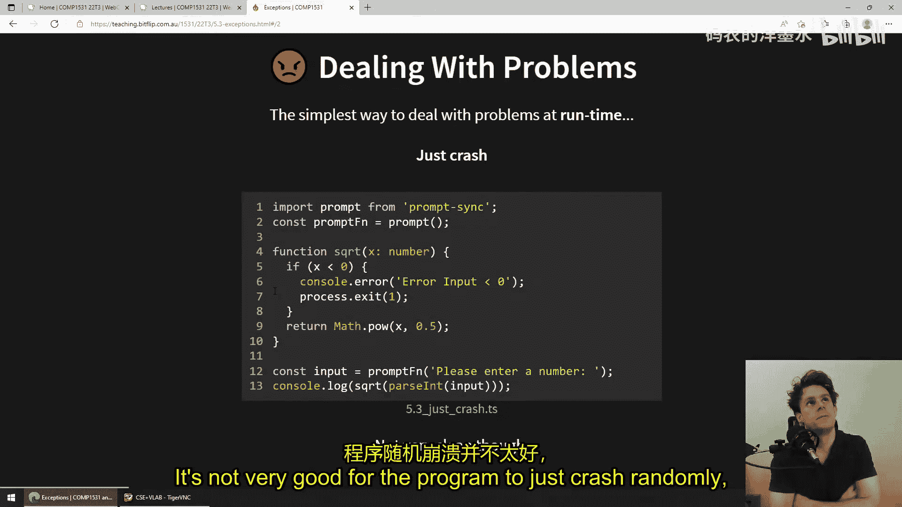

You know， demo console do era。You know， number must be less than 0 or something like this， right。

 Like you could do something like this。 This works。 But there are limitations to this approach。

 For instance， What happens if you know。Now， this function is returning like null or a number and a few other things because from a tight perspective。

 it can get tricky。 What if null is a meaningful return value。

 So there there there are just some limitations as approach。

 So what we prefer to do instead is to modify our syntax a little bit by doing what we call throwing an exception。

 Now the main line that's been modified here as line 6。

 So instead of doing console dot error and process dot excer or returning you know some kind of object with null。

 we're actually going to throw a new error。 I'm going to reiterate for the sixth time like one of six times in this lecture that this has nothing to do with iteration 2 it has nothing to do with lab 5。

 Okay， please remember that。

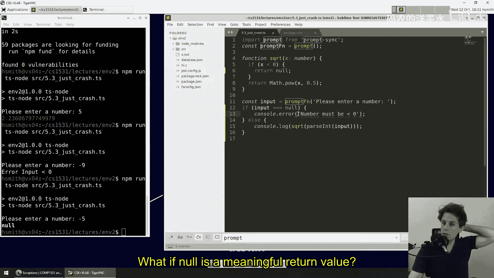

But this line here is very interesting。 We're not gonna get too much into this like， you know。

 you don't have to think too deeply about the syntax of like throw a new error。

 but it's self explanatory。 What it's saying is like， think of throw like scream or yell。

 It's like saying， or create， like， create and scream。 We want you to create a new error and like。

 tell everyone that there's a problem here。 you know， like run out of the building saying fire， fire。

 file or something like that。And we're saying， throw a new error that just says that has the string error input less than 0。

 So create an error and screen it out to the top of the world。

 And what's interesting is that when we run this particular program。

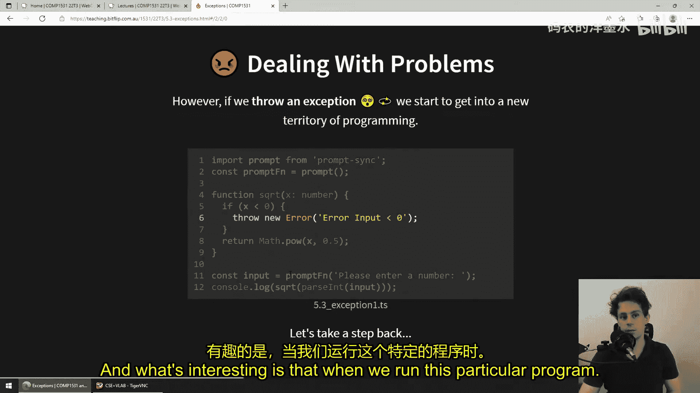

You'll notice that。Exception 1。Pick a number 21。11。41， right， That's easy enough。

 And we pick another number。 Let's do negative 6。 And we get this whole thing here and pay attention to this。

 It says， okay。Import blah， blah blah， it said that there was a， there was an issue on this line。

 and this particular error object was called。 It was called。It was thrown。

 It was thrown in the square root function， which is inside of a whole bunch of other really boring stuff。

 basically， what it's saying is that the programme crashed。

So instead of ending it like we did in the first example， in this case。

 we just threw an exception and it just crashed the program。And it might be kind of like， alright。

 well what's the difference between those two things。 They both seem to have exactly the same output。

 Well， let's take a step back and actually go and have a look at what this is before we get any deeper into of the code。

 because it is a very different coding pattern。

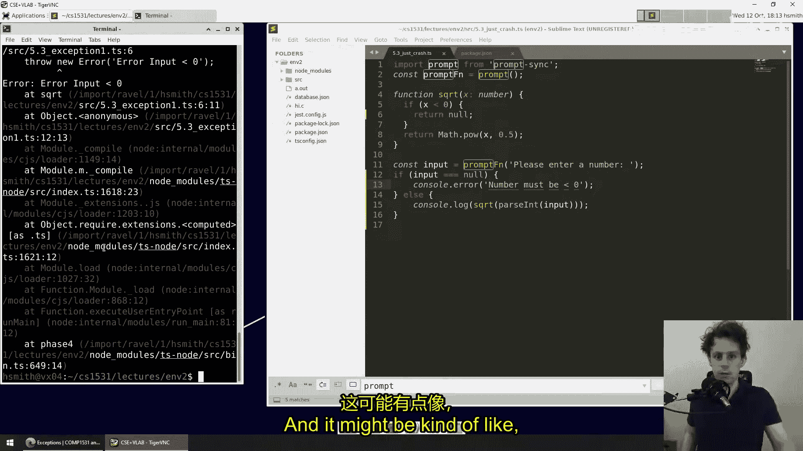

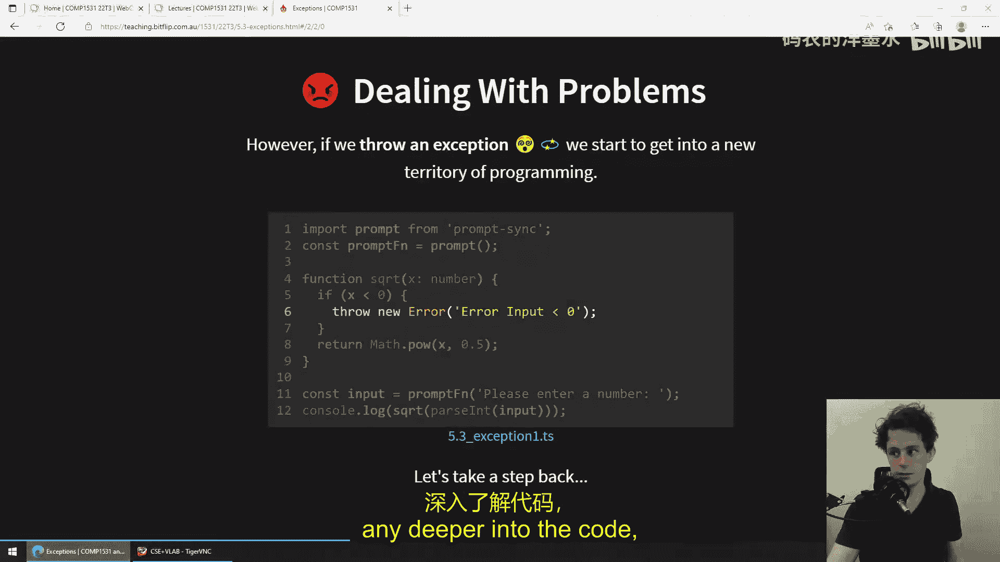

That seems to do a similar thing。 You notice we didn't have to re。 Where' is it， What's it called。

Exception  one， you notice we didn't have to return anything here。

 No one seemed to deal with the error explicitly， but it was still kind of handled。 So， yeah。

 let's look at some theory for a second。

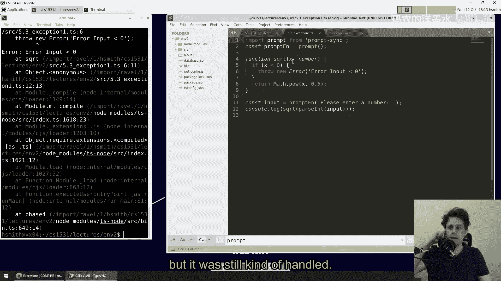

So exceptions what an exception is what that line is that throw new error。 That is an exception。

 You are doing what you would call throwing an exception。 That error thing is an exception。

 It is an action that disrupts the normal flow of the program。

 It's a way of kind of halting how things are going。 and it tends to happen when an error occurs。

 So it's often representative of there being an error typically to do with some kind of runtime error like user input or a bad network request or something like that。

 And exceptions are used so that we can elegantly recover from errors。That's why we use them。

 Exceptceptions are a particular method of ensuring that we can make software safer in different languages。

 whether it's， you know， Javascript， Python， Java， anything like that， They tend to have。

Different conventions for managing unexpected runtime events。

 but while something like C and JavaScript differ quite a bit， many。

 many languages rely on exceptions for the majority of air handling， which is again very unlike C。

Now， let me just， let me just check what。I think I might actually jump back to this slide after。

Let's actually look at a bit more code first。 when I ran this lecture last time I think it was more beneficial to'll look at the code and this is the code we saw before right exception1。

 this program is good in that it throws an exception。

 but the problem is when the exception was thrown the program just crashed because when we deal with exceptions。

 We're not just interested in the throwing of exceptions。

 we're actually dealing interested in the handling of them and the handling of them is really what gives them actual value here。

 So if we have this code okay we know it throws an exception but let's actually add some more syntax to deal with the handling side of things and this is where things actually start to get very。

 very interesting。 So in this exception2 case here。

 you'll notice the top half of the function from lines 1 to 9 is exactly the same。

 but from lines 11 through to 18， things are a little bit different we've got this kind of funny little try catch block here。

😊。

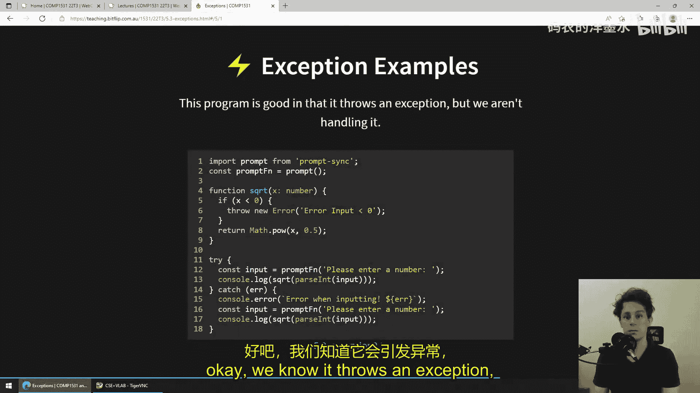

Now， it looks a little bit like an F and else， doesn't it， right。

 except it doesn't have a condition and it doesn't say if an else it says try and catch。

And this is a little bit of funny syntax。 But what it actually says is it says hey。

 I want you to run some code just like normal， right， So this try， this try always gets executed。

 It's not like any if statement where it sometimes gets executed。 It always gets executed。

But what we're saying here is that any time， like anything you put in this try block。

 you're asking jascript to keep an eye on in case it throws an exception。

And if any of this code here on these two lines throws an exception。

 you immediately jump immediately wherever you're up to in the processing。

 jump to the catch part here。 And the catch is essentially like how to deal with the problems。

 It's the block of how to， you know， deal with the issues of the runtime anomalies that happened。

 And that's the usual typical flow。 And then the code just kind of keeps going towards the end。

 So if you go through the try block and there aren't any issues。 If you don't。

 if there aren't any exceptions thrown in the functions that you're calling。

 then it actually just finished the try block and jump straight to the end， the done there。

 And we'll see this。 if I try and run this， right， if I try and run。Exception 2。Enter number 5。 Okay。

2。23， It says done。 That's good。 But if I enter negative 5。I get here we go。

0 error when inputting error， error input less than 0。Okay。So a few things that happened here。嗯。

There's actually been kind of two things。 I don't know only one thing。Yep， sorry。

 I was misunderstanding that。 So what's happened in this particular case is that it's gone through and it's executed these two lines。

 But an exception's been thrown on line 13。 Now， what did I say before I said that if an exception is thrown。

 basically， if there's an error that occurs， we stop executing what we're up to。

 And the the reason this is important is if I put， say a consoles loggue here， and I run。

 I run it with， say， a good number like a 5， right。You'll see that it。

 it consolesol logs the square root of the number。 It consoleol logs third line。

 And then because there were no exceptions， it jumps immediately to the end， it skips the catch。

If I pay attention to what happens when I enter negative 5。Oops。Negative 5 like that。

 You'll see that it。Immediately from here actually jump straight to the catch。

 So once the square roots been called it skips， it skips this line here on line 14。

 where console log third line。 And that's a really important other behaviour for exceptions。

 And it's something that you can use to your advantage because you know this from iteration 1。

 If you have to return some kind of error object or error code。

 You have to put in a lot of extra checks in your code。Because。Sorry， because。Let's say that。

 you know， the square root should fail at this point。

 You have to kinda go do a whole bunch of other stuff。 And what。

 And here's the benefit of exceptions。 Because imagine for a second that square root。

Didn't actually like throw an exception。 What it did was it return null if something was invalid。

The problem with this is I would then need to refactor the code and go， well， you know what。

The square root is this。 And then I need to say， well， if square root equals null， you know。

 then we're gonna console log error， Otherwise， we're gonna， you know。Print out square root。

And it's just a little bit different。 Like， it's a little bit more regimented and structured。

 which some people would think is a good thing。 Some people wouldn't think it's a good thing。

 But regardless， that's kind of where you get to here。Now。If we go back to the code。You will notice。

 though， that in the code we originally had in this file。

 what we actually did inside the catch statement。Was that we。

 if someone entered the wrong number or an invalid number。

 we actually went and prompted them again for another number。

 So let's imagine someone enters negative 5。 They enter negative 5。

An exception is thrown because we call the square root function， which throws throws an exception。

 That causes us to go in the catch。 And then once we're in the catch， we say there was an error。

 we ask for a new number， and then we console log the square root of that new number。

 So now what we'll see happen is that。When I go to run this， if I enter 6， it all works fine。

 And if I enter negative 6， it's going to go into the catch。

 and then it's going to say arrow and inputting and then prompt me again。

Enter another number at negative 9。 But you'll see the program now ends because the programs just like a linear flowide。

 It just goes from the start to the end。That's it。 It's not particularly exciting。

 So you only really get two stabs of this。 But if you wantan to take it even further。

You do have something。 Oh yeah， I'll get back to the everything in a sec。

You do have something like this where what I'm now doing is just putting it on a while loops。

 So let's say you want to kind of collect input from a user forever until they give you the right input right Like that's a pretty reasonable thing to want to do。

 So in this case， I say well success is false while success is false。

 I want to try getting the input from the user then I want to try console logging the square root。

 And if at any point in this try there's an error what it will do is it will skip line 16 and jump straight to the catch statement and it'll print that out。

 So now we get a really interesting program which will essentially just kind of。in our。

Ask for errors all the time。 not ask for errors。 Like it'll keep going asking for numbers till it work。

 Centre number 3， that works So the programme ended'cause the loop left right。

cause when you get a number right， success is true。 But if I do negative 3， it's like， sorry。

 that doesn't work。 Ne 4， Ne 5， Ne。9 negative8， something like that。 right？

 So that's kind of how we could use loops to say， keep collecting that information until we get something right now。

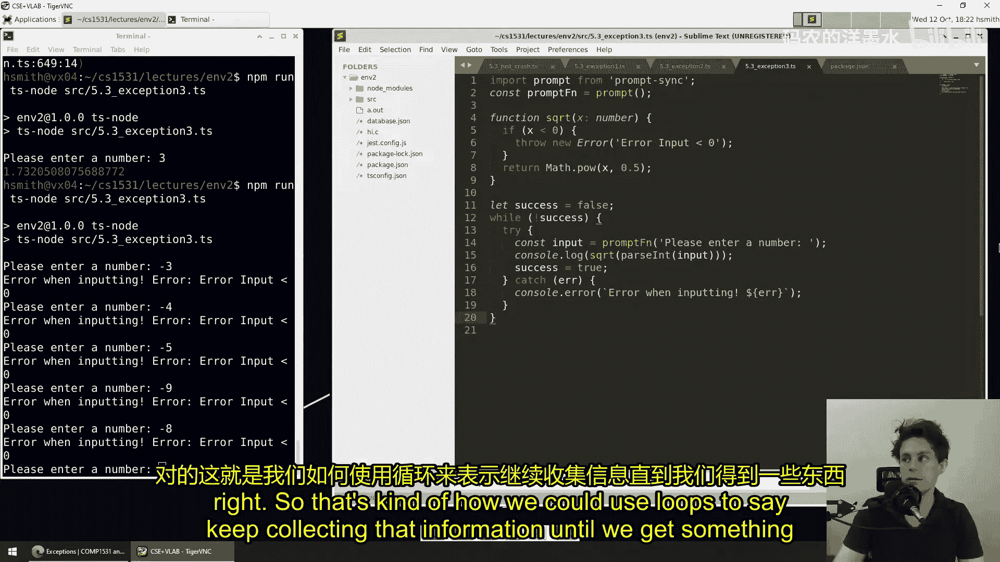

Just seeing what the difference is there， yep。

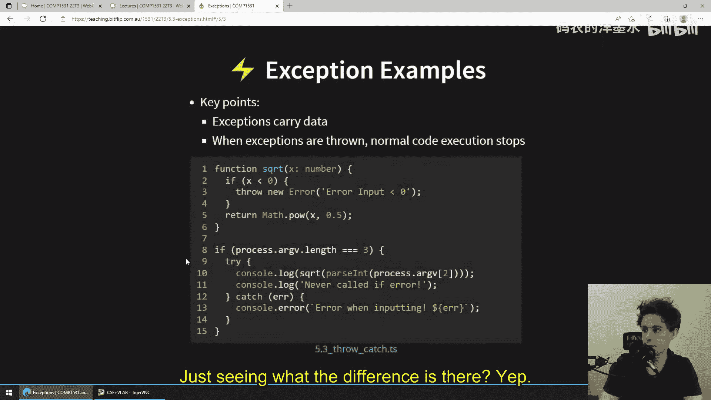

嗯。Now， there was a good question， which was like， what is error？So every time an exception is caught。

 we call it catching an exception。 What happens is is that original object that was thrown， right。

 Like you throw an exception and someone else catches it。 It contained information。

 And we can actually consolesol log that out。 So that's actually consolesol log error here。

 And what you can do is after the catch again， a little bit like how an if statement is written。

 not how it behaves。 You can actually kind of capture that in that variable there。 just one。

 that's typically just one variable。 And you'll see now when I do negative 5。 Oh， the program。

Just crashed。That sound good。 That's okay。Oops。嗯。

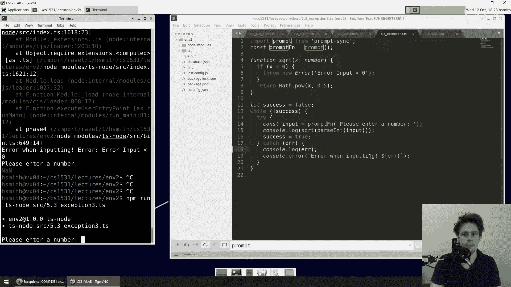

Yeah， so what error is if I tried this out， I'll sorry。 It was right there before I dismissed it。

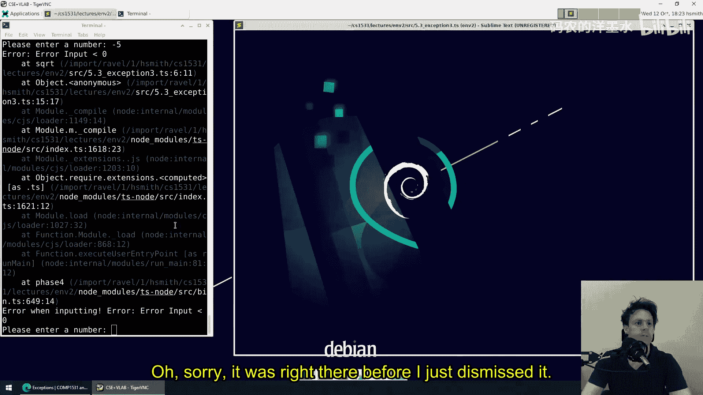

U。Let me put like pipes on it or something。 just so you can see it a bit clearer。Yeah。

 so you see that entire error is actually an object and it's an object with a whole bunch of stuff in it because you can see these pipes here。

And that whole object is is honestly。It contains all the information about what error actually happened there。

 But on each of those， on every exception object， there's actually a property that I think is called message。

It's different in every language。 So I'm probably going to get it wrong。

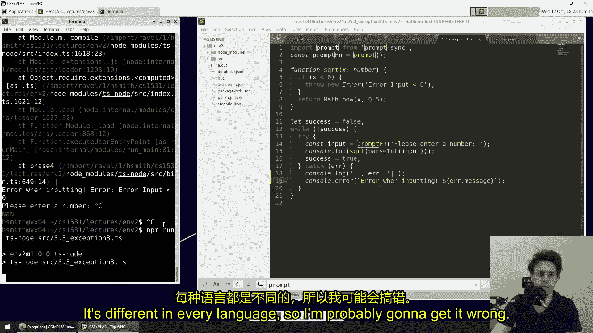

Yep， I probably go。

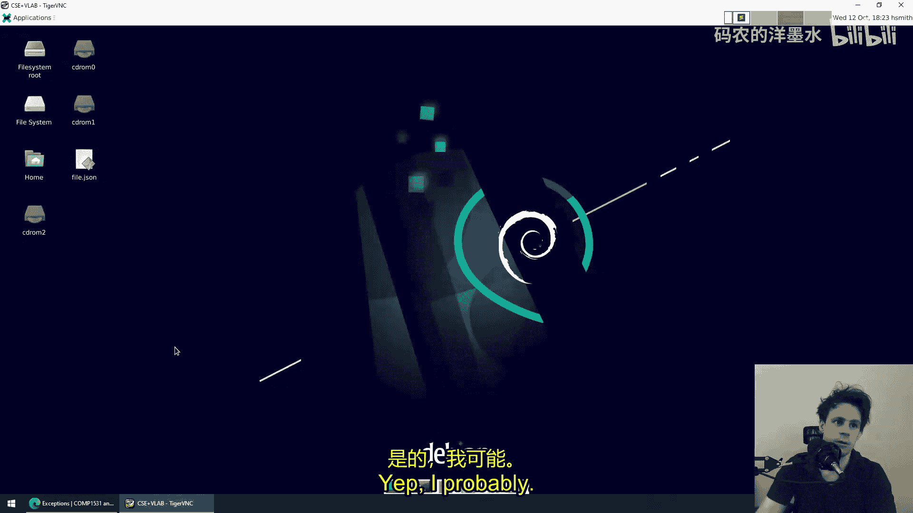

Oh， sorry。 That was just the console log。Right。So if see if I try this now。Now。

 and that's what I get。 So that error input is less than0 is the actual message that was given。

 So when you create an exception and throw it， there's a little string you can give it。

 And then someone else who's handling it can actually capture that string and just say。

 can you just actually print out what the error messages， I don't know what the error could be。

 It could be like 100 things。 I didn't really write this part of the code。 So very interesting。

 very powerful way of dealing with errors。 That's honestly like a lot of what there is to it。

 When we look at the key points of exceptions。😊。

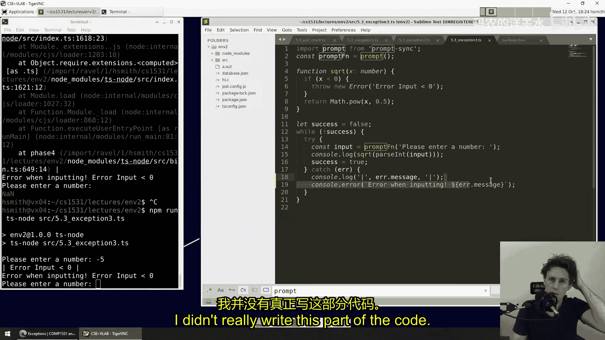

Compared to kind of a C star more like return Nla return some object。

 key things are exceptions do carry data。 That's really important because you can store lots of stuff in that object if you need to like not just a string。

 but you can store other information。 And then secondly， when exception is are thrown。

 normal code execution stops。 We already talked about this。

 What that means is that it's a little bit like an early return statement。

 when this throw is called the code actually stops。

 And actually technically what happens is that you know you can kind of visualize your code as a series of functions calling functions like you have a main function that calls other functions and those all call other functions and it kind of ripples out like that。

 when an exception is thrown。 What happens is all the program just kind of stops working for a second。

 everyone stops。 And that exception says is anyone here to catch me and if the answer is no。

 it kind of comes up to the function above and it asks that same question。

 And that's actually exactly why。This square root function here。

 when we call square root and it throws the exception， we actually， you know。

 we look inside this function to say， iss there anyone here to catch meca exception was thrown on line 6。

And if the answer is no what it does is it kind of kills that function off。

 that function call pops off the stack， so to speak。

And then immediately comes up and starts looking for it in this function。 And if it was。

 if there was no catch in this function。We'd have no idea what to do。

So the try is really just a way of saying this is the section where you should be aware that exceptions could be thrown。

 And then the catch is like， this is how you deal with those exceptions that could be thrown。

Any questions on this so far'cause we're not， when， we're actually not far from the end。

 This lecture is fairly short。Let's take another example here。

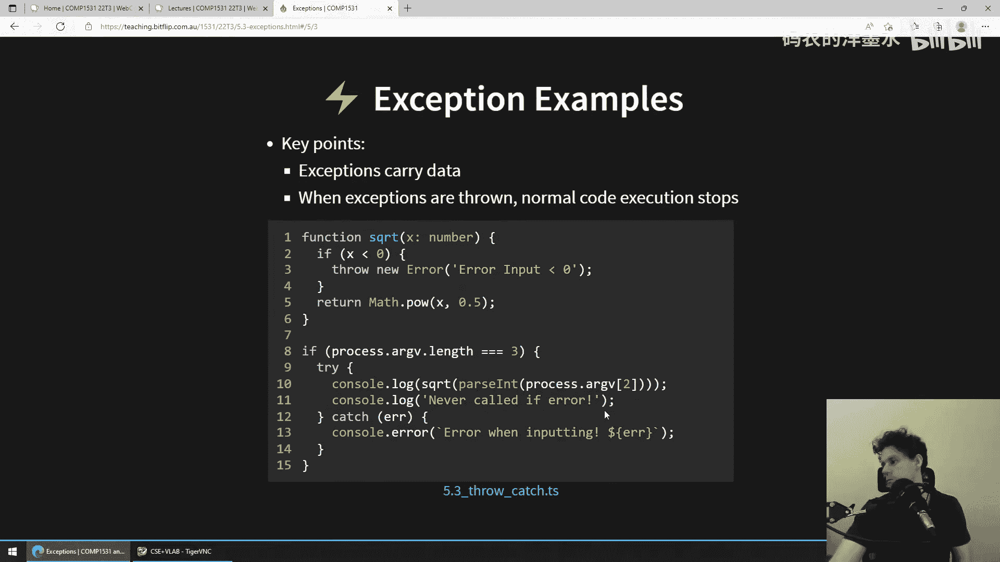

Try it out。What was this last one。5。3 throw catch。

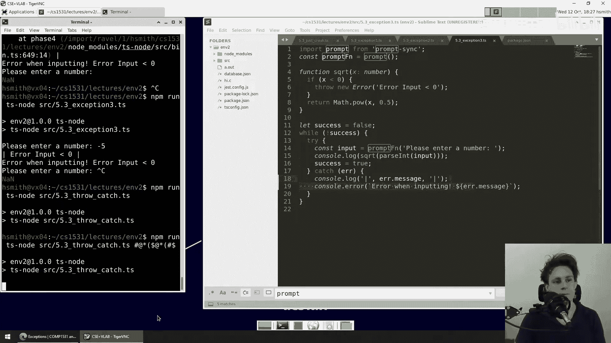

Okay， maybe this one isn't too happy。 But in this particular case。

 what we might be doing here is we might be。 it's the same thing。 Sorry。

 I thought it was due with the Parant。 Sam thing here。 we have a programme now。

 And this program is like， hey， if someone has three Rrgvs。 And remember。

 three Rvs is actually just one argument， because in Javascript， If you look at A V， the first。

 the first Av is actually kind of it A V， actually let me check that， sorry。

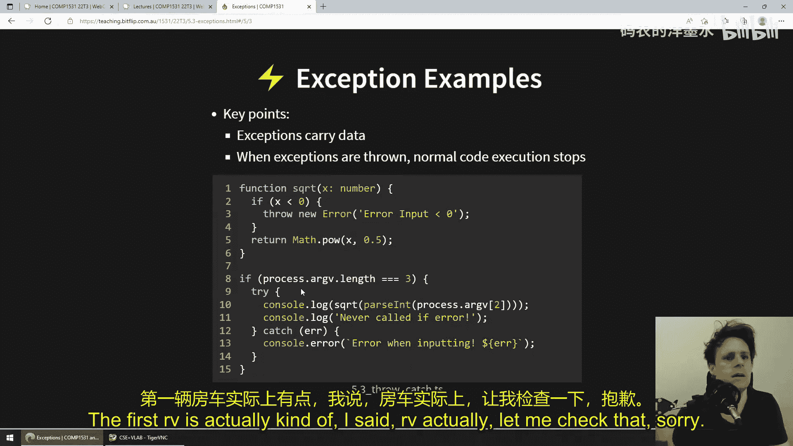

I think I've gotten。Something slightly mixed up。Let's just print out processs。goly and take a look。

Yes， you got the binary you're running it with， which is T S node。 Do you got the file name。

And then after that， that got removed。 Maybe after making it a string。 Maybe that's the problem。

And that third argument there is that they， yeah， there we go， not a number。So naturally， if I。

 you know， for instance， put in negative 5 here， that negative 5 will get converted。To an in。

 it'll get square rooted， and it should。Squares should throw an exception， but it's not。

That's really weird。Looks。I don't know。This particular program is actually just getting its input from A on the command line。

 you don't actually have to do any standard input or anything like that。

 A little bit confused why that's not working。Strange that it's not picking up on。More stuff。

 Maybe I did something wrong。Okay， seem to like that。But not numbers。Okay， it doesn't my numbers。

 but not negative numbers。Very odd。 It's probably something to do with。You want to do with the minus。

Yeah， okay， Shell's a little bit weird。 to pass in a negative number there。

 I had to add this double dash thing。 But you can see in this particular case。

 it simply checks it if the a lengths 3， it's like， okay， I have a parameter tries to square root it。

 If it can't square root it， then just catches， you know。

 the exception does something like that with it fairly straightforward。

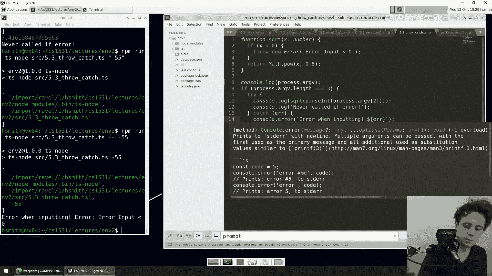

And。Think that's mostly it。Honestly， the last slide is just this testing with exceptionsca what I did here was I created another piece of code called square root like this。

 right？ very simple function。 I just export it。 So it's a square root function we've been using before。

 I'm just exporting it in this case。 except what I'm gonna do is then test it。😊。

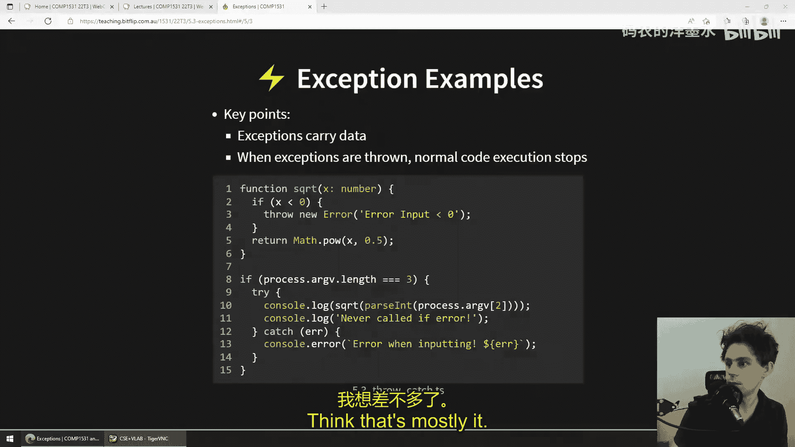

So I import the square root function， naturally。And then I go describe to check my square roots correctness。

 And then I've got two tests。 The first one just deals with square root with positive numbers， right。

 So the square root of 4 should be 2。 The square root of 2 should be close to 1。

414213 to the nearest， like 5 decimal places， right。The second party is kind of interesting， though。

 but let's come back to that。 So let's imagine for a second that I have those tests。

 so I go MPM run just on source 5。3。Catch dot test dot T S。It's probably how I'm importing。

 and I'm guessing。Or maybe not。 Oh，5。3。 Oh， I need to update that code。

 I think I move the lecture around。Cool， so that passes right。

 So it's very easy to write testca you've written test Feration 1。 you're writing test Feration2。

 But one thing we haven't explored is how to write tests for exceptions。

 And what that means is that how do you test that when you call a function with a given value that it returns you an exception because remember。

 exceptions aren't return values when an error is thrown is very different from return value。

 Like exceptions are a whole like system within a programming language。

 And this is how we do it in this case， what we say is， well， you know what I expect。😊。

The square root of 2， when it's called to throw an error that has this string input， right。

 This is the error I want to get。 And this one is a kind of an alias for it。

 These two lines do the same thing。 like these two dot2 throw dot2 throw error。 But， you know。

 we have a square root of negative 2 and we have square root of negative 5 there。 Now。

 this code will also work。 and it should pass it because negative numbers do throw an exception。

 And those exceptions are those strings。 however， right。

What I want you to notice is how differently we have to operate with these。

 The temptation here is to do something like this， right， It to say， well。

 I expect that the square root of negative2 should throw that。 But the problem with this is that。

The problem with this is that what actually happens if this line was to get executed was that it tries to actually execute and call the square root of negative 2。

 which throws an exception which no one's catching because what's actually happening here。

 I'll show you kind of what's happening。Imagine there's a function called expect。

 And what it does is it actually takes in a function。And then what it does it says， you know。

 try catch or something like this。You know， and what it actually does is it just calls function within that。

That's all it really does。 So a kind of， that's why we actually give it a function。

 That's why we don't give it like the becauseuse when I just write square root negative 2。

 I am not giving expect a function。 I am giving it the result of a function that I called， right？

 So this one here gives expect a value or at least tries to。 This one here gives expect a function。

If I give it the value it's going to try and evaluate it immediately。

 which means expect more and have the time to actually like set it up and wrap it into something。

So that's why I give it the function， because then what it does is it takes that function。

 It does something like this down here with it。 It calls that function in a safe environment。

 It checks how it deals with it。 and then it checks whether it throws or not。

 And that's where we get these nice little pieces of code。

 So this is something that you're gonna have to do pretty extensively in iteration 3。

 Iteration 3 has just a couple of changes in it。 Nothing completely absurd。

 and certainly nothing as much as iteration 2。There you go。 What do we got here。 I， Oh， okay。

 it's just a colon issue， is it or something， yep。Oops， lost everything。One second。

So this should now work for everything。

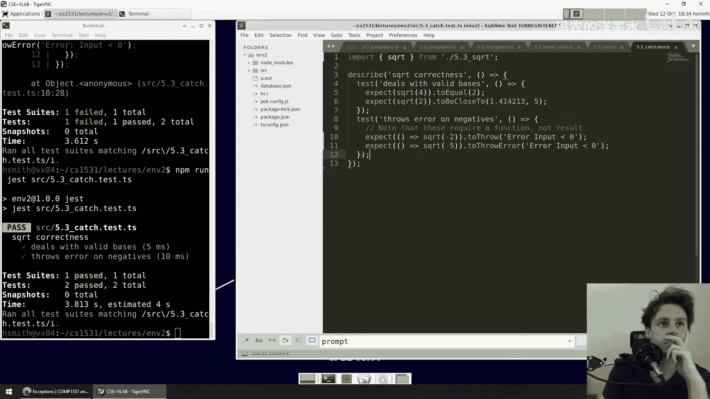

Yes， so two tests pass， right。 So the way we deal with Jeest is actually remarkably similar。

 There's just slightly new syntax you need to be aware of about how to actually check whether exceptions are thrown。

 This also doesn't actually have a huge bearing on anything because in your project。

 you do a lot of stuff with express and with express。

You don't need to actually check for exceptions as much。

 We'll keep talking about that in the next couple of weeks。

 but that's not something you need to worry about。 Do you have any please leave some feedback。

 Do you have any other questions about this lecture for those who've hung around。

 It would be great to see if there are any lingering questions， because otherwise。

 we will quickly move on。Jeremy asks a good question。

 So do we just chuck everything in the try catch。 I like that question'ca it's very intuitive， right。

 Like Jeremy's kind of here being like， well， I get what you mean， Hayden， but。

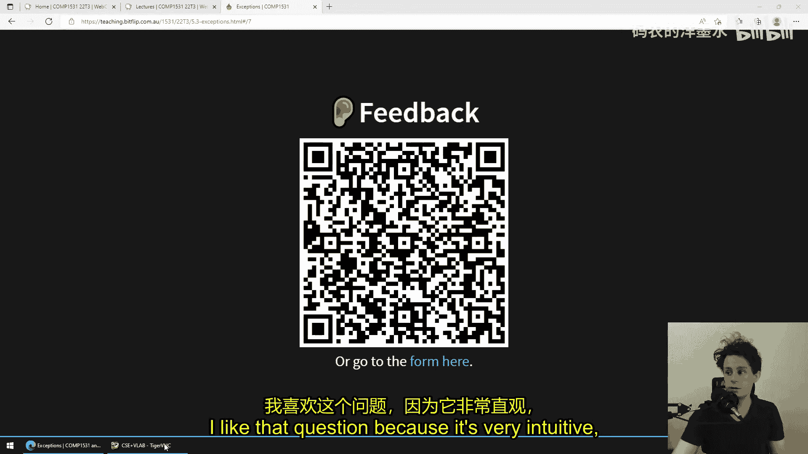

你哪儿。Why don't we just put everything in the try。In case anything throws an exception。 the answer。

 the short answer is that it's。There's a couple things。 One is。

 it can make it harder for programmers to read。 Like， for example， let's say。

 for example that you had extra code like this。 Like you could put the， you know， I mean。

 you couldn't put that there， but。You know， let's say you had some other code like， you know。

 getting started。You probably don't want to put that in the try because there's a need for it。

 Like one thing is when you haven't narrow try， you help signal to other programmers exactly what things could go wrong。

 whereasas here， you know， it's like a lot of code。

 And also sometimes we actually have multiple tries。

 That's like another common thing that happens is that let's say we do a different operation that could fail。

 that could throw an exception sometimes you're just go and put that in a separate tryca because different errors sometimes you want to deal with differently。

 So it's not that you should always chuck everything in if you're not sure you can always put more stuff in it's like it's always safer to put more stuff in。

 but。Right。That being said。嗯。Iner。Be careful， right， Like， don't be reckless。 Like。

 there's always ways to be lazy with programming。 But sometimes we just want to。You know。

 be a bit clearer to our colleagues and everything else。

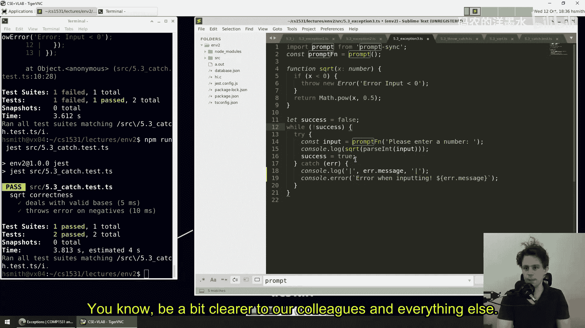

嗯。Yes。Have I been to the village green yet， Don says， no， I haven't。

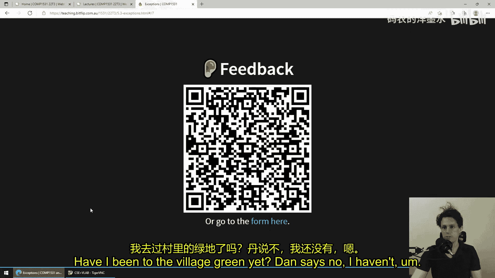

嗯。I have not。Whereas there was a LinkedIn update。 I saw it yesterday， though。And look good。

These are all renders。 There was actual photos of it。I live。

 I lived next to the village green for two years when I lived at college a long time ago。

 So I spent a lot， spent a lot of my life looking at that patch of grass。

 So I'm interested to see how it turned out。😊，Yeah， no， I haven't。 I have to check it out， though。

 I think I'm on campus a couple of days next week。 I think I'm there。 Oh， no， not a couple days。

 just Tuesday。 So Ill check it out on Tuesday， and I'll， I'll report。

 I'll take some selfies for people， yeah。

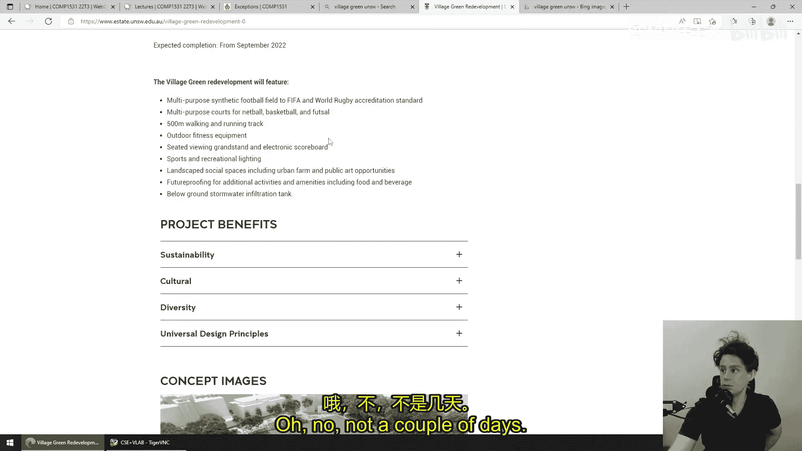

Alright， I'll leave some feedback。 I'm actually gonna take an。

 I'll take an early five minute break'cause we only have one lecture next。 and it's a bit longer。

 So we'll do an early break。 So let's。Let's split for five minutes and keep going。 Thank you。

 everyone。

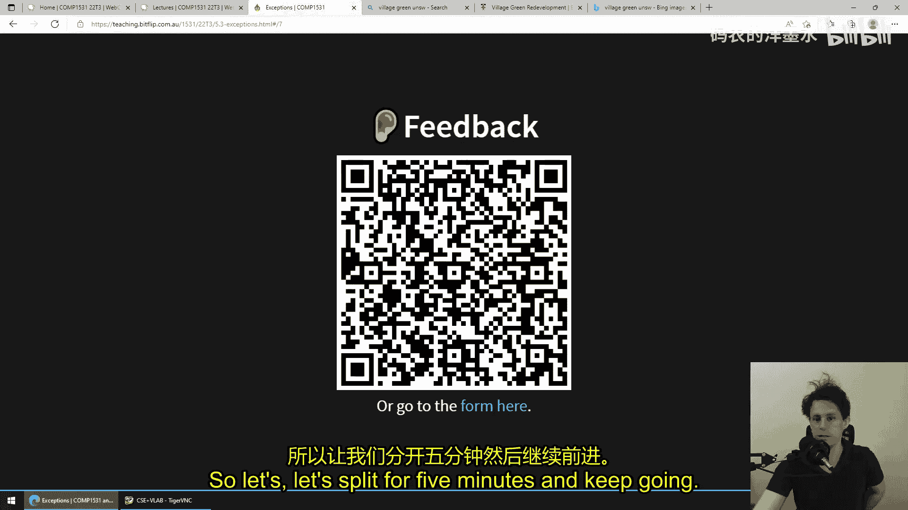