# 【全集】新南威尔士大学 软件工程基础 中英字幕 1080P COMP1531 p17 Lecture 17 - 可维护性设计 -BV1M7Nwz7EGh_p17-

Okay， so。😊，We're about to jump into a fairly hefty but interesting lecture called Designing for maintaintainability。

It's lecture 5。4。I'll give you the why for the why。Take a step back here， so。

Something that I've spent a lot of time doing over the last several years and something I probably enjoyed the most throughout most of my education and computing。

Was helping。Students understand the importance of software design。你呢？

How to write good software because you can actually write software that's correct。And bug free。

 But it can be crappy software。You know， there's a certain like elegance to it and。

It's not really taught。😡，In any crazy depth in the right way， probably anywhere in the degree。

Maybe not as much as it could， at least。Probably the better thing to say。

And it's hard to teach as well， but it's all what falls into the design area of software。You know。

 this is like， well， what am I talking about here，'cause I'm getting on a bit of a babble， but。

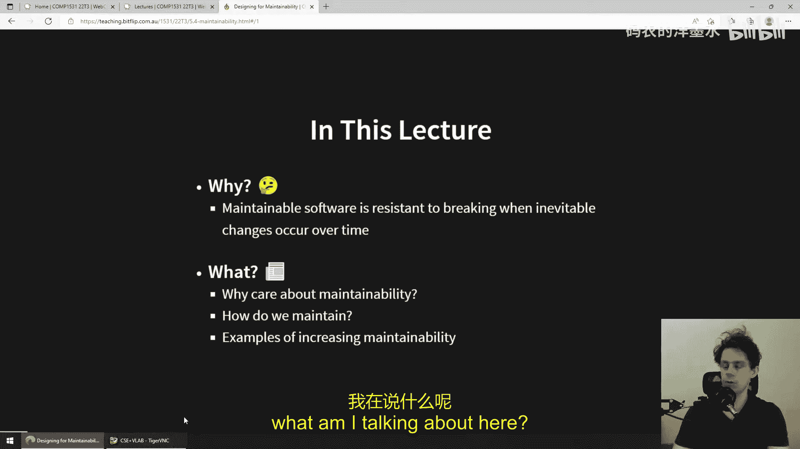

You know， if you ever written some code。And。Your friend has written the same code。

 Maybe they've done the same lab， and you've gone and looked at their lab。 And you've just gone。

 gosh， that's clean。 That's nice。 That makes sense。 That was easy。 You didn't over complicate it。

You know， or on the other side， have you ever written code。And like after it。

 you've gone back to it a week later。 You've just come。 This thing is a nightmare to work with。

 feels like。You know， it feels like the equivalent， you know， like， you know， and it， you might make。

 you know what it's like you make something in the kitchen and you make a big mess and just like。

 this is a nightmare。 Sure I made the cake， but like。This isn't good。

 I can't sustain a kitchen life like this。 You know。

 there's like there's all these stupid analogies I could come up with。

 but it's all really about doesn't matter what the outcome is。

 Sometimes we like to do things well and do things properly。I would love to teach。

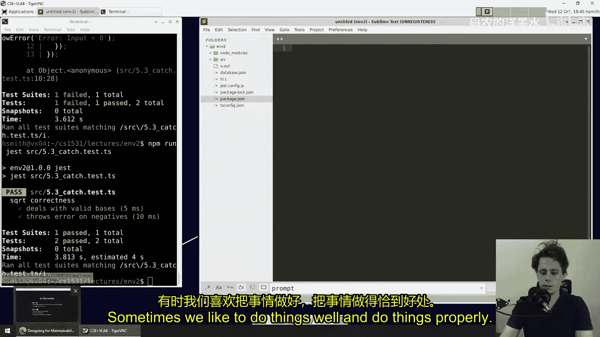

This more。In this course， but to be perfectly honest。

One of the issues is that when you teach people about software design who've maybe only been programming for like。

 you know， 12 to 16 weeks， it's hard for it to kind of hit them as clearly as people who've programmed a bit more。

 so it's a little bit hard to really emphasize some of the principles that we could apply。Right。

And that's okay。 That doesn't mean we can't talk about it。

 But what it means is that we have this kind of one lecture where we talk a lot about software meant maintainability in the course。

 And I'd love to talk about it。 And I could talk about it for。Hs and hours and hours。

 But we have lots else to talk about。 But this one is really important。

 I think this is a very important and exciting lecture。 And I hope， if nothing else。

If you do pay attention to the details of what we're talking about， I hope that as well。

 you will be able to walk away being motivated to apply this desire to learn about software design and everything you do because and this gets back to the why of the why。

 it is what separates you from other people。I say this a lot。 I say this every term I teach 1，5，3，1。

 I've said it since the start。 Your ability to write code is。Not that exciting。 frankly。

 many people can write code， and many of them will work for less money than you。呃。So like， okay。

 you can build a website good on you。 you know， lots of people can。

 more and more people can every year， too。You want to be known not for the person who can make things with code。

 but for the person who A can make things with code that are correct。Different lectures。

And to make things with code that are built elegantly。That are built well。

 And if you can do both of those things， you will be a force of nature in the development space。

 If you can't do either of those things， you know， you're just going be。

 it's going be a question of like， you know why why would you。

 the example I always give is why would you not just hire someone overseas who maybe had a shorter education or a cheaper education or just something else。

 you know， because anyone can write spaghetti code if they just you put their mind to it so。

In this lecture， how we're gonna approach good software design， writing good software is to。

Stick to this more fundamental idea， that maintainable software， that software that works for years。

 right。Think about that， like just anything you know in life that you're just like， wow。

 it's lasted forever。 And I haven't had to like throw it in the bin and buy a new one。

 So maintainable software is resistant to breaking。

 It's resistant to breaking and needing to be thrown out or breaking and losing a bunch of money。

That was poorly I ended the sentence in the middle there。Our software is resistant to that。

 It becomes maintainable when inevitable changes occur over time。 That's what our goal is。You know。

If we， if if like as time passes and as new people work on software and as things change all over the place。

 our software still is resistant to breaking， It's still resistant to being thrown in the bin。

 Then we have what we call maintainable software。 And that's a good thing。

 That's why this lecture is called designing for maintainability。 Now。

 what are we going to talk about， We're going to talk about why we care about maintainability a little bit。

 We're going to talk about how we maintain software。

 And then just more examples of increasing that maintainability。 So。Bit of a recap。

 What is software engineering back to week 1。Software engineering is where we focus on building the right software for the right people and making sure that it's maintainable over time as it grows and the people who work on it change。

Now， that's quite interesting。 buildinging the right software。Correctness。

 building it for the right people。That we talk a little bit about in week。8ight。

And making sure it's maintainable over time as it grows and as the people who work on it change。

 that's what today's about， right， that particular section there。So we'll discuss that today。

 Why do we care about maintainability。 We've chatted about a few of these things in the preamble。

 But software in the real world changes over time。 pretty much no software that's actually used by people is just built and then exist。

 very few cases of that are true， right， there would be some。 And if they are。

 they usually low level systems and they tend to kind of probably break into like the mechanical or and electrical sphere。

 right， Like， I'm sure some of the。The least changing software over time is like the software that probably runs。

 you know， like nuclear power plants and just things like that。

 things that like the software had to be written， It had to be really simple。 And everyone。

 no one wants to touch it'ca it works。 You know， they wrote really simple small software。 It got。

 they got it right。 and then they like leave it alone'ca it just kind of works。But reality is 99。

9% of the software you all interact with， or like 99。

9% of you will interact with software that just changes over time。

And if your software is not maintainable with it's written poorly。As it's forced to change。

It will be a pain to change。 And what do we mean by pain to change。

 I might kind of have this written elsewhere， but basically means that it will become more buggy or it will cost more money。

 right。So software is hard to change when you change it， it breaks。 And you know what。

 if someone says to you， well， change it， but don't break it。 You know what you have to do。

 You have to spend more time on it。To test it more at a really triple check。 And that costs money。

 right， so。This topic is actually more critical than ever in some ways， because of how rapidly。嗯。

Iterative， modern customer software is， you know。Like。We。

 we write like most software you use is just like pushed out all the time now。 You know。

 it's not like years ago where you'd push something out a year or two。

 you know you push out a video game and it just stays like that forever。 Sos pushed out really。

 really frequently。 But then there's that question， why does it change over time。

 I've kept saying that maintainable software resist the tendency to break as it changes over time。

 Well， different people work on it。Different people bring different programming styles。

 they'll see things。 They'll miss things。 know， maybe they'll be like oh。

 we need to account for that。 We weren't accounting for that before。

 The requirements change over time。 Like think about a product like YouTube。YouTube has shorts now。

 right？Well， it has shorts because， you know， it was like Tiktk， is that thing Tiktok。

Kind of heard it and scared it。 So now they've got short。

 So their requirements of what they wanted to build changed over time。

 You need to increase performance。 Sometimes maybe as you get more and more users using something that you do。

You have to kind of clean up your code。 You have to make it run faster because otherwise everything explodes。

 So you have to go and change your software again。 and then also fixing bugs every time you fix a bug。

 you tend to have to change your software anyway。 So code always grows。

 it never shrinks and you you will never get on top of it。 and you just need to be ready to adapt。

It's a little bit。 I'm trying to think of what a good。

You all probably get this because you study right， you know what it's like some of you would have seen this and this is not everyone but most of you in high school。

You might have taken crappy notes in high school or something， Right。

 Has anyone ever got a Google doc or， or just like a pen and paper notes。

 And you take take these really crappy notes And you think， I'll wait till I have some spare time。

 and then I'll go back through them and I'll clean it all up。 That never happen。

 Did it for most of you。 right， Some of you would have， but。For， for many of you。

 it just wouldn't have because you just don't have time for that。 And again， in the real world。

 when you're working with。You know， an organization or an institution that's not a right software。

 there's always so much pressure to move forward。 you don't really ever often get a chance where someone says。

 you know， I just take a few months and just really go and like make it all nice。Just for us。

 you know， you don't really feel that because in the world of mostly monetarily motivated software。

 there's always that question of what value is this providing the organization。

 And this isn't just big business， right， Like it's， it's everything。

 Every organization is trying not to waste money。Right， not for profits。

Tried not to waste money just like everyone else。 So don't think it's if you're， you know。

 if you're one of those people who are like， I don't want to work for a big， greedy company。

 It's like， well， no， everyone， everyone doesn't have time at the end of the day。

 unless you're working for free。 in which case， you know。

 why would you want to waste your life working for free trying to maintain software that you didn't maintain Well。

 So maintainability also more important than performance。 there's a great。

 I think it's from Rob Pike has some great phrases here， which I've gotten， which is like。

 if code isn't maintainable， then performance issues will appear more often。

 And what that means is that if you write bad or inelet code，Then。As you try and fix it or entry or。

 you know， fix bugs。嗯。What will happen is that。Sorry， my brain just died。

 Well happened is as you fix bugs， performance issues will appear because you have to kind know tweak levers and pull things and add things and that'll slow it down over time。

 And the good thing is， if the code's easy to maintain。

 it will be easy to speed up because things tend to be more modular and well separated。

 know so if code's easy to maintain， it's easy to change and performance improvements tend to be you know changes to the code。

 So if it's easy to change， it's easy to improve the performance。😊，Now。

 that was a lot of maintainability。We get why it matters。

 But how do we make software more maintainable。 That's the next question。

 So a few key ways to make software more maintainable。 There's testing。

Testing makes our software more maintainable because what we can do is we can make changes to the code without worrying about regressions in correctness。

 And you probably have felt this already。 you've gone and written a whole bunch of jest tests before。

 no doubt。 And then what's happened is that you have。You have， it's all passing。

 and then you come along and you make a small change to to the implementation。

 And then you know what， it keeps passing。 And you think， damn， that's awesome。

 I feel comforted inside， right， Like who's felt that。 I'm sure you felt that。 You're like， man。

 my tests make me feel safe。😊，That's the purpose。 So testing is a great way to improve software maintainability because it can give you more confidence to change the code when it inevitably demands to be changed。

You can also。Deal with， you can also approach software with a high quality of system design。

 And that essentially means that， you know， think about this as the not code element。

 But like the sitting down with， you know， like a mirror or something a mind map a brainstorm of like。

 you know， what， what are channels， What our users。

 How will all of these components interact together。

 Let's get a good conceptual diagrammatic visual understanding of these things together before we go and actually write code。

 We talk about this a little bit in particular。

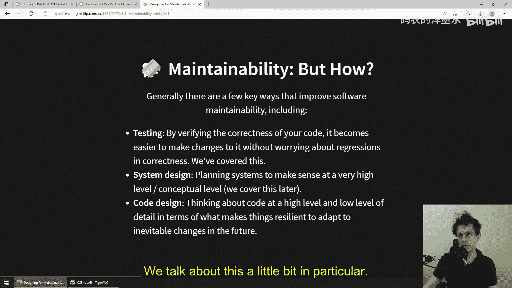

Next week with conceptual modelling， and we do it a little bit with software complexity。

 but to be honest， mostly it's on conceptual modelling next week。 And then the third one。

 which is a lot of what we're talking about today， which is code design。

 And that's thinking at a high level about how easy it is to make code actually like work for us。

 So it's all about good code， clean code is is one of these parts。

 Clean code isn't everything that makes software maintainable， but it's a massive part of it。

 That's what we're talking about today。 Yes。😊。

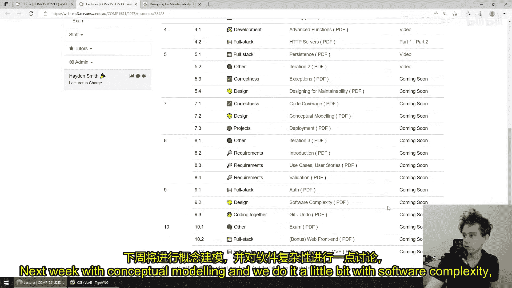

So code design is really just what happens between when you write your tests and when you actually write your code。

 and again， you， if you haven't labeled this， you've thought about this before。

 every time you write tests。 And you know you have an implementation to do。 And you're like。

 I can do this， but I haven't actually written the code yet。

 You're thinking about the right way to do it。 And sometimes it's not just like sometimes you might have an idea of how to do it。

 but you think that's an ugly way to do it。 That's a silly way to do it。

 that might cause me problems later。 So I'm not going to do it。 that's all code design。

 It's that how to do it and how to do it elegantly。 And the thing to remember。

 and this is really important。 Our tendency is to not write well design code。

 because we are in a rush or there's pressure on us。

 a bunch of you would have felt that through the iterations already。

 And good code design just takes a little bit more time and energy。

 And it's okay to sit down and think， you know what I'm actually gonna pause for five minutes here and think very deeply about what I'm trying to do now。

The way that I。After many iterations of this lecture， this lecture has changed quite extensively。

How I like to approach it now， instead of kind of teaching all these principles， you know。

 like the ABC and the D EF principles and all this kind of stuff。

 I actually think that the healthiest way to think about good software design to make code more maintainable is to ask yourself questions。

And the questions are great， because。When you teach people principles。It's a very personal and in。

 you know， very like。Isolating thing。 It's for you， for you to sit down and apply the principle。

 but I love questions because it opens up your capacity to work with other people much easier because if you think about these six design questions to ask there are7。

 If you think about these seven questions。 I I think one of them I group together，6 or7 questions。

 these are great because it's very easy to go to your team member or someone you work with in the future and ask them a question such as is this as simple as it possibly could be。

You don have a conversation about that。How could we make it simpler？你儿。So questions are really good。

 So we're gonna focus on questions。 So question one here， is there one source of truth for this。

This is one of the oldest kind of tropes of good software design， not tropes。

 like tenants of good software design that you've probably come across back from 1511。

 which is that when you write code， if you repeat yourself。

 I if you define the same thing in multiple places。

A change in that value or capability requires changes in all locations。

 You might know about this through magic numbers， or you might。

 they might be referred to as magic numbers。 And it's a fairly， fairly easy idea， right， Let's say。

 you think about a C style thing。 You got like an array of five items。 And then you go and create a。

 you know， a loop， eyes less than 5， something like this。

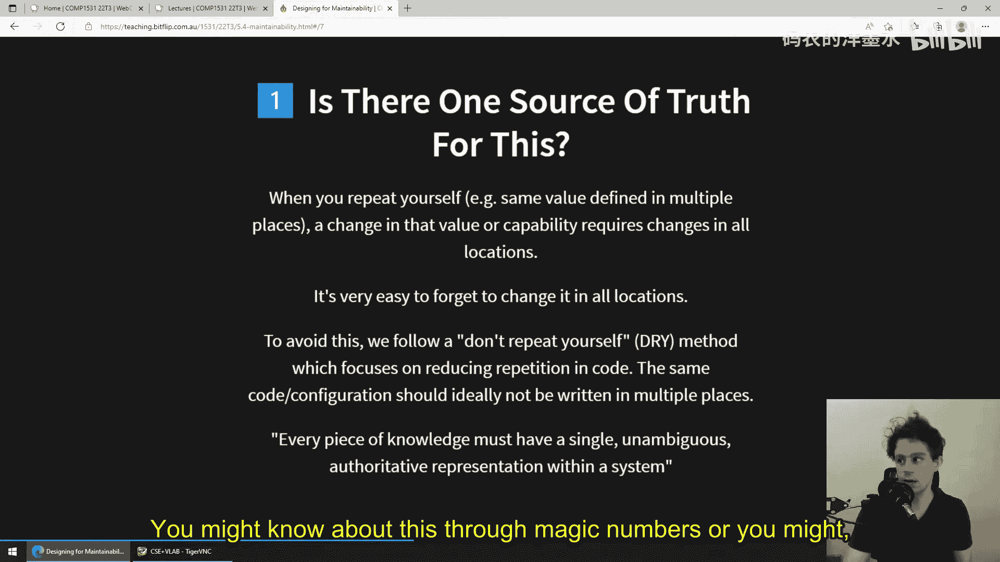

Like， you know this Back from C， you'll be like， define array array size is 5。

 And then you just go and grab that and you replace that。That's an answer to the question。

 Is there one source of truth for this， Because the answer to that question was no。

 there's not one source of truth。 There was multiple sources of truth。

 So we want to kind of undo that。 right， So the question prompts an action。

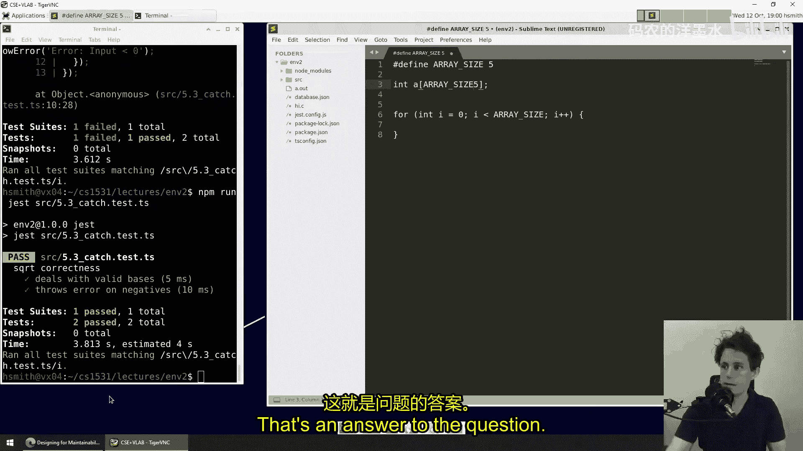

And to avoid this problem， we follow a don't repeat yourself method。

 which focuses on just not repeating yourself as much as humanly possible， right。

 And it another way of framing it is that every piece of knowledge must have a single。

 unambiguous authoritative representation within a system。 Now， that's a big， kind of scary。

 abstract sentence， but it's very true。 And it can be applied to most things。

Every piece of knowledge within a system think of system like software。Should have one。

We might more colloquially between us call it a definition， but representation as saying， you know。

 it should just be represented， defined somewhere in particular。 Now。

 we can have a look at some code。

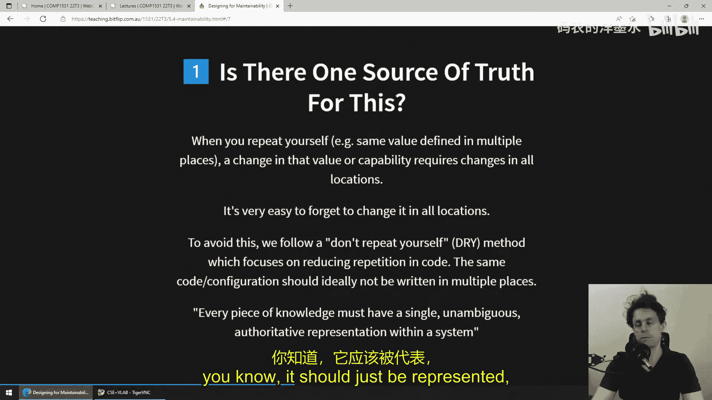

Like this， for instance， if I open up 45。4 dry， This is a fun little piece of code。 It's a bad。

 uglyly piece of code that I wrote。 And what we're gonna do just as a quick group is like。

 apply that principle of not repeating ourselves。 So open question to everyone here is just like。

 what would you do to make this code a little less repeatity of yourself。I'll give you a moment。

 But like， you know， shoot some ideas。 Tell me what you do if you saw this， you know。

 what would you actually do to change it。Use constants for magic numbers。 Yes。

 that's one thing we could do。 What we probably noticed， like， I mean， let's actually first。

 first talk about what this program does。 MPM run T S node source 5。4 dry， dirty， easy。😊，嗯。Okay。

 well， I didn't do anythingcause I should probably read the code first。 We import R V from process。

You can do that a couple of ways。 But let's say we're getting the Rrgv。

 That's the command line arguments when we call the program。 We check if the Rv length is not3。 Now。

3 means it expects one extra argument because you've got T S know the file name and the third one should be that extra argument。

 So if it doesn't have three it exits。 If it does have three。

 it goes and pulls that particular Rrg V and turns it into a number because remember every Rrgv is basically a string。

 And then if the number is 2。It does some stuff。 Or if the number 3， it does some stuff， Otherwise。

 it also exits。 So this means that if I enter nothing， it doesn't run anything。 If I enter 5。

 it'll do nothing because 5 is not 2 or3。 But if I enter 2 or 3。

 then what it does is it goes and gets all the numbers between 10 and 19。

And it raises the number two。To， you know，1011，1213，1415，16，17819。 And it prints out the result。

 It basically just like uses。It's just like， you know，10 to the power to。 sorry。Pen squared。

That right， yeah。And this one's like 10 cubed。 I'm just using some Python syntax。

 But so you see in this case， it's like 10 squares 100 and does this， and it does it for 3， too。

 So if you enter 3， it goes and does it for three。Okay， now。Use constants for magic numbers。 Okay。

 that's fair。 Sometimes it's good in jascript to use uppercase for constants。

 So let's say like loop low end is 10。 and we'll say like loop high end as， you know。

20 or something like that。 And then we can go and replace these two things。 instead of 10。

 we say like loop low。 And instead of 20， we say like loop high。Kaiki says。

 compress these if statements into a function and then set the argument as none。 Great， so。Kai。

 he's like， okay， well， both of these like kind of， he says if statements。

 but let's do four statements。 These two things are very similar。

 so we can probably abstract them into a function。 And I'll call， I'll say with this function。

 It's like， you know， print。What would you call it。You know， print powers or something like this。

 And I use the new function syntax， right， just for a bit of fun。

 And I'll go and copy this in and we'll pull out things。 We'll abstract out things that are。😊。

You know。Not common。 And the main two things you can see that aren't common of this two here。

cause the two appears twice。 So I call this like， you know， the， the power or power。Like that。

 And then we'll just pass power into the function。 And because it typescript will say it's a number。

Okay， this is handycause now here I can just say print powers a two。

And then here I can just say print powers of three。And already what we've done。Right。

 is we have reduced。The definition of something， particularly this function down to one spot。

 So now things， you know， are much closer only having one source of truth。Now。

 you could argue that you don't actually need to make this constants anymore。

 This is a bit of a murky area。 Some people， like in some code， it's really about， you know。

 will this number change I it easy to have it represented up the top Sometimes even though the 10 and the 20 are actually only represented once。

 Sometimes people still prefer to pull them out。 so that you can actually kind of like see them in one spot。

 I think that one's kind of on the border， You'd also see down here。

 we could simplify this code more this is and we could repeat ourselves less in terms of calling functions by just saying。

 well， you know what， if nu equals 2 or nu equals 3 than just call print powers on numb。Right。

So our code got much simpler very quickly there already。Now。

 one of my favourite things about this example， and this is normally when we have more people turn up is that someone usually says we should like extract process dot exit into a function。

 we'll call it like exit。😊，And all this functions is gonna do is just do process dot exit 1。

And then we just exit like this， you know。This is interesting because what when you make that change。

 you are actually making that change in the spirit of not repeating yourself。

 of trying to answer that question that we had in the slides， which was。

 is there one source of truth for this， And you think now there is， because previously， we had two。

 there were previously two places where we defined what it was like to exit the program。

 And this is a really， And this is why I like questions as well。

 because there's not a lot of answers when it comes to software design。 I mean。

 so there's not a lot of。Unambiguous correct answers in software design。

 But there's a lot of interesting questions。 So the plus side of what we've just done is we。

 we now know that when we call that our exit function。

 that exit function will have one source of truth over how the program exits。

But there is a downside of it。

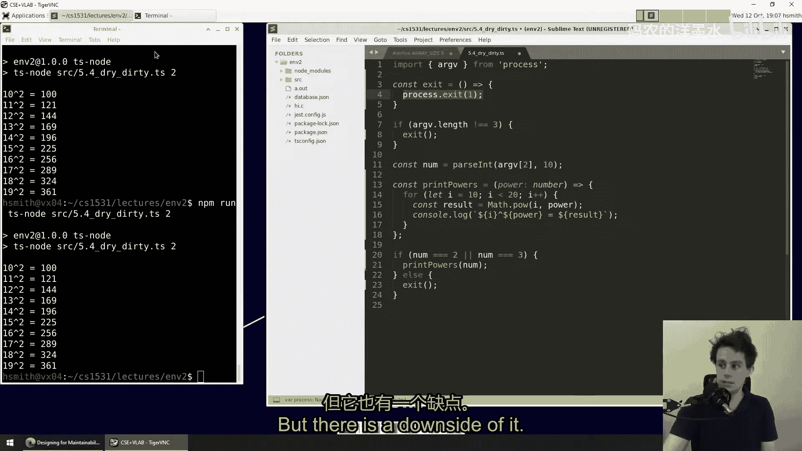

嗯。Which I'll kind of get to see if I remember it back in  point7。

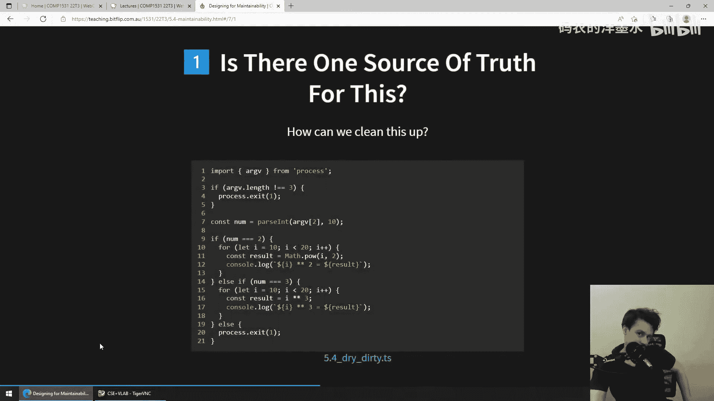

So for now， let's say that looks good。 and we'll move on and come back。 But this。

 this code's like been pretty well reduced in terms， you know， the one source of truth part。

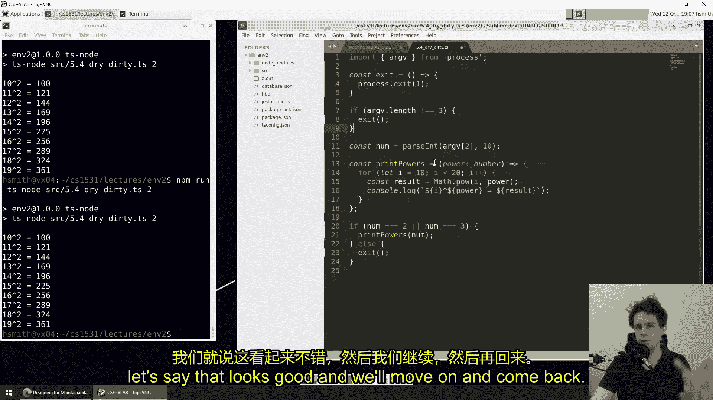

Let's look at the second question now。 The second question is， is this as simple as possible。

 Maintainable software tends to be simple。 the better a programmer gets generally。

 the less complex and less difficult their code is to understand。

So fairly typical trope you will see with， you know。

 like first year computing students is that as they first get into computing and they get over the initial confidence。

 it's kind of a fun， It's a bit of a thrill， It's a bit of a buzz to write complex software makes you feel smart。

 right， because you' written something that was really hard to write。 And that is like kind of。

 you know， that's the validation in in end of itself。 But in reality。

 the simpler software is usually the most maintainable。 So when I look at say。😊。

Say like the people I've employed over the last couple of years。 generally speaking。

 it quite it's quite straightforward。 the younger they are， the more complex the softwares。

 unnecessarily， and therefore， the more difficult it is to maintain and the more often it breaks。

So them， and。You know。It， it comes to， it comes from this idea that the more code we write。

 the more code there is to maintain。 It's actually one of the simplest things to understand。

 you know， So when someone says is， is this as simple as possible。

 they're not questioning your intelligence， I wouldn't think of it like that unless they're rude。

 I'd more think of it and say， well， hey， friend。 every line of code you write gets this one step closer to a difficult to maintain code base。

So， you know， did we have to write every line of code， Were there some places where we could have。

 you know， replaced five lines of code with one line of code。 And there's this quote I love。

 which is that every kind， every line of code you don't write is bug free。And it's a cool idea。

 right， Like if you write 10 lines of code instead of the 20 you originally gonna write and lines of code is not always the best metric。

 But let's just use it。 If you write 10 lines of code are not 20， those 10。

Let's say if you write 10 lines are coded not 15。Those five lines of code you didn't write are guaranteed to not have issues because they don't exist。

So you should always view kind of like writing code as a bit of a burden in a way， right。

 It's like risk。There's not a lot of downside to not writing something that's unnecessary。

 but there is some downside to writing something that is necessary。

 Sometimes you'll hear this principle referred to as like， keep it simple， stupid。

 This isn't just in software。 This is just in life in general。

 And it is the idea that things work best when they're kept simple。

 And it's the idea that complexity and errors are correlated。Right， sometimes they like。

They're causal in the sense that a complex complexity will lead to an error， but that's case by case。

 But it's more that the broader idea is saying， you know what， We think there's a correlation。

Software that gets more complex tends to be more， have more errors。 And again。

 just to reiterate this principle， it is the idea that kind of clear simple code is much better than clever code。

 and no person really likes clever code if it could be no， no。

 no sane person who's got some experience likes clever code if it could be simpler。 And one of the。

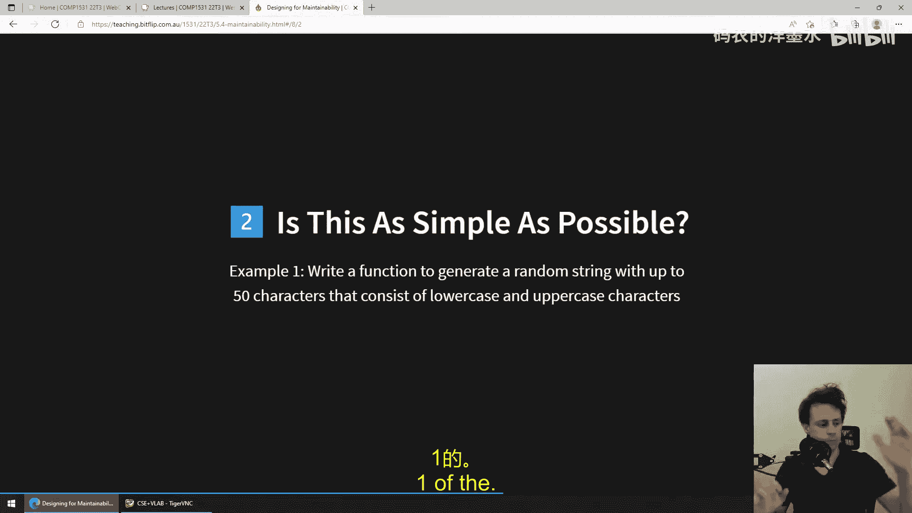

You know， simple code is。Pretty easy to think about， in terms of。

We could have made this previous example much more complex if we wanted to。You know。We。

 we could have come along and。what's an example。We could have made this string very hard to read if we wanted to。

 you know， like， say， you know， constant left hand side equals I plus power plus power， you know。

 constant right hand side equals result， something like this。You know what I mean。

 like you can kind of， you can always make software more complex just by writing more lines of code。

 And if you' never like， and one way to think about it is that。

Simple gets really complicated when you think about it from a very non human standpoint。

 When you think about it from the perspective of， oh， is this simple。Algorithm or something。

 But I would encourage you to go just a much more straightforward approach， which is。

Is this easy for someone to understand。Cause if you make it harder for someone to understand there's a good chance it's inherently more complex。

 So that simplicity matters a lot。 and and probably one of the most basic ways to keep things simple。

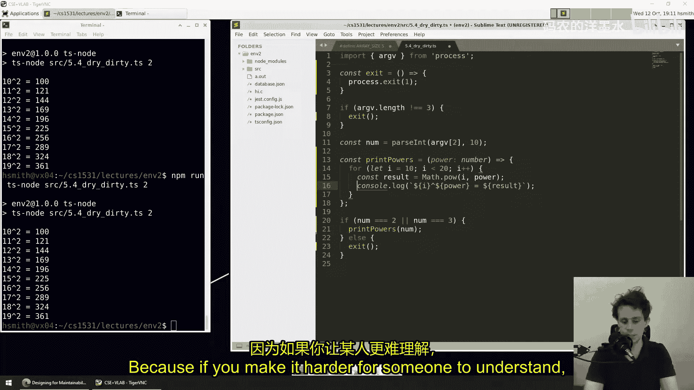

Which comes back to the idea of every line of code we don't write as bug free。

Is to use libraries that exist。And it's again， a common thing you'll hear from experienced software engineers。

It'll always be that question hass someone done this before？And it's something again， you will。

 you will get better at generally， the typical student will typically get better at this as they mature when they see a problem they won't jump to。

 how can I solve this， They'll jump to who's done this before， you know， and there's this quote。

 it might even be。Sater got its from like Todo from F1。But。I don't remember it exactly。

 but it's like。You know， everything you， everything you do in life and everything you will do。

 there's a nearly guaranteed chance that someone else has。

Become an expert on it in a way you never will， right？ So thinking I might have butchered that。

 But the idea being that， you know， when you get asked to solve this problem。

 I want you to write a function that generates a random string with up to 50 characters that consist of lowercase and uppercase characters。

 It's like， well， that's an interesting problem。 You start thinking about ASi。

 And you think about loops， And it's like， no， no， no。

There's such a high chance that someone else has already solved this for you。

 who is probably smarter than you。 And therefore， your approach can be simple by just leveraging their intelligence。

And that makes your code less buggy because， you know。

 someone has probably spent a lot of time solving this problem。

 and you need to dedicate an hour of your data solving this problem。

 and you're not gonna get it right。 It's the exact reason that we use these MPM libraries and everything else。

 So let's say we do look at。

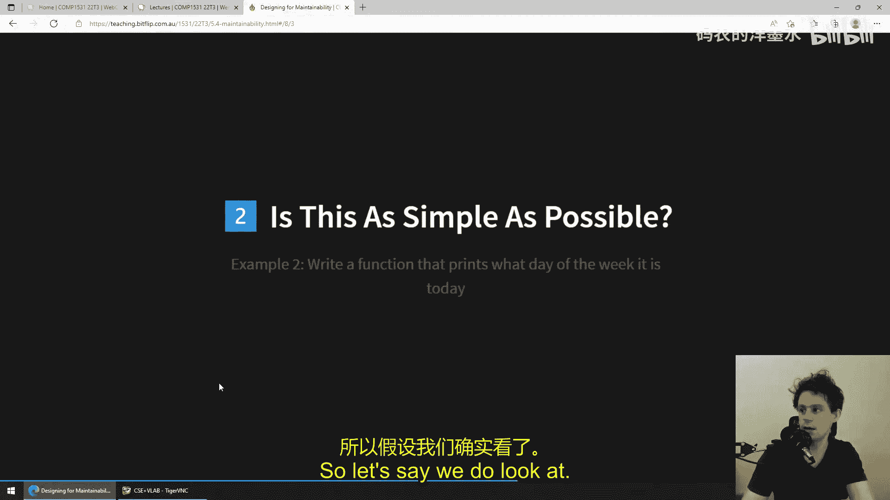

I'll just butcher this file here。 Let's say we do wantna generate a random number。

 Maybe I'll write a function called like， you know， random or random string。

And let's just say if an now returns A， and we'll just call Rand string for now。Or council loggan。

Just test that。 it works。To just print a。Yep， so the question was。

 generate a random string with up to 50 characters。 So， you know， I might do what we normally do。

 No J S， random string。

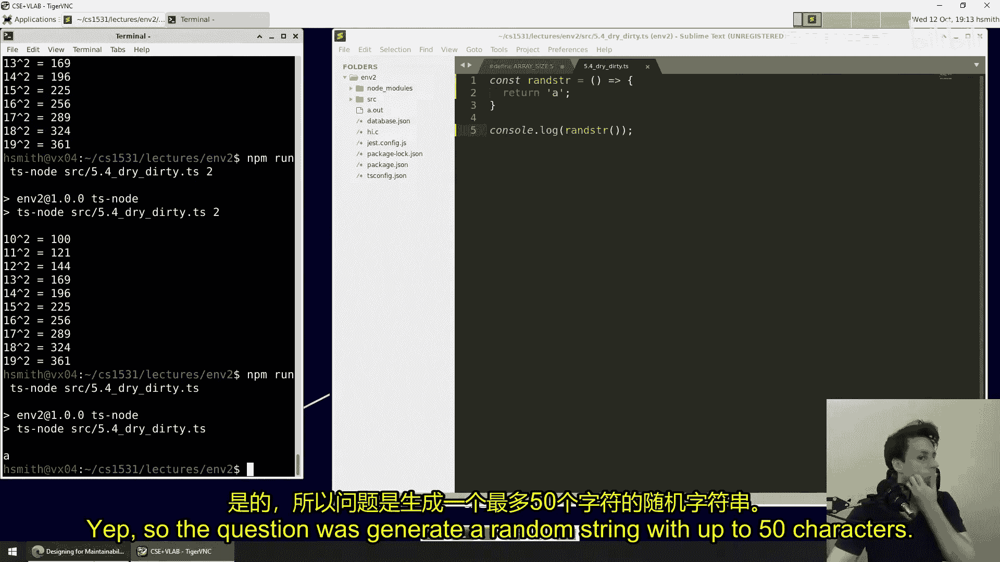

Generate random strings using regular expressions in node Js And I kind of look down here and。

You know， play around with it for a little while。Okay， there's some interesting code here。

Do I have to install anything。 Yeah， it looks like I have to MPM install this random expression。

 So we'll try that one。

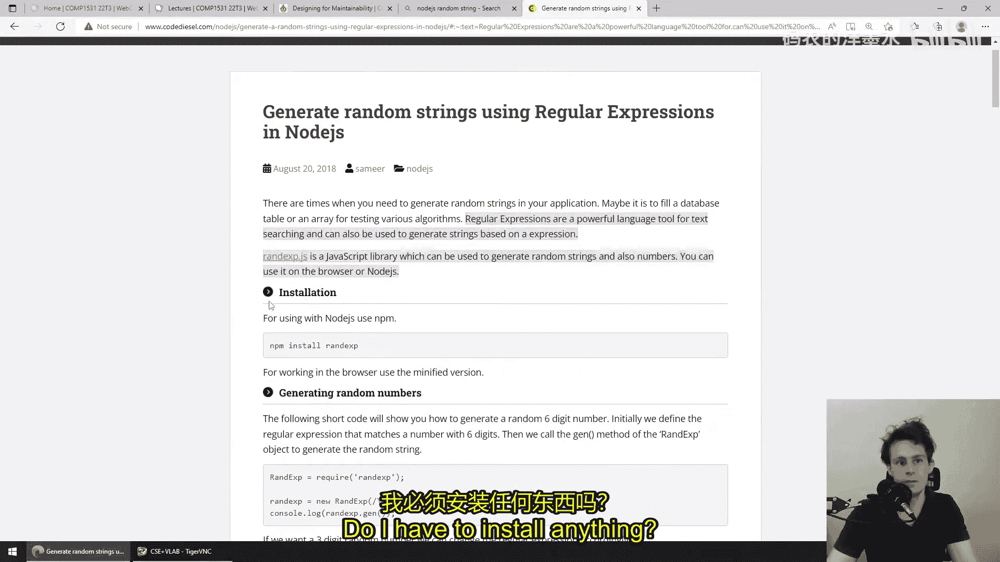

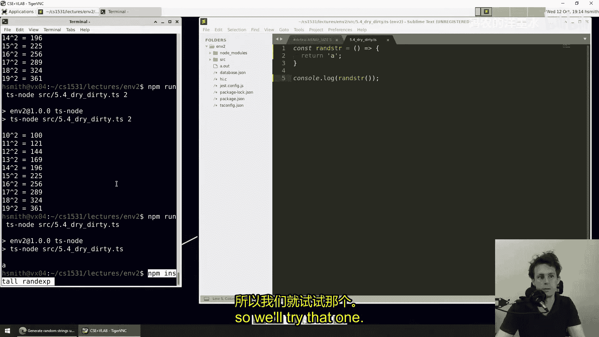

Cool， and then we've got a code sample down here where it looks like it generates some random strings。

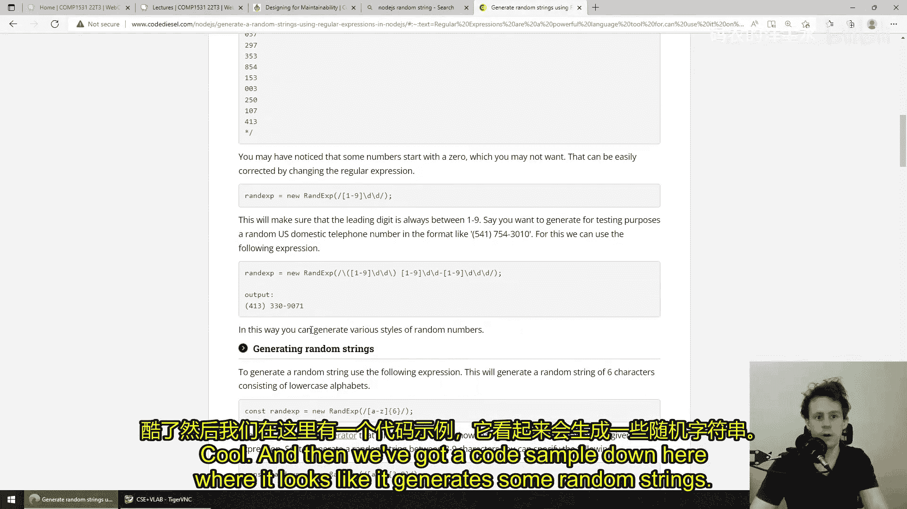

嗯。

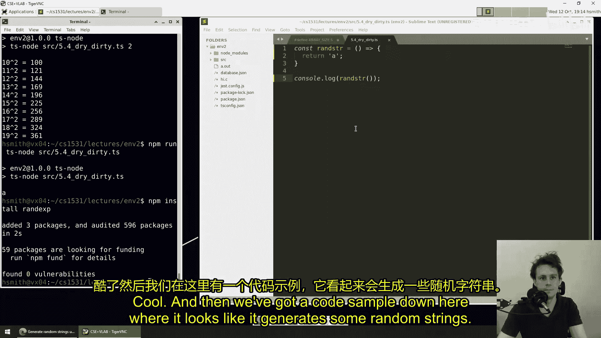

Okay， so I'll， I'll go and I probably have to import that， no doubt。

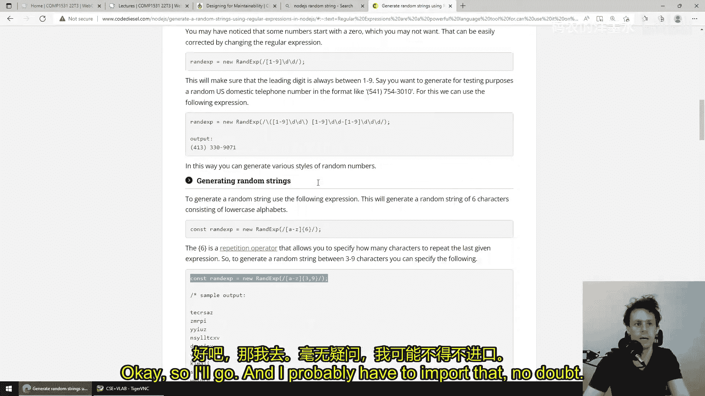

Someone else was's the import。 Yeah， so we， you know。

 import random expression from random expression。 I've never used this library before。

Not that I remember， at least。And then we say here。

 constant random expression is equal to new random expression。 And then this is some redjectx。

 Redxx is like a particular， like a small。I don't know if I call it a programming language。

 but it's certainly some kind of like descriptor language that you can use to generally filter text in this case。

 though， if you were to Google around a bit more， you would probably find a variant of this where it would show you how to do it。

 I know how to do it in this case， but again， I've seen other examples of this on the Internet。

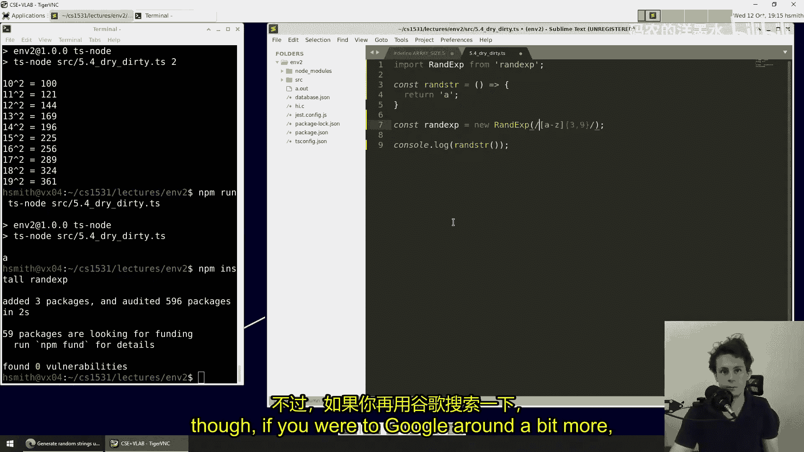

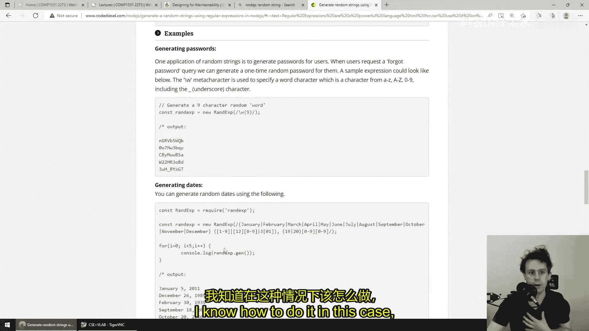

Which is a bit of digging confin， which is to say that if you want uppercase and lowercase characters。

 you're looking for all the characters that are a or z， lowerer case or8 is Z uppercase。

 And what this particular example is doing is it is simply。Doing it。

 generating one that's between 3 and 9 characters。 So when I call this。

 I'm going to get a random lowercase uppercase string。Between 3 and 9 characters。

 So now if it's like， I want it to be 50 characters， well I can just say， well。

 generate me one between 50 and 50 characters。 and I haven't printed this out properlyca I need to。

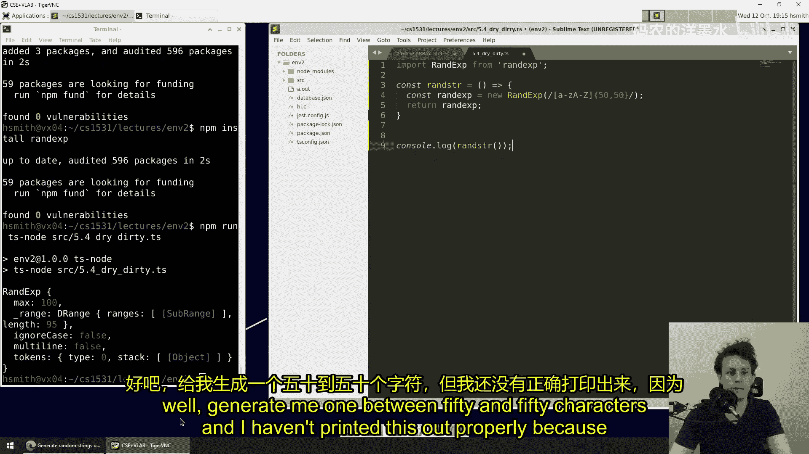

Looks like I need to do something。Dot Jan， I guess， Is that what it is， okay。

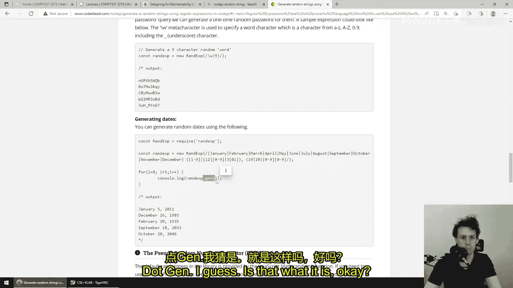

So。ight change that back to 3 and 9。Dozhen。有。See if this so clearly。

 what's happened here is this is some kind of object， but。So that's what， what I was doing here was。

Printing out some object that gave me a bunch of info。

 But I actually had to take that object and generate a number。 So in this case， I get some random。

 you know，3 to 9 character length string。 And I'll got probably get a， yeah。

 this one is slightly smaller。 But if I say， you know，5050 here。

Now I'm going to get a 50 character string and we've kind of solved the problem already。You know。

Doesn't even need to be that big A function。 I'm sure you could just put gen at the end here。

 I'm sure you don't need。I'm sure you don't need all of this。My， my， my editor is being weird。

 I can't say the。Co maybe。Yeah， so you could probably just do that where you just return that。

There's your function。 Or again， you could， you could really go hardcore javascript syntax here like we've talked about in previous weeks and just do that。

 Like， there's your function。That was simple， wasn't it。Very straightforward。

 very easy to understand。 You can look up the library。

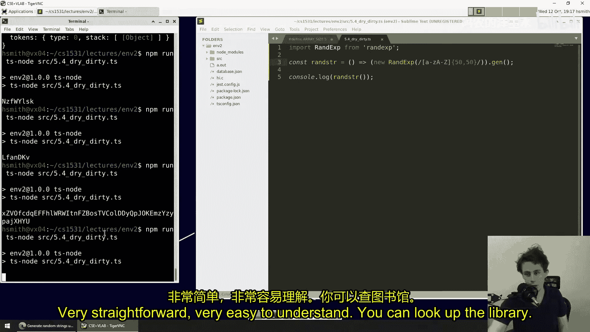

So that's very powerful stuff。 There was a few more questions here that we're going to go through in different cases。

Write a function that prints what day of the week it is today。 again， the same thing。

 you don't need to get caught up in， you know， time zones and all this other complicated stuff。

 You can actually just kind of leverage libraries before。For instance， again。

 what day the week it is today。

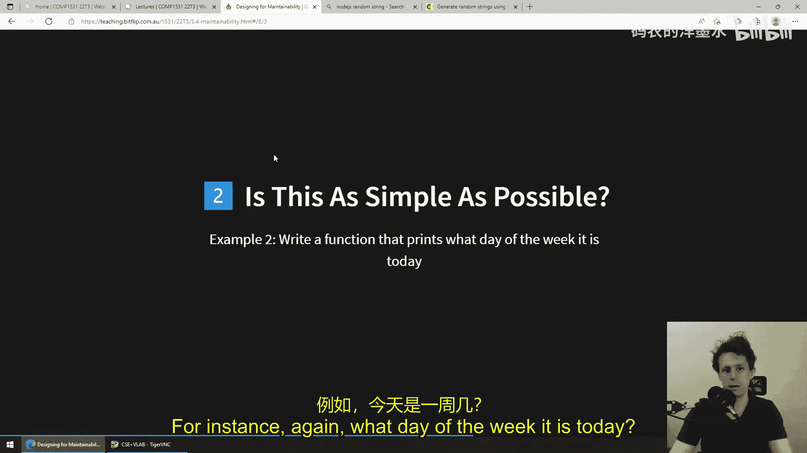

No JS day of week。How to get the day of the week， You know， like Google's a very powerful thing here。

 And it's very easy to be like， oh， you know。Blah， blah， blah， I。I shouldn't have to use a Google。

 That's like kind of a cheap way to learn。 And it's like， well look。It's how it works。Da dot js。

Returns the current week。Day of current week， What's this。Day dot J S。 that's an interesting library。

 Go I have to install it Inslation。 Is it gonna give me an NPM install， hopefully， No J S。 Oh well。

 yeah。 There's a literally a Id。

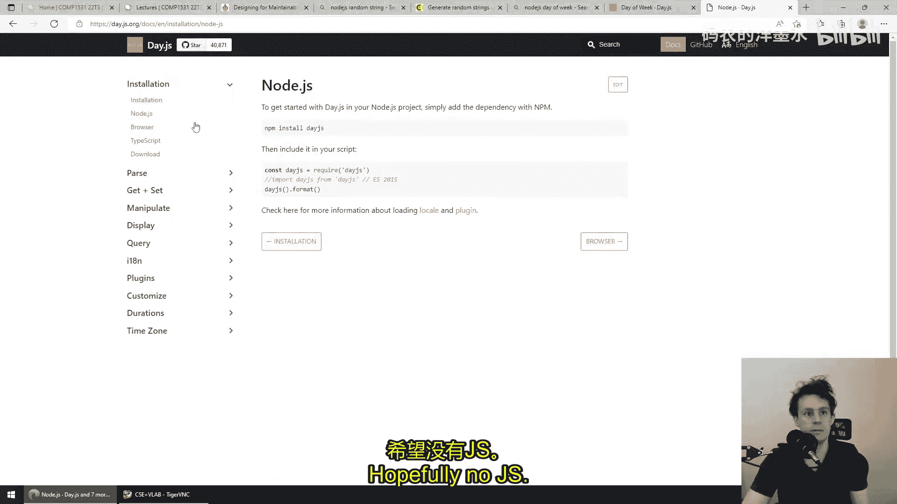

Every time I， like， I don't prep some of these examples very much because I try and like。Yeah。

 date functions。 Weve already seen date functions。 So I could just do that again。

 but to show you something fresh， let's try this out。 I've never used this library。

 and I mean that day J S sounds interesting。

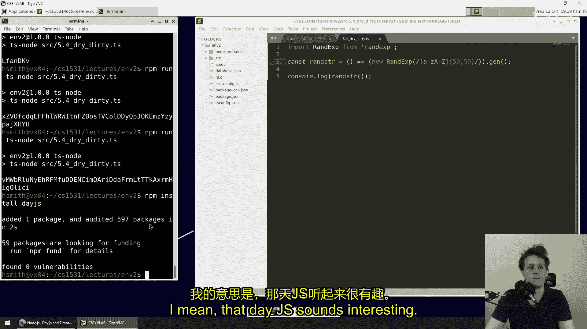

Let's try and what was the example we saw here， day。js。day。

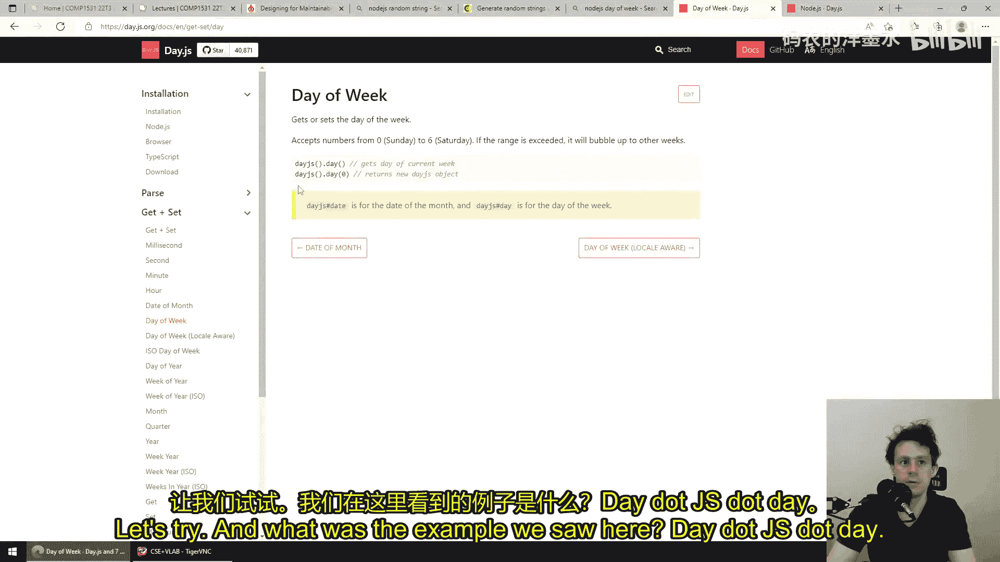

Okay， let's try that。Oops， dayjs dot day。And it's all we have to do is like import DJ S from。

The A J S。That doesn't look good。bit worried about that。 Sometimes actually， you can you。

Sometimes you can actually run into issues and we might run into one here。

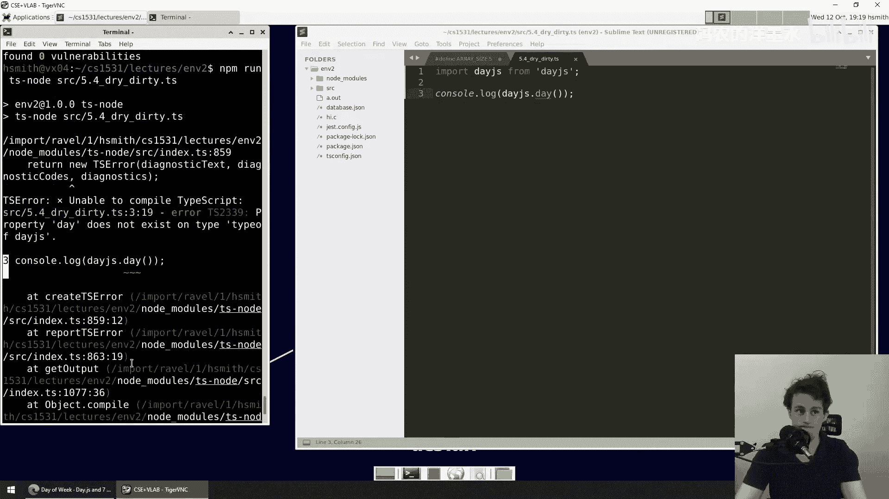

Okay， maybe I need to look at some examples。Installation。I don't know。

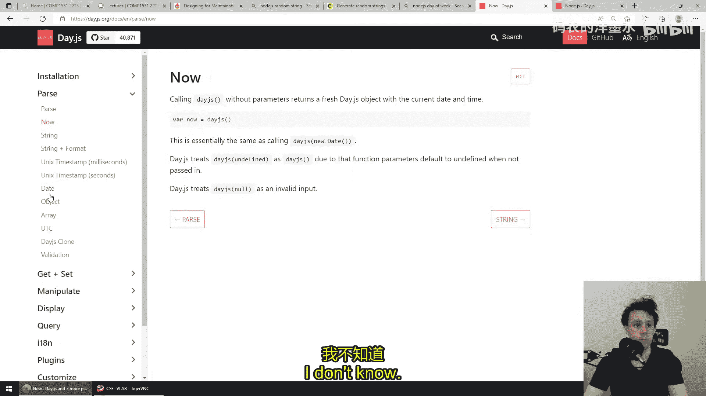

Let's try printing some stuff out。Oh， so I'm missing the brackets。 Very silly， very silly。Okay， so。3。

Well， okay。

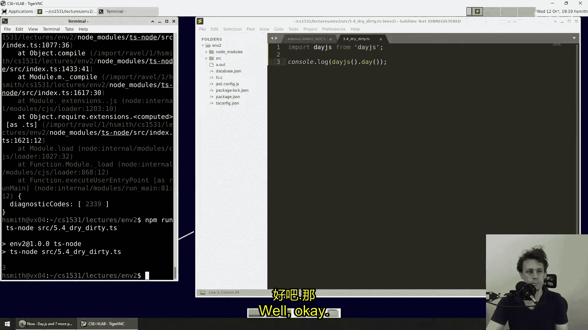

That wasn't super exciting。 I don't want3。 I want Wednesday。你儿。But I'm sure if I Google it some more。

 I go to date functions。 You know， the date functions library， day of week。Thank you。

There'll probably be something around。 you know what I mean， there's like。

 always something sometimes just a case of。Of looking through the docks， you know。

 So it's like day of week。 What do we get。Get day。Yet day of the week。You know。Look。

 I get some number answers。That's interesting。All these libraries will give you。Number answers。

Like 0，1，2，3，4，5，6。 But， you know， let's say you want something that's， you know， like。

 the point is that if you like， okay， here's my point in this example。

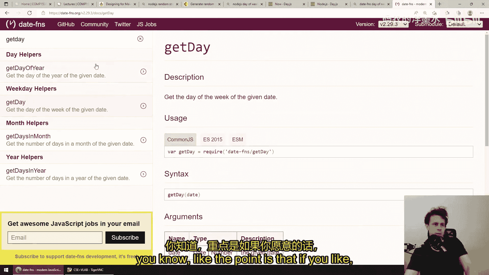

You're like， cool day 3。 Now， what's your temptation。

 I'm gonna go and create some kind of like day map。Where I create an object where like， you know。

 I map 0 to Monday and I map  one to Tuesday or something like this。

 except I think this is probably Sunday， you know， and I do this for all the different days of the week。

Right，2，3，4，5。6 like this。Saturday。Friday， Thursday。Wednesday。Tuesday。And then here， and I I。

 I get my day of the week。 And then I simply， you know。

 get my day map and access that particular index。 And now it should print out Wednesday， right。O。

I've solved the problem， but I don't think what I just did is good is my point。I would be shocked。

 I don't know。 I really don't。 I， I'm not gonna waste your time looking at it because we don't ask you to really do it。

 but I don't think I would be shocked if I was the first person to have to solve this problem。 And。

 I mean， that's obviously not the case。But I'd be shocked if someone else didn't wrap this into a library。

 and。To find it all I needed to do。Was actually。Just go and like。

 look up some more documentation on the Internet。And I could avoid that because this is the problem。

 It's like， okay， every time you write code。You know。

 there's a chance someone else will misunderstand it。

 There's a chance that the indexes might be wrong。 There's a chance that there's a typo。You know。

 another library out there might be able to do days in different languages for you， right。

 because dates are universal。 Day of the weeks are universal， but the， the language is different。

So a library might be able to convert。 this is， think back to the original point of this lecture。

 It's like we want to write software that resist the tendency to。

To break when it's inevitably forced to change。So if you write some software and then。It's like。

 well， we need to do it in French now。Well， you're going start doing something silly here and start going。

 well， we got the English version。You know， and there's the English version。

Then we got the French you know what I mean， and then suddenly you've got all this stuff to maintain。

 whereas if you just use like a library or something simpler then it's a bit easier。

 So these examples are all predicated on top of using a library。

 there are many other ways to keep software simple。

 you will just naturally figure this out though over the next few years as you program or I don't need to spoon feed you 10 random examples。

 The point here is that you'd be amazed how much you can like do 90% of your software simplicity just by saying someone else has solved this before。

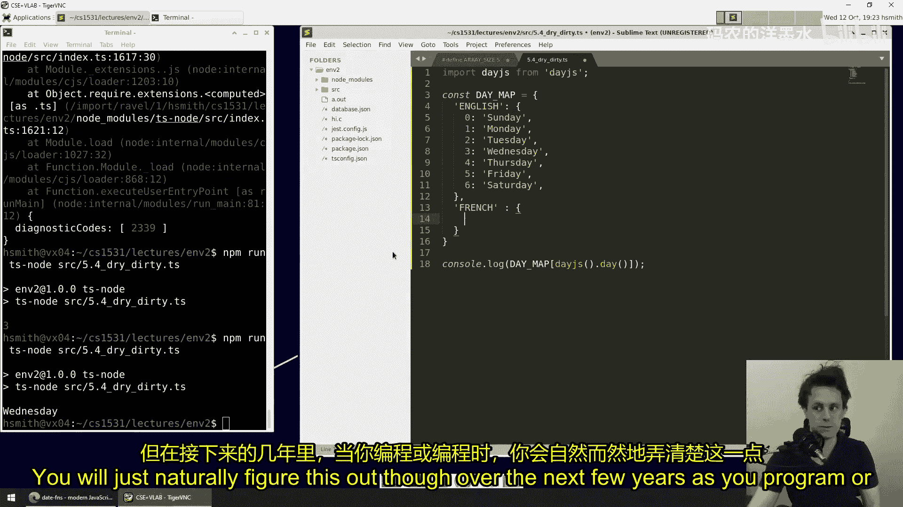

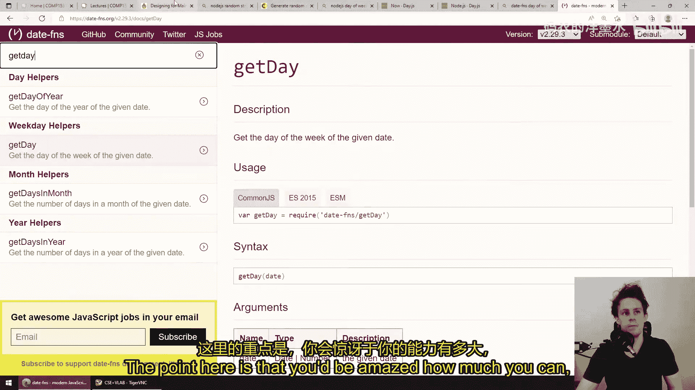

That'll help you a lot。Question 3， is this， I think there's only six questions'ca I collapsed。 No。

 I didn't。 There is7 questions。 Now Id combined 4 and 5。

Is the software over designed or under designed， You've probably heard the phrase over engineered before。

 right， Like， oh， wow， we really over engineered that party or over engineered that problem or something。

It's a fairly straightforward idea。 If you over design something。 If you。

 if you think too deeply about how to make it beautiful。

 you'll spend a lot of time creating very kind of complex abstractstructions to maintain very trivial changes in code。

 If you under design it， then you're gonna have to be constantly restructuring things。

 This is actually one of the hardest things to get right。 I think。And。An example。For you。

 I'll give you a couple of examples。One of them at work， we had to design a system。F years ago now。

 probably like three or four years ago。Where people made deposits and transactions on the system。

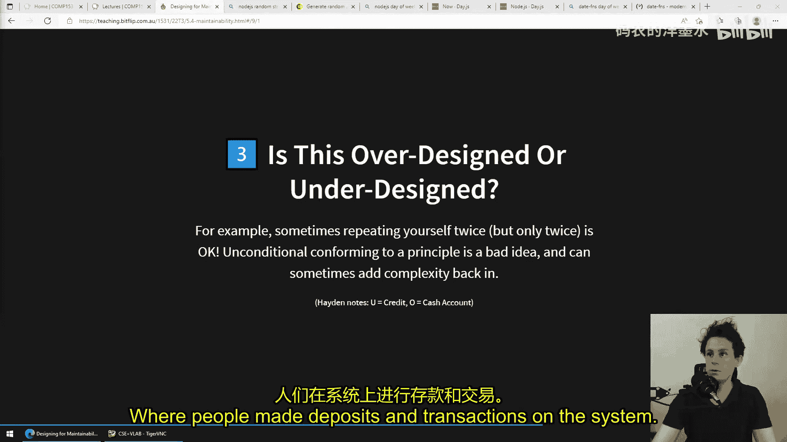

And I'll just changed the colour of bit。 And what happened was。

 was that for those trans deposit or transactions， we'd have a little database。

And that database would say something like， well， you know， deposit $5 from Hayden on， you know。

12 October。 Then there'd be another line， deposit $10 from Hayden on 12 October。

 And then another line that was like， withdraw $2 from。To Hayden on 13 October， right。

 And we have something like this。 And there's an interesting question to ask， which is， well。

What's at this point in time here， Imagine this is all the past。 How much money does Hayden have。

Well， he has$13， right。 And you know that， because you just went in like tallied that up， you said。

 well， I got 5。 I got 10， and then I lost  two。 So he's got 13。 He's 13 that he's deposited in。

 right， money。But to calculate that， we actually have to like， go through and kind of tally them up。

 And what this meant was that every time a customer would。

Log in every time they'd look at their balance， we'd have to kind of quickly in the database。

 like sum up all these numbers， which wasn't。It's a pretty quick operation。But at scale。

 it can be kind of difficult slowcause you got， you know， thousands of customers。

 thousands of times a minute， you know， looking at different kinds of things。

 So maybe that takes a while。 So we said， well， why don't we just keep it running total。

 So it's like， what we'll do is here， we'll just say 13。 And then， you know。

 what when they come along here and they， you know， they go and say， deposit $8。

We'll just kind of update the running total'll be 21。You know。

 so like you're kind of casing the running total。 So every time someone's like。

 what's my balance you're like 21，21，21，21， you don't have to go and count the history。 Now。

 this is a really interesting question because， again， most things in software design are questions。

 is this approach over designed or is that over design。

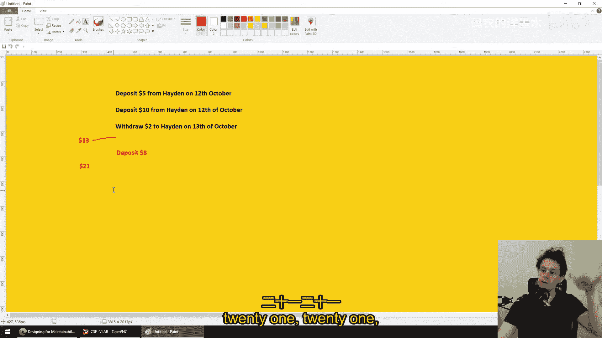

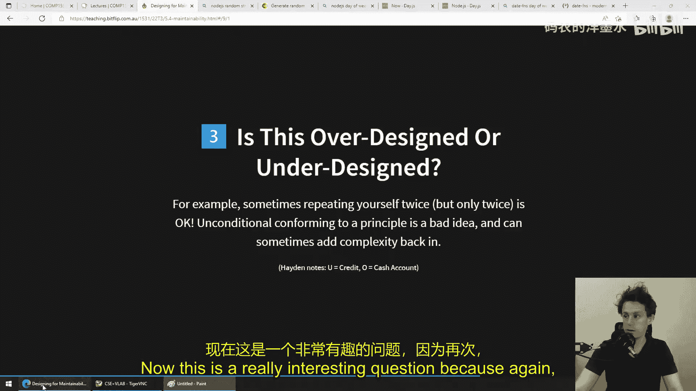

If I do this little cay thing here。Where we kinda keep it running total。

 am I over designing my software and making it too complex。 And if I don't do it。

 am I under designing it and gonna regret it later， Because， you know， what do we say before。

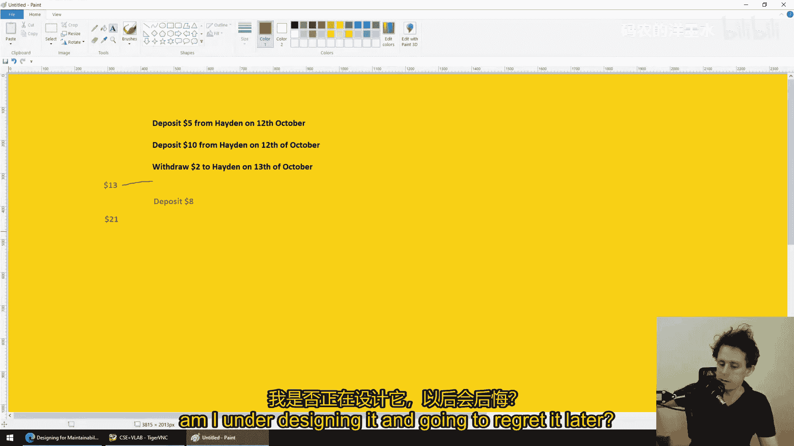

We said that the problem is if you overdes software。

 you've got all these very complex abstractions and things going on。

 which makes it really prone to bugs and really hard to maintain， which is what we're trying to do。

 But if you under design things， you have to constantly keep changing your code all the time as it grows or changes much more than you'd expect which can introduce bugs anyway。

 so like if if you over engineerer your code becomes too hard to maintain because you've just got all this crap to maintain if you under engineer it。

 you're constantly hacking at it and it becomes difficult to maintain because things you hack out a lot aren't going to turn out very good。

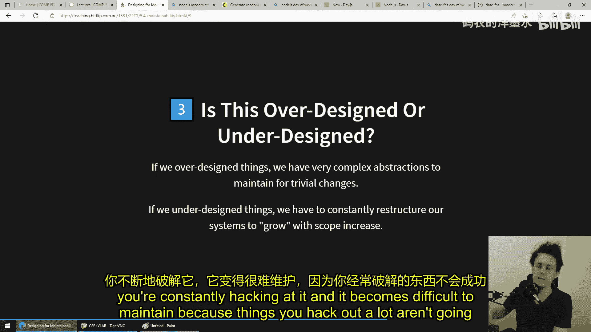

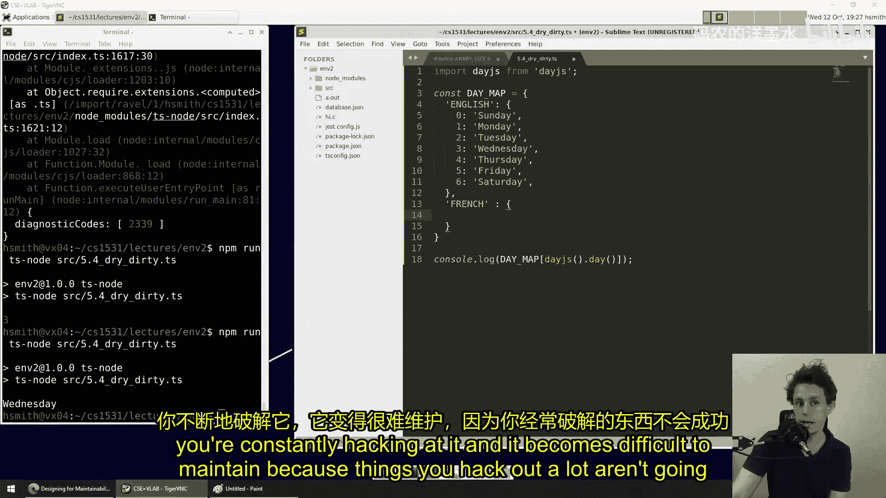

There is no good answer for this other than experience。

 That's why people who've been designing software for a long time get paid a lot of money。

 It's because they look at stuff like this and they look at the surroundings and they go。

 there's the right answer， Pro you probably。You know， and this。

 this is kind of something that I deal with on a daily basis。You see problems like this。

And you think， well。H。If we don't put more time into it now， is it gonna hurt us later。Sometimes， no。

Sometimes we've gone and built very complex systems。

 We built a very complex system around giving people credits。 Like， you know。

 think about like Qantnias points kind of thing。 It could do anything。 It could， It could deal with。

 you know， different expiry dates and starting dates and different use cases and all this stuff。

 But you know， so far， it hasn't been used。 So now we've got a very complex system that just isn't like if it was five times less complex。

 it would still do the job。So you get the same output for more complexity。But then other times。

 you might think， oh， we don't want to over complicate that。So you keep it really simple。

 and then you get about a month into using it， and you think。Jeez， this isn't enough。

 This isn't good enough。You know， we can't have this problem where。

We offered two different capabilities on the platform。

One of them was to invest into invest money into kind of box 1。

 and the other one was to invest into box 2。And we said， you know。

 let's keep these things really simple。 And Box1 had this like a couple of different ways of depositing money in。

 you know， So you had like method 1， method 2 and method 3。You know， and method 1 was like， you know。

 like a direct debit。 And method 2 was it'd like， you know， read your bank account。

And like tallied up your transactions and something like that。

 And what happened was when we launched kind of product 2 over here。

 we just copied the methods because we said， well， let's not figure out how to get them working together。

 Let's just get them working， right， Let's not over engineer it。So we kept them really separate。

 But we noticed was very quickly。 People were getting really confused because they were saying I don't want to have like these two separate things over here。

 They were like， I just want to be able to give you 100 dollars a week and to kind of have it。

 you know。Have some of it come up here and some of it come up here。

 I want to use both at the same time。 And then suddenly。

 that kind of under design of the system really bit。

 And there was a lot of work that had to get done to kind of restructure these things so that you could kind of have you know。

 a common set of ways of getting money in and sending it out to multiple places。

 So that's that's a very hard question to answer this one is。

 is your approach over designing or under designing And most of the time you won't know until you actually see how it pans out。

 because whether something's over designed or under design depends not just on your own knowledge or experience。

 but it depends on you know how， how is the thing you're building actually end up going to be used as' external factors you sometimes can't predict。

 but you can get better at it， regardless。

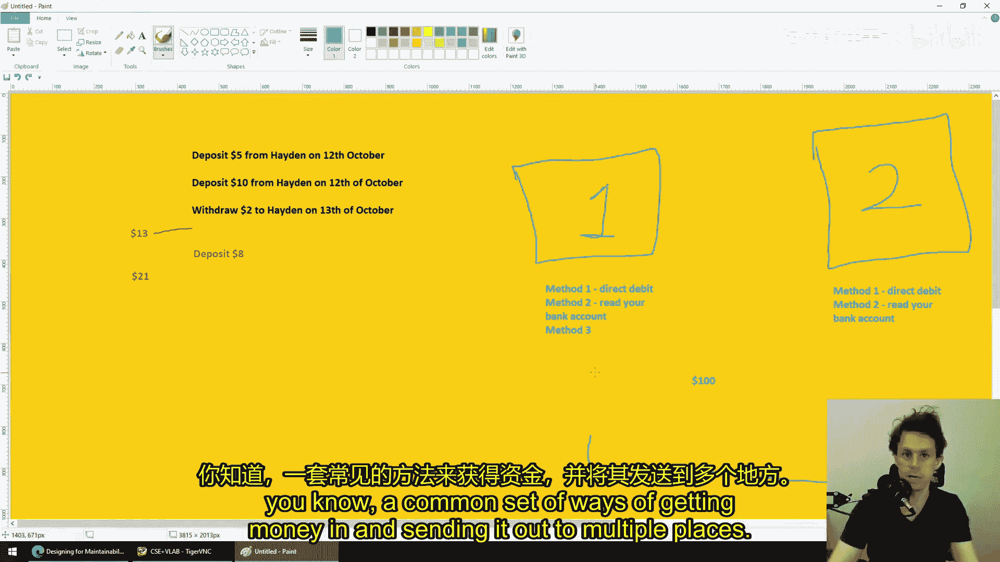

嗯。Yeahep。Okay， some other questions are related modules kept too close together and are unrelated modules kept too far apart。

 So there are two important ideas here， which are coupling in cohesion。 And we're gonna talk about。

 I don't think I' talk about cohesion much in this course， but。There's。

 there's a great term called soft， you know， coupling of software。

 And it's the idea that if you were to look at software。

You could say coupling the degree to which the software is coupled。

Is how interdependent different software components are。 And think about this in terms iteration1。

You kind of had a bunch of o functions。And then you had a bunch of channels， functions。

 something like that。Ittereration 1。How， how coupled they are depends on how kind of grossly connected they are。

 like， how could you delete your channel's functions。And all of your o stuff still work。

 If the answer is yes， then they're not very coupled， are they， they're very separate。

 But if you deleted one and the other one broke， then yeah。

 they're super coupled'ca their interdependence is huge。And what these two questions。

4 and5 really come back to is a fairly straightforward idea。

 which says that if you have software things that are related， you want them to feel close together。

 So like author register and or login are so similar， right。

 So you probably want them to be in the same file。 you want them to share the same space。

 whereas things like or and channels are very different。 So you want them to be quite separate。

 So related software components should be tightly coupled and unrelated software components should be loosely coupled。

And the purpose of this is fairly simple， if。Related software components aren't together， generally。

 very related software components。 When you make a change。

 it kind of affects lots of things if they're related。 know， so if you。

 if you're going update how the token is generated。

 it's going to kind of affect or register and or login。 So you want them to be close together。

 So it's easy to maintain them in one go。 But things that aren't similar。

 you want to keep them separate because it means you can kind of go and change channels over here without worrying about the impact it has on Earth。

If you have too much coupling。If things that aren't are not related。

 it's generally what can lead to spaghetti code， which is just like messes of code。

 And this is a very abstract one here， right。I'm speaking very abstractly， but。It's。

 it's all really out。Kit my finger。It's all really just saying it's not just like code。

 it can be files， you know， like which， which files does this function go in， you know。

 where do I put these functions in the file with respect to each other。😡，You know。

 it's not just placement， but it's also like should。I have a function that generates a random number。

 Can I use this for。For all these different purposes， or should I separate this out。

 I this function for something over here， But I need a slightly different version over here。

 It's all just really looking at code and saying， is this actually， I this actually， should this。

 should this actually be this close or should it not be this close。Question 6。Is an interesting one。

 Am I speculating about how necessary this is。When we write a lot of software and you might have seen this with your project。

 sometimes。What you'll end up doing is writing code you never use。

 Have you ever written code that never got used， You might have written a function that you thought you needed。

 but never ended up calling it。You know。This is pretty common。

 particularly if you're like a very thorough thinker。 You know。

 if you're like the type of person who really likes to plan everything out。

 you'll tend to get a problem like the assignment and you'll say， you know what。

 I'm gonna to go and write a function that adds a user to the data store。

 and then I'm going to go write a function that generates a token and you'll go write all these before you've actually kind of written the functions themselves。

 You've written like all the helper functions before you've written the functions。

 This isn't always a bad thing。 There are certainly scenarios in software where you really need to think from the bottom up like that。

 But in general， in general， I'd probably say that a top down approach to building software。

 we'll yield you less unnecessary code because what it does is if you start writing code from say。

You know。呃。From the functions like or login and author register。And and the channels as well。

 you don't have to speculate about what you need because you'll just kinda come across it。嗯。

We sometimes refer to this principle as like you aren't going to need it。Which is like。

A programmer should not add functionality until it's certain that it will eventually be used。

 and it helps remove unnecessary code。 And， you know， a good example of this is like。

 we partnered with an APII provider。

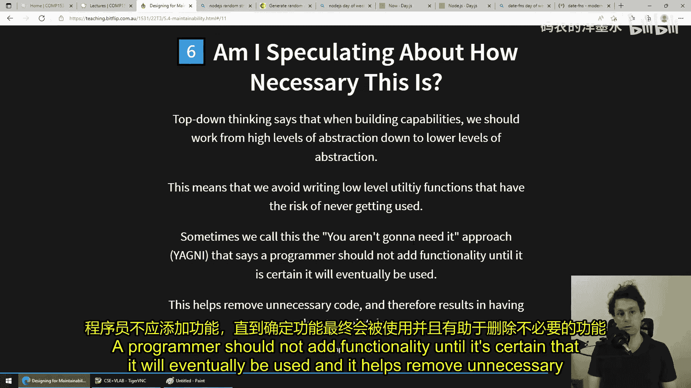

To help people。Invest in manage funds。 If anyone's ever used like rays or spaceship。 you。

 you know what I'm talking about and。You know， what we saw developers do sometimes was that they would。

When working on this， there'd be some kind of API。 right， We looked at APIs last week。

The big set of functions。 And what they would do is they would。You know。

 maybe the actual software itself， maybe as far as the users were concerned。

 there was just a few functions on our end， the API that might have been like。

 you know invest money and it would take a customer Id in an amount。 and it was a function。

 And then there'd be another one that was like， you know sell money that were taking a customer I in an amount like this。

 And maybe that's all that's all the customer does。 That's all they do。

 they can either put money in or sell money。 But the API has all these functions with it。

 And obviously like some of these are very complicated。 like investing money isn't just like done。

 You might have to do a lot of complicated things。 But the right approach to start from these functions。

 the right approach， usually the right approach is to start from these functions。

 which is what the consumer see because you know， these need to work。

 whereas what we sometimes saw developers do they went to the API and they went and wrote like tons and tons of helper functions。

 you know， like imagine what was an API that we looked at like you know that intercom API。

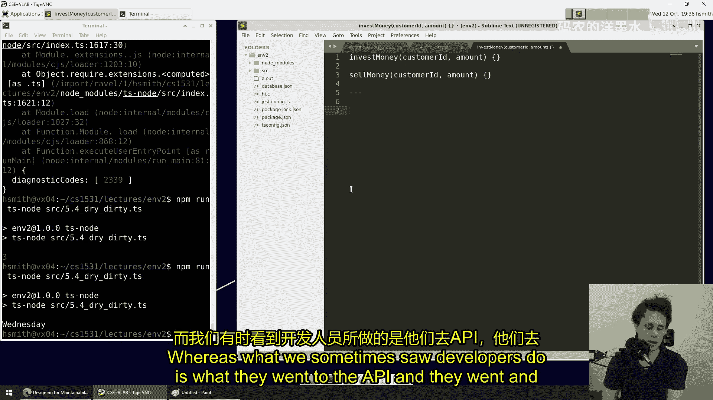

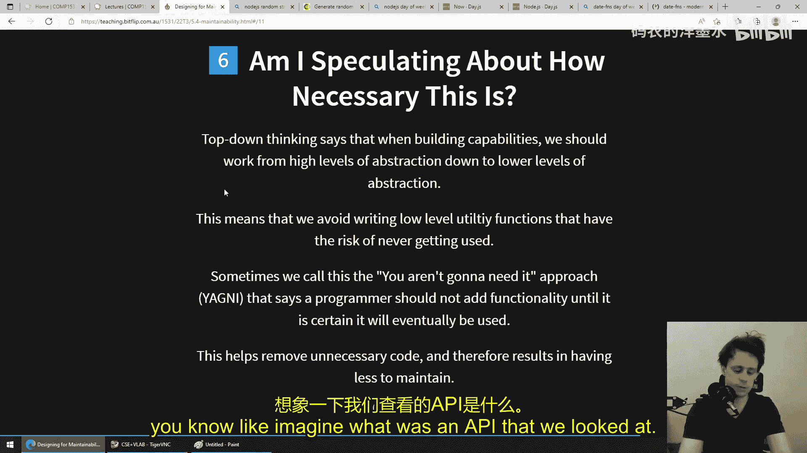

The other day。That's not the software。 That's a ad。 The ad worked effectively。Where。对。Yet。

 well what they would do is they would go and write code to like delete a company and retrieve a company and list the companies and attach a contact and attach a contactca they were like。

 I'm gonna go get all my ducks in in line so that like when I actually do the coding。

 I've got everything ready。 I've gotten all the integrations and connections done。 But in the end。

 there was a bunch of stuff they wrote that didn't get used。 You know。

 whereasas if you actually start from up here， you can be in a much better place because you're like。

 well， to invest money。 you know， I firstly need to。😊。

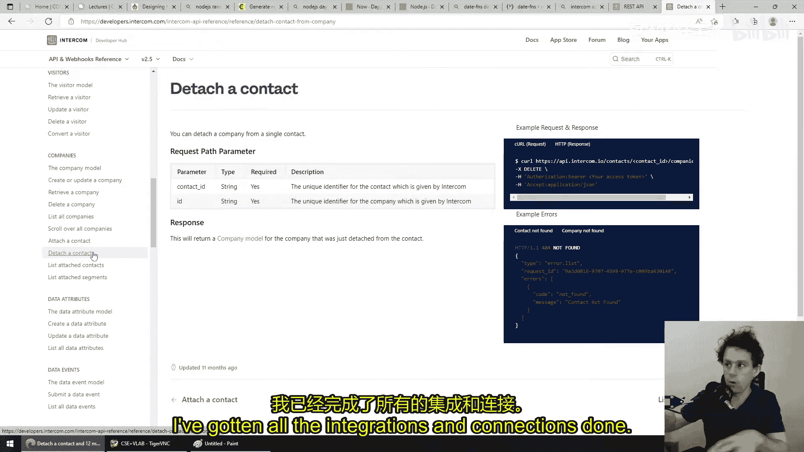

You know， do something， do something， do something， do something。 And it's like。

 it's a way of kind of starting from the top and going down。 Now。

 I can't do this example very well because it's a very like complex， abstract example。

 But one question I love to answer is this one， which is given two latitudes and longitudes。

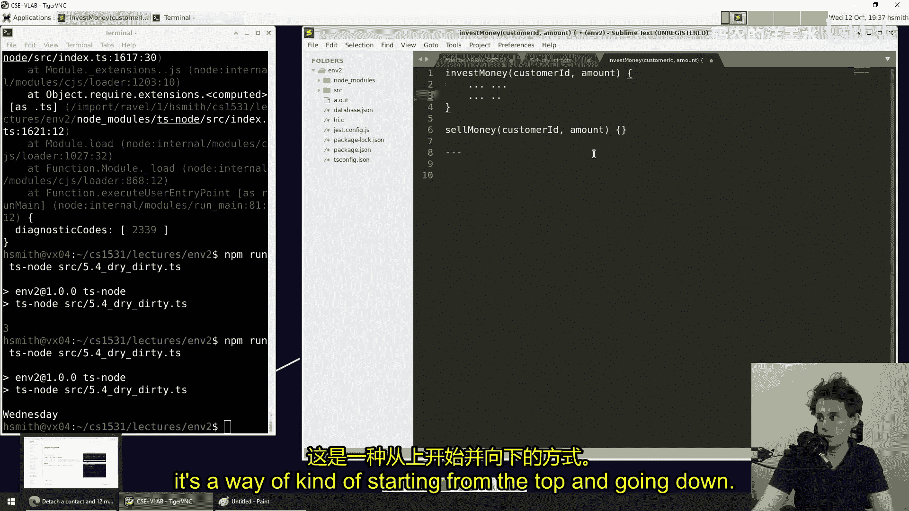

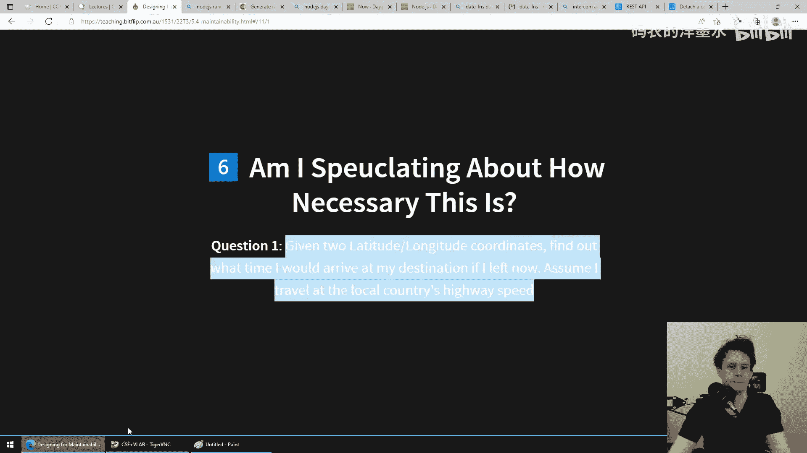

Lord， come on。Copy paste。 Oh buger off。 given to latitudes and longitudes。

 find out what time I would arrive at my destination if I left now。

 So that's really interesting'cause let's say we write a function。

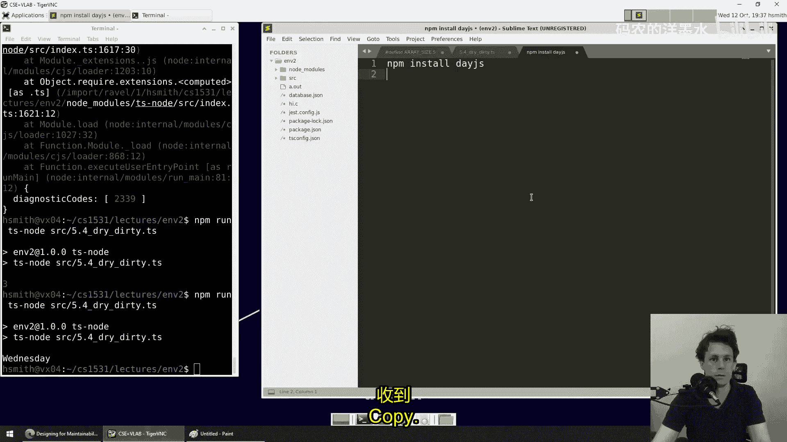

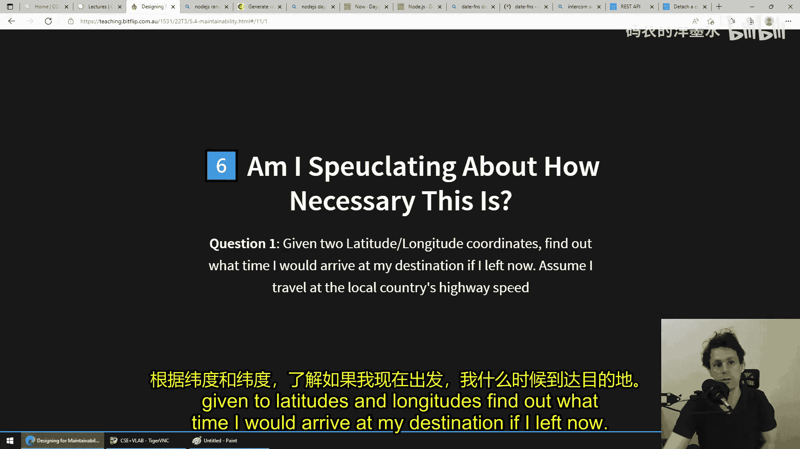

Right， and the functions is called like time between lap longs or something。

 And we take in like La 1， long，1， La 2， long2。You know。

And we want to calculate the time it takes to get between those two。

 It's really tempting to get lost in thinking about like coordinates and geography and GPSes and stuff。

 But you I actually like to go simpler than that sometimes， which is like， well。

 what are we actually trying to do here， Someone gives us two latitude long Like that's two points on a map。

Well， we probably wantan to just figure out the distance between， right。Distance between， equals。

 you know， or I call it D， B distance between La 1， long 1， La 2， long 2。

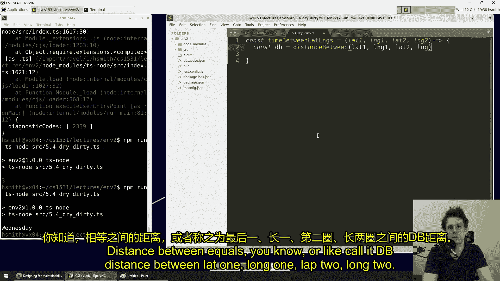

Okay， that makes sense。 And what do they say， As I travel at the country's local highway speeds。

 And now I'll be like， well。

Speed equals get local speed。Of like， say， lap one， lap2， that one， long one。

 like maybe you just get it from where you start， say let's just assume the speed limits。

 you know the。There's no speed limits。 So you get the local speed。 and then you say， well。

 what I know the time is actually just， what is it， you know， speed equals distance over time。

 time equals distance over speed。I should just call this distance。Yep， and I just return time。

You know， like that。And what's cool about this is that Ive I like to describe this is like。

 I've finished the function I just haven't filled it in yet。

 And what you can do is you can kind of like iteratively。

 recursively kind of cut into the software and be like， well， it's done。

 But these functions are magic。 They don't actually exist， right？ I， they're not MPM something。

 Maybe they are。 So now what I do is I go stub them。 I go say， well。😊，You know。

 distance between a function that takes in， you know， La 1， long，1， La 2， long 2。

And let's just have it return one for now。 And then I've got another function called get local speed that just takes in the Latin the along。

 Does it need to be one。And what that does is that's just going return me a local speed of one as well。

 right。 And now that now the program kind of works because I've stubbed it。

 But what I'm doing is that rather than getting too caught up in all the lower things I need to do。

 I'm starting from the actual original problem and just slowly like weeding it down。 You know。

 maybe this function I'll write half as well。And， you know， in this case。

 I'll probably just write both of these functions separately。 But you get what I'm。

 I hope you get what I'm talking about。 So you just keep beating down through the layers。

 And eventually， you won't have a function that calls a function that you didn't write anymore。

 And that function is done。 It's kind of like a little tree search in a way。

 as a way to think about it。 So that's a great way to approach software， which is like。

You know， that top down approach。 And the question that it stems from again is like。

 am I speculating about how necessary this is， So maybe someone writes a function。

And the function is not used。 And you think， well。You sure we need that。 Like。

 how do you know we need that。'Cause if you， you know， generally， if you needed it。

 you should have like generally， if you wrote it， it'scause you needed it。

Notcause you think you might， you know， that's kind of that question。

 And then the last question today is， does this follow standard conventions？

 This is another great question to make your software more maintainable。

Has this been solved in a certain way。This one's a bit too unpack， but。

This comes back psychologically to people like to do things their way。 You know。

 if you write software， you kind of want to leave your mark on it sometimes sometimes it sucks too much to write software that。

 you know， is just NPm installs。 You feel like you didn't really solve any problems and also sometimes you want your own style guide。

 sometimes you want your own approach， your own function names and stuff。

 But if I go right back to the example I said we go back to at the start right。

Here。Do you remember how before I talked about， you know， pulling out this exit function？

It does make your code repeat itself less， which is good。

 But here's the problem with the exit function。Most JavaScript programmers know GS programmers would know what process do exit means In this case。

 they would know that process dot exit1 means that you are going to terminate the process。

With error code with code 1， which means error。And what you've done is you've thought that you might be coming across here and making it simpler by not repeating yourself。

 but this actually made more sense。2 programmers， because。They've seen this before。

 whereasas when you did this， they haven't seen it before。 They're like what the hell is exit。

 And every time that you force someone to have to kind of learn something new。

 it's an area where they could get confused and might make mistakes， something like that。

 So this is the balance side of this equation， which is that sometimes it's actually better to make software a little less not repeatable。

 for instance， like this or more specifically， avoid silly abstractions like this。

 so that you can rely on these standard practices。 It's like the people and another good example like people who do loops and they call it X or something。

It's like everyone calls it I。 not when to say everyone and nearly everyone。 When you do this。

 it makes people like their brain has to think a bit harder。

 and it might mistake it for something else。 whereasas when you use I， it's like cool。

 If you use a loop within a loop， it tends to be I and J。 if you're just using it for an index。

 right。When you rely on these standard conventions。

 may it means you have to comment less too because other people。

 other experience programmers like you will just know what they're talking about。 So again。

 when you write code， ask yourself is this kind of what everyone else does？

You know， and if it is what everyone else does， it's gonna make your code more maintainable just by that fact alone。

Last comment。 If you have any other questions， please post them nowca I'll talk about refactoring for a couple minutes。

 and then we'll wrap up。 And if there aren't any questions， by the time I hit the end of this slide。

 we'll just finish。 But refactoring is。An interesting idea。And。

Conversations about code design don't finish just because your software is finished。

This is because no one writes perfect software the first time。

 no matter how much you think about code design。No matter how much you think you're getting it right。

 you will always have imperfect code and you will always need to in some way probably go back and fix things up。

 Reffactoring is a verb that describes the process of restructuring existing code without changing its external behavior。

 So it's basically changing code internally think of it like black box stuff like you could refactor a function and the interface doesn't change。

 the behavior doesn't change， but the actual source code itself does because maybe you've gone to improve the code design。

 It's typically done to fix poor code design。 That's usually what it's done。

 Reffactoring is generally discouraged。 if you don't have a strong test suite。

 Blind refactoring can introduce more bugs It a really common way I see students introduce bugs is like they write software。

 you'll see this all the time in like student projects and stuff。 They'll write software。

 It doesn't have tests。 They'll have a grand idea to go and clean it up。 they'll clean it up。

 they break everything。Suddenly， like and， in half the time， the clean up isn't done or not。

 you know， super helpful。 So just be very dubious about refactoring without test suites in any piece of software that really matters。

 Jeremy says， what if a complex solution is the more efficient  one， Clean code versus fast code。

 I mean， this is why， this is why this。A lecture is written as questions， because， again。

It's a good question。 What if a complex solution is the more efficient one。You got to dig deeper。

 You just gotta talk to people， figure it out， have a conversation。

 Sometimes that complexity matters。You know， like， what's the difference between a page taking point1 of a second to load and  point2。

2 of a second to load， probably not much。Probably makes sense to use the cleaner code。

The simple code， you know。What happens if， you know， someone comes along from YouTube and says， hey。

 we've got this really complex idea。You know， it's a smart way to buffer videos。

 We can probably save million dollars a day in terms of， you know。Data center electricity。It's like。

 well okay， that sounds like it might be worth it。 then， you know， might be worth some complexity。

 We talk a little bit about complexity in， in a couple weeks to formalise it。

 But the short answer is it just depends on the situation。

 There's definitely times you write more complex code just because it needs to happen。You know。um。No。

 all grey。 that， that's why it's an interesting topic， like。There's so few answers on this。 And。

 and that is why you doing well at it makes you valuable because it's so hard。

To point to a textbook or to point to a rule book and say this is the right thing to do in this situation。

 the answers come from experienced people。And experienced people write a lot of code and a lot of important code。

 So you get a few experienced people in a room together。

 they'll usually come up with a good answer to that question， for instance。

 for a particular use case。Thank you for coming tonight。

 Please fill in the form if you can or could be bothered。

 remember you can always fill it in even if you're not watching live these things can be filled in at any time。

 please have a great evening。 If you have any other questions。

 please post on the forum we're happy to help out。 And yes， thank you。😊。

