# 【全集】新南威尔士大学 软件工程基础 中英字幕 1080P COMP1531 p18 Lecture 18 - 代码覆盖率 -BV1M7Nwz7EGh_p18-

Okay， so this lecture today is one of the last lectures on code correctness and in fact。

 if you look back on the lecture slides on Web CMm3 you will see that this is the last correctness lecture So we've had a bit of a long journey here on the topic of correctness because if you remember essentially it was a topic around how we make software that is safe and reliable and how do we verify that the software actually works So this last topic is called code coverage now。

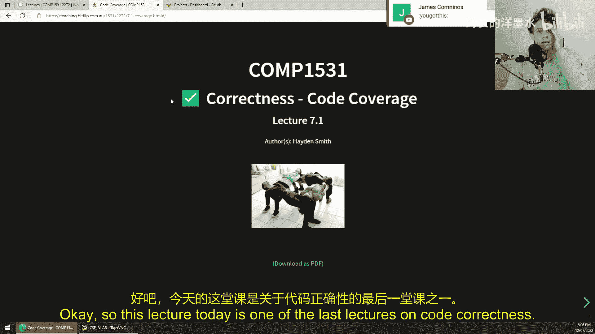

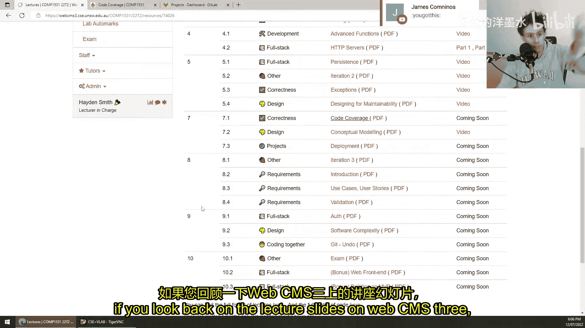

The reason it's called code coverage is because so far when you've been writing tests。

 you've really been focusing on just you coming up with your own ideas。

 but we need more automated ways to tell if your tests are good and in some ways this is going to be a very similar lecture to when you learned Lnting because you kind of learned what good style is and you did a lot of that manually and then we came along and we saidLters are tools to help automate that so。

Today， we will be looking at a mechanism to tell how much our tests actually test。

Because how do you know if your tests are good， right。

 You only know because the auto marker tells you whether your tests were good or not。

 But there's actually much more depth to test writing than that and things that you can figure out without any auto marker because in the real world。

 you don't have an auto marker， right， your tests are your own auto marker。

 We'll be talking about coverage。 We'll be talking coverage broadly as a topic we'll be talking about code coverage as a type of coverage and we'll be talking about code coverage in jest because a lot of the correctness we look at when it comes to code coverage is done in the context of jest。

 which you're already familiar with， which makes your life a bit easier。 So firstly， coverage。

Coverage is a measure of how thorough our tests are。Makes sense。 I said before that we， you know。

 auto mark your tests。 I think I might have said， that's not really the case， right。

 Like if you think about your project， we actually just auto mark your implementation。

 You write your tests to help your own implementation。

 but we don't actually check the quality of your tests automatically， right。

 There is no automated process we have for that。 Your tutors just look at your tests and kind of get a sense of whether they're good or not。

You could argue that your tutors are actually looking at the coverage of your tests。 In fact。

 we asked them to， we asked them to go through your source code on Gitlab and to actually give you some of the marks based on how decent the coverages you have for tests。

 So if you have tests that they feel cover a lot of use cases， a lot of different potential outcomes。

 then you get extra marks for that。There are two types of coverage， though， generally。

The first one is what we call test coverage and test coverage is a measure by which we check how much of a feature set is covered with tests and this is actually what your tutors do。

 So I mentioned that your tutors look at coverage and this is typically what we would call as test coverage so your tutor kind of looks at your test code and then they say。

 yep， I can see that they testing register and their testing that register might fail in these few cases and then their testing channels create。

 you know their testing all these different things。And it's a very high level thing。 And again。

 it is very human in nature。And it's quite literally nearly looking at a spec and then coming back and looking at your code and just very vaguely getting things。

 And then there's code coverage， which is really the crux of what we're talking about tonight。

 which is a measure of how much code is executed during testing。 So it's not。

 has no It has no awareness of the spec， you know， because test coverage is kind of looking at a human looking at the spec and then a human looking at your code。

 your test code and going， did this cover all the use cases or the possible。Outcomes。

 whereas code coverage is a computer looking at your code and your implementation and seeing how much of your implementation was actually tested by going line by line。

 and it can be completely automatable， which is why it's interesting。嗯。

The simplest way to imagine code coverage is if you have a piece of code that is 100 lines long。

 you know， maybe like 10 functions and 10 lines， each in those functions。

And then you go and have tests over here that call those functions and test it。

 What code coverage does is it essentially checks was every one of those lines of code you wrote in your implementation were they explored by all of the tests collectively。

 You know， did at least one test go through at least one line at each line of code And therefore we kind of measure code coverage often in a simple way as the number of statements。

 the number of lines of code that executed。 So if you got these 10 functions with 10 different lines of code in each function you could say that your code coverage is just a measure of how many of those hundred lines of code did your tests actually go through。

 how many did they execute， How many did they call This gives us a good indication of how much of our code is executed。

 but more importantly， it helps us understand what code is not executed。

 So it's not just the percentage that matters to us。

 It's actually coverage tools being able to tell us， hey。

 this line of code that you wrote was actually never executed。 and that's kind of a problem。

So we can actually do some code coverage checks pretty easily。 And for that， I'm。

 I might go back to some of our previous weeks。 So if I go to。

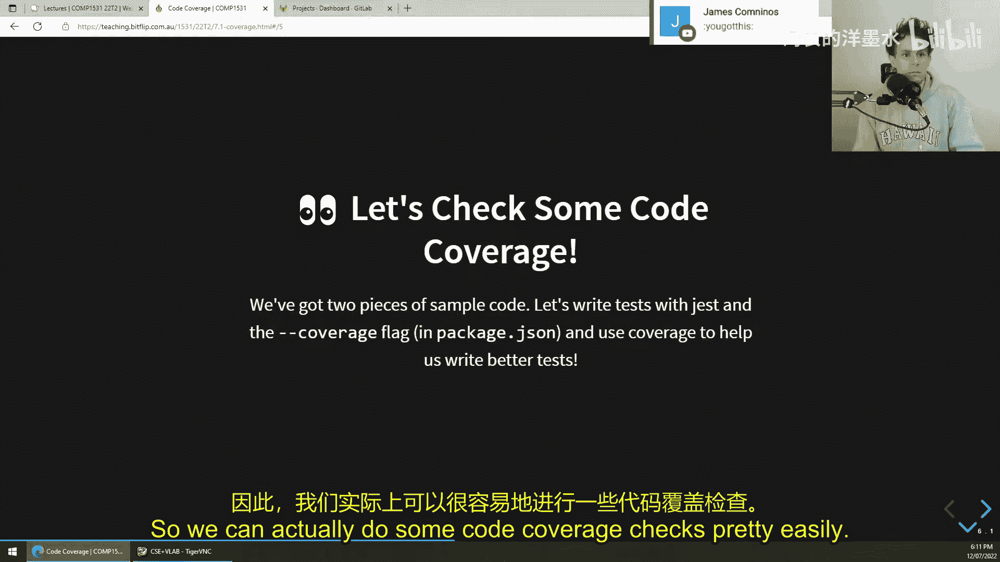

Say 1，5，3，1。 Let's go back to some of our week，2 code， a week 3 code， right？

 So we have a few different things here。 And you can see that I've got a file。

 What test files do we have here。Let me see， okay， we got this 2。3 jestlib dot test dot Js， right。

 and you can see that this particular file here。Is a， it was calling our j Lib。

 which if we have a look at that file， was a pretty straightforward function that hasn't been implemented。

 probably got rid of the implementation。 That was a little bit， little bit silly。 That's okay。

 Let's actually quickly inspect these files。 Let's make sure。

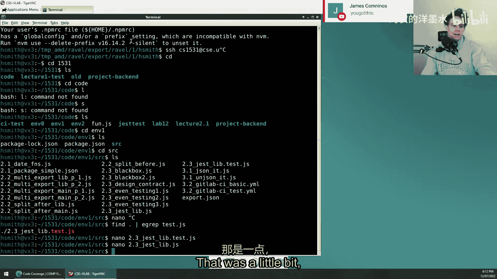

So I do think we had the implementation hiding somewhere from memory。

And we'll see if it's still there， sometimes I don't save the files from the lectures。Justcause。

 you know， we kind of butcher things in the oops。 We kind of bo butcher things in the middle of a lot of our lectures。

 so。We drag this out。What do we got， So we got a few different files。

 I think we only have one of these has tests in it。嗯。

And all the remove valves ones don't seem to be implemented。That's okay。

 We can quickly implement that again。 So if we do have this function， which is our  two point。

3 jestlib。 And then we have a jestlib test here。Our remove vows function。

 How could we remove some vowels， How many people do we have here， by the way， Excelt， handful。

 If you were to remove some vows again， you probably know by this point， also， by the way。

 one thing you can do and you've probably done this before is like。

 if you want to really crudely test a file， you can just put console logs in that file at the bottom。

 just like temporarily， I'm sure nearly all of you have probably figure this out right。

 So you can kind of just write something like that， and then run your code directly against that。 So。

 you know， over here， if I go into our。嗯。Or I can run， you know， node source 2。3 just Lib dot J S。

Okay， and I get 0 because， you know， the function's broken。 But if I then say， you know。

 string equals string dot replace a with nothing。We will have removed to the vow。 oops， sorry。

 return。Return string。 Now， there's probably some linting rules here that they don't like that。

 And that's okay。 And we'll just do that for the five hourss。 And， yes。

 there are cleaner ways to do this spot。Let's just get this together for now。Okay。

Great ABC removes that。 So we know that works。 Now， we want to run our test。

 So how do we run our test while I can run NPpm run jest source slash 2。3 jslib dot test。

 So there's that test file I can run。 And it's missing a script because I don't have the node modules installed。

 So I need to do an NPM installed here。😊，Which will go and all the modules。

 Though this was already done。 My apologies。And you'll see the test results quite straightforward。

 And you， you should be very， very familiar with this kind of pattern， right， this， this。

 at this point， you're kind of like。Sorry， I don't know。Let me just add just manually here。Yep。Okay。

 so what can we see here， We can see that。Our tests are failing。 Oh， that's annoying， right。

 deals with no vowels， deals with starting vowels。 Things aren't really working。

 So what do we see what one fails， deals with starting Valel， We expected old to return that。 Now。

 why doesn't it do that？ What happens if we pass in old。See if this passes more tests。

 we' failing three tests at the moment。Oh wait， so I wanted to run the code directly。

 Sometimes jazz can be a little bit slow。 So， you know， it might actually be quicker to。

To run the code directly like this。 And we get L D， so。Clearly， something is wrong with the import。

 probably。 No， I'm not sure。Not exactly sure why this function is failing here。

 This doesn't make a lot of sense。If we're running the right file， we're running our test lib， yep。

We call it with old。Did I misunderstand the function。The function meant to not remove。

 I maybe I I probably just didn't actually finish our test last time。嗯。Let's try it now。Yep。

 only failing two tests。And you can see that B turns into B， E B doesn't。Okay， this makes sense。

So the string dot replace here looks like it's only replacing one。 Now。

 this is the kind of thing that， again， most of you are probably like， I know that。 And if。

 in my case， you haven't played with that function for a few months， it's easy to forget。

I just wanted to run the file directly So you can see that replace here looks like it only replace one。

 How do you normally get around this， I look up replace string jascript。

 You go look at the API documentation online W3 schools， typically like the MD N sitess， really the。

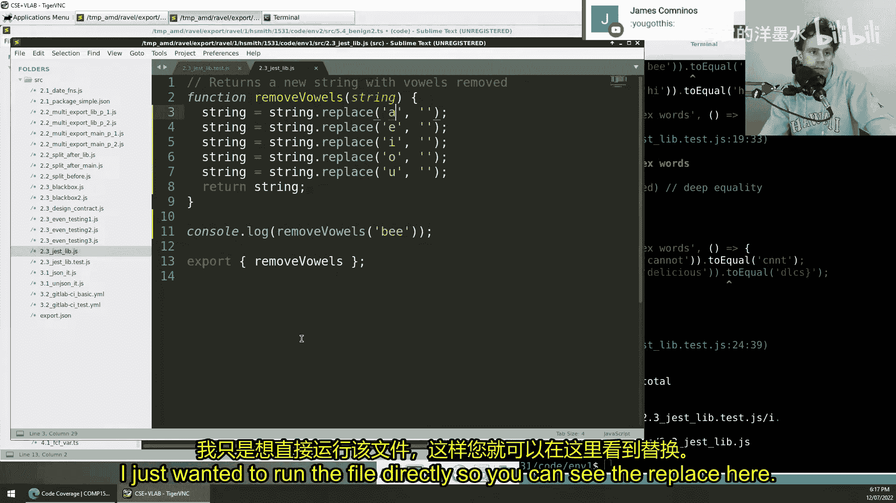

You know。Where all the proper rules are。But I guess， it's only。Replacing one。

 does it take in a redja substring。It's interestingter， not sure。

Every language has its own replace function。 There's probably another function， something else。

Doesn't really matter。

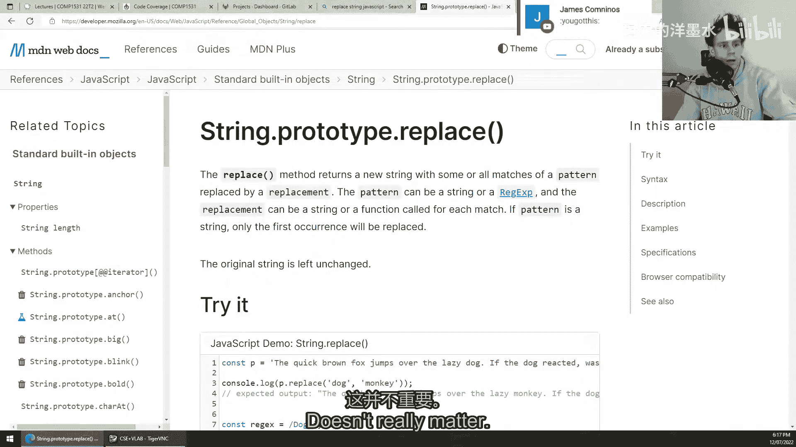

We can wrap it in a full loop or something。

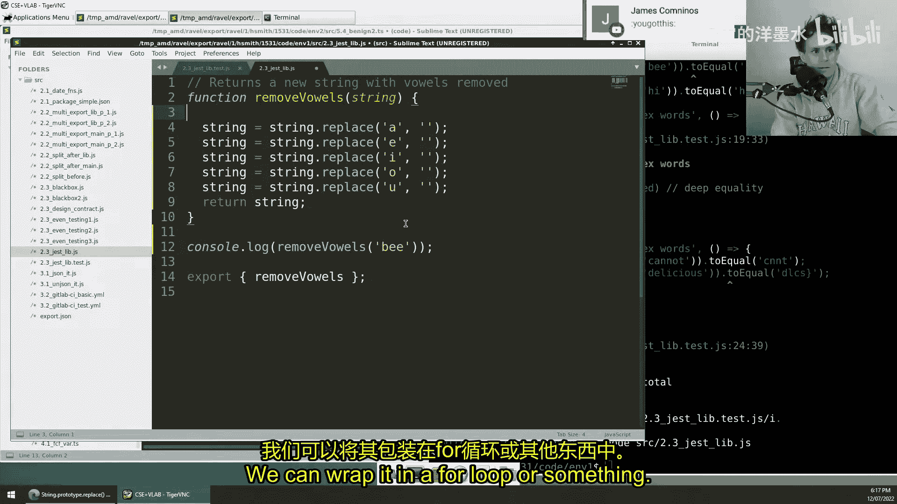

I should probably read this properly。 returnsturn a new string with some or matches of the pattern。

 The pattern can be a string or red Xx。So Ho， Clayton says using redx and with G for global。

 So this's the the thought I'm getting here is that the sub string method。

Only the first occurrence will be replaced。 Okay， sure。

 So it looks like a limitation of the way this works in jascript， right。

Normally when I do replaces I user redjectex。

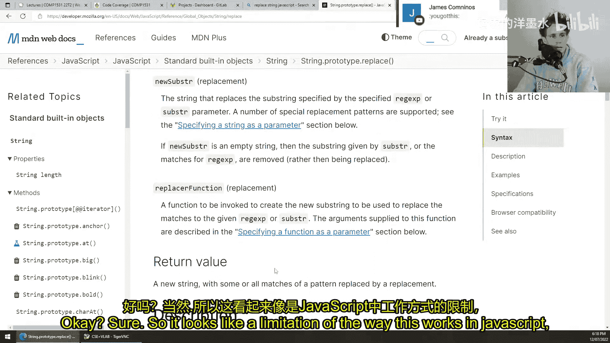

Like， I'll do something。I'll do some kind of red jet string， like。

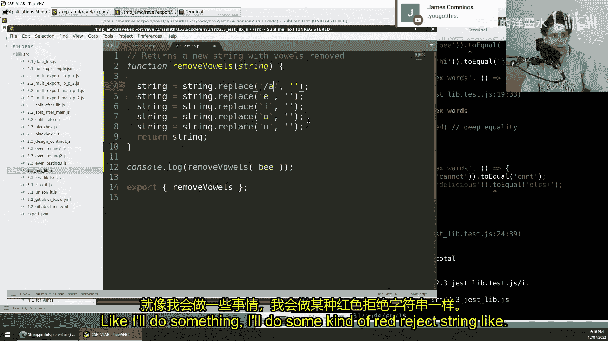

Where the examples I have。Rexx is not part of this course。

 It's something we do actually teach inside of。

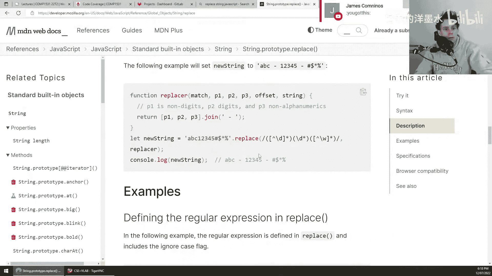

2041， Comp 2041， if you want to take that particular course。 but we can see if this works fine。

 So let's just quickly replace all of these with some redexx。

 redgexx is a language that kind of just describes patterns of strings。 Clearly。

 that is wrong because I've got these quotes here。

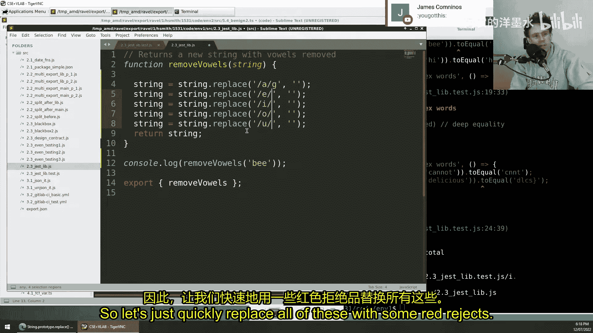

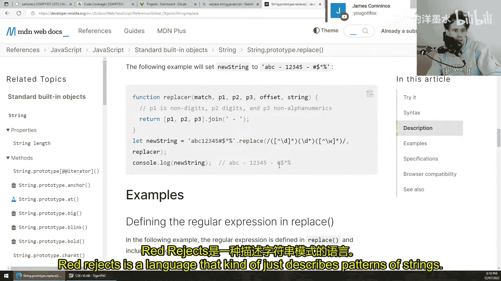

Okay， there we go。 Now， this should par all the test。Maybe you need the G， Maybe you don't。

Not too sure。 And then you can see that it expected that to turn into that。

I think that might be a typo。 So back here we go。 And now we got our test working。

 This was just to demonstrate a point。

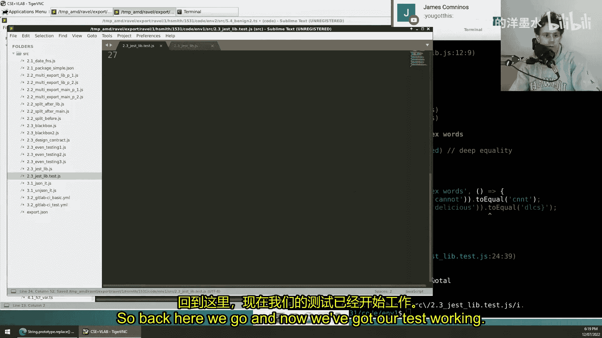

Fairly straightforward。 We have our test passing。 now， bit of attention。 But if we come back here。

 one thing about jest is that you can actually add the dash dash coverage flag to it。

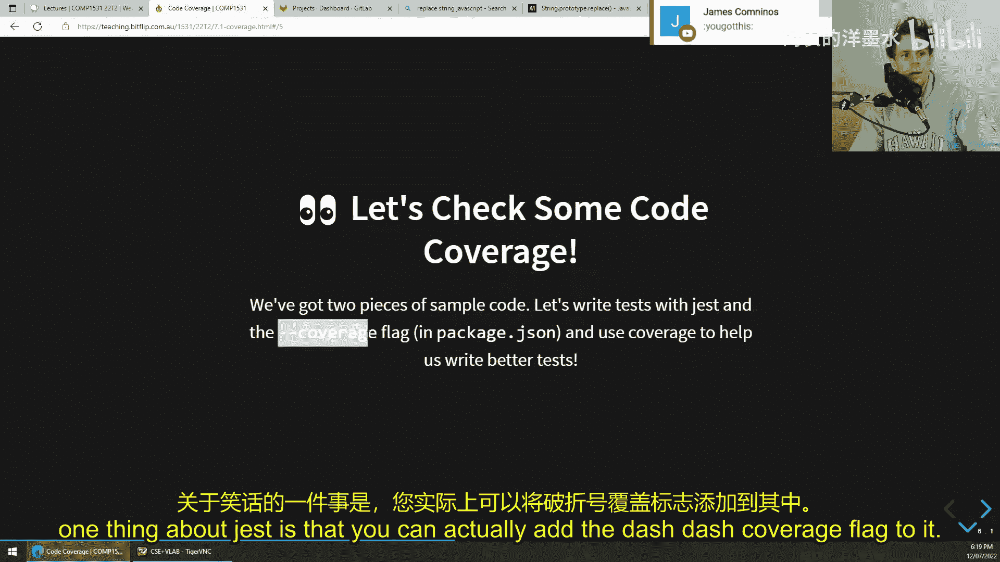

There are other programming languages like， I think Python is a good example where， you know。

 when we used to teach this course in Python， you used to have a different library for your coverage。

 So you'd have like your jest testing library， then you'd have your like coverage library。

 which would be used in conjunction with jest whereas jest has has the the coverage command built in。

 So when you run instead of just running jest and then a file。

 you can run jest dash dash coverage and then a file。 and that looks like it was pard out。

Which is kind of annoying。 So you probably have to add it to the script itself。

So if I just modify this。Gest，'cause if we just run jss by itself， right。

 it will run all the tests in the file。 NP PMM run jest。

 because that's what I've defined in the package I'll Json here。Yep。

 so it ran all one file that existed。 I got to get rid of this console log。And now。

 if I want to use the dash， dash coverage。I go and open up my package to Json。

 and then I can add it here。Like this。 Now obviously， test and jest do the same thing in this case。

 But now when I run it， it's running it with the dash dash coverage command。

 And you will see what's really interesting here。 And this is where the meat of things really start。

 It's not just that it ran the tests and it showed us the successes and the failures。

 but it actually showed us all of this information here。 Now， let's dissect this together。

 a few things to point out， firstly， all files is just a summary of the different files。 In fact。

 to give you an example， let me go and take our test file here and let me go and create another one called 2。

3 jest Lib test too。And what I'm going to do is in this one， I'm going to keep a couple of tests。

 And in the first one， I'm going to get rid of those two tests。

 So we're basically just splitting these tests up across a couple of files。

 So just to show you when I run it again， you'll see that it will give you a summary of the results for all the files。

嗯。I think I had named that poorly。 I did name that poorly， sorry。I named it underscore test。

 instead of 2。3。L 2 dot test， dot Gs。It's kind of a terrible name。So we on that again。

 we should actually get two results now。No。What have I named it。What have I done。It's very strange。

 Oh， no， it did。 Did it run both Lib 2 and Lib， Not sure why only showed one here。

 That's kind of strange。We can see that both tests ran and both files passed， Not 100 per sure why。

We're only seeing one file here， but the point is that this part here is the coverage part and this is essentially saying for each file。

 how many lines of code did your test go through？Now， let's say。

 let's imagine for a second here that you have。You have the remove valves function has another condition。

 which is like， if there is a number in the。Input string。Return undefined， right， this。

 imagine this is part of a spec or something like that。 So if there's a number in the input string。

 then return undefined and。What is interesting here is， how would you implement this， you would say。

 well， you know what， if the string， you know， dot includes。

 I can't remember if dot includes works out of the box， Probably not。You know，0 or something。 Or。

 in fact， we could probably actually use redxx for this For those of you who have been curious about red Xx。

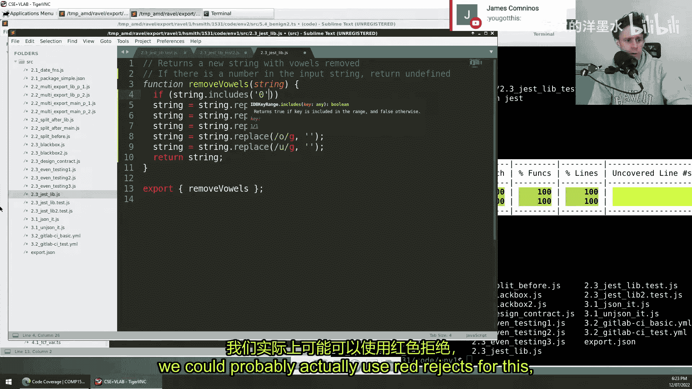

Again， redjax is a particular language that you can kind of teach in your own time。But basically。

 it's a very powerful way to look up strings。 It's not assume knowledge in the course。

 You don't have to learn it， but there are some very helpful。Little pieces of code。

That will help you。I'm sure the example was right in front of me， then。

But I just want something quicker to look at。

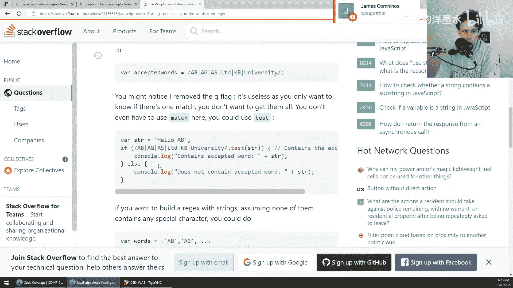

Yeah， so very simple one here。 You can actually write a statement to say， like。

 check if something's inside something else。 And I'll just show you here。

 So one really easy thing to do with red X is to actually， doesn't really matter。 I can write it out。

 is you actually say， you know what， hey， if。If some kind of like。

 what I've clicked a button on my keyboard。 now everything's not。 the cur is not working。嗯。嗯。

Very strange。 Okay， you basically say， you know what， if a pattern dot test and then you。

Let me save this file and reopen it。 That's so difficult。 Yep。

 if pattern dot test and then you give it the string。

And the pattern here is actually a piece of red jack。 So kind of by default， this。

 what this really says is like， hey， if you can find an A inside the string。Then， you know。

Return undefined。That's， that's quite literally what it is。 except redx is quite a powerful language。

 So what you actually want to say here is not just a， but you actually want to say， hey， A or B。

 So this is some redjax for A or B。 If any of a or B。

 or you can say any of 0 or 1 or 2 or 3 or 4 or 5，6，7，8，9。 Now we have all the numbers。 So it's like。

 okay， if any of these numbers appear in the string， then we want to return undefined。Now。

 what's interesting is like， let's say you have some code like this。

 I' crap and save that file again。 Let's say you do have some code like this and you now run your test coverage on it。

 Let's pay attention to what happens because we've got our two test files。

 Those two test files run through all of your implementation。And what's interesting。Is that you see。

 the results here have changed。 So now， instead of saying 100 per， it's actually saying。

 you know what， hey， on your 2。3 j Lib。I might rename this to see if it comes up。

 I'm not 100% cent sure why it it's so。Weirdly doesn't want a display。2。3。Jest limb tester。

Call this br dot test dot J S。 Okay， we'll just give it something really， really random。

See if it appears twice here。Maybe not。Oh， very strange。 There's probably a configuration missing。

 So because this term， we moved to a totally different coverage framework， there's。

 there's a few things that we're still figuring out。

 And me still figuring out specificallyca it's pretty similar to other other things we've dealt with。

 But the core is still the same。 This is your coverage result。 And you can see that for 2。

3 just Lib dot J S here。 It's saying that 87。5% of the lines of code。

If we come back to your implementation file， 87。5% of those lines of code were basically run。

And what it's saying is that 50% of your branches were run。 interesting。

100% of your functions were run。 good and 87。5% of your lines were run。

 So lines and statements are kind of the same thing。 not literally because， you know。

 you can write a statement of code over multiple lines。

 but for the sake of what we're dealing with here。 you can kind of picture that lines and statements are exactly the same thing。

 And it will tell you the lines of code that were not run。 In in this case，5。

This is interesting because it's not that the if statement wasn't run because the if statement is always run because the program actually has to pick the if statement。

 right， like it has to execute it。 It has to。Run the condition to decide whether to not enter the if statement。

 But because we didn't test with any numbers in our strings。It never actually went inside。

 And that's why line 5 here was never executed， so。

Hoping this starts to help paint the picture that coverage is where it's a program that watches your implementation while your tests run against it。

 and it tries to make sure that every line tick tick tick was actually executed。 and in this case。

 it found a line of code that wasn't executed。 And the reason this is useful is because this is a common source of bugs。

Is you writing code that is never tested。 So what this coverage output is saying is like， yeah。

 you have code in your implementation， I get that your tests are passingsing。

 I get that you know you're happy you got your 100% and that it's all good。

 but you you need to understand that there's something in here that's not tested。

 There's something in here that could be broken。So then we would go away and we would go and open our。

 you know。Blar dot test dot J。 S。 And we will go and test something， right， test。

Returns undefined for numbers。 And then we would have， you know， ABC 1，2，3。

 to equal undefined like that。 And then we would run our tests again。

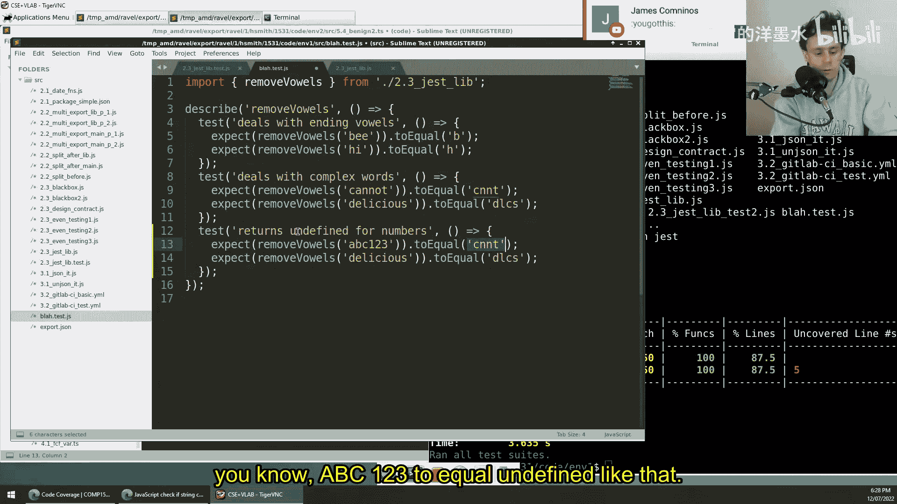

And we should get full coverage this time。Yeah， so that's good。That tells us what we want to see。

 Very good。1undred percent，'cause we executed all those lines of code。 That's。

 that's pretty straightforward。 Let's jump back to the slide。 So this coverage in this case， Like。

 if you imagine that that remove valve had that extra piece of implementation。

 which required you to return undefined in the case of。嗯。In the case of a missing。

 in the case of a number being in the string， then this just helped us write better tests。

 There is another piece of code we can look at。 And this time。

 we're gonna have a look at it in the context of Typescript。 Obviously。

 this will pretty much be exactly the same。 But this isn't， this is a piece of code from week 7。

 So if I go pull up that particular environment in week 7。

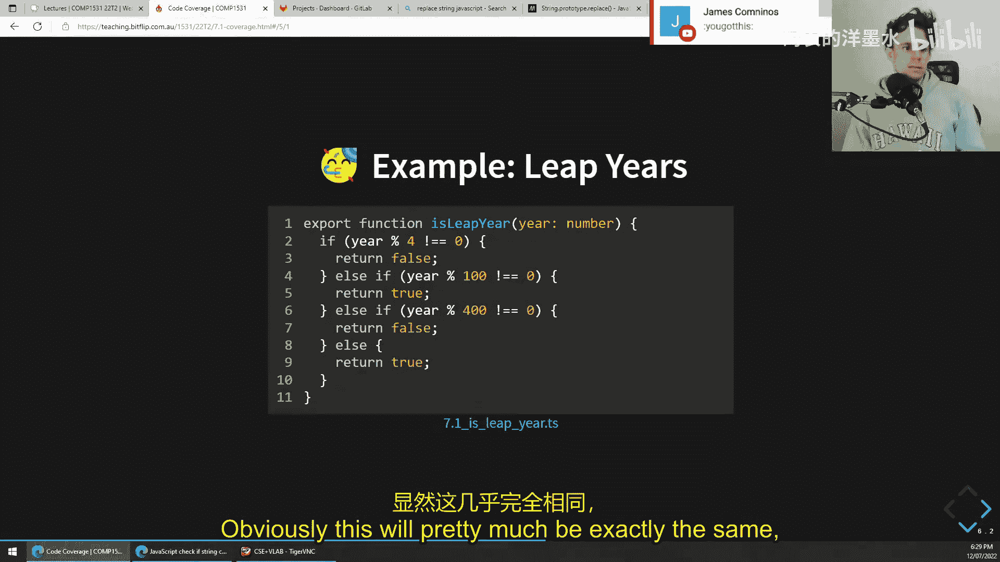

Whoops。So we go pull this up。 Let's have a look at a piece of code，7 point。Wan。Is Liier， right。U。

How would you test this， Now， I know we say to you all the time you need to write your test before your implementation。

 but you kinda know this already。 Sometimes you write your implementation before your test。

 not wholly。 It's not like you write your whole implementation。

But I'm sure you've all been through it。 You write your test。 You write your implementation。

You then realise later something's missing。 So you go and add that missing thing in。

 and then you gotta test it more， or maybe you don't test it more。

 Maybe you just kinda leave it alone， which would not be ideal， but that's okay。So in this case here。

 let's say we have a function called I Liier。 Now， I Leier function is fairly straightforward。

 You'd give it a year， like a number like 2022 for 2022， and it will return true or false。

 if there is a leap year or not。 So let's go and write a test file for it。 That test file our name 7。

1 is leap year dot test dot T S。Like this。 And then we'll start going， you know， doing nothing。

 We'll go and import the function。Go， an import is leap here from。You know， 7。1 is leap year。

Should be easy。 And then we can start doing our testing， you know， So describe testing leap years。

And then we'll go and do our tests。 So we'll start writing tests for what would you。

 what would you say testing， what are some leaps。Testing。Or we want to test recent years， you know。

 something really simple。So we say expect 2022 to be equal to。Or to be false。Or。

 it doesn't really matter for that， Right， or 2011 should be false， too， and 2020 should be true。

Okay， in 2019 should be false。And so forth， right，2018，1716。 So you can kind， you know， this。

 this is， you wouldn't maybe write this money out， but just trying to convey a point。

 We've got some tests here。Okay， great。 And they're testing this particular function。Great。

 so now we'll come here and we will let's open up our package dot Json。 and let's。

 let's add another line just to particularly test this file call like week 7 test。

 And this will just run the jest command you know， in source slash 7。1 is leap year。😊。

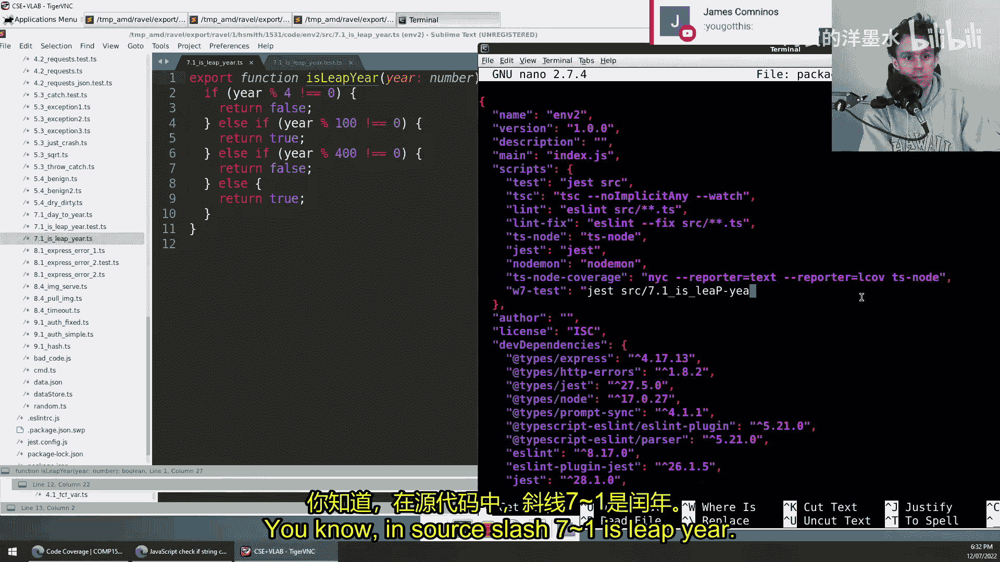

Dot test dot T， S。 Okay， so now when I run NP PMM run week 7 test should run that line of code。

 Great， no。Got this annoying problem that I had sometimes。 That's okay。Let's just double check。

 I'm doing the right things。嗯。也。LetSry one more time。That's a pain。 That's a pain。 That's okay。

 We can pull this example off pretty quickly。If you giveive me a short moment。嗯。So， basically， here。

Just gotta clone this repo。 Give me a short moment。Okay， so just a quick recap。

We're having trouble with the CSC machine， so I' just running this one locally for the moment and there was just a little bit of a silly moment where we forgot to add these in。

😊，Now， I'm not going to add them all in because this is wasting time。But what we have here。Right。

2022，2021。That was an absolute。 That was an absolute hilarious one。 I won't forget that one。

Why is 2022， not false。So we run this again。 This should work this time because we're not trying to check if 2022 is a bullolean。

 Thank you。 And you can see that it's true。 So we wrote some tests。 We passed all the tests， and。

This example is trying to illustrate that problem you probably all experience where you write some tests。

 your tests succeed， and then you get your auto marks back and you got 80%。

 How do we bridge that gap， You've written all the tests you think you have to write。

 we can't stop you from we literally just can't stop you from not interpreting the spec correctly。

 That's just an important skill in life。 You have to figure out yourself。

 without us but we can help you figure out if you've written implementation that has not been thoroughly tested and you can do that。

 obviously， by adding your dash dash coverage to your jest command that you run。

 So now by adding dash dash coverage here。And I run this week 7 tests。

It's kind of annoying because this text actually appears in yellow。

 So I'm gonna have to change my terminal colour。 Finally。

 away from this beautiful colour of yellow to maybe。😊，I don't know， blue。

That is a ferociously terrible。D。These are all very bad options。But。We can go with them。

Let's run it again and get some better formatting。Okay， not the favourite colour。

 Let's will change the colours soon。 But what you can see here immediately is you can see that it says that 7。

1 is leap here，66% of the light of the statements covered。Were tested。

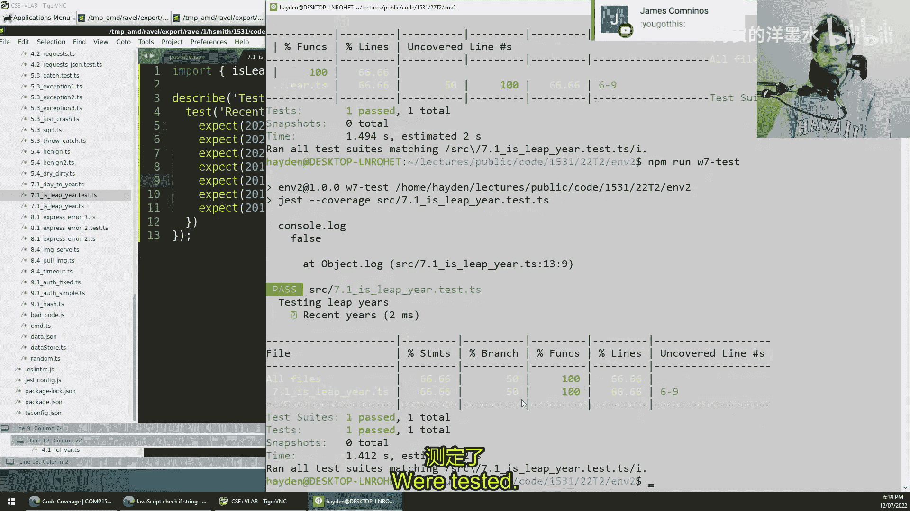

50% of the branches， whatever that means，100% of the functions and 60% of the lines。

 And it says that uncovered lines were 6 to 9。 So now I can go back to my code here and I can say。

 okay，6 to 9 are the lines of code not covered。

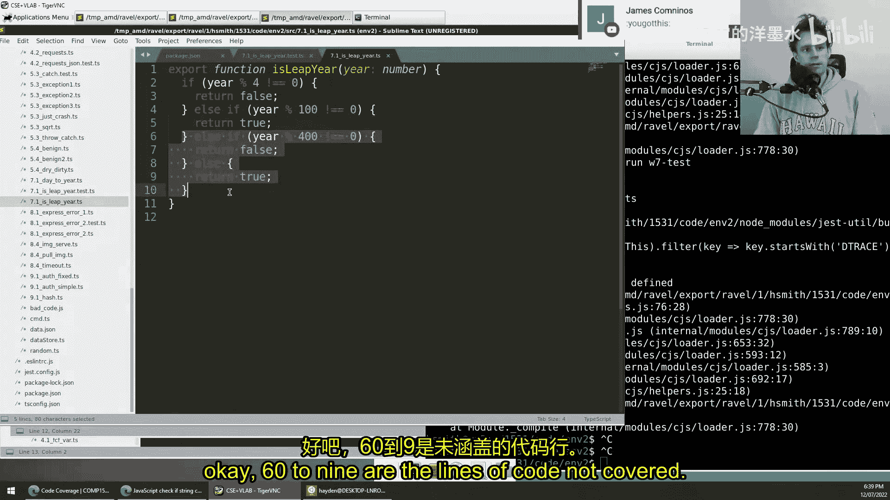

So that's interesting。Now， there's another file we'll check in a second。

 and I don't think we get into this。 We'll get into branch coverage later。 But for now。

 if we're testing this code and let me， let me maybe pull it up in a separate terminal in my second grey terminal。

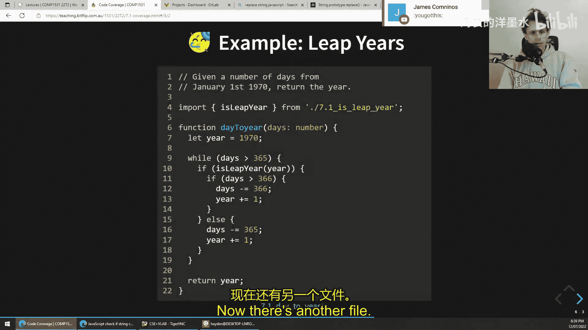

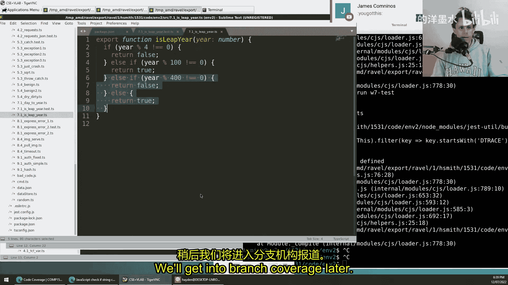

嗯。ちち。M2。And I saw，7。1。Gsly Pi dot T， S。 Okay， so we've got this code here on the left。

 and it says that we have not covered line 6 to 9。 So this is really useful because it immediately starts to tell us what goes wrong。

Let's trace through the code。 If a leap year， when divided by 4 is not equal to 0。

 then it is not a leap year。 So that's a pretty straightforward rule to start。 Basically， if you。

 if your year is not divisible by 4， it's not a leap year。 we have an example of that。 And In fact。

 this is where you can actually go back through your tests and you can actually try and write them in that particular order。

 So you can say， I'm going to forget this whole recent year's thing。 Let's actually say。

Test for years， not divisible by4。And then you can start trying to test if years divisible by4。

For instance， like， let's take a year not divisible before，2001。Should be。False。Right。

A year that is also not divisible by4 1997。嗯。You know， pretty much any odd number。

 So maybe let's not test some， let's test some even numbers，1998。Few of these other things。 Now。

 we're testing that the years are not divisible by 4。

 But we already kind of did that in the first example。 So that's not gonna help。

 The next one says if the year is divisible by 4。And it's also divisible by 100。

Then return true that it is a leap year。So， this is kind of interesting。Because when this one。

 and it's not it's inverted logic always gets me， no matter how many times I do this example。

 I get completely stumped by it。If a year divided by4。Has a remainder。Right， it's not a leap you。

However， if it does have no remainder。Is in it is divisible by 4， We have to check。

 Is it divisible by 100。With a remainder。Right。What are some examples of this one， In fact。

 try and try and try and throw out a few examples of things you might test。 And you can kind of see。

 you can kind of see implied from the implementation here that being divisible by 100 and being divisible by 400 are two kind of boundary cases。

 so I can immediately start to write some of those tests out right Test years divisible by 100。

Like this。See if anyone has any ideas， but otherwise， you know。Let's try this out。 So like。

 like here's an example，2000 was a leap year， right。2200 is going to be a leap here as well。

 But the year 2100 is quite interesting because 2100 is that divisible by 4， unless I can't do math。

It is visible all a 2200。 Oh， my god。It's everything。 No， they're fine， right。So what do we got。

It's every like， so the funny thing about leap is is that。Every 400 years， I can't verbalize this。

 I have it in my head。 Every 400 years is a leap year。I believe。嗯。But every 100 years is not。

So like if we pull up just to paint this point。Like， let's test it out with a calculator here。

 We got like a leapy at Checho on。This will kind of help Also， this is a really great way to test。

 It's something we don't actually talk about a lot when it comes to testing。

 which is that one of the most common ways that tests are done are actually just by benchmarking it off previous things that were tested。

 You know， so in this case， I'm like， oh， I was 2022 a leap year。

 It's a common year is 20100 a leap year。😊，No， is 2400 a leap year。Yes， so， okay， there we go。

 Got the articulation of my head。 So it's like。What we have to be careful of here is that if you're divisible by4。

You might be leap here。嗯。But if you're divisible by 100 as well。

 you're not a leap year unless you're divisible by 400。So2000，2004，2008，2012，2016，2020。

 these are all leap years。2096 is a leap year。2100 is not。2104 is 2108 is all the way up to。

 you know，2200， which is not。 So we should be testing here for years to visible by 100。

 such as the year 2100 that it is not leapier。And 2200 and 2300。 But here's the other kick。

 If the year is divisible by 400， it is still a leapier。 So it's kind of like， you know。

 if you think about the hundred， everyone gets the even thing， right， if it's not even。

 if it's divisible by 4， it's leapier。The year 100 was not 200 was not。300 was not 400 was 500，600。

700。 No，800， Yes，901000100010121100 is not。1200 is 1314，1500s not 1600 is 1700，1800，1900s not。

2000 is。So we can test a few of these cases， as you know，2300，2500。

 And then our last test will be years divis。By 400。Which is where we can just check for our kind of。

 you know， standard edge cases of the year 2000， which should be true。The year 2400。

 which should be true。The year 20800， et cetera。 right， So， you know，1900 was not a leap year。

 even though it is divisible by4。 Now， in theory， when I go and run this again。

 we should see a whole bunch of。You know， passes， which is good because now we've covered all those use cases。

 but you'll see if I go and comment out this particular line of code here， this particular test。

 which was our 4001 and I run it again， you'll see we do do better than our 66% but we're now at 88% so we're at 88% of lines and it says the uncovered line is line 9 and line 9 in this piece of code is right here。

So there's our piece of code that was not actually run line 9 there， Re true。

 And this makes sense because if you go look at all the other tests we're running。

 some of them go into this if statement and then return immediately。

 some of them go if Elif and then return immediately， some of them went if else。

 else ifif and then return immediately， right。But no one ever made it to that last one。

 because that last one you only get to if your， if your leap year is。嗯。

If it's divisible by 4 and it's divisible by 100 and it's divisible by 400。

Because if you're not divisible by 4， you end up there。And if you are divisible by four。

 but not divisible by 100， you end up here， which makes sense。 That's all our 2004， 2008。

And if you are divisible by 4 and you are divisible by 100， but you are not divisible by 400。

Such as 2100，2200，2300。 You return false。 And then if you finally make it to the end。

 you must be divisible by 4， divisible by 100 and divisible by 400 or at the same time。

 And that's where we get our return true。 Now， we talked about this whole lines of code thing。

 I don't know if I'll be able to demonstrate this super effectively。 I haven't tried to before。

 but let's try it out。嗯。If I say put these on different lines of code。

 this is obviously terrible style。See if we get a different thing with statements and lines。No。

 we don't。 That's okay。嗯。If if you go study like the theory of programming languages you learn about that you know code is made up of expressions and those expressions can be part of statements and you know those expressions or statements can be over multiple lines of code that's kind of a whole programming Ethereness to that and you can kind of see here that it did show that you know when we split it up lines 9 and 10 were bad。

 What is kind of interesting though about coverage。

 and I didn't talk about this because I wanted you to understand it on a more basic level。

 but let's actually go all the way back to our first example for a second。

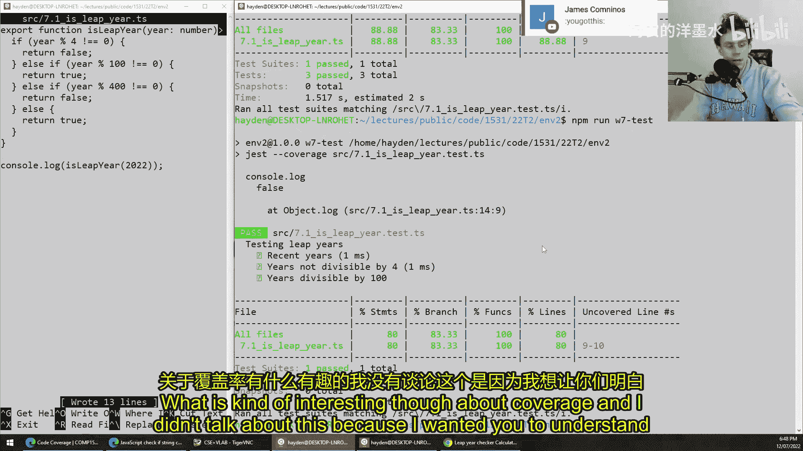

And run that one。Right。What we didn't talk about was that when you run coverage and you get these results。

In this case， for instance， it says10。 But if we go back to our previous example and I actually。

 we get rid of that test here。You know， we get rid of that test that was checking for that that edge case of the numbers and we do get a result that says like 8 87%。

 What's really interesting is that if you actually like LS like look at all your files。

 you actually see there's a folder that's been added called dot coverage Now I don't think this is a git reaper。

 yep it's not。 So if you go inside your dot coverage folder you' actually see a whole bunch of stuff here。

 but the file of interest is inside the L coverage report。

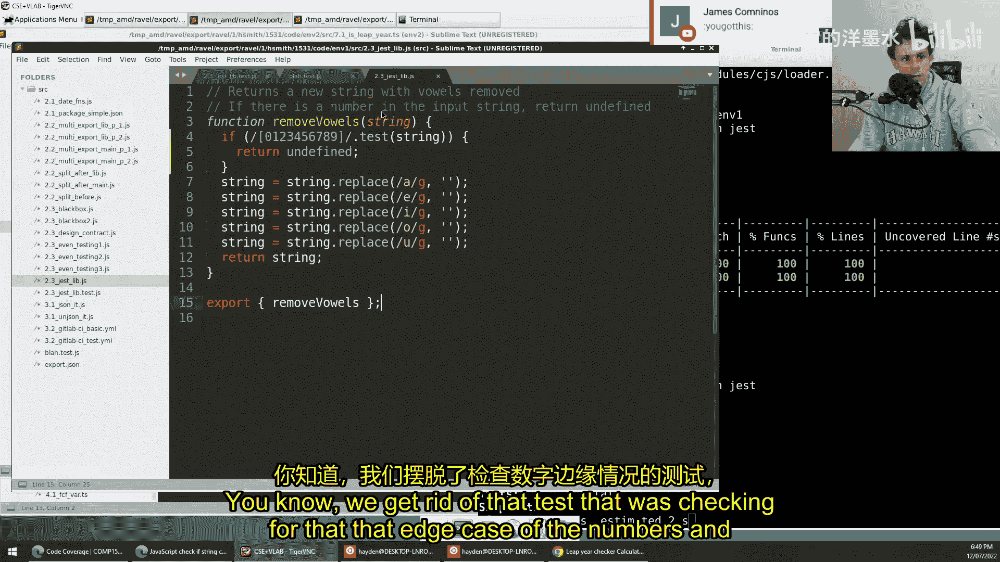

And there's a file in here that's indexed at Hl。And you can actually open that straight from the command line by saying you know Firefox or something else coverage Lco report index do hml。

 And what this is is actually a web page， it's actually like a web things a static web page。

 It's like when you file， save a website on your computer locally and you can load that up locally So it's a local file but it is produced every time you run the coverage command And when I open that up in the web browser。

 it actually gives you of a more detailed more visual explanation of what's gone wrong。

 You notice this is kind of just like a pretty version of what's on the command line where we can see that7 out of8 statements executed 100% of the functions are executed all of that。

 it gives you a little nice screen bar， but most importantly you can click on the file And if there are many for your project。

 you're gonna have many files here。 your do Ts， your server do Ts channels do Ts when I click on my jlib js here。

Actually gives you a visual summary of what's gone on here， which is that it's like， yep。

 everything here is good， except the red lines are the lines of code that weren't executed。 Now。

 there's not really any extra information here。 Then what's on the terminal becauseuse obviously。

 the terminal up here did tell you that it's line 5。

 but the terminal display you wouldn't exactly call。You know， very easy to read。Now， obviously。

So hello， Clayton says， waitade， how do we open the HL and the browser again， I mean， you can do it。

 you can do it a bunch of different ways。 You can， you can do what I did where you simply find the file。

 It's always the same file。 It's just always gonna be that。

And you just write Firefox or Google Chrome in front of it。

 Let's say that you're not on the terminal or something。 Well。

 what you can probably do there is simply open up。 you can， where is it How do I open file manager。

 I can go inside of 1，5，3，1 and my code。 And I can actually just find the folder coverage L Cov。

 And then I can just open up index or HML like that。I'm in Vlab now。

I'm aware that there's a handful of people in this course， who。

And some of you wouldn't have experienced this so far is you do your work in。With V S code SS S H。

So you're working locally on V S code， but you're SSHching into into the CSE machine。

 which means that you know when you run a server or something， it's actually running on CSE。

 Why this is tricky is that depending on how you're set up it might be hard for you to open up an HML file from CSE on your own browser locally there are probably ways around that。

 you could probably poke around， we can chat on the forum。

 but honestly something like I would just recommend for your average person is if you are using like if you are using VS code via SSH。

 I would just honestly open up like a Vlab window like this。

 I do all my development locally but what's really cool is that if you're like using SSHVS code if you actually go and fix up your problems you know like by。

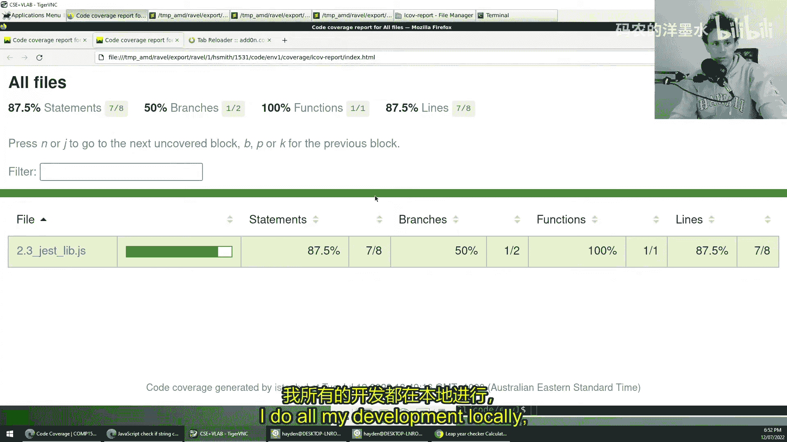

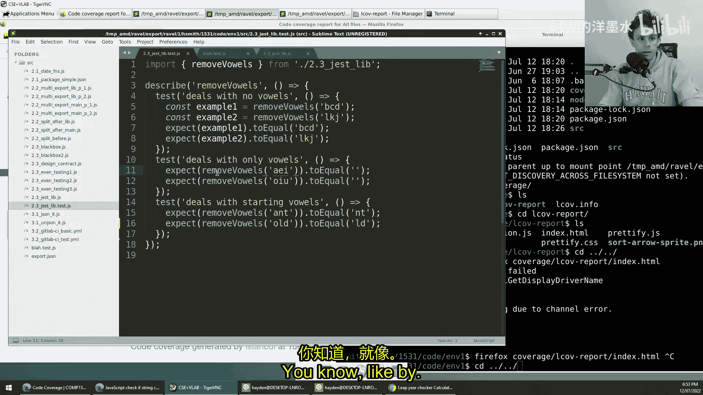

Adding that test in。And you're， you're on， you're on your local machine right now。

 You're doing all of that。 And then you run your coverage again。

If you just have V lab open with the Web page。Like， you know， we have， I already closed the Web。

 I closed the Web。 no， it's open。If you have Vla open with the web page。

 once your coverage runs locally， you can actually just refresh the web page。

 You don't need to like open it again or anything。 like once the web page is open。

 it's just open and you can keep it there。 God， it takes a while。Gli。Jez。

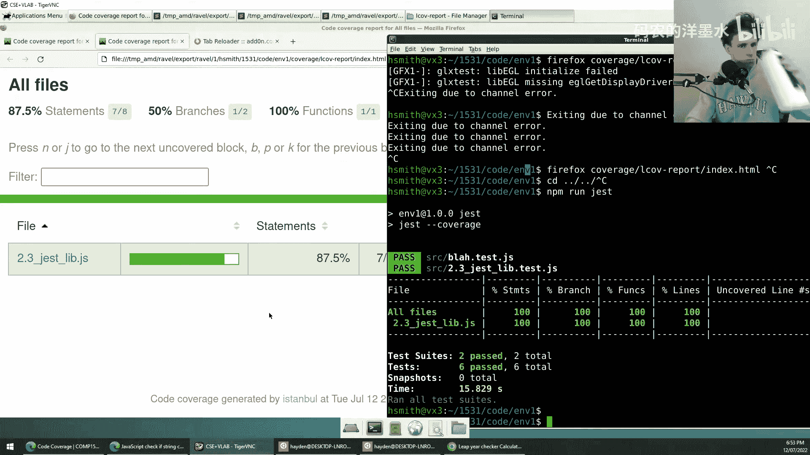

As excruciatingly slower for nothing。If I refresh this， you'll now see it passes。 So， you know， yes。

 some of you will open up browsers locally and things。

 and many of you have probably experienced this already with things like。😊，Postman or ARC。 And。

 you know， you can't connect to V lab becauseuse you're on your local machine and and various other things。

 But again， you can just pull out Vla。 You don't have to write code in V lab。

 You can just like check for these things in V lab and write your code locally。

 You can kind of set up。 however you'd like to set up。 Or you can just do everything in V lab。

 which is totally fine。 And that's what I do。 I did pretty much all of my undergraduate degree on。

Something that made Vla look like a very， very wonderful， happy thing。 So I'm sure we'll manage now。

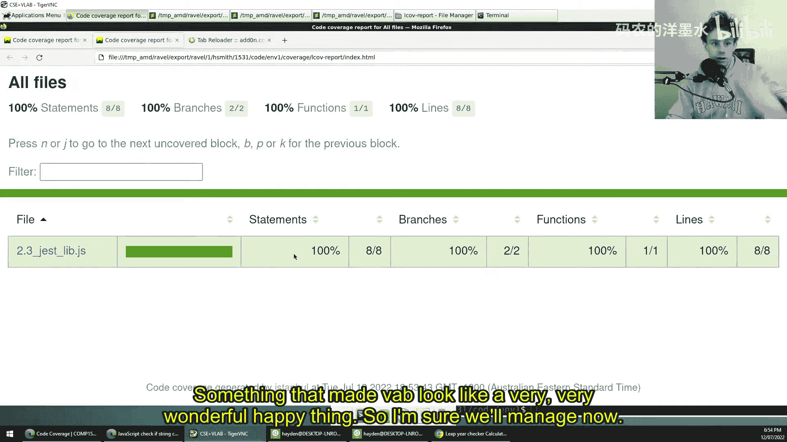

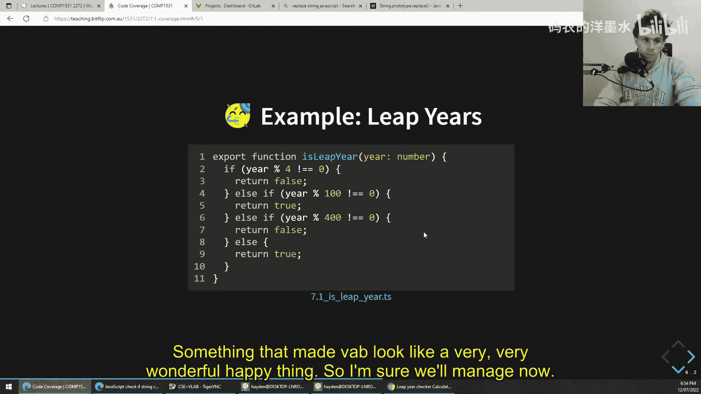

That was a quick throwback just to pull that up， but you know same thing applies for anything on my local thing here in the leap year example。

 which we did in Typescript， there is a folder called coverage and inside that folder is an L coV report and inside of that is a indexed HTML file I am not going to open it up in a web browser here but it's basically just a web page that has the data in it that your web browser displays so pretty manageable。

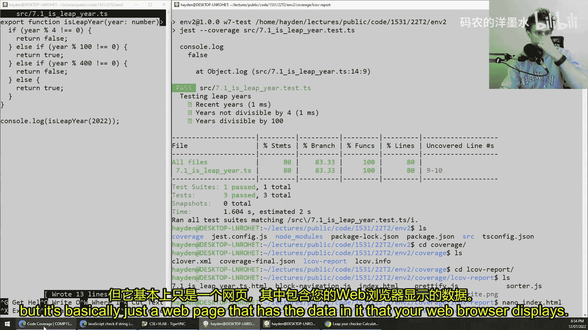

嗯。There is another example here， which is a bit more interesting。

 We probably won't go into a great deal of depth with， but。Basically， there's a function called。

Data to year。Where， and I'll， I'll kind of show you this really quickly。

 We'll probably take a break at like 7，05 or something。

 So if I look at this locally here and I've got a file。

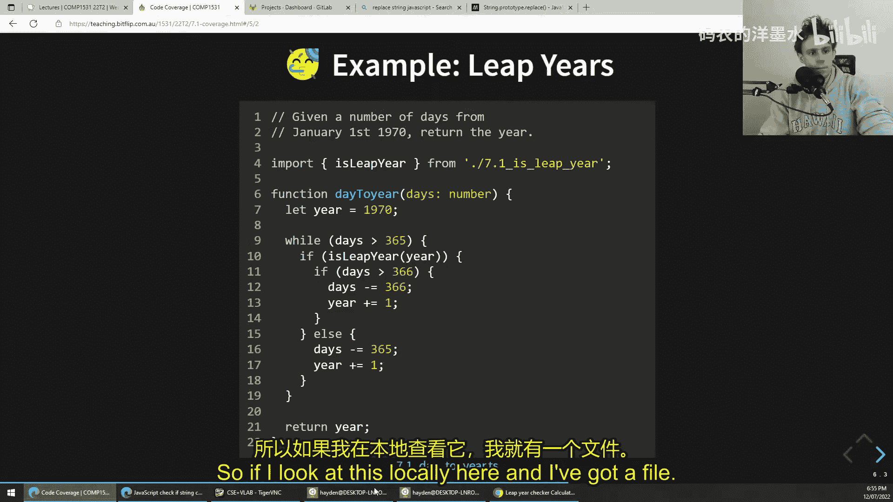

7。1 data year。Okay， relatively straightforward for we give ourselves a little bit of space。Oh， no。

What just screwed up everything。Sure， whatever。Okay。If we go back a few folders。 yep。

 now let's make a test file for it。 Now we're pretty familiar with how to make test files。 right。

 We'll make a 7。1 is leap year dot test dot T S file。 O， sorry， I meant 7。1。

 what's this file called day to year。 So what this particular day to year function does。

 is it takes in a。Number of days since the January 1，1970， and it。Tells you what year it is。

 So if you say zero days， it says it's 1970。 If you say one day， it says it's 1970 like that。

 So we can open up our little。Test file here。嗯。Just trying to I did this thing with the terminal。

 where I resized it。 Now it's all grumpy。I don't know if this ever happens to other people。

 but it certainly happens to me。So if I hear C into that folder， yep。

 so I'll open up my source slash 7。1 data year dot test dot T S。Okay， now we'll import。Da。To year。

From。7。1 day to year。Then we'll do our tests as as you expect。I don't know。

Something that's a terrible example。 But you get the point testing。Day is close to 1970。 Okay。

 so we'll test a few days with this function。 We'll test if， say。

 I expect that calling day year and yes， the Y should be capitalized on9 on of0。

0 days since 1970 will give me 1970 the year。We can start with that。

 Now one obvious problem here is that we need to actually have this function exported。

 It's not currently exported。 So I need to export function without that， it certainly wouldn't work。

 And then I'm going to update my package do Json here to instead of running my 7。

1 is leapier or now run8。 And now you don't normally have to do this because you're typically doing this in the context of a project or a lab where you can just run jest jest and it will just test everything which is what you want it to do pretty much 99% of the time。

 but in this case， I'm going to run my week 7 test function。 which should work。

 I probably made a mistake。 Okay， so what you can see here。

 very interesting is you can see that we did actually pass in this case， I might actually open up。嗯。

Might actually open up the file， Give me a second。嗯。Then devb， Hayden just got to find the file。

Pictures。Code。I to coverage。This， and then we'll open it up here。

So we can see the coverage in more detail。 There you go。s there's what we're looking for。So。

What you can see here。Is that。Naturally， day year。Had。

so coverage is not like a one to one thing where one file tests one thing and another file tests another thing。

 What's actually happened here。 If you look at it is that when we test our data year function。

 that function actually uses the islipia function。 So by， you know。

 essentially through a chain of events by testing data year。

 I checked on a certain number of lines of code inside of the isleia function as well。And therefore。

 when we look at our test coverage result， you can see that it's saying that your single test that we did where we tested。

 you know， zero days actually tested 45% of data year。Which is quite interesting， right？Now。

 we're never gonna get that up particularly high， probably because we're not trying to test that。

 We're really focused on this one here。 And in fact， when I click on that， oops。

 I got those two the wrong way around。 I meant is leap year， not data year。

 but if I click on data year， it actually will show you。What we didn't test。In this case， so。

You can see that when we tested days of0 because days was not bigger than 365。

 we knew it was in 1970 because we never exceeded that so now we need to write slightly more tests。

Sir。If we open this back up and you know we can test another one。

 say which is you know test that day 365 should still be 1970 and then we'll say let's test let's test days close to 1971。

So you can imagine that 366 should be the first day of 1921971。

So now we'll go and run our test again， and you can see the coverage is helping us inform what we're not thinking about。

So when I come back to this and I refresh， you'll see that it's like a you've actually gone inside of the 365 loop。

 which is really cool and because you've gone inside of that， we did check the if condition however。

 because all of the kind of days or year that were passed in， which is 1971 won't leap here。

 we never went inside this particular if statement but we did go everywhere else。

 which is good now this doesn't tell us that the code works。

 but it helps us again understand the parts of our code that our tests are not testing。😊。

So let's go back and let's actually test something that's a leap you。So now say test leak you。

So a test like a 1970。 Well actually， how would we do that， How many days So we got， if we got 3。

65 days in a year， times by 4。So one gets us to 71，2 gets us to 72。

3 gets us to 73 and 4 gets us to 74。 So it should be 1，4，6。0。

 So this should be the first day of 1974。Now， obviously， in your test， you don't have to write this。

 you could just write 3，65 times for it。 And in fact， that's probably more readable， right。

 Someone actually understands what you're trying to say there。So now let's see if this works。

We test it with a leap year。Now， this should know， what have we done， We've got a typo。um。

what is the typo。Oh， okay。 it's just no not typo Its just a test failure。 Sorry。

 we that that should be 1973。I guess that may， Oh， sorry， We have to do plus one day， right。Yeah。

'cause 3，6， that'll give us sorry the last day of 1973。 In fact， while we're here。

 let's turn that into a test。That's actually like， you know。

 maybe this should be organ better of it now it's like one day past the end of 1973。

 So we run this one again。Okay。Still failing。 We expected to be 1974， but it was 1973。 H。

 Why is that， well。3，65 days got us to the last day of 1970。Last day of 1971，72，73， then plus  one。

 not too sure that doesn't make a lot of sense to me， right， in terms of like， I mean。

 is this a problem with our code， Probably not。Any ideas。So if we have this 1974。

 let's just add a few numbers to it。 we can play with the boundary， if we want。You know， so plus two。

 see if this is the whole problem。Maybe this' will just magic。 Okay。

 that magically passed everything。 So clearly， there's a slight misunderstanding there。 perhaps。

 So if the years 1970。If you do 365 days， you're still in 1970。 but once you do the 366th day。Oh。

1970s a leap here。 obviously， right。 Okay， there's， there's your。Problem， I guess。Is it no， no。

 it's not。That's 1980。Okay， never mind me。 So what you can see is if we go back to our code down and you refresh it。

 you see that we are actually in theory， covering everything。

 And this is reflected here in our day to year function is getting 100%。 Now， obviously。

 our is leap here is not because we aren't running any tests as part of this。

 But if we just re the j coverage normally， you would actually see those tests。

 I can try running it like this。I can try。 Let me just try MP X Gest coverage。

 ignorere the command I'm running there。Yeah， it's gonna try and。Run a lot of stuff。

Quite a lot of stuff。 That's why I didn't want to run it。 But the point is。

 if we did have our other test there， this would be at 100 per cent as well。Now。

 there is actually a subtle bug in this code。I believe it's related。

 it's related to a fairly famous bug。 If you， if you want to dig for it。

 you can it's an infinite loop。 if， if you get this code wrong。

 I'm pretty sure there's an infinite loop somewhere。 So if you're bored some time。

 feel free to go and play around with that， find the infinite loop in the code。

 But that's just another example of where we can use code coverage to help us figure out what we're not testing。

 And to my point again。

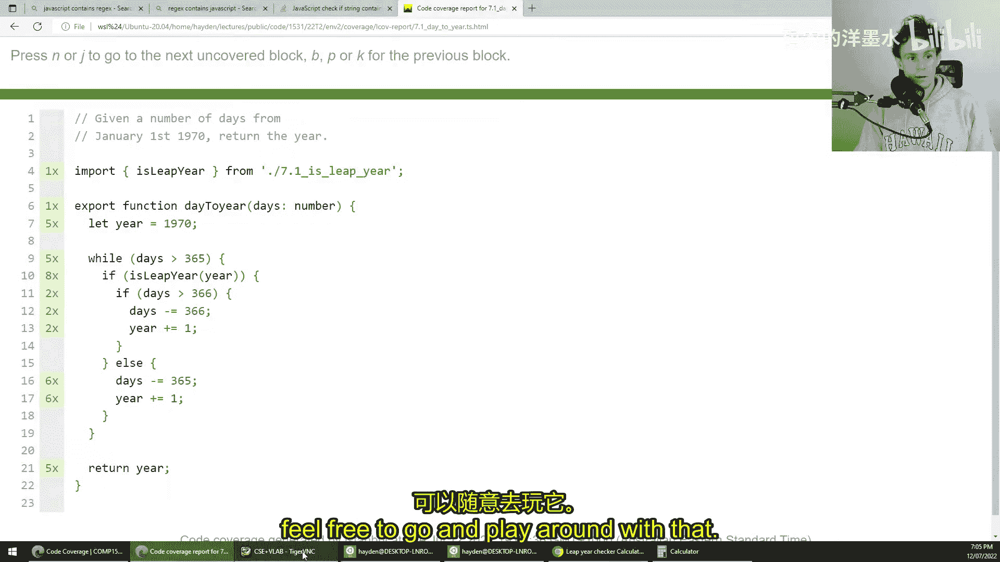

嗯。In summary。You know， there's the dash dash coverage command。

 You can put this in your package dot Json。 There's an index dot H TML file that actually gives you that information。

Brandon has said will be will we be assessed on this in our project。

 you will be assessed on this in iteration 3， not iteration 2。

 so come iteration 3 you will also have your test coverage assessed。

 but that's okay because if you improve your test coverage you probably improve your auto mark as well。

And， and the summary to give on this again is that test coverage is essentially how well your test test what's in the spec。

Whereas code coverage is how much of your code your tests actually go through。

Hello Clayton says well we learn how to apply coverage to requests and web servers。

 That's a good question。 it's it's actually it's actually like identical。

 I don't think this will work on the lab。 sorry， not quite identical。

 Let me elaborate on that slightly， so。😊。

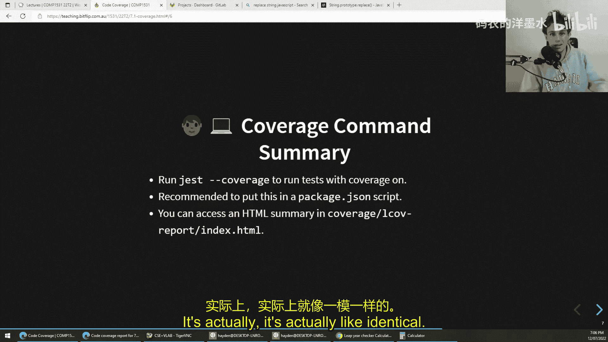

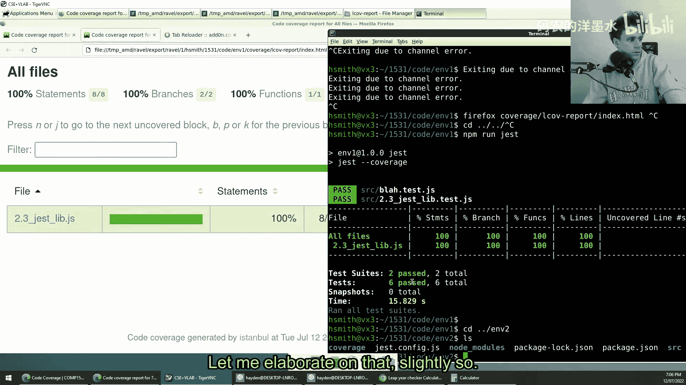

And I'm a bit worried this will blow up in my face because of that strange error。But。

If you actually go to your package do Json and we will give you this iteration that you'll see this in La 8 and in iteration 3。

 there is actually a command here。Which we get you to run。 And it's part of the spec。

 So like we can talk about this next week when we talk about iteration 3。

 I won't go into it too much now because it's kind of easier to go into when people are paying attention and remember。

 but essentially we've got this really fancy， confusing command for you where。

Instead of running T S node on server。You just run T S node coverage。

 So if you think about how you run your server， right， NPpm run TS node。

 you know source slash server dot T S， you kind of run that over here。 It's not a real file。

 It's why it failed。 And then in another terminal you run your like NPpM run jest and it goes and runs it all against your server quite literally Feration 3。

It's as simple as， instead of running jest。You run j dash coverage。 and instead of running TS node。

 you run Ts node coverage。 this is a bit annoying that we need to use this。

 but it's it's some kind of magic that essentially is required because it's a web server。

 but it's basically the same。 There's like you know so to the point to apply it to our web server。

 it's actually quite literally the same your test run。 it's just that there's this one extra command。

 But again， this is all written into the iteration 3 spec and the code push and stuff。

 So there's nothing there's nothing crazy that we expect you to just kind of come up with So we will support you very well there。

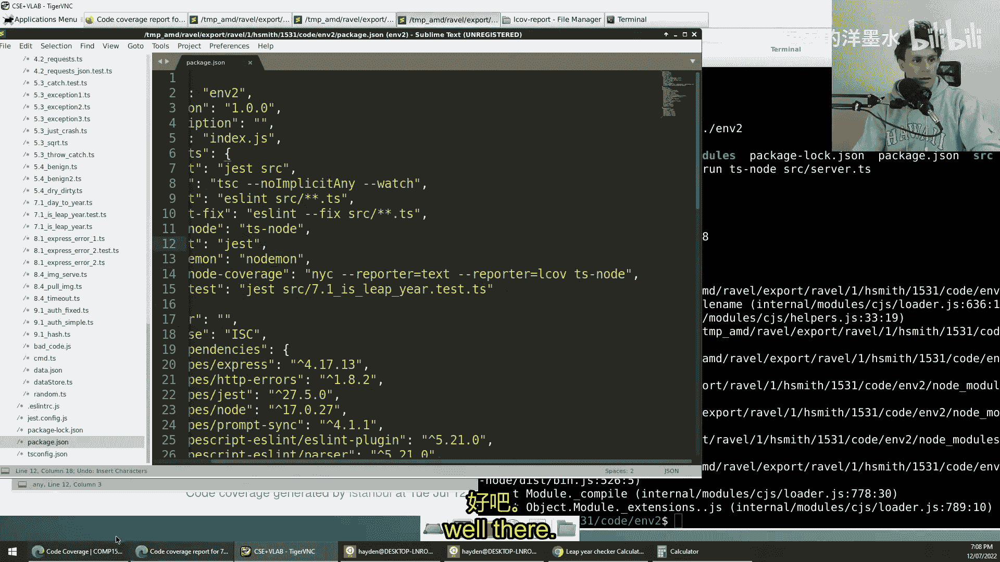

Now， last couple of things。Branch coverage。嗯。Yeah， you're， so you're。Sorry， just before I move on。

 So Clayton said all my coverage is getting 0% at the moment。

 it's probably because you're it's not running it with this command。 So like。

 like myself in the course staff went through quite extensive testing when we were writing this course。

 And we found tons of problems that we all fixed up。

 And this was part of it was that web servers were a bit weird and。

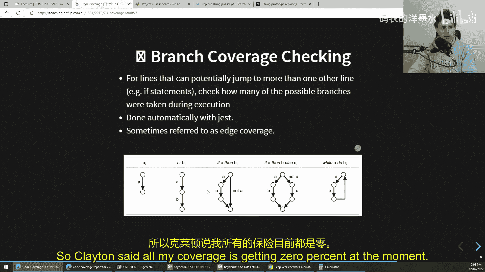

啊。Because it was a web server。 The coverage wasn't keeping track of what was seen in the code or something like that。

 But again， this was all fixed by just running our command。 So don't， don't stress too much。

 If you just add coverage to your iteration 2， it's probably a great point。

 If you just go and add coverage to iteration 2， and it says 0。

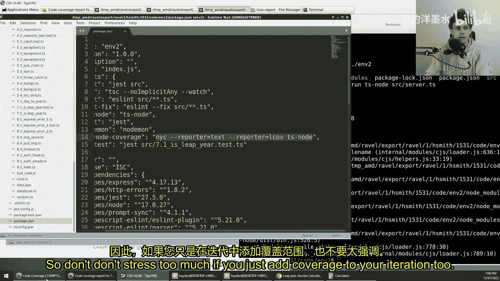

You know。Don't worry， I'm pretty sure La8 covers this stuff。嗯。Yeah。But if， you know。

 iteration 3 is coming out on Monday， you don't have to worry about coverage。

Many of you from what we've seen with the tests have pretty good coverage anyway。

 So it should be fine。 One thing that's interesting， though， is this topic of branch coverage。 Now。

 branch coverage is really interesting because branch coverage looks not at the number of lines of code。

 but essentially at the number of branches in your code。 Now。

 branch don't confuse this for a second with a git branch， because a git branches。😊。

Is something completely different。 A branch is essentially a wall loop or a fall loop or something else。

It is where。You， actually， I realized。嗯。No， we talk about that later in the course。

 Brach covers where you look at code， not from a number of lines。

 but how many possible branches there are。 Now， a really good example of this is actually if we go back to。

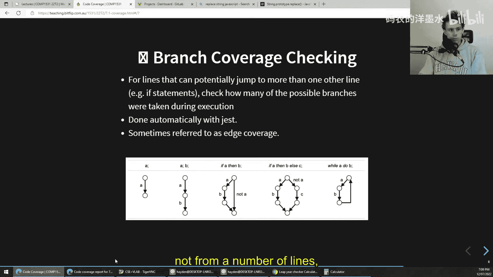

Our code。Here， this piece of code， this function， whilst it does have， you know，8 or 9 lines of code。

Branrantch， like this is statement coverage or line coverage。

 But branch coverage actually looks at this piece of code and said there's actually only two ways this code can go。

 It can either come into the if statement。Right。And come through there and then finish。

 Or I can skip the if statement and finish。And what you often find is that。

Branches are often where things go wrong。 And what what we mean by that is that。If。

If this line of code is correct， if sorry， if this line of code is passed through。

 the rest of the lines of code tend to be passed through。

 So when you when you look at a function like this。

 that doesn't ever make it into the if statement and you say something like， oh， it's 80% correct。

 And we saw this up here when you kind of look at some of the older results，87。5% correct。

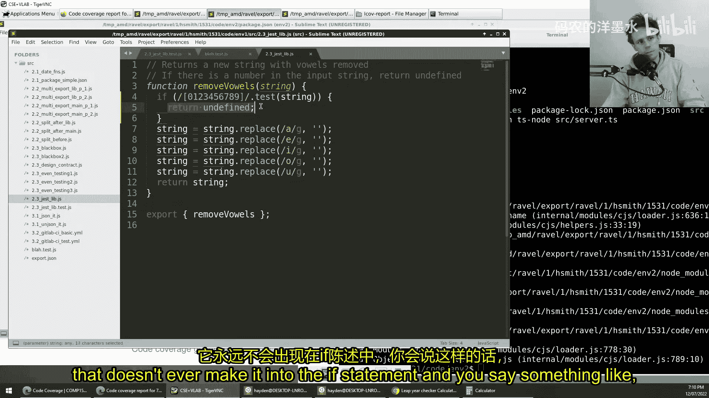

That's a little bit deceiving， because。That percentage gets bigger if I copy and paste these lines of code another five times。

 you know but branch coverage here is 50% because there's only really two ways this function can go and you've missed one of them。

 So it it's just a different way of reporting。 So it's the same coverage。

 It's just like branch coverage doesn't like do anything different。

 It's just the way it summarizes your results are different。 Bra coverage is kind of arguably better。

 this line done automatically with jest is true。 So and we used to actually do branch coverage by default as our judging mechanism in this course with Python and P coverage。

 but。There's some limitations of how jest works that I'm just not gonna go into extensively。

 but it essentially。It doesn't do branch coverage how you'd expect， sometimes。

I don't know if I go so far as to say it's a bug， but the behaviour of how Jess does branch coverage is not consistent with what we believe branch coverage is。

 So for that reason， branch coverage is something that's really interesting。

 and you should engage with it。You know， in your career and later on。

 as something that really matters。 But for the sake of this course， we will be looking at statement。

 We we were looking at the statements lines thing， the 87。5%。That's what we will be looking at。

So in summary， code coverage is useful。 It's more important to look at what's not covered than the coverage percentage。

 Yeah， so like don't get too caught up on the percentage focus more on the lines of code it hasn't covered and go check them out because they might be really critical branch coverage is more accurate so you should use it if you can。

 but you can't in this course and like all measurements it's important。

 you understand what it's saying because sometimes there's just code that you can't reach or something else kind of obscure So that's pretty much it on code coverage。

 I appreciate your patience submits the weird CSE issue。

That's a bit annoying with Typescript apologies about that。

 We will talk about coverage again when we talk about iteration 3 next week， again。

 everything in this is all tied to iteration 3。 It has nothing to do with iteration 2。

 It's completely unrelated iteration 2。So if you could please provide some feedback。

 that would be great。um。And yeah， we'll keep chatting about this， but。Overall。

 pretty straightforward topic。😡，Pretty cool idea。 fairly straightforward commands。

And very powerful to help you reduce errors in your code。

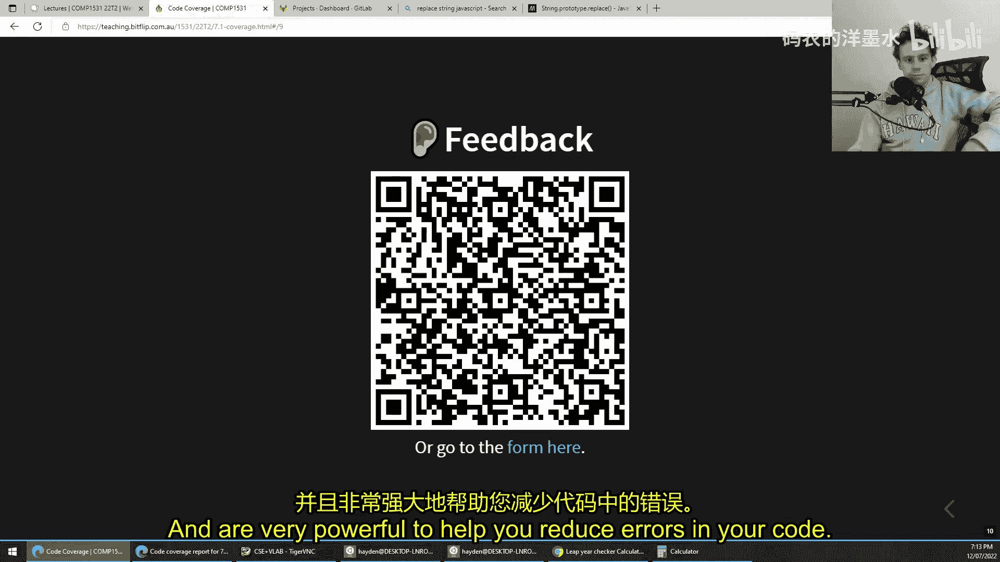