# 【全集】新南威尔士大学 软件工程基础 中英字幕 1080P COMP1531 p19 Lecture 19 - 概念建模 -BV1M7Nwz7EGh_p19-

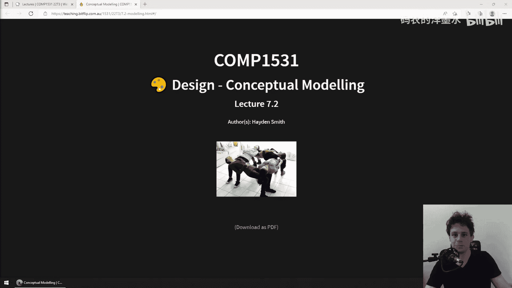

We're going to get started into this lecture。 So just because I am still fairly unwell。

 we will only do this lecture today。 So what happened this week was that。

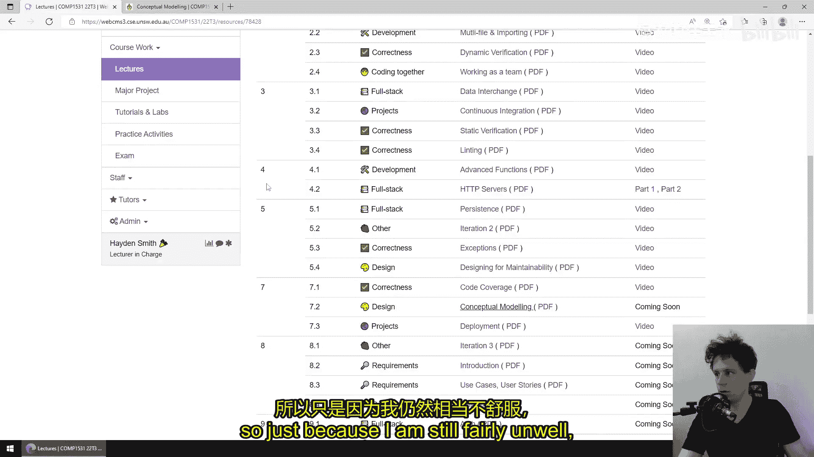

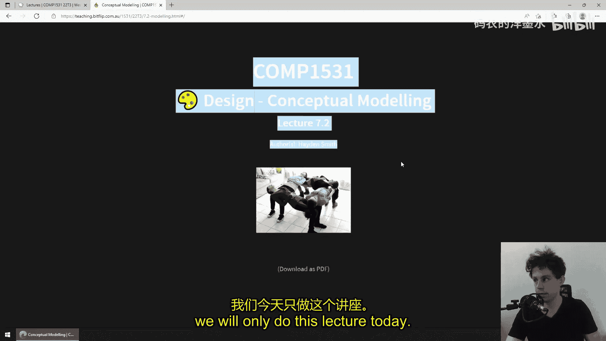

Wei。We have these two lectures，7。1 and 7。3 that we use the prerecords from previous term for。

 And today we're gonna to do 7。2 conceptual modeling。

 The reason that this one was chosen to do this week is because last time the prerecor was actually done in person。

 and generally I don't think that in person lectures do as well for recordings。

 but that's why we're gonna to do it today。 So we get a bit of an online recording example of it。

 So it should be a pretty light lecture last it normally only takes like 40 minutes。

 So we'll see if we can bash through it for those of you who are watching it live。

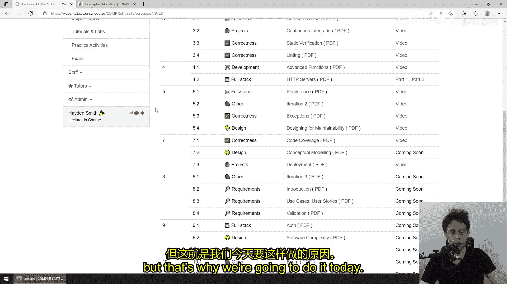

Congrats for being here and being engaged for the， you know，95% of you who aren't。

 I hope that iteration 2 is going okay， or it's much more likely that when people are watching this。

 that the statement is more that I hope iteration 2 went well。

 because you'll probably be watching it later on， but that's， that's totally okay。

This this particular lecture is quite interesting， I think， and it's really born out of。

It's really born out of the idea that。Software， like， there's a bit that goes on between。You know。

 deciding you want to solve a problem in writing code is the short answer and that's what we call design。

 We've seen that as part of the software engineering lifecycle a critical element of software design like getting that design of software right is to be able to translate these complex system ideas into something high level and understandable So you know if you're sitting around and you think well。

 I'd really like to build a system to help students figure out what rooms are free on campus right？

Between understanding the problem。And setting yourself some you some goals for the problem。

And actually writing the code， you need to translate into something and visualize it basically。

 And the ways that we're gonna look at this， we're gonna talk about what conceptual models are。

 basically， you know， how do you plan things in software。

 And then we're gonna take a deep dive in one particular type of conceptual model。

 which is a state diagram because it's an easy one to talk about and apologies in advance for my cough in my voice。

Re sound， particularly。Particularly。Flat。Today， that's just me trying not to kill myself， you know。

 in terms of like， you know， too much， too much energy。Okay， so。Question。

 what is a model You've heard this term before， right。A model。 Well， you've got a few funny things。

 right， You might think of model trains。 You might think of model boats。

 You might think of mathematical models， you know。Someone trying to model gravity mathematically。

 you might think of， you know， runway models or something like this。 But what we're kind of。

 you know， getting closer to is is also a model。 but it's really a description of software。

 And this is what you kind of see here。 This one's actually kind of a bit of a software model。

 And this is also kind of a software model。 And this is also a model， not a software， right， It's a。

 it's a chemical model。 Yes， chemical。 which you call it a physics physics， I don't know。

 It's a science model of an atom from high school， probably。You know， and there are lots。

 don't know what that at the bottom is， but there are lots and lots of different ways of showing you what a model is'cause you've probably heard about it in many contexts。

 right， You've probably seen other types of models like the water cycle。

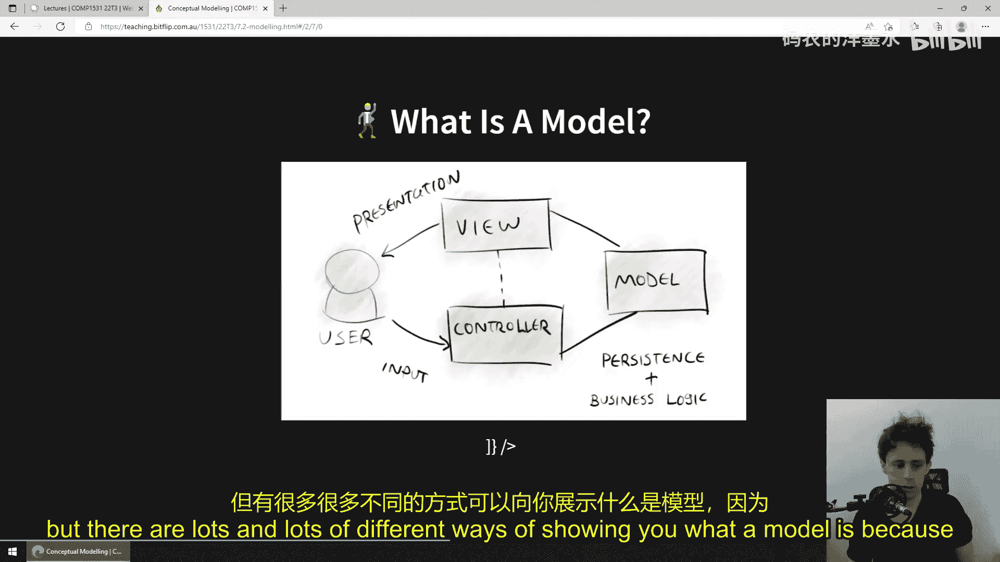

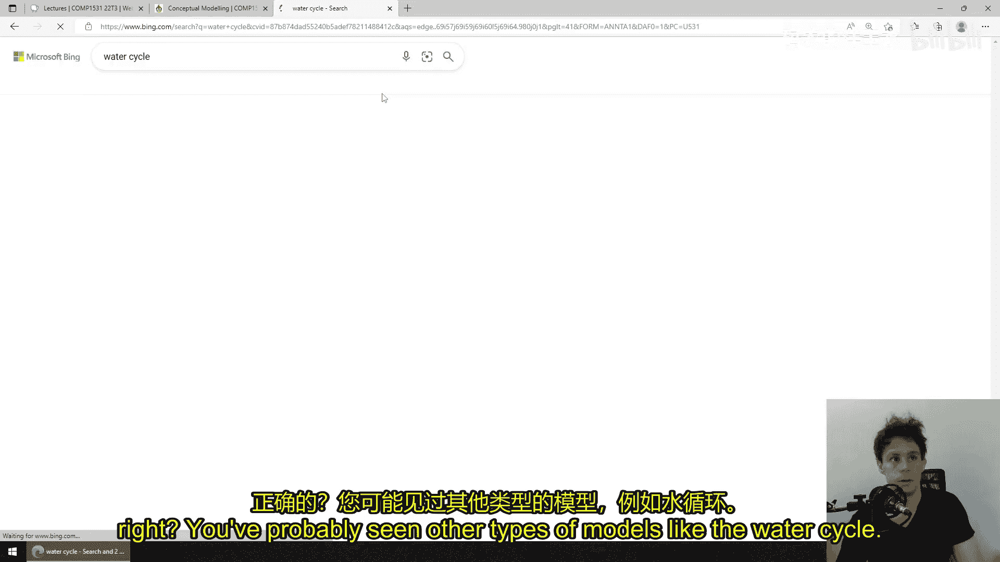

Right。This is a bit of a model。Or you've probably heard people talk about climate change and global warming as。

 you know， they're like， the models show something。 So what。

 what we're trying to do today is we're trying to dig into。

To what all of this is really about because these words come up And a model is really just a simplified representation。

To assist in understanding something more complex， right， makes sense。

This can be interpreted in a lot of different ways because you have things like。

 oh a mathematical model is meant to try and take something complex and abstract like the world and make it。

 you know real with numbers。 A software model might be trying to take a complex piece of software and simplify it。

 you know， a little model plane or boat is trying to take a big real world complex thing and make it small and simple。

 You know， you've got lots and lots of different things here。

 but they're all trying to do the same thing。 simplify，And make more digestible。Now。

A conceptual model is a particular type of model that captures a system in a conceptual way rather than a physical way。

 They tend to be diagrammatic or visual。 So if you' got like physical models and conceptual models。

 they're a little bit different。 If we come back to our kind of slide back up here。

 this is a physical model。This is a conceptual model。This is a physical model。Maybe。

I don't if there's a grab mean， I guess， you know。I mean。

 I guess if the model is trying to represent something quite deeply like， you know。

Trauma or something Then it gets a bit conceptual。 This is a conceptual model。

 That's a conceptual model。 That's a conceptual model。 That's a conceptual model， right。

 And we're interested in these more conceptual models today。

 And those conceptual models tend to be more diagrammatic or visual in nature。You know。

 so that means that they're， they don't really like miniatures of something。 They're more。

It's something you could typically draw is the short story。

Examples of conceptual models are mathematical models like we saw before。

 Sometimes there are data models， data models are just really diagrams or visuals to represent data。

You could kind of think about。The data dot M that you did in iteration 0。

As a bit of a conceptual model。 But it was kind of， you know。

 it was a little bit of just text and stuff。 You know， you could have drawn it diagrammatically。

 but it was a little bit of a summary of of what you're doing at a conceptual level， right。

 Like someone who's not a programmer could probably make some sense of it。So you can model data。

 have data stored。 you can do domain models。 This is something you kind of get into a bit more in probably comp 2511 later on。

 you can do state transition models which is actually what we're gonna to be looking at today。

 which is how does a program how do you model a program that moves between different states。

 which is how a lot of software kind of moves frankly， you know so that's quite relevant。

So conceptual models are also generally broken up into two different types。 So remember， again。

 we've got like models。 and then we've got conceptual physical models。

 And then within conceptual models， we're now digging into two types which are structural conceptual models and behavioral conceptual models。

 And structural conceptual models emphasize the structure of a system。

 they show you how it just kind of exists as it stands， You know。

 they don't really tell you a lot about behavior。 And a lot of conceptual models are structural in nature。

 right， Like if you have a look for a second at some of these again， or， you know。

 maybe something like。You know this， this is a structural model。 It just tells you， you know。

 what it's trying to achieve is to communicate to you how an atom like is。You know。

 this is just how it exists。 This is how it's structured。So I'm just getting back to the slide。

And two examples of conceptual structural models within software class diagrams。

 which are like domain diagrams。 again， they're kind of covered in 2，5，1，1。

 That's why you kinda look at the simplest way of explaining this without having gotten into it is that imagine if you had a way of trying to。

Visually。Show all the different files you have in your project like orth dot T S and channels do T S and how they relate to each other。

 You know， it's like a way of describing software functions and files is like a really。

 really dumb way of putting it。 And then you have other things like entity relation diagrams。

 which you can go study in like， I think it's comp 3，3，11 in the database of course。

 which is like a more souped up intensive version of of， you know， think like data dot M D。

 but like blown out into like a formal way， you know。

 like an industrial size way and you can see some of these diagrams。 like if I Google a UMl diagram。

 you'll see something that these diagrams help try and describe software components， you see here。

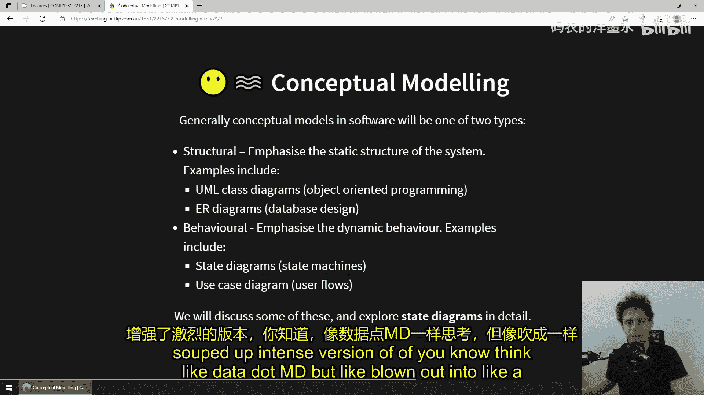

Something financial banks， ATM's accounts， customers savings accounts， current accounts。

If you look at something like an ER diagram which is meant meant to represent databases more。

 then you start to get something that's actually showing you different things that are stored。

 you know like this is some kind of review system like users and posts and ratings and users have names and birthdays and emails and posts have images and descriptions you know so it's a way of like modeling the data that stored within a system。

 So that's structural conceptual models。 And then we have behavioral conceptual models which are all about emphasizing the dynamic behavior of a system。

 So that is a system behavior over time。 and the two really standard cases for this state diagrams and use case diagrams or user flows。

 And we're going to talk about。

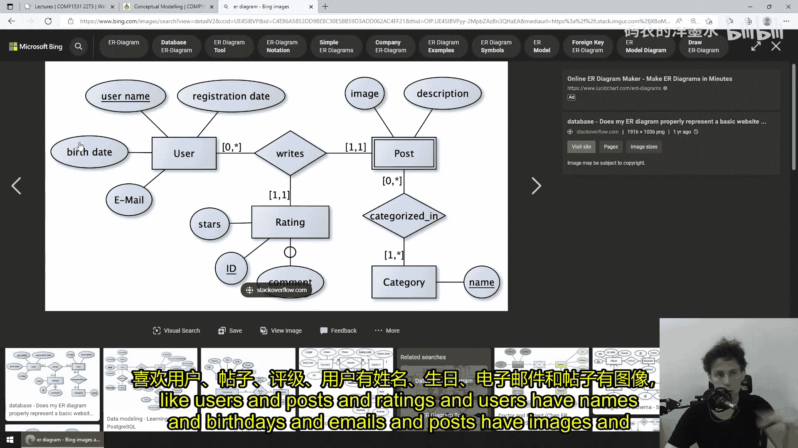

Use case diagrams and user flows。Next week。But today we're going to be talking about state diagrams because they're a really fun one to talk about now before we get into state diagrams though quick bit of recap what are these kinds of models used for like the diagrams that just showed you all the ones at the front they can kind of like what they're used for can kind of be summarized into a few different buckets which is like they can either be used to predict the future they can be used to understand the present they can be used to make sense of the past and they can be used to simplify things and typically that simplification is like critical in all of it right so again like you think about climate change models well。

😊，Climate change models are often about。Validating the past。

 predicting the future and trying to simplify it a lot of the time。

 but most modeling involves some kind of simplification， it's just kind of inherent to it。嗯。

This is a bit more of a formal take on what I just described。 You know， this is from。

 this is from an actual book。

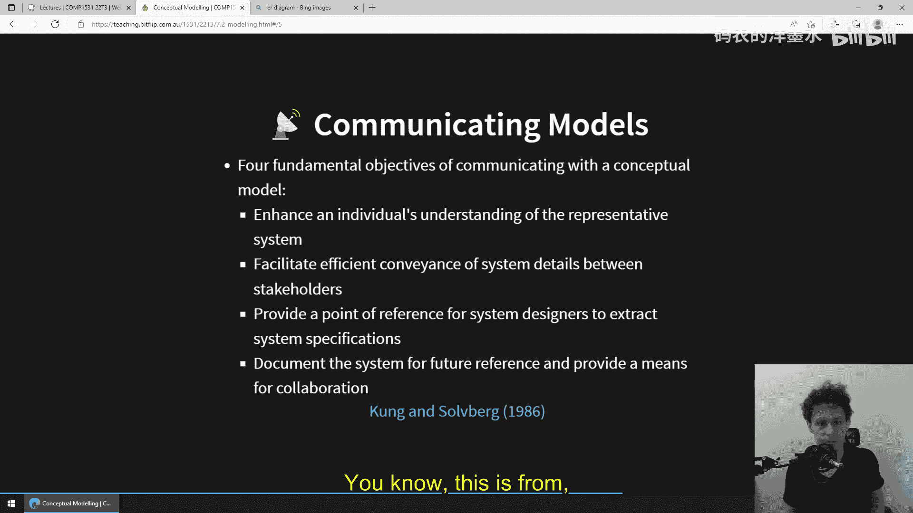

You can go and look at if you'd like to， not book paper。

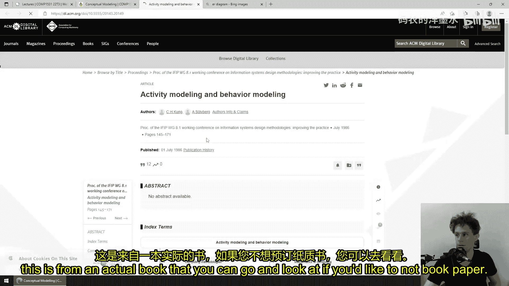

You know， something academic where they talk about， you know。

 the four objectives of communication with a conceptual model like enhanced understanding。

 conveying of details between stakeholders， stakeholders like all the different moving parts of the system。

😊，Point of reference for designers。 Yeah， so this is actually an important thing I probably didn't mention is like a lot of the time。

 part of why we do these kinds of things， why we draw these diagrams and models is for people who are going actually go and make it real。

 you know， So this doesn't make sense so much for something like an atom in science。

 But for some of those diagrams we looked at before。

 These things are actually really useful because you'll often have people go and design software。

 And then larger teams might go and implement it。 And it's like a really important reference， right。

 sometimes you might have like thought about this or referred to this as like a blueprint for design。

😊。

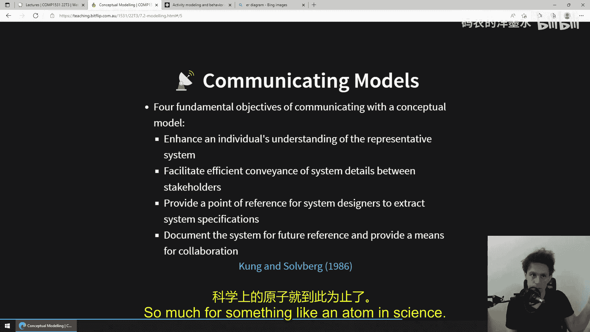

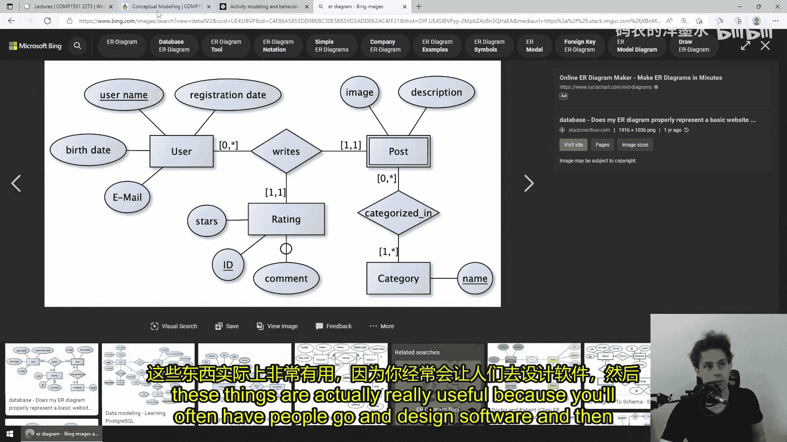

嗯。Can anyone hear them？The birds。I just the birds seem loud to me。 But if the birds aren't too loud。

 then great。 Just wanted to check。 and just documentation， you know。

 like code is often hard to document。 And like even if you document， are they loud。

 are the birds loud。Tell me if the birds are to that。 The documentation is really important， because。

Quite often， you won't document code。 You know， it's just like。

 no matter how hard you try and document code， someone who comes along and tries to make sense of what's going on with your code。

 it's just gonna be like a real struggle。 you know。

 like imagine sitting down with someone else's project back in that you haven't seen before and just trying to be like what is going on here And these kinds of models do a good backup for us in terms of like someone can look at this and be like。

 okay， I kind of understand what the software is trying to do because they've got that high level right it's all pretty intuitive stuff Now。

 the particular type of。

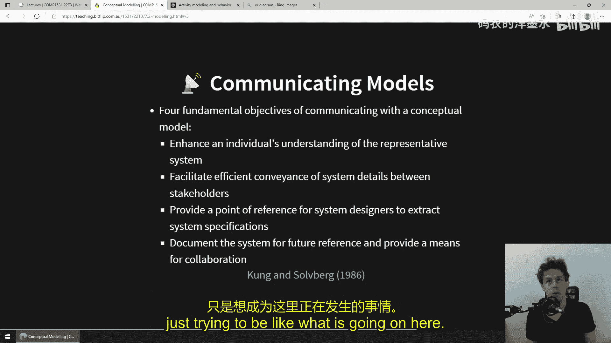

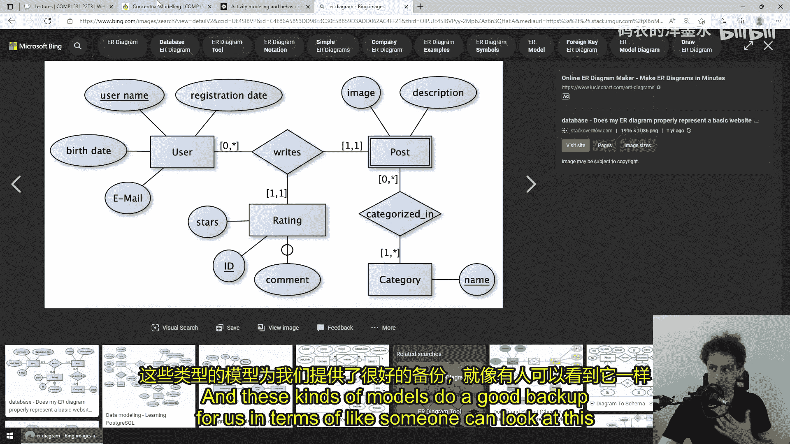

Behaviouroral conceptual model that we're looking at is a state diagram and a state diagram is a diagrammatic representation of the state of a program that has multiple states and it's a really simple diagram which is also why I like it and it's pretty fun to talk about because it essentially says that we're going to represent a system by drawing a bunch of circles right the exact shapes don't really matter as long as they're consistent。

 we go draw a bunch of circles for like these are the different states that a system can be in and then we're going to use arrows and notations to say how you get between those states So in the cases here if you're trying to create a state diagram for a door you know like a door in your bedroom。

Say that you're in right now maybe well， the door really has one of two states in theory right it's either open or it's closed and if it's open well you can close it by going from an open state to a closed state and if it's closed。

 you can open it by going from a closed state to an open state Now what do we say before。

 we said that models try and simplify representations and this makes sense because if youve if you've ever had a door。

 you'll know that your door is a little bit more complicated than that。 sometimes it's。You know。

 like， has anyone ever been asked， you want your door open or closed and you say something like a little bit open。

 mostly closed， half open， you know。Open or stick the stopper in it。 You know。

 it's like there are more states than just this in， in reality。 Maybe it's the door with it on this。

 you know， those doors that like click into place and things like that。 Maybe it is slightly ajar。

 you know， just resting on the end shut but locked。 You know， like you can go quite deep into this。

 But again， models are meant to be simplifications of the world around us Now。

 does this mean that this is the perfect model。 Is this the perfect amount of simplification。😊，Like。

 maybe。Sorry， maybe it kind of depends on what you're trying to achieve。

 There's no right or wrong answer to that， because the answer。Is really just。It's like。

Where like and this， this is the thing with context。 And this is true for software all the time。

 people get into arguments about， oh， is this language better than that language is C better than jascript is jascript better than Mips or something。

 But at the end of the day， it's all about why using it and how you're trying to use it。

 So it's like， what is this diagram for， It's hard to tell you whether this diagram is too simplified or not simplified enough。

 depending on what you're trying to use it for， know， And if someone was like， well。

 we're just trying to write a state diagram to help someone understand know how they might want to manage their child's door in the house。

 It's like， well， maybe it's too simplified because there are other elements here that are at place。

 So but that's a simple state diagram just to make a point。

State diagrams we said before describe systems that have different states。

 systems that have different states we call state machines。

 state machines are basically software that are made up of a finite number of states。

 as we just said， and the idea is that this piece of software is really just transitioning from one state to another。

And some examples here are like U eyes with different screens。

 And like you kind of get this like most softwares like this。

 This slide thing you're looking at here is a state machine in a way， right。

 Like we're moving between states。 like here's a state here's another state every time we change slides。

 It's another state。 You can kind of view your own project back in that way as well。 where， you know。

 you have an empty server。 And then someone registers。

 And now you've gone from like an empty server to a server with more than one user。 You know。

 like you kind of model it however you wanted。 could you could have a million different states that you could have just5。

😊，哦。Most I've talked in like four days。It's quite a trickrek。Okay。

One good example of a state machine。One of the first state machines that left an impression on me。 I。

 I Ive talked about this， I think last couple of years。

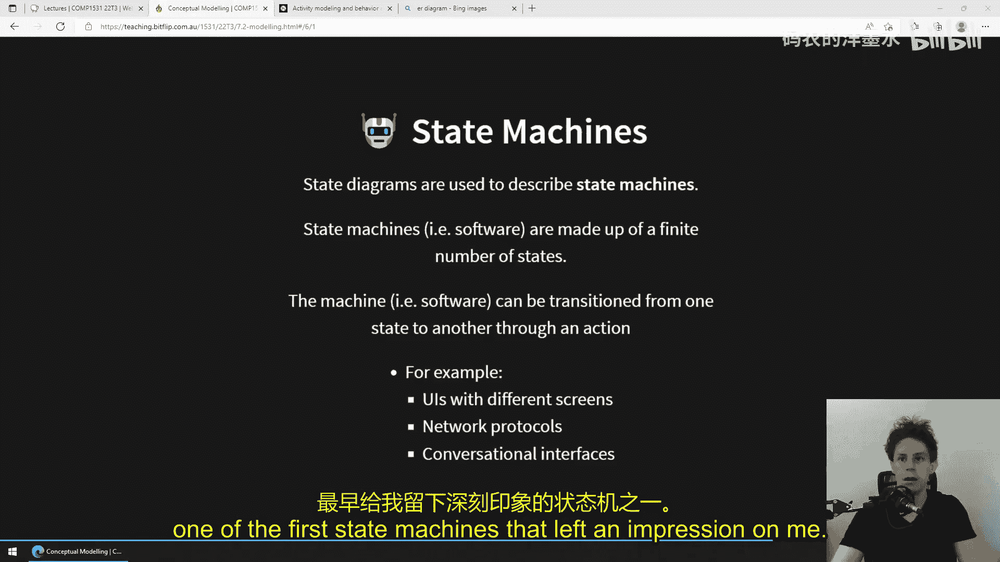

嗯。Robot soccer。Robot Cup standard Pla League， I'm not going to go too deeply into it。

 but let's have a look at these little things。

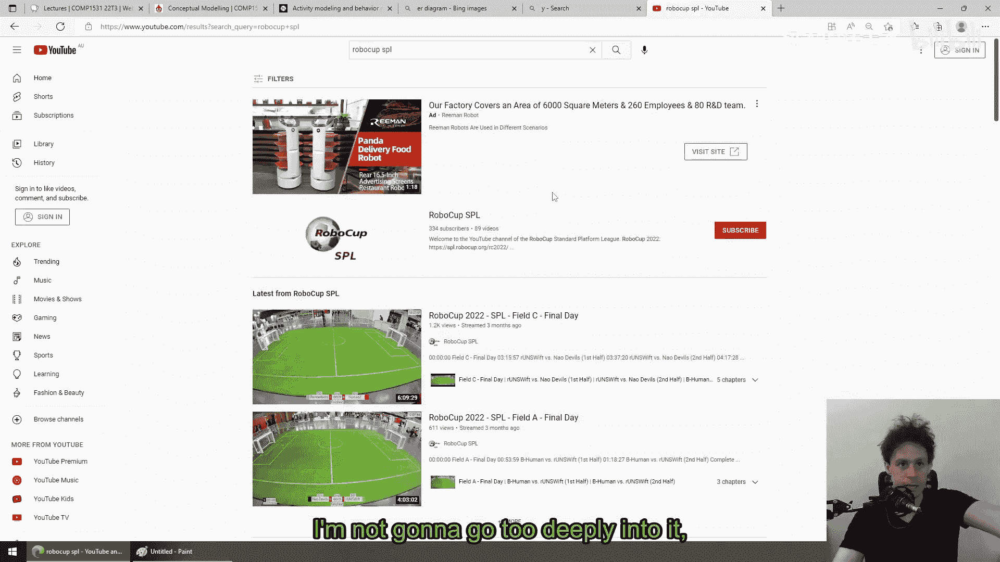

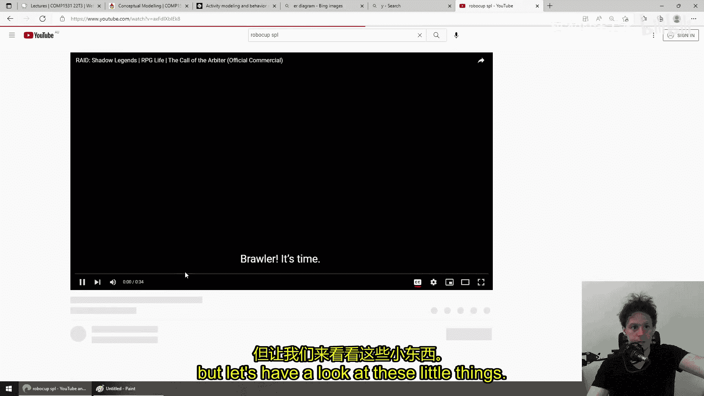

Kicking bowls around， right？So。See， look at these like little robots。Now。

 when I had a brief stinentt trying to program one of these， which didn't go very well。

 And I worked on the tiny little tiny part of it。 that was all around behaviours of the robots。

 The robots were structured like a state machine。 and how they worked was that。They were basically。

They were basically a series of states。Like this。Different states and those different states were doing different things。

 And this one might be like I think it was like， you know， say， looking for ball。

Anyway aint this bigger。Liu。Might be looking for ball， walking toward ball。They might be like。

 I think it was like lining up for kick。Kicking ball。嗯。I guess like kickback swing or something。

it was kind of like this。 And the idea was that the way the robot was actually programmed was that it was always doing it was always in a state。

 and in that state it had a particular behaviour。 So if you were looking for a ball。

 the robot was standing still and it was turning its neck and it was looking all around to try and find it。

 And you know what if while it was looking for the ball。

 the only thing it could do from that state was go and walk towards the ball because if you're looking towards for the ball。

 you're not going go and line up to kick it or kick it or back swingwing kick it。

 you're going just be looking for it。 So it would walk towards the ball。 And you know what。

 when it was walking towards the ball， there was only really two things it could do。

 it would either get to the ball where it would then line up to kick it or if it。😊。

As it was going to the ball， if it lost the ball， sayy someone came in and stole it。

 or maybe it lost vision of the ball， Then as it walked towards it。

 it might have to start looking for it again。 And as it was lining up to kick。인널。Well。

 after it lined up to kick it， would go and like swing its foot back to kick it。

 Or if while it was lining up， the ball moved， it might have to say， look for the ball again。Right。

And after it did， its kickback swing， you know， if that didn't work， you know， again， it might。

Go back to lining up or something。 You kinda get where it's going。

 And then it would like kick the ball。 And after kick the ball， it would go and look for it again。

You know， you could kind of， you could kind of actually describe a software system like this。嗯。And。

A lot of。A lot of software can be described like that， but that's essentially where this is heading。

 So if we then come down here and we look at this slide and we look at a parking meter example。

 you can kind of represent how， you know， like think of an old school parking meter with like coins and stuff in the city。

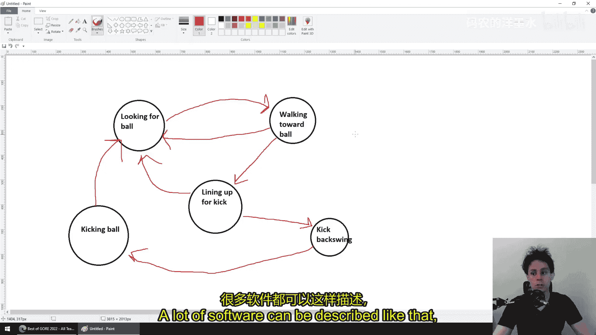

你er。You come up to it and you start this left hand side here。 and it kind of is like， hey， you know。

 where'd you park， right， it's one of those ones where， you know。

 you you punch in a particular car spot。 So it's like okay。

 well you get there and it says enter the parking bay number。 So you type in you know，62 like that。

 And then it's like great。 And we have a look at this well。There's only one imbound line out of this。

 So there's only one way you can go， which is that。After you input the number。

 it says enter the duration。 How long do you wan to stay there for So you enter like。Two hours。

 right？And then after， you know， while you hear you enter two hours。

 either you input the two hours or you click the cancel button。 And if you click the cancel button。

 you go back to the start screen， that makes sense， right， Like， how long do you wan to stay here。

 enter it or cancel。 So there's two ways out of there。And then once youve entered the input。

 it's like， okay。Parking bay 62，2 hours。 Please insert the money。

So now you're in this state and now one of three things can happen either you click cancel and the coins are rejected。

 you know， and you start again， or you insert a coin and if you insert a coin you come back here。

Or at this point there's no more coins to insert and you finish and you go back to confirm。

And then from like confirm is in like a final， like， are you sure you want to go ahead with this？

Right。嗯。And then from that， you can either like， click。Okay。To like。

 finish up and get it all confirmed to get your ticket or you can cancel it。

 which winds it all the way back， right。So， you know。

 they're just the different ways you can do stuff。Now。That should make sense too。

The interesting part about this， actually， and have a look at this diagram。

 So this diagram is slightly annotated because the point of this parking meet a diagram。

Is to really articulate。How simplified some of these things can get。

 Because if you really think about a parking me， you can ask some interesting questions。

 And the question that was asked between this diagram and the next diagram was like， well。

 how do you represent a timeout。You know， because if I go and enter parking B 62 in it。

And I don't click cancel or I don't insert any numbers。 It just kind of stops， you know。

 just kind of ends。It's like， all right， Well， let's annotate it further。

Cancel or five minutes elapsed。Cool， so all we've done here is instead of saying cancel。

 we say cancel or five minutes lap in here， where're like cancel or 5 minutes ala。

 and then the coins are removed。 You know， so you can just kind of keep annotating this。

 And we've done this at the top。 So at each step， there's like a， you know， a time out element to it。

😊，Now。There's still kind of limitations of this， you know， things that might not make sense。 or。

 you know， what happens if， what happens if you insert a coin that's the wrong size。You know。

 you insert， like it says， you need to enter 80 cents and you put in a dollar。 Well。

 it's probably gonna reject the dollar， but that's not represented here。

 How would you represent that， you know， So you insert a coin， Well， could you。

 should you create a new state， a new circle where that new circle is like insert coins that are rejected or do you just create a line that says coin inserted that's。

Wg， you know what I mean， like， and this is like， I think this is kind of the one of the fundamental challenges of of getting a good state diagram is that everything you wanna represent。

 you have to ask yourself， should this be represented as a。

 as a state in the state machine or should this be represented as a transition between two states。

Is rejecting a coin in its own state？Or is it an action， Well， you know。

 entering a coin that's wrong is an action。 But where does that take you。

 If it just takes you back to insert coins， how do you represent that？ So， again， if I drew it here。

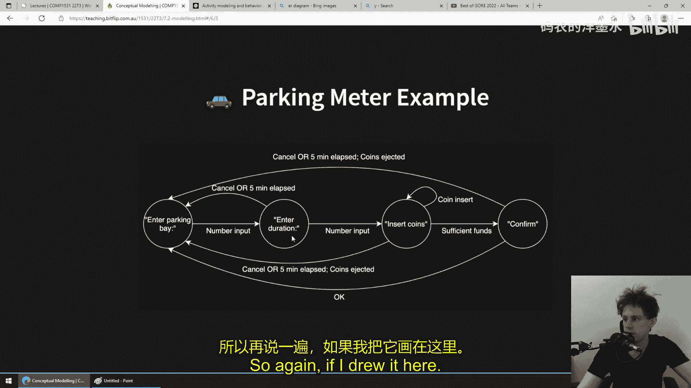

Copy image。 see if I can just do this， right， If I just tried to draw this here and I was like， well。

 yeah， you know， it's probably just another。Another thing。And then what am I going to write here。

Like on this line， imagine that's on the line industry。Coin insert， but wrong size。 So rejected。

little bit clunky， isn't it， you know？It's probably okay， but。That's， that's one way to do it。

 for sure。

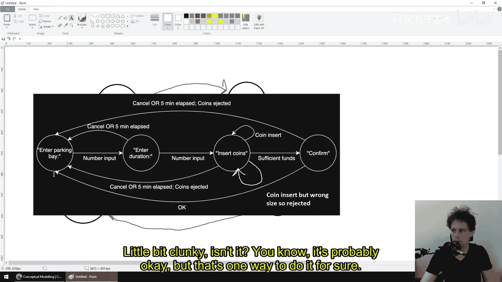

So we're gonna do a quick activity because we're nearly at the end here。 Well， it's not super quick。

 but the activity is coming model the Opal Car system in Sydney。

 So if anyone has ever been to Sydney， travelled to Sydney， right， which， you know。

 most of you have probably in some way， how do we represent Opal or like， you know。

 just Sydney transport。 I， I don't， I don't even use Opal in years because I've been using my credit card thing so。

😊。

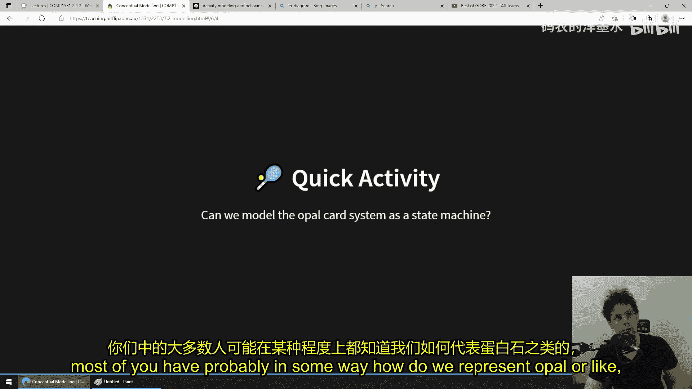

嗯。How would you try and describe how the system works。 And what I mean by this is， you know， tap on。

 tap off all of that kind of stuff。 It's a fun topic for meca I've always loved reading the rules about。

 you know， Sydney transport and stuff。 How would you start。 weve got 11 people here。 Someone give me。

😊，A bit hot。 So forgive all my shirt picking。How would someone start this， What would you do。

But what's the first state you'd have？Not tapped on， okay。So Daniel says not tapped on。

 Let's try that。Im gonna use these。 So it's a bit ugly。That's a good first state。Not tapped on。Okay。

 and where do you go from Not tapped on。Well， okay， well， you tap on， don't you， So let's make I。

 I'll help ya out， you know， but like keep adding， please keep adding things。 So like after you。

 you know， I might draw this further away。You know， if you haven't tapped on。Well。You can tap on。

Right right， there here。Tap on。 then， you know， so we're getting a good split here between like states describe moments。

 you know， and。The lines describe actions。So what would you do next， I mean， I'll。

 I'll help finish it out and stuff。 But like someone give me some more。 What else would we add。

Help me out。Tap off at a different location。That sounds like an action。

But where does that take you cancelance tap on， I guess， I mean， let's just O， well。

Let's just draw two。We're going have to unwind a few things here。

But let's say one was like cancel tappon。And the other one is。Tap off at different location。Now。

 already， like， you can kind of start to feel this getting a bit complicated， right， because。

You know。You just get into weird areas。 Like you can start asking yourself questions already about。

 this doesn't really tell you anything about how much it costs。

Which is like a little bit of a problem。 Or like tap off at a different location。 Okay， well。

What happens if you tap off at the same location， What happens if you tap off at the same location four hours later Well that's not a cancel Now you're just tapping off at the same location。

Because the way the trains work in Sydney is that you it's only cancelled if you tap off within 15 minutes。

So now you tap off at the same location。 It's like， okay。

 this is starting to get a little bit unruly。 Deian says insufficient funds and Adrian says that as well。

 So it's like， okay， well， if you're not tapped on。You can try and tap on。But。Then， you have。

Tap on not enough funds。Sure， Jed says deducted money。Yeah， this is where it gets more fun， right。

cause it's like， alright， well， if you tap off at a different location， do you。

 do you put deduct money there， Do you put， do you put that as a state where all deducted money takes you back somewhere。

 You know， it kinda gets a bit， a bit further。 So let me just。😊，Complicate this a bit more for you。

 so。Couple of important rules to do with Sydney transport。 This is just fun， little。Is it opal rules。

 I don't know what it's called。Opal。Oal benefits， I don't know。um。就。哦。Damn it， okay。

I don't like this。I'm a little bit worried。 So some simple rules with Opal， right。

 or like the network。If you tap off at the same place， you tap on within 15 minutes。

 you aren't charged anything。If you tap on。Again， after tapping off somewhere less than an hour ago。

Your trip is just extended， right。So they're two simple things we can start with。

 So now it gets interestingcause now we have to think about， well。

 how can we intelligently describe this。 Well， you got this 15 minute problem。 Well。

 what you could do is you could say， well， there's not tapped on and there's tapped on within the last 15 minutes。

So now what happens is someone taps on from not tapped on。Like that。

And now you kind of have an easier way to represent this because if you're not tapped on what you can tap on。

😊，And if you tapped on within the last 15 minutes， you can tap off cancel。You know。

 no charge or something。But。If 15 minutes elapses。Then you probably automatically kind of maybe going to the next one。

Which is called it like， you know。Tpped on for more than 15 minutes。

And this one is just like automatic after 15 minutes， something like this， right？

 And we've still got those states you guys mentioned before where you have this one here。

 which is like tap on insufficient funds。Ins funds。 Okay， then it's like， well。

 if you tap on for more than 15 minutes。嗯。Well。You can now tap off， right？Surely， okay， well。

 what happens if I tap off。Well， this is where it gets trickyca like if you tap off now。

 you're not necessarily not tapped on because if you leave home right now and you tap on a train。

 you're like fresh， whereas if you tap off a train and then you tap off another train within an hour。

 if， again， if you've been in Sydney at all， which many of you have。 It's like you extend your trip。

 So it's actually kind of like a weird state over here， which is like a。Um。It's like， not tapped on。

But mid journey， you know？And that's the kind of thing where， okay， if you've。

 if you've tap on and it's been more than 15 minutes， if you tap off。Then， you know。

 and this is also where you charge， say， or make that。 And if so you say you catch a train from。

You know， Hursstville to Central in Sydney， you tap off， Well you come into this not tapped on。

 but you're still in the journey state for an hour like we set up here。And now it happens。 Well。

 let's say you don't do anything after that hour。 Well， after that hour， you will just automatically。

Get sent back here to the stop。Which is， you know， like an hourah passes。But if you do tap on。Right。

Within that hour， then you come up here。Which is that you've tapped on again。

 And this within the hour is like if you， if you tap on within hour。You know。Now。

 I'm not gonna take this much further， but I'm trying to articulate to you a bit of a balance here because like sometimes stuff's really hard to represent。

 It's this question about， you know， this doesn't do a good job of representing。Dollars， you know。

 it's not a financial model。 It's really like， it's not a financial。

 It doesn't model the cost of this very well。 It It really models the。Your。

 your trip validity in a way， like it models whether， you know， whether you're on or off the train。

This might be something that， you know， like oh， you know。

 you've been on a train and a train inspector come and like taps your phone or something and it's like。

 well you know， a system like this is you could model how those things say it's okay or not okay based on this。

 right。嗯。Pretty easily。猪。Any questions about this？ We'll move on to the last slide。

 but I think this kind of really starts to drive the point home a little bit as well。

Just give everyone a minute。 Cas you have questions。 Sorry about all the coffeeing。And u the。Faint。

 faint sounding everything。

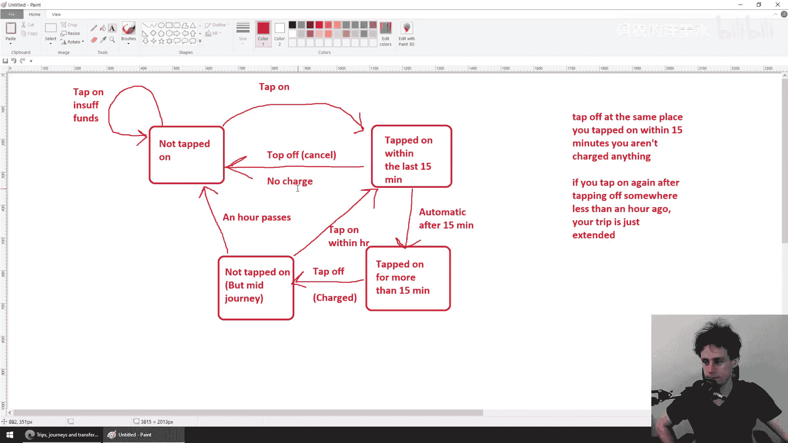

I'm gonna keep moving on just in case we'll stop if someone ask a question in the next。10 seconds。

 So the last thing was just， this is just a little bit of fun。 It's just a story I like to tell。😊。

Because I think it's a really interesting， probably still one of the most interesting examples of like a university level engagement with a conceptual model。

 basically。😊。

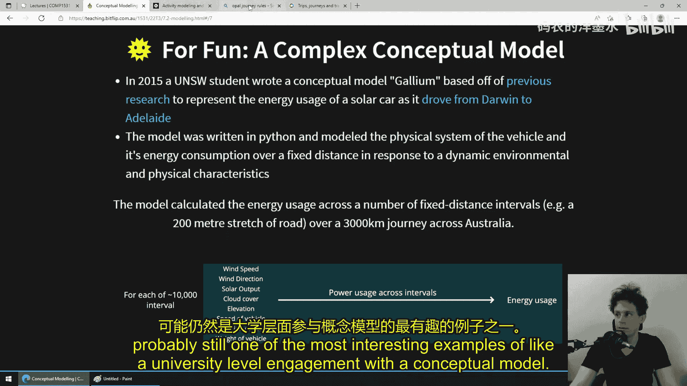

There is a race。Ui students race。嗯。Every couple of years。

They all race from the top of Australia to the bottom of Australia。

 it's about 3000 kilometre and they all race solar cars。

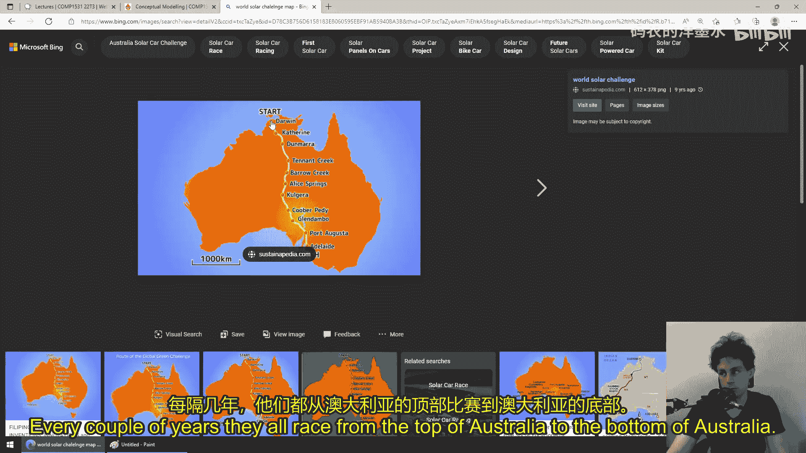

From the top to the bottom， right， So lots of different teams from around the world。

 They build these things and they race them from the top to the bottom。You know。

 it's obviously a mountain of work to build these things。 They're very complex。

 mechanical and electrical feats。 But a really interesting question is that you have six days to do this drive。

 and you have。Depends on the rules。 But just to simplify it， you have a battery of a certain size。

 right， just like a car。 car's got a fuel tank。 fuel tank's only so big。

 And you have to make a decision as to how fast to go。 Like， think about this， too， right。

 Let's imagine you're driving from Sydney to Melbourne or Sydney to Canberra and you have a half tank of fuel。

 right， It's about 3。100 in kilometers。But you need to be the first one there。If you drive too fast。

You run out of fuelcause the faster you go， the more fuel you use， right，cause when you go faster。

 it's like， it's like anything in life。 you， you go faster， you got more wind on you。 There's。

 there's a cubic relationship with the wind or quadratic。 I can't remember that， that slows you down。

 but。If you go too slow， you'll get their last。 So it's a pretty pretty simple trade off。

 and it was a peer of mine a student in 2015 they wrote， I mean。

 they designed a conceptual model that they then expressed through coding right They wrote it in Python。

 a language similar to jascript and you can follow some links there if you're really interested in but basically all this tried to do was model the car。

 model the car as it drove across the country。 This isn't like a toy model like a miniature of the car。

 This is saying， well， you know what it's actually really really complicated to figure out how much energy a car uses right。

 think about you on a bicycle。 how much energy to use on a bicycle。 Well。

 it kind of depends how pumped up your tires are， depends how good the bearings in the by car。

 It depends which way the wind's blowing it depends how hot it is because the hotter it is。

 the more tide you're gonna get because you're gonna sweat more。

 It depends how much sleep and like your physical state， you know it depends on your strength。

 Some of these things are quite constant。Like you have a strength。

 and that's pretty similar every day。 But the wind direction kind of comes and goes and winds very complicated。

 right And like how can you even predict like we can't even predict the weather generally So how can we predict how much energy you're gonna use exactly on this particular cycle。

 It's the same kind of thing with a car。 So there's all these complicating factors like the car is driving is the wind coming from behind。

 which is helpful or is it coming from the front， which is bad is it coming how fast is it coming。

 how much sun is coming down onto the top of the car how much cloud cover is there because that affects the sun in a very complex way in terms of how much hit the solar panels because they're all solar cars。

What's the road like driving uphills quite？Taxing and it takes a lot of energy driving downhill is pretty easy。

 the fast you go。Obviously， the more energy， that's kind of like the， the， you know。

The parameter of the function in a way。 But， you know， how's the car oriented Because， you know。

 if the cars facing one way， if the top the roof's not flat。

 it's gonna pick up different amounts of sunlight， right？ And then how heavy is the car。

 there's more stuff than this。 And the way that this student designed it was they basically broke up the entire。

 you know， it's a 3000 kilometre。 So like 3 million metre drive。

 And they broke it up into like 10000 intervals。 And each interval was say， you know。30 Mters。

 I guess。Yeah，30 meters long。

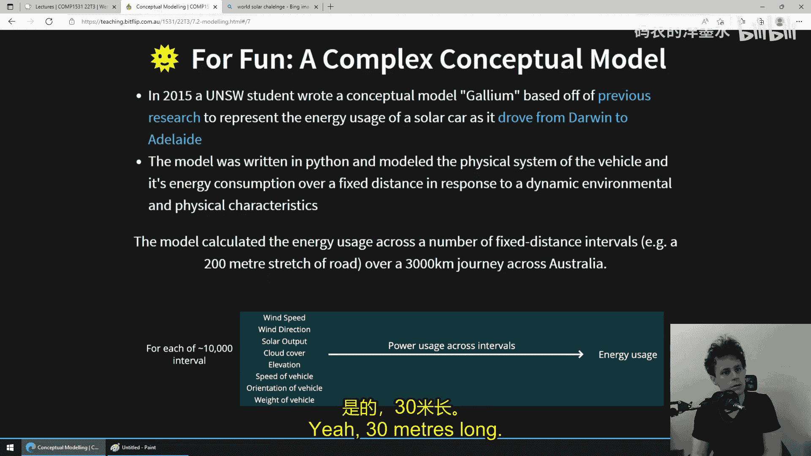

So they said， like， think about sampling from high school。 You know。

 got like music sampling or whatever。 You know， they like analog。Analoggue to。And is it。

Digital analog。I can't remember。And to digital sample。

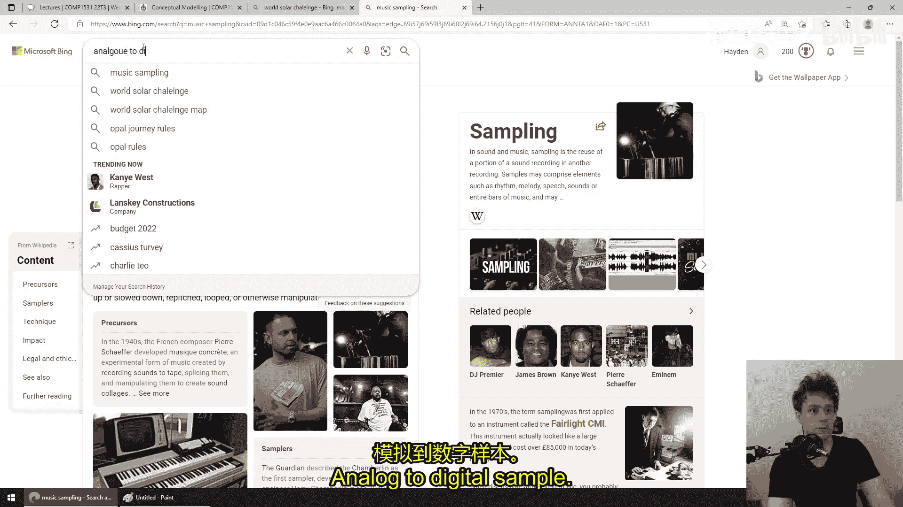

Yeah， you remember learning this kind of stuff in。In school where they'd be like， oh。

 if you take like a real world signal， you have to you， it's kind of a modelling it as well。 right。

 You're like simplifying。 you're like， well， let's just like simplify this down。

 So a very similar thing was done， which said， well， it's impossible to know what， you know。

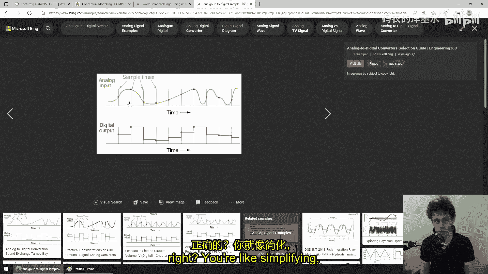

The the elevation of the road is every single metre。 You know， that's very complicated。

 So let's actually just say， well， you know what this 30 metres a road is exactly the same。

 It's exactly this elevation perfectly。 It's exactly like this orientation perfectly。

 We're gonna assume that for this 30 metres， say。😊。

The sun is gonna be shining at exactly this brightness。 And then all this。

 all this model was was saying， let's break up that trip into 10000 pieces。😊，嗯。

And then let's for each piece， calculate how much energy the car has to use。

 Let's sum it all up and then we'll get a distance It's like again in a car。

 it's like let's just break that trip to Canberra up into 10000 pieces。

 figure out for each piece for each 30 mes。 for instance。

 how much fuel do you use and then see if you have enough fuel to get there And if you don't have enough fuel slow down and check again。

You know， and then if you do have enough， if you have way too much fuel speed up and check again。

 So it was essentially just a piece of code that was designed to really just simplify what was going on by modelling it。

 right And it's a really cool example of a conceptual model because， again。

 it's taking something that is complex。 It's making it simpler。 It is sampling the world。

 It is typically ignoring things。 There are always lots going on here that don't make sense。 Like。

 for instance。😊，The temperature of your car tires affects how efficient they are in ways I don't fully understand The humidity affects all these things。

 You know， but you kind of ignore those things because they're too complicated。

 It's like when they model the economy。They don't take into account every single little thing。

 They simplified。 Anyway， this is a bit of a random story。 But the point was just to show you。

 this is another。 like， we talk a lot about conceptual models。 And it's not a new idea。

 You're kind of all very familiar with this because you've seen it before you probably just haven't given it a name。

 So thank you。 If you do have any feedback。 please， please fill out the form。 It's always welcome。😊。

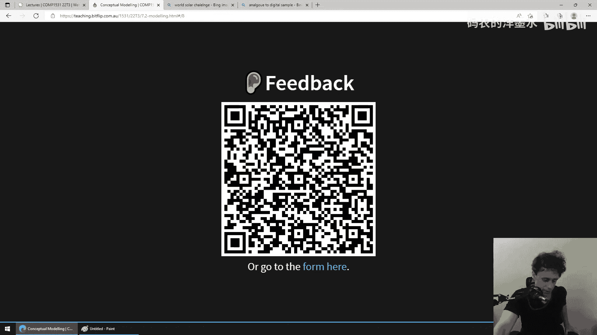

Yeah。Thank you， everyone。