# 【全集】新南威尔士大学 软件工程基础 中英字幕 1080P COMP1531 p20 Lecture 20 - 部署 -BV1M7Nwz7EGh_p20-

So。I think this slide is slightly wrong。 It should say projects deployment。

 I'll go and fix that up after This is the last lecture we do on projects as well。

 So we did a couple of lectures on projects in the course。

 the first one we did was on package management and then we did another one on continuous integration where we talked about the Gitlab CI file and everything like that and this is the last lecture where we talk about deployment。

 which is really， really interesting。 So the purpose of most this one of my personal lectures I like the purpose of most software is for people to use it。

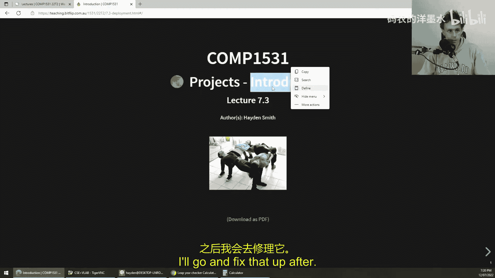

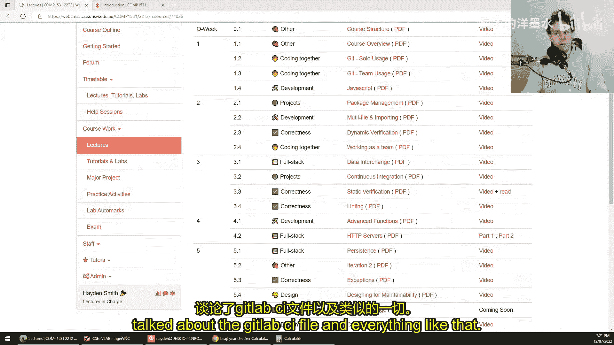

It's a pretty interesting and straightforward idea， but it's kinda true， right， Like there's。

 there's no value in software if other people can't use it。

Like it just sits in a box right most everything we do with engineering again is designed to be used by other people most of the time。

 so if we want to make our software available for people to use it。

 we need to have processes that exist that make it available for use， you know。

 so if you write a piece of code like let's say you look at your your project backend in 15，31。

You write some software。 How do you make that software available to other people。

 Becauseuse right now， the only people that can really use it are your group members who have the Gitla access and stuff。

 right？ So we're going to talk about deployment history。 We're going to talk about。

Continuous delivery， continuous deployment and devops as a site concept as well。 so firstly。

Deployment deployment is what you would summarizeise as activities relating to making a software system available for use。

 You'll hear this so many times deployment is making software available for use for people。

There are many diagrams in this lecture， a lot of them are sourced from Gitlab and in Lassian。

 but before we get into that， let's actually have before we get into the theory of all this in the history。

Let's actually just get a really tactile example， so one of the most basic forms of deployment you could possibly do is to deploy things to your CSC account。

What do we say deployment was， People say deployment， you might think of AWS or something like this。

 but again， deployment is about making something available for you。

 So let's say that you on your CSE machine。

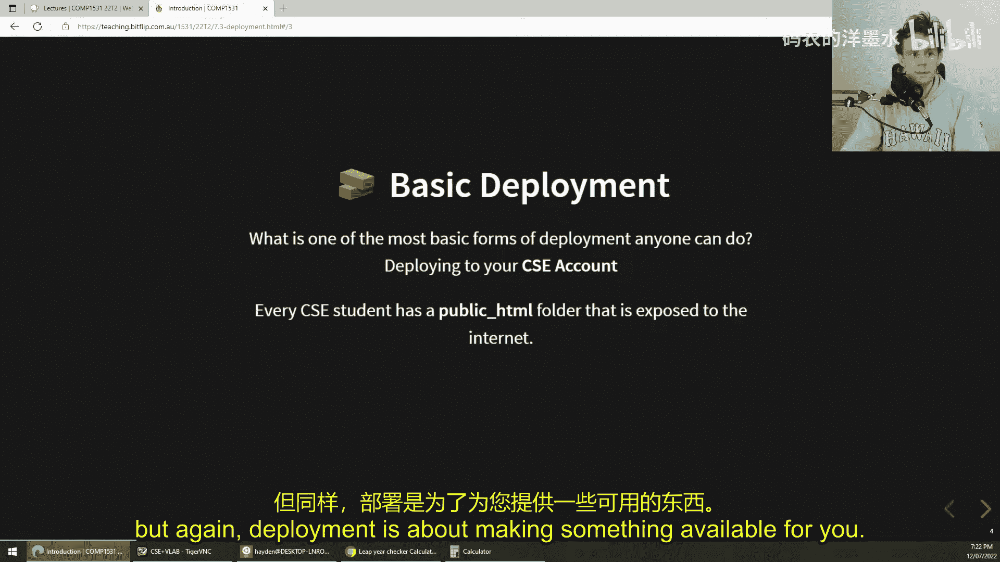

I'm going make a new folder， called。You know， peanut。And inside a peanut。

 I'm going to make another file， and it's going to be a really straightforward。

 a really simple Hm file indexed at H。 And it's going to say welcome to my site。 And in fact。

 because you're an H TMl wizard。嗯。You're going to use the marquee tag。Becauseuse you're fun。

 and then you're gonna open up a web browser or more specifically， you'll probably open up。This。

 and you'll go into your peanut folder and you'll open up this web page。

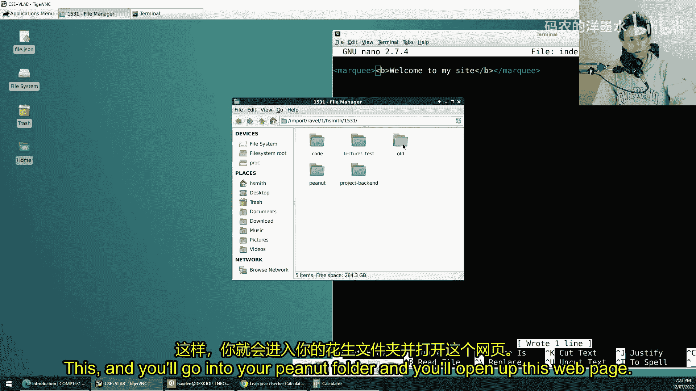

And it'll open up in Firefox or something。 And you'll see that it has some text going across the screen。

 And you think， call， I'm a software engineer go， Yeah， sweet。 I'm awesome。

 And now you think I want to give this to someone。 I want to， you know。

 make it available for other people to use this。 You know， Now， obviously。

 this is an extremely boring piece of software。 And that's okay。😊。

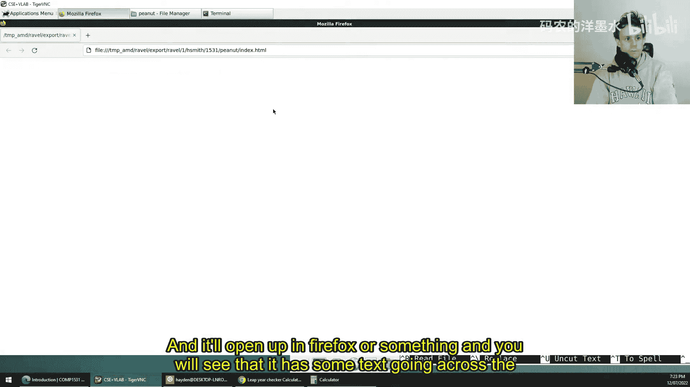

OhDid't come back。We'll run it again。 and you could maybe send your friends some files like this。

 but let's be realistic。 Most software you write， it's not going to be something that's simple it's going to be like jascript files or something where you don't want to send someone or your ja typescript files just to make them run a server。

 You just want to give them the ability to use it。 So one of the simplest things we could do for deployment is figure out how to put this on the Internet。

Putting things on the internet is like 99。9% of what deployment is。

 what making software available for uses。And to do that。

 a really easy way is that all of us have a folder on our CSC accounts。

Which is the public H M L folder。So if you go to your home directory and you navigate public HTML。

 you'll see a bunch of files， right？And I don't remember what most of these files are。

 so I should probably just delete them。Just in case there's something relevant。

 or I could have just hidden them， but， you know。We'll deal with that。

 So I've got this public H TL folder。 And what's really interesting about this public H TL folder is if I create a file here called test dot T X T。

And then I write test in this file。And then I look at the permissions of that file。

 and I will have to give that file certain permissions。

You know you have to run that command if you don't know what it is you can Google it。

 but what's really interesting now is that if you just on your web browser， in fact， you can do this。

 you can do this at home right now live or later， if you just navigate to I can't remember the exact URL。

 but I'm pretty sure it's cG。 cs。 unSw。au Tilda your Z number and then the name of the file。

 test Txt， it's actually on the internet now。

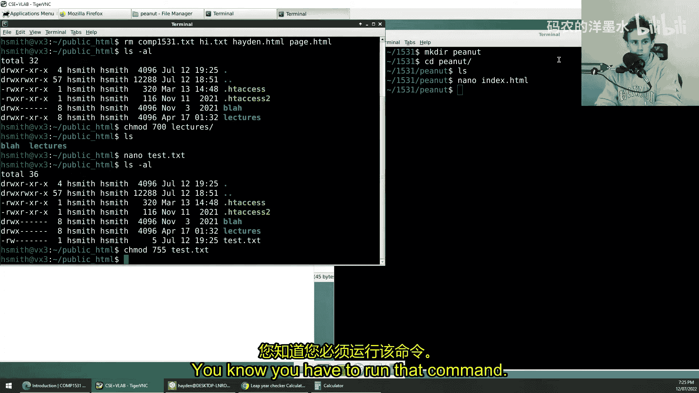

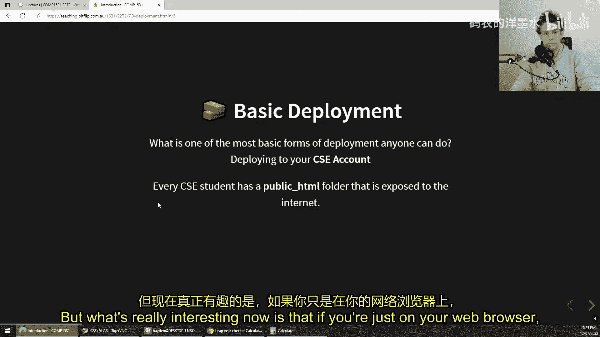

That's cool。 This works for static content pretty well。 So I've got my test file here。

 and it's on the Internet and anything inside this folder you have here。 if I change。

 if I change that file from test dot T X T to test2 dot T X T。

 you'll see that it does actually update on the Internet。 And you， you can access this URL again。

 I I'm just gonna， you know， send it in the chat。 It's pretty， it's pretty straightforward， right。😊。

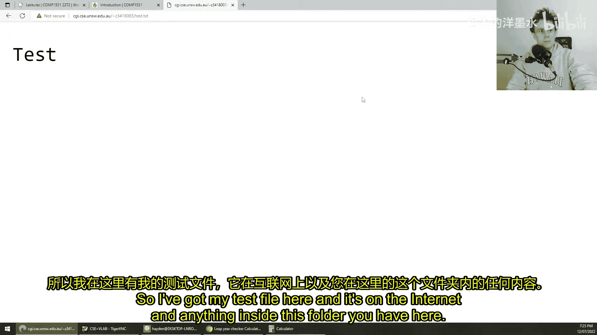

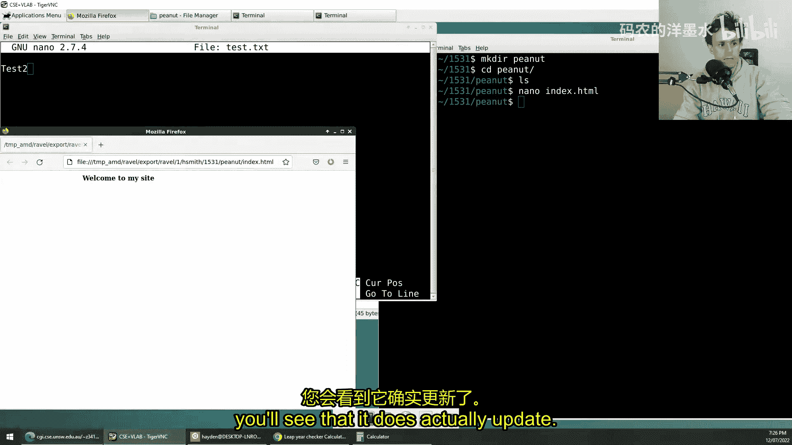

Yeah， you can click on that link if you're on the live stream。

Or you can just type that in if you're playing at home。Later on so。This isn't deployment per se。

 but we would say I mean what we would say deployment is is deployment is anything that takes software you've written。

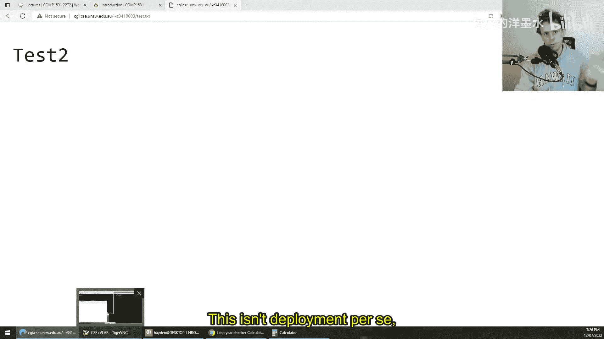

And it makes it available for you。 So here's a simple deployment command or script。

 It is to copy index dot Hml to let me make this terminal bigger。

 It's to copy index dot HTMLml in this folder。From， from this folder to public H TMl。

Slash indexed of H TML like that。 And when I run that command。

 I'll probably have to play with the file permissions。 You'll see that this file has now appeared。

Inside of my。Public HM L folder。 and I will have to again adjust its permissions。

 But now if I just go to you know， Z3， you know， my Z ID slash index dot H Tm L。

 I now have this little web page。

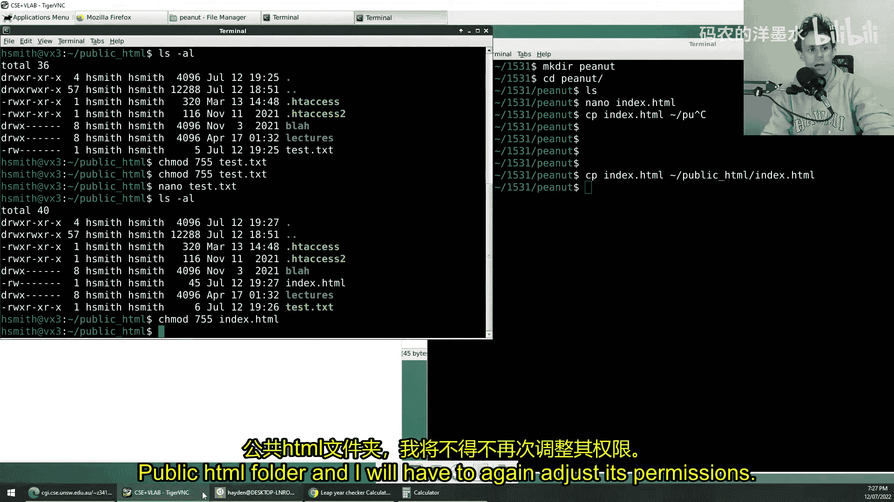

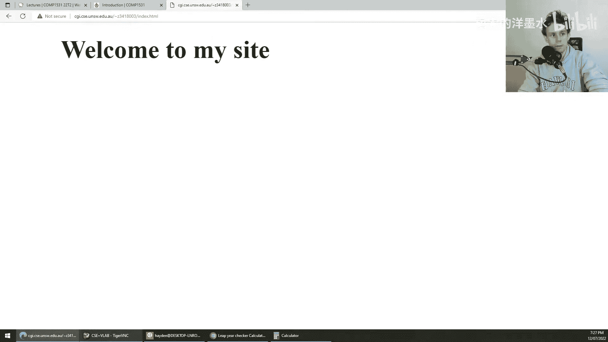

And this is， this is like the simplest deployment you'll ever kind of see。

 And and what I mean by that is like when we say deploy， think about the software lifecycle。

 I'm going to go and edit that piece of software， and I'm going to say welcome to my site。You know。

Go away。And then， let me just include。Let me just include one of my favourite images whilst we're here。

嗯。Great， I found it。 Let me just copy it。Im going go write some really， really basic HMl。Where。

I don't just have that text there， but I'm gonna put an image right here。

That image is just going to be from the internet。And。

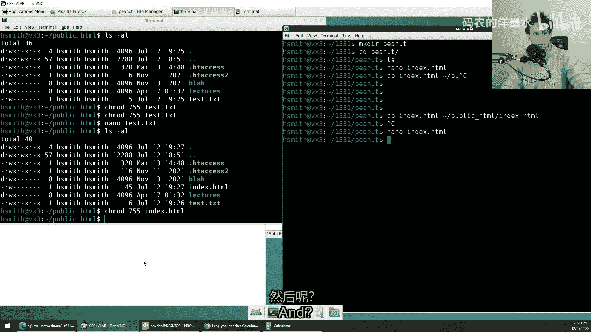

Right now， I've updated that file， but it's still the old web page。 It just says welcome to my site。

 I haven't deployed it yet， but I can make this available for use by simply running this command again。

 And when I run that command again， I have now updated my site so that it is the new software。

 I've made my new changes available for use right So that is like the reason I show this example is not because you'll probably ever find there to be too much long term use in this。

 but it conveys the idea in the simplest way。

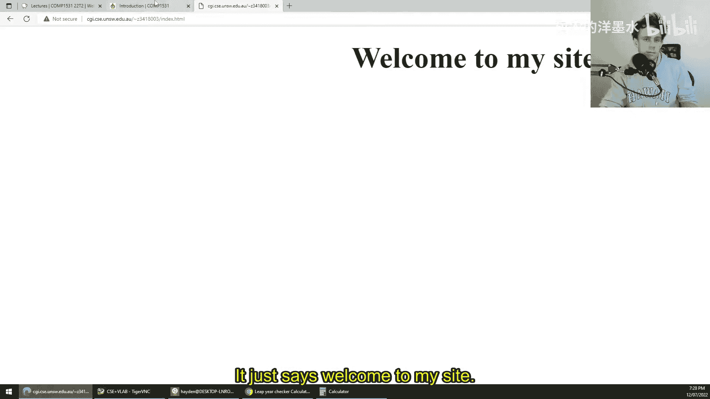

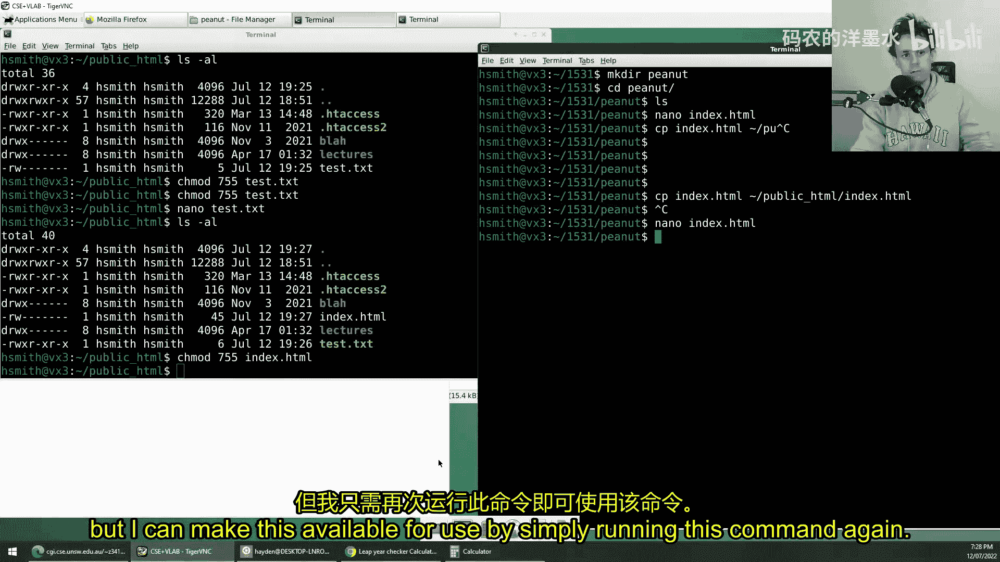

The idea being you wrote code that does stuff。 You want to put it out on the Internet。Now you get it。

 Now， the rest of the lecture is just filling in some of the details and elaborating on that a little bit。

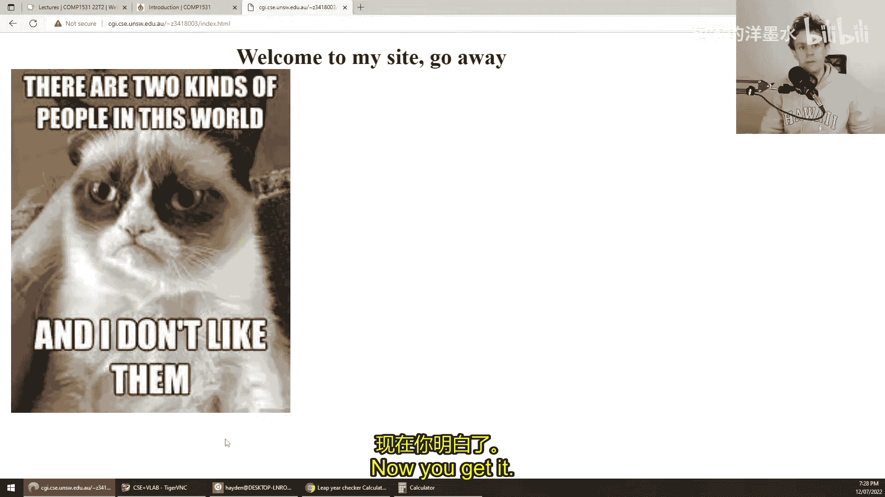

So the history of deployment， historically， deployment was a much less frequent and much more。

Physical activity。When you go back to early 200s or times before that。

 code would typically be worked on for days at a time without being tested and deployed。

 sometimes years apart， long time apart。 And this was mostly due to things being put out on Cs。

 I think I've mentioned this before previously。 If you imagine video games out there。

 They used to be like coded once。 I think we mentioned this when we were doing testing and iterative stuff。

 you would， you would write code， you would ship it， And then the game was done。

 And if there were bugs in the game， the game had bugs in it for 20 years right。

 And speed runners and stuff know about all this stuff。 So that was like old school days。

 You write software for a long time， you'd make it available once in a big batch。

 somethinging changed。 and there have been two major changes over the last 10 or 15 years。

 which are really important。 The first one is that more and more stuff started getting built on the Internet。

You've known that for a long time。 no matter how young you are， most of you are only。

9ine years younger than me so。You probably remember， you know。

 there's been a lot more stuff being done on the Internet since you were very， very young。

Most of what you do now is on， on websites。 Again， we've talked about this before， too。

 instead of having your Netflix app， you just go to Netflix dot com。 So， you know。

 a massive boom in the Internet， in the web。 And then also。

 there's been a massive improvement to Internet connectivity， speed and bandwidth。Basically。

 there's so much internet data to go around now。What all of these things have done is they've really just propped up an industry where。

It's allowed us to now go and push software very frequently to people all the time。

 And this isn't just websites。 This is also i， Android updates。You think about Windows X P。

Windows Vista， even Windows 7。You were still updating things like once a year。

 I like at a major level， whereas you think about Android and ios， they're doing updates frequently。

 You're getting a system update， you know， every a few weeks or something like that and。This。

 this was quite interesting because again， instead of software being made available infrequently to people。

 the boom of the Internet and essentially high bandwidth on the internet was that you could start making software available far more frequently。

 So making software available for use is something that happens all the time daily。

 sometimes in fact。

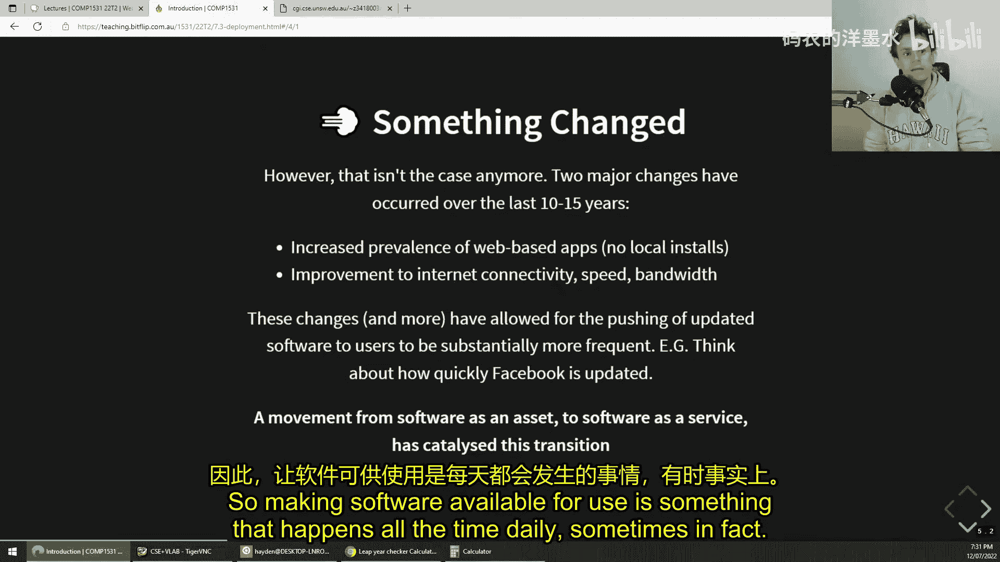

And I believe we talked about this。

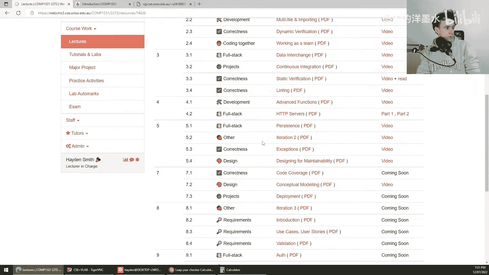

Somewhere， I don't quite remember， but we did talk about it somewhere。

This is also set off a boom of what we call software as a service where essentially now this is just a bit of side knowledge and other relevant things instead of software being something that you kind of write and then sell as a hard drive you see more and more subscription style stuff these days and a big part of that's because you know again software used to be written mass produce sold and you move on whereas nowadays because you kind of write software for people to use temporarily and you're constantly improving and constantly updating and constantly making your work available for use again。

Software is being seen more as a service。 you've probably got more software subscriptions than you've ever had before。

 and most things you do now， you're probably not paying for software。

 you're probably renting software basically and that's that's quite interesting and that's just something to kind of be cognizant of And it's all tied together as part of the same story。

 which is the way that software is being made available for users very different nowadays。Nowadays。

 because you aren't getting things sent to you on C Ds and everything else。

 you will typically be accessing software through these websites。 again， is a really common place。

 And most of these websites are hosted on what we call cloud providers。

 which are really just companies that have a lot of servers on the Internet such as， you know。

 you got AWS， Google App Engine， Barroku。Aia， with Microsoft。And。What。

 what it means nowadays to make software available for use is quite literally to write software and to push it to be available on the Internet。

By having it live on some of these services。CSC。I you could kind of put the cE public HL folder on this list。

 but you couldn't，'cause it's。It's like a grain of sand compared to the sun kind of you scale of difference here。

 So again， recap， you write software。 you push it somewhere on the internet。

 typically a massive provider which you make it available for use。

 Now many of you have already gotten a taste of this because you' probably done your lab 5 at this point and your lab 5 was to deploy something on a cloud provider called always data。

 And we use that it's a pretty average server if you didn't figure that out。

 but it's one of the few cloud providers that gives you a simple direct access server without the need to enter a credit card。

 which is actually really hard to find。 So they're like you know little free product and there are probably there are probably more seamless ways to do it。

 but they require people to enter credit cards and cancel trials。

 which know is just not a wise thing to do with 600 to 700 students so。Cloud services。

 big part of making software available for use。Now， that's just like the history。 And you can， again。

 you can kind of get this pretty clearly。 There's products out there。 You send software to it。

 They're made available。 But let's talk a little bit more about the mechanics of。

Not where it's available， but how we make it available。 And to understand this。

 we kind of need to take a recap step back to continuous integration。

 And we know continuous integration。 we think of the Gitlab C I file we think about it's the process of automating the integration of code changes from multiple contributors into a single software project。

Where you write code， you merge it in， that code is testeder。 that code is lted。

 and then you get the green tick。 What I really interested now is expanding that idea So that it's not just like the code you write in the tests and stuff。

 And then the C I pipeline。 But imagine every single time you get a green tick on master instead of that green tick just staring there。

 smiling at you， doing nothing。 That green tick says， I'm good。 I'm now gonna go take this code。

 And I'm going to go and put it up on the Internet and make that available for use。

 And we'll do a little example of this。😊，probably do a bit of an example of this。

 hopefully if we have time。 So to achieve these rapid development cycles that come from modern deployment that come from this。

 this massive desire to make software available for use frequently。

 modern deployment is not just as simple as pushing code like I did on Vlab to the CSE account。😊。

We instead have a heavily integrated and automated approach to this。

 And this process is what we call continuous delivery。 Contin delivery is the automation。

Of making software available for use。Okay so you have your continuous integration。

 which is the automation of integrating code changes。

 and then if code changes are integrated successfully。

 continuous delivery is where we look at how we can automate the getting of that from our computer Gitlab onto typically the internet。

 but typically a website but more broadly just push it out on the Internet。

 no matter depending on where you're sending it。So continuous delivery， we've just talked about this。

What I kind of glossed over though， is that the continuous delivery。

 while the actual process of making the software making the software available for use is automated。

 what isn't automated is typically the decision to make it available for you。

 So there is still typically a big red button that someone has to hit or， you know。

 smash that button to start the process automating it out like a big approval button kind of thing。

 You know， think of it like making a payment at a bank。You， you know， you， you click pay。

 but the bank goes and does all this crazy automated stuff for you。

 but you still have to click that button。 There's nothing particularly automated about that。

Many companies will structure this in terms of what they call shipping code。 So， you know。

 deploying code， shipping code two common words used。 and they'll typically have a cadence for this。

 Sometimes they'll have a weekly cadence， but more likely these days， it'll be a daily cadence。

 And you see this for most companies I see these days are doing this daily。

 And what that means is that every single day， they are taking the current code on master once a day。

 if the code is green。 if the tick is green。 they will go and。You know。

 hit that button and make that code available on the Internet， or they'll update it。 You know。

 So if you find a bug， a small bug in some。Website out there or some kind of product， you know。

 and a company finds out about it。 It might take them， you know， just that day， they'll make the fix。

 they'll get the code into Ma and it will come and be pushed out to you that evening。

 And to the point about that big button to ship code。

 whether it's daily or weekly or hourly or something， there is still typically a sign off process。

 human intervention to deploy that code when it comes to continuous delivery。Now。

This is a pretty easy concept to grasp。 deploymentment is automated。

 continuous delivery is that automation， big button to make it happen。

 What is a bit more interesting is to talk about release methods。Now。For tiny companies such as the。

 you know， Hayden CSC account， marque scrolling text or a meme。

 you don't really have much complexity in the rollout of your software to make it available its。

It's written。 and then it's updated。 That was it。 You know， there there was no real gray area there。

 There was no kind of in between steps or anything like that。 However。

 once you start to get to a bigger scale of software。

 you then start to deal with interim stages of release。You know， so。A good example of that。 Now。

 this is a very， this is， okay， so we started with the CSE thing， which is very dumb and easy。

A slightly more medium thing， Some of you might see it like， you know， a scale up company or。

 you know， companies with like 10 to 1 thousand people is they'll kind of have certain tiers of the software that gets slowly made available before it reaches what we call pro production Product typically being the real site。

So if you're working at a company and let's say you're working out Bi pocket。

 not that's not a company， but let's pretend it's a company。 I don'n know， Github。 Okay。

 you're working at Github and you。I don't wanna confuse that with Git。

Let's just say you're working in Netflix。 So if you're working in Netflix， you write some code。

 you push it into master。 Typically， once your code gets to master。

 it's not going to immediately go into production。 It will often go into like。

 kind of think of it like a hidden copy of the website， you know， like Netflix。Netflix beta dot com。

 and。Instead of code going straight from master to Netflix do com。

 it' will kind of go straight from master to Netflix beta and then some real humans or some quality assurance testers will go and make sure that's working okay。

 And then if they're happy， they'll hit the big red button that'll move it from there to actual Netflix do com you know so there's a kind of interim stage。

 And this is a very common thing when you're working with software because。

And you've probably learned this， too。 Sometimes your pipelines can pass。

 but the thing still breaks because at the end of the day。

 it doesn't matter how it doesn't matter what tests you pass。

 All that matters is like for a real person using your real software in production， is' it working。

So you can have every single tick and check you one in the world。 But if a real。

 if it's broken in reality， then you know， you can't send it out。 So， you know。

 you might have three tiers。 You might have two tiers。 You might have four tiers。

The two environments I've worked in somewhat recently have been you know。

 having two tiers where you have like a like a beta， a dev or test site。

 which is every single time someone pushes to master， this site gets updated。

 So essentially you have a kind of like Netflix beta do com， which is always the current master。

And then every day someone pushes a button， sends it out to Netflix co。

 Sometimes you'll have an intermediate area where like maybe every day it'll get sent to this like Netflix staging like Netflix nearly ready do co website And that's where people actually check it。

 So you have your kind of Netflix beta or it's coming out all the time。

 you've got your Netflix nearlyread do co， which is where it's a bit slower。

 maybe once a day and some real humans are checking it。

 And then once those real humans are happy it goes to Netflix co every few days or something like that。

 There's no right or wrong， it's all just depends on what particular organizations are trying to do One use case that I've been talking about for years。

 and I only bring this up because I got to learn a bit about it when I was inter turning at Microsoft。

 And I thought it was particularly interesting And there'd be there'd be so many more interesting things these days that I'm not familiar with。

 but was just how it's very indicative of how like a tech company actually like a big tech company actually does stuff like this。

 where。

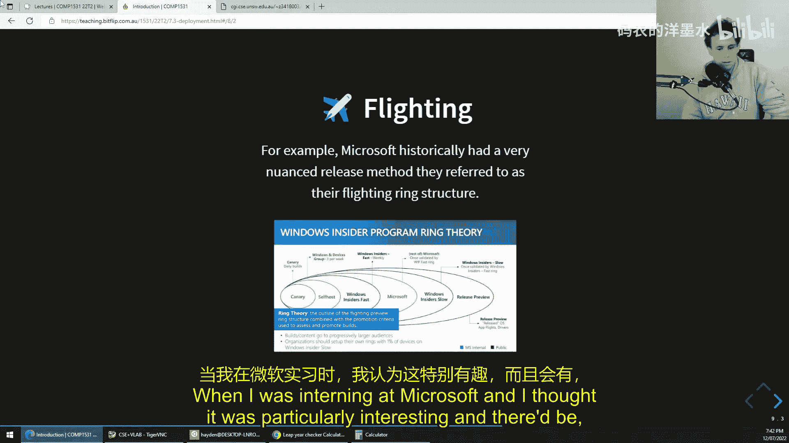

What you'll do is like， let's say you have your code like your project back in or again。

 your Netflix， stick with the Netflix thing。You will have your Git repo or some other repo。

 you'll have your your Netflix repo。 And every time you push to master。

 what happens is that that code immediately goes out to you know， a certain layer of people。Right。

 which。Might be， say at Netflix。 this， you know， it's a bit， this is from Windows。

 And if you think about Windows or OS S X， they get updated a little less frequently than every day。

So maybe we'll stick with the Windows analogy here。 It's like let's say you're working on Windows。

 you push to the Git reppo It's at master and then that day every single day。

 everyone in your team at Microsoft who's working on Windows。

 this is some speculation I'm just trying to convey a point。

 you will have the latest version of Windows。 you'll have the literal master built version of Windows。

嗯。Then， you know， that'll happen every day， but then maybe like every few days。

 once there's like a fairly stable looking version of what your team sees。

You'll go out to more people within Microsoft， for instance。You know。

 and then once that's kind of good once a week when that software is looking okay， because， you know。

 imagine this every time you push a master， let's imagine that two out of three times you push。

It's kind of crap。 You see a problem。 And you're like， we shouldn't release that any further out。

 any further layers。 And then you say this one's good。 So you release it out a layer。

 And then as it goes to more people because more people are using it， more people are testing it。

 than someone else says as another bug。 And you say damn。 This self host layer found a bug。

 We should fix it。 And then， you know， you push that out to self again。

 And eventually self host a like， this seems good。 So then it comes out to another layer like that。

 You know， and this one is interesting because it shows you like the difference between people within。

The company and also like early testers， like a lot of， a lot of products out there such as。

 you know， Windows， you can actually subscribe to get the earlier versions of software so you can actually get like the new updates for Windows。

 but it's also very unstable。嗯。Which means it might break a bunch of times。

 which is particularly problematic。 And you can see here that you know a company like Microsoft。

 and this is a very old diagram Again， it's years old。

 most companies will require that all their employees。

 So there's a good chance that if you work at a company like Microsoft with a product like Windows and you're using Windows everyone out that company will have the latest version of Windows before it's released to like the beta testers。

 the real people out there who want early access because it's just a way of essentially mitigating risk。

 it's kind of I often like to think about it， it's like a way of cheating testing because in a perfect world where you can write perfect tests and perfect code once your code is in master。

 it all just works。 but that's not how reality is right， we can't predict everything。

 So it's kind of like a way of like guinea pig testing in a sustainable way which balances people getting things quickly。

 but also not so quickly that it's totally broken because if you just shipped it out to everyone immediately。

 everyone will be really sad， but if you。Until it's perfect。

 people are gonna take forever and you're not gonna be able to utilise all those useful pieces of feedback you get。

 so。This kind of structure， having layers to things。Makes sense。 I mean。

 I was talking to one of your tutors this week who were telling me that they work at。

 I'm just gonna pick a random company for fun。 but like they work at Google and they were like they couldn't send emails for a lot of the week because Gmail was broken this is not true。

 But this is making making it up making up the names。 but Gmail was broken。

 And that's because while you and I every day use Gmail and it works perfectly fine。

 if if you're at a company like Google using a product like Gmail。

 you as an employee will probably be using like a new version of that so that you as an employee can get frustrated and pick up on problems and report them to the team and not the general public who are paying consumers or in case at Google。

 not really paying with money， but you get the point。 So that's just quite interesting there now。

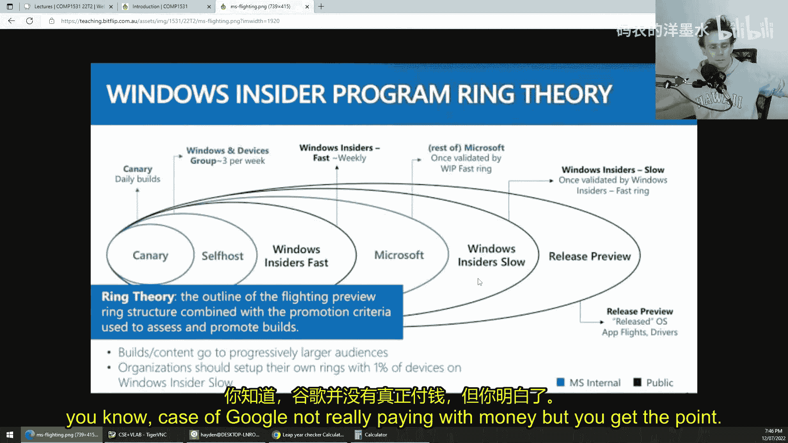

Continuous deployment， we've been talking a lot about continuous delivery。

 but continuous deployment is essentially just the same thing as continuous delivery。

 except that decision to go into production is not automated。 Sorry it's automated。 It's not manual。

 So instead of there being a big red button， you have to press to go into production。

 you don't have to press anything it just kind of happens automatically。

 So essentially if every evening at midnight， if your master branch has a green tick。

 then your code will automatically deploy。It'll deploy， you know， onto the Internet。This time。

 we've decided to use a free service， always data。There were instructions about how to set this up Feration 3。

 We shared those for the lab。 I'm really impressed with how well everyone did。

 I think this has been the most。In my opinion， probably the most impressive term of students we've seen who've。

Tried to do this。You know， followed the instructions are gotten done。

 I'm sure a number of you would have found some challenges in the deployment。 You would have。

 you know， there would have been a few things that made you wanna pull your hair out。

It's also the nature of a lot of these things。 You know， in reality。

 you don't just sit down and just like write some code and make it happen。 You know。

 and it's kind of the problem with unis。 you start off with a course like 15，1，1。

 where you write this slight little C code in a vacuum and everything feels very controllable and sustainable。

 And then the just the deep you get into the world of software。

 Everything just feels like a circus half the time。

 So hopefully you got a little bit of a taste and experience of that without it being too detrimental to you。

A few more things just before we， we got a couple more slides before we kind of maybe do a quick demo if we have a few minutes left。

Deevops has a topic。 This is kind of thrown in here because Devops is something that's become a bit more relevant。

 as we've had。A massive change in how we make software available for use。A decade ago。

You just kinda have people developing software and testing software in not a decade a few decades ago。

 they'd develop and test and then they just dump it on a CD D and send it out。

 put it out at the stores。But with the increase in the relevance of deployment because of the frequency in which software is made available for use。

 there's been this idea that。Previously you used to have developers。

 testers and then maybe some Q A people， and then people who would be responsible for actually deploying the software。

 Sometimes they'd be people in I T when I my all close friends from Unii used to work at Optiver。

 essentially just doing this。 They were a software engineer。

 but they weren't writing features or developing systems。

 they were helping make sure systems were taken from developers and put into reality， you know。

 put into production made available for use and stuff。 now。um。Historically。

 some of those roles used to be a bit more separated。 You know， you might be like。

 you might be in the deployment team or the operations team。

 and you might be like a software engineer， but。Nowadays， there's a bigger and bigger push to get。

People kind of being a bit more multi skill so that it's not just like segregated。 It's a bit like。

 you know， you think about mechatronics as a degree， right， It's like let's。

 let's stop training people to be electrical engineers and stuff。

 Let's start trying to create a few generalists and a very similar thing happens in industry where there are people who are responsible for。

There is not a single person responsible for development and not a single person responsible for deployment or operations。

 And what we mean by that is that if you look in like a typical team。

 you might have something like product managers， right or product owners in like in a sprint scrum。

 agile style。 And it's not so much that a product owner or， you know， product manager would。

Manage something and then finish it and then hand it over to the team to deploy it。

 But they would actually be part of that quality assurance process。

 They would actually be working with the people who helped make software available for use。

 and they would be checking and making sure that it was deployed correctly。

 and it's ready for deployment。 You know， this is the same for team leads。

 And you see a lot more of people who are in。You know。

 deployment systems and working with AWS who don't just kind of sit in a box。

 but they're actually quite engaged with the development and how the code works and talking to developers。

 So Devops is probably less nowadays a role and it's more a category of roles or it' it's a lens to a role。

 the way software industry changes has changed a lot。 You know， I think， you know，15 years ago again。

 used to see a lot of actual。 you'd actually be employed as a test engineer or a dev engineer。

 And you would have teams that would have test engineers and dev engineers。 But again。

 tendency to blend those things together because it's kind of like。To be a good developer。

 you need to be a good tester， et cetera。 So similar thing with Devops。

 blending things together and just being like， these are considerations we need lots of people to worry about。

One part of the software development life cycle that we did not cover in a great amount of depth was maintenance。

 If you remember back to the early size， it was requirements， design， development， testing。

 deployment and maintenance。 We don't really cover it in this course， but。

I just wanted to touch on it so that it's not completely ignored。

 Maintenance is the thing that happens after deployment after your you know after you've actually gotten your code out into Netflix。

 co， what typically happens after that is a lot of monitoring and analy。And。

The monitoring can happen in terms of trying to。What I would call preserving the user experience。

 which is where you you make sure that there aren't errors， you look at the error logs。

 you make sure there aren't warnings that the site's performing that is' fast enough so that people are getting what they expect。

But then also as part of this maintenance post deployment。

 you're trying to enhance the user experience because you're trying to use analytical tools。

To monitor users and understand their interactions。 What are people watching on Netflix。

 Where are they clicking off the videos， Are they logging in less you know and this is where you'll get into a lot of requirements stuff that we'll talk about next week And this whole topic of maintenance and monitoring is really just the glue that happens between we've release some software Let's learn a bit and monitor it and then let's go and decide what our new problems to solve are so that we can design code and develop code that's tested so we can deploy to then see how people respond so that we can figure out the new problems so that we can design code to develop code that's tested you get the point So kind of that this is where that whole iterative nature of everything we're doing here exists as。

We don't need to worry about that slide。 There's some further reading here as well。

 Before we get to this last feedback thing。

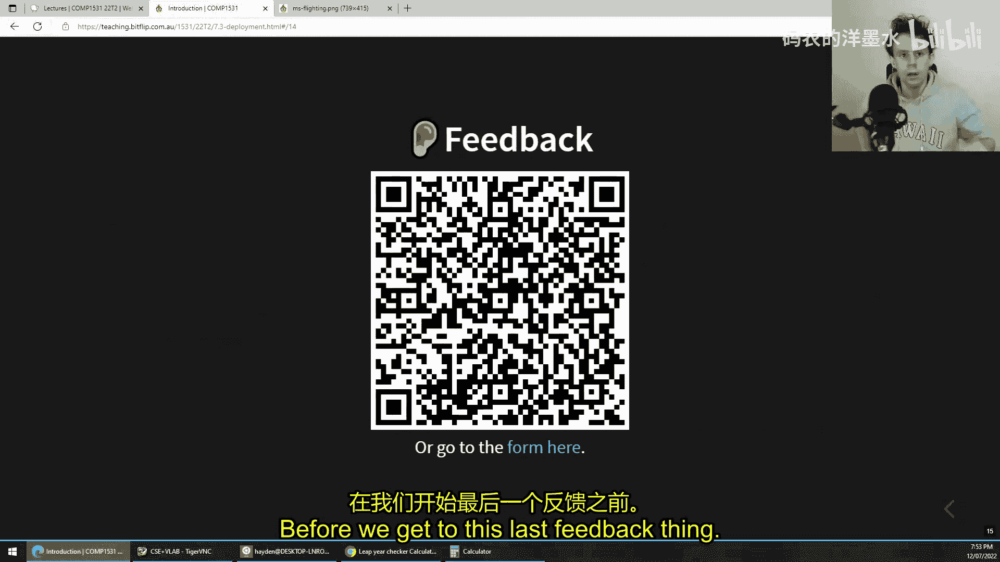

Just really wanna kind of， I guess， quickly show you something。

 which is that let's go to Gitlab and let me go dig up one of the repos that。Hight，10。

 I think that was a separate re。 Leture 1 test， lecture 2。1。 Where do we do can。

Where did we do our Gitlab C I。Lecture test。 Was it this one。No， it wasn't。 It's okay。

I don't know if it's here。No， it's not。 That's okay。 Let's go steal。 Let's go steal something from。

The project backend。So I'm going do is just really quickly show you So if I've got like project back end here and I've got a Gitlab CI file。

Ive got a bunch of stuff here。 What I can do if I'd like to is I can go and I'll go create my own。

Reaper。You know， create new repository。I'll call this week 7。You know， and I'll put it in my folder。

Yep。Great project。And。Then I will go and create a file。 You can do this just straight on Gitlab。

 right， I can literally just click on create new file。Generally。

 we don't tell you to do this in the course， because we want you to get familiar with the command line。

 but I do this all the。 I do this all the time day to day nowadays。 So we've got this file here。

 And what I'm gonna do is instead of having checks。I might actually just say deploy。

And I might really simplify this down。Where what I'll do and just to simplify it again is I'll just say echo。

 hello。Im sure this won't workca I'm inside of my。啊，发个。

This won't work becauseuse I have to make this inside of 1，5，3，1。

The way we have Gitlab set up is that the， the runner only looks for things inside of 1，5，3，1。

Which is probably where that。Thing I was looking for before is， but let's make one here。

So I'll make a new project or repository call week 7 inside of Com 153，1。 I will make a new file。

The Gitlab C I file。And all it's going to do again is it's just going to echo hello。

So when I commit that， which， you know， you shouldn't do it this way。

 you'll see that it's a very simple thing。 It runs the pipeline， except。

I think the pipelines are very slow tonight。 We're just trying to figure out what's going wrong with them。

 So this might actually not run。 So we might not be able to carry this through。

 but I can still demonstrate it for you broadly， which is that do you remember how really early on。

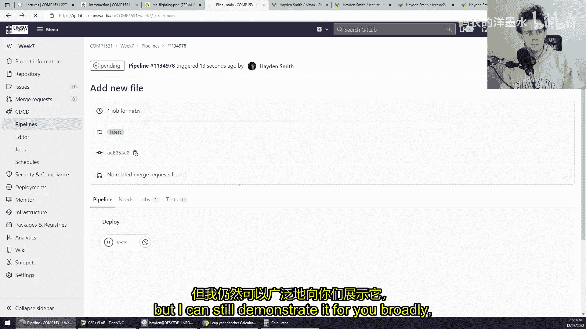

In the lecture， we did this whole copy thing。

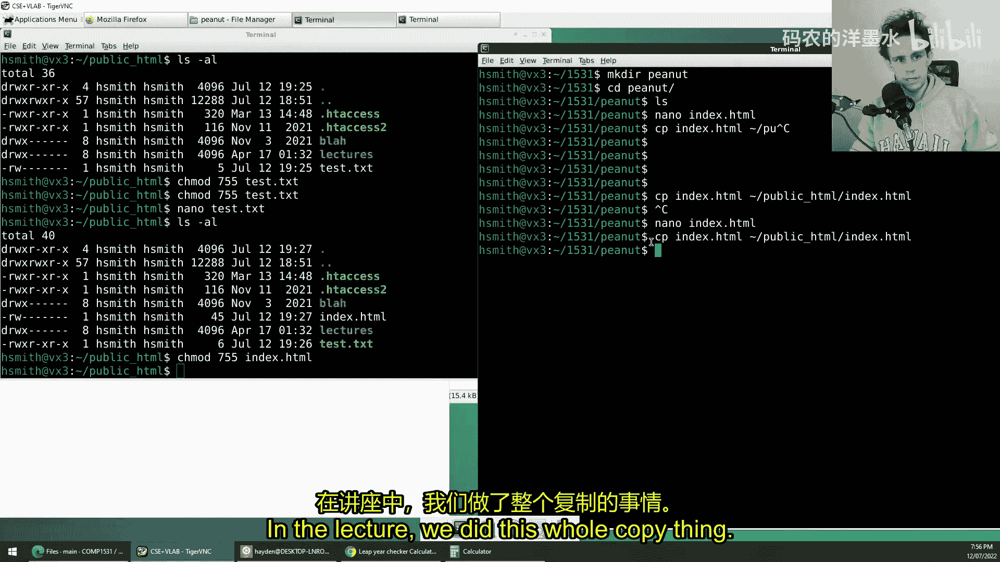

Where we copied this like， you know， index dot Hl file here。 Well。

 imagine if for a second I created a file。 I'm just trying to avoid doing this on the command line called index dot Hl。

 And that was， it's a very big file。It's a very big image。Here's my index at HTML file。

I'm going to paste that into Gitlab here。Yep， ma'am。And now my repo is pretty simple。

 It's got to read me。 It's got an index at H， which is just a web page。 and it's got a Gitlab C I。

 But what I'm gonna say。Is that did the pipeline not run， That's really weird。 still running。

 What I'm going to say is I'm going to edit this。嗯。

And I'm going to copy this command that I use to deploy。 Now， naturally。

 this isn't going to work because the C command only works when you're on the same system。

 But if I wanted to。I could replace this hallo with say deploying now。

 and then here I could add a command that's SCP into my account。Like this。And then say。

 I want you to， or I could say I want you to copy index dot HTML from this repo。

To my CE account on that file。And and we won't be able to see this tonight because of how slow the pipelines are。

 So they're not going to run in the next two minutes。

 But the point is that what I've done here is now essentially a form of continuous deployment where if you had all your other checks in here like yourlynting and your testing and your type checking。

 it would go through all those continuous integration things。 And if they all passed。

 you could have a new stage called deployment。After your check。

 so if we go back to your project again。This wasn't planned， by the way。

 If we go back to your project。And and I， let me just paste these things in。

 So at least you have the context and you're not thinking this is something like totally different。

Where， you know， you have your type check here， and then I'll create one here called in fact it should just be deploy。

 which is in stage。Checks。And the script。Would be that there。 So， you know。

 we've seen before you have your test。 you have your type check， but。Oh my God。

 thiss so much crapier。Yep， you've got your tests， you've got your type check。

 and we would add a new， say stage for deploy called deploy。

So that you could actually go and do all your checks on your code， your continuous integration。

 and then once they're all done， you could run this script where it would actually take your file and put it onto the public HTML folder or CSE。

 Now， a couple of caveats。嗯。Deploying a JavaScript or Typescript based application is a little bit more complicated than a static file。

 as you would have learned in lab5。And secondly， as you would have also learned in La 5 to deploy to most websites。

 you need some kind of token because you can't just run this command on your computer and send it to my account you'll typically need to do something with your SSH key which again is a bit beyond the scope here but you can kind of configure GitLb with all these things and you'll actually get a bit more exposure to this with iteration 3 where you deal a bit with this。

 but it's very fun。It's a very fun topic because the point of this topic is to help you make your software available。

 which is probably one of the most important parts of what you do。

 you know if you're writing code that no one ever uses what's the point of writing at half the time right so very exciting today's lecture is probably meant to be about the theory of things we cover a lot of the practical stuff more throughout the project like within the project。

 but hopefully that gives you some context of the history of deployment， why it matters。

 what continuous delivery is， what continuous deployment is。

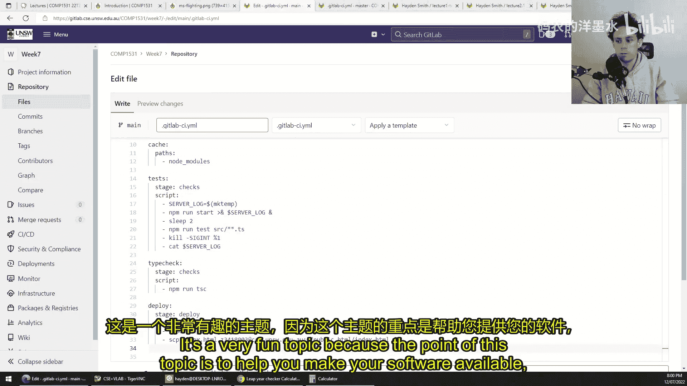

And just， just context around it all because we will， you will get some more exposure to this router。

 So please leave feedback。Just take a photo or follow the link。 and other than that。

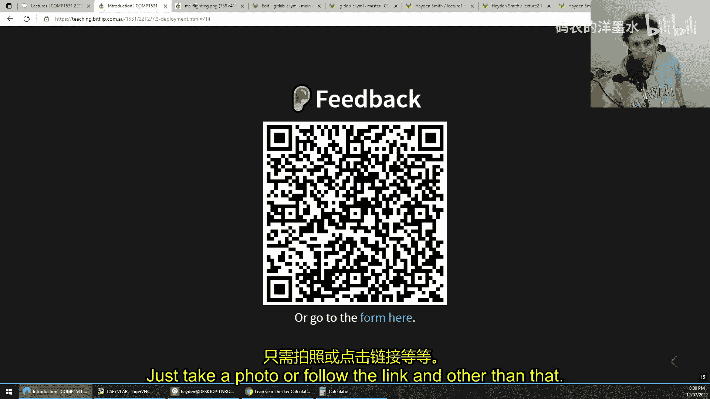

Have a great evening。