# 【全集】新南威尔士大学 软件工程基础 中英字幕 1080P COMP1531 p21 Lecture 21 - 需求介绍 -BV1M7Nwz7EGh_p21-

All right， so。😊，This lecture is the introduction to software engineering requirements。 Now。

 we talked about software engineering engineering requirements way back in week one when we talked about the software engineering life cycle。

This lecture is not gonna， you know， light your pants on fire。

 you're not gonna have a whole bunch of fun with it， but it is really important。

 And this is the lecture that that kind of got me wanting to teach 1，5，3，1。3 years ago。

 not specifically like the content of the lectureca it is an introductory course。

 so we can only have so much fun with it。 but the idea of it， the idea of this lecture I really。

 really liked， right。And。I hope I can instill a little bit of that excitement in here today。

It all stems back to a pretty straightforward idea。

 The most important part of building any system is figuring out what you need to do。

It's not writing the code， it's not nice diagrams， it's actually figuring out what you are doing。

A lot of this lecture is about requirements and that's because what we're really doing when we say we're figuring out what we need to do is we're saying we are figuring out what we are required to do to achieve the goal。

And we'll talk about a few different components of that， so。

Before we write any code generally we need to know how to test it。

 we've kind of established that already that's been part of the project since day1 Before we code anything we need to know how to design it as well。

 That's when we start talking about state diagrams and some other things next week。

 Design is not a huge part of this course we kind of shift that off to 2511 hopefully but to test and design anything which we should be doing before our coding。

 we need to know what our objective is or more specifically we need to know what the requirements of the system are that we're building what does the system require in order to be built correctly。

嗯。The IEEE definition of a requirement is a conditional capability needed by a user to solve a problem or achieve an objective。

 We might also describe requirements as essentially an agreement of work to be completed by all stakeholders。

Okay， so when a group of people come together and they say， we're gonna build a thing。

 a set of requirements and a set of kind of。Two dues that everyone agrees upon。

 And you might also therefore describe it as a description and constraint of a proposed system。

 So it's really like saying what does this system do， How is it limited in some way。You know。

 there's a quote at the bottom here。 The harder single part of building a software system is designing what to build。

 deciding what to build。 That's pretty standard。 No part of the work。

 So cripples the resulting systems。 If it's done wrong。 That's fair enough。

 You've probably seen this a bunch， right， And， and this is really common。

I always talk about the example of building a building。Always take so long to get started。

 doesn't it。Yeah， a lot of the time that'sca they're doing the planning and making sure that they they're doing the right thing。

 And it's like this and nearly everything in life。 The best engineered things are spend a lot of time trying to make sure they're solving the right problem and less time actually figuring out how to solve that problem。

 So what are some examples of requirements。Well。There are two ones that I usually go to in this lecture。

The first ones like。There's an activity I used to play with。You know， some first second years。

 years ago， Oh like。Must be six years ago now， long time。

 I SAT down about 20 students on a Monday night， funnily enough at like 7 PM on a Monday night。

 right right now， years ago， and I said to them I was like go。

 I'm breaking you up into groups of three。 It's like5，6 groups of three。

 You're gonna come back to me in half an hour or 15 minutes with a chair that you've designed or I think it was a table。

 actually， you're not a chair。 It was like， I want you to design me a chair and come back to me with a chair。

And they all kind of ran off and they all kind of designed their chairs。

They kind of came back pretty quick。None of them had actually stopped to ask anything about the table。

 I said chair again， I meant table， Anything about the table。

 They' just kind of gone and done the thing。 And this was like a big problem。

 And it's very indicative of， like。The process we all have to go through as engineers to learn。

Which is that we get so preoccupied in like the planning of the doing of the thing and the doing of the thing self that we don't stop and ask like。

 what are we doing， You know， what are we actually doing here。

 No one asked how big the table should be for a little while， No one asked how strong it should be。

 But when you actually go and look at how a real table is designed before someone actually figures out whether it's going to be made of this or that。

 There's usually a set of kind of rules that govern what you're doing。

 And those rules might be things like the table must be smaller than 2 by 2 mets。

 It must be at least 1 met off the ground。 It has to be at least so thick。

 It can only be made out of sustainable woods。 It must be able to hold 500 kg distributed on it。

 You know， those are requirements。And they're pivotal to the process。

 And a big part of you as a software engineer is not just building the thing。

 but it's actually sitting down and figuring out what those rules are that govern the game you're about to play。

 right a more cr example of requirements were feel like I've told the story like seven times now is like when we were trying to get we were trying to build a solar car and get it legal on the roads in Australia。

 which was quite quite an activity and something that we probably shouldn' have done in hindsight because it's just it's just very hard and takes up a lot of time。

 but we were trying to get this car legal to drive on the roads in Australia And to do that。

 there are a whole bunch of rules that you have to follow。 They called the Australian design rules。

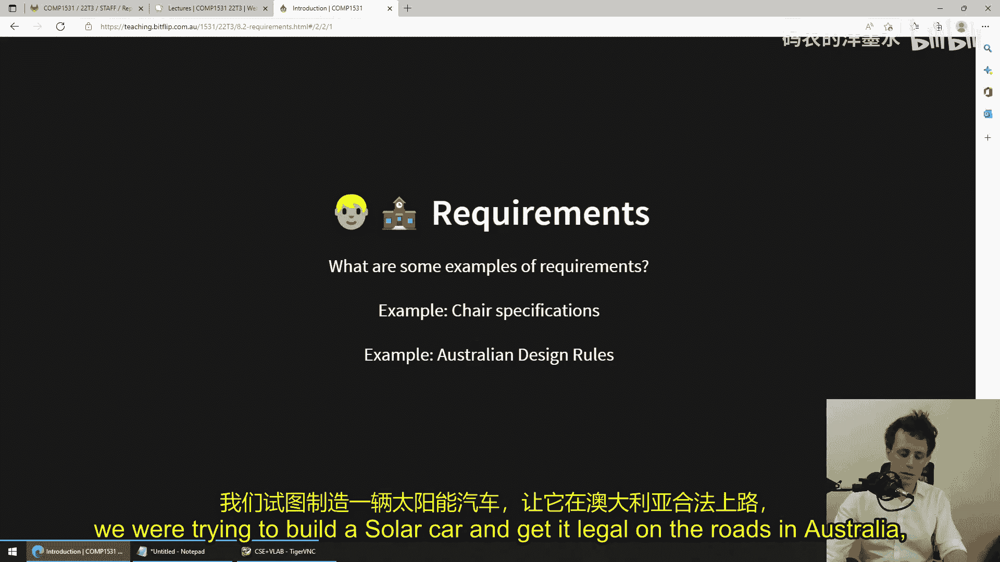

And they really are just a bunch of legislation that the government puts out where they tell you what cars have to do if they drive in Australia。

 And there are a whole bunch of these rules。I don't know if they'， Yeah。 They're all here。 So they。

 theyre to do with everything from reversing lights to side door like door hinges to seats and how seat seat belts are anchored to seat beltts themselves。

Anchorages for seatbelts。 Oh， that's sorry。 That's seat anchorages。

 How your seats are mounted to the car， indicators， your brake hydraulics， your wind screens。

 your steering column， the bar that connects your steering。 wheel right， sun viors。

 lots and lots of stuff。 rear vision mirrors， fuel systems， you know， it kind of goes on for a while。

 And the thing is， if you go and pick one here， like， say this one。

Well seats seats might be a good one。Seats and seed anchorages。

 There's actually a really boring dock that， you know。

 it's got the big Australian Government logo on it。

 where they actually go through and they tell you lots of things。 They set out requirements of what。

These things have to do。But oh， so long。I'll tell you things about the different types of standards they need to meet here are some diagrams about the width。

 the height and everything else。Lots of stuff， right。Lots， I sorry。

 I kind of skipped the lecture break， but let's just keep going。 I won't take too long on this。

 So like， lots and lots of stuff here like， oh， you know， the recording instruments used to。

 you know， it's just like a lot of lot of stuff。 This is like a very dramatic example in my mind of requirements。

 right， They are things that are， again， to use my phrase earlier。

 The rules of the game that you're playing。 They tell you what you。

 you kind of can do and and have to do。

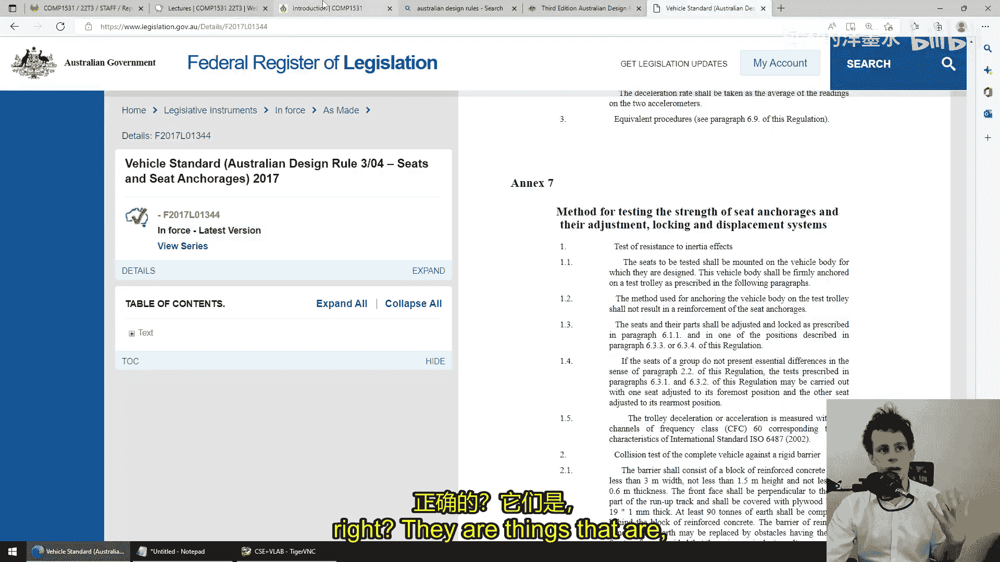

嗯。We keep this lecture pretty broad because requirements in the real world can come in all forms and sizes。

 right Sometimes it's something like what I just described。

 That's an extreme example of systems engineering， where you are being kind of told what to do by like a regulating body。

 That's some kind of crazy stuff that you know you might do it like a Tesla or Spacex where it's like highly regulated markets。

 And then on the other end you have maybe something much softer。

 which is where you actually get to work with people。 to figure out what the requirements are。

 you know。嗯。What the rules are where you actually get to be a participant in it or if you're not a participant in it。

 Like if you don't have a voice， you at least get to help extract it from other people。

 which is what we're about to go into。 So firstly， we talk a lot about requirements as these rules or these statements that describe a system。

 but there are generally two buckets of requirements in terms of topics that they fall into。

 These are called functional and nonfunctional requirements。 And our functional requirements。

 what they do is they specify a specific capability or service that a system should provide。

 It's basically what a system does。 It tells you something it can do。 It's like it's like a skill。

 think of it like a skill。 and a nonfunctional requirement places a constraint on how a system can achieve that。

 And this is typically a performance characteristic。

 So think of this as like a little bit of a limitation or sometimes that can be a bit specific。

 it's less it's not always a limitation。 Sometimes it's just a method。You know， so if I say to you。

 you know。Or someone says to me like， wow， he， you know， I want you to be able to。

 to get to Hurstville from Burwood in Sydney。 You know， that's like a functional requirement。

 It's like a thing that it does。 And then if I say， you know。

 and you need to get there by car or you need to get there in half an hour。 Suddenly。

 that's like a nonfunctional requirement because you're not telling me something that I can do。

 you're not being like， wow， what a cool skill， you're kind of shaping the way it can。

 And in a way you're constraining it， you know， because without that。

 you might be able to do more things。 that's like the seventh time I've had to explain this。

 And I feel like I'm slowly being able to articulate it better。 But if you don't understand this。

Talk to you Tutor。 Have another couple of goes at it because it is a little bit confusing。

 And I remember the first time I ever tried to get my head around functional or non function。

 What melted my brain a little bit。 So， you know， do your best。

An example of another example of functional and non functionalal。

 a functional requirement might be that the system must send a notification to all users when there's a new post or when someone comments on an existing post。

 and a non-functional requirement might be that the system must send emails no later than 30 minutes after from such an activity。

Right so you're building some kind of social messaging app。

 The functional requirement says that we want to send a notification。

 That's like a thing that it does。 And the nonfunction requirement says that it can't send it any later than 30 minutes afterwards。

 That's a constraint。It's， they kinda get a bit murkcause you might think， oh。

 that's describing what it does。 But it's like， yeah， but it's， it's con， it's tightening it up。

 You know， without that， I might have more breadth to work with。A really important topic。

When it comes to requirements。In general is requirements engineering and requirements to engineering is really just the process of how requirements come to exist。

 How how do they come into the world， right， Because they don't just appear out of nowhere。

 Sometimes they do， like with these fun Australian designer rule standards where they talk about seats all day。

 super fun。 Sometimes they just appear out of nowhere。 But generally， in particularly in software。

 you have to help。

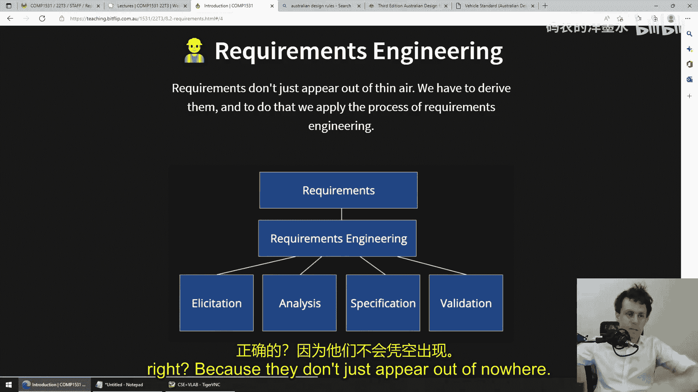

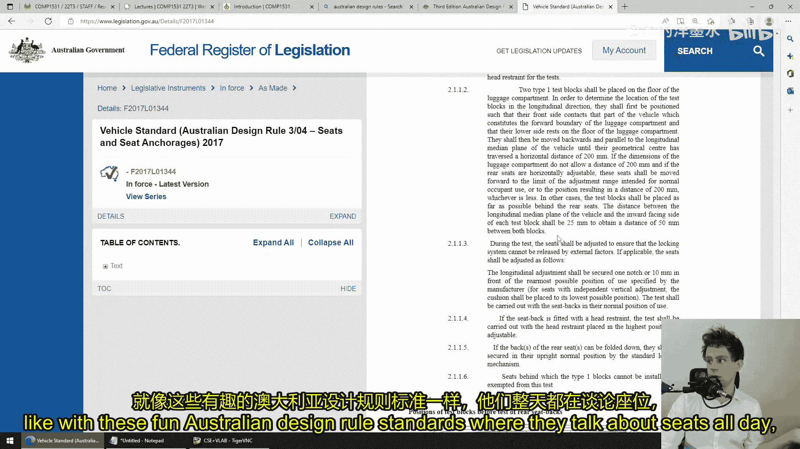

Bring them to life。 They exist in the world， but maybe they're not written down。And to do that。

 we follow this process of requirements engineering， which is really， you know。

 it's not as cut and dry as this， but we can break it up into four general steps， which is called。

 which we call elicitation， analysis， specification and validation， big， ugly words。

 But let's go through each one bit by bit。Yeah。Yeah， step 1 is elicitation。 elicitation。

 like the word elicit means to like， extract， I think。 I mean， I don't know what you'd。

 what you'd see in Google。

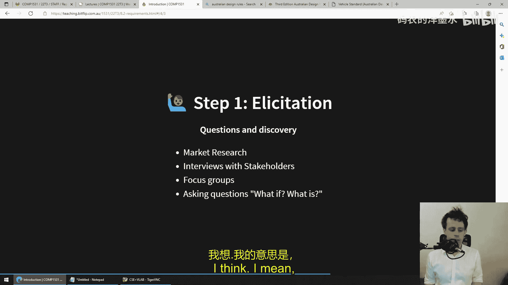

Did I spell that right， and I didn't。U。😊，To evoke or draw out from someone。 Incredible word， right。

 elicitation is really about asking questions and discovering and learning。

 It's where you extract information from people。 So， you know。

 if you're like talking to someone new that you haven't talked to before and you want to learn things about them。

 You just asking them questions， you know， like， tell me about your family， tell me how this feels。

 bh blah blah， it's all about that。 And sometimes we might talk about this as market research。 So。

 you know， if， if we're trying to learn more about a particular area or space。

 you might call this market research。 surveys and everything like that or focus groups。

 You might interview things with certain stakeholders。 You know， let's say I'm building a new。😊。

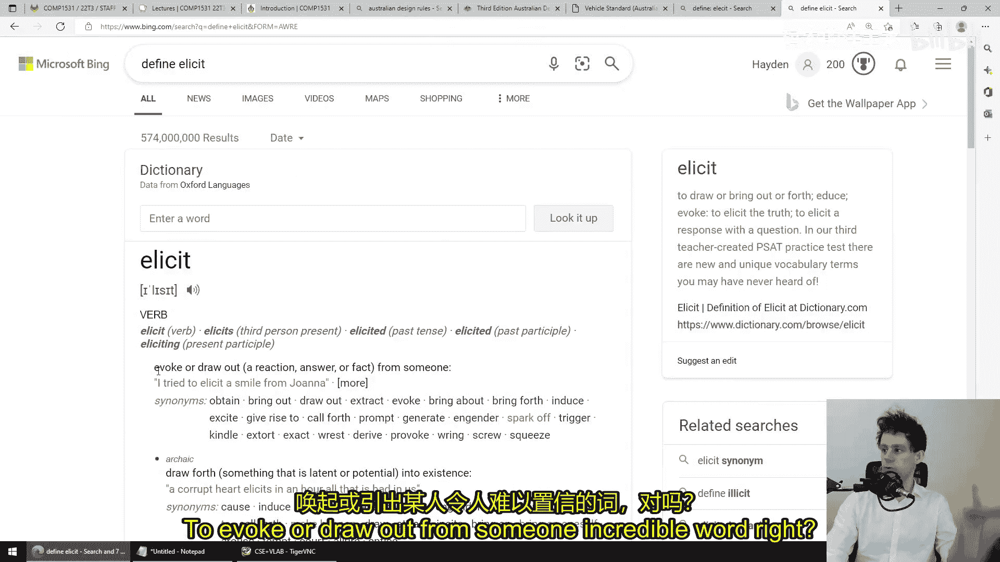

Here's a good example。 Let's say I'm building a new Web Cs。

 I'm building Web Cms 4 for CC or something。 There's lots of people who use Webcms 3。

 So I'm probably going go and talk to them。 I might have some interviews with them。

 send them to some emails， ask them to fill in some forms。

 I'll ask students and tutors and lectures and all the people that use it。

 we call those people' stakeholders， They're people that have a stake in what you do。

 basically stakeholders or someone that when you go and do a thing。

 it will affect that it will affect a group of people in some way， positively。

 negatively or maybe if you're lucky。Nuturally， they're your stakeholders。

 So we like to go to these types of people and ask them lots and lots of questions。

Step two is analysis， so after you've kind of extracted all that information。

 after you've elicited this from people， you then want to go in and try and build the picture。

I kind of like to describe this one as a bit of like a mind map。

 I like to think back to remember in high school how you had a big research project。

 maybe like a chemistry research project。 and you kind of went through all these textbooks and you would like pull out lots of information and talk to your teacher and get your class notes and you felt like you had all this raw info。

 And then the next thing was to kind of try and organize it。

 So analysis is to really organize and analyze this and to identify how things depend on each other。

 how they conflict how they you know how they might form risk， you know。

 bucket things into different areas。 So again， let's say I was building and you you know。System for。

WebC is4 or something。You know， I might highlight a whole bunch of assumptions that I'm having to make that I need to clarify。

 I might highlight a bunch of conflicts between what， you know。

 tutors want and students want some risk with the project that I've identified。 I've been like， okay。

 this is potentially something very bad that could hurt me later on and， you know。

 buckets of things that we might need to do。 And generally we go and do this either through writing。

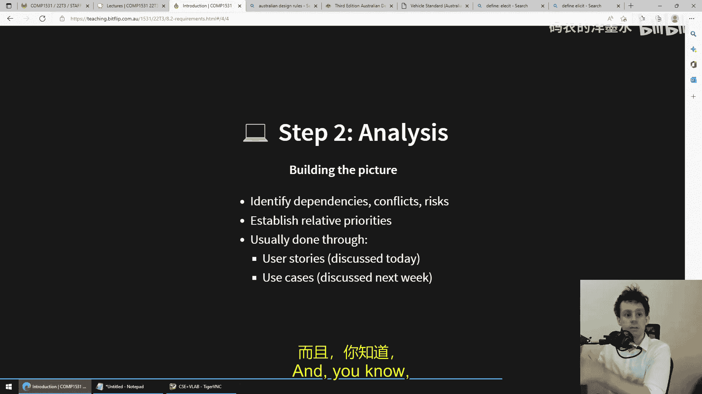

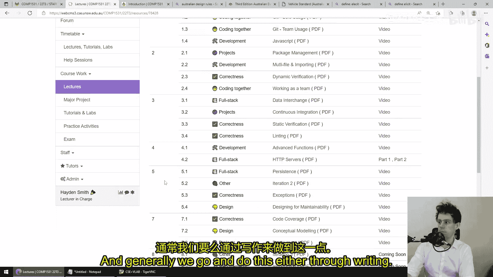

User stories which we cover in the next lecture or use cases this kind of says discussed today and discuss next week。

 but it's more just in the next lectures which we have up there。

 So analysis is all just trying to start structuring it down on paper Specation is where you might try and take all those rough kind of thoughts and workings you have and turn it back into something more formal。

 So think of it like trying to get a draft of like a finished doc that can help sumise all of all of like the requirements you're working towards。

Again， requirements aren't listed dot points， they could be anything requirementsquirements is just a way of saying information that tells you the rules that you know。

 to play the game。嗯。The specification part is about cutting away all the crap。

 It's about synthesizing， condensing， trying to granulate things， you know。

Here's an example of trying to reduce something that might have been a bit longer previously。

 This is about doors being locked。 The system shall keep the door locked at all times unless instructed。

 otherwise by an authorizedised user When the lock is disarmed。

 a countdown shall be initiated at the end of which the lock shall be automatically armed if it is still disarmed。

 So it's a little bit wordy。 And this is a very。This one's a very cold sterile example of a requirement。

 we can have fun requirements too， but the point is it's very clear。You know， it's very succinct。

 There's not a lot of babel English And it it's not that the the not that you have to use big words。

 but it's more like it should feel very intentionalcause you're trying to bring it all back together。

 And when you do kind of bring everything back together， that's when you get to the validation stage。

 which is where you kind of go and take what you've done and you bring it back。

To the original people， you were kind of。Doing stuff for And you'd be like， is this correct。

 does this sound like what we were trying to do together？ And if they go yes， then you go great。

 awesome， you know， happy to hear that。😊，Yeah。Ko。Am。

There are some challenges that exist during requirements engineering。

So if you're ever trying to establish a set of requirements from people。

There are just always problems you're going to run into。Some of these are the what you're trying to。

 the rules of the game that I mentioned， these requirements are sometimes only understood after designing and building has begun。

That just happens sometimes sometimes people don't know what they。

 what rules they want when building Web CM M S 4 until they actually use it。

Sometimes this is where you can Google rapid prototyping if you wan to kind of learn a bit more about how you can get around that of bit by trying to build a little bit as you go。

Sometimes clients or customers don't know what they want。 That's normal。

 Student don't know what they want from Webc4。 Sometimes clients or customers change their mind。

 These are all kind of part of the same themes， right。

 Sometimes developers might not understand the subject domain。

 If you get a software engineer who's trying to build Webc4 that never went to uni。

 they might not understand like even if you have a requirement that says things like， you know。

 they should be the ability to break content up into weeks。

 They might not know what that means intuitively because they don't have that what we call domain knowledge。

 domain knowledge is like knowledge of a particular area or a particular domain。

 you might have limited access to stakeholders。 You know。

 sometimes it might be really hard to get in contact with lecturers who use this stuff。

 And then for you have to make more assumptions。 And every time you make an assumption you run the risk of getting something wrong。

And then the other problem is that you might jump into details or solutions too early。 Yes。

 so this is super common as well。

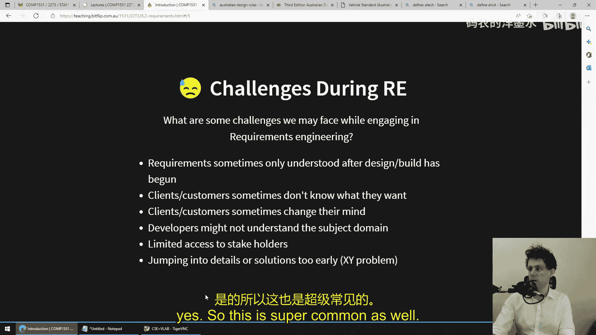

It's if you accidentally， this is like one of my favourite things。 I talk about it every time。

'cause I love it so much。😊，There's this idea called the X Y problem。

 Some of you might have heard of it。 The X， Y problem is very simply summarised as oh。Yeah， okay。

 this is pretty clear。 if you're trying to solve problem X and you think about and you think solution y would work instead of asking about X。

 you you come up to someone and you ask them about Y。嗯m。A good example of that， the example。

 my favourite example， always， if anyone's ever failed the course a few times。

 I'm sorry for repeating myself， but。I was on campus once with a friend。

 and I had my lunch in my bag。 And I said， hey。Do you， do you have a fork， And they said no。

And I was like。Okay， let's go look for a fork。 And we walked around campus for like 10 minutes during lunch。

 trying to look for a fork， and we eventually found somewhere with a fork。 But by that time。

 I like pulled out my food， And my friend， this is like a bit of a summary of the story。

 My friend was basically like， did you just need the fork for your food。 And I was like， yeah。

 and they were like， oh， I had chopsticks in my bag。 And I was like， oh， they would have worked fine。

 And it's a bit of a dumb example， But I always remember it because it's such an。

 it's such millions of them。 right， it's such an easy。Case of if I went to like。

The fork was a solution to my problem If I need something to eat my lunch with。

 And if I went to my friend and said， hey， I need something to eat my lunch with。

 they would have said， I have some chopsticks。 But instead， I went to them with why。

 which was the solution， which was I need a fork。And what this meant was we went on a rabbit hole of them trying to help me optimize and solve my problem。

 whereas in reality， I didn't need that。I actually needed。Just something to eat with， you know？

And this is true。 this happens all the time in software。 I I'd love talking about this too。

 It happens everywhere。 You pay attention how many times you do this every day。

 both in your work and in your personal life where you'll come to someone and you'll say something like。

 hey， you know， what what time are you leaving work or time you gonna get home。

 When can you call And you know， you'll start trying to optimize something that the original problem is。

 maybe you never needed to even call。You know。Happens a lot with code。

 happens a lot with junior developers。 They'll kind of come to you and be like， hey。

 I can't figure out how to install this particular library。And then you'll。

 spend a lot of time working with them on the library。 And then eventually。

 just throughout the conversation， someone will be you'll be like， what are you trying to do。

 and they'll be like， oh。嗯。I'm trying to do this and you'll be like， oh。

 you don't need that library at all。You can do that with a much simpler library over here。

 and then everyone's like， oh damn it， you know， that's a really common thing so。

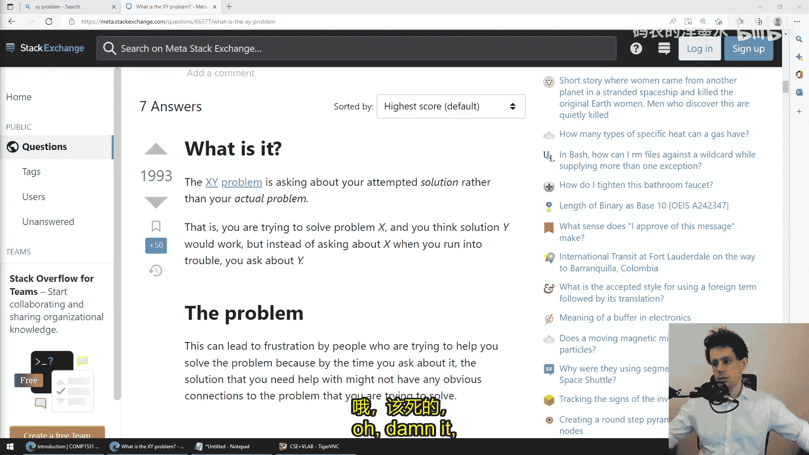

That XY problem is a serious thing。 be careful of that。

Do people have any questions about requirements or requirements engineering in general。

 it is an interesting topic and I'm happy to spend another five minutes on it or so before we kind of keep moving on。

I'm actually probably just going to keep going with the lecture if that's all right。

 we're actually making good time so。Probably because no one's asking questions。嗯。

But if we keep going， we might actually get all of Wednesday stuff done， too。

Can we please have more story time。Maybe we'll have a little fun lecture on Wednesday。F like。

Maybe we'll just do story time on Wednesday。Anyway， doesn't matter。Requirements。

Let me find something really quick from work。See if I have it。Recently， there was a。I mean。

 I'm just trying to look for this thing just as a quick example。Yeah， so here you go。

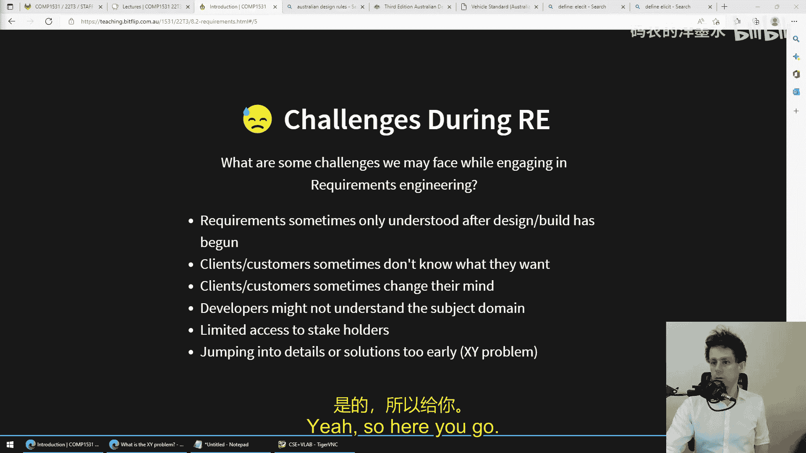

This is something that I wrote for work when。F months ago。

 where we were kind of redesigning the dashboard on on our website at work。 And again。

 I'm not trying to write code。 I'm not even trying to draw diagrams。

 But what I did was I wrote out this。And I wrote out the objectives of the dash。 I kind of write it。

 wrote out the rules again， which is that hey， on the dashboard in terms of goals。

 I want to be able to see my current goal and my progress towards the goal so that I'm reminded and motivated about my progress。

 I want to be able to edit that goal and add a new goal in case my goals change。

 That's what I gave that a designer， you know， So I want to go and design an actual user graphical interface。

 right， But the point is these are requirements because what I'm doing is I'm I'm specifying the capabilities of the system and the constraints of the system。

 And we're setting the rules。 So。Requirements are anything that tells you the， the， you know。

What something should do and how it should do it not too， not too much detail， but yeah。

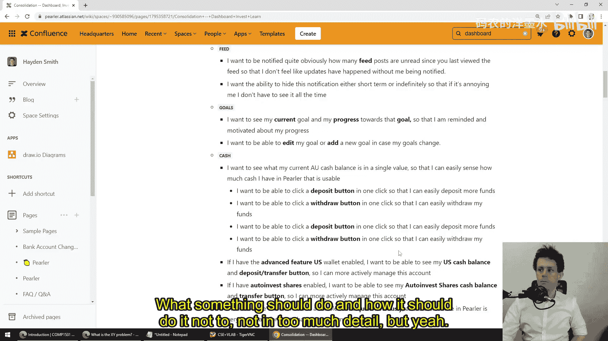

We could talk about this for hours， but let's， we can always come back to this。 So let's move on。

 If you could please leave some feedback。 That would be greatly appreciated。😊。

Always love feedback from all of you。Makes me super happy。So， thank you。

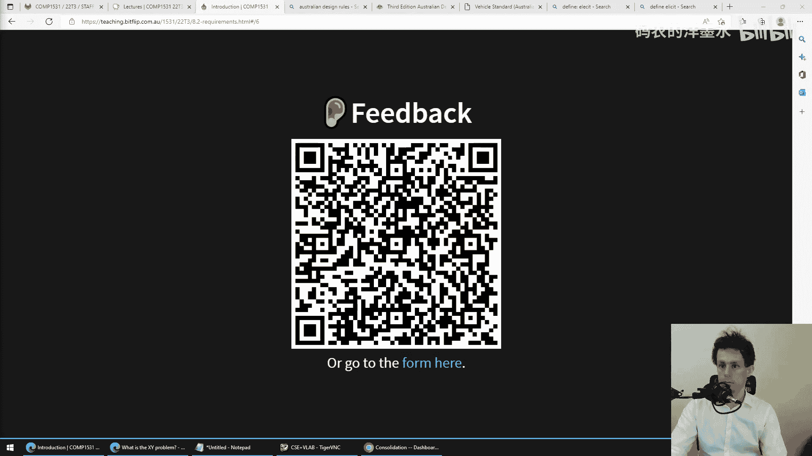

Cool。