# 【全集】新南威尔士大学 软件工程基础 中英字幕 1080P COMP1531 p22 Lecture 22 - 用例、用户故事 -BV1M7Nwz7EGh_p22-

So we kind of talked a lot about requirements at a really high level but。😊。

One thing that we didn't cover much on， which kind of falls into that specification or even an analysis specification part of requirements engineering is how to represent。

A system or how to represent a requirement a little bit。

 And this is why we're gonna delve into both use cases and user stories。 And they。

 they're two very different things， firstly。What motivates this is the fact that while it's all cool that in the last lecture I showed you these like fancy smanancy legalistic documents that specify all these rules that make you want to fall asleep。

 right， in reality， requirements are often very human。 You know。

 if you're kind of building something， not because you have to follow a law。

 but because you're trying to build the right thing for people people are human and you want to be able to capture that。

 And you want to be able to express the complexity of people as well。

 So we're going to look at user stories as a topic and use cases as a topic as well。

 So the first one is user stories。 These things are massive in the the kind of。😊。

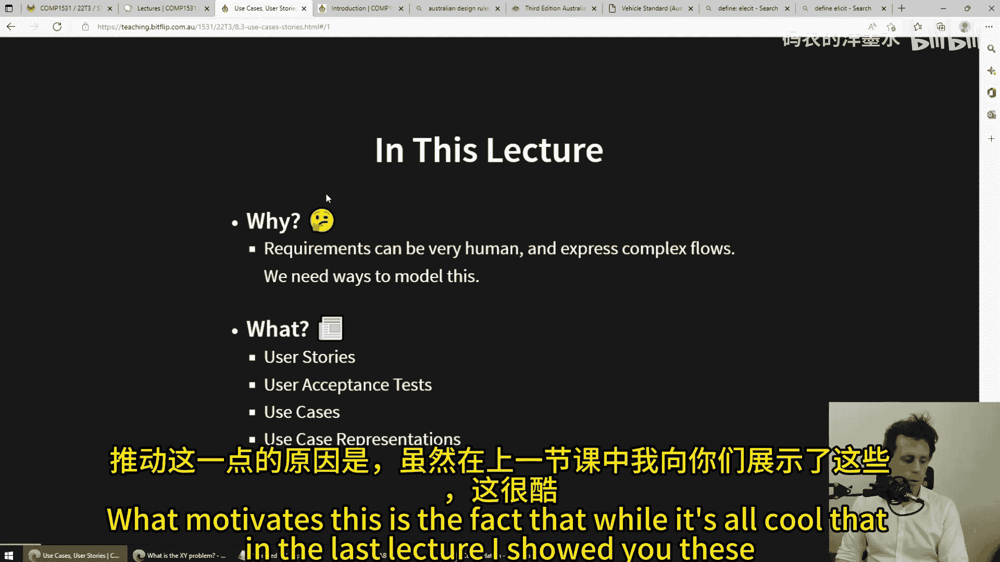

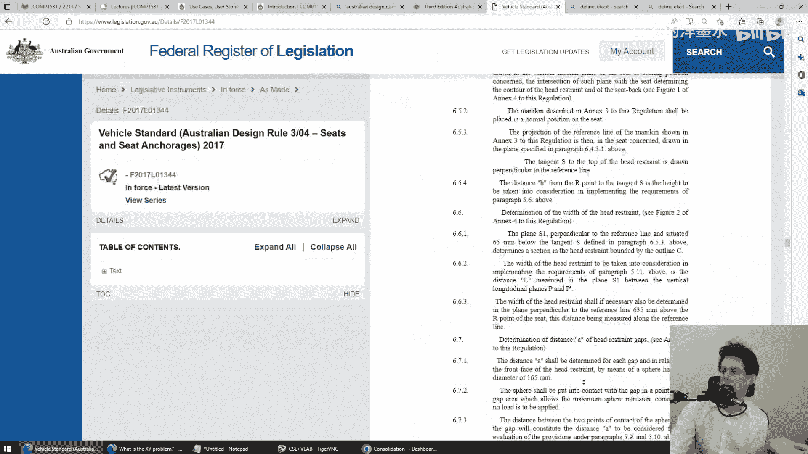

The world of agile， agile kind of appeared out of the ground。

We talked about agile way back earlier in the course。 I think back in week  two， maybe three。

 can't remember， I think it might have been week three。

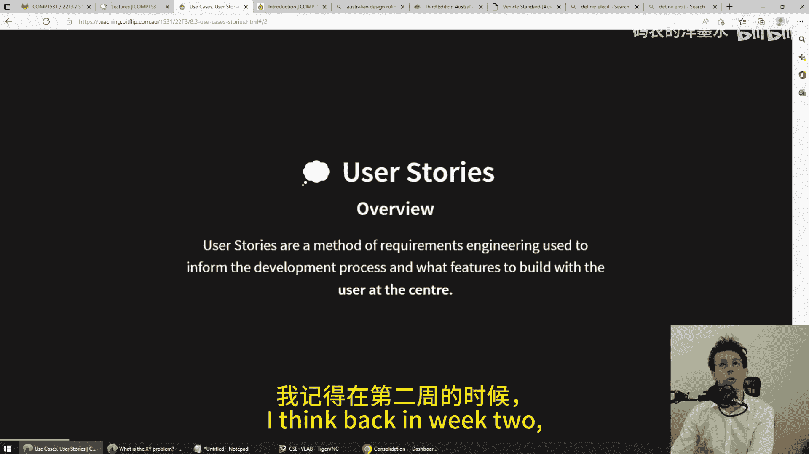

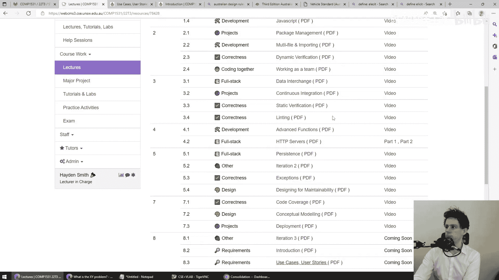

Now， a week too， thought so。User stories， funny term。

 it's simply a method of requirements engineering used to inform the development process and what features to build with the user at the centre。

 It's literally just a way of writing requirements that puts the user at the centre of that process。

And all it is is you just trying to write a requirement with a particular structure。

And that structure is。As simple as when a customer tells you what you want。

 you try and represent that in some form by saying， as a insert type of user。

 I want to insert something you're trying to achieve。So that insert。

 give the background of why you're trying to achieve it。 So if。

 if a student comes up to you and says。Hey， I like。

 I really like to be able to purchase monthly parking pissed tickets online。

 Maybe that's something that happens from the elicitation process of requirements。

 You might write a user story that is， as a student。

 I want to purchase a parking pass so that I can drive to school。Right。

 and this is really important because you want to tell someone who the person is that you're trying to satisfy。

 You want to tell them what they're trying to do。And then you want to tell them why they're trying to do it。

 And that why is really important and critical because these user stories are like given to developers。

 just like you've seen how I have this here。 And it's important if you just say something to someone like I want to see my current progress towards my goal and you don't emphasize that more human element that it's about being reminded and motivated。

 some of the power of that requirement might be lost in translation。

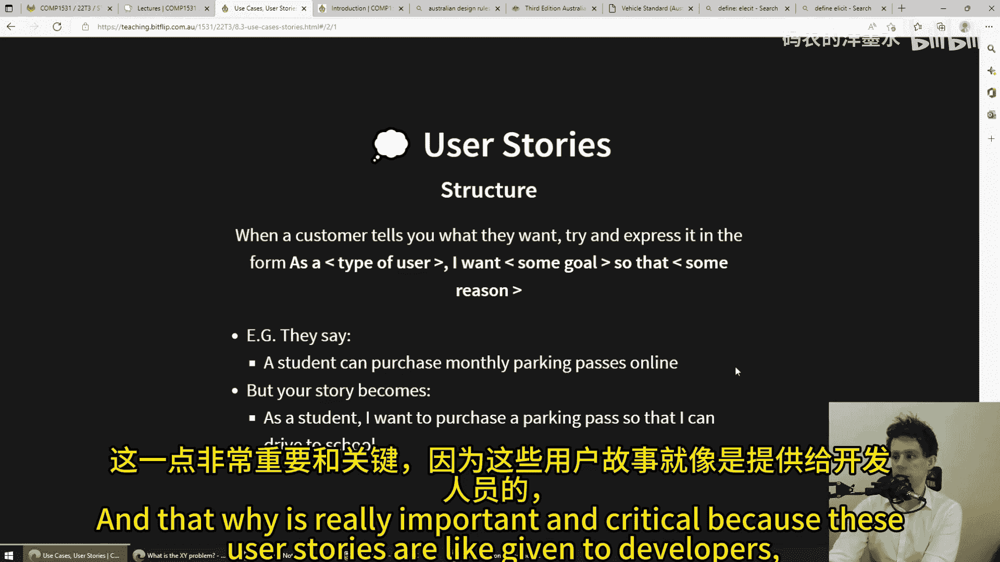

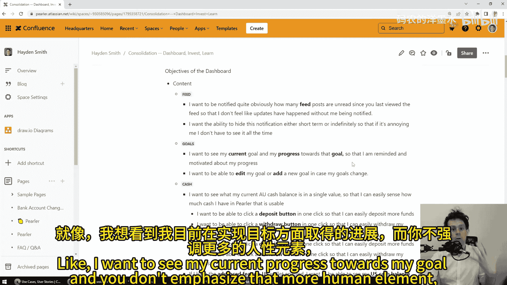

This is also a really great time to be conscious of the X Y problem。

 because when someone says to you， I want to purchase monthly parking passes online。

 It's always a good idea to stop them and be like， but。😊，Why。You know， and。

 and sometimes it appears like this where they say， I just wantan to drive to school and you go。

 okay， well， that's fair enough。 Sometimes it might be worth， you know。Digging deeper and saying。

 why do you want to drive to school And they say public transport is too slow， You know。

 so there's no like right level of granularity for a user story， right。

 there's no way to be like that's too detailed。 That's not detailed enough。

 But there's it's just always worth exploring to try and get the right answer。

 generally good user stories are non-technical。 They don't look like this scary thing here。

 they're focused on the customer and the customer's experience。 They're user focused。

 not product feature focused。 So as much as possible。

 You try not to write them as if you want to have a particular feature in a product。

 That's where things can get really tricky。 I've kind of， you know。

 this one's a very hard line to flirt with because。

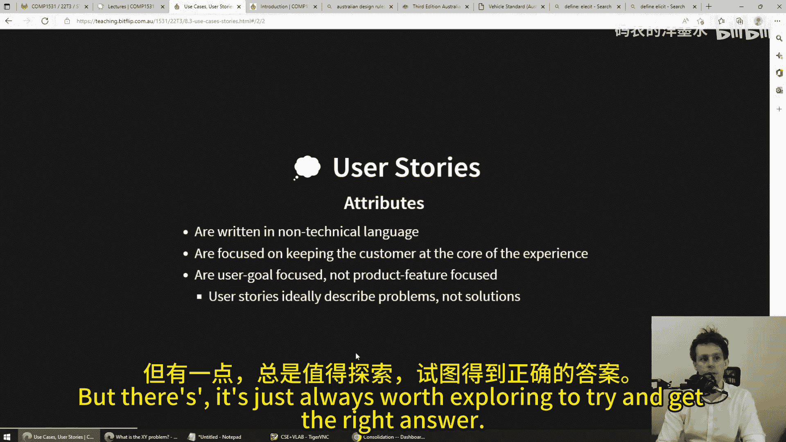

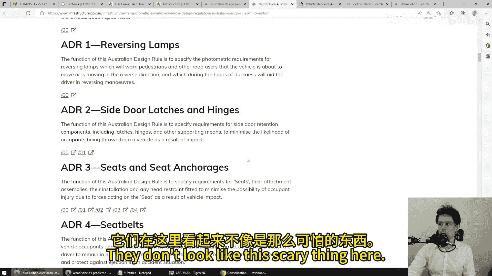

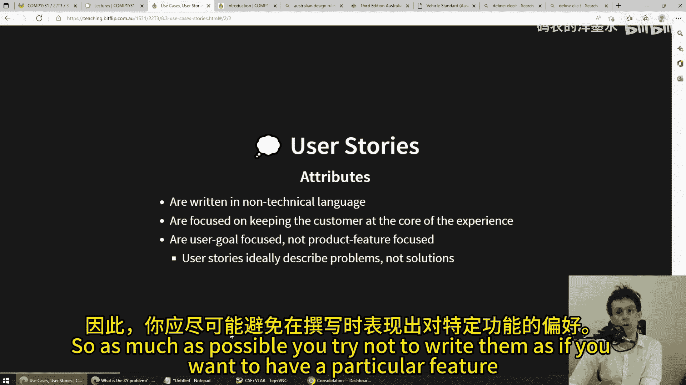

Often what people want is the feature。 They often want a thing to do a thing。

 So sometimes your user stories will always end up being a little bit featurey。

 You just need to limit that as much as possible。 So always challenge yourself to make it more about a problem like I want to be able to。

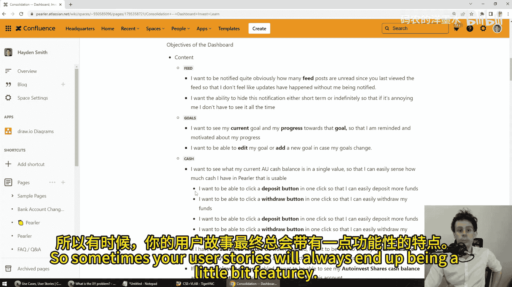

Feel motivated towards a goal rather than be like， I want to have a pie chart that tells me my progress visually。

 You know， like that's the difference between something that's maybe a bit higher level and something that's a bit more specific。

 And therefore， user stories should generally describe problems and not solutions。um。Yeah。

 so and the other properties of user stories， we want them to be independent as in you can kind of work on。

 you know you can kind of solve one， but not the other。

 They shouldn't be like too interdependent where to solve one。 you have to solve the other。

 They should be negotiable as in they shouldn't have too much detail。

 If your user stories have too much detail。 then what starts to happen is that you limit developers and designer's ability to kind of be creative。

 right If your user story is too specific Like it's like you need a pie chart with progress。

 then suddenly the person who's implementing that later on in the life cycle。

 They have to do what you've told them。 whereas if you be a bit more vague。

 that you just want to show progress， you give more like creative control to people later on。

 they should be valuable， obviously， they should hold some value to the kind of client or customer they should be estimable This says will get to it in a later lecture we've cut that out So to save you one more thing to talk about。

 But basically， it's like it should be clear how hard it is。 shouldn't be super vague。

So vague that someone's just like。I have no idea This could be really big。

 This could be really small。 You do want it to be smallish。Basically。

 you want to be able to break things up ideally into smaller pieces， and it should be testable。

 Every users story should have a way to actually test it。For someone to sit down and be like， did we。

 did we meet this user story so that， you know， can I。

 can I prove that someone can now do this thing that they could not otherwise do before。Right。

 all of these things are important。There's some reading from us some of Lassian articles。 But like。

 for instance， let's， if we take a quick pause and we say， let's try and write out。

 let's try and write out some user stories for like a two do list， right。Well， that should be。

 That could be fun in the chat。 Someone tell me， what would you， if you were trying to。

Let's imagine I'm trying to elicit some requirements from you。

 Tell me what you want out of a two do list app。 I'm asking you， like。

 tell me the things you want to do， and I'll start trying to write them down as user stories as we go。

So just send it in the chat and we'll write it up quickly。Don't make me pause the video。

 You take long time。Priority， okay， so someone says priority， Matthewu says priority。

 So maybe I'll say as a student， let's say or you know， as a young person， whatever's a bit weird。

 As a student， I want to be able to prioritize， and I'm making some assumptions here that I should probably go back to matu with and ask。

 I want to be able to prioritize my to do list items。

So that I can easily see what is most important to me。 Okay， that's an example of， you know。

 Matthew says， I really want to be able to prioritize my to do list。

 So now I've gone and written it in that user story format that you see up here on the screen。

 It's a pretty sleepy lecture tonight。 So I'm gonna assume that we don't have any more than that。

 But that's just an example of how you can write a user story。 on the topic of user stories。

 I'll just move on maybe someone else will share one later。 Riz says tag task with categories。Okay。

 as a student。Want to be able to tag tasks with categories。

So that I can easily see groups of interrelated tasks。You know。

 maybe that could be a bit better elaborated on， you know， like。Or， you know， that I don't。

Don't feel overwhelmed by a giant。Pile of uncategorized tasks。 You know， it could be anything， like。

 And this is where you go talk to a Ri。 you go， you go learn to understand it。 This makes it human。

 That's a really important part。 That why is a very， very real in human， human aspect to it。

When you write user stories， another thing you'll often write alongside it is user acceptance criteria。

 user acceptance criteria is essentially a method to help test whether a user story has been satisfied。

 It allows us to kind of break down a user story into criteria that must be met to achieve it。

 And it's generally written very kind of casually， naturally。

 and we try and do it before we implement things。 It's really just like a way of。嗯。

Think of it like writing jest tests except that user stories are really high level。

 so so is user acceptance criteria and we kind of tie this off in the very last lecture we have today。

But it's not often gest tests。 It's actually written like a checklist that a human might go and check。

 So let's imagine that we have， for instance， a user story that's like， as a user。

 I want to use a search field to type a city name or street so that I can find matching hotel option。

 So maybe you're building a hotel website looking for hotels to book。

 You might write down some user acceptance criteria that you agree on with the stakeholders so this can be part of the process you go through with people like your actual user and customers。

 which might be like， well， here's some check boxes。 The search field placed on the top bar。

 The search starts once the user click search。 The field contains a placeholder with gray colored text。

 The placeholder disappears once the user starts typing search so forth。

 these are actually really specific user acceptance criteria They' kind of here to demonstrate a bit of a dramatic point。

 In reality， I'd probably say that these user acceptance criteria might be a tiny bit too detailed for your typical application。

 But again， whether they're really high level or detailed or would depend on what your particular group of people as。

To achieve at a particular time。 And that's okay。Another example of user acceptance criteria might be like if if I have a requirement that is as a user。

 I want to be able to log in through a social media account and I want to do that because I always forget my passwords。

 right， That's why I love signing in with Google。😊。

So the user acceptance criteria might just be can log in with Facebook。

 can log in with Linkedin can log in with Twitter， can log in with Apple， can log in with Google。

 You know， that could be the user acceptance criteria。

 And the way these criteria are taken is quite literally。People go and test the system later on。

 and they just like， check this off。 and they'd be like， yep。It's all working fine。

So some other points on user acceptance criteria， they shouldn't be too broad and they also shouldn't be too narrow。

 just like user stories， they should mini technical detail， just like user stories。

 if they're too technical， then it becomes hard for like clients to understand then basically they need to be understood by someone who's not a software engineer is the short story。

And while they can be updated during development because you always learn things when you're developing。

 we generally want to get them right at the very start。You perform these acceptance。

 you perform acceptance tests to make sure that the user acceptance criteria is met。 I mean， again。

 you get this。 Imagine that you're cleaning your room and you're restructuring your room。

 and I write you a bunch of tests。 That's like the bed should be near the window。

The door should be able to open fully。 You could give that to someone who could come in and look at what you like what you。

 they could look at what the person who reorganised your room ended up doing based on your requirements and your user stories。

 so to speak， and they could check them off。And they're also black box in nature because they're really。

 really high level。Sometimes in the software world。

 I just gave you this example about rearranging a room， but in the software world。

 what we'll often do is we will often go and create what we call user acceptance testing or UAT environments。

 which is where we might create an entire copy of a piece of software that we give to people and we so every time we like make a change。

 we kind of give it to the people who are using our software and where like。

Can you check these things off and tell us if you think that it satisfied everything for you。So it's。

 it's kind of， you know， it's very interesting， very fun。

Sometimes we can write our user acceptance tests in a bit more of a free flowing manner if you find the general structure of it a little bit overwhelming。

 you can always write it out like this where you go like through a scenario given when and then given dot point structure so you're like you know if you think about the forget password I want to be able to recover the password to my account so that I'll be able to access it in case I forgot it well you're like。

 well in a scenario where I forgot my password and given that the user has navigated to the login page when they select the For password option。

And they enter valid email。 I want the system to send them a link。to the entity email mail。

And given that the user entered that link， when the user navigates to that link in their email。

 I want the system to be able to help them set a new password。 Now， again。

 this one is quite detailed to really accentuate the point。

 but the gist here is that if you find that kind of free flow structure。

 you can go and write user acceptance criteria in a bit more of this kind of like given when。

 then sometimes I think it's called like given when then typically the ends and the scenarios and stuff are all just kind of added for fluff。

 But it's often like you know given this assumption， when this occurs， then this should happen。

 that's the underlying that's the underlying reality of it。 Which one should use either fine。

Both work。 totally fine。Then the last part of this lecture is talking about use cases or use case diagrams。

 so we said at the start that we'll be talking about user stories today。

And we'll be talking about use cases。 Use cases aren't。Strictly like user stories were saying。

 let's write requirements in a friendly way。 Use cases are more like。

 let's describe how a system should work in a visual way and what use case diagrams often do is they represent a dialogue or I shouldn't say diagrams because we're going to look at some nondias but they represent a dialogue between the user and the system and the purpose of writing up use cases is to more easily communicate how a particular user or customer interacts with you know a software system or a business。

And it's all based on the idea of like， you know， a conversation where a user does this and the system responds with that and a user does this and the system responds with that。

 and again， they're all very high level and they are all very black boxy。

The two ways we're going to look at today are we're going to look at use case diagrams that are a list of steps。

 basically steps written down or when they are diagrams。

 something visual and diagrams are going to speak to people a little bit more。

 So this is an example of a written down version。Where what we might do is we might give some background or some context to the use case where we say。

 you know what， here's a particular use case。 This is what the the user is trying to achieve in this use case。

 This is what occurs before。The use case exists and like blah， blah， blah， there's like a lot of。

 lot of stuff here。Oh。Yeah， this is kind of useful in both the written case and the diagram case。

 It's really just providing background。 This is a little bit over the top， though。

 We don't expect this much detail。 This is just kind of here for completeness。

 But an example of a use case diagram might be this one here。Where。

 we're trying to describe the interaction that a customer has with an ATM as they go and try and withdraw money。

So say a customer comes up to an ATM and the machine says to them enter your pin and then the customer enters a pin。

And then the machine goes and talks to the bank。 And it says， hey， bank。

 can I verify this account and the bank responds， Yes， you can。 They look valid。

 Here's their balance。And then the machine comes back to the user and says， hey， all good。

 How can I help？ The user says， can I withdraw $60。The， the machine says， hey， alright， here you go。

 Here's your money。 And then the machine goes to the bank and says， hey。

 that person that you told me is valid。 They， they withdrew this money。 and the bank says， great。

 thank you。So this is really， this is really interesting because without this kind of visual element。

 if you were to try and write this down， I mean， if you just ignore for a second， you know。

That it can be very uninclusive for people with， you know， things like dyslexia。

 This just makes it instantly understandable what's going on。 You're like， oh， okay， cool。 I see。

Someone's just trying to withdraw money from the bank。 and I get a sense of how the flow works here。

You could write it down as a list， though， in a more， you know， textual form by saying， well。

 there's just eight steps。 The ATM ask the customer for pin customer enters it。 the ATM ask the bank。

 It's exactly what I described before， but it is。It is just a little bit。Calder。

 a little bit more sterile， I guess you'd say。You know。Which is okay。 Sometimes this is easier。

 obviously because you don't need to draw anything。

 but it can also be a bit harder to like really quickly understand。 And， you know。

 you've noticed it's like when you're tired， you try and read stuff and your brain just melts。

 So they're just kind of different ways of approaching it。

There's a whole bunch more reading you can read about on use cases and user stories。But。

Before we finish up this lecture。And then smash through our last one， which only takes five minutes。

 And then we just did this weeks done pretty quick。

I want to take a quick five minute pause with you and say。

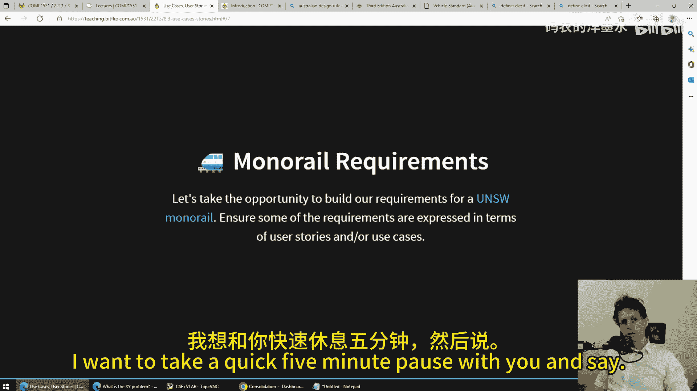

You know， there's this article I loved。 It's from my first year。 was on on no。

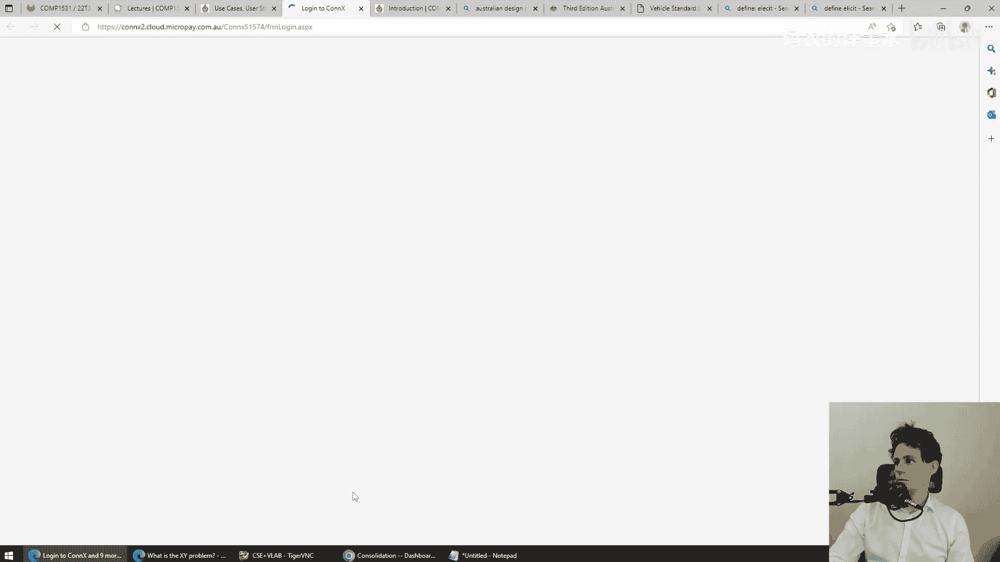

Onner。Damn it。 They got rid of it。 That's a shame。Anywhere should have saved it。

 There was a funny April foolol's article where they were like UnSW is going build a like a monorail from the bottom of campus to the top of campus。

 And I love this question because it's like， let's pretend or let's have some fun for a minute。

 as if like they were actually going to build a monorail。

 So let's imagine that UnSW was actually going to build a monorail for a second。

 And I came to you again。 just like we did before。 And I said， tell me， you know， as a student。😊。

What you'd want from the monorail。Now again you think about requirements。

 engineering and other kind of elicitation， it's not just students we're interested in it's also stakeholders like you know UNSW management and the people who are constructing the unI and so forth and so forth and you might come up and say let's try and write some we won't do any use cases but let's at least try and write some user stories。

Well， maybe not everything works with a user story， right。But let's try it out， as a student。

Let's imagine I've talked to a student。 And these are some things I might have heard from students。

 As a student， I wan to be able to。Morail。Between stops， let's imagine there's just two stops。

Actually， that should be a requirement。There shall be two stops。One on lower campus。

 lower than the law library。And one on upper campus higher than Scientia。 You know。

 so maybe that's like a requirement that's not。 And that's a non。You could kind of break this up。

 typically usually it's a good idea to break requirements up。So like this one。

 there shall be two stops。Or at least two stops， say。嗯。

And this one is a functional requirement because it's telling you what it does。

 and this one's a non functional requirement because it's like constraining it in some way。

So then we have a user story down here as a student。

 I wanna be able to monorail between stops in less than5 minutes， because if it takes longer。

 I might as well walk。As a student， I don't want to pay for the monorail because walking is easy and free。

Or monorail directly。 you know， so my point is that， and if anyone has any ideas， feel free to share。

 But this is kind of how like， if you would， if you were tasked with a very big broad problem。

 like trying to get a monorail working for a uni， you could talk to people like。

The university management to students， to alumni to the general public。

 And you could start to build this picture。With user stories， you could maybe then， you know。

 draw some use case diagrams later on where you show what it's like to actually get on the light rail。

 where maybe， you know， you tap your student card and then you hop on the light rail and then it moves。

 and then you get off it and then you tap it again or， or， however else。

Bill says the monorerail will have to take students from K17 to boost in three minutes。Here you go。

 And if you got enough people suggesting that maybe you could turn it into part of the requirements。

 maybe you have that as a requirement。 But when you go and validate it with the university before they give you the money to do it。

 they come back and they say that's not going to happen。 You know， it's a very human。

 it's a very human process。 All of this to try and get it right。Yeah， so。Yes。

 that's all I have to say， really。嗯。嗯。图 okay。Yeah， again， that's just a delight touch on the example。

Just to recap， we have covered user stories and use case diagrams。If you do have。More to add。

 or sorry， if you do have feedback to add， I'd love for you to fill that in。Again。

 it's always appreciated same as every lecture。 Thank you。

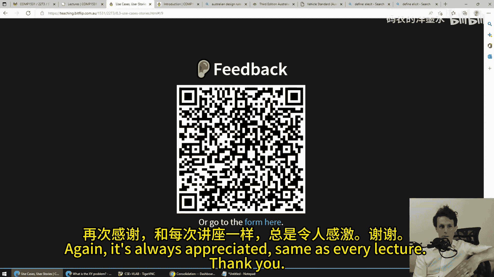