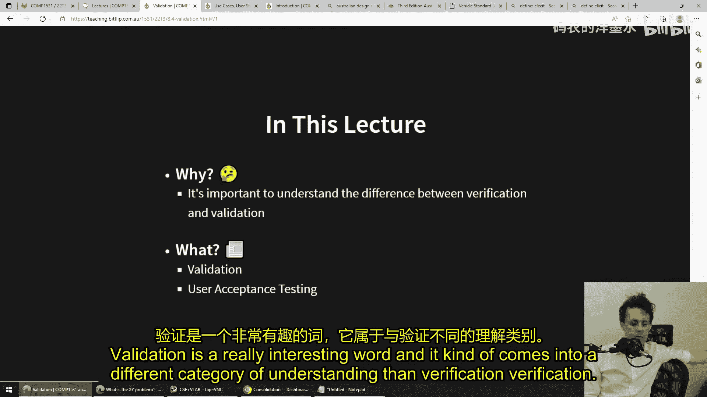
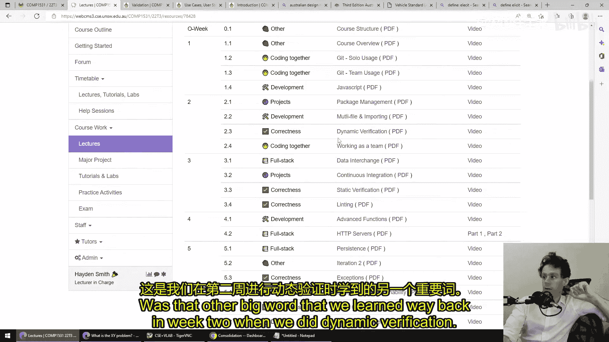
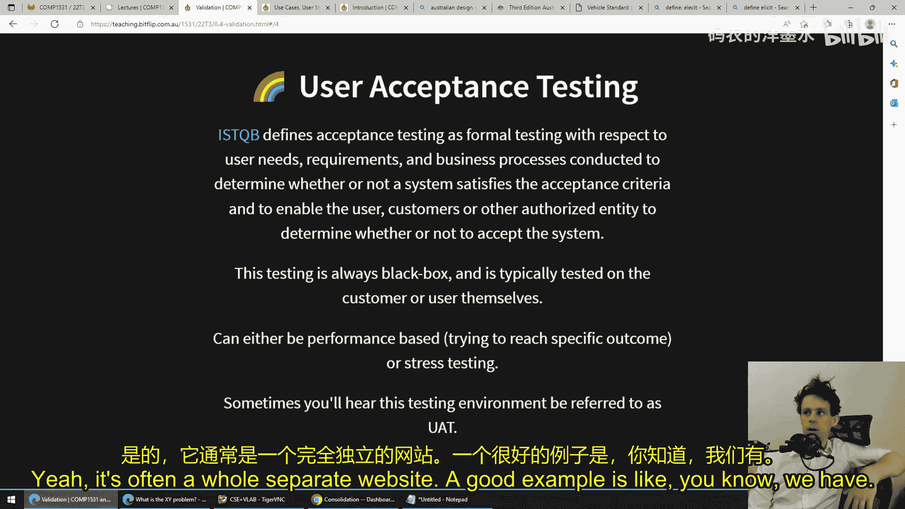
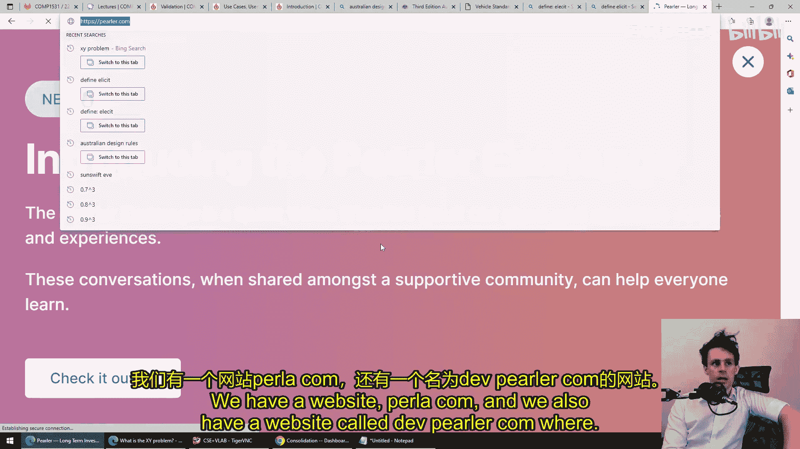
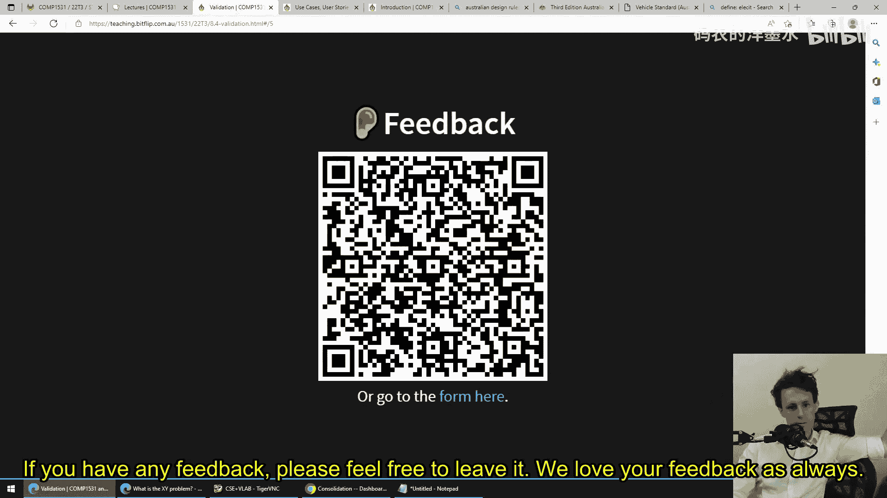

# 【全集】新南威尔士大学 软件工程基础 中英字幕 1080P COMP1531 p23 Lecture 23 - 验证 -BV1M7Nwz7EGh_p23-

So the last like third of three piece， and it's a small piece of the requirements lecture set is on validation Valid is a really interesting word。

 and it kind of comes into a different category of understanding than verification verification was that other big word that we learned way back in week two when we did dynamic verification。

And it helps really tie in the difference between testing and what we had just talked about previously in terms of user acceptance criteria。

 So let's compare， do you get the emoji， I thought it was funny Let's look at the IE definitions IO definitions verification in a system lifecycle context。

 It's boring is a set of activities that compares a product of the system。The product， it can be。

Compares a product of the system life cycle against the required characteristics for that product。

 So this may include， but is not limited I'm bored already right。

 and validation look I'm not even going to read the slideca you're not going to read the slide。

 Let's look at it in a really human friendly way， which is a verification。

 is trying to figure out that the system has been built right and validation is trying to figure out that the right system has been built。

Now this might sound like a little play on words， but actually makes sense。

Verification assumes that you're building the right thing。

And it's trying to check that you built that thing correctly。

 whereas validation is a little bit more interested in trying to make sure that you built the right thing。

 so go back to that table example I had before。If you actually come up with a set of requirements。

 right？Like all the table has to be so big。 and it has to do all this。

 verification is trying to check that the table does what your requirements that it should do。

 whereas validation is a lot more trying to。Actually make sure that your requirements achieve the original goal。

 Now， again， these are all big fancy descriptions and distinctions。 In reality。

 it's far more nuanced than that because in in reality， requirements are not often like that。

Cut and dry， You know， in reality， requirements will have layers to them where， you know， you have。

Requirements at a really high level about， you know。

 that a table needs to have 200 kilos and be made from nonsustainable wood。

 And then as you go further down in the process， you'll have even more detailed requirements that'll be like。

 you know， that maybe the engineers put together themselves。

 that are things like the wood needs to be made of the table needs to be made of that wood。

 And it needs to have like a finish and a tolerance of this。 you know。

 So verification is a lot more about。 well， now that you assume that you did the right things。

 And let's use this example as wood with the wood stuff。

 you might have that really high level requirement。Needs to be made of sustainable wood。

Everyone agrees on that。 Then you say， I'm going to go build it with。

 I don't know what a sustainable wood is。 I'm really bad with wood。 Let's just call it。

 Let's call the wood tree。Right， then you go make the table out of treewood。U。As an engineer。

 you might try and verify your work by checking that you have built the table with Twood。

 You'll build the table， then you get someone else to check。 whats that treewood。

 That's like writing jest tests， You know， you've kind of already defined the system and you're just making sure that it was built right。

 whereas validation is trying to make sure that that table that you give someone satisfies the person at the end of the day and。

If I'm butchering this a little bit。A better example might be you can write all the j tests you want in the world。

But you can still give。Your。Beans up to someone。And they might hate it。They might be like。

 this doesn't。 This doesn't do what I expect。 You know， they might be like， this is the wrong thing。

 I don't want this。But your just test pass。 So your just test passing is that verification。

 It's making sure that the system。That you think you need to build was built right And validation as being like。

 did you actually build the right thing， So to speak。So then there's the question， well。

 how do we validatecause we've talked about verification a bunch。 We talked about that with J。

 We talked about it with Tpescript， But and validating software is not really an automattable process because it's a human thing。

 And it's often the last step of software testing。 And it comes after we've done all of our unit tests and integration tests and system tasks like that。

 right？ It's super。Yeah， that' that's just kind of how it comes about。

 And one of the most common ways that we validate software is we basically either test it with real customers or we get quality assurance employees to test the actual completed software Basically you write software and then you might say deploy it to the internet somewhere and then you get real people inside your organization whose full- time job it is to make sure software works or you give it to real customers and you say you like what do you think。

Does this achieve what you wanted it to， They might have a checklist or the quality assurance that employees probably got a checklist。

 Custom maybe don't， but they might be monitored and asked questions。

 which is kind of like a checklist， but it's all about trying to make sure that the software is behaving is intended and solves the original problem。

So that's the process of validation， very manual， very human。

 and this is where we come back to that user acceptance testing from the last lecture。

 which is defined as when we do formal testing to make sure that the system satisfies the acceptance criteria。

To see whether the user accepts the system。Are they okay with what you've produced。

 even if your jest tests work。嗯。Are they happy with what you've given them。So。As I said before。

 this is always typically black box。 It's typically tested on the customers themselves。

 And you'll often hear this referred to as UAT testing， which is a little bit funny。

 is like UAT T environments for user acceptance testing。Yeah， it's often a whole separate website。

 A good example is like， you know， we have。

We have a website polarar dot com， and we also have a website called dev。poar dot com where。

We do our testing for things sometimes。Not always， but sometimes。Cool， thank you。

If you have any feedback， please feel free to leave it。 would love your feedback as always。

Just pause the video。