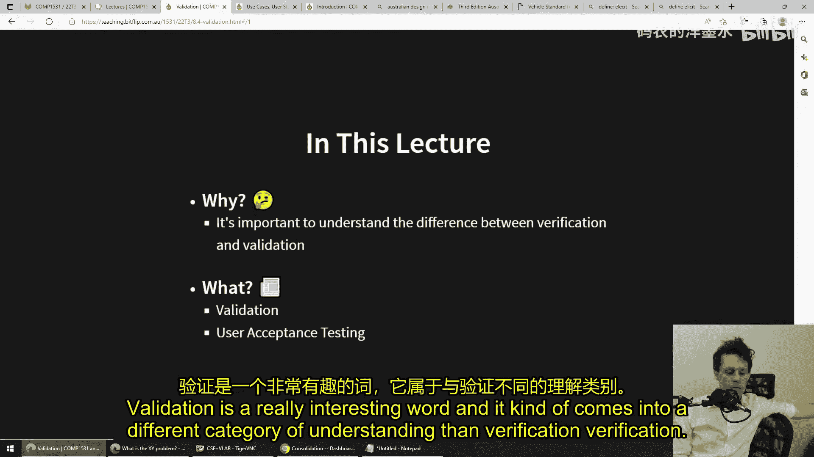
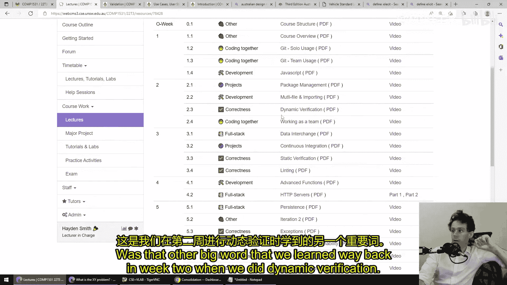
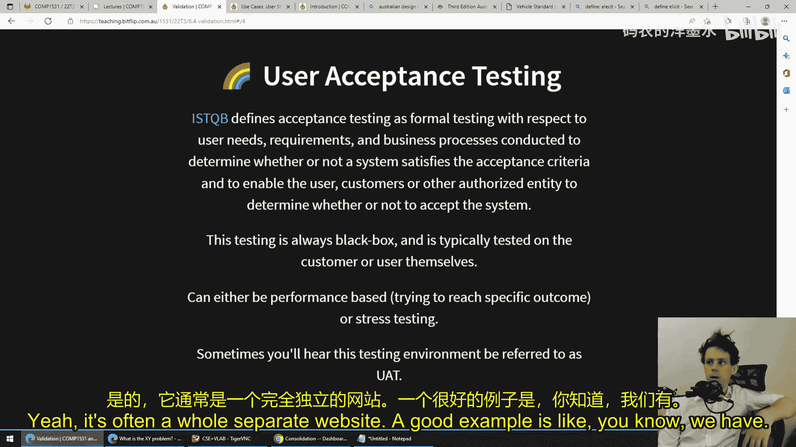
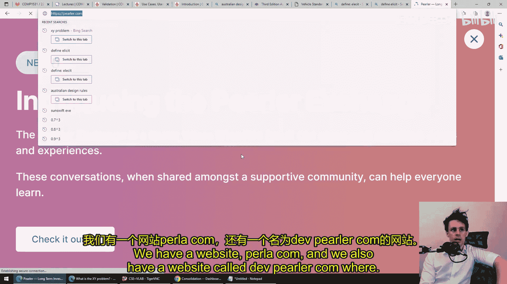
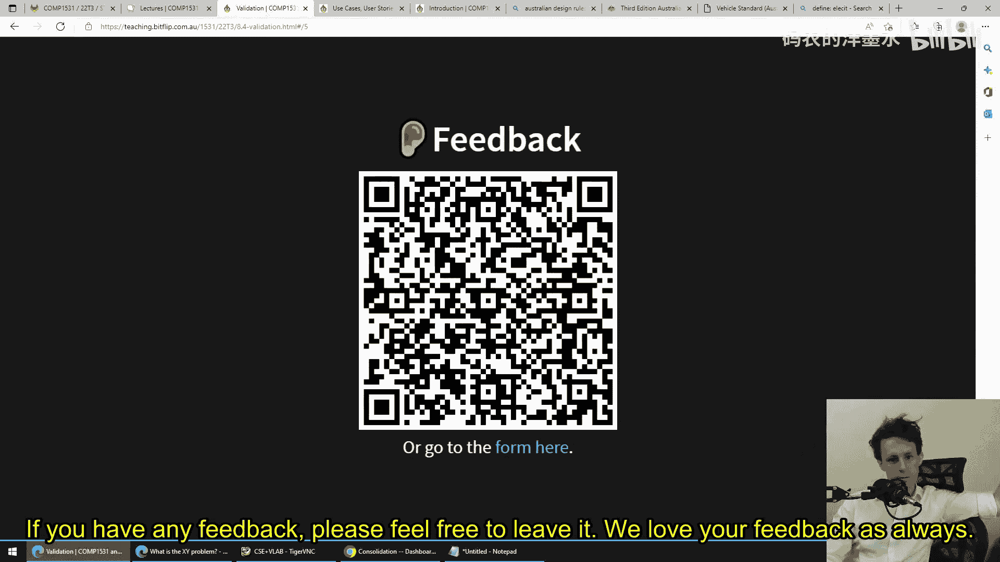

# 软件工程基础：23：验证 🧪

在本节课中，我们将要学习软件工程中的一个重要概念：**验证**。我们将探讨验证与之前学过的“确认”有何不同，理解它们在软件开发过程中的角色，并了解如何通过用户验收测试来执行验证。

---

## 概述

验证是需求分析环节的最后一部分，虽然占比不大，但至关重要。“验证”这个词本身非常有趣，它与我们之前在第二周学习的“确认”属于不同的理解范畴。确认主要与动态测试相关。

上一节我们介绍了用户验收标准，本节中我们来看看验证如何帮助我们区分测试与满足用户需求之间的差异。

---

## 验证与确认的区别

为了更好地理解，让我们先比较一下这两个概念。以下是IEEE的标准定义：

*   **确认**：在系统生命周期背景下，是一系列活动，将系统生命周期中的某个产品与该产品所需具备的特性进行比较。
*   **验证**：（定义略，我们用一个更人性化的方式来理解）。

这些定义可能有些枯燥。实际上，我们可以这样简单区分：
*   **确认** 关注的是 **“系统是否被正确地构建了”**。
*   **验证** 关注的是 **“我们构建的是否是正确的系统”**。

这听起来可能像文字游戏，但意义重大。确认假设你正在构建正确的东西，并检查你是否正确地构建了它。而验证则更侧重于确保你构建的东西本身就是正确的。

---

## 一个具体的例子

让我们回顾之前提到的桌子例子。如果你制定了一系列需求，比如桌子必须有多大、必须能做什么。

*   **确认** 是检查这张桌子是否满足了你的需求说明书上要求它做的事情。
*   **验证** 则是更多地尝试确保你的需求本身实现了最初的目标。

当然，现实情况比这更复杂。需求往往不是非黑即白的，它们具有层次性。例如，高层需求可能是“桌子必须承重200公斤并使用可持续木材”。随着流程深入，工程师会制定更详细的需求，比如“桌子必须由某种特定木材制成，并具有某种漆面和公差”。

*   **确认** 更侧重于：既然你假设做了正确的事（比如使用可持续木材），那就检查桌子是否真的用那种木材（比如“Treewood”）制成的。这就像编写Jest测试——你已经定义了系统，只是确保它被正确构建。
*   **验证** 则是确保你交付给用户的桌子最终能让用户满意。即使你的所有Jest测试都通过了，用户可能仍然不喜欢它，认为这不是他们想要的东西。Jest测试通过是确认，而用户是否接受则是验证。

---

## 如何进行验证

那么，我们如何进行验证呢？我们已经讨论了很多关于确认的内容（比如用Jest、TypeScript）。验证软件并非一个可完全自动化的过程，因为它涉及人的因素。它通常是软件测试的最后一步，在我们完成了所有单元测试、集成测试和系统测试之后进行。

最常见的验证方法之一是让真实客户测试软件，或者让质量保证员工测试完整的软件。基本上，你编写软件后，可能会将其部署到互联网的某个地方，然后让组织内部全职负责确保软件工作的人员进行测试，或者交给真实客户并询问：“你觉得怎么样？这达到了你想要的效果吗？”

质量保证员工可能有一个检查清单。客户可能没有，但他们的反馈会被监控和询问，这本身也类似于一个检查清单。这一切都是为了确保软件按预期运行，并解决了最初的问题。

---

## 用户验收测试

这就是验证的过程，非常手动，非常依赖人力。这也让我们回到了上一讲提到的**用户验收测试**。

用户验收测试的定义是：我们进行正式测试，以确保系统满足验收标准，从而判断用户是否接受该系统。即使你的Jest测试都通过了，用户对你交付的产品满意吗？

如前所述，这通常是黑盒测试，直接在客户身上进行测试。你经常会听到“UAT测试环境”这个说法，这有点有趣（因为UAT本身就代表用户验收测试）。例如，我们可能有主网站 `polar.com`，同时还有一个用于测试的网站 `dev.polar.com`。

---

## 总结

本节课中我们一起学习了：
1.  **验证**的核心是确保“构建了正确的系统”，而**确认**是确保“系统被正确地构建”。
2.  验证是一个以人为中心的过程，通常在自动化测试之后进行。
3.  **用户验收测试**是执行验证的关键实践，通过让真实用户或QA人员依据验收标准测试完整系统，来评估软件是否真正解决了用户的问题并令其满意。

感谢学习。如果你有任何反馈，请随时提出。