# 【全集】新南威尔士大学 软件工程基础 中英字幕 1080P COMP1531 p24 Lecture 24 - 身份验证 -BV1M7Nwz7EGh_p24-

嗯。Today's lecture， we're gonna be talking about。Authentication and in particular。

 cover some ideas that you might have already seen about or heard of like tokens， hashing headers。

 things that have come up in the spec。 And the reason this lecture should be of interest to many of you is because it's kind of like the last piece in the puzzle。

 really for iteration3。And。That will probably bring you some peace and probably have a answer a few questions that you might have been asking yourself so far。

 So today's lecture is really all about basic security and highlighting how it's an important step when it comes to building good software。

 This is not a security course。 But it is certainly something we think is worth spending an hour on。

During the course， right， about 36 hours of lectures or whatever。

 an hour on just to really focus on basic security principles so you can actually， you know。

 apply them。It's really the tip of the iceberg in terms of a much deeper set of theory that many of you should be interested in going forward。

 And in particular， we're going to be talking about two key ideas。

 which is authentication and authorization and and the kind of difference between those two things。

 so。We use oth as a shortened description。For。These two were authentication authorization and。嗯。

Authentation， which is probably a slightly more relevant part of today。

 is defined as the process of verifying the identity of a user。

 This is something that you should all be pretty familiar with because it's what entering you know a username and a password iss it's what happens when you you know you lose your student card and you turn up to the nucleus hub and you say。

 hey can even use student card and they say you know can you show us some I or something。

 It's all the process of making sure that you're like I am this thing and you have to prove that you are the thing and then someone says great。

 you've proved it you are authenticated authorization， on the other hand。

 is the process of determining and authenticated users access privileges。

 So essentially once I know that youre you what are you allowed to do。You know。

 and these two definitions it can kind of be hard to decouple in some senses。You could kind of argue。

 for instance， that if you're on campus and you tap into a computer lab or a room with your student card。

 you might have already been authenticated in the sense that you have the student card。

 potentially you could kind of argue that that's not the case but every time you tap。

 there's an authorization process to determine if you are authorized to access that particular room。

And there is two pretty basic definitions。 We're not actually gonna go too much more into the theory of things today beyond exploring a bit more with tokens and and hashing。

 But U NSSW does have more cybersecurity courses on these topics。There's about a half a dozen。Yeah。

 it's half a dozen， half， half a dozen。 There's about a half a dozen or so they're all level 6 courses。

 You can go look them up in the， the handbook or the timetable。Should be pretty straightforward。

Another example I have here why we expand on authentication authorization is that authentication is checking if you have a username password for a valid Microsoft Teams account。

 obviously， whereas authorization might be checking if you're an admin or not， you know。

 can you add or remove particular channels or groups within within something the definitions kind of write themselves to an extent。

😊，嗯。Most of what we're going to talk about， though， is authentication。Which is this process of。

 again， verifying。You know， a user is who they really say they are。

 And let's look at what is the most basic approach to authentication。

 And it's probably the approach that you've taken in the course so far， which is that step  one。

 the user registers。To say your， your app， right， after they register。

 you store their username and their password。In your data store and most groups would have done that。

 And then later on， when the user logs in， you look at the password and user name they give you and you compare it to the data you have in the data store。

And if it matches， you're like wheat， they enter the right details and you authenticate them because。

In theory， only they could have entered the right username and password， right？

 So because they were the ones who， in theory， could only enter it， you're like， okay。

 it must be you。 That's a good basic approach。 And it probably looks something a little bit like this。

 Your code is probably maybe somewhat similar。 You've got like some kind of user's object within your data store。

Here有。You got a function called register， takes in an email and a password。You know。

 if someone tries to register the the the return values here are just kind of placeholders。

 But you get the idea。 you store their details against their email when they log in。

 you check if what they entered matches everything。 And if it does， you， you know， return true。

So pretty straightforward logic。 But there's a problem with that， Does anyone know。

Anyone in the live lecture here have an idea。 It's a pretty， it's a pretty obvious one。

 If you've thought about it for a while， if you haven't， it might not be totally obvious。

Do a quick wait for a good answer。Yeah， so Bill says。You story it in plain text。

And Adrian said the same thing， so。In the CO 1，5，3，1 project。

 this isn't really a huge problem because。You're storing data in a variable。

 which is kind of in memory， which is much less bad than other ways。 you can store it。

 But what I want you to kind of extrapolate in your mind is that in a normal production system。

 that password stored in the actually sorry in iteration2， you implement a persistence。

 So I don't know what I'm talking about。 you know this because like it being stored in a variable in iteration1 style is not too bad But the problem really comes when you do something like an iteration to where you start storing passwords in a file like you've got a JSON file there somewhere on your computer or on the production computer where it's just someone's password。

 like you've open probably data Json or data stored or JsonN or data do JsonN or whatever you want to call it and you've probably seen passwords there it's a little confronting right because you're like oh my God。

 that's a password。And if we were to do this in a real software application。

 the problem is we then have a very risky file because this file just kind of exists on the computer and anyone at any time。

 if they were to gain access to it， they could get people's passwords。 Thankly。

 this is not how nearly every serious service these days。

 probably basically everyone wouldn't do it this way。

 They wouldn't store passwords in what we call plain text。

 which is where the password is just sitting there in text waiting for accuracyacy。

 So what we need to try and do is we need to try and。😊，Hide the passwords。 Now。

 this is particularly tricky， right， because you kind of might know this。Let's say。

 I'm sure all of you have something important。 Maybe it's a journal。 Maybe it's a photo book。

 I don't know。 You probably have something that you value that you don't want people to find。

 The problem is， is that when you go and hide the thing that you don't want people to find。

It becomes a little bit。Hard to do something with if you have to go and look for every hour。

 you know， so we need， we need to kind of use computers to our advantage here and figure out a way how to hide people's passwords while still being able to check if the password they gave us is correct。

 You know， because that's the problem。 You can't like you could say， oh， well。

 you just won't store passwords。 But obviously， that won't work。

 Because if you don't store passwords。 And someone says， here's my password。

 how do you know they entered。You know， the right password。 So you kinda need to know it。

 So it's a little bit tricky。 And where this takes us to is a topic on hiding information。And。

There's two important words that come up in the realm of security here。

 which is encryption and hashing。Both of these terms are verbs。Well。

 not verbs encrypting as a verb and ha or hashing' is a verb。

 I should call it encrypting and hashing， I guess， but。

Enccrypting and hashing are both processes of taking plain text， just passwords， anything。

 just askI characters。 And it's the process of taking it and concealing it by turning it into a seemingly random string of characters。

 And it does this by passing it through。We me just double check what's on the next slide。 Yeah。

 passing it through some kind of cryptographic hash function。

 It's basically think of a hash function like a， you know， like a joboly function。 It。

 It kinda takes something and spits out seeming garbage。It's a very kind of cool idea。

 So you kind of put in f and you get this giant string of ASI characters。

 you can put in something else and you get this other giant string。

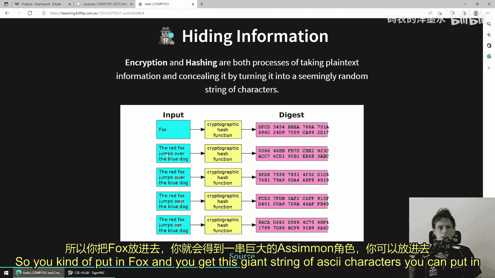

If I just jump ahead for a second， you look at like there's little websites where you can use a little hash function so I can enter something like hello。

 and it will print at the bottom here。 That's like the output of it。

 So that's like the equivalent here of， You know， we have the blue input and the pink output。

 There's our blue input。 There's the， you know。

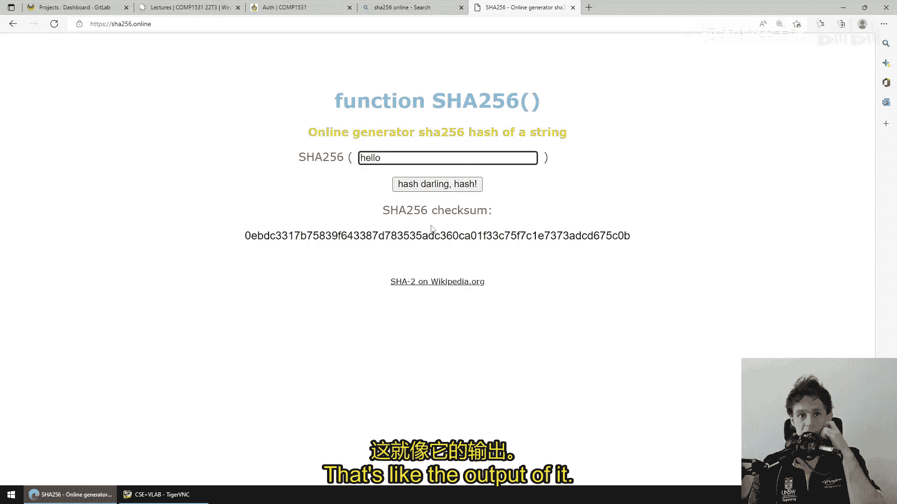

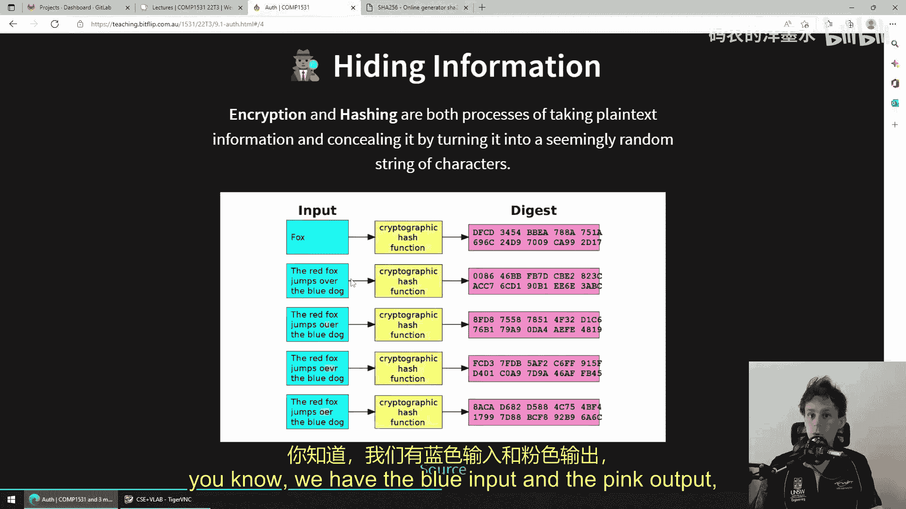

Every single different combination of string will lead to some kind of output here。

 And it's a very long， scary， confusing output like that。

 But we mentioned that encrypting and hashing are both ways of concealing information by turning into a seemingly random string of characters。

 but encryption is reverssible and hashing as irreversible。

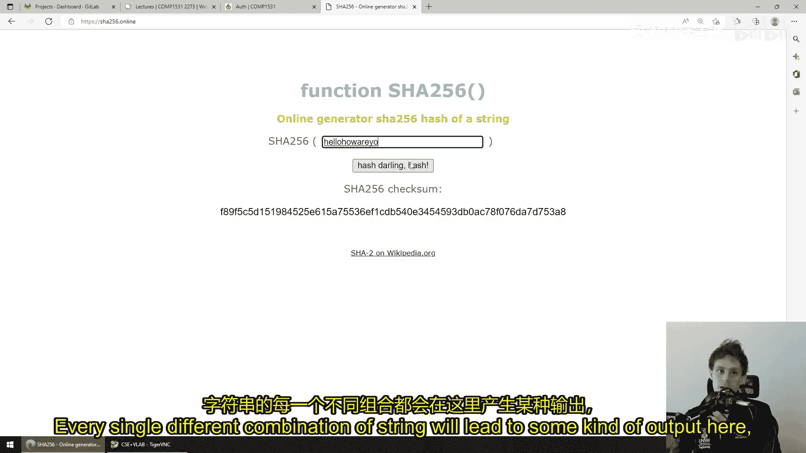

What that means is that with encryption， encryption is the idea that you can take something that's sensitive and raw and you can pass it through something that will go and hide it。

 make it， make it seem seemingly random。 Someone couldn't look at this information here and say。

 oh I know they're trying to say hello， how are yo， but encryption allows you to unreverse it。

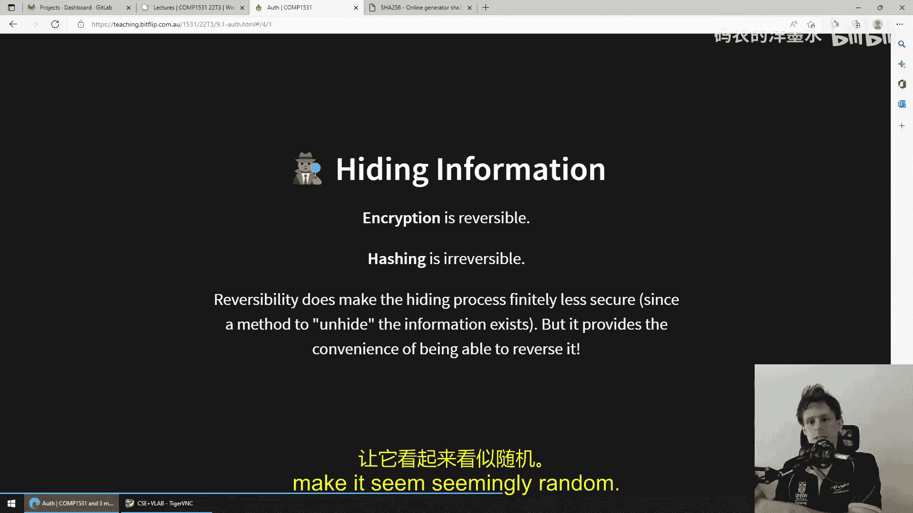

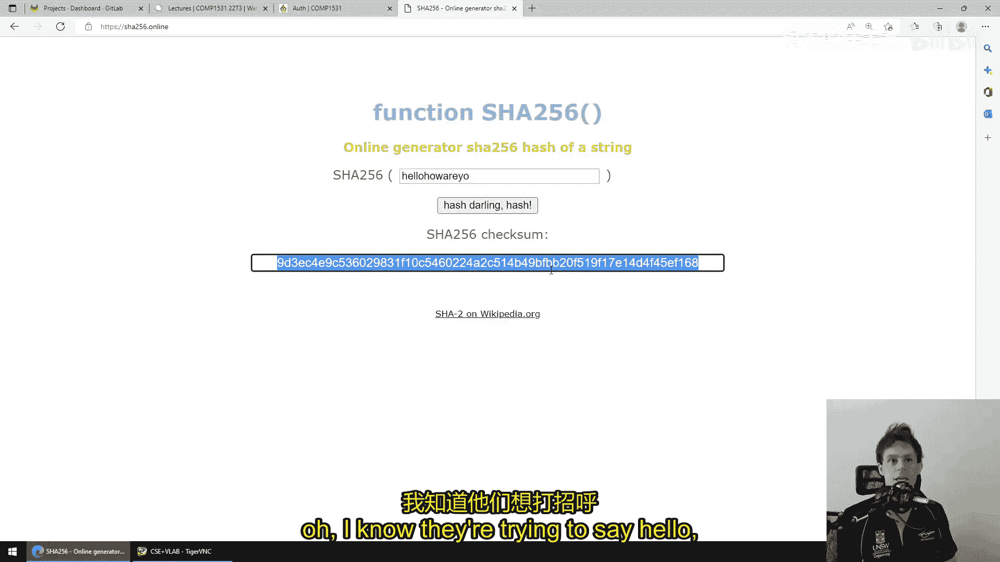

And hashing doesn't now。Unreversing， it makes a lot of sense。 You know。

 like you think about applications where。um。Maybe files。 if you ever a user service and they say。

 you know， encrypt your files at rest is something you'll hear a lot。

 What that means is that they might have stored your information somewhere。

 but that information is actually encrypted。 It's all kind of randomised and garbled。

On a server stored on a file system so that if hackers were to come in and just steal all the files。

 they would just get gibberish。You know， like this。But they can unencrypt thatca obviously。

 like you need， like if you put your files somewhere， you need a way to kind of access them again。

 right， Like did just make sense。 Hahing is irreversible。 And you might think。

 what in the world is that useful for， You know， what is the point of having a a way to take use useful input Turn it into something seemingly random and then not undo it。

Well， the reason for this is that reversibly。Reversibility。

 reversibility does actually make the hiding process finitely less secure。Basically。

 if you have a way to unhide information， even if you're the only one using that and you're the only one with access to it。

 that's still like a point of failure。That's still scary because， you know， there's a key somewhere。

You know， like as long as there's a key to or how someone could break in if they compromise you。

You know， if someone jumps you on the street。So。Reeversibility is something that we should only really care about if we need it。

 because every like reversibility is a capability that will add some risk。

So there are times when that convenience is not as as as critical。

Which is where we just use hashing this one way form of encryption。

And hashing is actually perfect for passwords。 And we'll show you why so。😊。

First thing is we need to get a sense of how hashing might work。嗯。Just generally。

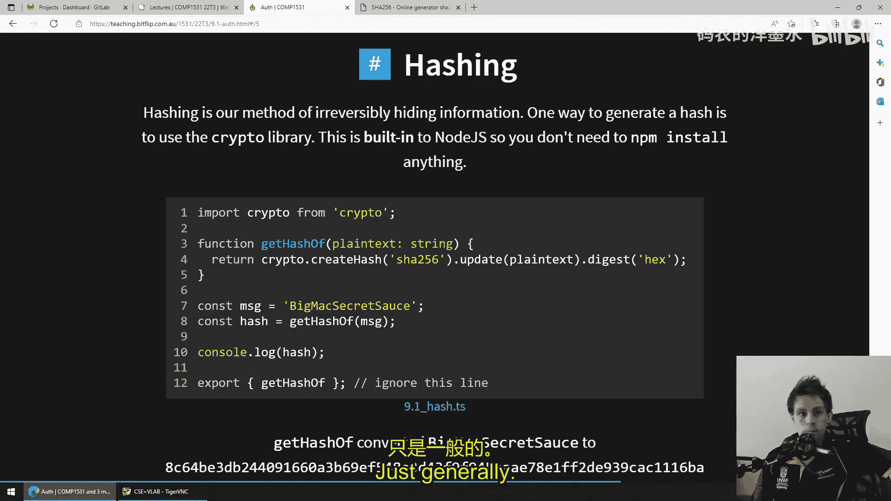

In a simple file。So let's say， for instance。

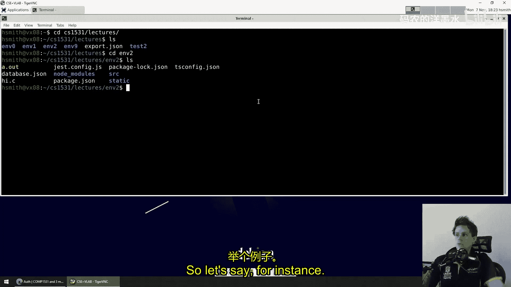

Hoop， let me just poop。 Let me hide all of this for a second。I've got this file here，9。1 hash。

 And there's a few things going on in this file。 First thing is that we are including this library called crypto。

 crypto means cryptography， not cryptocurrency。 It's essentially like security， encryptioning stuff。

This library lets us do a few fun and interesting things。 in particular， Lets us hash things。

 And what I've got here is I've got a function called get hash of。

 And what I do is I give this function some plain text。 I give this function some。😊。

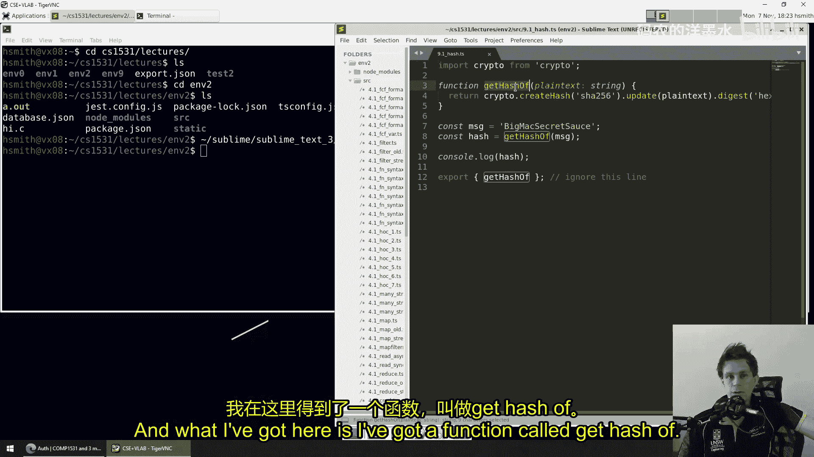

Blue。And this function will give me back some pink， right， So I give the function some blue。

 I give it back pink。 and yellow is the function itself。 right， The diagram kind of makes sense。嗯。

What this， if you pay attention to how this function works。 The crypto library here。

 there's a function called create hash。 And this is all kind of a bit confusing。 But essentially。

 it's saying， use this particular way of hashing'cause there's lots of different ways you can encrypt stuff。

 use this particular wave in hashing。 Here's the text。 I want you to hash。

 Now go and create some garbage or random stuff with it。 And then down here， I'm saying， okay。

 here's my raw input text my blue text。 It's called big Mac secret sauce。

The hash of that is the get hash of that big Mac secret sauce。 So here we have the raw thing。

 and here we have the hash thing。 And then I'm going to console log the hash and see what it gives us。

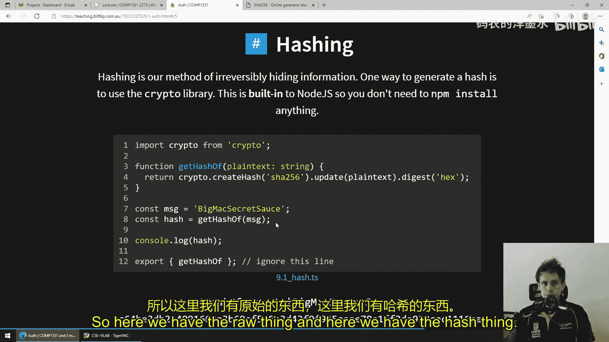

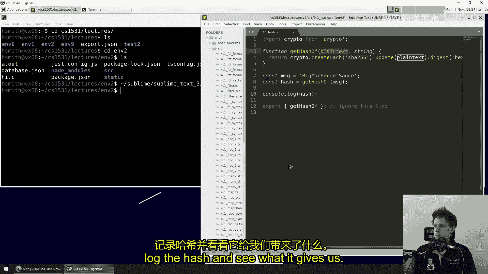

So it's hard coded as you can see here， but you'll see if I go MPM run T S node on source slash 9。1。

Hash。You'll see we get this nice little hash result。

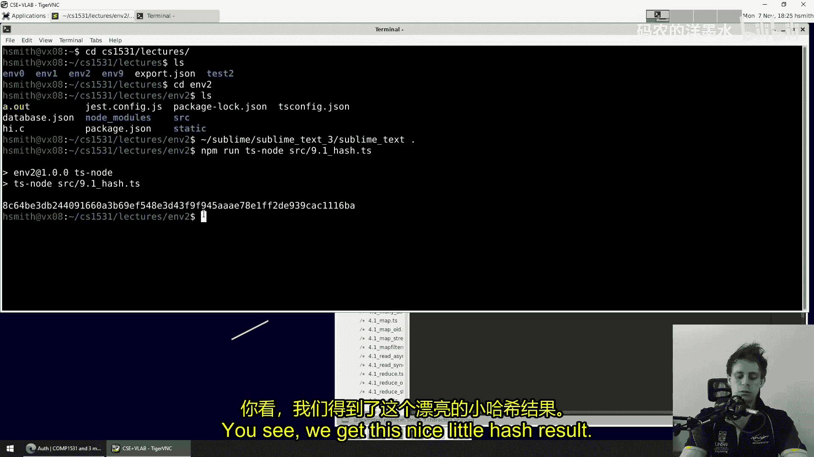

Out of it。That's kind of cute。 And you'll see if I come in here and I change this。

 and I change it to big Mac secret sauce， too。 And I run it again。 We'll get a different hash。

 It doesn't look like a slightly similar hash。 It looks like a wildly different hash here。 See。

 like totally， totally different numbers now。

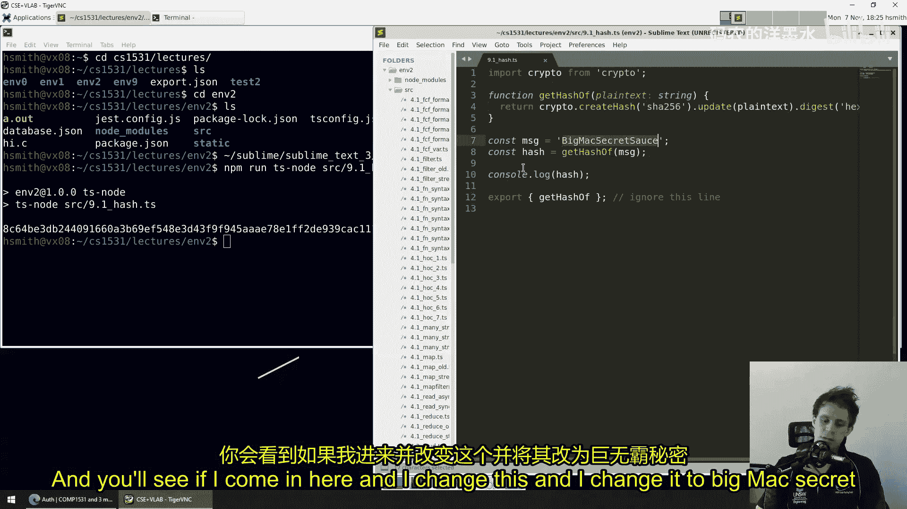

This is very handy because if I just look at this information， it doesn't really tell me about March。

 does it。

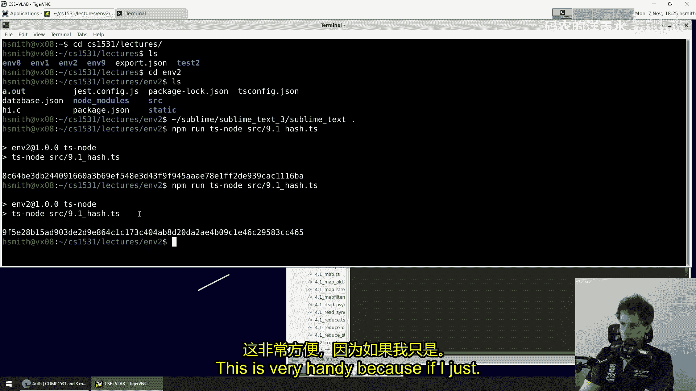

你。嗯。But the real question is like， okay， cool。 Thanks， Hayden。

 You show me away how to take something that makes a lot of sense like a string and convert it into something that makes no sense like one of these hashes。

 How， how does that actually help with our authentication issue。 And the short answer here。😊。

And half of you would have figured this out。Where we're going with this is that when someone enters a password。

 we don't want to store their password in our server。

 We want to store the hash of their password in our server。Not the password itself。 just the hash。

So when you have like your kind of typical server like this right， where you have。

 this is the same code we had before with your part， you know， you someone registers。

 you store their email and you store their password。 What we're going to do instead。

 and I've highlighted the exact lines here is that we're actually going import。Our hashing function。

 you don't。 You don't have to create a separate file for this。 We've just done it for simplicity。

 becauseuse remember， we wrote that get hashel function here that'll take in a string。Right。

 string being blue， and it'll give us pink。 That's that function。 Get hash of。

 So let's say we import that。 Now what we're going to do is instead of storing the password itself。

 we store the hash of the password。And then the most interesting thing is that。

 and I think Anthony's said it here。 And I'll just quote Anthony。 Anthony said。

 so when they enter the password again， the programme is comparing the hashed version to the stored password。

 Yeah， so what that means。 And you can kind of。😊。

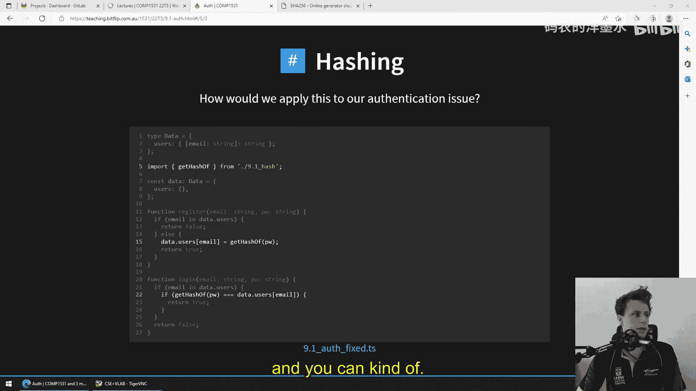

Visually demonstrated here is like。At the point of。Registration here。Right。

Someone gives us their password。And what we do is we hash that。To hashed password。

And then what we do is we only saw the hash password。 Now， while again， immediately， immediately。

 like you intuitively think， well， if I can't reverse the encryption'cause a hash is one way， like。

 you can， yeah， let me get back to reversing it soon， but。If you can't reverse the encryption。

 what's the use of the hash password because I don't know what someone's password is well you don't really need to because when someone comes over here and logs in 10 minutes later。

 they enter a password。But what you do after they enter a password is you also hash that。

So you hash their input and in theory， if they've given you the right password。

These two things should be the same。Right， and just as a practical example here， let me show you。嗯。

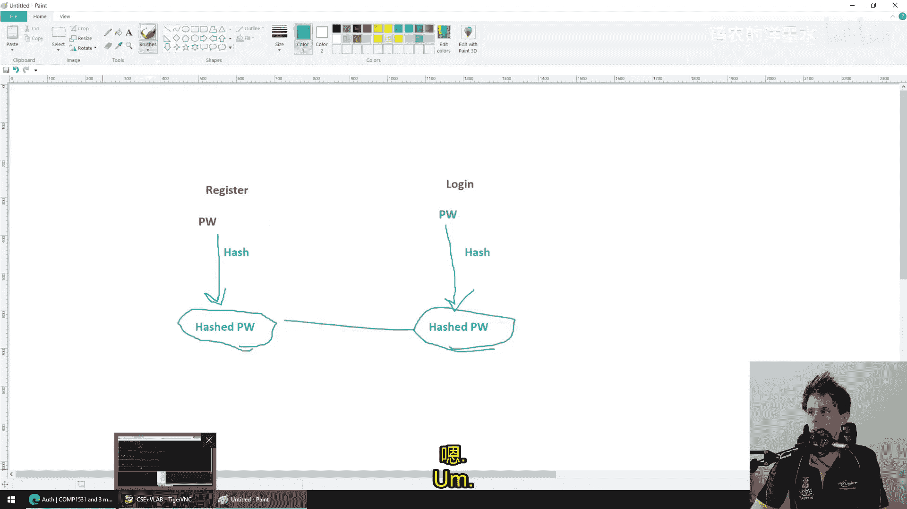

I'm going to。Close your eyes。I mean， you don't have to close your eyes。 but let's pretend。

 let's pretend that my password is Lama。

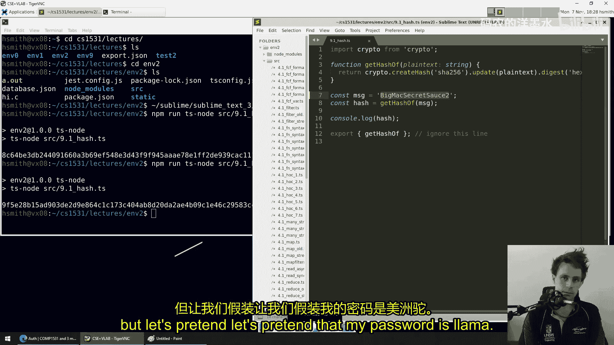

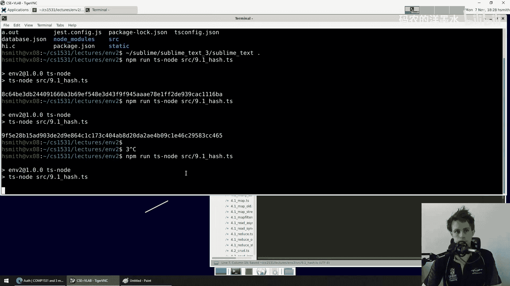

Now， the hash of Lama is this giant thing here。 So let's imagine that my data store somewhere now looks like this。

In know， emails Hayden dot Smith at U SW。And my password is the hash like that。

 I don't know what the real password was。 But now what happens is let's imagine someone's trying to log in。

 And if they're trying to log in， let's say they're trying a bunch of different passwords like koala。

So they enter koala。 And what we do is we go， what's the hash for koala。 It's that。

 Does it match what we have。 No， So it's not the password。

 I don't know what I don't know what Hayden's password actually is。

 but it's not koalaca if it was koala， if we hashed it， we would get something else。

 And then he tries Hayden koala 2，34。 And then we compare it here and we say， nope。

 those hashes look different。 and then eventually say someone guesses it right or more。

 hopefully you enter the right password and you enter Lama。

 What happens is this was run and we look at it and we go 9，3，8，4 F9 oh， wow， okay。

 it's actually the same thing。

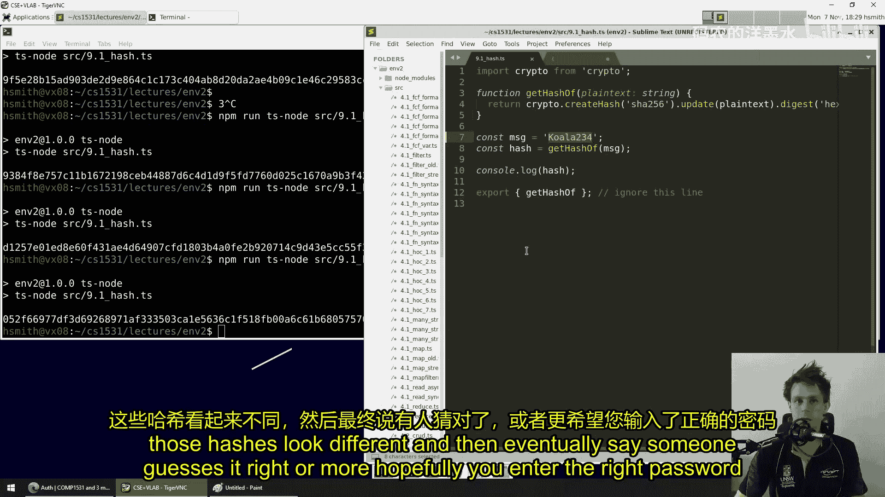

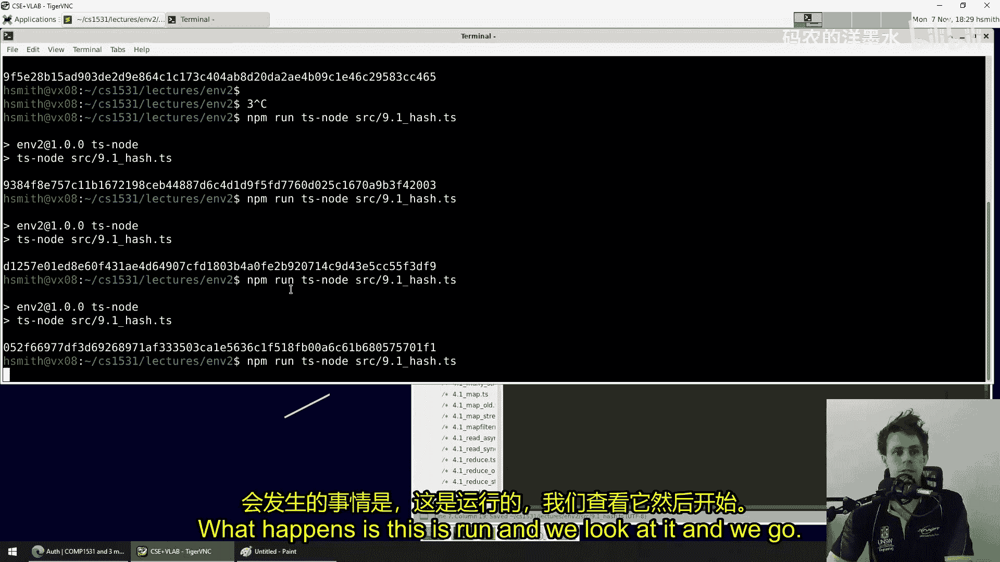

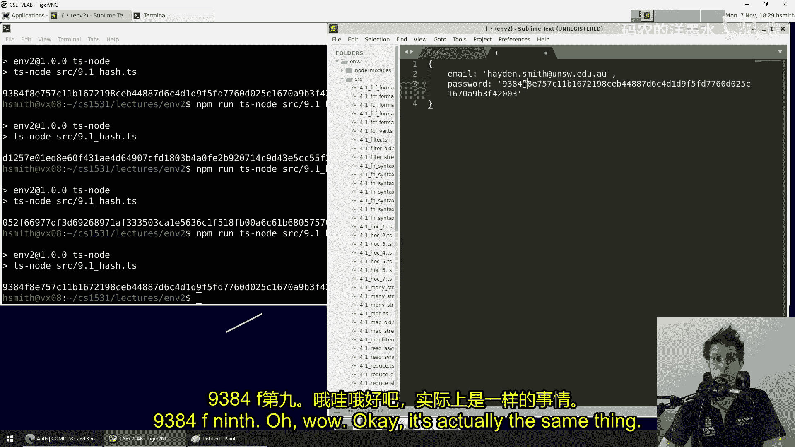

So they give us their password as a log in。 We hash it every time they try and log in。

 We compare the hashes and we go， oh， sweet。 Okay， it must be you。 So this is an incredible way to。😊。

Store passwords essentially， it's a very simple way。

 not like a more industrial way is a bit more involved。

 it's an easy way to store passwords without actually storing the sensitive information because now if there's like a hacker that comes along and they get access to all your data or say your database dot JSON。

 all they're going to get is this file here with the hashes。

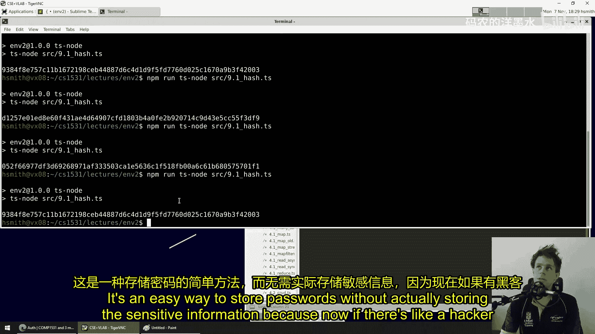

And with ashes， you can't really do a lot。And， you know， it's like， why can only go one way。

 Why is there no function that can reverse this， That's quite a deep topic。

 You're probably gonna have to get into like the world of finite mathematics and stuff。

 There's some other courses you can do at uni or you can go deeper into cyberseity and computer science。

 but。Essentially， the short story is that。It's very challenging to， to undo it。A。

It's very challenging to get something like this。And to turn it back。Into the plain text itself。

You can kind like I， I just don't wan to waste their time on it'cause it's not relevant。

 but you can go and Google it and watch some videos and I'll talk about， I mean。

 Jacob's asked about bit bit operations。 They'll talk about prime numbers and multiplying two large primes together in the difficulty of factorise it。

 factorising two large primes。It's a really interesting topic， but essentially。You know。

 it can be very easy to take a string， like imagine for a second。Now。

 I can't even explain it trivially because I I'd be like， well。

 let's imagine you take every character and you turn it into its ASI number and you multiply it by 9。

嗯。And like that might work， right， Like if we thought of probably won't work。 Like you look at this。

 Okay， what are the ASI characters of these， I'm just gonna guess them'cause I don't remember AS off the top my head。

 Let's call like 62 and 96 and then like 90。Like 88。 And then like。97， and then like 88。

 And then you multiply all of those by three for no particular reason。一人。And then。

After you multiple them I， but all by three， you add them all together。Lookops。

And after you add them all together， you get a new number。

 and that new number might be like something like that。 And this is like your hash result。

Except you could represent that in a string form if you really wanted to， right。

 and it'd be very hard if someone came along with， let's just try and represent each of these as a character。

Where four is like D， F， E， A A F。It's very hard to take something like that and be like。

 where did this come from？Now， if you're smart about it， you'll be like， well。

 I know how it was generated。 So I kind of just unwind it and。The short answer is that， again。

 if without going into the finite math of it， there are certain things that。

It just not that easy to undo。Go read up on it。 It's not what we're here today about。 pointers。

 hash function like this really easy to go one way。 Very difficult to go the other way。 Now。

 I say it's really difficult to go the other way。 I wouldn't feel like I am doing your justice if I don't take a moment to talk about。

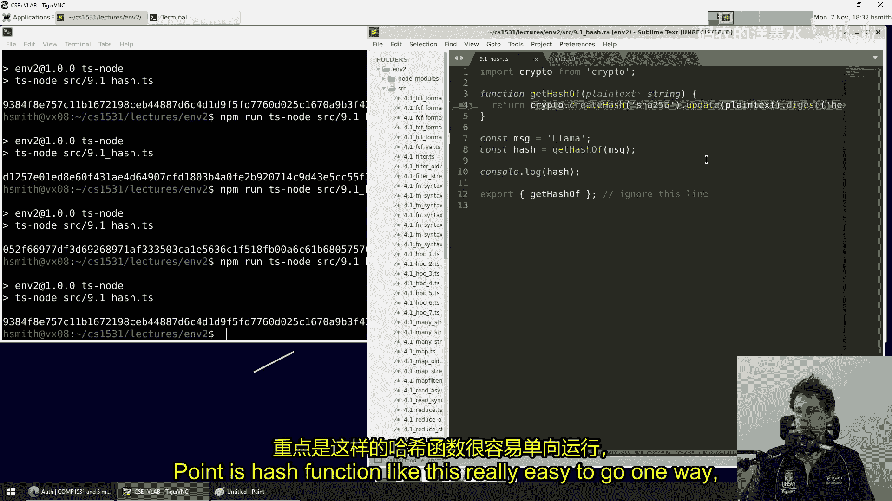

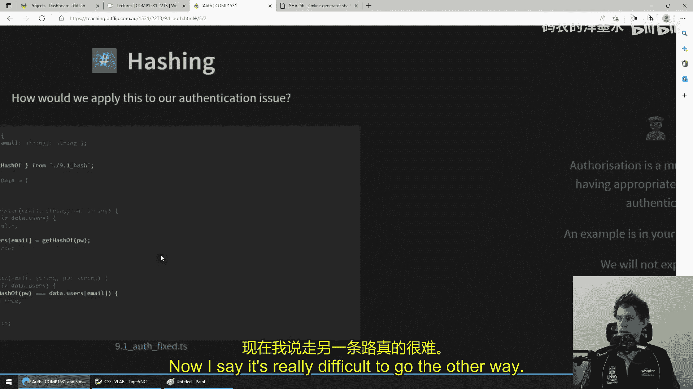

That。And this has nothing to do with the course here。

 This is more just for your own general knowledge， whilst it is very difficult to undo。

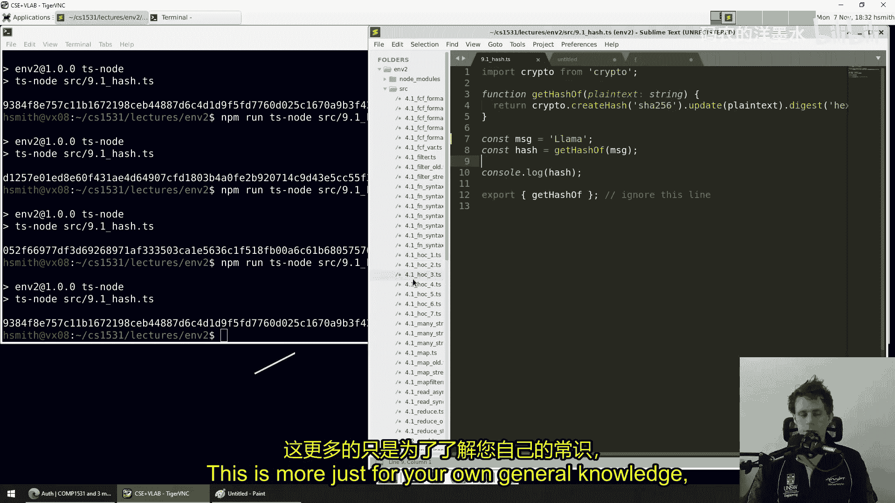

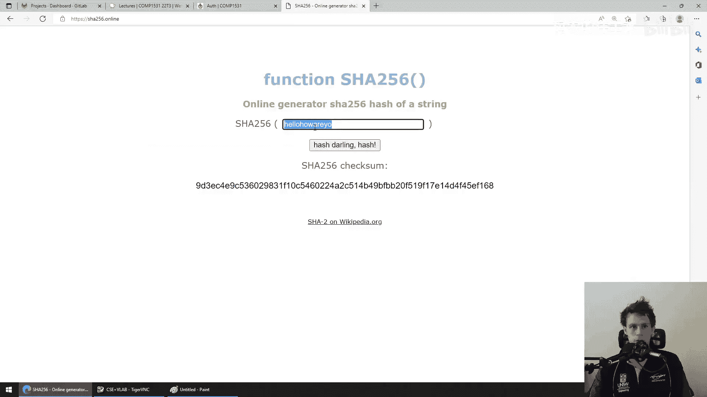

I can come here and I can say there's the hash for a。And I can go write that down。 A is that。

 And then I can enter B， and I can copy that and say B is that。 And I can enter C。

 And I can do the same thing。And what I'm doing here。

 as I do this is I'm creating something that they'll refer to as a rainbow table。

 It's essentially a table of all the different hashes。

 And this is really helpfulca let's say that you hack into， you know， the compt 1，5，3。

1 major project database and you get a bunch of hashes like。😊，This。Now。

 all you have to do is grab this hash and enter it into your like big file you've created of all the different password permutations like A。

 A， A， B， A C。 You know what I mean， you can kind of like write them all out。

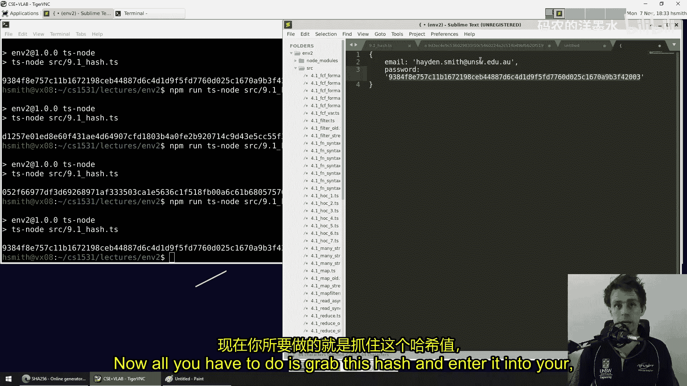

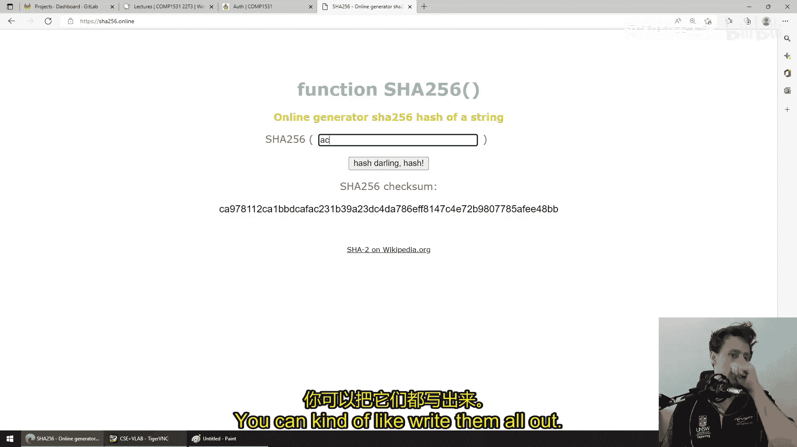

And， again。This is just for general knowledge。Obviously。What this implies you。

 what this implies to you and something you should think about a lot is that。Simple passwords。

 even if your password is protected， it's not really protected because。

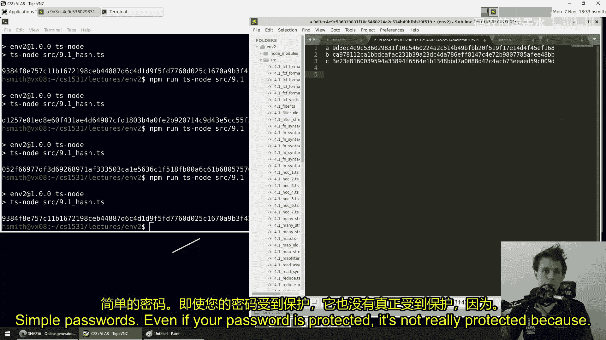

For simple words， like。Cactus。Someone's priority if I look up Sha 2，5，6 raininbow table。

You'll say this。 Cactus has this particular hash。But if I come。I hope they have a shout to 5，6，1。

 Yeah， they do。 If I come here。You notice that as I enter that， it tell me that it's cactus。

That's because someone's already gotten a computer that go， that go through every。

Single ASI combination。And figure out the hash so that when you get a hash。

 you can figure out what the string is。Very， you know。

 so that's why long passwords are really important because let's say you pick a long password。

Like cactus makes me cry。 Thiss a really long string。And you'll see if we try and crack that one。

It hasn't been found yet。 No one's， no one's generated that yet。You might be thinking， well。

 that's strange。 Why has no one done it， Like， you know。

 surely it's a big planet with a lot of computers。 And this is where we fall back into the interesting world of kind of maths。

 right， where like。

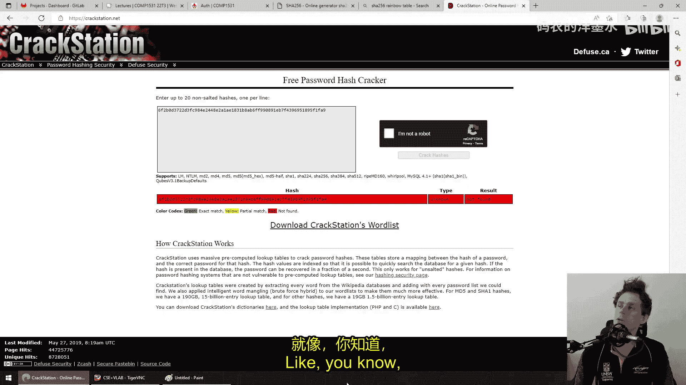

嗯。Let's imagine， you know， a password。 Let's just say a password can be any of 70 characters。

You know。So if you have a one letter password， let's say with 70 characters。

 there's only 70 different ways the password can be。70 different letters。

 If it's a two letter password， then it's， you know，70 of the power， two different ways it can be。

 And then again， let's imagine for a second that to calculate one hash。To like。

 just simply run this program that I wrote here with a different thing like A or A A。

 Let's imagine that it takes。 let's be quite conservative and say， let's imagine that it takes 0。

001 seconds。To run that function。Well， now this one is going to take， you know， the 70。

 let me pull this up beside it。

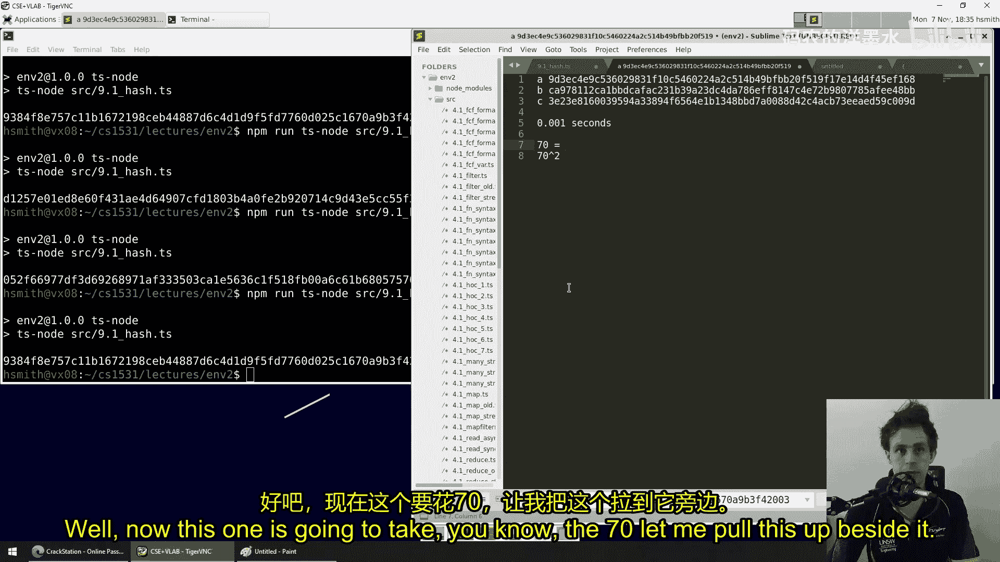

This， you know， so like this， and and I I know a bunch。

 I know there's a handful of you that know a lot of this stuff already'cause you're really interested in it。

 but I'm just trying to prove a point to people who haven't thought much about it is like。Yeah。

 but one character password， obviously that's gonna take you 70 times 0。001 seconds， right。Which。

Is 0。0 seconds to get every single one character password。

And then you look at your two character passwords， which are 70 to the power of 2。 You know。

 and that's gonna take 4。9 seconds。 Then we'll do like， say， four characters，6 characters。

Would do like 8 characters，10 characters。We'll do 12 characters， and we'll do 14 characters。

 We'll just do like a bunch。Of really interesting ones， right？So。Just trying to。

Guess I'm really dragging this example out of it。Yeah，70， the power of that equals something。Yep。

Could just use X L for this。 I think last time I used Xel。

'cause I probably had a bigger brain back then。 Well， let's have a look at this。 So if you have。

A  four digit password don't it takes 0。01 seconds。Well， that's gonna take， you know。

 that many seconds， which is that many minutes。Which is 6 hours， say， okay。

 now it definitely does take that long。 point001 seconds is probably a really long time。

 But let's say this one takes you know，6。7 hours。 Okay， well now we do it with。70 the power of 6。

 That's how many hours that takes。 Well，24 hours in a day，365 days in a year。 So now， you know。

 a six character password to figure out the hashes of every single six character password。

 you're now looking at 3。7 years， right， And when you do 8， now you're looking at that many years。

 So， you know， and， and the whole story of this is not really anything exciting。 It's really just。

The effect of exponential math， right。Cause when you get to 10， you start to get into， you know。

 like。89 million years。And suddenly at 12， you know， you get into。Tion numbers us， right？

Like longer than， longer than the universe has been around， I think。You at the point， encryption。

 cryptography。 If this interests， you go learn more about it。

A lot of it's propped up on this idea that there's things to do in one direction that you can't do quickly back。

 but you can kind of hack around it by like storing a big database of all the different hashes， but。

There are so many different combinations of things that you just physically。

 It's physically not possible to go and store them all。嗯。At all， you know。

Like one thing I always think about is。They estimate that there are approximately 10 to the 80。

Adams in the universe。And。Let's say you divide that by， like 70 to the 16。That's still really big。

That's okay。Let say 22。Now， it's gotta super big。 Obviously， let's try like 35。Still too big。Oh。

 so what am I doing， Spak out loud。 all I'm really doing here is saying that if you were have a。

43 character password where you could have 70 different digits。

There are more combinations of passwords that you could have than there are atoms in the universe as far as our best estimates go。

 You know， so it really does get to a point。 And this is why they talk about long passwords being important。

 It gets to a point where。Someone's just not gonna guess it。If it's long enough。

 you're just not gonna be guessed。 No one's， no one's gonna figure out what it is。Obviously。

 that's maybe not the case。 Like， don't sit here being like if I have a 10 character password。

 I'm really safe 'cause lot of people have 12 character a lot of people have 181616 character passwords that are just gonna be password password。

 And obviously， you know， if you're smart and you're making this like special table of things。

 you're gonna probably put that in at some point or something。Anyway。

 I'm about to now just kind of talk a little bit about。😡，Tokens and iteration 3。

Now that we've kind of covered the basic theory of it。

And I wanted to see if there are any questions before we， we moved on，'cause this lectures。

 this lecture is nearly done after we talk about iteration 3。Matthew says， is it open source。

 Yeah most。Most kind of encryption libraries are open source。Yeah。I don't know of many that aren't。

I mean， if this makes sense， encryption isn't really about computers。 It's about math。U。You know。

 and， and。These libraries are just expression of that math。 And I don't， as far as I know。

 you can't pattern a lot of， I don't know。 Maybe you can't pattern math。 I have no idea。Anyway。

 let's have a quick tangent to iteration。Iteration 3。So。If we come down in iteration 3。

To the section on。Tokens。图。嗯。There's two things， to iteration 3。

The first thing is that you need to store passwords in an encrypted form。

 That's super easy because we've really shown you how to do that。 We showed you right here。

 It's in the lecture slides， right， passwords should not exist in your data store anymore。

The second thing， which is a bit more interesting， though。um。Which is kind of alluded to here。

Is about。It's what you would call session hijacking and and I'm aware that this piece of text might confuse some people here because it's it's a new thing we've added to the spec。

 so you know there's definitely ways we could improve our explanations of it。

 but basically most of you have implemented sessions。In iteration 2。

 And what that means is that if you look at your data store。

 you might have something like this users where， you know。

 it might be like emails hiddenden it U and S W password is soon gonna be like some hash。

 And then you might say sessions。 And then you might have a list of session I Ds like this， right？

 Maybe you have something similar。Where people， you know， every time they log in。

 they get a session and when they log out， that session is removed or something like this。

One of the problems。With this approach。Is that。Or or， people can basically。It's。

 it's really hard to get into the depths of itcause there's a bit more kind of web knowledge here。

 but。Maybe we should look through the sample flow here。

A sample flow of a user logging in is that they call off log in。

The server generates a token and the hash of the token in a secret。

 and then the server returns the hash is the token value in the response's body。O。

So what you might have done in say iteration2 is when you have your like or login function。

 say takes in an email and a password。This function might， you know， do the checks。And， you know。

 if they're all good， you're like， okay， they're logged in。

And what you might return is you might return an object that says token and that token might just be。

 say。You know， a session I D of some sort。You know， like users。You know， two dot sessions。

0 or something like this。 You're returning the session I D。

But one thing that we are asking you to do， Federation 3 is to be cognizant。That。

Sometimes it's possible for people to。Hjack sessions。And what we mean by this。

Is that let's say that we have two users， and maybe I'll just change this data store here a little bit。

Let's say we have two users。And the second user here。Is， you know。

 Jake at UNSW dot com And Jake's got a different password。And。Let's say， I'm a hacker。

And what you actually respond to me with， and I'm not going to use。

 I'm going to use just hard coded here like Stub code is you return to me a token。This is the token。

 and that token is just like a session I D， which might be like 1，2，3cause I'm Hayden。

 And this is all good。 And this is all cute。 But the problem is。

 if I'm a hacker and I've gotten that from your login function。

 what I could start doing in my subsequent functions is tampering with the token。

And what I mean by that is， let's say that， you know。

 I'm a hacker and ortho login returned me a simple token that looks like this，1，2，3。

 I might come along when I call subsequent functions and say， you know what。

 I'm gonna change this to a bunch of random numbers。Like this。But the problem with， and this is bad。

 because eventually。嗯。I might guess the right number。 if I was to change it randomly。

 One day I keep changing it， and eventually I change it to that。You know，8，9，9，7，8，7，9。

And then the server says， oh， hi， Jake， I can see it's youcause you've entered the right session number。

You might think， well。We could make the session number longer。 We could randomise it。 Yeah。

 and that's like kind of helpful sometimes。But。What can be even better here。Is if what we do。

 this is a little bit heady， I think this is definitely one of the parts of the course that might confuse people。

Is when you return a token， what you do。Is you try and。Return， not just the session I D。

 but a session hash。 Now as you can do this a few different ways。

 Some people might have already done it another way。 There's just a method to achieve a goal。

 which is to make your tokens tamper proof。 And I want to keep coming back to that。

 Everything we're talking about is about trying to make the tokens tamper proof。

And to make it tamper proof， I'm not just going return 1，2，3。

 but I'm actually going return a hash as well， which is going to be the combination of。

 say that the session I D 1，2，3， as well as what we call a secret string。

 So I'm just using my hashing file here。 And this secret string can be anything you could hard code it in。

 which might be， you know like lemon tree or something like this。

And maybe I can pull this out further and say， you know， can't， you know， session equals 1，2，3。

So the message is just the。Session passed a secret。

So what happens is now when your function is actually going and。嗯。

Returning the token in the login and register function， it's again。

 it's not just returning a session I D， but it's returning a session I D and a session hash like this。

Why this is so important and why something like this is so useful and it's very interesting to think about。

 and it's the foundation of in reality， libraries do this kind of stuff for you is that if someone gets this token。

And they start tampering with it。AndThey start changing this to 8，9，9，7，8，7，9。

They won't be able to get past you because one of the first things that you can do when you get a token like this is you can take the session ID。

😡，You can go and pump it in to say， you know， this cha thing here，1，2，3 and。

It's a slightly different one。 Oh， yeah， sorry， you pump in 1，2，3 plus lemon tree like this。

This website here is doing something slightly different， too。How we were doing it？Anyway， let。

 let me just put this hat。 Let me put this hath in here。So。啊。That's not working。 That's okay。8个。

You know so let's say someone comes along and they change this from 1，2，3 to 8，99，7879。

 They don't know how to change the session hash to the right thing。

 So when you look at their token on the server in your， you know， channel's view。

 your channel details and your messages and all this kind of stuff。

 when you try and generate the hash for that。Now， suddenly。You get a different hash。

 So you on the server can then look at the hash you got from that and you can look at the hash they gave you。

 And this is clearly wrong， right， This is the wrong hash。It doesn't match。It doesn't match the 8，9。

9，7，8，7，9。And it's like， well。What if they hash it themselves is the next question， Right？

 What if they come and take their 8，9，9，7，8，7，9， And every time they pick a random session I D。

 they also hash it。 Well， the problem is they can't， because they don't know this particular secret。

 which lives on your server。 You never expose that to them。 Obviously， yes。

 by having this little secret in theory，It's another piece of sensitive information that if someone hacked you。

 maybe they could figure it out。Maybe they could go and grab it from the source code or something。

 but that's not really a concern'cause we're talking about sessions here。嗯。And， you know。

 if someone has your source code， you've got some problems anyway。 and a few other details。

 But the point is that this is a way to secure your payloads to make them tamper proof because now someone can't just go and change the information in the token because they don't know how to get the new session hash。

 This is sometimes what you might call a signature。Where I don't。

 I don't just return the information that I'm interested in， which is the， the payload here。

 but I also return a signature， which could， which is， is， is。It's。

 it's basically like only the server can produce the right signature for that payload。

 So if someone taampers with the payload， they can't generate the new right signature or the new session hash。

 so。That's kind of a way of doing it is's probably the way I'd encourage you to do it。嗯。Yess。🤢。

Sometimes like the other way that we talk about in the spec is that instead of sending session I Ds。

 you can send。 you can actually just， the token can just be the session hash。

And then all you do now is you just like。Store the hash instead in your data structure。Up here。

 so your sessions are just hashes。That's really not too different from。Generating a big session I D。

 though， you know， that's kind of like the equivalent of just generating a big， big ran number。

 So I'd probably more so recommend that you try and do what I've suggested。

 which means you don't actually need to store more information in the data store。

 rightca you're just actually only you're only returning that information as the return value because all the secret hash then becomes is like like really。

 all it is is just you know， hash of 1，2，3 plus the secret。That's all that is。

And when you have your function that checks if the token's right， it's just doing the same thing。

 It's just hashing the session I D in the token and seeing if it matches the other thing in the token。

Before I kind of keep moving and finish off this last example with the tokens to do with the headers。

Again， I want a quick pause。And asking your people have questions because this is quite a heady topic。

 And I want to make sure we nail it。So I'll do a quick pause for 20 seconds and see if people have questions about this。

Anthony says， bus。It's very interesting stuff。Dey says。

 so is it just making a hash of the I with the secret？ Yes， yes， that's it。

And then just returning that as part of the token I。You know， I wanna be clearcause。

This language is so easy to mess up， but it's like， this is the token。This is not the token。 Often。

 people just kind use the word token everywhere。 And I think even in the speck。

God even in the speck it's written a bit poorly。 Not that it matters。

 This is just a pet hate of mine。 So I'll make sure that's cleaned up。

 But token is what you get back from the server。 Token is the whole object， right， token is actually。

dependspends what you define it as。 I'm not gonna go too crazy about that'cause you can interpret it different ways。

Yeah， so Anthony says yes。It all makes sense。 So to recap， there's three things here。

 there's hide your passwords。With hashing。There's use hashing。

To add more to your token to make your token payloads tamper proof。

And then number 3 here is putting your token in the header。

 And I'm just gonna quickly touch on this'cause it is mentioned in the spec， but basically。

If we go back to。Some servers。From an earlier iteration。嗯。How the old speck looked。

Was that if you made a post request for most of your requests。You would often。

Pass the token through the body。😡，So the top of most of your functions might be something like this。

 requestquest dot body dot ho can say。And then you might have a function that's like， you know。呃， if。

This is what you might have done previously， if is not valid token。Token。um。Then， you know。

 return error， error。You know， maybe you had something like this。But the point is in all these cases。

 you would take you would get that token from the query or the body。😡，um。4。This iteration。

We're asking that instead of that， we actually get it from the header。

 So instead of getting it from the body like that， we actually want you to get it from the header like this。

Now， how does that change what you do Well， when you're writing your tests。

 it's going to change it because now you're going to send the token not through the query string。

 but you're going to send it through the header like this， you know。

 you're going to send your token here。Or whatever it is。And same for this request here。You'。

 you'll do something like this。嗯。And the question is kind of like， why do we do that。

 Why do we have to send it through this headers thing。

 Headers is like the metadata associated with a request。 It's kind of like， you know。

 when you send an envelope， the headers are like， you know， the address and stuff on on the front。

 It's kind of like it's like not the main body of it。 It's just the metadata。And then also， just。

 I guess， to complete this， if you're trying to send it through。

Say the ARC client or something like that。 How do I get to apps again。I was figured how to open up。

Os。How dont。Have a moment。How do I open up。How do I open up apps in Chrome。Someone help。Launch， okay。

Silly， so it's really quite simplecause previously when you made a get request。

 you'd put some data in the URL。 But there's just a header section。

 You know thatcause of the content type header and same with post requests。

 there's headers body and and variables。 The reason we do this is actually really， really simple。

 If you go and have a look at HDP requests。 You have get。Post， put and delete。嗯。Then you。

 you can send data through the query and the body and headers。 Right。

 Soqueries just like through the URL bodies like， you know what the body is。

 and the headers is something separate。You can send data through the query with any request。

 You can only send data through the query with。Post and put。

 That's why post and put you send it through the body， get and delete you send it through the query。

 But with headers， you can send it through everything。 But here's the important thing。

This is unencrypted。Whereas these two are encrypted。On modern web。Right。

 so what that means is that the header is the only place where for every request you can send encrypted information。

That's why we send the token there， because the token is generally considered to be sensitive。

 because。Whilst we said before， if we go back to what we were talking about。

 we said that we had covered a few things today like one and two， here。

 like this whole hashing thing， it just makes your token tamper proof。

 but that doesn't stop someone stealing your token because if someone can steal your token。

 it's like they've authenticated as you and they don't need to log in， they can just use your token。

Right， like if I stole your token， I could just start calling server functions with that token and they'd think I'm you'cause that's all you need。

 right， Like when you're checking if someone something。

 if you're checking if someone is someone or you checking is against the token。

So that's why we move it to the head off iteration 3。

 not in the body or the querycause in iteration 2， you would have been sending the token through。

The query sometimes and the body other times。Right。

 and if you're not sure what I mean by like the information is unencrypted with the query。

 think about this Every time you bookmark a page， you bookmark the entire URL。

 So you think about a website like this， right， When I bookmark this page。

 I bookmark Bing dot com Sha 2，5，6 rainbow table。 So if you just go and put your token up in that URL。

It's all kind of， it's all kind of public on the， the， the Internet。

 The Australian Government can see it your IP can see it。 There's no encryption there。

 The Us you access aren't encrypted。 This is that whole thing， again， about。

Government surveillance and stuff is， is like， you know， and you should be like aware of this。

 is that。When you send， well， I don't know what the NS is up to， but。

When you send messages unlike Facebook Messenger， all that information you're sending is encrypted。

So in theory， both neither Facebook or the government can see what messages you're sending， right。

 in theory， because it's all encrypted because it's all being sent through a body。Typically。

 and therefore， anyone who tries to kind of in intercept the the data on the way across the internet。

 they just eat gibberish'cause it's all encrypted and we've just talked about encrypted today and how we make things look seemingly random。

 But every URL you send access is not encrypted。 So every time you access any page or any time the URL changes。

 I'm pretty sure nearly all of that data is being stored。By ISpss and all the government these days。

 So， you know， that's just something to keep in mind。 And that's also why we don't send data。

 sensitive data through the query'ca it's not considered safe anyway。

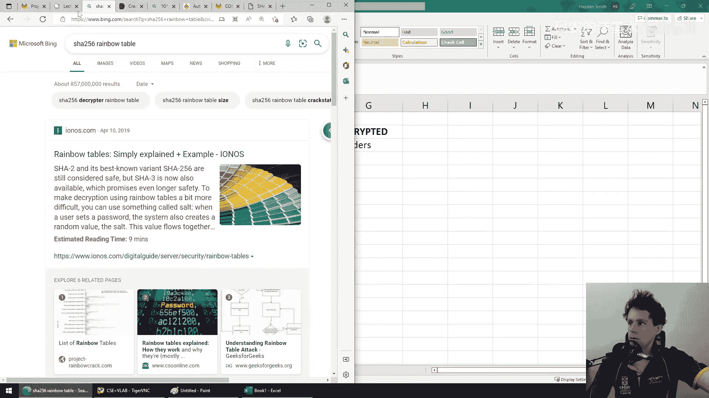

Just to wrap this one up。Ipe that was interesting。 I hope that was insightful and helpful。 frankly。

 for wasn't。 I'm sorry。 Let's tackle it on the forum or ask a question in the next 30 seconds。嗯。

But the last thing we talked mostly about authentication today。

There's nothing really to cover with authorisation because。Authorization is just a check。 And you'll。

 you'll deal with this in your project pretty simply because you'll have someone call a function like。

Edit channel。Or， you know， add user， and you will。You will authenticate them by looking at the token or。

 you know， you， you look at the token， which is their authentication。

 And once you see that it's Hayden， the next step， as you see， is Hayden and admin or is Hayden。

 not an admin。 That's really you author seeing what I'm what Hayden is author to do。

 So there's nothing really to talk about on that topic in this lecture。

 We would more just exploring definitions。 If you could please leave some feedback that would be great。

 We're gonna go take a。😊，We're going to take a five minute break。

And then we're gonna keep going into the next lectures。 So let's。

 let's just assume that we'll keep going at say 7，10。That's probably easiest。So， yeah， cool。 Anyway。

 thank you。 Leave some feedback。

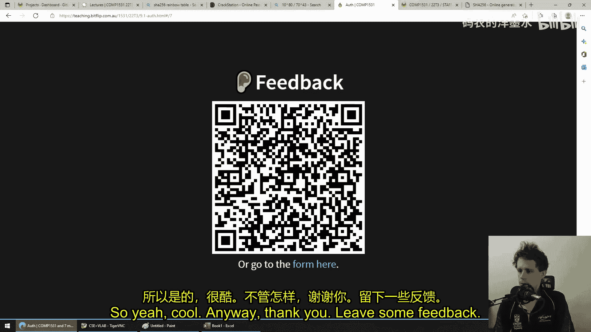