# 【全集】新南威尔士大学 软件工程基础 中英字幕 1080P COMP1531 p25 Lecture 25 - 软件复杂度 -BV1M7Nwz7EGh_p25-

Alright， so kind of our like nearly third last lecture for the term。

Is the lecture on software complexity， It's the last design lecture that we do。 It's not really。

 it doesn't really have anything to do with the project。 It may come up on the exam。

 but it is certainly very interesting。 And this lecture is essentially about。

We need a way to talk about。And analyze how complex software is。You know， because。

Communication is really important。And if we don't have a way to actually have a conversation about things。

 it's very hard to get better ideas。 What I mean by that is， if someone says to you。

 hey is your software complex。Like， what do you even say to that， You you know what I mean。

 But what do you say。I don't know what I'd say。 Well。

 I know what I'd say'cause we're about to have this selection of it。

I wouldn't have known what I was going to say in my second year uni is the point。

And we're going to cover two main topics。 one's quite theoretical。

 one's mostly theoretical a little bit。Fun， first one is accidental versus central complexity。

Kind of comparing and contrasting these two fundamental ideas of what complexity are。

 And then the last one's on some kind of analysis or measurements。

 which is on something calledcyclmatic complexity， which is about looking at。

How a complex software is in putting a number on it。So， first thing。What is some software complexity。

 You know， if I could ask all of those here live to define what software complexity is。

 What would you say。What would you say if someone someone asked you， what is complex software。

Dillon says how complex software is。That's a terrible definition。But， I appreciate the effort。

Does many different things。Yeah。😊，Are you complex if you do many different things。

 It's a good question， right。But。My throat's starting to go again。Essential。

 when we look at software complexity， what。One way of dividing it up。

 which is the way that we encourage you to divide it up is into two big categories。Right。

 and it's what we call essential and accidental complexity。

 Anthony says that complexity soft software complexity is how easily understood a software program is。

Yeah， that's one way of looking at it。What's more interesting is that。

 And this is kind of where this slides getting to and where this topic's getting to is that。

If software is hard to understand， it's pretty easy to tell that it's complex。

But a distinction that's quite relevant for us is the difference between。

What we'd call essential and accidental complexity。

An essential complexity is any kind of complexity that we feel is inherent to the problem at hand。

For example， if you have a project back end like your major projectors and someone says。

 how complex is it and you say it has 40 routes。They go， wow， that sounds complex。 And you're like。

 yeah， but it's， it's essentially complex like。It's essential that it's that complex because that's the scope of the work。

Whereas accidental complexity is complexity that's not inherent to the problem。

 It's essentially a complexity that has been introduced that didn't need to be introduced to solve the problem。

 And for example， that would be writing your own Json PAsza or， you know。

 finding a really convoluted way to encrypt stuff。Maybe you've written a hash function instead of using a library one。

 It's， it's any time that software becomes harder to work with， harder to understand。

 harder to maintain when it just wasn't really necessary for that to be the case。

The reason that this distinction is important when it comes to conversation is because essential complexity。

Basically can't be removed， but it can be managed with good software design。

So what that means is that you can't really prevent needing 40 routes for your project or however many there are。

 But what you can do is you can write your code and design your code in a way that is。

More elegant and more maintainable if we go back to that week five lecture。Where we talked about。

 you know， writing maintainable software。Whereas accidental complexity can basically just be mitigated outright by better engineering decisions like the smart use of libraries。

It's really easy to remove a lot of accidental complexity。 That's what senior engineers are good at。

 It's what experienced engineers are good at。 It's what teams of people generally。You know。

Come together with， and someone will come up with the， the idea。

But it is hard to remove entirely because it's in all of our nature to add accidental complexity to all problems。

 right。It's just like bad design。 It just happens。 It's a question whether it happens a little or little or a lot。

嗯。There are some questions that don't necessarily have answers。

That we try and leave students with a little bit。 One of the most interesting questions is。

 is there an easy or scalable， automated way to distinguish between accidental complexity and essential complexity。

It's a good question。Not really at the moment。 Will there be in the future， maybe， And to our degree。

 if we can identify it， will accidental complexity be removed in the future。

 That's just something to think about。 You know， we might have more tools in the future that can do this for us。

You know，10 years ago， lints weren't really a thing。You know， nowadays。

 we have that kind of code stuff that can autocomp。

 There's a lot of crazy things that can happen now。

 So that's just something to keep in the back of your mind。

 But that was essential an accidental complexity。 really easy topics。

The second part of this short lecture is on measuring complexity。 So if， if we pose the question。

 how can we measure software complexity。What we generally might want to measure is how coupled a piece of software is。

 Remember， again， like we looked at like coupling and cohesion。 coupling was the degree to which。

Independent pieces of software are joined together。

 which we want to avoid and cohesion was the degree to which similar pieces of software were joined together。

 which we want to keep。 But then we havecyclomatic complexity。

 which is a whole new idea that we haven't covered yet。Which I think we do in a sec。 Yes， sorry。

I thought we talked about coupling cohesion。 I think I actually covered this much earlier than normal。

 I don't think I。I don't think we had this much detail on the slides， but just a quick recap， again。

 coupling measure of how closely different software components are。

 So just to reiterate from week 5 lectures if。If you have an o。Library and like a channel's library。

 they're different。If they're coupled， it means they're kind of joined together。

 which you don't want them to be。 So we want to have low coupling or loose coupling。

 Coup is of different software components， whereasas cohesion is the degree to which elements of a module belong together。

 So essentially if you have， you know， channel details and。You know， channel messages。

 they're kind of very similar。 So you want them to have high cohes。 You want them to stay together。

 So Nkil says it's it's like how interdependent they are sort of it's basically say its it's really honestly a bunch of waffle in the sense that all we're talking about with coupling a cohesion is that things that are different should be a apart and things that are similar should be together。

 right， you get this in the fridge， you put you put your your drinks in in the shelf and you put your fruit and vegetables in the CRISPR。

 You know， it's good if you keep things that aren't similar apart and things that are similar together。

 That's all we're talking about here。 Butcyclomatic complex is a new idea。

 andcyclmatic complexity is the measure of the branching complexity of functions。

So it's a way to measure how complex functions are， but in particular。嗯。In particular， it's about。

There。How to put it。Back when we did。Test coverage。Two weeks ago。

 we talked about how you can do coverage on lines or coverage on branches。

 where branches was all the different ways that software could like break off from one another。

Cylomatic complexity is the measure of how many different kind of if statements while loops we have in our functions。

 because what it's focused on is computing the number of linearly independent paths through a function。

And it's actually a pretty simple thing to calculate。 And there's this formula here。

 which is gonna to make no sense until we go through some examples。

 But basically what you do is you take a function， and we're gonna do a few of these together。

 you convert it into a control flow graph， you essentially diagramimate it。

 you turn it into a diagram and then you use this function to calculate thecyclmatic complexity where ease the number of edges and n is the number of nodes。

 And here is an example of a function here。 So if we take a function like this one。

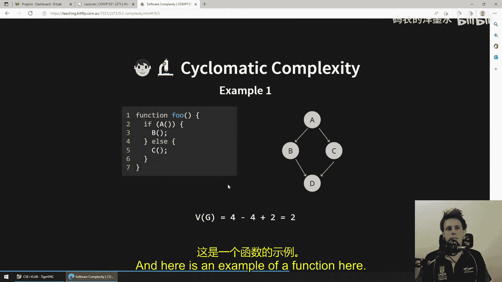

嗯。And， you know， let me take a screenshot of it。Can I just right click Now， that's right。Screenshot。

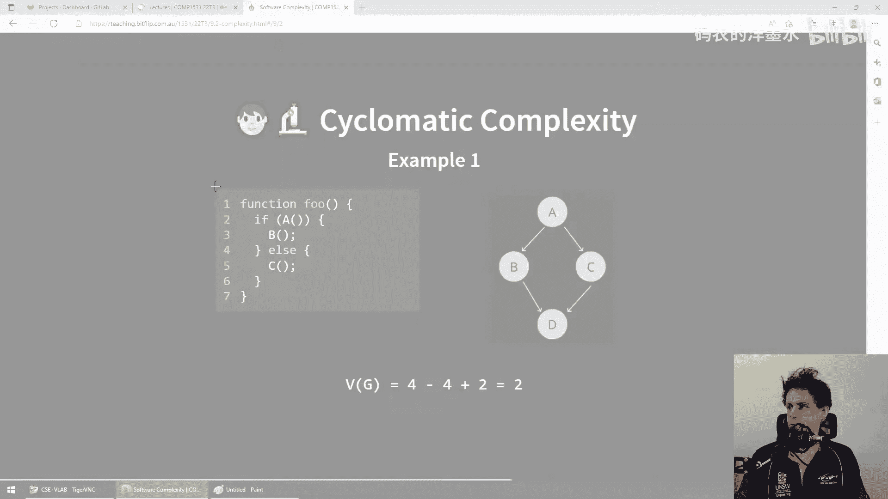

So let's take a screenshot of this。What we can actually do with a function like this is we can actually try and trace the flow through this function by highlighting a bunch of the different branches And what I mean by that is let's say that this function starts at the top here。

😊，And what we're gonna to do is we're gonna， we're gonna explore what are all the different ways that we can move through this program。

 Well， this program is pretty simple because when you start the the when you start the function。

 you can only ever go through the if or the L statement。Right， so I could call this one here like。

 I might call this one like my start。And this is the if。And this is the else。Right。um。

And there's only two ways I can go through it。 I can go through the if or the else。

And once I'm in the if， well， what am I gonna do next， I。

 I'm always gonna have to go through this line of code that has the B function on it。Y。

 and when I go through the else， I'm always gonna have to go through the line of code that has the C function on it。

 And whether once I do B or I do C in the case of B， Well I skip the else in the case of C。

 I never go through the F。 So both of these take me to。The end of my program。Here。

This is the end of my program。Yeah， so that's the program finishing。嗯。

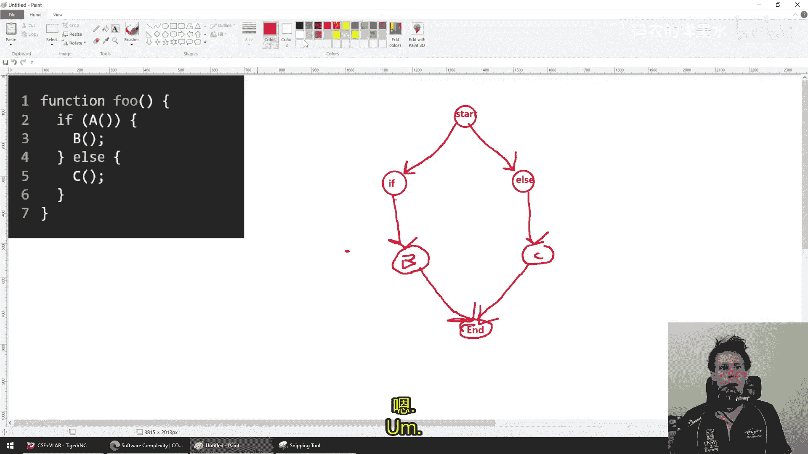

Now what we do once we have a graph like that is we apply our formula， which is E minus n plus 2。

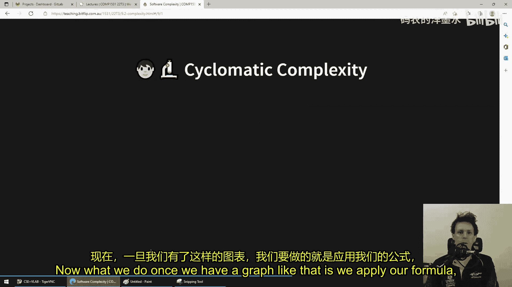

So E in this case is the number of edges， which is you know， the lines， 1，2，3，4，5，6。

 and is the number of nodes， which is 1，2，3，4，56， and then we say E minus n plus 2。

 which is 6 minus6 plus 2， which is2。So now we know that thecyclomatic complexity of that is 2。Right。

 and a low number is good。 generally， the higher the number。The worse it is。

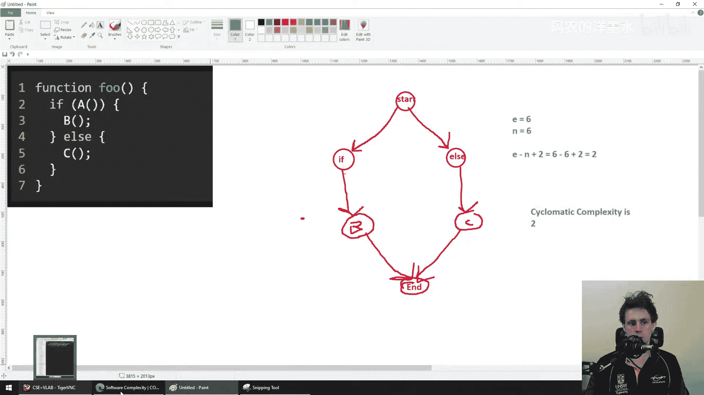

，Yeah， the higher the number， the worse it is， the lower number， the better it is。

 And we can apply this to many different examples。 But actually， before we do that。

 let's just take a quick pause and be like， hold on a minute， Hayden。

 what I do is different to what the solution is here。

 And the reason for this is actually quite interesting and simple。

 There's no correct way to represent your code。

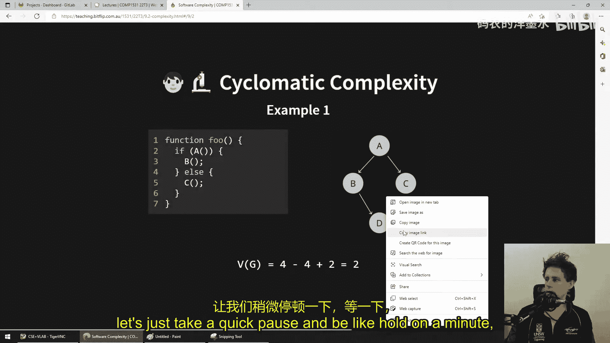

Diagrammatically， because。You're representing branching andcyclmatic complexity actually represents branching。

 And what I'm saying with this is that this whole B thing we added here is kind of unnecessary。

 You could have kind of skipped this and just had the program do what the the kind of answer has over here。

 But the reason it doesn't matter that we added those extra things is because it was a linear flow。

So I added these extra steps， which didn't affect thecyclomatic complexity becausecyclmatic complexity is measuring all the different branching factors。

 And in this case here， this moving through the B thing was not it wasn't like a decision point。

 Like if you enter a， you're always just gonna do B and then move on。 It's always linear。

 So when we add an extra node， we just added one extra line。

 And we added two extra nodes that are unnecessary。 So we added two extra lines that are unnecessary。

 So when we did the calculations， Two extra nodes，2 extra edges， they kind of cancel each other out。

 So don't be scared about draw。You know。

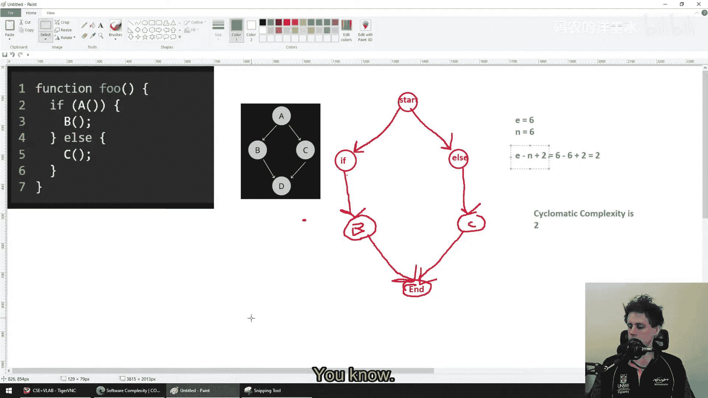

Drawing is wrong。And if we move on to another example here before you look too heavily at that diagram on the。

 the right， let's try this one as well。 So in this case here， well。

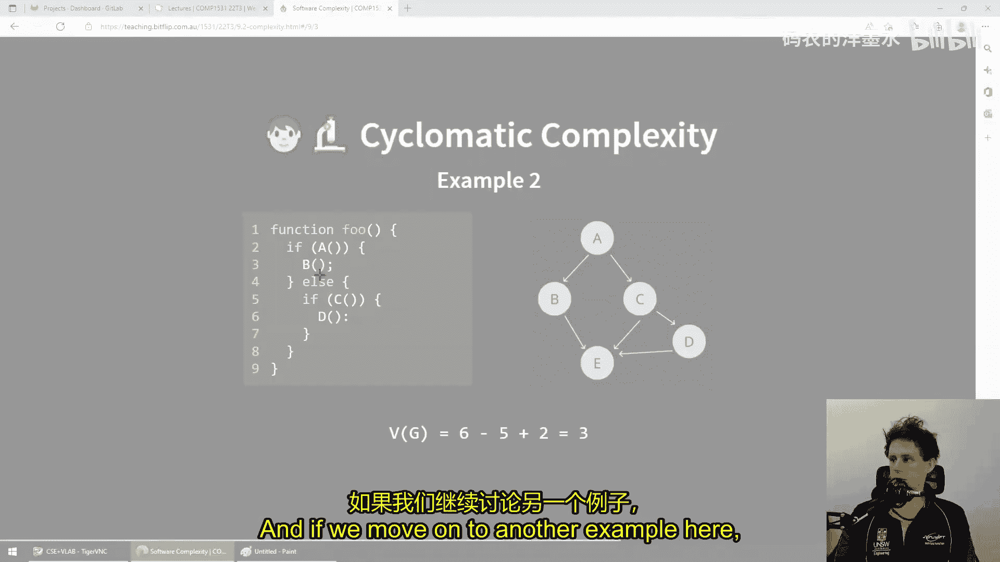

Nil， yeah， if B has two branches in its function， we'd have to show that。

 And I think we kinda have this here。 So this might answer your question。

 Let's say that we have our start up here。 right， We have our starting point。 Now， from our start。

 we can either go through our iffo or else。Now， I might write， you know。

 how you annotate this is up to you。 I'm just gonna write if here。

And then here I'm going to write else。You know， and once I'm inside the if。

 well I'll keep my things consistent， we're going to call the B function。And if I'm in my else。

 then we can do one or two things， which is we can either go through like an another if。Like that。

Or we can skip the if。 I don't really know where we go if we skip the if。But if we go inside the if。

 we're going to call the D。Like that。And if we skip the if， we're not gonna call the D。

 but these things end up in the same place。 You know what I mean。

 like they'll finish it the same place。 And if we go through call the B function， that's all。

 they're all gonna finish at the same place Now， you know， they all kinda come down here。

I should probably draw that a little bit differently。

They're all gonna kind of finish at the same node in the end。Which is like our end point。And anyway。

 I'll just write a smiley face for the end。So now if you have a look at this diagram。

 you can see a few things。 anything that's totally linear was unnecessary。 So in theory。

 I don't really need that。And in theory， I don't really need this。

But it doesn't matterca you can always draw redundant things in it and the math will come out the same。

 So what is it E minus n plus 2。 Well， E is what do we got 12，3，4，5，6，7，8， We got 8 edges。

 How many nodes we have 1 to 3，4，5，6，7 plus 2 is 3。cyclomatic complexity is 3。 Obviously。

 this diagrams drawn differently。 That's these diagrams are very like slim down。

 So that's another example there。

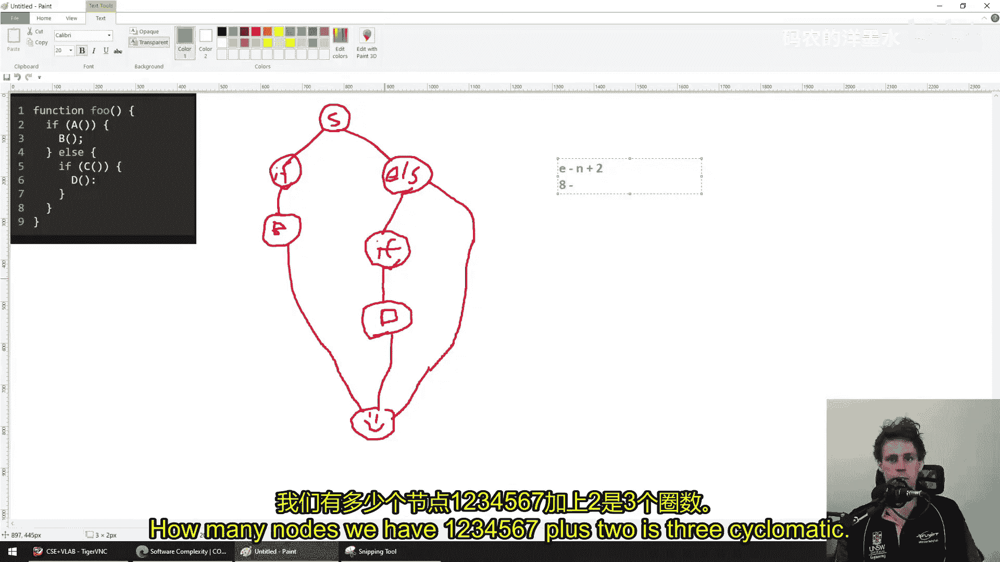

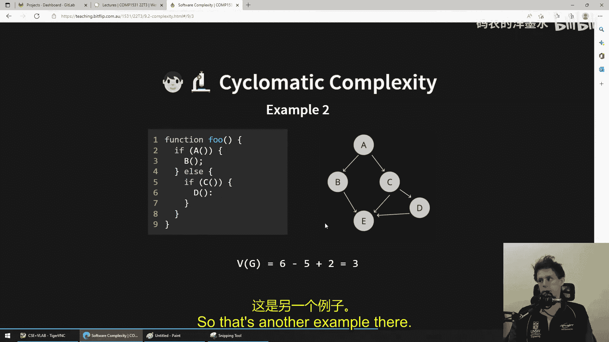

We have anothercyclomatic complexity example。 I think we got four to go through together。

 So we' got this w loopop here。 This one's kind of easy。 If you think about it。

 We have our start up the top here。Then from the start， well， we're always。

This is where it gets a little bit tricky。 I know we're always going go through the while loop。

 I guess。Cause you always have to call at once。 Maybe I'll get this wrong。We'll find out。

So you kind of have this。Yeah， you can either like， you can either go through the while loop。

Or you can go straight to the sea。So I guess you always have to go through the while loopop。I think。

So we're going to go into the while loop and then from the while loop。

 we either kind of come back into the while loop。Or we go to the sea。

 and we always finish at the sea。And then from the sea， we like， end our program。

Let's see if we got that rod， I've probably screwed something up。

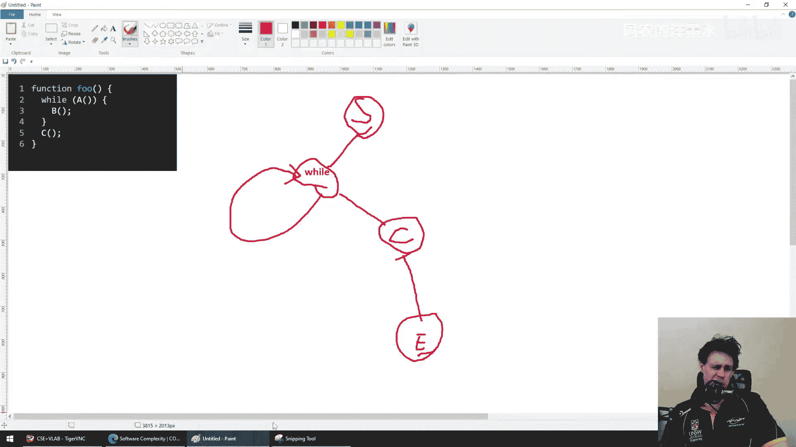

Yeah， how many edges we got 1，2，3，4， we got 4 there。 It's not2。 is it。 Oh， it is 2。 Okay， well。

 there you go。 This is what I mean， Don't get too caught up。 Like as long as how you're drawing it。

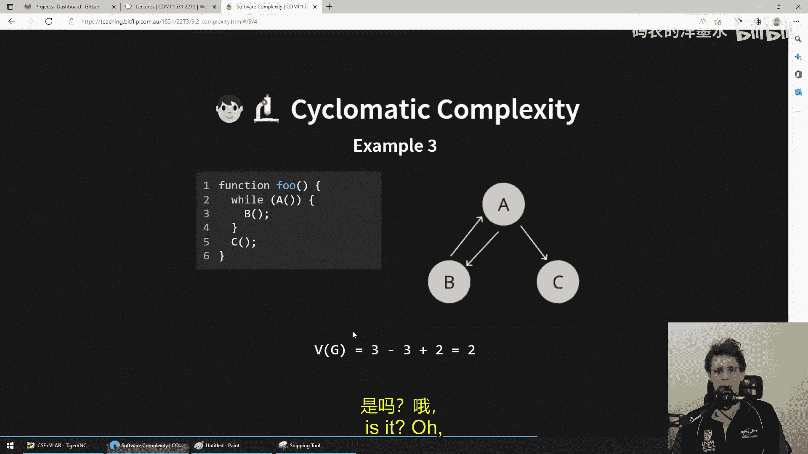

Makes sense。 You can't be okay。In this case， we had four edges， four nodes， and we got two。

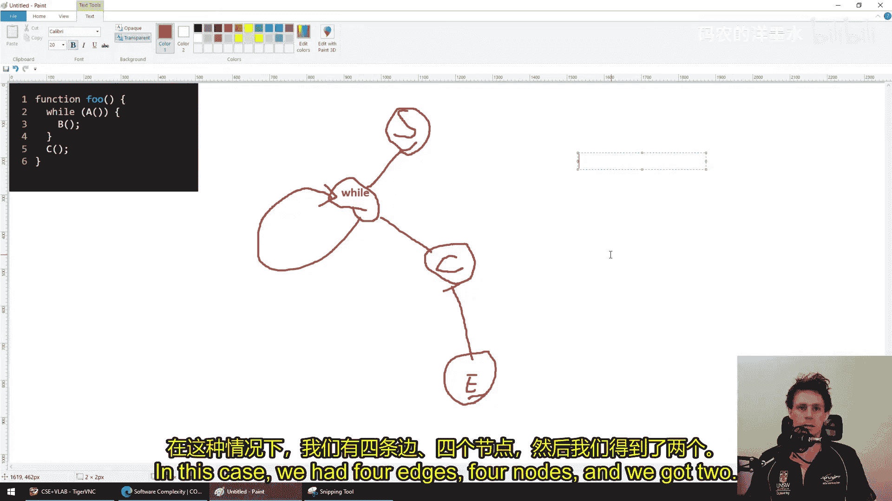

I've never drawn it like I did today。 I don't know what compelled me。I don't think it really matters。

 because。Obviously， you can think you either enter the while loop or you don't， but。

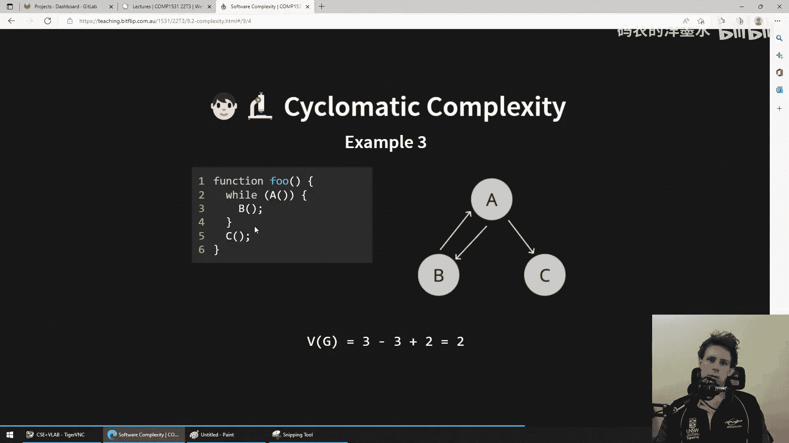

What I drew here wasn't really like this was the entering the while loop part。

'cause you kind like I was kind of thinking， well， no matter what。

 whether you enter the while loop or not， you still actually have to execute this line of code here。

So this a here， this is technically like the a function that I was drawing。And then like。

 if you enter the wall loop， you're gonna have to enter， you know， call the a function again。

 you know， So you're always going through that。 But hope that's not invalid。

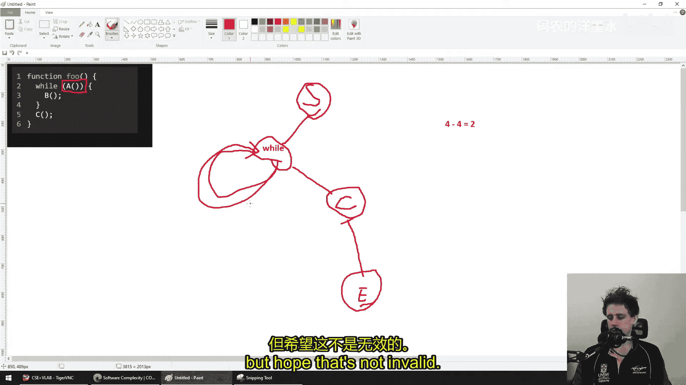

Anyway。And then the fourth example， this one's a bit more involved。

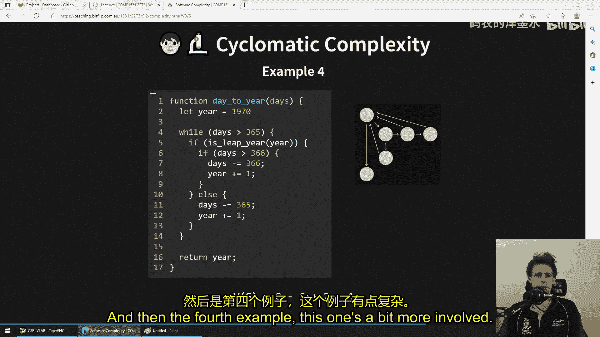

Sorry。God。嗯。Feel like I'm dying。Not literally。 that's a bit。It's a bit dramatic。 Okay。

 we have this function here。 Well， similar kind of thing again。

 Sometimes I find it really easy to annotate the functions actually， where I say， you know what。

 let's call this A up here， like where the function starts。

 And then we can like enter the wall loopop here， which is like B。And then once you enter it。

You can go inside the if statement。Or the L statement。 And once you're inside this if statement。

 you can， I guess， go to E potentially。Then let's called F the end of the program。

 We could try something like that where like a and then。We could try drawing in a different way， B F。

四。A。D， we could do something like this。Draw little circles around all of them。

F's quite sad down there。 Yeah， so from a， we can either say， like go through the while loop。

 Let's like visualise it a different way， or we can just like， totally finish the program。

 Once we're in the while loop， we can either go inside the if or the L statement。Easy enough。

And once we're in the else， we just end up going straight to the end of the programme。

 And then once we're inside this if statement， where we can either go from C to E。Or if we skip that。

 if we go to the end of the program。You know what I mean， like it all kind of。

 you just kind of follow the flow。 And then again， we do what we do before we count the edges 1，2，3。

4，5，6，7，8。 So we have 8 edges。 We have 1，2，3，4，5，6 nodes， which is 8-6 plus 2， which is 4。

 The answer is。

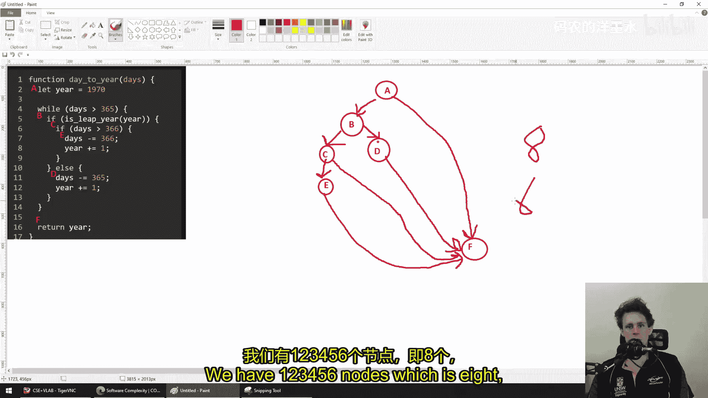

4 so there's ourcyclomatic complexity。 Now， as you can see， the higher this number gets。

 the more complicated the function is。 So you can start to see how this can be a semi useful measure。

That's what it is useful for。 Oh， we have another example here。

 It's the same thing as what we saw before。 I won't drag you through this one， but same gist。

 You start at the top。 You either ghost sorry。How is this drawn。Yeah。

 I guess this one's like treating the top like the while loop。

 you either like skip the while loop and go to the end or you enter the while loop and you go through one of the if or theels。

 the if and the el's take us both here。And then you finish it。

 This is a really good example Like this diagram actually has some redundancy in it。

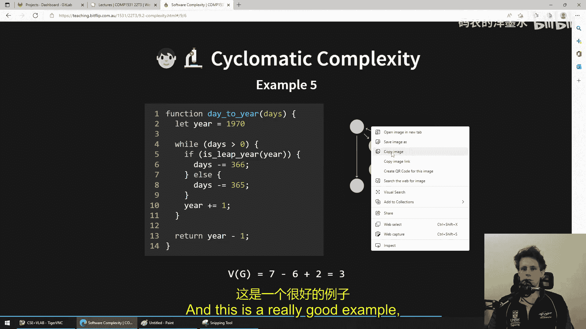

'cause like technically， like again， any linear flow can be cut out。

 See that's these these two are linear。These two pots。You don't kinda need that there。

 You could kind of like rub this out and destroy a line straight through。

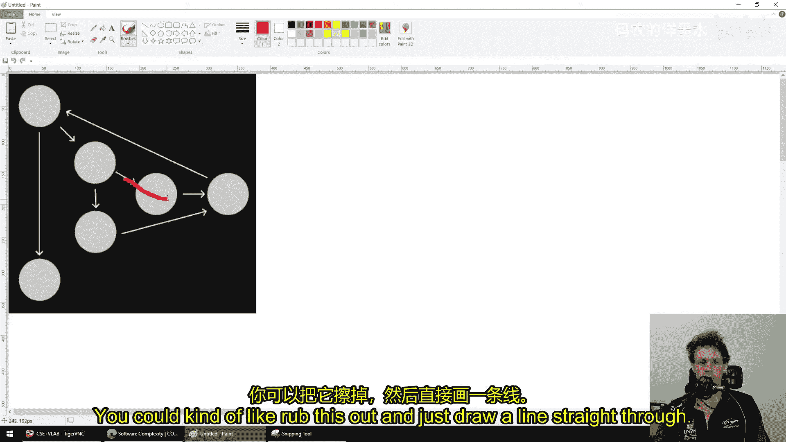

Like that。 and I'll give you the same answer， but same kind of thing。

So the benefit ofcyclmatic complexity is it's a simple。

 measurable way to understand function complexity。You know， and。

 and it's a good way to talk about it because， you know， if， if you're working and。

 and I'm sure there's automated tools out there that can figure this out。

 I haven't used one personally， but。It's a great way because you can kind of nearly mandate within an organisation to say that。

 you know， no functions too should have acyclomatic complexity of more than 8 or 10 or 12 or 6 or something like that。

 It's a way to kind of keep your functions simple， One of the problems ofcyclomatic complexity。

 Two things， two things to think about。😊，One is that measuringcyclomatic complexity assumes that non branching code has no complexity。

 So it assumes that like 100 line function with no ifs El's or ws， and it is simple。

 which it's not always。En。Sometimes functions can actually be better to kind of have a highcyclmatic complexity。

 sometimes breaking functions up unnecessarily into smaller pieces can make code harder to read。

And we can calculate it automatically。 if you Google， you know。

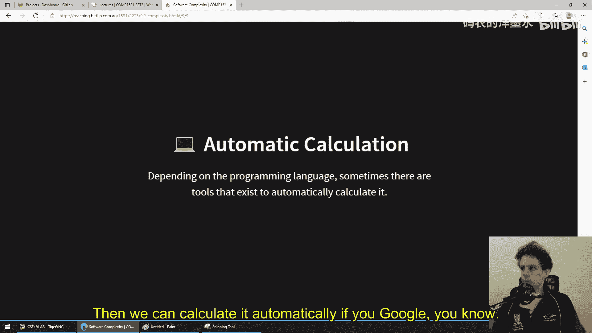

I don't know。 NP PMMcyclomatic complexity。 There's probably a library for it。Dontno。

 I haven't looked this up before。嗯。Yeah， complexity report。

 Sometimes they might unnecessarily use this exact measure。

 but this whole lecture is more just to try and make you think about that there are automated ways to try and analyse the complexity of software。

 I'm not sure if this one。Yeah， what iscyclomatic。There you go。

 specify the per functioncyclomatic complex。 It's all here。 This would be fun to play around with。😊。

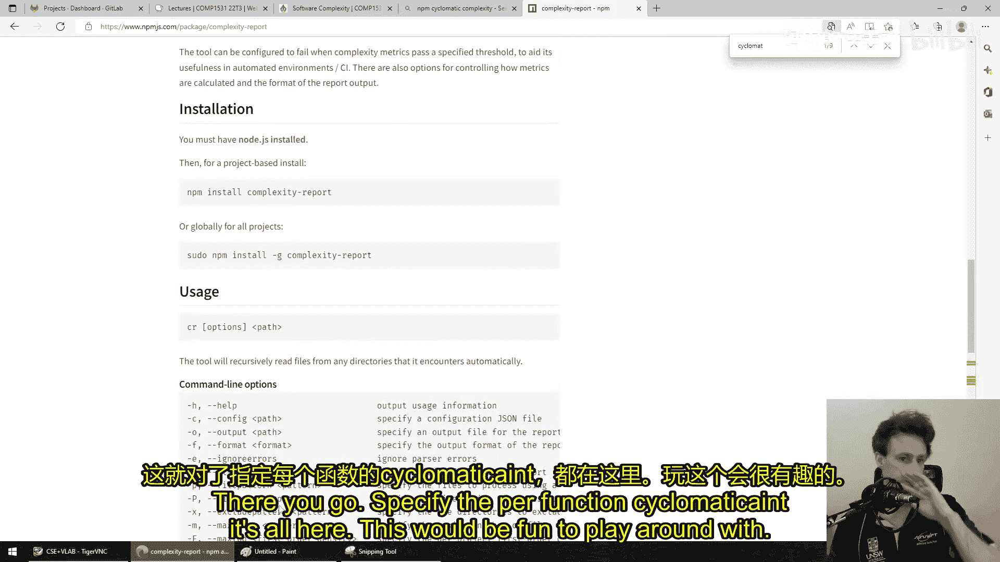

And that's it。 There's some further reading。 if you'd like to read it， But otherwise。

 please leave some feedback。On this lecturehow。And hope that was interesting。

 little bit of a little bit of a tid bit on software design。 Lots to think about。

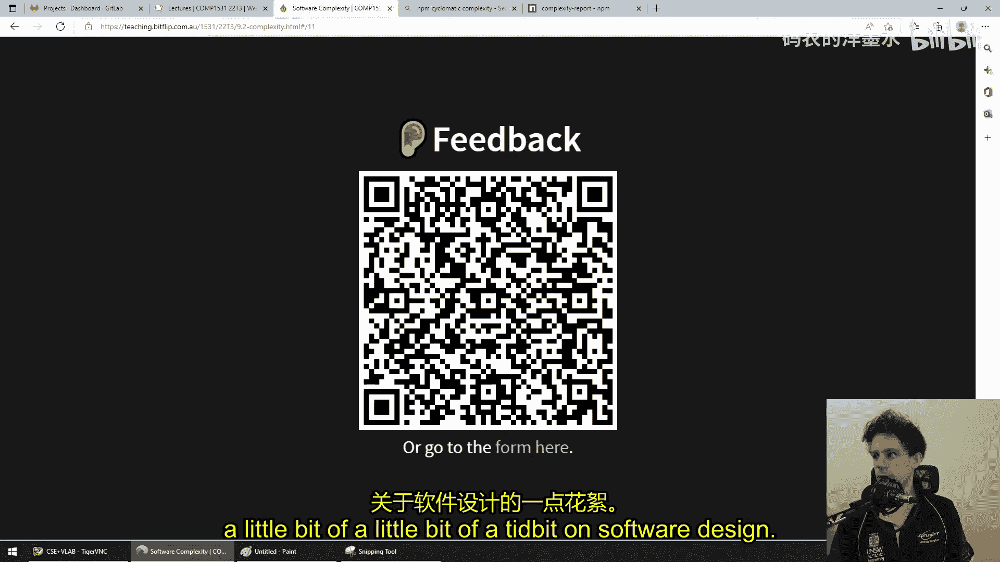

So pause and thank you。