# 【全集】新南威尔士大学 软件工程基础 中英字幕 1080P COMP1531 p26 Lecture 26 - Git撤销与修改 -BV1M7Nwz7EGh_p26-

Alright， so the last lecture for week 9 is on git。 Well it's called Git undo。

 It's essentially a bit of a fun lecture that I added in a few terms ago where we went and we focus on。

😊，What to do if you make like some mistakes in Git and how to resolve them carefullyca everything we've kind of done in the course so far has been really。

 yeah， let me get to that slide。 So we'll talk about hard resetting。

 altering Git history amending a commit。 We'll just talk about a few practical things with Git。

 So everything we've done until this point。😊，Is focused on continuing to build on the Gi history。

 And what that means is that we've largely considered the Git history immutable。

 as in it doesn't change， or it can't change。And。With Git， though。

 sometimes you will make mistakes or sometimes you will want to rewrite the Git history。Yeah。

And this is important， because。Like examples of this are maybe you actually need to completely remove code for everyone。

 Maybe you push some sensitive code。 Maybe it's too hard to figure out what you have to go and change。

 And there's lots of scenarios where you might want to do this。

 but you generally need to be quite careful。 And the two ways that we go and rewrite history are either git resetting or by amending a Git commit。

 and the amending amending a git commit part is pretty easy。

 but we're going to look at Git resetting first。 So at Lasian who run Bi bucket。

 they have an article about Git reset。

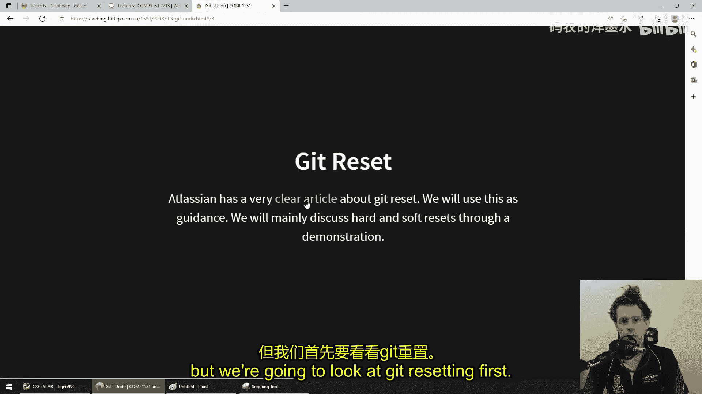

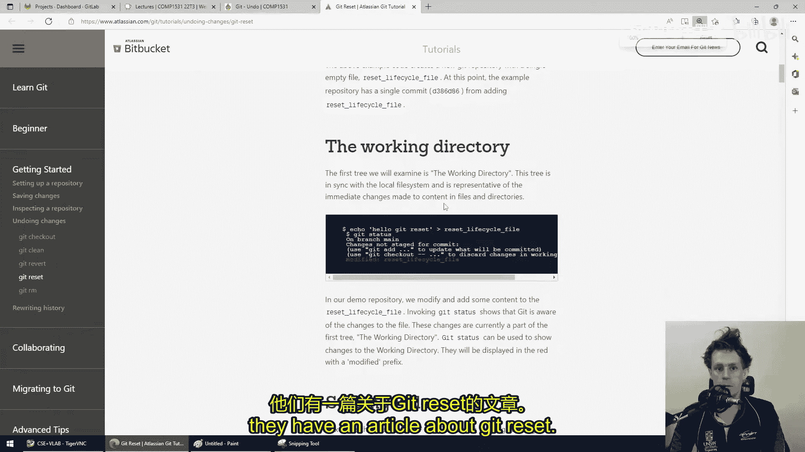

Where they go into a lot of detail with it and they explain stuff super thoroughly。

 much more thoroughly than we're going to today。 But today。

 we're just gonna focus on hard and soft resets。 They're both a really simple idea。

 I think gi hard resets are actually the easiest thing to do。

A Gi hardd reset is a way of saying that。You want to set all of your code back to a specific commit。

 And it's used when you say， I want to go back in time。

 and I don't care about anything that's happened since that point in time。

 I just wantan to like unwind the clock as if everything that happened after that never happened。

 So if I go and say have a look at。

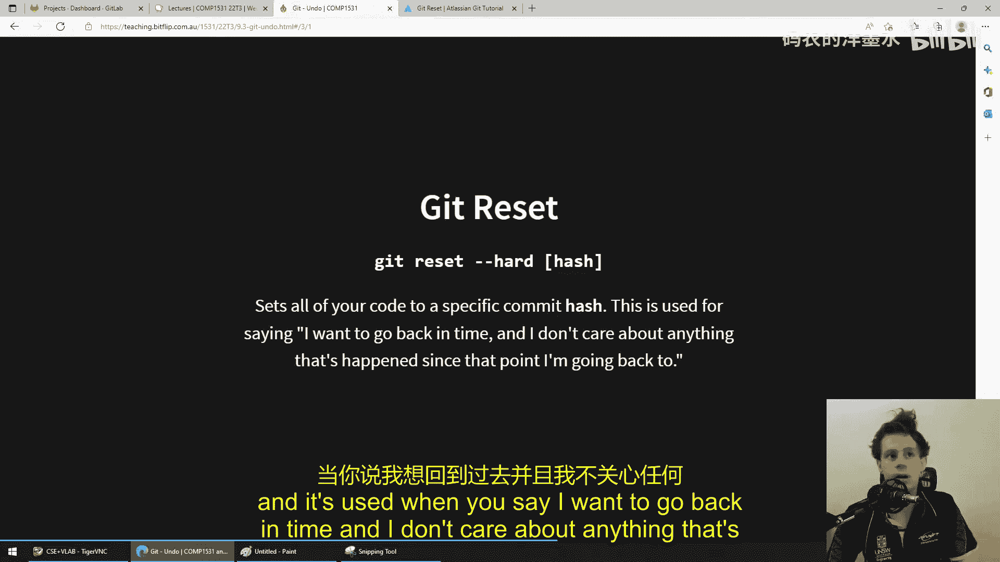

Maai。😔，Let's say look at our like week 2 NP PM。 What have we got here。

 Let's say look at some things we did earlier this time。Yeah， okay。 this is a good example。

 So let's say I go and clone this repo。

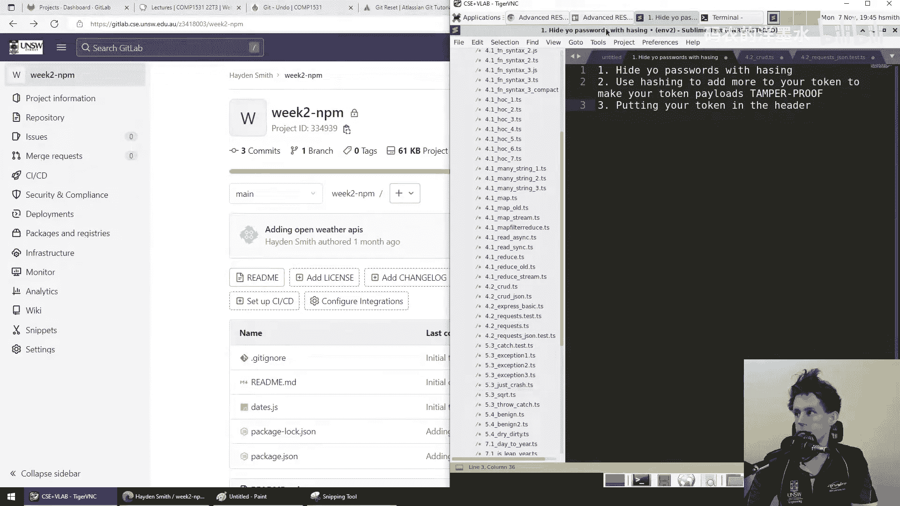

Make this big again。第二。I'm gonna come up here。Get clone that。Now， if I come inside here。

You can see that if I gi log， I've got three commits here。

 So what a git reset hard allows me to do is that if I just simply type in git reset dash dash hard。

 and then I give it a commit hash it can be the short one or the full one。

 what it will do if I once I run that is you'll see it will actually have reset my historytor is if that was the last commit and it will have removed these files here as well。

 So you'll see that if I look at the commit history on this repo you'll see that we added the weather apis in the last commit here we added open weatherath apis。

 but you'll see that now that I've reset it if I open up the package dot Json those weather apis aren't there。

 it's not always necessarily for going back in time。 if you have the commit of something newer。

 you can actually go further forward in time to like I can get reset hard。

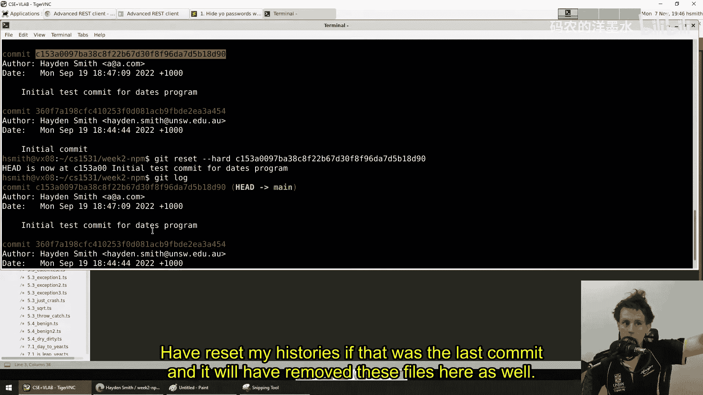

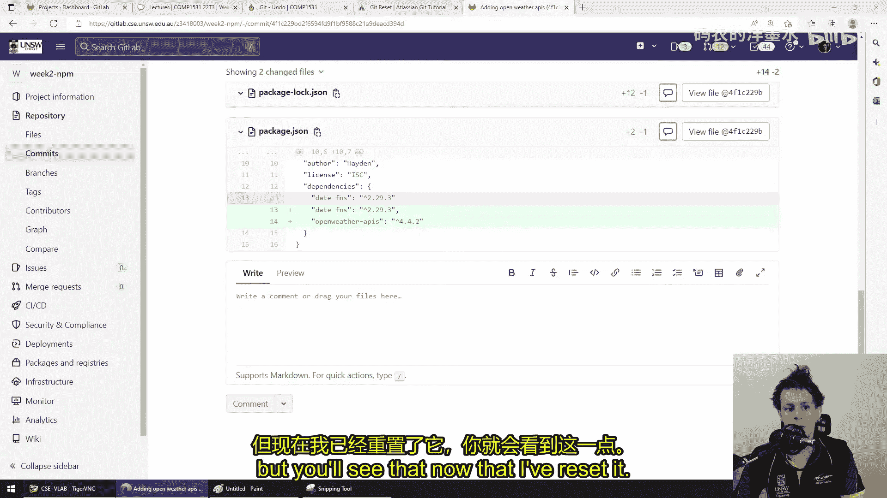

Kind of like a a future commit。

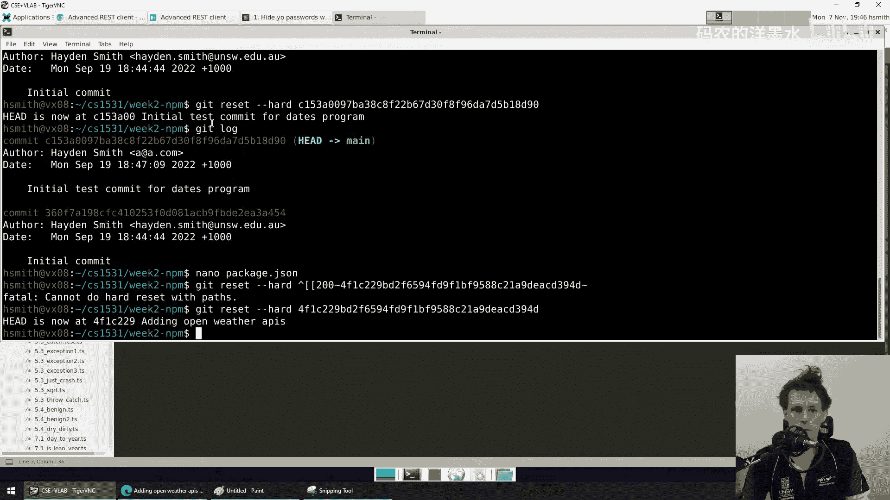

Like that one。 And now we're kinda going back there because remember the way to think about get and commits is that if you make three commits on a repo on a brand on a。

 Yeah， three commits on a repo like this。Remember all the branches。

Is a branch is just a pointer to a commit。 That's it。And each commit has a parent。That's all gi is。

 So when you reset something hard， when you say when you're on the master branch and you reset the master branch hard to another commit。

Git kind of just， this still exists in Git。 You just can't really see it。You know。

 like it's kind of gone as far as， as far as gets as far as， you know， master is concerned。

ca master just says， yeah， I'm this commit and this commit just has one other thing。 So similarly。

 if you then like， kind of point it to this one， it just looks like a single commit。

 So if we say gi log here and we look at， say this last commit。

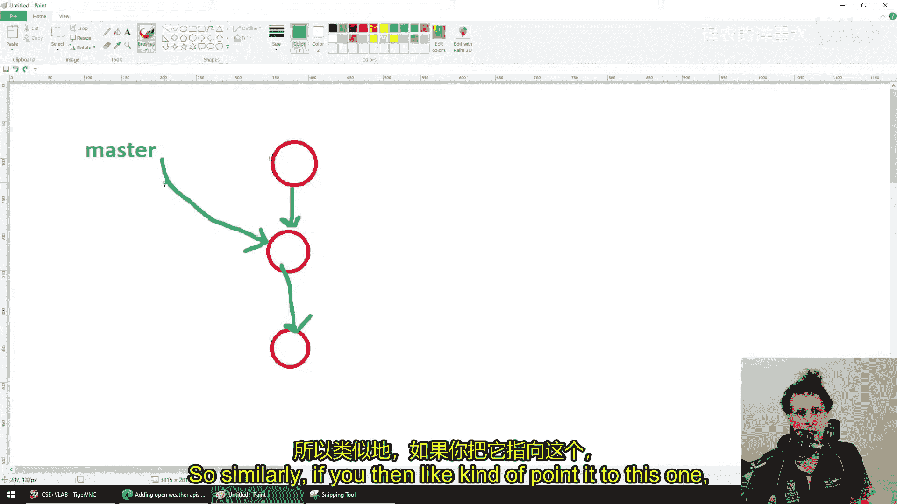

You know，36078198。Now， when I get loggged， it's as if that's the only commit that exists。

So it's just a way of kind of like snapping back to a particular commit。 It's pretty handy。

 The only problem with it is that you kind of now can't push like this because remember。

 if you remember back to week one， we talked about how Git always wants like new history。

So you kind of have to do a force push。Is the problem。

 We'll do a force push in the reset soft example。But。也。That's it。 That's， that's， that's。

 that's resetting hard with git。

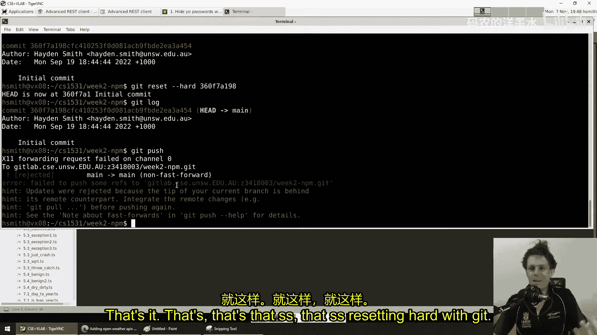

That's what that is。I wan to go back in time， mean or forward in time。

 I want to go to a specific commit， and I don't care about anything that's happened after that specific commit。

 It's typically used to go back in time。 sometimes to jump around。

 A git reset soft is a bit more subtle。This one I've never really had a lot of use for in the real world。

 I mainly use it a lot with like 1，5，3，1， but what to gett Resetofft does is it keeps all of your current code the same。

 but it just changes what commit you're pointing to。嗯。Which is kind of。Might be a little confusing。

Okay， heres look at the text here。 This is used for saying I like the code that I have。

 I don't want to change the code that I have， but I want to alter the history。

 So where the hard reset was different was the hard reset was like I want to go back to this point in time。

 I want to go to that commit and the code for that commit like just literally like go to there specifically whereas a git reset soft is like don't change the code I have but I want to pretend that I'm pointing here。

 So it's kind of like it's kind of like we come back here if you're say pointing here when you do a git reset soft to say this one the first commit。

 you kind of have all the code from all the commit still， but Git thinks you are at this commit。

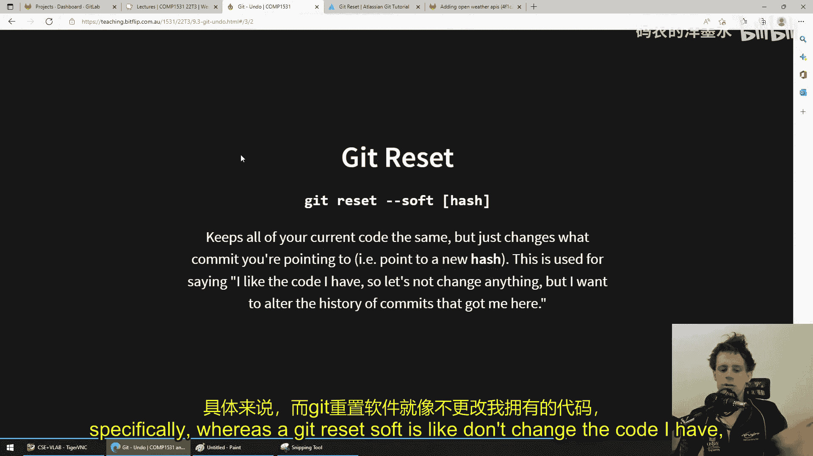

And what that immediately does is Gi immediately thinks that all this code that's happened from since these since the first commit kind of needs to be committed。

 So you'll see here that if I say go right back to the first commit， Sorry， if I like。

 say reset this repo， let's go back to how this was when I cloned it。

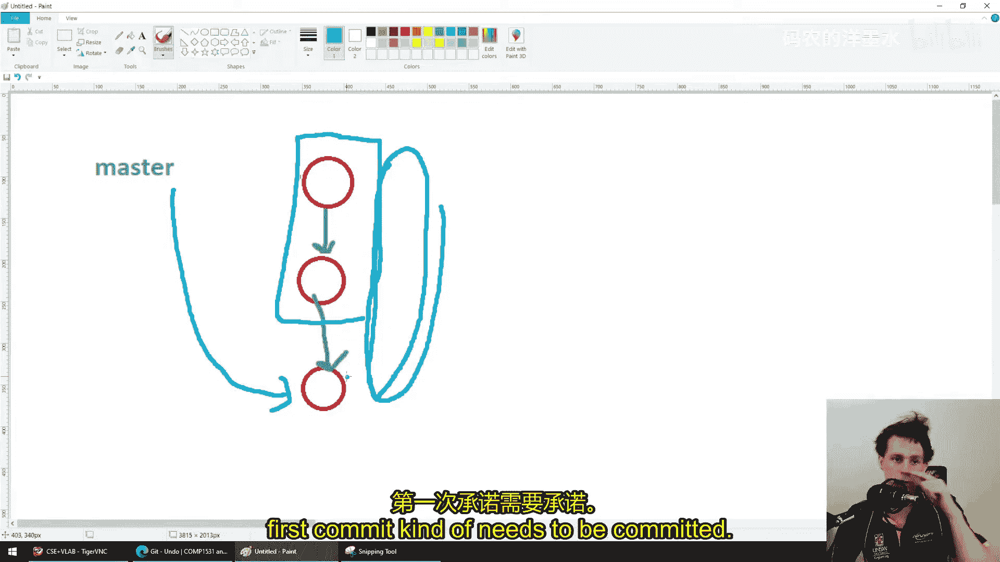

Right， so I've got three commits。 I've got all the code。

 You can see it in my package dot Json'cause I've got， I've got both dependencies here that we added。

Well， if I do say git reset soft2360 you know， to the first commit。ooops， already wrong。F 7， a 1。

 else's do that。 You'll see that when I get log， there's only one commit there now。

 but you'll see that if I open up my files， everything's still there。

 And if I get status and I get diff， you'll see that will not get di。

 but you'll see that all the stuff that's happened is all kind of ready to be committed。 So again。

 it's like keeping all the files， but not。My brain melted。 I'm sorry， keeping all the files。

 but going back to a specific commit。 Now， why is this useful。

 It's really useful when you have lots of commits and you want to kind of collapse them down。

 So let's say， for example， we have a different repo。

 What's another repo we worked on together in week 1。 Think it was carbonara。 Remember this one。

 Just bring back some dark memories for you all。 Let's say we go and clone this repo for a second。😊。

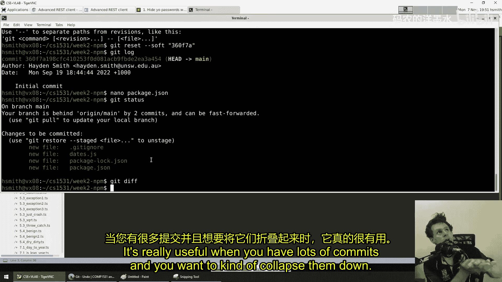

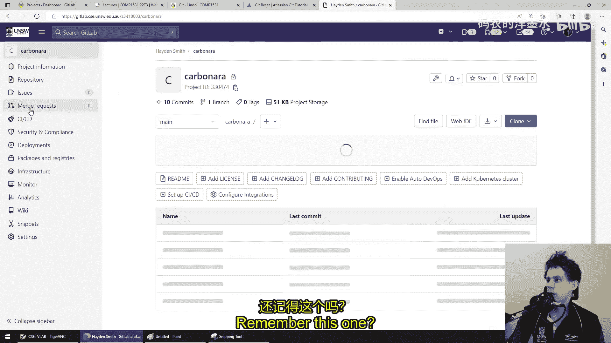

I'd gi clone carbonara。 and I go inside Carara。 Well， we got this big git log here。

 But let's say we go， we go all the way back to the first commit。

And then we do a get reset soft to the first commit。Now， I've got all these， like。

 I've got all these file changes。Right， but I've only got one commit。 So now Ina do a commit。

 and I say， like finishing up carbonara。My git log now only has two commits。

Whereas this one here on the Git rep， I out a whole bunch。

 So it's kind of like a way of cleaning the Git history。

 And you'll see here that now when I try and push， I still get an error。Right。

 I get an error because again， I'm trying to rewrite history。

 but you can overwrite that with a push force。

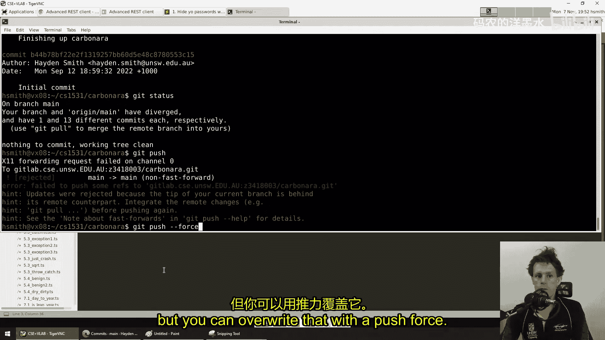

Generally， if you do a push force， it won't work。 But if you're a maintainer on a repo。

 which many of you aren't for 1，5，3，1， you can actually go and remove what they call branch protection for a particular branch。

 Most gi tools have this， which is like a way of protect，'s like a way of protecting。

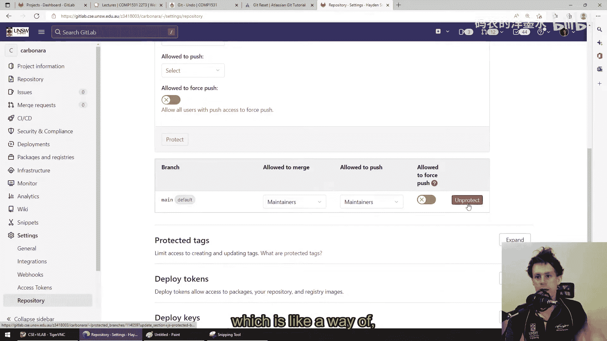

Gett from yourself。Basically， this is saying I can't force push。 Well， if I tick this。

 I can force push now。 So now when I force push it a work。

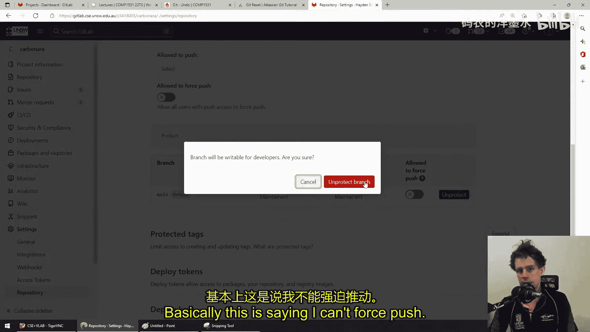

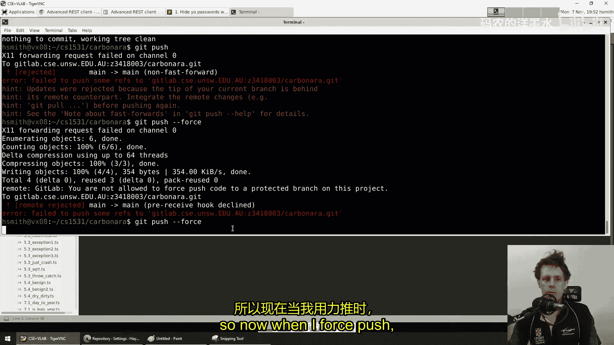

Again， you can't do this on your reos， but you'll see I've like rewritten the commit history。

 but all the files are still the same ingredients。 we have all of that stuff there。

 And all of this leads us to our last point here， which is a gi commit amend。

 So you know how to gi commit right， you gi commit dash M and then the commit message。

 But if you add a dash dash amend to the commit， What it will actually do is it won't go and add a new commit。

 It kind of overrides the last commit that's there。 and you'll see this a bit， for instance。

 let's say again， I'm on the carbonara repo。 And I do a soft reset back to the first commit。

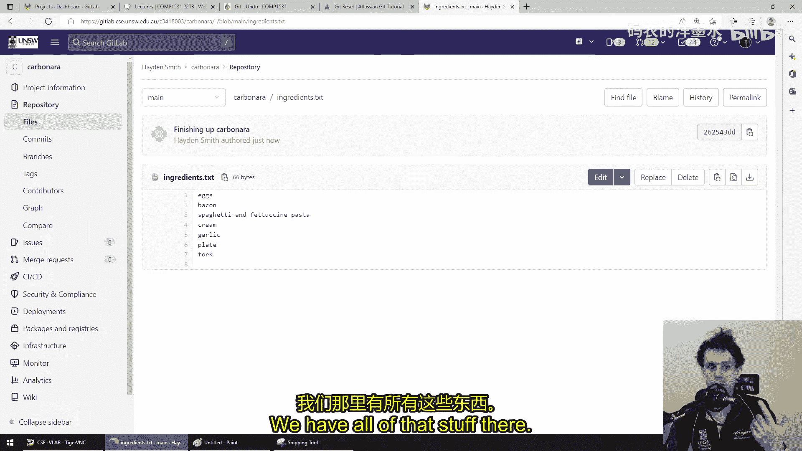

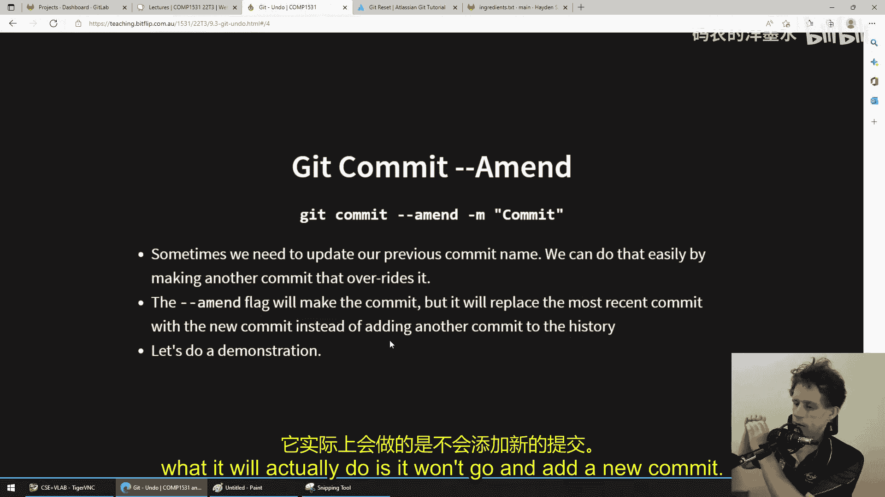

Right， so now we， we are at that first commit all the files that happened since then are still like there。

 I haven't deleted them。 It's not a hard reset。 But what I want to do is I only want to leave one commit here。

 What I can do is I can do the commit I did before。But if I add a dash dash a men to it。

What you'll notice if I get log is that it's different。 Now， a couple of things you'll notice。

 the hash is different。 That makes sense because it's， it's a totally different commit。

 The name is differentca I overrote it。 But by default。

 it doesn't actually update the times stampamps and stuff。

 This is actually why if you pay attention to some of you might have noticed this。

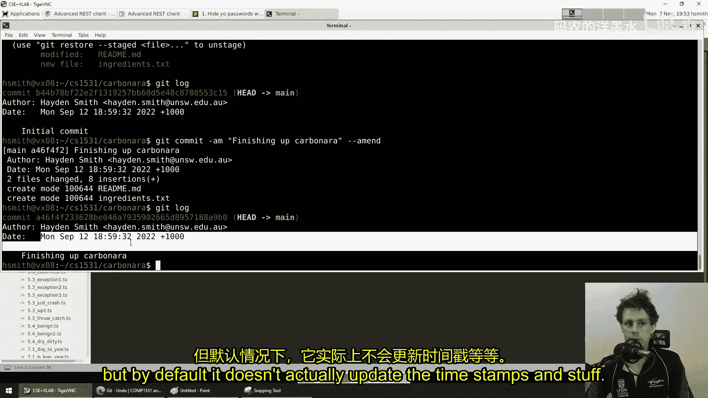

On some of your labs。Most of the labs we push you， we have made updates。Sir。Ye。Sa。

 see if one of them has it， maybe not。Tam usually seems to update stuff。Yeah， Tm's updated stuff。

 But when we push them out to you， you would have seen this kind of thing where it says ready for 22 T 3。

 And then it says two months ago。 Now， that makes a lot of sense'cause that was this term。

 but maybe a better example is that。If you look at the project。

If you actually pay attention to the very first commit in the project。Do we rewrite that， too。

 There you go。I think we the thing is's'cause we made a whole new repo for it， probably。Okay， well。

 maybe if I show you like。22 T1s。 Maybe it's different there。No。Never mind。嗯。

The point is that sometimes it keeps the old history。 you'll see this for your final exam actually。

 so when you see the final exam you'll see that it looks like the commit was made back in like July or something if it's the same exam。

 but it's actually just'ca we amended the commit and the the dates stayed the same。

 so in summary here。😊。

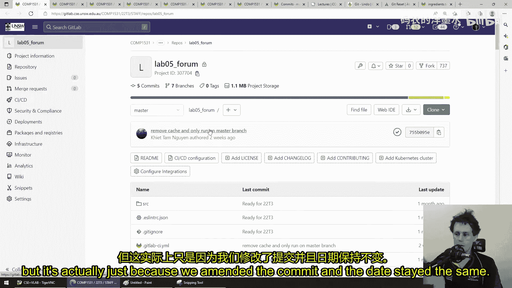

嗯。Generally， a hard reset is pretty useful。 I would say it's most useful when you are working locally and have yet to push anything to git because things get a lot harder once Git like Gitlab is familiar with your history because then you have to force pushing。

 which ruins other people's stuff don't do it or at least talk to everyone first。

 but a soft reset in conjunction with a git amend is pretty useful way of cleaning up history it's not a useful way to change the code as much as polish off the commits a little bit which again。

 I've never really had a useful I've only worked in organizations of203040 people mostly but it's certainly useful for like 1531 when giving it out to 700 students who never use git before and you don't want to give them like10 commits with weird messages they had nothing to do with because they'll just be like this is weird So anyway。

 any questions about that because that's pretty much the end of this one。

 It's meant to be a short lecture。 It's only 15 minutes not accessible in any way， buts a little bit。

Of useful fun。Cool。Okay。Well， thank you， everyone。For this， that's that's it for the week 9 lectures。

 Next lecture be on the exam。

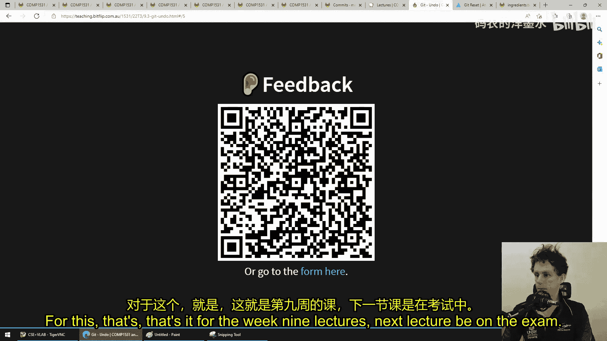

嗯。Yeah。