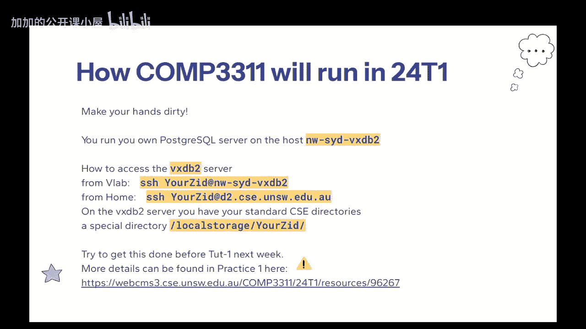
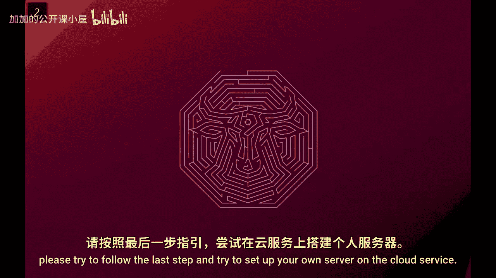

# 001：课程介绍与数据建模

在本节课中，我们将要学习COMP3311数据库系统课程的基本介绍，包括课程团队、运行方式、学习资源以及初步的实践准备。

## 课程团队介绍

首先，我们来认识一下负责本课程的人员。

*   **讲师**：我是本课程的讲师，我的名字是Yuue Kang Li。你可以称呼我为Yuuekang、Doctor Li或YK。
*   **联系方式**：课程相关的疑问请发送邮件至课程邮箱或使用课程论坛，请避免发送至我的个人邮箱。
*   **课程管理员**：Dlan是我们的课程管理员，负责除讲座外的几乎所有事务。

## 课程运行方式

上一节我们介绍了课程团队，本节中我们来看看课程将如何运行。本课程在UNSW已开设约27年。

以下是本课程在2024年第一学期的主要信息源和活动安排：

*   **课程网站**：你可以在此找到幻灯片、时间表和课程大纲等大部分信息。
*   **论坛**：今年我们使用了一个新的论坛系统。
*   **录播与资源**：讲座录播需要通过Moodle或Echo360访问。
*   **学习材料**：今年的课程内容将主要整合在讲座笔记中，其中包含了详细内容、总结和练习。但你仍可能需要教科书来获取更多细节。

课程的主要活动包括：

*   **讲座**：覆盖课程核心内容，讲解示例。
*   **辅导课**：用于讲解练习，你可以向导师提问。
*   **实践练习**：帮助你学习系统和技能，这是工程学习的重要部分。
*   **作业**：用于练习你的技能。
*   **考试**：用于展示你的知识和技能，占总成绩的60%。

## 幻灯片与学习提示

关于课程材料，今年的幻灯片采用了一些颜色编码和图标，以帮助你快速浏览。

*   **知识总结**：幻灯片左上角出现特定图标时，表示该页是知识总结。
*   **练习相关**：出现黄色“E”图标，表示内容与练习相关。
*   **需注意内容**：出现特定小图标，表示该部分内容需要特别注意。

## 实践环境设置

正如之前提到的，我们是工程师，需要动手实践。本课程需要大量练习，因此你需要设置自己的实践环境。

你需要在学校提供的云服务上运行你自己的PostgreSQL服务器。如果尚未完成，请尝试在下一周的第一次辅导课前完成设置。

具体步骤如下：

1.  访问相关资源链接，查看详细设置指南。
2.  如果今早尝试设置时遇到了问题或错误，该问题已被修复。
3.  课程管理员Dlan可以展示如何操作的实验演示。

请按照步骤尝试设置你自己的服务器。

---

本节课中我们一起学习了COMP3311数据库系统课程的概况，包括教学团队、课程资源获取方式、学习活动安排以及最重要的初步实践环境设置步骤。请务必完成服务器设置，为后续的学习和实践做好准备。