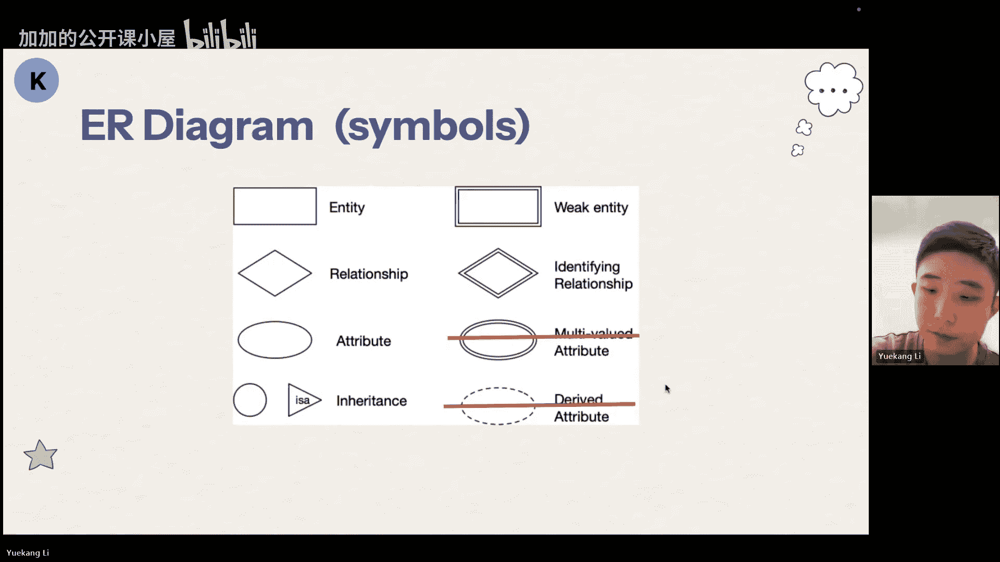

# 002：实体关系模型与关系模型 🗄️

在本节课中，我们将学习数据库设计的核心建模技术：实体关系模型和关系模型。我们将从基本概念开始，逐步了解如何用图形化的方式描述现实世界的数据及其关联。

## 课程更新与材料说明

在开始主要内容之前，有几个课程相关的更新需要说明。

首先，新的课程材料已经上线，所有辅导课内容现已在WebCMS上发布。

其次，在准备讲义时，我发现了一些“宝藏”——以前的课程笔记。这些笔记比当前的幻灯片内容更详细，这可能是因为新南威尔士大学以前实行的是12周学期制，而现在只有9周。请注意，**并非**笔记中的所有内容都是考试范围，只有**讲义、幻灯片和辅导课**中涵盖的内容才是可考的。这些笔记可能已有约20年历史，因此与当前幻灯片可能存在一些差异。

以下是三种主要的课程材料：
*   **练习幻灯片**：包含核心知识点和练习题。
*   **历史课程笔记**：提供更详细的背景和解释。
*   **教科书**：作为详尽的参考手册，用于查询概念的准确定义。

关于如何利用这些材料：
*   如果你的目标是**通过课程**，那么练习幻灯片和辅导课内容就足够了。
*   如果你的目标是**精通数据库**，我建议你深入研究课程笔记和教科书。

最后，请注意本课程有一个重要的考核要求：你必须在期末考试中**至少获得40%的分数**，并且**总评成绩达到50%** 才能通过这门课。这一点非常重要。

## 数据建模与ER模型概述

上一节我们介绍了课程的基本信息，本节中我们来看看数据建模的核心过程，并引出实体关系模型。

数据建模是一个设计过程，其目标有三个：
1.  涵盖数据库中需要存储的**信息**。
2.  涵盖数据库中不同数据项之间的**关系**。
3.  涵盖对数据的**约束**。

这个过程的输入通常是用户提供的需求，输出则是数据库结构的半形式化描述。**实体关系模型** 就是其中一种重要的形式化描述方法。

ER模型将世界建模为一组相互关联的实体。它包含三个主要组成部分：
*   **属性**：描述实体或关系的特征，类似于面向对象设计中的对象变量。
*   **实体**：具有相同属性集合的对象的集合，可以看作是对象本身。
*   **关系**：实体之间的关联。

ER模型并非完全标准化，在实际应用中可能存在一些变体。为了简便起见，本课程笔记采用了两种教科书中通用的符号。

为了可视化ER模型，我们使用**ER图**。一个ER图包含：
*   一组实体集定义。
*   一组关系集定义。
*   与实体和关系相关联的属性。
*   实体与关系之间的连接。

请注意，在术语上，我们有时会用“实体”来简称“实体集”。

## ER图符号详解

上一节我们了解了ER模型的基本构成，本节我们将通过一个示例图来详细讲解ER图中使用的各种符号。

这是一个ER图的例子，其中包含多种符号。别担心，我们会逐一讲解它们。

以下是ER图中常用的符号及其含义。请注意，我划掉了其中两个符号，这并不是因为它们不重要，而是在后续的幻灯片中较少出现。我们会先通过例子讲解其他符号，最后再回来解释这两个。

首先，让我们从ER建模中最核心的概念——**实体集**开始。

一个实体集可以被视为具有相同属性集合的一组实体。例如，“学生”是一个实体集，而“张三”是其中的一个具体实体。

以下是实体和关系的关键概念列表：
*   **实体集**：用矩形表示，代表一类对象（如`Student`， `Course`）。
*   **关系集**：用菱形表示，连接两个或多个实体集，表示它们之间的关联（如`Enrols`）。
*   **属性**：用椭圆形表示，是描述实体或关系的性质（如`studentID`， `name`）。
*   **键属性**：属性名下加下划线，用于唯一标识一个实体（如`studentID`）。
*   **多值属性**：用双线椭圆形表示，表示一个属性可以有多个值（如`phoneNumber`）。
*   **派生属性**：用虚线椭圆形表示，其值可以从其他属性推导出来（如`age`可从`birthDate`派生）。
*   **复合属性**：可以划分为更小部分的属性（如`address`可包含`street`， `city`， `postcode`）。

现在，让我们回到之前被划掉的两个符号：
*   **弱实体集**：用双线矩形表示，其存在依赖于另一个“强”实体集，没有自己的键。
*   **识别关系集**：用双线菱形表示，是弱实体集与其所属强实体集之间的特殊关系。

## 关系模型基础

在深入理解了如何用ER图进行概念设计后，我们需要将其转化为计算机能够存储和处理的格式。这就是关系模型的作用。

关系模型使用**表**（在关系模型中称为“关系”）来组织数据。每个表有唯一的名称，由行（元组）和列（属性）组成。

关系模型的核心概念可以用以下公式表示：
**关系 = 表头（属性集合） + 表体（元组集合）**

一个关系模式可以形式化地定义为：
`R(A1, A2, ..., An)`
其中，`R`是关系名，`A1`到`An`是属性名。

从ER模型转换到关系模型有一套系统的规则：
1.  **实体集转换**：每个实体集转换为一个单独的关系（表）。实体集的属性成为该表的属性，实体集的键成为该表的主键。
2.  **关系集转换**：处理方式取决于关系的**基数比**（一对一、一对多、多对多）。
    *   **多对多关系**：转换为一个新的关系表。该表的主键由相关联的实体集的主键组合构成。
    *   **一对多/一对一关系**：通常通过将“一”方的主键作为外键添加到“多”方的表中来实现，而不是创建新表。

## 总结

本节课中我们一起学习了数据库系统设计的两个核心建模阶段。

首先，我们探讨了**实体关系模型**，这是一种用于概念设计的半形式化工具。我们学习了如何使用ER图、实体、关系、属性以及各种约束（如键、多值属性等）来图形化地描述现实世界的数据需求。

接着，我们了解了**关系模型**，它是数据库的逻辑实现基础。我们讨论了如何将ER图中的概念系统地转换为关系模式（即表结构），包括实体集和不同类型关系集（特别是多对多关系）的转换规则。

理解从ER模型到关系模型的转换过程，是设计一个结构良好、高效且无冗余的数据库的关键第一步。在接下来的课程中，我们将在此基础上学习如何使用SQL语言来操作这些关系表。