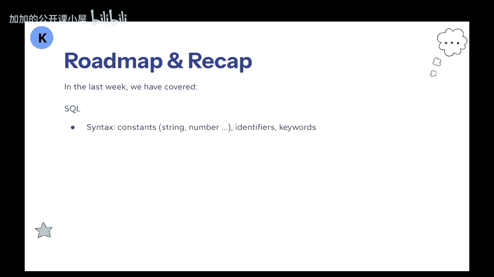

# 005：数据修改与单表查询


在本节课中，我们将学习如何使用SQL修改数据库中的数据，以及如何编写针对单个表的查询语句。我们还会简要介绍视图的概念。

## 课程公告与回顾

在开始新内容之前，我们先来看一些课程相关的公告，并快速回顾一下之前学过的知识。

### 课程公告

以下是本周的重要通知。

*   **关于测验1**：上周的测验1已完成。大部分提交了答案的同学都取得了不错的成绩，平均分略高于往期。请注意，**测验2已经开始**，截止日期是本周五午夜，请务必按时完成。
*   **关于作业1**：第一次作业即将发布，提交截止日期是第5周结束前（即在灵活周之前）。关于作业1的详细说明，将在下一次课上进行讲解。请密切关注邮件和课程管理系统（WebCMS）的通知。

### 知识回顾：从ER图到关系模型

上一节我们介绍了如何将实体关系（ER）图映射到关系模型和SQL。本节中，我们来快速回顾一下核心的映射规则。

以下是主要的映射方法总结：

*   **实体映射**：
    *   **强实体**：直接转换为一个表。
    *   **弱实体**：转换为一个表，并正确设置指向其所有者实体的外键。
*   **关系映射**：
    *   **多对多关系**：创建一个新表，其主键是参与此关系的所有实体的主键的集合。
    *   **一对多关系**：将关系的属性放在“多”那一侧实体对应的表中。
    *   **一对一关系**：将关系的属性放在任意一侧参与实体的表中。
    *   **多元关系（带箭头）**：创建一个新表，其主键是所有**没有箭头指向**的参与实体的主键的集合。
*   **属性映射**：
    *   **复合属性**：将其“扁平化”，拆分为表的多个列。
    *   **多值属性**：将其转换为一个弱实体（及对应的表）来处理。
*   **子类映射**：
    *   **ER风格**：为超类和每个子类创建单独的表。子类表包含自身特有属性，并通过外键关联到超类表。
    *   **全部风格**：为每个子类创建单独的表，每个表都包含超类和自身的所有属性。
    *   **单表风格**：只创建一个表，包含所有可能的属性，允许某些列为空值（NULL）。

这些知识告诉我们如何从ER图出发，设计出具体的关系数据库模式，并最终用SQL实现。

## 使用SQL修改数据

回顾了数据库设计后，现在我们将重点转向SQL的数据操作部分。我们将学习如何使用`INSERT`、`UPDATE`和`DELETE`语句来修改数据库中的数据。

### INSERT 语句

`INSERT`语句用于向表中添加新的数据行。

其基本语法如下：
```sql
INSERT INTO 表名 (列1, 列2, 列3, ...)
VALUES (值1, 值2, 值3, ...);
```
例如，向`Students`表插入一条新记录：
```sql
INSERT INTO Students (student_id, name, age)
VALUES (12345, ‘张三’, 20);
```

### UPDATE 语句

`UPDATE`语句用于修改表中已有的数据。

其基本语法如下：
```sql
UPDATE 表名
SET 列1 = 新值1, 列2 = 新值2, ...
WHERE 条件;
```
`WHERE`子句用于指定要更新哪些行。**务必谨慎使用**，否则可能更新整个表。
例如，将学号为12345的学生的年龄改为21岁：
```sql
UPDATE Students
SET age = 21
WHERE student_id = 12345;
```

### DELETE 语句

`DELETE`语句用于从表中删除数据行。

其基本语法如下：
```sql
DELETE FROM 表名
WHERE 条件;
```
同样，`WHERE`子句至关重要，它指定了要删除哪些行。如果没有`WHERE`子句，将删除表中的所有数据。
例如，删除学号为12345的学生记录：
```sql
DELETE FROM Students
WHERE student_id = 12345;
```

## 单表查询与视图

掌握了如何修改数据后，接下来我们学习如何从单个表中检索数据，并了解视图这一有用工具。

### 单表查询基础

单表查询主要使用`SELECT`语句，从指定的一个表中获取数据。

一个完整的`SELECT`语句通常包含以下部分：
```sql
SELECT 列名1, 列名2, ...
FROM 表名
WHERE 条件
ORDER BY 排序列 ASC|DESC;
```
*   `SELECT`：指定要查询哪些列。
*   `FROM`：指定从哪个表查询。
*   `WHERE`：设置过滤条件，只返回满足条件的行。
*   `ORDER BY`：对结果进行排序（`ASC`为升序，`DESC`为降序）。

例如，查询`Students`表中所有年龄大于18岁的学生姓名和年龄，并按年龄降序排列：
```sql
SELECT name, age
FROM Students
WHERE age > 18
ORDER BY age DESC;
```

### 视图的概念

视图（View）是一种虚拟表，其内容由查询定义。你可以像使用普通表一样查询视图，但它并不实际存储数据。

创建视图的语法如下：
```sql
CREATE VIEW 视图名称 AS
SELECT 查询语句;
```
视图的主要作用包括：
*   **简化复杂查询**：将复杂的查询逻辑封装在视图中，用户只需查询简单的视图即可。
*   **数据安全**：可以只向用户暴露视图（包含部分列或行），而不是底层基表，从而隐藏敏感数据。
*   **逻辑数据独立性**：即使底层表结构发生变化，只要视图的查询结果不变，依赖视图的应用程序就无需修改。

例如，创建一个只包含成年学生姓名和学号的视图：
```sql
CREATE VIEW Adult_Students AS
SELECT student_id, name
FROM Students
WHERE age >= 18;
```
创建后，你可以直接查询这个视图：
```sql
SELECT * FROM Adult_Students;
```

## 总结



本节课中我们一起学习了SQL数据操作的核心内容。我们首先回顾了从ER图到SQL的映射方法，这是数据库设计的基础。接着，我们详细讲解了如何使用`INSERT`、`UPDATE`和`DELETE`语句来修改表中的数据，并强调了`WHERE`子句的重要性。最后，我们介绍了单表查询的基本结构以及视图的概念和用途，视图是简化查询和增强安全性的有力工具。掌握这些知识，你将能够有效地管理和查询数据库中的信息。