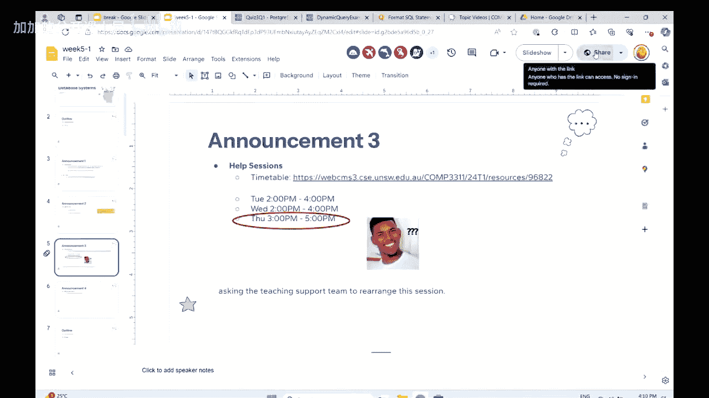
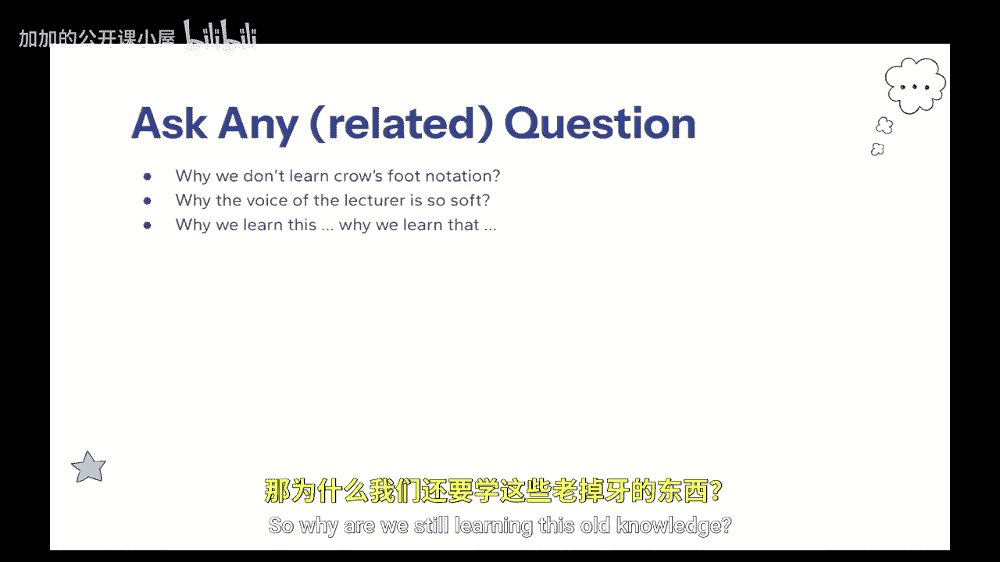

# 009：课程前半部分回顾 🗂️

在本节课中，我们将进行课程前半部分的知识点回顾。首先，我们会发布几项课程相关的通知，然后系统地梳理从开课至今所学的核心内容。

## 课程通知 📢

以下是本周需要关注的几项课程通知。

### 关于作业1

作业1的大部分具体题目已经发布，但第10题仍在准备中。这是因为助教Dlan正在为所有题目创建相应的测试脚本，以确保每个问题在各种边界情况下都能正常运行。作业1的提交截止日期是**第6周周五**之前。请务必按时提交，以获得相应的分数。

### 关于测验3第1题

一些同学询问了测验3第1题中选项E的正确性。**选项E是不正确的**。关键在于，题目中表X的`name`字段虽然被定义为`UNIQUE`，但并未指定为`NOT NULL`。这意味着`name`字段允许存储`NULL`值。

我们可以通过运行SQL语句来验证。以下是题目涉及的两个表和数据示例：

```sql
-- 表X：name字段UNIQUE但允许NULL
CREATE TABLE X (
    id INT PRIMARY KEY,
    name VARCHAR(255) UNIQUE -- 注意：没有NOT NULL约束
);

-- 表Y：引用X.id
CREATE TABLE Y (
    id INT PRIMARY KEY,
    x_id INT REFERENCES X(id)
);

-- 插入数据：向X插入两条name为NULL的记录
INSERT INTO X (id, name) VALUES (1, NULL), (2, NULL);
INSERT INTO Y (id, x_id) VALUES (1, 1), (2, 2);
```

选项E的查询可能使用了`COUNT(DISTINCT x.name)`。在SQL中，多个`NULL`值在`DISTINCT`比较中被视为相等，因此只会被计数一次。然而，根据数据，我们实际插入了两条`name`为`NULL`的X记录。因此，选项E无法正确处理`NULL`值，不是正确答案。该题唯一正确的选项是**B**。

另外，请注意，部分同学可能参考了以往学期的测验答案。你们不应该也无法访问以往学期的WebCMS内容，请以本学期发布的官方材料和答案为准。

### 关于辅导课时间调整

有同学指出，原定于周四的辅导课与本次讲座时间冲突。我们已经将此情况通知教学支持团队，正在协调重新安排该辅导课的时间，请关注后续通知。

### 关于本周测验

**本周没有安排测验**。大家可以利用这段时间，集中精力完成作业1。

## 课程学习情况统计与建议 📈




在开始回顾知识点之前，我们先了解一下本课程目前的学习情况。

*   **测验平均分**：与往届学期相比，本学期测验1和测验2的平均分高出约3-4%，测验3的平均分更是高出约10%。这是一个非常积极的信号。
*   **分数趋势**：一个值得注意的现象是，平均分随着测验的进行呈下降趋势。尽管课程内容确实在逐渐深入，但就像刚才演示的测验3第1题一样，许多问题可以通过亲自运行SQL代码来验证和理解。希望大家能共同努力，扭转这个下降的趋势。
*   **参与度**：每学期总有约10%的学生从未参与任何测验。请注意，测验是课程评估的重要组成部分。
*   **评分说明**：本课程的评分**不采用“钟形曲线”法**。你的最终成绩不会因为其他同学的表现而受到影响。因此，鼓励大家互相帮助，共同进步。
*   **论坛参与**：我们很高兴看到许多同学在课程论坛上积极为他人解答问题，例如助教Dlan和一些热心的同学。这种互助精神非常值得赞扬。当然，论坛也欢迎任何与课程相关的问题，无论是关于为何学习某个特定知识点、技术细节，还是关于课程安排的建议。

上一部分我们了解了课程近况，接下来我们将正式进入课程核心内容的回顾环节。

## 课程前半部分核心内容回顾 🔍

自课程开始以来，我们主要围绕数据库系统的设计和查询语言展开学习。以下是主要知识点的梳理。

### 1. 数据库设计与ER模型

我们首先学习了如何使用实体-关系（ER）模型进行概念数据库设计。

*   **核心概念**：
    *   **实体**：表示现实世界中可区分的对象。
    *   **属性**：描述实体的特性。
    *   **关系**：表示实体之间的关联。
*   **设计要点**：重点是识别正确的实体、属性和关系，并确定关系的基数约束（如一对一、一对多、多对多）。

### 2. 关系模型与SQL

在ER设计之后，我们学习了如何将ER图转换为关系模型，并使用SQL进行实际操作。

*   **从ER到关系模式**：掌握了将实体、属性和关系映射为数据库表和列的规则。
*   **SQL数据定义语言（DDL）**：用于创建和修改数据库结构。
    ```sql
    CREATE TABLE Student (
        id INT PRIMARY KEY,
        name VARCHAR(100) NOT NULL,
        age INT
    );
    ```
*   **SQL数据操作语言（DML）**：用于查询和操作数据。
    *   **基本查询**：`SELECT ... FROM ... WHERE ...`
    *   **连接操作**：`INNER JOIN`, `LEFT JOIN` 等，用于合并多个表的数据。
    *   **聚合与分组**：使用 `COUNT`, `SUM`, `AVG` 等函数与 `GROUP BY` 子句进行数据汇总。
    *   **子查询**：在查询中嵌套另一个查询。

### 3. 约束与数据完整性

为了保证数据库中数据的准确性和一致性，我们学习了多种约束。

*   **主键约束**：`PRIMARY KEY`，唯一标识每条记录。
*   **外键约束**：`FOREIGN KEY`，维护表之间的引用完整性。
*   **唯一约束**：`UNIQUE`，确保某列的值唯一。
*   **非空约束**：`NOT NULL`，确保某列必须有值。
*   **检查约束**：`CHECK`，确保列值满足特定条件。

### 4. 空值（NULL）处理

正如在测验3中强调的，`NULL`值的处理是SQL中的一个重要且易错点。

*   **`NULL`的含义**：表示值未知、不存在或不适用。
*   **与`NULL`的比较**：任何与`NULL`的比较操作（如 `= NULL`, `< NULL`）结果都是`UNKNOWN`。正确检查`NULL`应使用 `IS NULL` 或 `IS NOT NULL`。
*   **在聚合函数中的行为**：`COUNT(*)` 计算所有行数，而 `COUNT(column)` 会忽略该列为`NULL`的行。`DISTINCT` 会将所有`NULL`值视为相同。

### 5. 关系代数

关系代数提供了描述数据库查询的数学基础。

*   **基本运算**：选择（σ）、投影（π）、并集（∪）、差集（-）、笛卡尔积（×）。
*   **派生运算**：连接（⨝）、自然连接、除运算等。
*   **作用**：帮助我们从逻辑上理解和构建复杂的SQL查询。

## 总结 📝

本节课中，我们一起回顾了课程前半部分的核心内容。我们首先处理了关于作业、测验答案澄清和课程安排的通知。接着，通过分析学习数据，我们看到了大家的进步空间。最后，我们系统梳理了从**数据库设计（ER模型）** 到**关系模型实现**，再到使用**SQL进行数据定义、操作和约束管理**的知识链条，并特别强调了**`NULL`值处理**这一关键细节。



希望这次回顾能帮助你巩固所学知识，为后续更深入的学习打下坚实基础。请继续专注于当前的作业，并善用论坛进行交流。