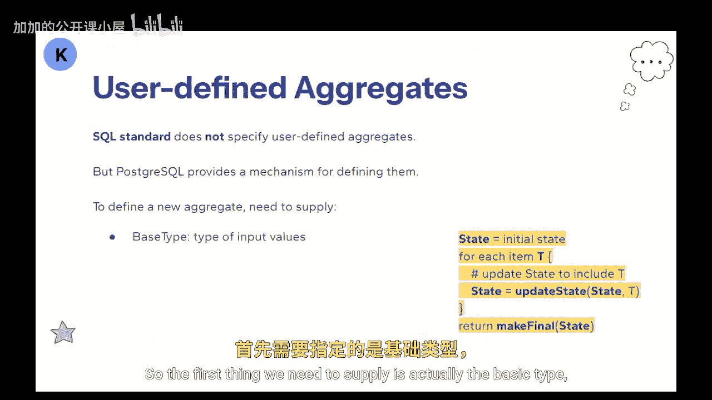

# 010：用户自定义聚合函数与触发器 🗂️


在本节课中，我们将要学习 PostgreSQL 数据库的两个高级特性：用户自定义聚合函数和触发器。我们将了解如何创建自己的聚合函数，以及如何使用触发器在特定数据库事件发生时自动执行操作。

## 概述

上一讲我们介绍了数据建模和基本的 SQL 查询。本节中，我们来看看 PostgreSQL 提供的更多功能，特别是如何扩展其聚合能力以及实现自动化的数据操作。

---

## 课程公告与路线图 📢

首先，有一些课程相关的公告需要说明。

### 关于作业1

作业1第10题的详细说明尚未发布，但会在今天或明天公布。提交截止时间为下周晚上10点之前。截止时间后仍可提交，但会面临迟交扣分。

论坛上有同学反映自动测试脚本存在问题。需要明确的是，自动测试脚本的目的并非在提交前给出分数，而是确保你的 SQL 查询能够基本正常运行。它并不覆盖所有测试用例，因此请不要完全依赖它。

另外再次强调，通过规范格式化你的提交内容，你可以获得格式分。

对于需要特殊考试安排的学生，必须在作业截止时间前至少24小时提交延期申请，晚于此时间的申请将不被受理。

### 关于辅导课

我们正在组织一些辅导课，但其中一次与今天的讲座时间冲突。教学支持团队正在处理这个问题。

### 关于测验与灵活周

本周没有测验。下周是灵活周，没有讲座、没有辅导课、也没有测验。建议你利用这段时间完成作业，并重新学习 Python，因为在本学期后半段以及你的作业中都会用到它。

### 课程路线图

以下是本课程的后续安排：
*   **已学习内容**：数据建模、基础 SQL 函数与查询。
*   **本周内容**：更多 SQL 高级功能（即本节课内容）。
*   **第7周**：学习如何使用编程语言（特别是 Python）与数据库管理系统交互。将发布作业2，内容涉及编写处理 SQL 查询的 Python 脚本。
*   **第8周**：在掌握了 SQL 基础和编程交互后，我们将接触数据库系统的一些理论部分，学习关系设计理论。
*   **第9周**：学习关系代数，这也是一个理论性主题。作业2的预计提交截止时间是第9周末，但可能会延期至第10周，以给大家更多时间。
*   **第10周**：最后一周，学习数据库管理系统的事务管理，并进行课程总复习。届时将有一场来自行业专家的客座讲座。请注意，我可能会在周末前往悉尼以外参加会议，如果成行，我会为大家提供讲座录像。

---

## 用户自定义聚合函数 🧮

现在，让我们进入今天的核心内容。第一个主题是**聚合函数**。实际上我们已经学习过聚合操作。

### 回顾：标准聚合函数

聚合运算符用于将一组值汇总为单个值。

以下是我们已经学过的聚合运算符示例：
*   `COUNT`：用于计算元组的数量。
*   `SUM`：对数值进行操作，返回一组值的总和。
*   `MAX`：从一组值中获取最大值。

聚合函数的操作语义可以这样理解：我们有一个初始状态，然后遍历整个值列表；对于遇到的每一个新值，我们都用它来更新当前状态；遍历结束后，将最终状态返回给用户。这更像是一个实现聚合函数的伪代码逻辑。

聚合函数通常与 `GROUP BY` 子句一起使用，用于为每个分组提供汇总信息。

### 引入用户自定义聚合

今天要学习的新知识是**用户自定义聚合函数**。除了标准的 SQL 聚合函数外，PostgreSQL 提供了一种机制，允许用户定义自己的聚合函数。

要定义一个新的聚合函数，用户需要提供以下几部分。在考虑需要提供什么之前，让我们回想一下上面提到的伪代码逻辑。所有创建自定义聚合所需的材料都源于这个算法。

以下是定义聚合函数时需要指定的组件：

1.  **基础类型**：即伪代码中每个值 `T` 的数据类型，也就是聚合函数要处理的输入值的类型。
2.  **状态类型**：即伪代码中 `state` 变量的数据类型。它可能与最终结果类型相同，也可能不同。
3.  **初始状态值**：聚合开始时 `state` 的初始值。
4.  **状态转换函数**：一个函数，它接收当前 `state` 和一个输入值 `T`，并返回更新后的新 `state`。这对应了伪代码中的 `update(state, T)` 步骤。
5.  **最终计算函数**：一个可选的函数。在遍历完所有输入值后，调用此函数对最终的 `state` 进行处理，然后返回给用户。如果省略，则最终状态就是聚合结果。

### 定义聚合函数的语法

在 PostgreSQL 中，使用 `CREATE AGGREGATE` 命令来定义新的聚合函数。

其基本语法结构如下：
```sql
CREATE AGGREGATE aggregate_name (input_data_type)
(
    INITCOND = initial_state_value,
    STYPE = state_data_type,
    SFUNC = state_transition_function_name,
    FINALFUNC = final_function_name -- 可选
);
```

### 应用示例：自定义字符串连接聚合

假设我们想创建一个聚合函数，将一组字符串值用指定的分隔符连接起来，类似于 `string_agg` 函数，但我们来自定义。

我们需要：
*   **基础类型**：`TEXT`（输入是文本）。
*   **状态类型**：可以是一个包含“当前连接结果”和“分隔符”的复合类型，或者简单地用一个 `TEXT` 变量，并在首次更新时加入分隔符逻辑。为简单起见，我们使用 `TEXT` 作为状态类型。
*   **初始状态**：空字符串 `''`。
*   **状态转换函数**：一个函数，将新字符串附加到当前状态字符串后面，并在非首次附加时添加分隔符。
*   **最终计算函数**：可能不需要，除非我们需要对最终结果做额外处理（如修剪末尾多余的分隔符）。

由于涉及具体的函数定义，完整的代码示例可能较长，但其核心思想是遵循上述五个步骤来构建聚合逻辑。

---

## 触发器 ⚡

上一节我们介绍了如何自定义聚合函数来扩展 SQL 的汇总能力。本节中，我们来看看如何通过**触发器**实现数据库操作的自动化。

### 什么是触发器？

触发器是一种特殊的存储过程，它会在指定的数据库事件（如 `INSERT`、`UPDATE`、`DELETE`）发生在特定表上时**自动执行**。触发器常用于强制实施复杂的业务规则、维护数据完整性、审计数据变更或同步相关表的数据。

### 触发器的关键组件

一个触发器定义主要包括以下几个部分：

1.  **触发时机**：`BEFORE`、`AFTER` 或 `INSTEAD OF` 事件。
2.  **触发事件**：`INSERT`、`UPDATE` 或 `DELETE`。
3.  **关联表**：触发器附加在哪张表上。
4.  **触发条件**：可选的 `WHEN` 子句，用于指定触发器仅在满足某些条件时才执行。
5.  **执行函数**：触发器被激活时运行的函数。这个函数必须被定义为返回 `TRIGGER` 类型。

### 创建触发器的步骤

在 PostgreSQL 中创建触发器通常分为两步：

**第一步：创建触发器函数**
这是一个普通的函数，但它必须声明返回 `TRIGGER` 类型。在函数内部，你可以通过特殊变量（如 `NEW`、`OLD`）来访问被修改行的数据。
```sql
CREATE OR REPLACE FUNCTION my_trigger_function()
RETURNS TRIGGER AS $$
BEGIN
    -- 在这里编写触发器逻辑
    -- 例如，可以使用 NEW.column_name 访问新插入或更新的值
    -- 使用 OLD.column_name 访问更新前或删除前的值
    RETURN NEW; -- 对于BEFORE触发器，通常需要返回NEW或OLD
END;
$$ LANGUAGE plpgsql;
```

**第二步：创建触发器**
将触发器函数绑定到指定的表和事件上。
```sql
CREATE TRIGGER my_trigger
    AFTER INSERT ON my_table
    FOR EACH ROW
    EXECUTE FUNCTION my_trigger_function();
```

### 触发器应用场景示例

1.  **审计日志**：在 `AFTER UPDATE` 或 `AFTER DELETE` 触发器中将旧数据记录到另一张审计表中。
2.  **数据验证**：在 `BEFORE INSERT` 或 `BEFORE UPDATE` 触发器中检查数据的有效性，如果无效，可以抛出异常阻止操作。
3.  **自动计算字段**：在 `BEFORE INSERT` 或 `BEFORE UPDATE` 触发器中，基于其他字段的值自动计算并设置某个字段（如总价 = 单价 * 数量）。
4.  **维护数据一致性**：当主表数据删除时，使用触发器自动删除从表中的相关记录（级联删除的替代方案）。

---

## 总结 🎯

本节课中我们一起学习了 PostgreSQL 的两个强大特性。

首先，我们深入了解了**用户自定义聚合函数**。我们回顾了标准聚合函数的工作原理，然后学习了如何通过指定基础类型、状态类型、初始状态、状态转换函数和最终计算函数来构建自己的聚合函数，从而满足特定的数据汇总需求。

接着，我们探讨了**触发器**。我们了解了触发器是什么，它如何在特定数据操作事件发生时自动执行代码。我们学习了创建触发器的两个关键步骤：编写返回 `TRIGGER` 类型的函数，以及将函数绑定到表的特定事件上。触发器是实现复杂业务逻辑、数据完整性和自动化任务的必备工具。



掌握这些高级功能将极大地增强你利用 PostgreSQL 管理和处理数据的能力。