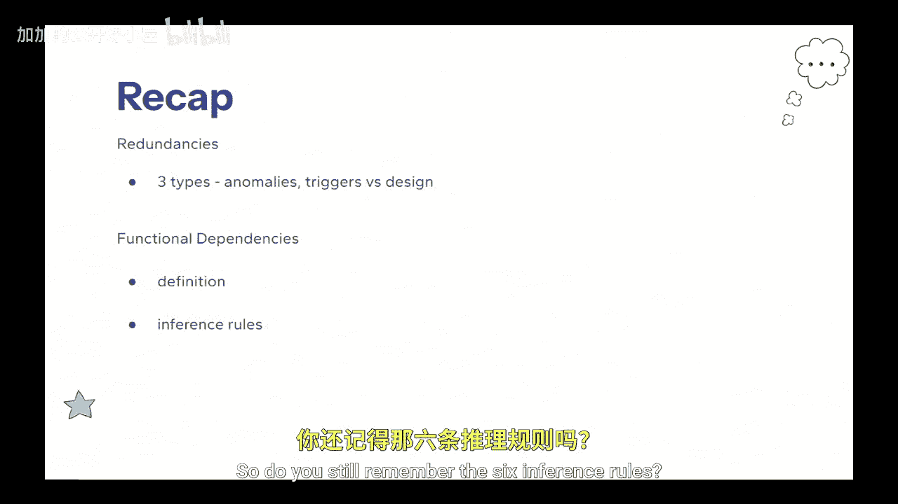

# 013：闭包、范式与规范化 🗃️


在本节课中，我们将学习如何系统性地使用函数依赖来优化数据库设计。我们将重点介绍三个核心概念：**属性集的闭包**、**范式**以及**规范化过程**。这些知识将帮助我们识别并消除数据库中的冗余，从而避免数据异常。

---

## 课程概述 📋

上一讲我们介绍了函数依赖及其重要性。本节我们将深入探讨如何利用函数依赖进行系统化的数据库设计优化。主要内容包括：计算属性集的闭包以确定超键和候选键；理解不同的范式（如BCNF和3NF）及其目标；以及通过分解关系模式来实现规范化的具体步骤。

---

## 公告事项 📢

以下是几项重要的课程公告。

### 关于测验与作业

1.  **测验5**的截止日期是本周五，请按时完成。
2.  **作业1**的初步成绩已发布。如果对成绩有疑问（例如，因语法错误导致自动测试得零分），请及时联系我们。助教会进行人工复核，你仍有机会获得部分分数，但请确保你的查询能通过基本的语法检查。
3.  **作业2**的说明正在准备中，预计截止日期为下周五。我们会通过WebCMS发布正式通知。作业2的题量较少，不会占用过多时间，请不必担心影响期末复习。

### 关于课程安排

4.  原定与本次课程冲突的辅导课已正式调整至下周上午。请注意，下周是最后一次线下课（因第10周讲师需参加会议）。该辅导课将由经验丰富的助教Kens主持，欢迎大家就作业、教程等问题前来咨询。

---

## 知识回顾 🔄

在进入新内容之前，我们先快速回顾上一讲的关键概念。

### 1. 数据库冗余与异常


如果数据库设计不当，可能会出现**数据冗余**。冗余会导致三种类型的**操作异常**：
*   **更新异常**：更新部分数据时，可能导致数据不一致。
*   **插入异常**：无法插入某些必要信息，除非同时插入其他无关信息。
*   **删除异常**：删除某些信息时，可能会意外丢失其他重要数据。

我们可以通过编写大量触发器来处理这些异常，但这并非理想方案，因为过多的触发器会拖慢系统性能。更好的方法是主动从数据库设计中**消除冗余**。

### 2. 函数依赖

**函数依赖**是描述属性间决定关系的形式化工具。其定义是：给定关系模式R，若对于R中的任意两个元组，只要它们在属性集X上的值相同，则在属性集Y上的值也必然相同，则称**X函数决定Y**，或称**Y函数依赖于X**，记作 `X → Y`。

上一讲我们还学习了从已知函数依赖推导新函数依赖的**6条推理规则**。

---

## 核心概念一：属性集的闭包 🧮

上一节我们回顾了函数依赖的基础。本节中，我们来看看如何利用函数依赖计算**属性集的闭包**，这是一个非常实用的工具。

### 什么是闭包？

给定一个属性集X和一组函数依赖F，**X关于F的闭包**（记作 `X⁺`）是指：**能够通过F中的函数依赖，从X直接或间接推导出的所有属性的集合**。

简单来说，闭包 `X⁺` 回答了这个问题：“如果我知道了X的值，那么我还能唯一确定哪些其他属性的值？”

### 闭包的算法

以下是计算属性集X闭包 `X⁺` 的标准算法：

```
输入：属性集 X， 函数依赖集 F
输出：闭包 X⁺

步骤：
1.  令 result = X。
2.  重复以下过程，直到 result 不再变化：
    a. 对于 F 中的每一个函数依赖 Y → Z：
        b. 如果 Y ⊆ result，则将 Z 加入到 result 中。
3.  返回 result。
```

### 闭包的作用

计算闭包主要有两个用途：
1.  **判断函数依赖是否成立**：要检查 `X → Y` 是否在 `F⁺`（F的闭包，即所有能推导出的函数依赖）中，只需计算 `X⁺`，然后看 `Y` 是否是 `X⁺` 的子集。如果是，则 `X → Y` 成立。
2.  **寻找关系的键**：如果某个属性集X的闭包 `X⁺` 包含了关系的所有属性，那么X就是一个**超键**。进一步地，如果X的任何真子集的闭包都不能包含所有属性，那么X就是一个**候选键**。

---

## 核心概念二：范式 🏗️

理解了如何计算闭包和寻找键之后，我们就可以用它来评估和改善数据库设计了。数据库设计的好坏通常用**范式**来衡量。

范式是关系模式需要满足的规范等级。高级别的范式比低级别范式具有更少的冗余和异常。我们主要关注以下两种范式：

### 1. 鲍依斯-科德范式

**BCNF**的定义是：对于关系模式R中的**每一个非平凡函数依赖** `X → Y`，其**决定因素X必须是一个超键**。

用公式表示，即对于 `F⁺` 中所有形如 `X → Y` 的依赖（其中 `Y ⊈ X`），都必须满足 `X⁺` 包含R的所有属性。

如果一个关系模式属于BCNF，那么它将完全消除由函数依赖引起的所有冗余和异常。

### 2. 第三范式

**3NF**的要求比BCNF稍宽松一些。它的定义是：对于关系模式R中的每一个非平凡函数依赖 `X → Y`，至少满足以下条件之一：
1.  X是超键，或者
2.  Y中的每个属性都包含于R的某个候选键中（即Y是**主属性**）。

3NF允许某些特定的冗余存在，但能保证不会产生更新和删除异常。

---

## 核心概念三：规范化 🛠️

当我们发现一个关系模式不满足BCNF或3NF时，就需要通过**规范化**过程来分解它，以提升其范式等级。

### 规范化的目标

规范化的核心思想是：**将一个大关系模式分解成若干个更小的关系模式**，使得每个小模式都满足更高的范式要求，同时分解必须是**无损连接**的（即通过自然连接能恢复原始数据），并尽可能**保持函数依赖**。

### 分解到BCNF的算法

以下是分解到BCNF的一个通用算法：

```
输入：关系模式 R， 函数依赖集 F
输出：满足BCNF的一组关系模式

步骤：
1.  初始化 result = {R}。
2.  当 result 中存在不满足BCNF的关系模式 S 时，执行：
    a. 在 S 中找到一个违反BCNF的非平凡函数依赖 X → Y（即 X 不是 S 的超键）。
    b. 将 S 分解为两个模式：
        - S1 = X⁺ （X的闭包）
        - S2 = (S - Y) ∪ X
    c. 在 result 中用 S1 和 S2 替换 S。
3.  返回 result。
```

### 关于3NF分解

存在一种算法可以保证将关系模式无损连接且保持函数依赖地分解到3NF。当BCNF分解无法保持所有函数依赖时，3NF是一个很好的折中选择。

---

## 总结 📝

本节课我们一起学习了数据库设计理论中的三个核心工具：
1.  **闭包**：通过算法计算属性集的闭包，用于验证函数依赖和寻找关系的键。
2.  **范式**：我们介绍了**BCNF**和**3NF**的定义与目标，它们是衡量设计好坏、减少冗余与异常的标准。
3.  **规范化**：我们了解了通过分解关系模式来达到BCNF或3NF的算法过程，这是优化数据库设计的系统性方法。



掌握这些概念，你将能够分析并改进现有的数据库模式，使其更加健壮和高效。在接下来的课程和作业中，你将有机会应用这些知识解决实际问题。