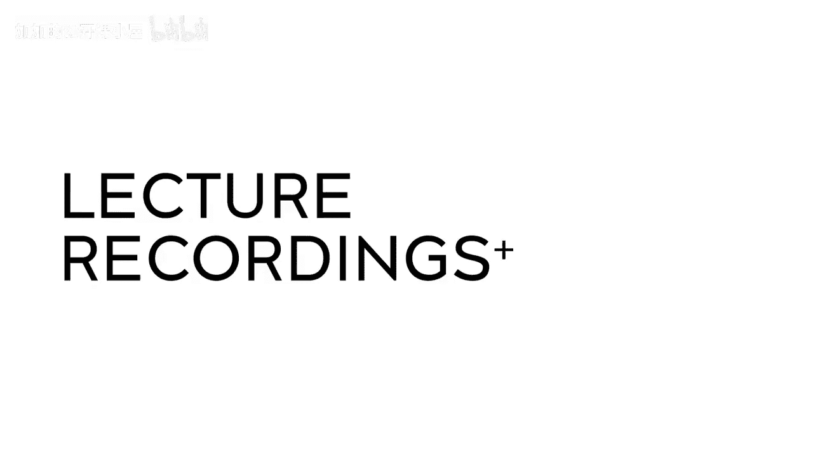
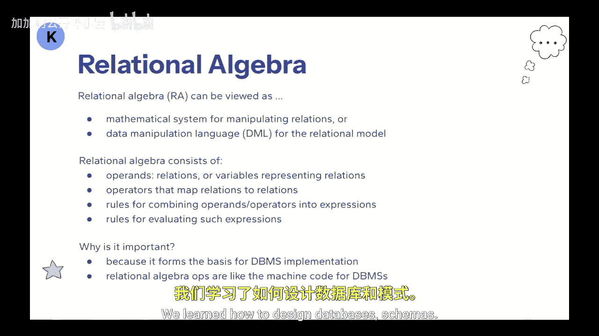

# 014：关系代数与查询执行

在本节课中，我们将学习数据库系统的两个核心底层概念：关系代数和查询执行。关系代数是操作关系（即数据表）的数学基础，而查询执行则关注数据库系统如何实际处理和运行查询。理解这些内容对于深入掌握数据库的工作原理至关重要。

## 课程公告与回顾

首先，我们来看一下本周的重要通知。

*   本周没有安排测验。
*   最后一次测验（测验6）的截止日期是下周五。
*   到目前为止，大家的测验平均成绩略高于往届。

关于作业2：
*   作业2的前两道题目的说明已经发布。
*   最后三道题目的说明正在最终确定中。
*   作业的截止日期是下周五。
*   如有特殊情况，请尽早提交特殊考虑申请。
*   如需延期，请在截止日期前至少24小时提交ELP延期请求。

接下来，让我们快速回顾一下上一讲的内容。上一讲我们学习了函数依赖的实际应用，并掌握了几个重要概念。

以下是核心概念的回顾：
1.  **闭包**：给定一组函数依赖，其闭包是指基于这组依赖可以推导出的所有函数依赖的集合。然而，函数依赖的闭包通常非常庞大，实际应用中我们更常使用**属性闭包**。
2.  **键的判定**：属性闭包的一个主要用途是确定关系（表）的键。如果一个属性集的闭包包含了关系的所有属性，那么这个属性集就是一个超键。
3.  **最小覆盖**：它是一组函数依赖的“最小完整集”，即没有冗余依赖的最简形式。
4.  **范式**：我们学习了最常用的两种范式——第三范式（3NF）和BCNF。BCNF的限制更严格，能产生更少的冗余。其限制条件分别是：
    *   **BCNF**：对于关系模式R中的每一个非平凡函数依赖 **X → Y**，**X** 必须是R的一个**超键**。
    *   **3NF**：对于关系模式R中的每一个非平凡函数依赖 **X → A**，要么 **X** 是R的一个**超键**，要么 **A** 是R的一个**主属性**（即包含在某个候选键中）。
5.  **规范化算法**：我们了解了将数据库模式分解为3NF或BCNF的算法思路。你不需要背诵算法步骤，但需要理解其工作原理。

为了帮助大家更好地理解这些略显复杂的算法，我们的教学计划是：先快速讲解所有核心概念，然后在后续课程中通过更多实际例子来深化理解。

以下是近期的课程路线图：
*   **今天**：学习关系代数与查询执行。
*   **周四**：学习性能调优、事务与可串行化，并提供更多关于理论概念（如规范化算法）的实例讲解。
*   **下周**：我将外出参加会议，但会为大家提供涵盖整个课程内容的总结视频和幻灯片。

## 关系代数介绍

上一节我们回顾了数据库设计的理论部分，本节中我们来看看操作数据的数学语言——关系代数。

关系代数可以被视为**操作关系（即数据表）的数学系统**，或者说是关系模型的数据操作语言。它由**运算符**、**组合运算符构成表达式的规则**以及**计算这些表达式的规则**组成。

学习关系代数非常重要，因为它构成了**数据库管理系统（DBMS）实现的基础**。在我们之前的课程中，我们主要从用户的角度学习如何设计数据库模式和使用数据库。而关系代数揭示了系统底层处理查询的逻辑。

## 关系代数核心运算符

关系代数包含一系列用于操作关系的运算符。以下是其主要的运算符分类及说明。

### 基本集合运算符
这些运算符继承自集合论，要求参与运算的关系必须兼容（即具有相同的属性集）。
*   **并集**：`R ∪ S`，返回在R或S中出现的所有元组。
*   **交集**：`R ∩ S`，返回同时在R和S中出现的元组。
*   **差集**：`R - S`，返回在R中出现但不在S中出现的元组。

### 专门的关系运算符
这些是关系代数特有的运算符。
*   **选择**：`σ`，根据指定条件过滤元组。例如，`σ_{age>18}(Student)` 会选择所有年龄大于18的学生。
*   **投影**：`π`，选择指定的列（属性），并去除重复行。例如，`π_{name, major}(Student)` 会返回所有学生的姓名和专业。
*   **笛卡尔积**：`×`，将两个关系的所有元组进行组合。若R有m行，S有n行，则 `R × S` 有 m*n 行。
*   **连接**：多种连接是选择与笛卡尔积的组合，用于根据相关条件合并两个关系的元组。
    *   **θ连接**：`R ⋈_{condition} S`
    *   **等值连接**：`θ连接`的一种特例，连接条件为相等比较。
    *   **自然连接**：`R ⋈ S`，自动在所有同名属性上做等值连接，并去除重复列。

## 查询执行概述

理解了表达查询的数学语言（关系代数）后，本节我们来看看数据库系统如何实际执行这些查询，即查询执行。

查询执行是数据库管理系统将用户提交的高层查询语句（如SQL）转换为一系列低级操作，并最终返回结果的过程。其核心目标是**高效、正确地**获取数据。

## 查询处理步骤

一个查询从提交到返回结果，通常需要经历多个步骤。以下是典型的查询处理流程。

1.  **解析与翻译**：系统首先对SQL查询进行词法和语法分析，确保其格式正确，然后将其转换为内部表示形式，通常是**关系代数表达式树**。
2.  **优化**：查询优化器是DBMS的大脑。它会对初始的关系代数表达式进行等价变换，考虑不同的连接顺序、访问路径（使用哪个索引）和算法，并基于成本模型估算每种执行计划的代价，最终选择一个它认为最高效的**查询执行计划**。
3.  **执行**：查询执行引擎按照选定的执行计划，调用底层的存储管理器、索引管理器等组件，实际地读取数据、进行运算（如选择、投影、连接），并将最终结果返回给用户。

## 总结

本节课中我们一起学习了数据库系统的两个底层核心模块。

首先，我们学习了**关系代数**，它是操作关系型数据的数学基础，包含并、交、差、选择、投影、笛卡尔积和连接等运算符。理解关系代数有助于我们洞悉SQL查询背后的逻辑。

其次，我们探讨了**查询执行**的基本过程，包括解析、优化和执行三个阶段。其中，查询优化器通过选择高效的执行计划，对查询性能起着至关重要的作用。

掌握这些知识，为我们后续学习数据库性能调优、事务管理等更高级的主题奠定了坚实的基础。