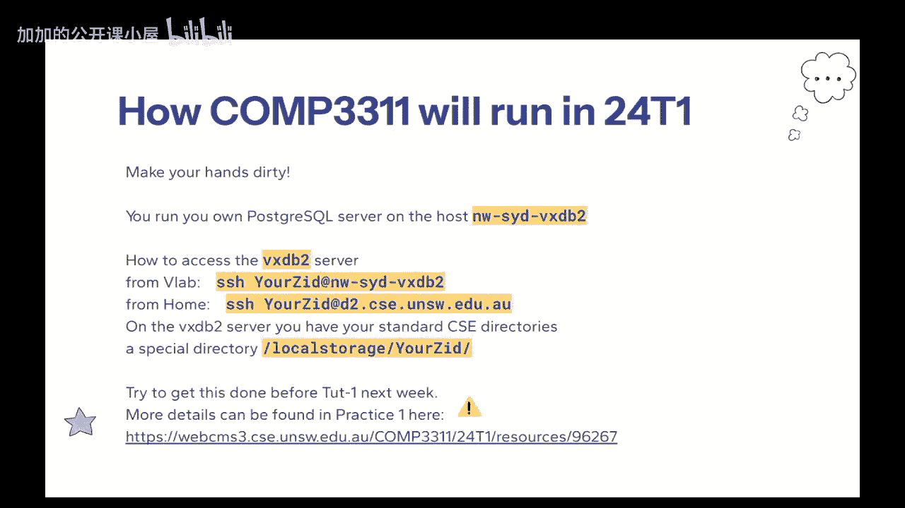
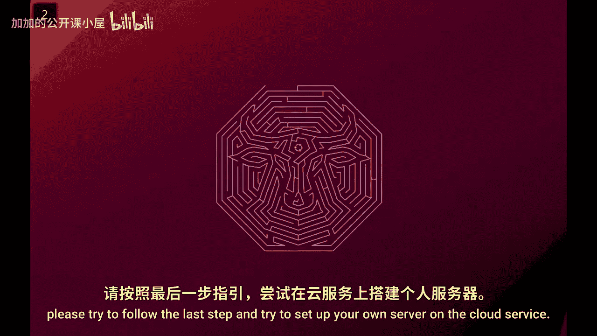

# 新南威尔士大学【中英⚡数据库系统｜COMP3311 2025 Database system】 p01 P1 Lecture 1 (Introduction & Data Modelling) -BV1dV4HzTE7p_p1-

，呃。helello。Let's start。 This is the first class for Com 3，3，1，1 database systems。 So I'm a lecturer。

And this is， this is today's outline。 So first， I will introduce you the people running this course。

So， this is。Actually， this is me。 and the photo was taken one day before I got my haircut。

And my name is Yuue Kang Li， and you can， you can ask your Chinese friends about the meaning of the characters in my name and is actually I。

 every character has a meaning。 And my， I'm the lecturer in charge for this course。

 and you can find my personal personal。 Oh， sorry， you can find my personal website here。

And my previous experience was， I got both my PhD and and bachelor's degree in Nanyang Technological University in Singapore。

And my research interest was actually not database。 I was a software engineering person。 and。

 I basically， I'm interested in software testing to find vulnerabilities and bugs in software systems。

 And recently， I'm particularly interested in large language model related topics。😊。

So what to call me， you can call me Yuuekang， which is my given name。 You can call me Doctor Li。

 and you can call me Y K。 actually， you can call me anything as far as I could recognize it。

And this is the email。 If you have any questions， you can drop me an email or you can use the forum。

So please don't use my per send emails to my personal email because it's， I。

 I receive a lot of emails every。 So it's better to send to this course email。

And the second person we introduce today is Dlan。 Actually， Dlan is our coursemin here。

 he's in charge of almost everything other than lectures。 And this is his photo。

 And this is the correct way of viewing his photo。 So you can practice your like with this photo here。

So， and we have 13 tutors this year。 Actually， you can find timetable and tutorial groups with this link here。

So how will this cross run in 24 T1。 So actually， this cross has been running here in USW for like 30 or maybe 20 or 30 years。

 I think he's older than most all of you here， actually。7，27 years。 Oh。

 that's older than all of you here， but still younger than me and。How。

 how will this course run in this year， in this term。

 So this is the course website where you can find most of the information。

 So you can find the slides in in this website。 You can find the timetable。

 You can find the course outlined there and in this year， we are not using a Web C M S for the forum。

 We we use a form。 I think it， it is a much better one。AndAs for recordings and my experience， you。

 you need to find them on Moodle or I 3，60， but you will need to log into your student account to access that。

And。As for the sources of information。We have lectures p this， this。

 this was previously how it was previously done。 So we have lectures。 We have videos。

 topic videos where the primary contents are， and we have cross notes。

 which are the more detailed version of the topic video slides。And we have textbooks。

 There are many different sources of information。 But in this year， we will do it differently。

 I will try to merge all the lecture nodes， all the content and all the knowledge inside。

 you don't need to take a photo actually， you can find the slides on the course website。

 And I will try to put everything inside the lecture notess。 And including the detailed content。

 including the summaries， including all the exercises and in examples。But you still need to。

 you still need to access or maybe rent or buy a textbook if you want more details。

And all the activities here are still the same。 So basically， we have lectures。

 We will cover the primary content of the course。 We will walk through examples， and we will。

 you can also ask questions if you want。 and we will also have tutorials where。

 we can walk through the exercises， and you can ask questions to the tutors。 and。

For practical exercises， I believe you have。 some of you may have already tried it。

 So it's actually to。Help you to learn the systems and skills。 because this is we are， although this。

 we are computer science， but we are essentially engineering students。 We are still engineers。

 We need to make our hands dirty to learn things。So that's why you need to。

 it's better for you to try out all the practical exercises。As for assignments。

 is also designed to practice your skills。 and for exams is to demonstrate your knowledge and skills。

 this course is the the exam is quite heavy for this course。 It waits 60% of your total mark。

 So but don't pay exams。 It's just。It's just to make sure that you can learn what you need to learn。

 So don't take exams and。And how are the slides organized this year in this term。 So I。

 I've used some color codings and icons for you to quickly go through all the slides。

 in case in case because most of you here， I believe you are a good students， you。

 you attend the first lecture。 But some of the students didn't even appear here。

 and and I think most based on my experience before some students。

 we only look at the slides maybe two weeks before the final exam。 So in case if you do that。

 this can help you to quickly go through run through all the slides。

 So here we have a summary of knowledge。 If you see this icon on the top top left corner of the of the slide。

 you will know that okay， this slide is related to a summary of knowledge。 And if you see this。

 this yellow E here。 it's related to some kind of exercise。So but you may， you may wonder。

 why do I use the colour of blue and yellow iss because some people are colour blindind。

 So I try to avoid。 I intended to avoid a red and green。And if you see this small icon here in。

 in a particular slide， it means that that particular content inside the slide requires attention。So。

This is， this is about the slides。 And just like what I've mentioned just now。We， we are engineers。

 We need to make our hands dirty， so。You need to make a hands dirty。 You need to。

 you need to practice a lot。 This， this course is a it， it requires a lot of exercises。

 So you will need to run your own post gra server。On one of the cloud services provided by the school。

So you， if you haven't set it up， you will need to do it。 And you。

 you try to get this done before the first tutorial next week。

 and you can find more details of how to do it here。 in the one of the resources。

 and and some of you may have encountered。Some problems or bugs when you are tracking。

 trying to set up this morning。 and we have fixed the bug。

 and Dlan can show you a lab demo of how to do this。

If you haven't done this， please try to follow the step。

And try to set up your own server。到这里。