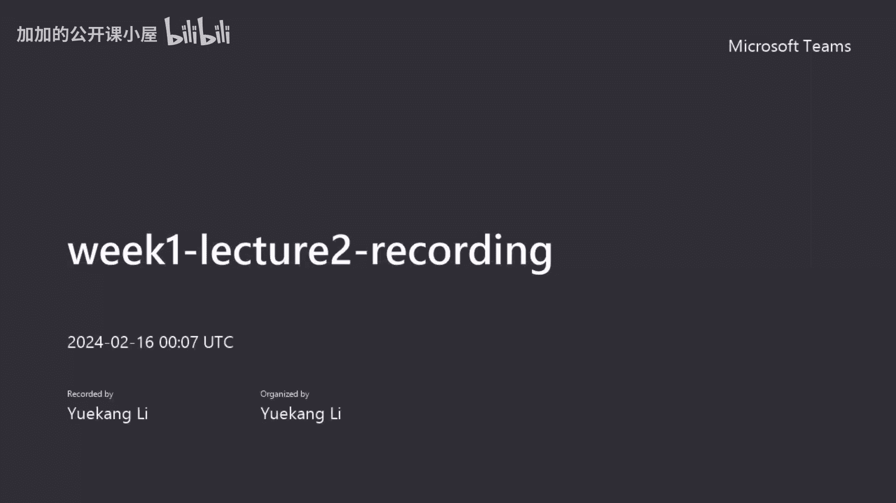
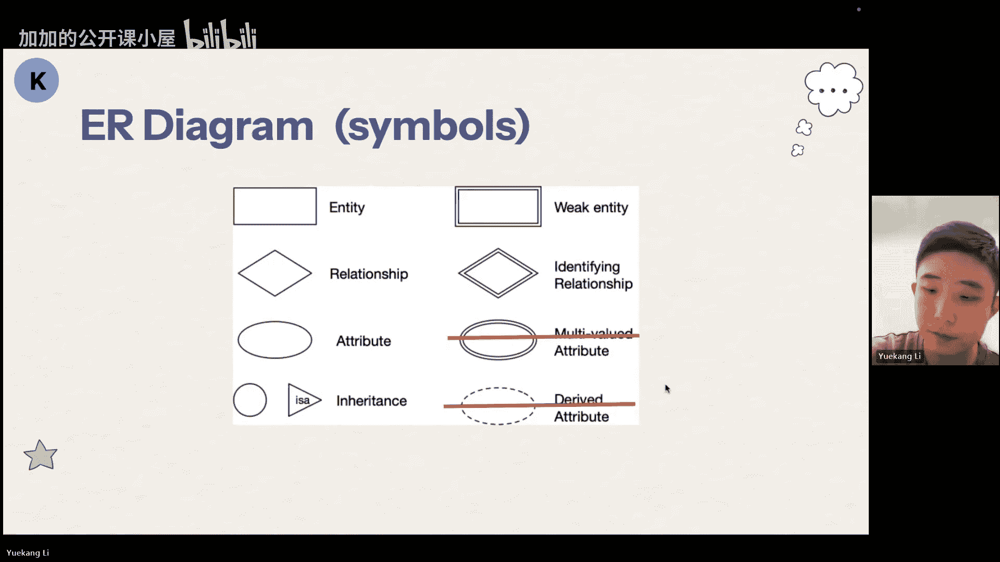

# 新南威尔士大学【中英⚡数据库系统｜COMP3311 2025 Database system】 p02 P2 Lecture 2 (ER models & Relational models) -BV1dV4HzTE7p_p2-

，Hi， class， welcome to the makeup recording for week one lecture 2。

 So I hope you are watching this recording before the start of tutorial 1。

And if you are watching the this recording， I hope you could physically attend the lectures because I'm trying to make the lecture content interactive。

 So I will ask you questions during the lectures。 and you will you can also provide me feedbacks during the lectures。

So， so， so please try to attend the lectures physically。And now we， we can start。

So this is today's outline。 So first， we will go through some updates for this course。

 and then we will discuss。The relationship modeling of， which is， which is a semi formal。嗯。

这他 modeling technique。And then we will go through the relational modeling technique。So first。

 the first update is we have some new cost materials online now。

 and all the tutorials are on Web C M S now。And second， when I was preparing this。

These lecture slides， I found some treasure， which are previous lecture notes。

 they have much more details than these slides。 I think it's because previously。

 USW was running 12 week semesters。 But now we only have 9 week terms。

 So that's why it has more content。However， not all the content inside these course notess are examineable。

 and only the what's covered in the lectures and slides I I and tutorials are。Examineminable。

And these casinos could be quite old because I found this slide。

So can you do a quick math to calculate， How old are the slides。Actually。

 the slides are about 20 years old。So since they are quite old。

So there could be some differences between the these cost node and the slides。

So that's the first update。 So now we have these three types of。Materials， cost materials。

 we have the exercise slide。 We have the previous course notess， and we have the textbooks。

 And some students were asking me about the text， textbooks。

 And I think normally you don't need to read it。 you don't need to read them because textbooks are really。

 they provide a lot of details。And it it's more like a dictionary。

 So whenever you encounter some ambiguous concept or some， there are some knowledge， you know。

 you are not you're not sure you need to check the ground truth。

 You need to find out the exact meaning or the exact concept。 then you go。

 then you can go to the go and look look into the textbooks。

 normally the the card notess and lecture slides should be enough。

So how do you handle these materials， If you say I just want to pass this course。

 then the exercise plus the tutorials should be should be enough for you。 And however， if you want。

 if you， you say， okay， I want to be the master of database。

 then I suggest you to look into the customs and textbooks。And talking about passing this course。

 there's an important thing you will need to notice。 It was not reflected in the course outline。

 I think he's now updated there。 So there is。An exam hurdle。So you will need to score 40%。

 at least 40%。In the final exam and have a 50% overall score to pass this course。

So this is something you have to keep， keep in mind。So the。

 the last update is related to those who are attending this lecture。

 So please try to keep quiet during the lecture。 So because since you are watching the recording。

 you can do whatever you want。So let's skip this really fast。😔，And now we。

 we come to the main content of this course。 That is the entity relationship modeling。

So let's have a quick recap of the process of data modeling， because it is a special。

 it is a concrete case for data modeling， so。There are three aims for data modeling。

 We need to cover。 We need to cover the information in the database。

 We need to cover the the relationships between different data items。In the database。

And we need to color。The constraints on the data， we may do data modeling。

 So these are the three aims of data modeling。And remember， data modeling is a design process。

 So there's no absolute right wrong。As far as your design makes sense， it's okay。

 So and the input of the data， the data modeling process are the requirements provided by the users normally。

And。And the output is the semi formal description of the database structure。

 and E R models is one of the the one of the formal descriptions。Here。So let's go through。

 first go through some concepts and definitions of entity relationship modeling。So。So remember。

 the data modeling is like the way of describing or modeling the world an entity and E R modeling provides。

modelss world as a collection of interrelated entities。And E R models have three major components。

The first one is attribute。You can think of this is actually model has a lot of connections with。

 It is very similar to a lot of concepts here are very similar to object oriented design。

 So attributes are more like the variables of objects。So an object could have similar attributes。

And entities are collections of attributes and belonging belonging to an object。 So you can。

 you can think of entities as objects。And relationship is just the association between entities。

And your model is not standard， so there could be some variations。

When we when we呃 when we try to呃 when we try to really呃。When we try to really implement the R model。

 So there are there could be variations and lecture notes use the notations from these two textbooks for the sake of simplicity。

And。And when we， when we want to visualize E R models， we we normally use E R diagrams。

 and an E R diagram consists of a collection of the entity site definitions。

 a collection of the relationship site definitions and the attributes associated with both entities and relations。

And the connections between the entities and relations。So。So here I， I would like to say that， okay。

 we sometimes we we don't just say entity site。 and that's too long for termin here。

 So we sometimes we refer entity as entity site。So， so please take note。This is an example E diagram。

 It is， you can see a lot of symbols here， but don't worry， we will go through all the symbols here。

 one by one。So these are the， these are the typical symbols used in E R diagrams。

 You may notice I have crossed out two symbols here。 It's not because they are not exable。

 It's because they， they seldom appear in the following up slides。

 So we will cover the rest of the symbols1 by one with examples。

 and I will come back to these slide and describe the meaning of these two symbols。

So first， let's go through the key concept in E R in entity relationship modeling。 So the。

 the first and most important concept here is。Entity site。

 So an entity site could be viewed as either a set of entities with the same set of attributes。好好好。

