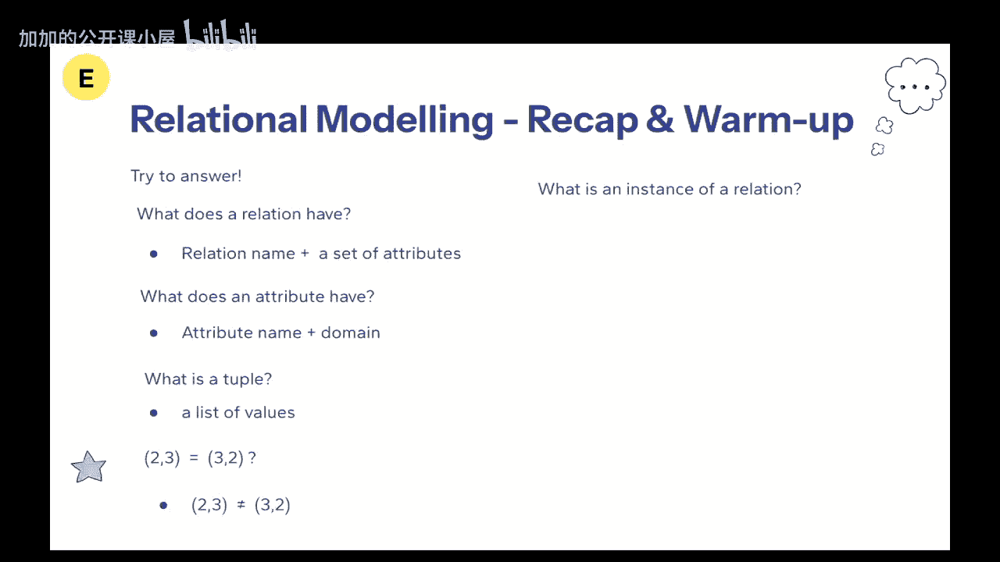

# 新南威尔士大学【中英⚡数据库系统｜COMP3311 2025 Database system】 p03 P3 Lecture 1 (ER-Relational Mapping and SQL Intro) -BV1dV4HzTE7p_p3-

。

差我。And let's wait for one more minute。For the recording to start。So good afternoon， class。

 let's start today's lecture。So in today's lecture， we will first go through some announcements。

 and then we will go through how do we map formally map。E R models with relational models。And then。

 we will have a。briefrief introduction to SQ L。So the first assignment is I just heard some some students or discussing about the quizzes。

actually， quiz one has been released。And you can， you can find it through this link。

And you can try as many times as possible。 And only the last try will be marked。

And the deadline of this quiz is before midnight， Friday。And actually， if you submit， if。

 if you submit your， your quiz after Friday after the deadline， you will。

Your final mark will be finalalized according to how late you submit。 But if you submit after。

I forgot the， the exact number after maybe three days。

 you will to totally lose the mark for this quiz。So this is the first announcement。And。😔。

The second announcement is that many of you may have known about the exam heard of。So they have。

 we do have an examination hurdle for this course。You will need to score at least 40% in your final exam and a 50% in your overall mark to。

 to pass this course。And talking about hurdles， we do have lecturing hurdles for this lecture theatre。

 unfortunately。And some other causes。Using the same lecture have the same issue of the Mac system。

 I believe some of you may have watched the recording of last Thursday。 So actually。

 our Mac is mixed with。The lecture theater above us。So， but， but other than that， I hope they。

 they have fixed this issue。So that's the second announcement。

And let's come to the main content today。So first， we will be covering some E。

 how do we map E R models to relational models。So let's have a quick recap of what we have learned。

So E R models， there， there， we could see that there is a。

 there are some correspondences between E R and relational models， for example， for attributes。

E R attributes can be roughly seen as relational attributes。 However， relational attributes。

 they do have， they do have restrictions。 They do have constraints。 They do have a domain associated。

With that attribute。And relational tus， table rows could be viewed as E R entities。

And relations are the tables could be viewed as a set of entities。And relations else can。

 can also represent。ER relationships。So this is a rough correspondence between E and relational models。

And let's have a， let's warm up our brain。 Let's warm up our memory。

 So let's try to describe what are the some key items inside this E diagram。So， first。

What does this symbol mean here， A circle with a D inside。Yes， yes， correct。

 Deed is it means inheritance。 So circle means inheritance。 And D means destroyed。 And this。

 what's the meaning of destroyed。So。What's the meaning of this threat。

What's the difference between Israel and overlapping。No over laughing， right。So of all I。

 it's now destroying， right。So the answer is actually， the， they are ex exclusive。

So a medical professional here can either be a doctor or a pharmacist。It has no other choices。

So this is why it is called destroy。 It cannot have overlap like。

 It cannot be both a doctor or a pharmacist。So， this is。The first one。And the second one is。呃，对原呃对。

Entity prescription here。So what are the attributes of。Prescription。I mean， we we。

 we don't look at the relations first。 Yeah， we， we just look at the。The entity itself。

 So it has two attributes。 Obviously， it has an I D and a date。And。

 and do know that since I D is underlined， it is the key here。 So keys are marked with underlines。

And let's try to describe this。Relation here。How do we describe， let's start from top down。

From prescription to drug。Yeah， let's， let's first look at the arrows。 Look for arrows。

 There are no arrows here， right， So it means it's a many to many relationship。And let's look at。

 and then let's look for participation。Let's look for the thickness of the lines here。 So the。

 the line con connecting prescription is a thick line。 So it， it means total participation。

 It means every entity of。Prescription is involved in this relation。

 So this is how we should describe this relationship。Everyy prescription。Contains one or more drugs。

So this is how it describe from top down， hello。1 to one relationships are shown by two arrows。Yeah。

 two arrows。And。Let's try to describe this relationship， from drug to prescription。

So how do I describe it。双方 drive头头盔。It's a partial participation。Yes。Actually。A drug may。

 might be contained。In one or more prescriptions。So this is how we should describe the relationship here。

And let's try to have some more warm ups。So， try to answer。So what does a relation have。

A relation has an。Has a relation name and set of entities。So you can think of relation as a table。

 So what does the table have， A table has。A table name。 And it has a set of table headers。

 So it's just like a table。So what does an attribute type for relational models。Not exactly。

 actually， it has attributes， name and domain。The attribute name is unique inside the relation。

 and the domain represents the set of valid values for this attribute。And what is a couple。Yes， yes。

It's a list of values。So。Do are are these two couples equal to each other。No， why not。Yes。

 I heard some of you say saying that lists are vectors。 So ordering matters for lists。

 So ordering matters for topples。 So these two are not equal to each other。

So what is an instance of a relation。Is the table right， A table is made up of what。

Its a set of tas。