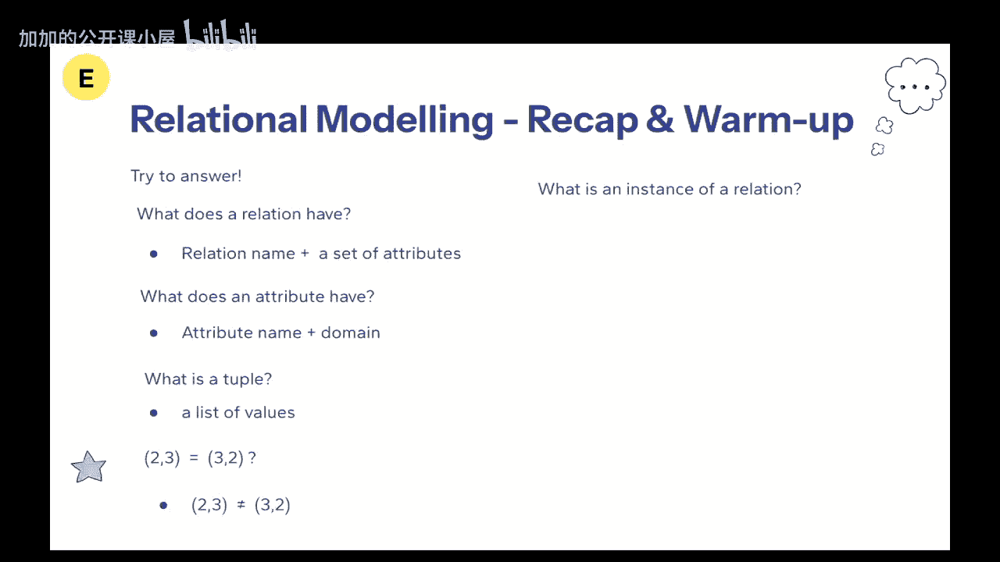

# 数据库系统：P3：ER模型到关系模型的映射与SQL简介


在本节课中，我们将学习如何将概念层面的ER模型正式映射为逻辑层面的关系模型，并初步了解用于操作关系数据库的标准语言SQL。

## 课程公告

在进入主要内容之前，我们先了解几个重要通知。

以下是关于课程评估的重要信息：

*   **测验一**：已发布。可通过指定链接访问，可多次尝试，仅最后一次尝试计分。截止时间为本周五午夜前。逾期提交将按规则扣分，严重逾期将无法获得该测验分数。
*   **考试门槛**：本课程设有最终考试门槛。要及格，必须在期末考试中获得至少40%的分数，并且总评成绩达到50%或以上。
*   **技术问题**：部分讲座录音存在音频串扰问题，技术团队正在修复。

## ER模型回顾

上一节我们介绍了ER模型的基本概念，本节中我们来看看ER模型与关系模型之间的对应关系。

ER模型中的元素可以大致对应到关系模型中：
*   **ER属性** 大致对应 **关系属性**。但关系属性有更严格的约束，例如关联的域。
*   **关系表的行** 可以看作 **ER实体**。
*   **关系表本身** 可以看作 **实体集** 或用于表示 **ER关系**。

让我们通过一个例子来热身，回顾ER图的解读。


以下是图中关键元素的解读：

*   **继承与互斥**：图中“Medical Professional”实体下方的圆圈和“d”表示继承，且子类“Doctor”与“Pharmacist”是**互斥**的。这意味着一个医疗专业人员只能是医生或药剂师中的一种，不能同时是两者。
*   **实体“Prescription”**：该实体有两个属性：`ID`和`Date`。其中`ID`带有下划线，表示它是该实体的**主键**。
*   **关系“Contains”**：这是一个从“Prescription”到“Drug”的关系。
    *   **基数约束**：关系两端都没有箭头，表示这是一个**多对多**关系。
    *   **参与约束**：连接到“Prescription”的线是粗线，表示**完全参与**。即，每一个处方实体都必须参与这个“Contains”关系。
    *   **描述**：因此，这个关系可以描述为“每一个处方都包含一种或多种药物”。反过来，由于连接到“Drug”的线是细线（部分参与），可以描述为“一种药物可能出现在一个或多个处方中”。

## 关系模型核心概念

在学习了ER模型后，我们需要一个更形式化的模型来实现数据库，这就是关系模型。

关系模型基于数学中的集合论概念。以下是其核心组成部分：

*   **关系**：一个关系可以看作一张**表**。它有一个关系名和一组属性。
*   **属性**：每个属性有一个唯一的名称和一个**域**。域定义了该属性可以取的所有有效值的集合。
    *   例如，属性 `Age` 的域可能是 **整数集合**。
*   **元组**：元组是属性值的有序列表，对应表中的一行。
    *   关键点：**元组的顺序很重要**。例如，元组 `(John, 25)` 与 `(25, John)` 是不同的。
*   **关系实例**：一个关系在特定时刻的所有元组的集合，就是该关系的实例，也就是我们看到的**表数据**。



上图展示了一个关系实例的例子，它包含了具体的元组数据。

## ER到关系模型的映射规则

理解了两种模型的基础后，我们现在来学习如何系统地将ER图转换为关系模式。这是数据库设计的关键一步。

以下是主要的映射规则：

**1. 映射强实体**
为每个强实体创建一个关系（表）。实体的属性映射为关系的属性。实体的主键成为关系的主键。
*   **示例**：强实体 `Student(ID, Name)` 映射为关系：**Student(**`ID`**,** `Name`**)**，其中 `ID` 是主键。

**2. 映射弱实体**
为每个弱实体创建一个关系。包含弱实体的所有简单属性和派生属性。此外，**必须包含所依赖的强实体的主键**作为外键。弱关系的主键由其自身的分辨符与所依赖强实体的主键组合而成。
*   **公式**：弱实体关系 = 弱实体属性 + 依赖强实体的主键（作为外键）。
*   **示例**：弱实体 `Dependent` 依赖于强实体 `Employee`。映射结果为：**Dependent(**`EmpID`**,** `DependentName`**, ...** **)**，其中 `(EmpID, DependentName)` 构成复合主键，`EmpID` 同时也是引用 `Employee` 表的外键。

**3. 映射二元关系**
规则取决于关系的基数（一对一、一对多、多对多）。
*   **多对多 (N:M)**：为关系本身创建一个新的关系。该关系的属性包括参与实体的**主键**（作为外键），以及关系本身的任何属性。这些外键的组合成为新关系的主键。
    *   **代码表示**：
        ```sql
        CREATE TABLE Contains (
            PrescriptionID INT,
            DrugID INT,
            PRIMARY KEY (PrescriptionID, DrugID),
            FOREIGN KEY (PrescriptionID) REFERENCES Prescription(ID),
            FOREIGN KEY (DrugID) REFERENCES Drug(ID)
        );
        ```
*   **一对多 (1:N)**：在“多”的一侧实体对应的关系中，加入“一”侧实体的**主键**作为外键。同时，也可以加入关系本身的属性。
*   **一对一 (1:1)**：可以将任一侧实体的主键作为外键加入到另一侧实体对应的关系中。通常选择参与度更高（完全参与）的一方来包含外键，以减少空值。

**4. 映射继承（ISA层次结构）**
有多种映射方法，常用的是：
*   **为每个实体创建表**：为父类和每个子类分别创建表。子类表包含自身特有属性，并包含父类的主键（同时作为自身主键和外键）。
    *   **示例**：`MedicalProfessional(ID, Name)`，`Doctor(ID, Specialization)`，`Pharmacist(ID, PharmacyLicense)`。`Doctor.ID` 和 `Pharmacist.ID` 既是主键，也引用 `MedicalProfessional.ID`。

## SQL简介

将ER模型映射为关系模式后，我们需要一种语言来操作这些表，这就是SQL。

SQL是结构化查询语言，是与关系数据库交互的标准语言。它主要包含三个部分：

以下是SQL的主要组成部分：

*   **数据定义语言**：用于定义和修改数据库结构，如创建、修改、删除表和索引。核心命令是 `CREATE`， `ALTER`， `DROP`。
*   **数据操作语言**：用于操作表中的数据，包括插入 (`INSERT`)、更新 (`UPDATE`)、删除 (`DELETE`) 和查询 (`SELECT`) 数据。
*   **数据控制语言**：用于控制数据库的访问权限，如授予 (`GRANT`) 或撤销 (`REVOKE`) 用户权限。

一个最基本的SQL查询示例是检索表中所有数据：
```sql
SELECT * FROM Student;
```
这条语句会从 `Student` 表中选择所有列 (`*`) 的所有行。

## 总结


本节课中我们一起学习了数据库设计从概念模型到逻辑模型的关键转换。我们首先回顾了ER模型，然后详细讲解了将ER图中的实体、关系和继承结构映射为关系模式（表结构）的正式规则。最后，我们介绍了用于操作这些关系表的标准语言SQL的基本概念和组成部分。掌握这些内容是进行实际数据库设计和操作的基础。