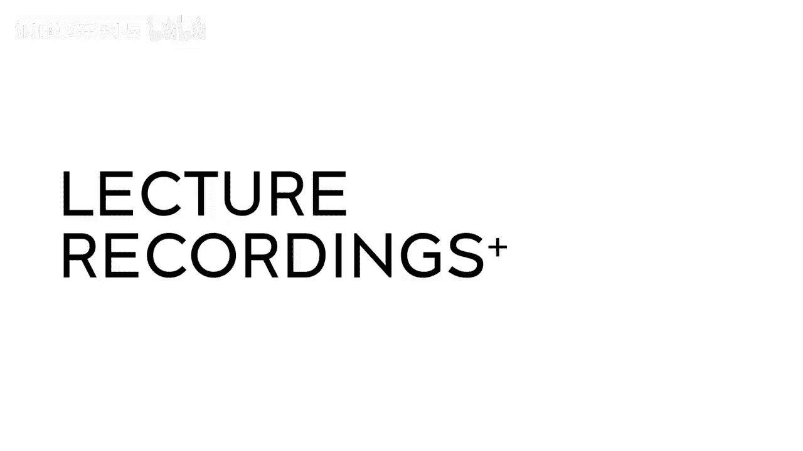
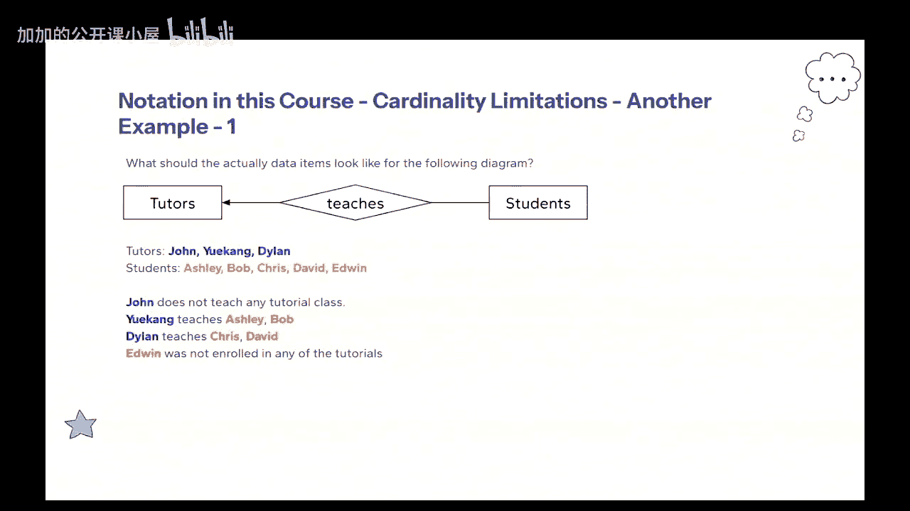

# 新南威尔士大学【中英⚡数据库系统｜COMP3311 2025 Database system】 p04 P4 Lecture 2 (SQL DDL & ER-SQL Mapping) -BV1dV4HzTE7p_p4-

。

All right， lets start。In the， in today's lecture， I will first cover some announcements。

And then we will go through the rest of the SQL syntax。And also。

 the SQR metadata definition language。And how we can map E model to SQL。Statements。So。

For announcement 1， in our last lecture， I mentioned that。The Dan is before midnight， tomorrow。

However。There is a power outage in C， S E， as you may have received an email for this。So。

There will be a whole day， a 24 hour power outage for C SU building。

 It will affect all the Web services。Including Web C M S。 So you。

 you won't be able to access the quiz。After 8 tomorrow， so。We have extended the deadline to midnight。

 Saturday。And， but I do encourage you to try to finish everything before 8 PM tomorrow because we。

 we don't really know。What will if some， something， some accident may will happen。So。

 that's the first announcement。And the second one is， you know， in， in our last week。

 we have covered how to design。Data models， including E R models and relational models。

And it's more like a design process。 It's it's some， some kind of thinking process。But now。Now。

 you are， you are encountering a lot of concepts， a lot of syntax， a lot of statements。

 a lot of things to memorize。And how to learn this course during this stage。

I'll tell you a story about myself。A long time ago in a university。

 far far away when I was still an undergraduate student。I was once very worried about my coursework。

 because。You know， I I， I have， I have nothing。 I， I。

 I I have no experience with programming before I got enrolled in university。

And some of my classmates， they even attended you know。

 international Olympics information competitions during their high school。

 And when I was still struggling with with the concepts of recursion and iteration。

 My classmates are already， you know， coding some websites for school clubs。So I was very worried。

And another thing I， I was very， very worried about is that。I found that I。

 there are many common cases when you learn a programming language。For example， in C。

 when let you learn C。What's the difference between a plus plus and plus plus a。So there are many。

 many different types of common cases that。You could memorize， and you should memorize。However， I。

 I can't do that。 It， is's kind of， very overwhelming。 And I found it very I。

 even if I can't memorize for a moment， maybe for a week， I will forget。

 I will forget everything after one or two weeks after I learned。A specific syntax。

And I went to my mentor。So in in my university， every undergra。

 every undergraduate student has a mentor。 and the relationship here is a mentor may have one or more undergraduate student a mentees。

 So you should be this sensitive when you learn this course。

 So the relationship is every student has a mentor。 And I went to my mentor。And那。

I told him the things I was worrying about。 I told him that I will forget about all the knowledge I learned。

During the lectures， I feel forget about all the concepts after one or two weeks。

And what should I do。And one thing he told me was that。As a computer science student。

 the most important thing for you is to learn how to Google。So， instead of。

Instead of memorizing everything。You can memorize all the keywords， the key some concepts。

And whenever you， you encounter something that is， that you are not sure about。You can always Google。

So that's the lesson I learned。So。Don't be afraid of the， the overwhelming concepts。

 syntax and keywords。In the slides。So you don't worry。

 It's very normal that you will forget about most of the concepts after。The doctor。

And the purpose of the lectures are to store some keywords in your mind。So whenever you， you。

 you came up with something， you know， okay， roughly there is something that is related when you came。

 when you， when， when you encounter a problem， a real world problem， a practical problem to solve。

 you may memorize。 okay， you can， you may not come up with a very concrete or solid solution at first。

 but you can think， think about it。 You can， you can， you can memorize that。 you。

 I have learned something that is related to this。And you can use the keyword。To do some search。And。

 and another thing is。Since we are software engineers， we are developers。

practiceice is very important。You can't memorize by just reciting all the concepts by just watching the slides you should memorize through practicing。

So if you use a programming language everyday。You won't need。 You won't have to remember。

 You won't have to memorize those syntax or those kind of cases purposefully， so。

So you should practice a lot。And， of course。Since you have the keys in your mind。

 you can Google a lot。 nowadays， you are very lucky。 You have many choices。 you can。😊。

Use star overflow。 You can even use chat GP T。 And also， you can ask us on a forum。So， this is。

The second announcement。And before we jump into today's main content。

Let's quickly go through some examples of how to describe relations， relationships in Y diagrams。

 because this is。This is important for your。This is important for your quiz one。 and。

 and some students still confused about。The cardality and participation relationship here。

And here I will use a concrete example to show you how do we describe these relationships。

And imagine this， this is the tutor， the tutorial。 I believe most of you have attended the tutorial class this week。

So this is roughly a mapping between in， in the real world， in our， in our system， so。So。

 let's think about it。So what should the actual data items look like for this following diagram。So。

This is actually the， the data we， the concrete data we can have to reflect。

 to be reflected by this E R diagram。So， assume。Assume we have three tutors。 We have drawn。

 We have Yuan， and we have Dlan。And we have five students。 We have Ashley。 We have Bob， Chris。

 David and Edwin。So。In this， in this scenario， John doesn't teach any tutorial class。

Yuekang teaches Ashley and Bob。Delan teaches Chris and David。And Edwin， the student， Edwin。

 was not taught by any tutor。 He was not in enrolled in any class。

So how should we describe the relationship， this relationship。From tus。2 students。So first。

 let's look at the arrow。 arrow means one or many。So the arrow painted by painted to the tutor is one。

 it it， is theres an arrow painted to the tutor。 So it means。

1 tutor is engaged in every relationship。In every， in every entity of the teacher's relationship。

1 only one tutor is involved。And on the other end， there's no arrows pointed to the students。

 So it means many students could be。Involved in this relationship。So and another thing。

 the second thing is the， the thickness of the lines。So on both side， there are thin lines。

 which means partial participation， which means that。Some tutors are not。Teaching。

So in this scenario， John is not teaching。And for students。

