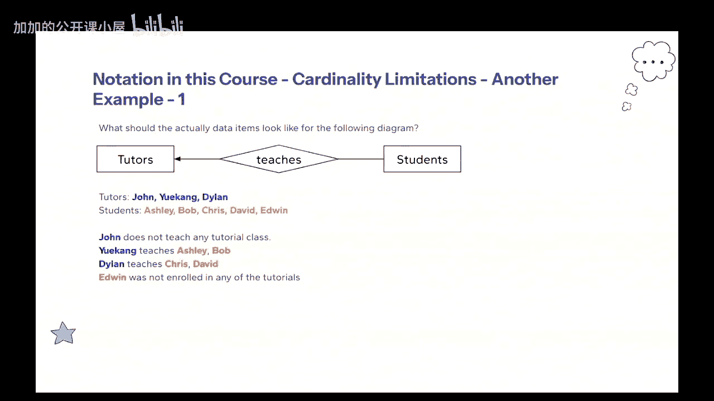

# 数据库系统：P4：SQL DDL与ER模型映射 🗄️

在本节课中，我们将学习SQL的数据定义语言（DDL），并了解如何将实体-关系（ER）模型映射为SQL语句。课程首先会进行一些重要通知，然后深入讲解SQL语法、元数据定义语言，以及ER模型到SQL的具体映射方法。

## 课程通知 📢

上一节我们介绍了数据模型的设计过程。在进入本节主要内容前，有两项通知需要说明。

第一项通知关于测验截止日期。原定截止时间为明天午夜。但由于计算机科学与工程学院大楼将进行全天24小时的停电维护，这将影响包括WebCMS在内的所有网络服务。因此，测验截止日期已延长至周六午夜。尽管如此，仍建议你尽量在明天晚上8点前完成测验，以防意外情况发生。

第二项通知关于学习方法。上周我们学习了如何设计数据模型，这是一个思考过程。现在，你将接触到大量需要记忆的概念、语法和语句。学习本阶段课程时，分享一个我本科时的经历：我曾因缺乏编程基础，面对需要记忆的众多语法细节感到焦虑，例如C语言中`a++`与`++a`的区别。我的导师告诉我，作为计算机科学学生，最重要的是学会如何搜索。你无需记住所有细节，但应记住核心概念和关键词。当遇到不确定的问题时，可以随时搜索解决方案。实践同样至关重要，通过日常使用编程语言，语法会自然内化，无需刻意背诵。如今，你可以利用Stack Overflow、ChatGPT或在课程论坛提问。因此，不必为繁多的概念感到压力，讲座的目的是在你的脑海中存储关键词，以便在解决实际问题时能够联想并搜索。

## ER关系描述示例 📝

在深入今天的主要内容之前，让我们快速回顾一下如何在ER图中描述关系，这对你的第一次测验很重要。

以下是一个具体的例子，展示如何描述这些关系。想象一个导师辅导学生的场景。

假设我们有三位导师：John、Yuekang和Dlan。我们有五位学生：Ashley、Bob、Chris、David和Edwin。在这个场景中：
*   John不教授任何课程。
*   Yuekang教授Ashley和Bob。
*   Dlan教授Chris和David。
*   学生Edwin没有注册任何课程，不被任何导师教授。

那么，我们应如何描述从导师到学生的这个“指导”关系？

首先，看箭头方向。箭头指向导师端，意味着在每次“指导”关系实例中，**有且仅有一位导师**参与。另一端（学生端）没有箭头，意味着**可以有多个学生**参与同一次关系实例。

其次，看连接线的粗细。两端的线都是细线，这表示**部分参与**。也就是说：
*   有些导师可能不进行教学（例如John）。
*   有些学生可能不接受指导（例如Edwin）。

---

本节课中我们一起学习了课程的重要通知、高效学习本课程的方法，并通过一个具体示例回顾了ER图中基数性和参与度的描述方法。接下来，我们将正式进入SQL DDL与ER模型映射的核心内容。