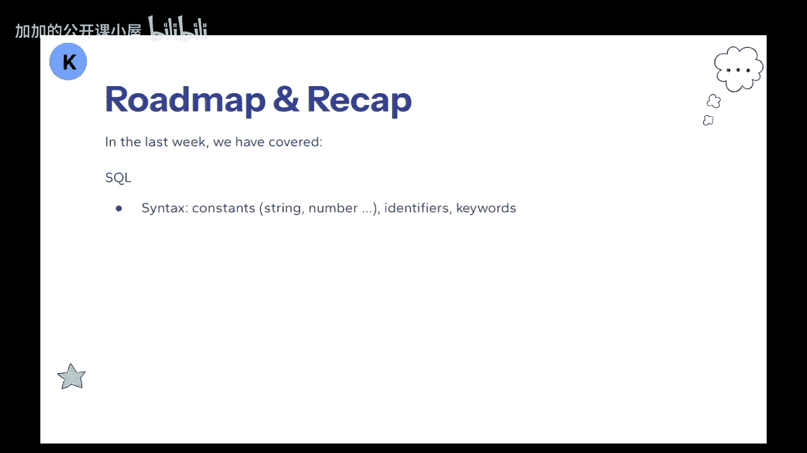

# 新南威尔士大学【中英⚡数据库系统｜COMP3311 2025 Database system】 p05 P5 Lecture 1 (Data Modification & Single Table Queries) -BV1dV4HzTE7p_p5-

。

All right。All right。Let's start， so。呃。This is today's outline。 So first。

 we will go through some announcements。And then we will have a quick look at the road map of what we have covered and we。

 what we will be covering。In the rest of the course。And then we will look into， how do we modify。

Da in with SQL。 And we will look into some single table queries and views some concepts of views that as well。

So for announcement  one。 So in the last week， we have done the quiz1。 So please try to stay updated。

 We are sending emails。 We are sending Web C， M S notifications and。

I'm doing some announcements for at the start of every lecture。 And still。

 about 50 students didn't submit their question at all。

 And a good news for all those who have submitted their questions。 So most of the students。高风了。

And none of the students who have submitted their answers， got zero mark。That's not pretty good news。

The average score is a little bit higher than the previous terms。So good job， class。And。

Please do take note thatquiz 2 has already started。So the deadline， if there's no changes。

 it should be。This midnight， this Friday。So please make sure that you。you do your qui。And。

That's the first announcement。And the second announcement is that we are releasing an assignment one soon。

So please stay updated。 We will be sending emails。 We will be putting notifications on Web C， M， S。

And I will make announcements during the lecture， but please just。Stay updated。

And the submission of this assignment 1 is by the end of week 5。 That's before the flexibility week。

And， and I will be discussing about the details of assignment 1 in our next lecture。

So that's all about the announcements。 And now let's move on to the roadmap and recap。

So let's have a quick warm up of what we have learned， what we have covered。So in the last week。

 we have covered here。Enantty relation to relational mapping。And how do we map entity relation。

Diagram into SQL。So first， for， for entities。How do we map from E R to relation。

How do we map strong entities。It's very simple， right， We just convert word。诶 the the entire。

entity into a table for me entities。We need to。 We need to have a separate table。

And we need to set up the foreign key correctly， for vacities。Her relationships。

We have covered many too many relationships。 And that's the easiest one to be converted。

Because we just need to put in all the primary all the primary kids participated of the participants。

Of each for this， for this relationship。放 from one同 many。relationship。We need to consider。

Putting the attributes of the relationship。Into one of the tables of the entities。

And can you think of which。Which table， which entity table should we use to hold。

The attributes of the relationship here。Is is it on the one side or on the many side。Yes， yes。The。

 the attributes of the relationship should be associated with the table of the entity on the many side of the relationship。

And for one to one relationship， we have covered。 we， we need to。 We can either assign the。We can。

 we can assign the the attributes of the relationship to either one of the participating。entity here。

And for the， for all the three relationships we， we just covered， they are our binary relationships。

Which means that only two sets of entities are participating in that relationship。 What about multi。

Multi way relationship。So how do we determine the case for this。T powerful relationshiplation。So。

For many to many relationship， it's easy to just collect the union of all the primary kids of the participating entities。

As the primary key for this relationship。If there's an arrow in this multi relationship。

 we just collect all the primary key from。The entities without an error。

As the primary key for this relationship。So this is how we map。Relationships。And for attributes。

 we have covered， how do we map。Composite attributes。 and how do we map multivalued attribute。

For composite attribute， we can just flatten the attribute。Into multiple columns of the table。

 So let's straightforward forward。For multivalued。Relationship attribute。

 We can convert it into a weak entity。To capture the behavior here。

And we also covered Halloween we map sub classes。 We have three types of styles。

The first one is called E R E R style， which is to create a separate table for each one of the entities inside this inheritance chain。

And。For each of the subclass table， we inherit。 We， we don't。 We don't put。

 We don't include the attributes of the super class。

 We just put a foreign key pointing to the super class。 So that's how we do E R style mapping。

And for all style mapping， what can we do。What's the difference。

 The difference is that although we are still keeping a separate table for each one of the entities。

We， we treat them as separate tables。 So each one of the sub subclass will have all the attributes。

As colorss。So that's how we do all style mapping。And finally， what we can do is we can do。

Single table style of mapping。 So that is to put all the columns。

 all the attributes into table columns。And。We allow some of the some of the columns to be known。

So that's how we do all single table style of mapping。So remember that just now。

 what we have covered is simply from entity relationship to relational modeling。

 And if you really want to map it into S Q L， we need to think about the constraints。

 We need to think about how do we determine the foreign keys and primary case。So， that's。

About the mapping。So。This actually， what we have learned， this。

 this type of knowledge tells us how do we design a database。

 So what we do normally is that we start from an E R diagram。

 And then we convert this E R diagram into relational model and S Q L。

 So that's how we do in real for practice。And we also have covered some basics about SQL。

 So we covered the syntax of SQL。

Wecover how do we。How do we describe？