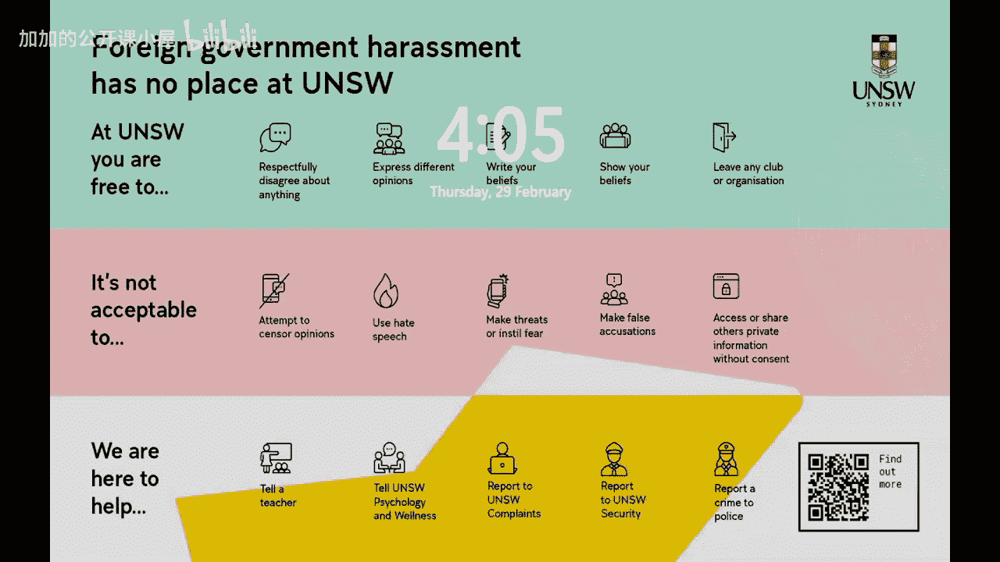
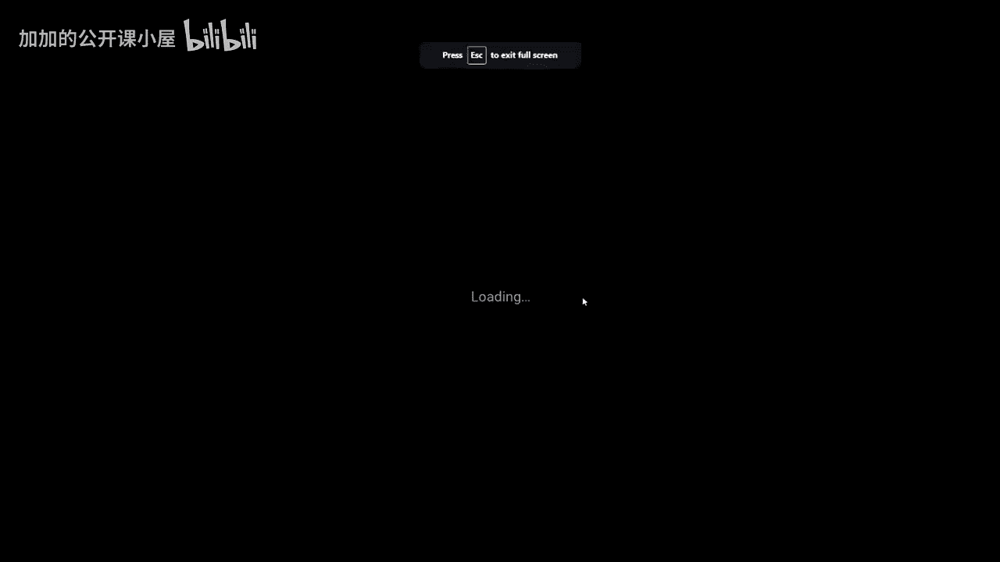
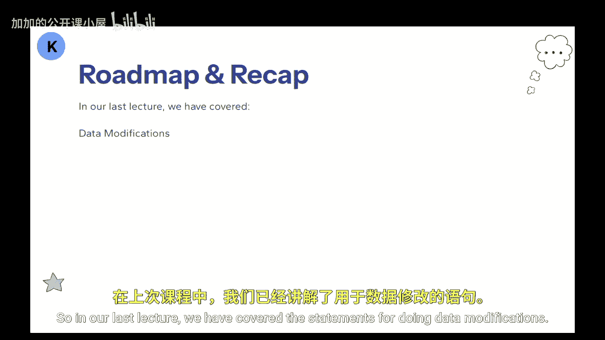
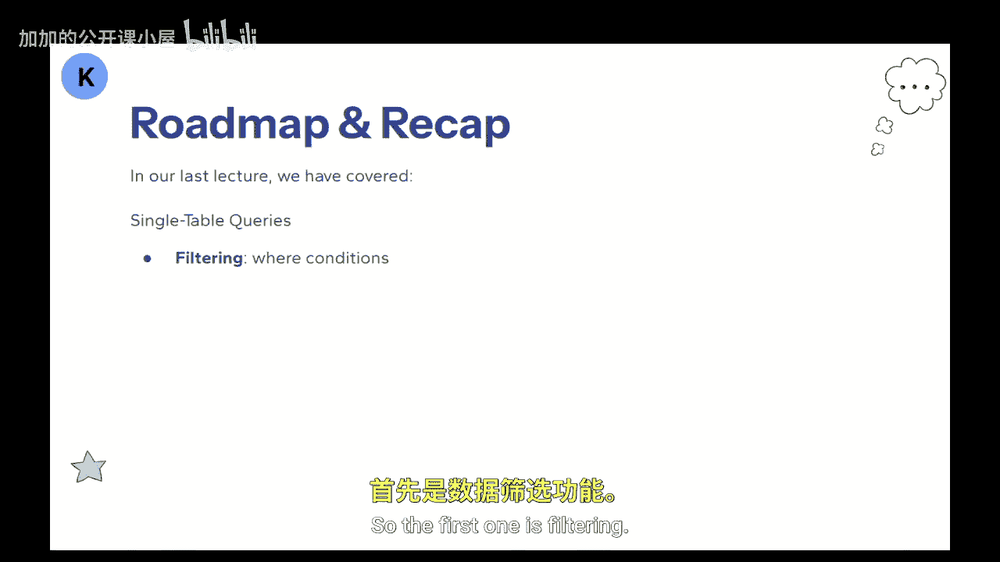

# 新南威尔士大学【中英⚡数据库系统｜COMP3311 2025 Database system】 p06 P6 Lecture 2 (Views & Multi-table Queries) -BV1dV4HzTE7p_p6-

。

嗯。Alright。Let's start today's lecture。So this is today's outline。 So first。

 we will go through some announcements。 And then let's have a look at the road mapap of what we will be learning in the next two weeks。

And let's have a quick recap of of what we have learned on Monday。And。Then Dlan will。

 will show you the， the database that that is to be used for assignment 1。And， and after that。

 we will learn two new concepts。 the first one is wheels in S Q L。

 And the second one is a multi table query。So the first announcement is that。Quz2。

 the due date of quiz 2 is midnight tomorrow。So what I suggest is is， you just do it。 Just do it。

 because even if you randomly choose。The number even if you you randomly choose make your choice for the questions。

 you can。 there's， there's a very low chance for you to get a zero mark。 So， so， so just do it。

 Just do it。And for assignment 1， it will be released by this weekend。

And so an the submission date is before the end of week 5。

 So you will have two weeks for finishing assignment 1。

And we will go through the database to be used in this assignment later。and。Bahysically。

 it will cover as clear wheels。SQL functions。And P， L， P， G， S，Q L functions。

So you can use whatever means you， you like to finish this assignment。But， I hope。

You can do it on your own。AndI don't know if you play games or not， but I don't。

 I don't want your university life to be just like playing a survival game or even a horror game。

 Let's not do that。 And I hope your university life should be like。A hack slash game。

 So whenever a classword comes， you just slash them。 Alright， so I hope you can do。

 you can finish the assignment with whatever means youd like。

 But I hope that you could do it on your own。 That's what I hope。And that's for assignment 1。

And the third announcement is that we will be hosting some help sessions。In next week。

 So you can ask that some， some tutors will be。Attending these sessions to help you out， and。

And during the help sessions， you can ask anything you would like to ask。Like， for example。

 you can ask for the， the， the answers to tutorials。 You can ask for。

Spations or clarifications for assignment 1。But you don't。

 but you can't ask for answers to the assignment。And now let's have a look at roadmap and recap。

So in our last lecture。We have covered。The statements for doing data modifications。

好。

And。And the first type of statement for doing data modification is a cut insertion。

 So remember that we have three different styles of insertion。 So the first。Style is。

That we could insert into a relation。 We just specified the name of the relation， and。

And we can insert a row into that relation。 So that's the first step。

The second style allows us to specify the attributes after。The name of the relation。 So。

 so in that case， we don't need。 we don't need to follow the order of the schema definition。

 The attributes to be inserted doesn't need to follow that order。

 And we can selectively use the attributes to be inserted。

And the third style allows us to insert multiple rows at once， with one statement。

So that's what we can do and。Although we can， we can use the third style to insert multiple rows with one single statement。

In practice， it's often is the bulk insertion is also needed because we need sometimes we need to insert data from。

Other files from other programs， or even from standard in。

So do remember that Postgres allows us to do bulk insertion。

And the command related to bulk insertion is called copy。So， that's about insertion。And for detion。

So。Oh we can specify the table we would like to delete from。

And we can use a real cloud to filter the data we would like to delete。

And there are two types of logic for implementing this di mechanism。

 So can you still remember what are the two types of。semantics。So actually。

 the answer is in the processes here。 So the first one is we can iterate the。

The table and delete the row  one by one。 So once we meet a row that fulfills the conditions that met the conditions we have specified。

 we can remove that row from the table。 So that's the first type of。Implementation。

 the second type of type of implementation is that。We use two loops。So the first， in the first loop。

 we just take note of。The coupleples that could meet the requirement of the condition。

And in the second loop。We just remove all the。All the roles we have taken note of。

So in we have experimented in our last lecture， that。Postg is actually using。

The second type of implementation。And。Do remember that what's the difference between the first and the second type of。

Deeletion。Inmplementation。So in most of the time， they are the same， but。

But there are in certain common cases， The second type of deletion implementation will delete more data。

From the table。So， that's about detion。And we also learned about update。所以我得。

The basic syntax for update is that we。Its an update。A table and set a list of assignments。

And we can， which can be followed by a we cloud。To indicate the data we， we would like to update。So。

 this is。About update。And for those， for those statements， which include beer clouds。

 So what's the default， Can you still remember， what's the default behavior of。

Not not having of your cloud， so。Is it does it equal to where  true or does it equal to where false。

So if we don't specify the we clause， its where true。 So the。

 the statement will be applied to all the rows or all the topples in the table。

So that's about the default behavior。And in our last lecture， we have also covered。

The single table queries。So here are some features provided by SQL for doing queries。

So the first one is filtering。 so we can use rear conditions to filter。

就对头比。