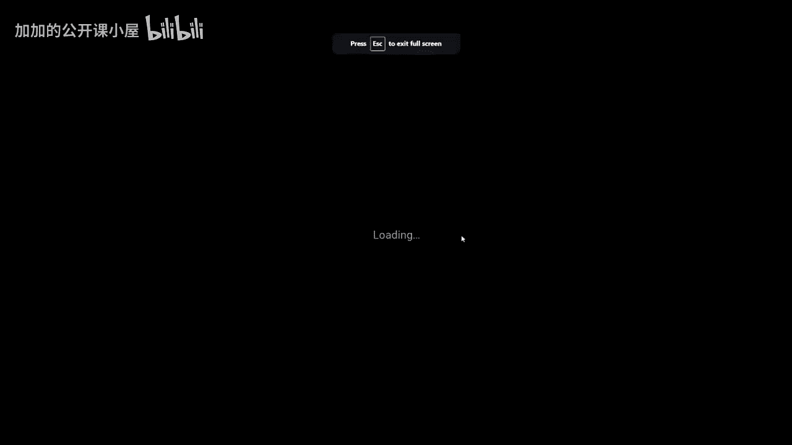
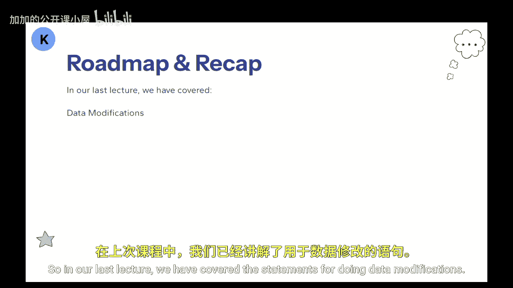
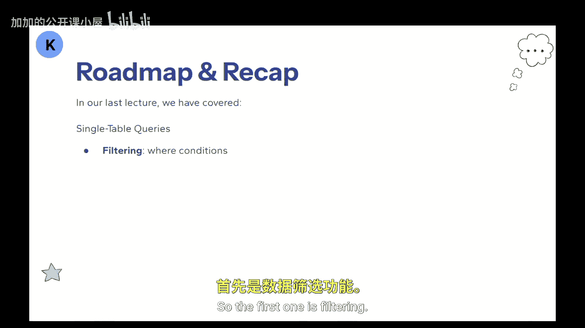

# 数据库系统：第2讲：视图与多表查询




在本节课中，我们将学习SQL中的两个重要概念：视图和多表查询。首先，我们会回顾一些课程公告和上节课的内容，然后详细介绍视图的创建与使用，最后探讨如何通过连接多个表来执行更复杂的查询。

## 课程公告

以下是本周的重要通知。

*   Quiz 2的截止日期是明天午夜。建议你完成它，因为即使随机选择答案，得到零分的可能性也很低。
*   Assignment 1将于本周末发布，提交截止日期是第5周结束前。你将有大约两周时间来完成它。本次作业将涵盖SQL视图、SQL函数以及PL/pgSQL函数。你可以使用任何你喜欢的方式完成作业，但希望你能够独立完成。
*   下周我们将举办一些帮助课程。在这些课程中，你可以向助教提问，例如询问教程答案或澄清Assignment 1的问题，但不能询问作业的答案。

## 路线图与回顾

上一节我们介绍了课程安排，现在我们来快速回顾一下上节课（周一）学习的内容。

在上节课中，我们主要学习了数据修改语句和单表查询。

### 数据修改回顾

我们学习了三种数据操作语句：插入、删除和更新。

**1. 数据插入**
插入语句有三种风格。
*   第一种：仅指定关系名，插入一行数据。语法为：`INSERT INTO relation_name VALUES (...);`
*   第二种：在关系名后指定属性名，这样插入的数据就不必遵循模式定义的顺序，并且可以选择性地插入部分属性。语法为：`INSERT INTO relation_name (attr1, attr2, ...) VALUES (val1, val2, ...);`
*   第三种：使用单个语句一次性插入多行数据。语法为：`INSERT INTO relation_name VALUES (...), (...), ...;`

此外，实践中常需要进行批量插入。PostgreSQL提供了 `COPY` 命令来从文件或其他源批量导入数据。

**2. 数据删除**
删除语句的基本语法是：`DELETE FROM table_name WHERE condition;`
我们可以使用WHERE子句来过滤要删除的数据。

删除操作有两种实现逻辑。
*   第一种：遍历表，逐行检查条件，满足则立即删除该行。
*   第二种：使用两个循环。第一个循环标记所有满足条件的元组，第二个循环一次性删除所有被标记的元组。

PostgreSQL实际采用的是第二种实现方式。在大多数情况下，两者结果相同，但在某些特定情况下，第二种方式可能会删除更多数据。



**3. 数据更新**
更新语句的基本语法是：`UPDATE table_name SET column1 = value1, column2 = value2, ... WHERE condition;`
我们可以使用WHERE子句来指定要更新的数据行。


对于包含WHERE子句的语句（INSERT ... SELECT, DELETE, UPDATE），如果省略WHERE子句，其默认行为等同于 `WHERE TRUE`，即该语句会应用于表中的所有行。

### 单表查询回顾

上节课我们还介绍了单表查询的一些功能。
*   **过滤**：使用WHERE条件进行数据筛选。
*   **投影**：使用SELECT子句选择特定的列。
*   **排序**：使用ORDER BY子句对结果进行排序。
*   **聚合**：使用GROUP BY子句和聚合函数（如COUNT, SUM, AVG）对数据进行分组统计。
*   **分组后过滤**：使用HAVING子句对分组后的结果进行筛选。

## Assignment 1 数据库介绍

接下来，Dlan将向大家展示Assignment 1中将要用到的数据库。这个数据库将作为我们练习视图和多表查询的基础。

（此处应有数据库ER图或表结构介绍，但根据提供的文本，具体内容未详细展开。在实际教程中，这里会描述数据库包含哪些表、表之间的关系以及示例数据。）

## SQL视图

上一节我们回顾了数据操作和基本查询，本节我们将学习第一个新概念：SQL视图。

视图是一个虚拟表，其内容由查询定义。与包含数据的物理表不同，视图只保存查询逻辑，每次查询视图时都会重新执行其定义中的查询。

**创建视图的语法如下：**
```sql
CREATE VIEW view_name AS
SELECT column1, column2, ...
FROM table_name
WHERE condition;
```

**视图的主要优点包括：**
*   **简化复杂查询**：可以将复杂的查询逻辑封装在视图中，之后只需像查询普通表一样查询视图。
*   **增强安全性**：可以只向用户暴露视图，而不是底层基表，从而隐藏敏感数据或复杂结构。
*   **提供逻辑数据独立性**：如果底层表结构发生变化（例如列名改变），只需修改视图定义，而无需修改依赖该视图的应用程序。

需要注意的是，某些视图是可更新的（即可以通过视图进行INSERT、UPDATE、DELETE操作），但这通常有严格的限制，例如视图必须基于单个表且未使用聚合或DISTINCT等操作。

## 多表查询

了解了如何通过视图简化查询后，本节我们来看看如何从多个表中组合数据，即多表查询。这是数据库系统的核心能力之一，通过连接操作实现。

当需要的信息分布在不同的表中时，我们需要使用连接来关联这些表。最常用的连接类型是内连接。

**内连接的基本语法如下：**
```sql
SELECT columns
FROM table1
INNER JOIN table2 ON table1.column_name = table2.column_name;
```
`ON` 子句指定了连接条件，即两个表如何关联。只有满足连接条件的行才会出现在结果中。

除了 `INNER JOIN`，还有其他类型的连接，例如：
*   **左外连接**：返回左表的所有行，即使右表中没有匹配的行。右表缺失的列以NULL填充。
*   **右外连接**：返回右表的所有行，即使左表中没有匹配的行。
*   **全外连接**：返回左右两表的所有行，任一表无匹配时，另一表的列填充NULL。

**示例：** 假设有 `Students` 表和 `Courses` 表，要查询每个学生选修的课程，可以使用：
```sql
SELECT Students.name, Courses.course_name
FROM Students
INNER JOIN Enrollments ON Students.id = Enrollments.student_id
INNER JOIN Courses ON Enrollments.course_id = Courses.id;
```
这个查询通过 `Enrollments` 连接表将 `Students` 和 `Courses` 关联起来。

## 总结

本节课中我们一起学习了SQL中的两个重要特性。
首先，我们介绍了**视图**，它是一种虚拟表，基于查询结果定义，可用于简化复杂操作、提高安全性和实现逻辑数据独立性。
其次，我们深入探讨了**多表查询**，特别是通过`JOIN`操作连接多个表来获取关联数据。我们学习了内连接的基本语法，并简要了解了外连接的概念。



掌握视图和多表查询是构建复杂数据库应用的基础。在接下来的Assignment 1中，你们将有机会实践这些概念。