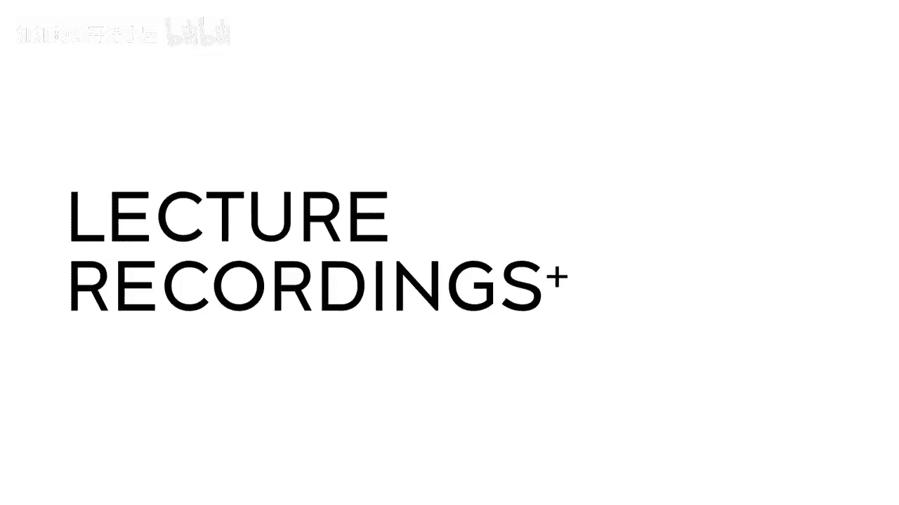
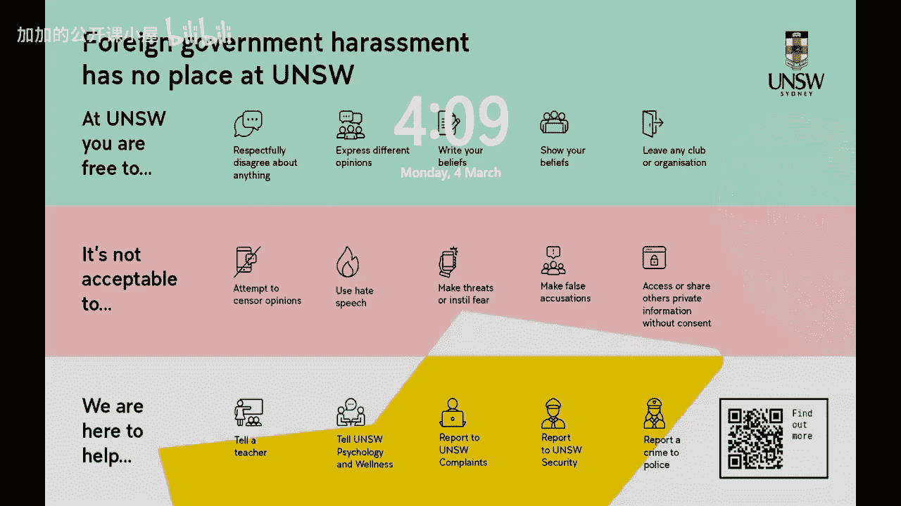
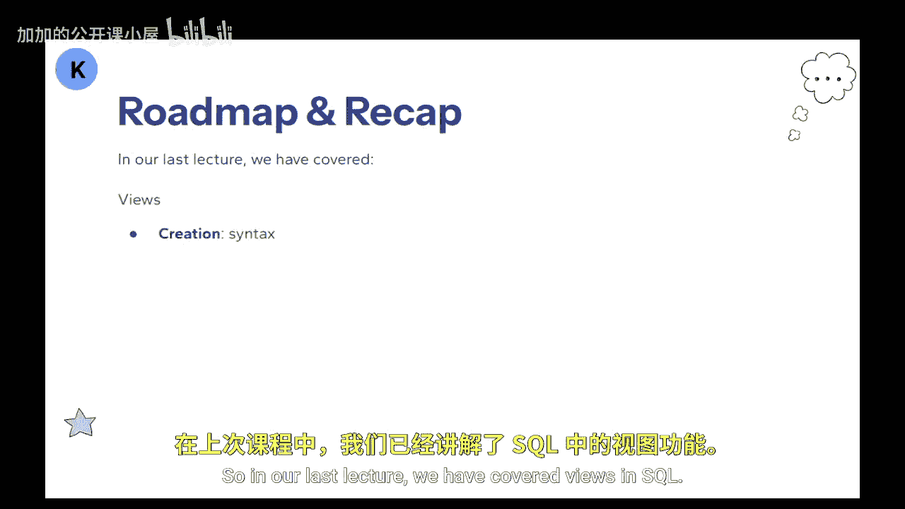

# 新南威尔士大学【中英⚡数据库系统｜COMP3311 2025 Database system】 p07 P7 Lecture 1 (More SQL Queries & SQL Functions) -BV1dV4HzTE7p_p7-

。

u。Let me restart the entire system。I don't know why I can see some lights on the。The projector there。

 but。There's nothing projected on the screen。Or maybe。Try to turn off the light， first。

So it has nothing to do with the lights。I've tried all the， all the options。

 but it doesn't seem to work。Let's try to restart the projector。Oh， it's， it finally works。

Please wait2 more minutes。

II think someone unplugged some wares here。So。呃 family works。So here's today's outline。

 We are going to cover some announcements first。 and we， we。

 we are going to do some recap and have a look at of our road map。

And we will learn more about some SQL queries， including bags， sites， their operators。

 more about grouping and also some abstraction for complex queries。

 And we will also learn about S QL functions。 You will be using SQL functions for your assignment 1。

So， for something one。Well for the first announcement， you。

 you will have to do your quiz 3 this week。 And in the next week。

 you don't have any quiz so you can focus on your assignment。And for Queenz 2。

 the average score is actually a bit lower than  Queenz1。 And when I see the。

A trendren ofquiz scores in previous terms is like going all the way down for for thequizzes。

 but still， we are US going higher than previous terms。 So good job class。

So the second announcement is about the assignment。 I believe most of you have received the email。

 So the specifications， and sorry for the delay。 we have encountered some technical technical issues just like today's lecture。

 So there the specifications will be released on by this Wednesday。

 and the submission should be before 10 PM。 No that is not midnight。And20 AM on 22nd March。

Which is the Friday of week 6。 So you are essentially given more time for a assignment one and。

And assignment 1 will be using SQl views plus SQl functions， and。P， L， p SQL functions。So again。

 you since you have given more time。 So you can use actually use whatever means you want to finish the assignment。

 However， I do encourage you to do it on your own because the purpose is for you to practice for you to master the knowledge。

So that's the second announcement。 And the third one is that we are。

 we are hosting some help sessions this week。 So if you have problems setting up your。V X D2 account。

 or if you can， you can， because since the data and schema has already been released。For example one。

 you can， you can try it。 And if you have encountered any problems of with the released material。

 you can go to these help sessions。So that's all about the announcements。

 And let's come to road mapap and recap， so。In our last lecture， we have covered views in SQL。

 So do you still remember the syntax for creating views。

