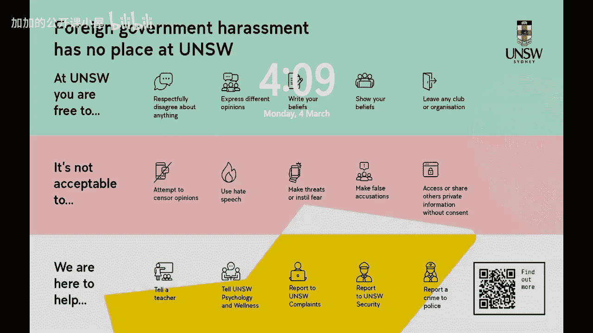
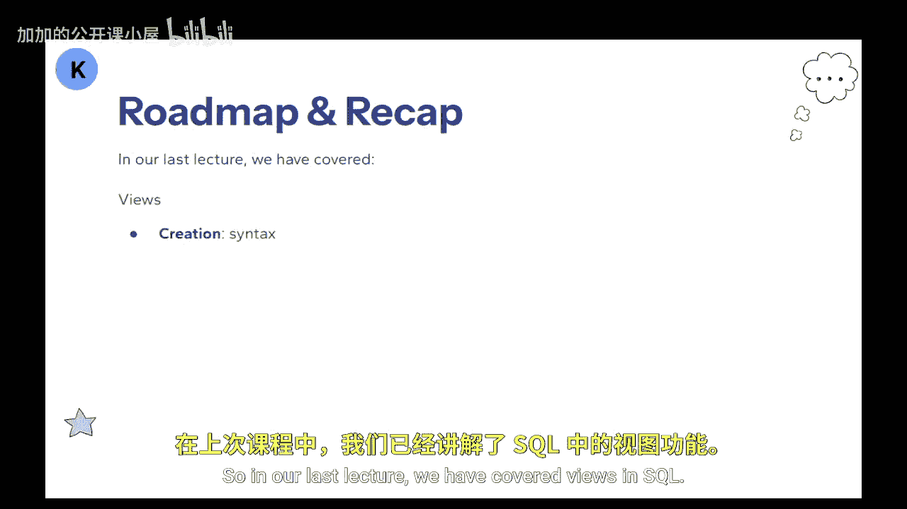

# 数据库系统：P7：更多SQL查询与SQL函数


在本节课中，我们将学习更多高级SQL查询技术，包括集合运算、分组操作的深入理解，以及使用视图和函数来抽象复杂查询。我们还将介绍SQL函数，这是完成作业1所需的重要工具。

## 课程公告 📢

在深入学习之前，我们先了解几项重要通知。


以下是本周及未来的课程安排：




*   **测验3**：本周需要进行测验3。下周没有测验，以便大家专注于作业。
*   **作业1**：作业1的说明将于本周三发布。提交截止日期为第6周周五（3月22日）上午10点。请注意，这不是午夜截止。作业将涉及使用SQL视图和PL/pgSQL函数。
*   **帮助课程**：本周将开设帮助课程。如果在设置VX D2账户或使用已发布的作业1数据和模式时遇到问题，可以参加这些课程寻求帮助。

## 回顾与路线图 🗺️

上一讲我们介绍了SQL中的视图。

你还记得创建视图的语法吗？

创建视图的基本语法是：
```sql
CREATE VIEW view_name AS
SELECT column1, column2, ...
FROM table_name
WHERE condition;
```

## 更多SQL查询 🔍

本节中，我们将探讨更复杂的SQL查询操作，包括集合运算和高级分组。

### 集合运算

SQL支持在查询结果集之间进行并集、交集和差集运算。这些运算符默认会消除重复行。

*   **UNION**：合并两个查询的结果，并自动去重。
    ```sql
    SELECT column FROM table1
    UNION
    SELECT column FROM table2;
    ```
*   **INTERSECT**：返回两个查询共有的结果。
    ```sql
    SELECT column FROM table1
    INTERSECT
    SELECT column FROM table2;
    ```
*   **EXCEPT**：返回存在于第一个查询但不在第二个查询中的结果。
    ```sql
    SELECT column FROM table1
    EXCEPT
    SELECT column FROM table2;
    ```

若要保留所有行（包括重复项），需使用 `UNION ALL`、`INTERSECT ALL` 和 `EXCEPT ALL`。

### 深入分组

`GROUP BY` 子句用于将行按一列或多列的值分组，以便对每个组应用聚合函数。

一个常见的进阶用法是 `HAVING` 子句，它用于过滤分组后的结果集，其作用类似于 `WHERE` 子句，但针对的是组而非单个行。

以下是一个示例，查找订单数量超过5笔的客户：
```sql
SELECT customer_id, COUNT(order_id) as order_count
FROM orders
GROUP BY customer_id
HAVING COUNT(order_id) > 5;
```

## 复杂查询的抽象 🧩

对于复杂的查询逻辑，我们可以使用视图和函数进行封装和抽象，使代码更清晰、更易复用。

上一节我们介绍了视图。本节我们来看看SQL函数。

### SQL函数

SQL函数允许你将一段SQL逻辑封装起来，通过调用函数名并传递参数来执行。这在作业1中会用到。

以下是一个简单的SQL函数示例，它接收一个客户ID并返回该客户的订单数量：
```sql
CREATE FUNCTION get_order_count(customer_id INT)
RETURNS INT AS $$
BEGIN
    RETURN (SELECT COUNT(*) FROM orders WHERE orders.customer_id = $1);
END;
$$ LANGUAGE plpgsql;
```
你可以这样调用它：`SELECT get_order_count(123);`

## 总结 📝



本节课我们一起学习了更多SQL查询技术。我们回顾了使用`UNION`、`INTERSECT`、`EXCEPT`进行集合运算，深入探讨了`GROUP BY`与`HAVING`子句在数据分组与过滤中的应用。最后，我们介绍了如何使用SQL函数来封装和抽象复杂的查询逻辑，这是完成即将发布的作业1的关键技能。请务必利用好帮助课程，并按时完成测验和作业。