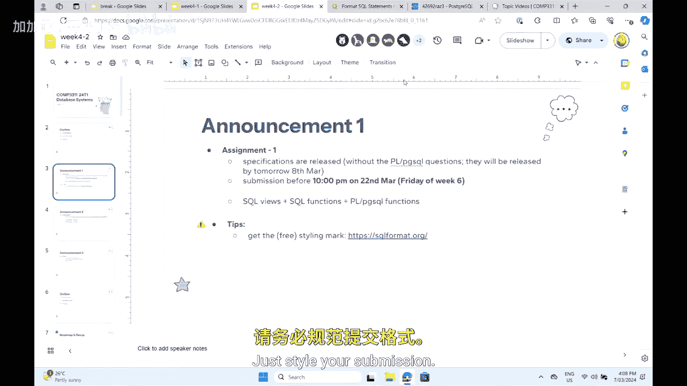
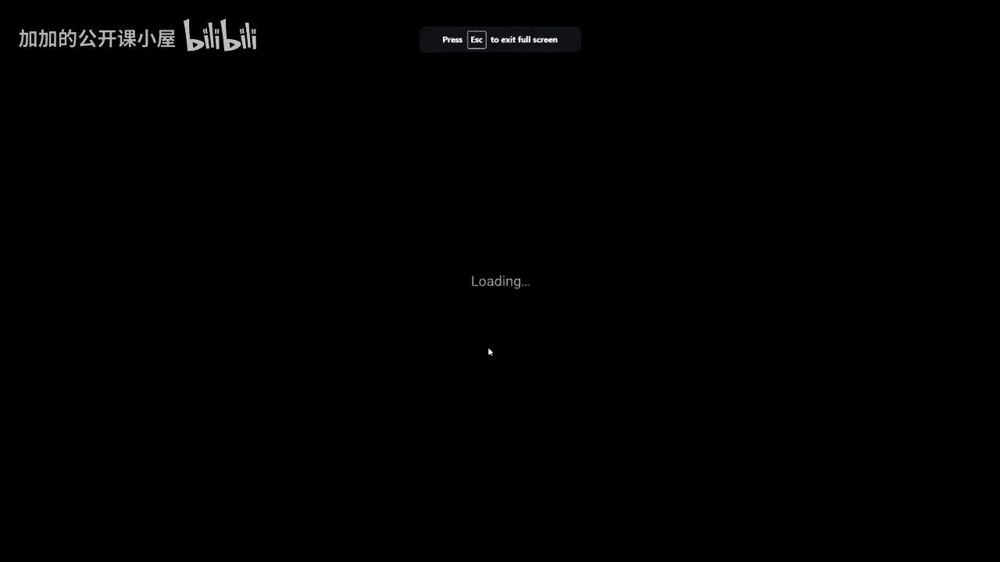
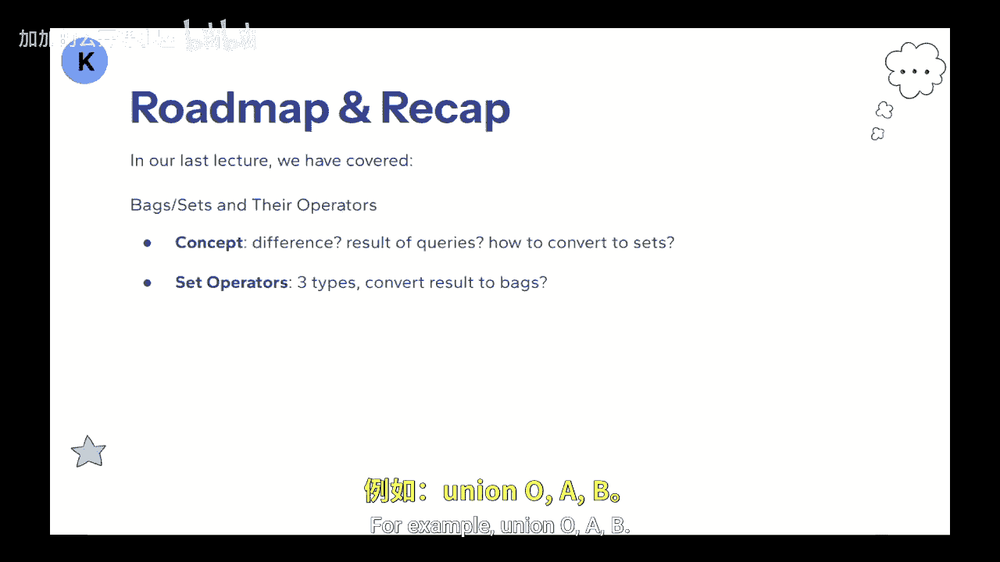

# 新南威尔士大学【中英⚡数据库系统｜COMP3311 2025 Database system】 p08 P8 Lecture 2 (pl⧸pgsql) -BV1dV4HzTE7p_p8-

，Okay， let's start。So。诶。Here's today's outline。 So first， we will go through some announcements。

And then， let's have a。Quick recap of what we have learned。And after that。

 we will cover an important topic for your71， which is P， L， P G， S Q L。So。

 for the first announcement。诶。Its related to assignment one。

And the specifications have been released on this Wednesday without the P L P B SP L questions。

And the full version of the specifications will be released。By tomorrow。And。and and。

And together with the the the questions and specifications， we have also released some sample。

Somehow outputs。For the， for the assignments， for the assignment questions。

 And some of you may have noticed that there are some minor errors in the sample output and post and some of you have posted some questions on the forum。

 and we are fixing the samples and the questions there， they are。Pro they won' be after 돼。嗯。

And inside the assignment， if you have went through the the specifications。

 the current version of specification， we notice that。The first question is a styling question。

 iss a stling mark。 So you have two marks。Which are almost free to get。诶。So。

So you need to format the your submission， the， the statements you have submitted。

 So what I suggest is that you could use some， some tools。To do the spell for you。

If you are using some， some I Ds like US code， you can have。

 you can some plugins to help you to do the formatting。And there are some online services。

Could do this。Sting。So， one of them is。Called SQl format。

And what you can do is you can just copy and paste your。Your Sql command。inside this。

In this input box。 and it will automatically format the SQL for you。 For example， let's try to。

Do something here， you can。You can use an example here。嗯。m。So， this is an unformted。SQl statement。

AndWhat you can do is you can just。嗯。This website。To format your assignment answers。

So before you submit your your， you you can use some websites like this to。To format it。

 and you will get some free some marks。For selling your。三个。So this is。

 this is almost a framework for you。 So please just do it just。Style your， style your submission。

And that's the announcement about assignment1。And for the second announcement today is that we are hosting help sessions。

Starting from this week。So here's the timetable for， for the， you can find the timetable here。

 and mostly its done on Tuesday， Wednesday and Thursday。So do you have any questions。Oh， its it not。

 yeah， that that's a good question and。It is actually scheduled by the school。 And I will。

 I will try to ask the school manager to about this。And see if we can adjust the the， the time for。

 for the shop session。And。And the， the last announcement today is that you should。Really do your。

 and。The deadlineland is tomorrow。Tomorrow， midnight。

 and some students asked about question 3 and 4 because they are related to。P L， P。

 B X L question functions。 And however， if the the those two functions。Don't require too much of P。

 L P D SP， specific knowledge。And most， for example， for question3 is， is mostly just a procedural。

Fun， so so you， you should use your previous do you plan use your previous knowledge to solve them。

And another thing about solving the questions for the quizzes。 Now。

 since we are learning some programming and the quizzes， the quiz questions are about some。

OfCo snippets。 So what you can do is you can try to execute the， the。

The the functions inside are all the statements provided by the quizzes。

On your V X D B server or maybe one compiler。 And then you can observe for the result and choose the correct answer。

So， so that's almost a framework for you。 So just do it。 Just do it。And now。

 let's have a quick recap of what we have learned。InIn our last lecture， we have covered bags。

 sites and their operators。So。First。😔，What's the difference between the concept of bags and sets。

So what's the conceptual difference here。So， size。Actually， doesn't allow duplicates and bags。

아 loud do play。So， most of the time。The， the result of a select。Is a bag。

Because there are duplicated data entries inside the results。So， that's a conceptual difference。

And how can we convert。The result of a bag。Into a site。What's the key word here。So we do select。Yes。

 yes。 I hear someone you。T distinct。The keyword here is distinct。 We can select distinct。

 and then it will give us a site instead of a bag。So， that's the first one， and。

We have also learned that there are three different types of site operators。So what are them。

 What are very different。三 다会。Let me give you the first one。 The first one is union。

SoWhat is the second one。The second one is。Interction。And the third one is， except。The is it accept。

So what are the differences between these three operators。So， for union and intersect is。

Equient to the mathematical。A operation operator。 So when you， when you do site operations in math。

The the result will be the same and for accept。嗰 out matters。so for for example for a except b。In。

The the element should be inside a， but not inside B。And if， if we change the order here。Let' say we。

 we want a result for B except A， then the result will be different。 It's like。The results are the。

 the the elements inside B， but not inside a。So for except， the other matters。

And all that's very different。siteite operators， they are producing sites instead of bags。

So how can we convert the result into bags。So these operators will eliminate duplicate。

And what if we want to keep the duplicate data。So what's the key here？Do you still remember。

I see a lot of computer cases。The the keyboard here is no。So if we want to keep the， the。

 the duplicates， we use the keyword R， for example， union R a。

嗯。저 그 서。