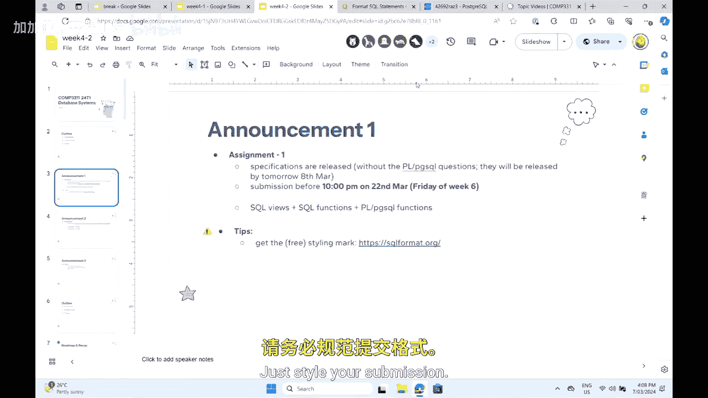
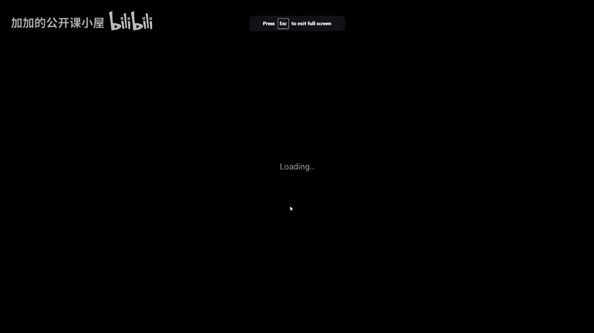
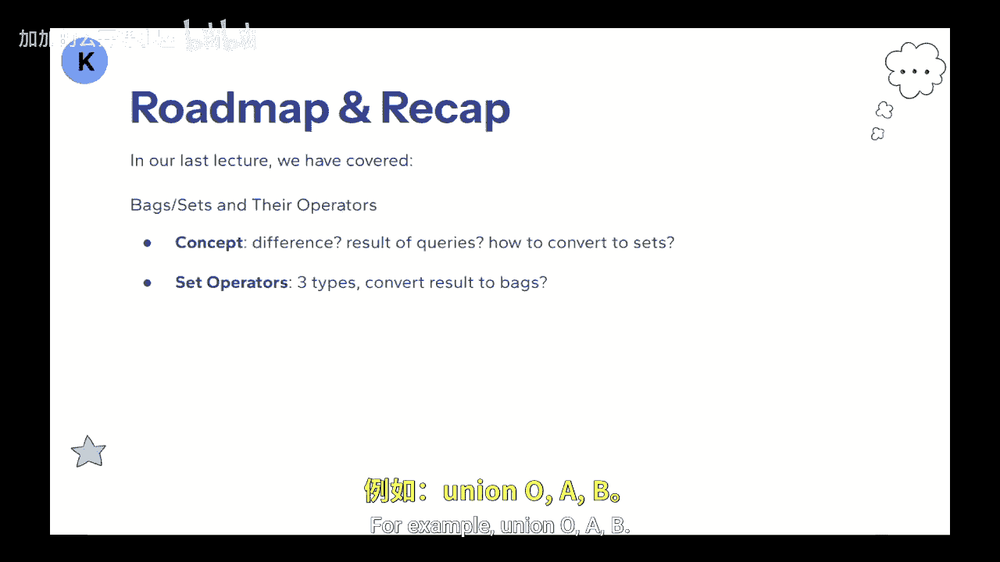

# 数据库系统：P8：PL/pgSQL 入门教程

在本节课中，我们将学习关于PL/pgSQL的重要知识，这是完成课程作业和深入理解数据库编程的关键。课程开始前，我们先了解一些重要的通知。

## 课程公告

以下是关于课程和作业的重要信息。

### 关于作业一

作业一的说明文件已于本周三发布，但其中不包含PL/pgSQL相关的问题。完整的说明文件将于明天发布。

与作业说明一同发布的，还有一些示例输出。部分同学可能已经注意到示例输出中存在一些小错误，并且已在论坛上提出了相关问题。我们正在修复这些示例和问题，它们很快会被更新。

在当前的作业说明中，第一题是一个格式规范题，旨在考察提交代码的格式。这部分分数几乎是白送的。因此，你需要对你提交的SQL语句进行格式化。

建议你使用一些工具来帮助你完成格式化。例如，如果你使用VS Code等IDE，可以安装相关插件。此外，也有一些在线服务可以完成这项工作。

其中一个在线工具叫做 **SQL Format**。你可以将未格式化的SQL语句复制粘贴到其输入框中，它会自动为你格式化。



例如，这是一个未格式化的SQL语句：
```sql
SELECT * FROM students WHERE age > 20 ORDER BY name;
```
你可以使用上述网站来格式化你的作业答案。在提交前进行格式化，你就能轻松获得格式规范的分数。这几乎是一个送分框架，请务必完成。



### 关于帮助课程

从本周开始，我们将举办帮助课程。课程时间表主要安排在周二、周三和周四。具体时间安排由学院制定，如果你对时间有疑问，我会尝试与学院管理人员沟通，看是否能进行调整。

### 关于测验截止日期

最后一个提醒是，测验的截止日期是明天午夜。有同学询问第3题和第4题，因为它们涉及PL/pgSQL函数。然而，这两道题并不需要太多特定的PL/pgSQL知识。

例如，第3题主要是一个过程性函数，你应该运用之前学到的知识来解决它。

关于解答测验题目，由于我们现在在学习编程，测验题会涉及一些代码片段。你可以尝试在VLab数据库服务器或在线编译器上执行题目中提供的函数或语句，然后观察结果并选择正确答案。这几乎是一个解题框架，请直接实践。

## 知识回顾：集合与包

在上一讲中，我们学习了包（Bags）和集合（Sets）及其操作符。现在，让我们快速回顾一下核心概念。

首先，**集合**和**包**在概念上的主要区别是什么？

**集合**不允许重复元素，而**包**允许重复元素。大多数情况下，一个`SELECT`查询的结果是一个**包**，因为结果中可能包含重复的数据行。

那么，如何将一个**包**的结果转换为**集合**呢？这里的关键字是`DISTINCT`。我们可以使用`SELECT DISTINCT`，这样得到的结果就是一个集合。

接下来，我们学习了三种不同类型的集合操作符。它们分别是：
*   **UNION**（并集）
*   **INTERSECT**（交集）
*   **EXCEPT**（差集）

这三个操作符之间有什么区别？

`UNION`和`INTERSECT`与数学中的集合运算等价。而`EXCEPT`操作的结果顺序很重要。例如，对于 **A EXCEPT B**，结果是属于A但不属于B的元素。如果我们调换顺序，**B EXCEPT A** 的结果则是属于B但不属于A的元素。因此，对于`EXCEPT`，操作数的顺序会影响结果。

此外，所有这些集合操作符默认产生的结果都是**集合**（即会消除重复项）。如果我们想保留重复项，得到**包**的结果，该怎么办？这里的关键字是`ALL`。

例如，如果我们想保留并集操作中的重复项，可以使用 **UNION ALL**。

## 总结



本节课中，我们一起学习了关于作业提交、帮助课程的重要公告，并回顾了集合与包的核心概念及其操作符。理解这些基础概念，特别是`DISTINCT`和`ALL`关键字在转换结果类型时的作用，以及`EXCEPT`操作符的顺序敏感性，对于编写正确的SQL查询至关重要。在接下来的课程中，我们将深入探讨PL/pgSQL的具体内容。