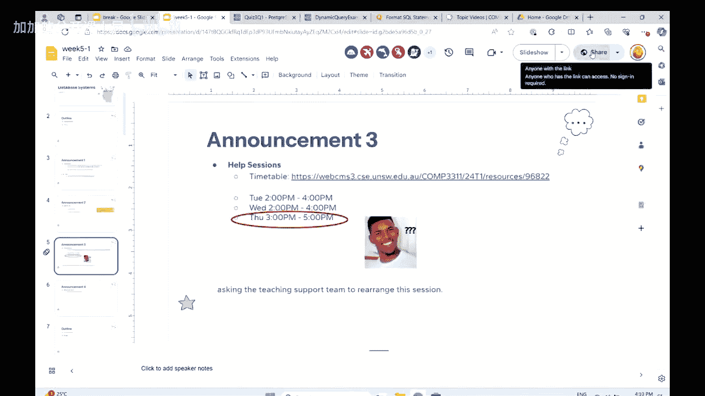
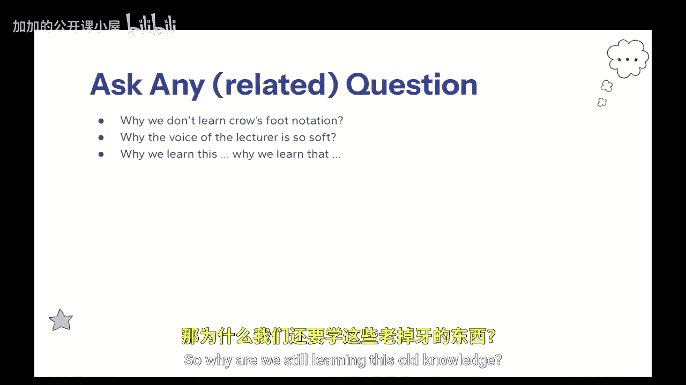

# 新南威尔士大学【中英⚡数据库系统｜COMP3311 2025 Database system】 p09 P9 Lecture 1 (recap - first half of the course) -BV1dV4HzTE7p_p9-

，Alright， let's start。So today， we our outline is very simple。

 We only have some announcement and a big recap session。So for announcement 1 is for assignment 1。

 So most of the specific questions are released， except for question 10。

 we are still working on it because Dlan is creating some corresponding testing scripts for all the questions。

 we need to make sure that the， the， the questions will work properly under every corner cases。So。

And the submission deadline is before week 6， Friday of week 6。 And and don't forget to。

 to get the free stling mark。So the second announcement is is that very I is related to quiz 3。

 question 1， so。Today， some students are were asking about the correctness of option E。

So Y E is not correct。Actually， there is a， there's a special case where the value of x。

 the name of x could be now。So let's see an example here。Actually。

 this is how you can do these programming quizzes。 You can just run the SQL statements on somewhere and test out the。

 the results。So。😔，The， the question gives us two tables。 So X。Has。😔，A name which is unique。

 but it doesn't say name is not now。Remember， now is a special value。 It could match。

to most of the cases， it， it belongs to any domain。 So， so， so x， the name of x is allowed to be。

 to be of now values。So this is the key thing here。And for， for why it's just。

 I I it's just another table which has a reference to X I D。And since。

The name of X is not specified as not now。We can't insert now values into x。And in this case。

 we have inserted2 x，2 x entries with now， no value as the name。And we populate the table for y。

So so let's run this E and B and see their differences。So。As you can see。呃，X。

E is wrong because it's not dealing with the nu value correctly。So only one is counted here。

Only one is counted here。However。It should be two because we have inserted two x with now values。 So。

 so the， the， the the， the， the arrow here is because。Is because it's selecting distinct x value。

 And although X could be is specified as unique。It could take the value of now。

 and two nu values equal are equal to each other。 So that's why this， this， this one will give us。

what W how no matter how many X values have the name now as its name， it will only give us one。

 So that's why E is not correct。He is not correct。And I don't know why some some of you were answering this。

 This is， this one was post was a question posted by one of the students。

 And another student answered by saying that in the previous term， the， the quiz was。

 there was something。 And I don't know why you have access to the to WebCMS S of previous terms。

 this shouldn't。 You shouldn't have access to that。And。That's about。Question。Asssement 1。

 assignment announcement 2， O。That's our， our。

Oh， sorry。

That's announcement， too。 So， so the， the results of， the results of the marks are your question。

 your answers are marked according to the the the， the correct answer。

 So only B is the correct option for question1。 So it is not correct。 So So the mark has no problem。

And for help sessions， last time one of you pointed out that we have。

 there's an overlapping on Thursday with our lecture。 and I will。

 I have informed the teaching support team to rearrange this help session。And see。

 let's see how he responds。And our last announcement today is that there's no quiz this week。

 so you can focus on your assignment 1。And now， let's have a recap of。

All we have all we have learned since the start of this course。嗯。

And here are some sta interesting statistics。 So for quiz1 and quiz 2。

 the average mark is about since some of you may have known that we are inheriting all the quizzes from previous terms。

 So quiz1 and quiz 2， the average mark is about 3 to per 4% better than previous term。

Andquiz3 average mark is about 10% better。 And that's very good。And。

And the bad thing is the the average mark is dropping quiz by quiz。 So I hope you。

 I hope you could stop this trend。 although it， it sounds like the cost content is getting harder and harder。

 But just now like what I've shown you with the question  one of quiz 3。

 you can just try out on your own laptop。 you can just execute the programs。

 So it shouldn't be that it shouldn't be harder than quiz12。😔。

So I hope you could stop this dropping trend。And， and there are， there's。

 there are always about 10% of the students。Who never do any quiz in every term。

 And I don't know why， because we are trying our best to。Get all the students notified。 And。

 but still， like 10% of the students never do any quiz。And for this course， for marking。

 we don't use things like bell curvebs。 So， so each one of you you。

 your mark is not affected by your peers， so。So help each other and。

And I already saw that some of you are actively answering questions on the forum for other students。

 And this is very nice。And here are some statistics。 So we have some top askers。

 and we have some And Dlan is very helpful。 He's answering a lot of questions。

 and we have some students answering questions for others as well。And yeah。

 some of I'm viewing the forum almost every day。 And， and some students。

 you even received some hearts for answering questions for others。

 But I think some of the students here， they receive hearts because they post some memes on the。

Forum。And。And for for talk when talking about asking questions。

So you can ask almost any question as far as is related to this course。So you may ask。

 why don't we learn cross foot notation， So you can also ask about the Mac problem or the the。

 the sound effect for the recording。 I don't know if this one， because I'm using， you see。

 I'm using the handheld Mac today。I don't know if will， it will sound better in the recording or not。

 but let's see。 So you can ask any question。 and you can ask why we learn some content。

 why we learn some certain topic， right in in 2024。

 So why are we still learning these some old knowledge， You can ask almost。

