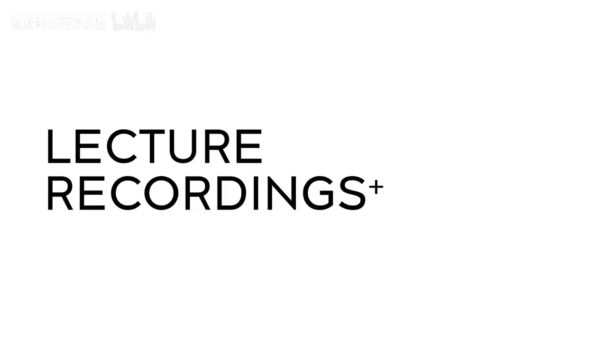
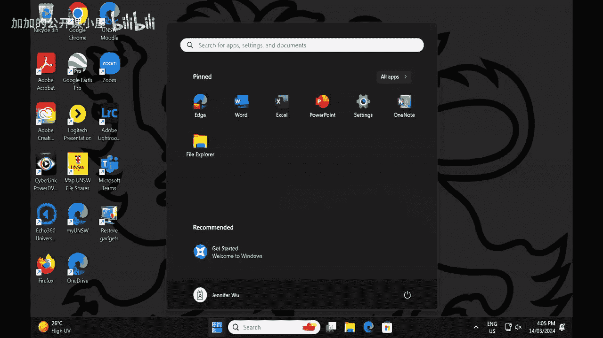
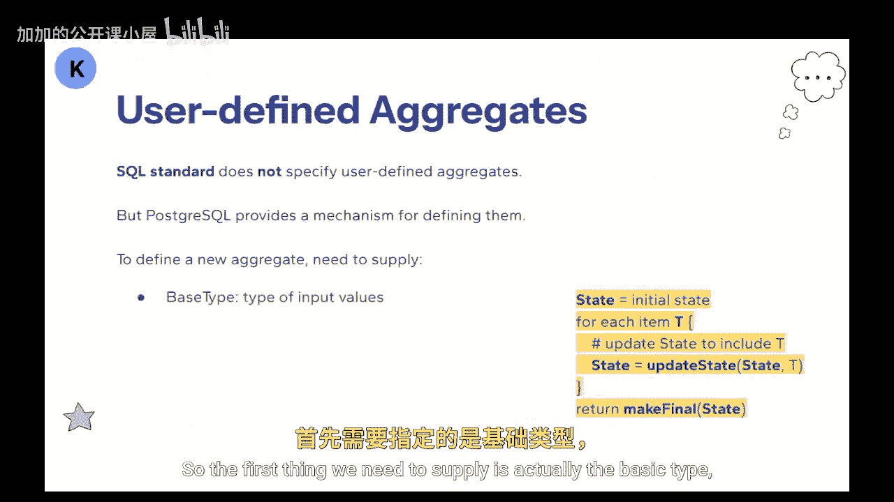

# 新南威尔士大学【中英⚡数据库系统｜COMP3311 2025 Database system】 p10 P10 Lecture 2 (User-defined Aggregates & Triggers) -BV1dV4HzTE7p_p10-

。

呃，All right嗯。I think they just had an examination before us。

 So the temperature in this lecture theatre is now is quite hot。And。And the air， I I'm not sure if。

 if it is working correctly or not。The， the air for this L T。But let's see。

 Let's start today's lecture。So this is today's outline。 So we will go through some announcements。

 A roadmap and I and learn more about the features of Postgs。

So the first an announcement is related to。Assignment 1。 So th the the th。

 the specification for question 10 is still not released yet。

But we will be releasing it today or tomorrow。And the submission deadline is before 10 PM next week。

 and you can submit after you can still submit after the deadline。

 but you will get penalties the later you submit。And。

And some of the students are posting some threads on the forum， saying that they， they， they。

 they have some issues with the auto test。Scrs。 so Y， the auto test。

 the purpose of the auto test script is not to give you a mark before you， before your submission。

 iss just to make sure that your， your SQL queries could work。Proly could what could functional。

 could be functional。It doesn't cover every kind case。So it's don't fully rely on this auto test。

And another thing is to just repeat again， you can get the free styling mark by styling your submissions。

And another， another thing here is for ELP students for those students with accessibility issues。

 You should send us extension requests for this assignment before，24 hours before the deadline。

 anything later than that won't be precise。And the second announcement is about the help sessions。

 We are holding some help sessions， and， but。But one of them has a collision with today's lecture。

 So it's still。they are the， the teaching spot support team is still dealing with this collision here。

And the third announcement is there's no quiz this week。 And the next week is flexibility week。

 So there's no lecture， no tutorials， no quiz。 You can do your assignment。

And I suggest you to use this time to。Relearn Python because we will be using Python in the second half of this term。

 and you will be using it for your assignment， too。So you should take this time to relearn Python。

And this is the road map for this Co this course。 So what we have learned are data modeling。

 the some basic SQL functions。Orqueries。And what we will be learning are more SQL features。And。

In week 7。We will be using。 We will be learning how to use programming languages to interact with these database management systems。

 Postg in particular。 So the programming language we will be using is Python。

 and we will release assignment to。By the end of week 7。

 and it is related to using to writing some Python scripts for dealing with SQL queries。And in w8。

 since we already learned the basics of SKL， the basics of how to use programs to interact with the database management systems。

 we will touch some theoretical part of database management systems。

 So we will be learning some relational design series on w8。And now week9。

 we will be learning some relational algebra。 That is also some theoretical topic。And。

And the expected deadline for submitting your 7 2 is by the end of week 9。

 but we may defer to week to give you more time because we are considering reusing a database that was once used before in one of the previous terms。

 And it was complained by the students as being too complex。

 But I think you will be able to handle that。 And it a very interesting database。 And we will。

 And I think you will be able to handle that。 And we will try to modify the questions to make it less hard。

 less complex for you to deal with。And on week 10 is our last week。

 We will be learning some transactions managed by database management systems。

 and we will have a course review。And there will be a guest lecture from some。

 some experts from the industry。And but， but on weekend， Im。

 I might be going for a conference outside Sydney and， and I will。Provide you lecture videos， if so。

So， that's our road map。Now， let's jump into the main content today。

 So the first topic we are going to cover today is called。Agggregates。

 so we have already learned aggregations， actually。So， these aggregation operators。

Are used to reduce a collection of values into a single value。

So here are some examples of the argregigation operators we have learned。We have learned count。

 which is used to count the numbers of items inside the toppo the number of topples， actually。

Because we also learned some， which is operating on numeric values to give the sum of the list of values。

And there's also。An aggregation operator called Max。

 which is to get the maximum value out of a set of values。

And the action or semantic of an aggregation function could be viewed like this。

 So we have an initial state。And for， and then we iterate through the entire list of items or values。

 And for each one of the。New that the， the item we have encountered， we use it to update the state。

after that。We will。 We will。 We may modify the state and return it to the user。So， that's。

The semantic of an aggregation function。 That's the suit is more like a pseudocode for how to implement this。

And， and， and aggregations are commonly used with together with group by。

 So I hope you can still remember the restrictions of using group buy。And in that context。

 they are used to summarise or provide some sum summarizations for each group。And today。

 what we are going to learn the， the new knowledge we are going to learn today is。

User defined aggregates。 So other than the standard SQL aggregates， we。

Postgs provide a mechanism for to allowing users to define their own。Agregation functions。

So to define a new aggregate or a new aggregation function， the。

 the user need to supply the following things。 But before we consider what， what。

 what I needed to be supplied， let's think about the pseudo code here。So， how the。

All the materials for creating a customized aggregation are coming from this algorithm or this pseudo here。

 so。So the first thing we need to supply is actually the basic type。

 which is the type of the tea here， the each。

