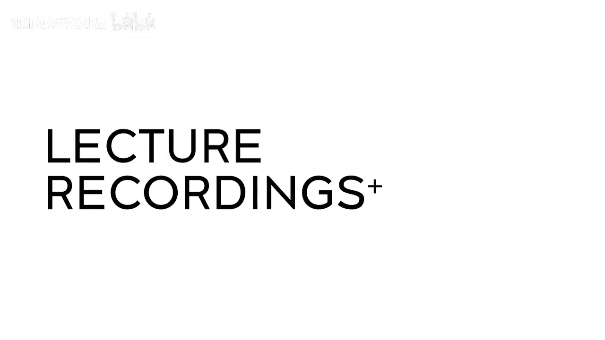
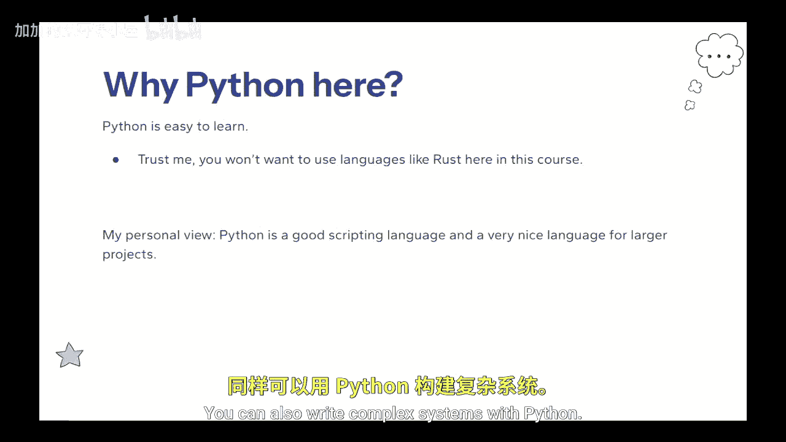

# 新南威尔士大学【中英⚡数据库系统｜COMP3311 2025 Database system】 p11 P11 Lecture 1 (Python and psycopg2) -BV1dV4HzTE7p_p11-

。

All right， let's start today's lecture。So， here's today's outline。

We will go through some announcements first， and then we will go through a road map of what will be covered in the next few weeks。

And then we will have a quick recap of the basics about， about Python。

 and then we will learn a python module that is used to interact with Postgres。

So the first announcement is about assignment 2。 So the specifications will be released later this week。

 and the due date is to be determined。 but we will make sure that you will be given。

More than two weeks for finishing your assignment， too， and。

Dilan and I are still discussing about which database to be used。

 but definitely it will be an interesting one。And， and this assignment is for you to practice how to use Python to interact with Postgs。

And so you will be using Python for this assignment。And。

Please try to do the assignments earlier and ask questions on the forums earlier。

 because in the last one or two days before the due date of assignment 1。

 we received a lot of questions。 and we can't， we can't answer everyone very well because there are just too many questions。

 So if you ask the questions earlier， there's a better chance for your question to be better answered。

😔，And yeah， there are staffs and some help， helpful peers on the forum to help you to answer your questions。

And the set up guide is released earlier than the questions。

 So make sure you try to set things up earlier because on the last day。

 a few hours before the deadline。 we received some th Pri rise about talking about some issues of setting up or connecting the database on V XD2。

 So that's very bad。 actually， you you， you can't finish everything in the last few hours。

 And so try to set things up earlier。And。And the last thing here about assignments。

You should use private posts。To post their code。 So some students。

 they ask about the bugs or issues inside their code。 but they。

 they just post the code to the forum without marking it as private。 So everyone。

 every other student will can see their code this is bad。 So try to use private co posts。

 If you really want to discuss your code with us。So that's about the assignments。 The second。

 the second announcement is about quiz。 So in this week， we have quiz 4。

And the due date is this Friday。 So just do it。And the。

 the last announcement today is about help session。 So the Thursday help session has an over。

 it is overlapping with the lecture， and is， it is to be shifted to 11 AM to 1 PM on Thursday。

But when it will be officially Fish shifted is we need， we need to wait。

So that's all about the announcements。 And let's look at the road map。So today。

 we will in previously， we have learned。All about SQ L。 So we know how to， how to write queries。

 how to write functions， triggers。呃。Within the postg。 And now today。

 we are going to learn how to use programming languages to interact with D B the， these databases。

 So this is what we are going to learn today。 and then。We will learn more about。Some serious。

Theoretical aspects。And， and lastly， we will also learn some transactions and concurrency controls of database systems。

 which is useful when multiple users are using the same database。And。

 and then we will wrap up by talking about the future of database， having a review of the course。

And having a preview for the further exam。 And perhaps we will have a guest lecturer from the industry to T。

 to tell you more about how they use database in practice。But on week 10。

 I will be traveling for conference。 so， but I will prepare the lecture videos for you。And now。

 let's jump into the main content today。So。As I just mentioned。

 we will be using Python for this course。 And I hope that this is a recap for you。

 So I hope that you are familiar with Python before taking this course， even。

 So Python is a very popular programming language。It is very easy to learn to use， and it。

 it has a wide range of useful libraries。 And today。

 it is particularly useful because because of the popularity of artificial intelligence。

 because there are a lot of AI libraries。呃，被伤拍成。And in this course。

 we assume that you know enough about pattern basics。And I hope so。

Because the primary topic for this course is steel database， not personython programming。

And and if you are not。Overly familiar with Python before。 you don't need to worry。

 So there will be many coding examples。about Python in this course。

 And there are many excellent online tutorials。 for example， learn Python dot org。So。

 you can learn it。😔，quick very quickly， so。So we are going to learn how to use programming languages to interact with。

The database。But why do we choose Python as the programming language here。

 So the first reason is that Python is a very popular programming language。So。

 according to a very new。呃 rankingking。Python is the most popular programming language。

And followed by CC plus size。 and this is， this is kind of rated by some programmers in the community。

 And it is not。Just count counting the the amount of code on Github。

 and because that's why cLC plus fast is ranked a little bit higher here because they are very。

 very important for building the infrastructures like the operating systems like the。

 the actual code of Postgres are written in CC plus fast。

But still Python is the most important one here。 And can you find IQR on this list on this ranking。

Yes， yes， it is ranked and the 7 in this March。So we are learning some very popular programming languages here。

 and they， they are both very， very useful。So the second reason here is。

Why we choose Python is Python is relatively easy to learn， so。Trust me。

 you don't want to use languages like rust for these course。 So so Python is the。

 the re A arguably the most the easiest one here。 So that's why we use Python。And for me。

 I think patterny is a good scripting language。 And it is also a good language for building large systems。

 for example。You can write some shell scripts and for。

 to for some utility for some utilities like batch renaming of files or just manipulating some some some files in your operating system。

 So you can use shell script， but you can't use shell script for writing a large server So that that's what you can't do。

 And you can use C or C plus files or ja to write a to write a web server。

 but you can't use normally you don't use them to to do to to write some basic utilities。

 And Python is like jack of or trade。 So it it can it can you can write scripts with python。

 You can also write complex systems with python。 And there are many famous frameworks built with python for example。

